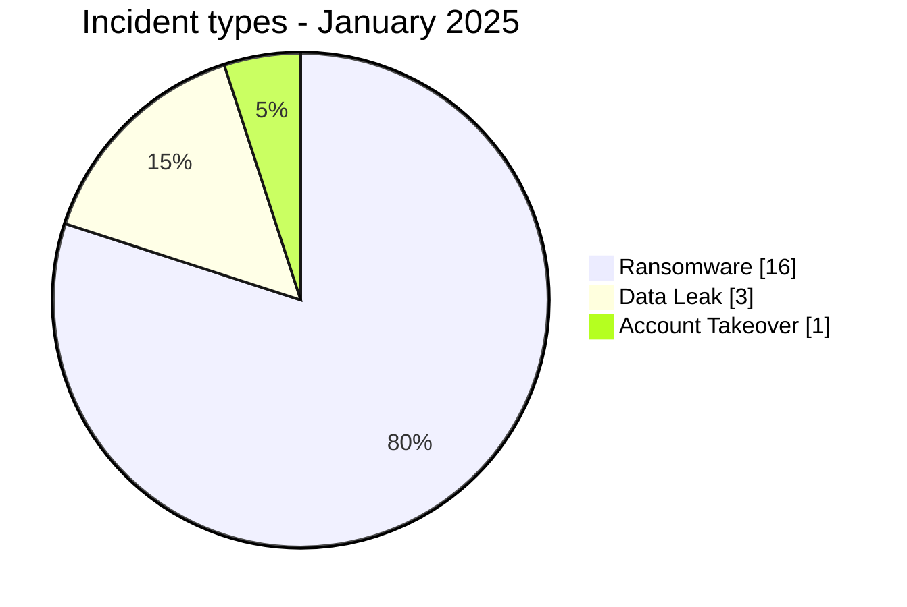
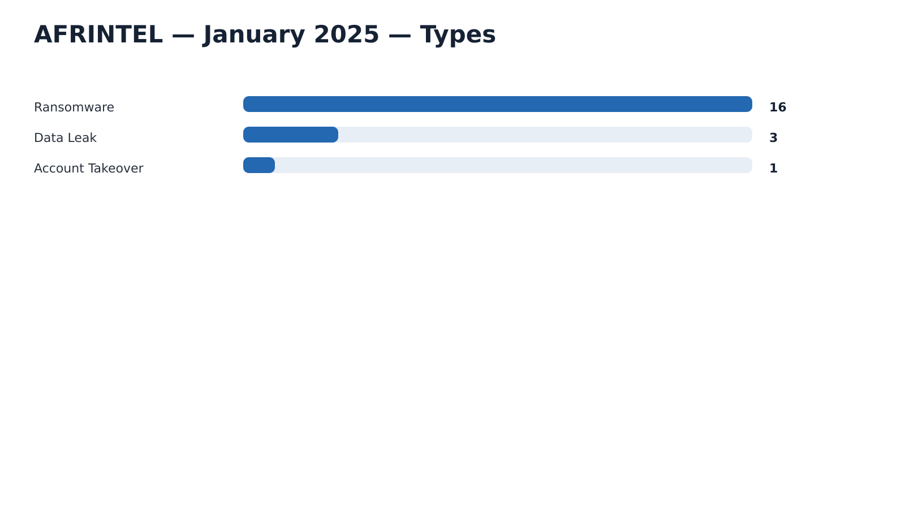
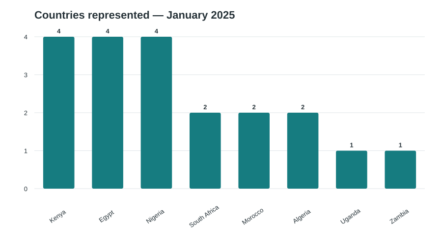
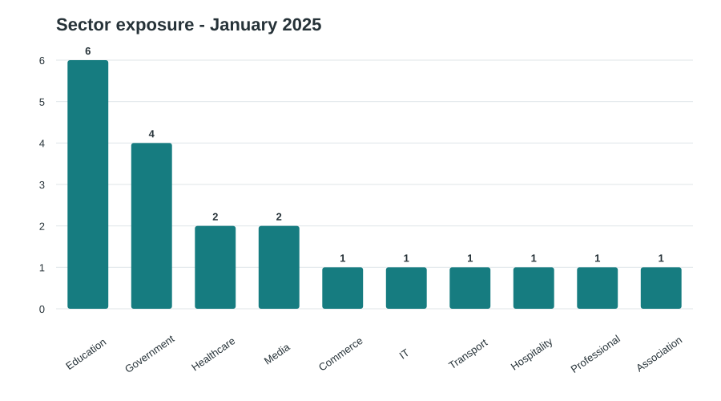
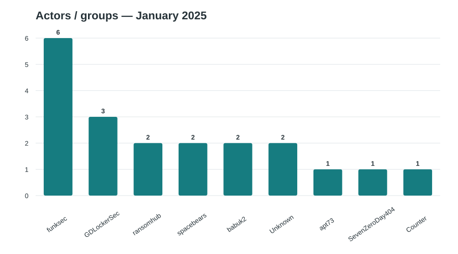
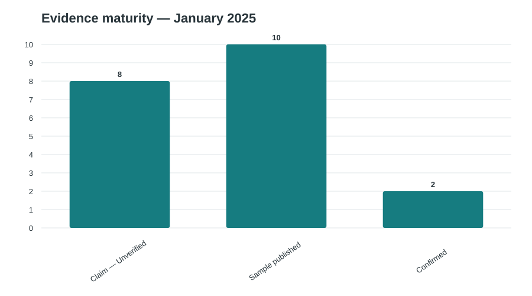

# AFRINTEL | Monthly cyber threat intelligence report
## Cyber threats targeting African organizations, January 2025

   

**Audience:** CISOs, risk leaders, SOC/CERT managers and business continuity owners.
**Period covered:** 1-31 January 2025, based on documented publications and events.
**Distribution:** TLP:CLEAR.
👉🏾 [Version française](./README_FR.md) | [Detailed French records](./victims_FR.md) | [English corpus](./victims.md)

> **Evidence methodology - how to read this report.** AFRINTEL distinguishes observed publications, samples actually examined, corroboration and official confirmation. A ransomware claim alone does not prove encryption, complete exfiltration or the announced volume. Raw personal data, secrets and identifiers are not reproduced.

## 1. Executive summary

In January 2025, AFRINTEL documents **20 cyber incidents** affecting organizations and digital services across **8 African countries**.

The landscape is dominated by **Ransomware with 16 records (80.0%)**, followed by **Data Leak with 3 (15.0%)**. Other observed types are Account Takeover 1.

Geographic concentration is significant: **Kenya (4)**, **Egypt (4)**, **Nigeria (4)** together account for **12 records, or 60.0% of the month**. This concentration reflects AFRINTEL corpus visibility rather than an exhaustive national compromise rate.

At sector level, the most represented categories are **Education / University (6)**, **Government / Administration (4)**, **Healthcare / Medical (2)**. The most frequent actor labels are `funksec` (6), `GDLockerSec` (3), `ransomhub` (2). `Unknown`, when present, denotes missing attribution rather than a threat actor.

Evidence maturity remains variable: **18 records** are unverified claims or claims accompanied by samples. AFRINTEL maintains a strict separation between **observed facts, claims, corroboration, official confirmation, and technical unknowns**.

Compared with the final corrected December 2024 baseline, monthly volume **increases by 2 records, from 18 to 20 (+11.1%)**. Ransomware rises from 11 to 16 (+5), while Data Leak moves from 5 to 3 (-2), Access Sale falls from 1 to 0 (-1), and Defacement from 1 to 0 (-1). Account Takeover appears with 1 record in January.

> **Reading note:** AFRINTEL figures describe documented incidents and the visibility of observed threats. They are not an exhaustive measurement of every cyberattack that actually occurred across Africa.

### 1.1 Month-over-month comparison

| Indicator | Final corrected December 2024 | January 2025 | Change |
|---|---:|---:|---:|
| Total incidents | 18 | 20 | **+2 (+11.1%)** |
| Ransomware | 11 | 16 | **+5 (+45.5%)** |
| Data Leak | 5 | 3 | **-2 (-40.0%)** |
| Access Sale | 1 | 0 | **-1 (-100.0%)** |
| DDoS | 0 | 0 | **Stable** |
| Defacement | 1 | 0 | **-1 (-100.0%)** |
| Account Takeover | 0 | 1 | **+1 (new)** |
| System Intrusion | 0 | 0 | **Stable** |
| Malware | 0 | 0 | **Stable** |
| Operational Fraud | 0 | 0 | **Stable** |

> **Comparison basis:** December 2024 uses the final AFRINTEL 2024 baseline after chronology review, reclassification, and integration of validated 2024 cases. All nine incident types are therefore directly comparable with January 2025.

## 2. Scope, method and limitations

- **Scope:** 54 African countries; reference period: January 2025.
- **Source of truth:** validated `victims_FR.md` / `victims.md` pair.
- **Classification:** Ransomware, Data Leak, Access Sale, DDoS, Defacement, Account Takeover, System Intrusion, Malware, and Operational Fraud.
- **Counting:** one canonical record equals one documented cyber incident; cases under investigation remain outside statistics.
- **Timeline:** `Incident date` and `Initial publication date` remain separate. A later disclosure does not artificially move an incident into another month when chronology is sufficiently supported.
- **Uncertain dates:** when no exact day is known, the evidence-supported month or time window is retained.
- **Sources:** public links are retained for supplementary incidents found through OSINT/web research; they are not retroactively imposed on historical or direct Dark Web observations.
- **Evidence:** incident type, status, confidence, impact, and provenance remain separate dimensions.
- **Sectors:** normalization is calculated once from the structured corpus and used identically in FR and EN.
- **Limitation:** frequencies reflect AFRINTEL visibility rather than every real compromise on the continent.

### AFRINTEL validation protocol

| Case type | Examination | Scope of finding |
|---|---|---|
| Ransomware / extortion | Publication, timeline, accessible files or previews and victim context | Publication and available evidence; encryption, initial access and total volume remain separate questions. |
| Data leak | Structure, fields, dates, observed volumes and sample consistency | Data actually examined; no automatic validation of the full announced dataset. |
| Claim without usable sample | Source, date, named organization and available public corroboration | Existence of the claim only. |
| Acknowledged incident | Victim or authority statement, within its exact scope | Facts confirmed by the source, without extending confirmation to actor assertions. |

The `victims_FR.md` / `victims.md` pair is the bilingual source of truth. The 20 records in each language were checked in the same order; report totals are derived from the French version and checked against the English version.

## 3. Overview and incident types

| Indicator | Value |
|---|---:|
| Documented incidents | **20** |
| Countries represented | **8** |
| Regions represented | **4** |
| Leading country | **Kenya (4)** |
| Leading sector | **Education / University (6)** |
| Leading actor label | **funksec (6)** |

| Incident type | Records | Share |
|---|---:|---:|
| Ransomware | 16 | 80.0% |
| Data Leak | 3 | 15.0% |
| Access Sale | 0 | 0.0% |
| DDoS | 0 | 0.0% |
| Defacement | 0 | 0.0% |
| Account Takeover | 1 | 5.0% |
| System Intrusion | 0 | 0.0% |
| Malware | 0 | 0.0% |
| Operational Fraud | 0 | 0.0% |
| **Total** | **20** | **100%** |

## 4. Geographic and regional distribution

| Country | Total | Ransomware | Data Leak | Access Sale | DDoS | Defacement | Account Takeover | System Intrusion | Malware |
|---|---:|---:|---:|---:|---:|---:|---:|---:|---:|
| Kenya | **4** | 2 | 1 | 0 | 0 | 0 | 1 | 0 | 0 |
| Egypt | **4** | 4 | 0 | 0 | 0 | 0 | 0 | 0 | 0 |
| Nigeria | **4** | 3 | 1 | 0 | 0 | 0 | 0 | 0 | 0 |
| South Africa | **2** | 1 | 1 | 0 | 0 | 0 | 0 | 0 | 0 |
| Morocco | **2** | 2 | 0 | 0 | 0 | 0 | 0 | 0 | 0 |
| Algeria | **2** | 2 | 0 | 0 | 0 | 0 | 0 | 0 | 0 |
| Uganda | **1** | 1 | 0 | 0 | 0 | 0 | 0 | 0 | 0 |
| Zambia | **1** | 1 | 0 | 0 | 0 | 0 | 0 | 0 | 0 |
| **Total** | **20** | **16** | **3** | **0** | **0** | **0** | **1** | **0** | **0** |

> `Malware` and `Operational Fraud` are zero this month and are omitted from the geographic matrix for readability.

| Region | Records | Share |
|---|---:|---:|
| North Africa | 8 | 40.0% |
| East Africa | 5 | 25.0% |
| Southern Africa | 3 | 15.0% |
| West Africa | 4 | 20.0% |
| **Total** | **20** | **100%** |

The leading region is **North Africa with 8 records (40.0%)**.

## 5. Sector exposure and business risks

| Sector | Records | Share | Main business risks |
|---|---:|---:|---|
| Education / University | 6 | 30.0% | student data, service disruption |
| Government / Administration | 4 | 20.0% | identity, public services, trust |
| Healthcare / Medical | 2 | 10.0% | care continuity, confidentiality |
| Media / Entertainment | 2 | 10.0% | accounts, content and reputation |
| Retail / E-commerce | 1 | 5.0% | customer data, transactions, fraud |
| Technology / IT | 1 | 5.0% | technical access, propagation |
| Transport / Logistics | 1 | 5.0% | operational continuity, suppliers |
| Hospitality / Tourism | 1 | 5.0% | reservations, customer data |
| Professional / Business Services | 1 | 5.0% | contracts, impersonation |
| Religious Organization / Association | 1 | 5.0% | accounts and member data |
| **Total** | **20** | **100%** | |

## 6. Actors, groups and evidence maturity

`Unknown` denotes missing attribution, not a threat actor.

| Actor / Group | Records | Activity |
|---|---:|---|
| funksec | 6 | ██████ |
| GDLockerSec | 3 | ███ |
| ransomhub | 2 | ██ |
| spacebears | 2 | ██ |
| babuk2 | 2 | ██ |
| Unknown | 2 | ██ |
| apt73 | 1 | █ |
| SevenZeroDay404 | 1 | █ |
| Counter | 1 | █ |

### 6.1 Evidence maturity

| Evidence maturity | Records | Share |
|---|---:|---:|
| Claim - Unverified | 8 | 40.0% |
| Claim - Data Sample Published | 10 | 50.0% |
| Victim/Government/Authority Confirmed | 2 | 10.0% |
| **Total** | **20** | **100%** |

Evidence statuses describe the available validation level; they do not change the technical incident type.

### 6.2 Risk-area assessment

| Area | CISO monitoring priority | Corpus-based rationale |
|---|---|---|
| Kenya, Egypt, Nigeria | High | Four records each, representing 60.0% of observations. |
| North Africa | Reinforced | Eight records and a strong presence of ransomware claims. |
| Education and administration | Reinforced | Ten records combined, involving sensitive data and services. |
| Other countries and sectors | Targeted | Case-by-case monitoring based on victim sensitivity and evidence quality. |

These priorities apply to the documented corpus and are not an official ranking of national cyber risk.

## 7. Observation timeline

```mermaid
timeline
    title AFRINTEL - January 2025
    06 January 2025 : Molars Dental Practice
    09 January 2025 : General Authority for Government Services
    09 January 2025 : Pick n Pay (pnp.co.za)
    11 January 2025 : SEOCOM Marrakech (seocommarrakech.com)
    13 January 2025 : Living Seed (livingseed.org)
    14 January 2025 : INTELS Nigeria Limited (intelservice.com)
    14 January 2025 : Sharm Reef Hotel
    15 January 2025 : Misr Technology Services (MTS / mts.gov.eg)
    16 January 2025 : North-West University (NWU)
    21 January 2025 : Barika University Center (cu-barika.dz)
    21 January 2025 : Inaya Clinic (inayaclinic.org)
    24 January 2025 : Lower Niger River Basin Development Authority (LNRBDA)
    24 January 2025 : Sidi Mohamed Ben Abdellah University (www.usmba.ac.ma)
    26 January 2025 : Achievers Journal of Scientific Research
    26 January 2025 : FGSE, Cairo University (fgse.cu.edu.eg)
    27 January 2025 : QED (qed.co.ug)
    27 January 2025 : Workers (workers.com.zm)
    27 January 2025 : Zetech University (zetech.ac.ke)
    31 January 2025 - reported date : Business Registration Service (BRS)
    31 January 2025 : Kenya Broadcasting Corporation (KBC)
```

## 8. Trends and intelligence gaps

### CTI trends

**16 records** are classified as Ransomware. Leading countries: Egypt (4), Nigeria (3), Kenya (2). A leak-site listing does not itself prove encryption or complete exfiltration.

### Data exposure

**3 records** are classified as Data Leak. Leading countries: South Africa (1), Kenya (1), Nigeria (1). AFRINTEL distinguishes actually observed data from aggregate volumes claimed by actors.

### Account takeover

**One Account Takeover record** is documented in Kenya. This category keeps institutional-account compromise distinct.

### Priority intelligence gaps

| Gap | Effect | Expected verification |
|---|---|---|
| Initial access vector | Limits attribution and technical tracking | IAM, VPN, EDR, WAF logs and DFIR timelines |
| Actual exfiltrated volume | Risk of overestimating exposure | Inventory, deduplication and reliable sampling |
| Remediation and root cause | Limits residual-exposure assessment | Technical statements and post-incident reports |
| Label attribution | A pseudonym may be confused with an intrusion group | Independent corroboration and documented infrastructure |

## 9. Incidents to retain for the security committee

| Country | Organization | Type | Status | Impact | Confidence |
|---|---|---|---|---|---|
| Kenya | Business Registration Service (BRS) | Data Leak | Government Confirmed | Level 4 | Very High |
| Nigeria | Lower Niger River Basin Development Authority (LNRBDA) | Ransomware | Claim - Data Sample Published | Level 4 | Very High |
| Uganda | QED (qed.co.ug) | Ransomware | Claim - Data Sample Published | Level 4 | Very High |
| Kenya | Kenya Broadcasting Corporation (KBC) | Account Takeover | Victim Confirmed | Level 3 | High |
| Kenya | Molars Dental Practice | Ransomware | Claim - Data Sample Published | Level 3 | High |

> This table highlights five records using structured impact, confirmation, and confidence fields. It is not an absolute severity ranking.

## 10. MITRE ATT&CK: defensive mappings

The mappings below support defensive hunting; they are not technical attribution for every case.

| Technique | Evidence level | Associated risk | Telemetry |
|---|---|---|---|
| [T1486 - Data Encrypted for Impact](https://attack.mitre.org/techniques/T1486/) | Defensive hypothesis linked to ransomware claims | Encryption and unavailability | EDR, file logs, backups |
| [T1078 - Valid Accounts](https://attack.mitre.org/techniques/T1078/) | Defensive hypothesis for ATO | Abuse of legitimate accounts | IAM, MFA, VPN, AD |
| [T1005 - Data from Local System](https://attack.mitre.org/techniques/T1005/) | Hypothesis for leaks | Collection of documents and databases | EDR, file auditing, DLP |
| [T1567 - Exfiltration Over Web Service](https://attack.mitre.org/techniques/T1567/) | Hypothesis; channel not established | Abnormal outbound transfers | Proxy, DNS, cloud, network |

## 11. SOC operational plan: detect, qualify, contain

| Use case | Signals to correlate | Defensive action |
|---|---|---|
| Suspicious encryption | Mass renames, backup deletion, ransom note | Isolate hosts, protect backups, preserve evidence |
| Abnormal privileged access | Off-hours logins, role changes, unusual MFA | Revoke sessions, reset accounts, strengthen controls |
| Mass export | Large reads, archives, increased egress | Restrict egress and trigger the data-response plan |
| Compromised institutional account | New devices, unusual geography or activity | Out-of-band verification, rotate secrets, review logs |
| Public-service integrity | Unplanned content or CMS-admin changes | Restore from a trusted source and audit admin access |

**Recommended workflow:** timestamp the alert → consolidate by identity/host/service → qualify `observed / hypothesis / unknown` → contain proportionately → notify CISO and business owners → preserve evidence.

## 12. Prioritized CISO roadmap

| Horizon | Priority | Expected action | Implementation evidence |
|---|---|---|---|
| 0-72 hours | P0 | Review privileged accounts, MFA, VPN, backups and public services | Access review and restore test |
| 7-30 days | P1 | Deploy ransomware, mass-export, ATO and web-integrity detections | Active rules and detection tests |
| 30-90 days | P1 | Exercise a combined outage and data-leak crisis | Exercise report and tracked actions |
| 30-90 days | P2 | Industrialize CTI monitoring and FR/EN synchronization | Parity controls and source traceability |

## 13. Recommendations

### Organizations

- enforce phishing-resistant MFA on privileged accounts, VPN, email, social media, and administration consoles;
- apply PAM, least privilege, segmentation, and secret rotation;
- maintain immutable backups and test restoration;
- strengthen public applications, APIs, and administration interfaces;
- formalize incident response and data-breach notification.

### SOC and detection

- monitor abnormal authentication, MFA changes, privileged-account creation, and role elevation;
- detect mass database reads, unusual exports, archive creation, and large outbound transfers;
- correlate EDR, IAM, VPN, WAF, proxy, DNS, cloud, and application logs;
- distinguish DDoS, internal intrusion, account compromise, and data exposure to avoid unsupported conclusions.

### CTI

- keep incident date, initial publication, first observation, sample, disclosure, and confirmation separate;
- track republication and resale without automatically counting them as new compromise;
- preserve the evidence hierarchy between claim, corroboration, and confirmation;
- validate FR/EN parity before generating statistics.

## 14. Conclusion

**January 2025** contains **20 documented cyber incidents** across **8 African countries**. The monthly CTI value lies not only in volume but in separating **incident type, timeline, evidence level, geography, sector, and actor**.

The report therefore preserves a structured picture of the observable threat environment while keeping claims, corroboration, confirmations, and unknowns at their actual evidence level.

👉🏾 [See monthly victims](./victims.md)

**AFRINTEL** - TLP:CLEAR
