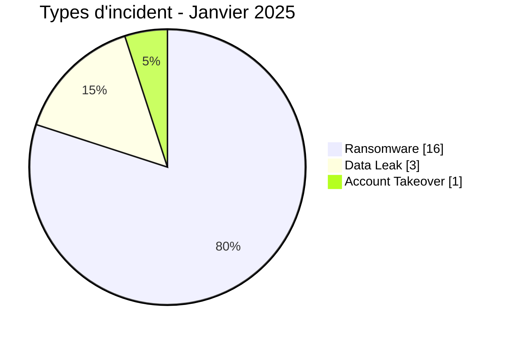
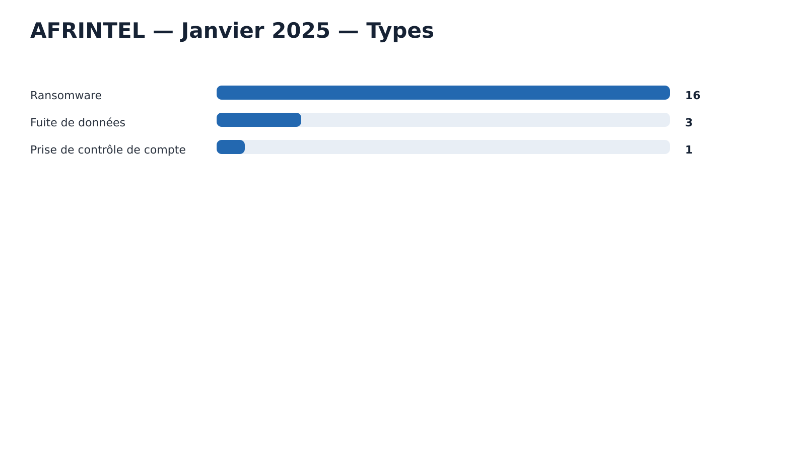
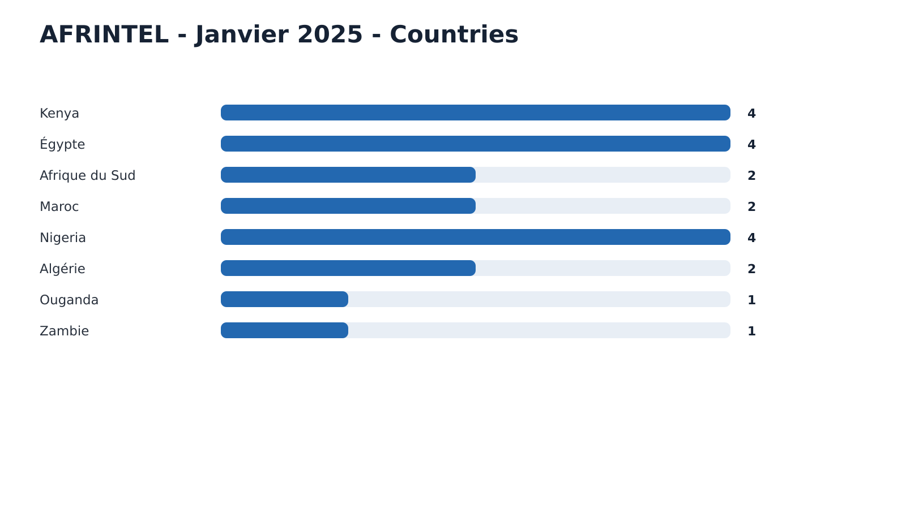
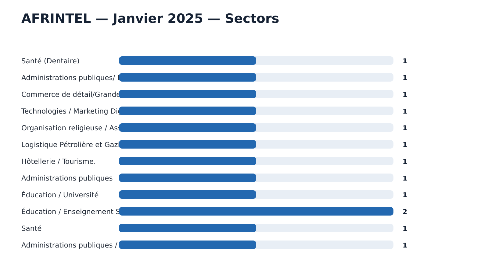
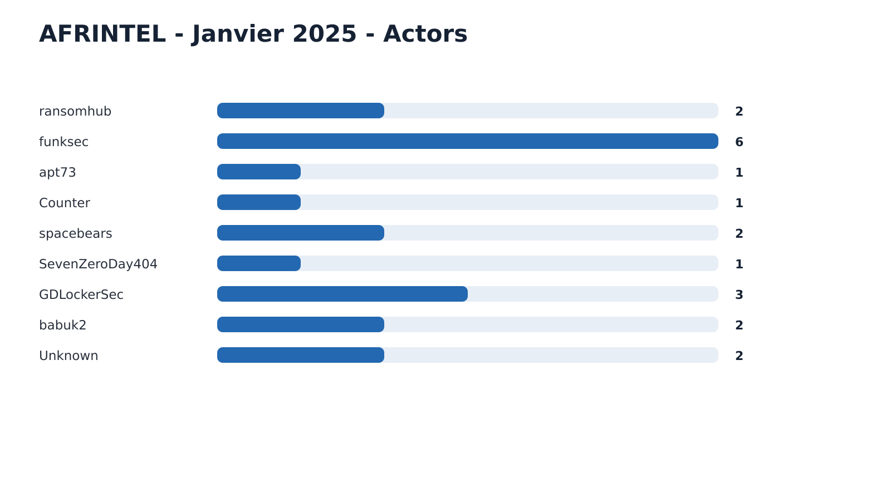
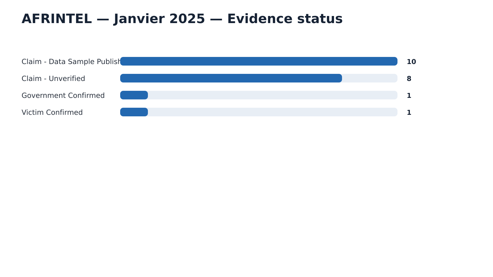

# AFRINTEL | Rapport mensuel de cyber threat intelligence
## Cybermenaces visant les organisations africaines, janvier 2025

   

**Public cible :** RSSI, directions des risques, responsables SOC/CERT et responsables de la continuité d'activité.
**Période étudiée :** 1er au 31 janvier 2025, selon les publications et événements documentés.
**Diffusion :** TLP:CLEAR.
👉🏾 [English version](./README.md) | [Fiches détaillées en français](./victims_FR.md) | [Corpus anglais](./victims.md)

> **Méthodologie de preuve - lecture du rapport.** AFRINTEL distingue les publications observées, les échantillons effectivement examinés, les corroborations et les confirmations officielles. Une revendication de ransomware ne prouve pas à elle seule le chiffrement, l'exfiltration complète ou le volume annoncé. Les éléments personnels, secrets et identifiants bruts ne sont pas reproduits.

## 1. Synthèse exécutive

En Janvier 2025, AFRINTEL documente **20 cyberincidents** affectant des organisations et services numériques dans **8 pays africains**.

Le paysage est dominé par **Ransomware avec 16 fiches (80,0 %)**, suivi de **Data Leak avec 3 (15,0 %)**. Les autres types observés sont Account Takeover 1.

La concentration géographique est marquée : **Kenya (4)**, **Égypte (4)**, **Nigeria (4)** représentent ensemble **12 fiches, soit 60,0 % du mois**. Cette concentration doit être interprétée comme la visibilité du corpus AFRINTEL et non comme un taux national exhaustif de compromission.

Sur le plan sectoriel, les catégories les plus représentées sont **Éducation / Université (6)**, **Gouvernement / Administration (4)**, **Santé / Médical (2)**. Les labels d'acteurs les plus fréquents sont `funksec` (6), `GDLockerSec` (3), `ransomhub` (2). `Unknown`, lorsqu'il apparaît, désigne une absence d'attribution et non un groupe cybercriminel.

La maturité des preuves reste variable : **18 fiches** relèvent de claims non vérifiés ou accompagnés d'échantillons. AFRINTEL conserve une séparation stricte entre **faits observés, revendications, corroborations, confirmations officielles et inconnues techniques**.

Par rapport à la baseline finale corrigée de décembre 2024, le volume mensuel **augmente de 2 fiches, passant de 18 à 20 (+11,1 %)**. Le Ransomware progresse de 11 à 16 (+5), tandis que Data Leak passe de 5 à 3 (-2), Access Sale de 1 à 0 (-1) et Defacement de 1 à 0 (-1). Account Takeover apparaît avec 1 fiche en janvier.

> **Note de lecture :** les chiffres AFRINTEL décrivent les incidents documentés et la visibilité des menaces observées. Ils ne constituent pas une mesure exhaustive de toutes les cyberattaques réellement survenues en Afrique.

### 1.1 Comparaison avec le mois précédent

| Indicateur | Décembre 2024 final corrigé | Janvier 2025 | Évolution |
|---|---:|---:|---:|
| Total incidents | 18 | 20 | **+2 (+11,1 %)** |
| Ransomware | 11 | 16 | **+5 (+45,5 %)** |
| Data Leak | 5 | 3 | **-2 (-40,0 %)** |
| Access Sale | 1 | 0 | **-1 (-100,0 %)** |
| DDoS | 0 | 0 | **Stable** |
| Defacement | 1 | 0 | **-1 (-100,0 %)** |
| Account Takeover | 0 | 1 | **+1 (nouveau)** |
| System Intrusion | 0 | 0 | **Stable** |
| Malware | 0 | 0 | **Stable** |
| Operational Fraud | 0 | 0 | **Stable** |

> **Base de comparaison :** décembre 2024 utilise la baseline AFRINTEL finale après contrôle chronologique, reclassement et intégration des cas 2024 validés. Les neuf types d'incident sont donc directement comparables avec janvier 2025.

## 2. Périmètre, méthode et limites

- **Périmètre :** 54 pays africains ; période de référence : Janvier 2025.
- **Source de vérité :** couple validé `victims_FR.md` / `victims.md`.
- **Classification :** Ransomware, Data Leak, Access Sale, DDoS, Defacement, Account Takeover, System Intrusion, Malware et Operational Fraud.
- **Comptage :** une fiche canonique correspond à un cyberincident documenté ; les dossiers en investigation restent hors statistiques.
- **Chronologie :** `Date de l'incident` et `Date de publication initiale` sont séparées. Une publication ultérieure ne déplace pas artificiellement un incident vers un autre mois lorsque la chronologie est suffisamment établie.
- **Dates incertaines :** lorsqu'un jour exact n'est pas connu, le mois ou la fenêtre soutenue par les preuves est conservé.
- **Sources :** les liens publics sont conservés pour les incidents complémentaires identifiés par recherche OSINT/web ; ils ne sont pas imposés rétroactivement aux observations historiques ou Dark Web directes.
- **Preuve :** type d'incident, statut, confiance, impact et provenance restent des dimensions distinctes.
- **Secteurs :** normalisation calculée une seule fois à partir du corpus structuré, puis utilisée à l'identique en FR et EN.
- **Limite :** les fréquences reflètent la visibilité AFRINTEL et non l'ensemble des compromissions réelles sur le continent.

### Protocole AFRINTEL de validation

| Nature du dossier | Examen | Portée du constat |
|---|---|---|
| Ransomware / extorsion | Publication, chronologie, fichiers ou aperçus accessibles et contexte de la victime | Publication et éléments disponibles ; chiffrement, accès initial et volume total restent distincts. |
| Fuite de données | Structure, champs, dates, volumes observés et cohérence des échantillons | Données effectivement examinées ; pas de validation automatique de la totalité annoncée. |
| Revendication sans échantillon | Source, date, organisation citée et recoupements publics disponibles | Existence de la revendication uniquement. |
| Incident reconnu | Déclaration de la victime ou d'une autorité, dans sa portée exacte | Faits confirmés par la source, sans étendre la confirmation aux assertions de l'acteur. |

Le couple `victims_FR.md` / `victims.md` est la source de vérité bilingue. Les 20 fiches de chaque langue ont été contrôlées dans le même ordre ; les totaux du présent rapport sont dérivés de la version française puis vérifiés contre la version anglaise.

## 3. Vue d'ensemble et types d'incident

| Indicateur | Valeur |
|---|---:|
| Incidents documentés | **20** |
| Pays représentés | **8** |
| Régions représentées | **4** |
| Premier pays | **Kenya (4)** |
| Premier secteur | **Éducation / Université (6)** |
| Premier label acteur | **funksec (6)** |

| Type d'incident | Fiches | Part |
|---|---:|---:|
| Ransomware | 16 | 80,0 % |
| Data Leak | 3 | 15,0 % |
| Access Sale | 0 | 0,0 % |
| DDoS | 0 | 0,0 % |
| Defacement | 0 | 0,0 % |
| Account Takeover | 1 | 5,0 % |
| System Intrusion | 0 | 0,0 % |
| Malware | 0 | 0,0 % |
| Operational Fraud | 0 | 0,0 % |
| **Total** | **20** | **100 %** |

## 4. Répartition géographique et régionale

| Pays | Total | Ransomware | Data Leak | Access Sale | DDoS | Defacement | Account Takeover | System Intrusion | Malware |
|---|---:|---:|---:|---:|---:|---:|---:|---:|---:|
| Kenya | **4** | 2 | 1 | 0 | 0 | 0 | 1 | 0 | 0 |
| Égypte | **4** | 4 | 0 | 0 | 0 | 0 | 0 | 0 | 0 |
| Nigeria | **4** | 3 | 1 | 0 | 0 | 0 | 0 | 0 | 0 |
| Afrique du Sud | **2** | 1 | 1 | 0 | 0 | 0 | 0 | 0 | 0 |
| Maroc | **2** | 2 | 0 | 0 | 0 | 0 | 0 | 0 | 0 |
| Algérie | **2** | 2 | 0 | 0 | 0 | 0 | 0 | 0 | 0 |
| Ouganda | **1** | 1 | 0 | 0 | 0 | 0 | 0 | 0 | 0 |
| Zambie | **1** | 1 | 0 | 0 | 0 | 0 | 0 | 0 | 0 |
| **Total** | **20** | **16** | **3** | **0** | **0** | **0** | **1** | **0** | **0** |

> `Malware` et `Operational Fraud` sont nuls ce mois-ci ; ils ne sont pas affichés dans la matrice géographique pour préserver la lisibilité.

| Région | Fiches | Part |
|---|---:|---:|
| Afrique du Nord | 8 | 40,0 % |
| Afrique de l'Est | 5 | 25,0 % |
| Afrique australe | 3 | 15,0 % |
| Afrique de l'Ouest | 4 | 20,0 % |
| **Total** | **20** | **100 %** |

La région la plus représentée est **Afrique du Nord avec 8 fiches (40,0 %)**.

## 5. Exposition sectorielle et risques métiers

| Secteur | Fiches | Part | Risques métiers principaux |
|---|---:|---:|---|
| Éducation / Université | 6 | 30,0 % | données d'élèves, interruption des services |
| Gouvernement / Administration | 4 | 20,0 % | identité, services publics, confiance |
| Santé / Médical | 2 | 10,0 % | continuité des soins, confidentialité |
| Médias / Divertissement | 2 | 10,0 % | comptes, contenus et réputation |
| Commerce / E-commerce | 1 | 5,0 % | données clients, transactions, fraude |
| Technologie / IT | 1 | 5,0 % | accès techniques, propagation |
| Transport / Logistique | 1 | 5,0 % | continuité opérationnelle, chaîne fournisseurs |
| Hôtellerie / Tourisme | 1 | 5,0 % | réservations, données clients |
| Services professionnels / Business | 1 | 5,0 % | documents contractuels, usurpation |
| Organisation religieuse / Association | 1 | 5,0 % | comptes et données adhérents |
| **Total** | **20** | **100 %** | |

## 6. Acteurs, groupes et maturité des preuves

`Unknown` correspond à une absence d'attribution, pas à un acteur.

| Acteur / Groupe | Fiches | Activité |
|---|---:|---|
| funksec | 6 | ██████ |
| GDLockerSec | 3 | ███ |
| ransomhub | 2 | ██ |
| spacebears | 2 | ██ |
| babuk2 | 2 | ██ |
| Unknown | 2 | ██ |
| apt73 | 1 | █ |
| SevenZeroDay404 | 1 | █ |
| Counter | 1 | █ |

### 6.1 Maturité des preuves

| Maturité de preuve | Fiches | Part |
|---|---:|---:|
| Claim - Unverified | 8 | 40,0 % |
| Claim - Data Sample Published | 10 | 50,0 % |
| Confirmation victime / gouvernement / autorité | 2 | 10,0 % |
| **Total** | **20** | **100 %** |

Les statuts de preuve décrivent le niveau de validation disponible ; ils ne changent pas le type technique de l'incident.

### 6.2 Appréciation des zones de risque

| Zone | Priorité de veille RSSI | Justification tirée du corpus |
|---|---|---|
| Kenya, Égypte, Nigeria | Élevée | 4 fiches chacun, soit 60,0 % des observations. |
| Afrique du Nord | Renforcée | 8 fiches et forte présence de revendications ransomware. |
| Éducation et administration | Renforcée | 10 fiches cumulées, avec données et services sensibles. |
| Autres pays et secteurs | Ciblée | Suivi selon la sensibilité de la victime et la qualité des éléments. |

Ces priorités concernent le corpus documenté, et non un classement officiel du risque cyber des pays.

## 7. Chronologie des observations

```mermaid
timeline
    title AFRINTEL - Janvier 2025
    06 Janvier 2025 : Molars Dental Practice
    09 Janvier 2025 : General Authority for Government Services
    09 Janvier 2025 : Pick n Pay (pnp.co.za)
    11 Janvier 2025 : SEOCOM Marrakech (seocommarrakech.com)
    13 Janvier 2025 : Living Seed (livingseed.org)
    14 Janvier 2025 : INTELS Nigeria Limited (intelservice.com)
    14 Janvier 2025 : Sharm Reef Hotel
    15 Janvier 2025 : Misr Technology Services (MTS / mts.gov.eg)
    16 Janvier 2025 : North-West University (NWU)
    21 Janvier 2025 : Centre Universitaire de Barika (cu-barika.dz)
    21 Janvier 2025 : Clinique Inaya (inayaclinic.org)
    24 Janvier 2025 : Lower Niger River Basin Development Authority (LNRBDA)
    24 Janvier 2025 : Université Sidi Mohamed Ben Abdellah (www.usmba.ac.ma)
    26 Janvier 2025 : Achievers Journal of Scientific Research
    26 Janvier 2025 : FGSE, Université du Caire (fgse.cu.edu.eg)
    27 Janvier 2025 : QED (qed.co.ug)
    27 Janvier 2025 : Workers (workers.com.zm)
    27 Janvier 2025 : Zetech University (zetech.ac.ke)
    31 Janvier 2025 - date rapportée : Business Registration Service (BRS)
    31 Janvier 2025 : Kenya Broadcasting Corporation (KBC)
```

## 8. Tendances et principales lacunes de renseignement

### Tendances CTI

**16 fiches** sont classées Ransomware. Principaux pays : Égypte (4), Nigeria (3), Kenya (2). Une publication sur un site d'extorsion ne prouve pas, à elle seule, le chiffrement ou l'exfiltration complète.

### Exposition des données

**3 fiches** sont classées Data Leak. Principaux pays : Afrique du Sud (1), Kenya (1), Nigeria (1). AFRINTEL distingue les données effectivement observées des volumes globaux revendiqués.

### Prise de contrôle de compte

**1 fiche Account Takeover** est documentée, au Kenya. Cette catégorie conserve séparément les compromissions de comptes institutionnels.

### Lacunes prioritaires

| Lacune | Effet | Vérification attendue |
|---|---|---|
| Vecteur d'accès initial | Limite l'attribution et le suivi technique | Journaux IAM, VPN, EDR, WAF et chronologies DFIR |
| Volume réel exfiltré | Risque de surestimation | Inventaire, déduplication et échantillonnage fiable |
| Remédiation et cause racine | Évaluation de l'exposition résiduelle limitée | Déclarations techniques et rapports post-incident |
| Attribution des labels | Pseudonyme parfois confondu avec groupe d'intrusion | Recoupements indépendants et infrastructure documentée |

## 9. Incidents à retenir pour le comité de sécurité

| Pays | Organisation | Type | Statut | Impact | Confiance |
|---|---|---|---|---|---|
| Kenya | Business Registration Service (BRS) | Data Leak | Government Confirmed | Level 4 | Very High |
| Nigeria | Lower Niger River Basin Development Authority (LNRBDA) | Ransomware | Claim - Data Sample Published | Level 4 | Very High |
| Ouganda | QED (qed.co.ug) | Ransomware | Claim - Data Sample Published | Level 4 | Very High |
| Kenya | Kenya Broadcasting Corporation (KBC) | Account Takeover | Victim Confirmed | Level 3 | High |
| Kenya | Molars Dental Practice | Ransomware | Claim - Data Sample Published | Level 3 | High |

> Ce tableau met en avant cinq fiches selon l'impact, la confirmation et la confiance structurés. Il ne constitue pas un classement absolu de gravité.

## 10. MITRE ATT&CK : correspondances défensives

Les correspondances ci-dessous orientent la chasse défensive ; elles ne constituent pas une attribution technique de tous les cas.

| Technique | Niveau de preuve | Risque associé | Télémétrie |
|---|---|---|---|
| [T1486 - Data Encrypted for Impact](https://attack.mitre.org/techniques/T1486/) | Hypothèse liée aux revendications ransomware | Chiffrement et indisponibilité | EDR, journaux fichiers, sauvegardes |
| [T1078 - Valid Accounts](https://attack.mitre.org/techniques/T1078/) | Hypothèse défensive pour l'ATO | Abus de comptes légitimes | IAM, MFA, VPN, AD |
| [T1005 - Data from Local System](https://attack.mitre.org/techniques/T1005/) | Hypothèse pour les fuites | Collecte de documents et bases | EDR, audit fichiers, DLP |
| [T1567 - Exfiltration Over Web Service](https://attack.mitre.org/techniques/T1567/) | Hypothèse ; canal non établi | Transferts sortants anormaux | Proxy, DNS, cloud, réseau |

## 11. Plan opérationnel SOC : détecter, qualifier, contenir

| Cas d'usage | Signaux à corréler | Action défensive |
|---|---|---|
| Chiffrement suspect | Renommages massifs, suppressions de sauvegardes, note de rançon | Isoler les hôtes, protéger les sauvegardes, préserver les preuves |
| Accès privilégié anormal | Connexions hors horaires, changements de rôles, MFA inhabituel | Révoquer les sessions, réinitialiser les comptes, renforcer le contrôle |
| Export massif | Lectures volumineuses, archives, hausse d'egress | Restreindre l'egress et déclencher le plan de réponse aux données |
| Compte institutionnel compromis | Nouveaux appareils, géolocalisation ou activité inhabituelle | Vérification hors bande, rotation des secrets et analyse des journaux |
| Intégrité d'un service public | Modification de contenu ou accès CMS non planifié | Restaurer depuis une source fiable et auditer les accès d'administration |

**Workflow recommandé :** alerte horodatée → consolidation par identité/hôte/service → qualification `observé / hypothèse / inconnu` → confinement proportionné → notification RSSI et métiers → préservation des preuves.

## 12. Feuille de route RSSI priorisée

| Horizon | Priorité | Action attendue | Preuve de mise en œuvre |
|---|---|---|---|
| 0 à 72 h | P0 | Vérifier comptes privilégiés, MFA, VPN, sauvegardes et services publics | Revue des accès et test de restauration |
| 7 à 30 jours | P1 | Déployer les détections ransomware, export massif, ATO et intégrité web | Règles actives et tests de détection |
| 30 à 90 jours | P1 | Exercer une crise combinant indisponibilité et fuite de données | Compte rendu d'exercice et actions suivies |
| 30 à 90 jours | P2 | Industrialiser la veille et la synchronisation FR/EN | Contrôles de parité et traçabilité des sources |

## 13. Recommandations

### Organisations

- imposer MFA résistante au phishing sur les comptes privilégiés, VPN, messagerie, réseaux sociaux et consoles d'administration ;
- appliquer PAM, moindre privilège, segmentation et rotation des secrets ;
- maintenir des sauvegardes immuables et tester la restauration ;
- renforcer les applications publiques, API et interfaces administratives ;
- formaliser réponse à incident et notification des violations de données.

### SOC et détection

- surveiller les authentifications anormales, changements MFA, créations de comptes privilégiés et élévations de rôles ;
- détecter lectures massives de bases, exports inhabituels, créations d'archives et transferts sortants volumineux ;
- corréler EDR, IAM, VPN, WAF, proxy, DNS, cloud et journaux applicatifs ;
- distinguer DDoS, intrusion interne, compromission de compte et fuite de données pour éviter les conclusions non étayées.

### CTI

- conserver séparément date d'incident, publication initiale, première observation, échantillon, divulgation et confirmation ;
- suivre republications et reventes sans les compter automatiquement comme nouvelles compromissions ;
- maintenir la hiérarchie de preuve entre claim, corroboration et confirmation ;
- valider la parité FR/EN avant toute génération de statistiques.

## 14. Conclusion et décisions attendues

Le mois de **Janvier 2025** compte **20 cyberincidents documentés** dans **8 pays africains**. La lecture mensuelle montre que la valeur CTI ne réside pas seulement dans le volume, mais dans la distinction entre **type d'incident, chronologie, niveau de preuve, géographie, secteur et acteur**.

Le rapport conserve ainsi une photographie structurée de la menace observable tout en maintenant les revendications, corroborations, confirmations et inconnues à leur niveau de preuve réel.

👉🏾 [Voir les victimes du mois](./victims_FR.md)

**AFRINTEL** - TLP:CLEAR
