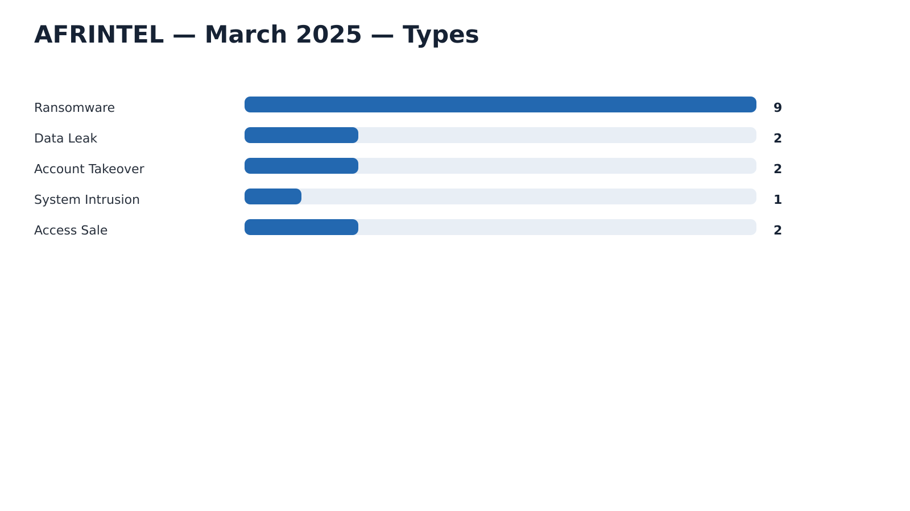
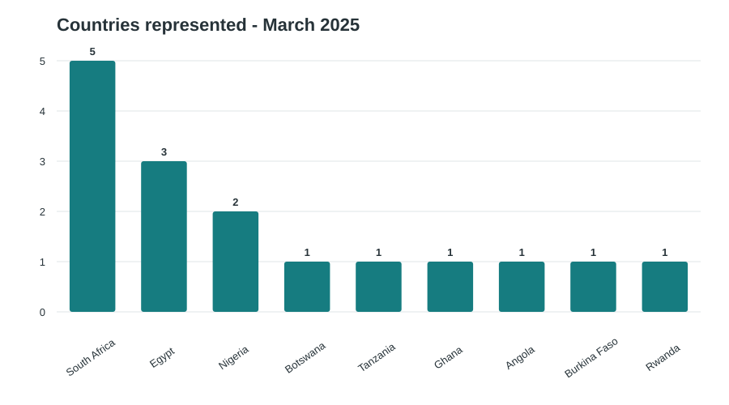
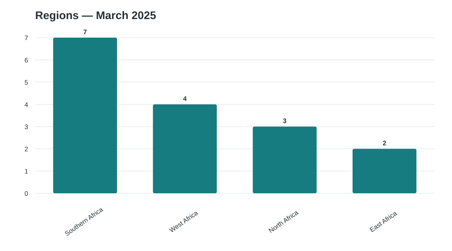
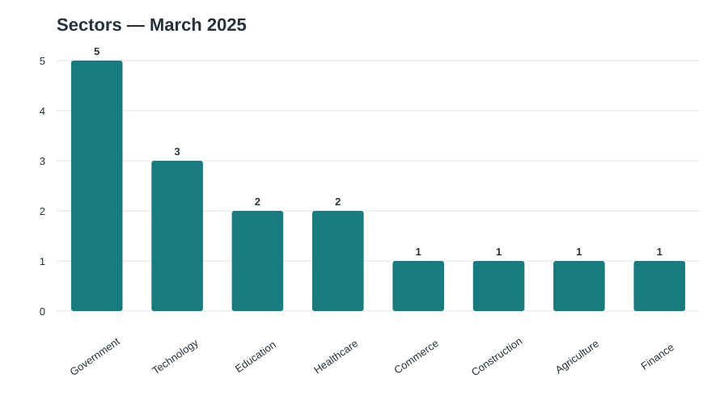
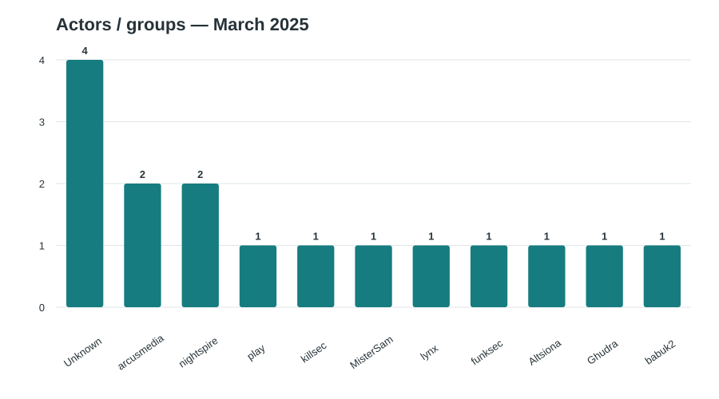
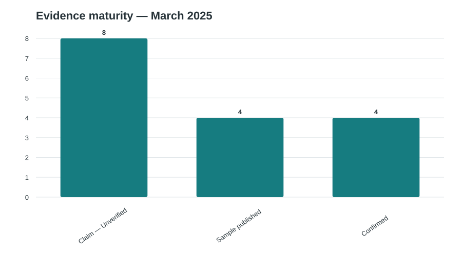

# AFRINTEL | Monthly cyber threat intelligence report
## Cyber threats targeting African organizations, March 2025

   

**Audience:** CISOs, risk leaders, SOC/CERT managers and business continuity owners.
**Period covered:** 1–31 March 2025, based on documented publications and events.
**Distribution:** TLP:CLEAR.
👉🏾 [French version](./README_FR.md) | [Detailed French records](./victims_FR.md) | [English corpus](./victims.md)

> **Evidence methodology - how to read this report.** AFRINTEL distinguishes observed publications, samples actually examined, corroboration and official confirmation. A claim does not automatically prove complete compromise, global volume or exhaustive exfiltration. Raw personal data, secrets and identifiers are not reproduced.

Documented corpus: **16 incidents**.

## 1. Executive summary

### 1.1 Comparison with the previous month

| Indicateur | Previous | March 2025 | Change |
| Total | 11 | 16 | 5 |
| Ransomware | 8 | 9 | 1 |
| Data Leak | 1 | 2 | 1 |
| Access Sale | 0 | 2 | 2 |

The corpus is led by **Ransomware (9, 56.2%)**. Figures represent AFRINTEL documented visibility.

## 2. Scope, method and limitations

The scope covers organizations and services linked to Africa. The **16 records** in `victims_FR.md` and the **16 records** in `victims.md` were checked in the same order. A canonical record is one documented observation; publication or first-observation date is not automatically the compromise date.

### AFRINTEL validation protocol

| Case type | Examination | Scope of finding |
|---|---|---|
| Ransomware / extortion | Publication, timeline, accessible previews or documents and victim context | Publication and available evidence; encryption, initial access and total volume remain separate questions. |
| Data leak | Structure, fields, dates, observed volumes and consistency of available material | Data examined; no automatic validation of the full announced dataset. |
| Access sale | Publication, interface or visible capability indicators | Existence of a presented offer; validity and depth of access remain unknown. |
| Acknowledged incident | Victim or authority statement, within its exact scope | Facts confirmed by the source, without extending confirmation to external assertions. |

Frequencies measure AFRINTEL corpus visibility, not the actual frequency of compromises in Africa.

## 3. Overview and incident typology

| Type | Records | Part |
| Ransomware | 9 | 56.2% |
| Data Leak | 2 | 12.5% |
| Account Takeover | 2 | 12.5% |
| Access Sale | 2 | 12.5% |
| System Intrusion | 1 | 6.2% |
| **Total** | **16** | **100 %** |

## 4. Geographic and regional distribution

| Country | Ransomware | Data Leak | Access Sale | ATO | System Intrusion | Total |
| South Africa | 2 | 1 | 0 | 1 | 1 | **5** |
| Egypt | 3 | 0 | 0 | 0 | 0 | **3** |
| Nigeria | 1 | 1 | 0 | 0 | 0 | **2** |
| Botswana | 1 | 0 | 0 | 0 | 0 | 1 |
| Tanzania | 1 | 0 | 0 | 0 | 0 | 1 |
| Ghana | 0 | 0 | 0 | 1 | 0 | 1 |
| Angola | 0 | 0 | 1 | 0 | 0 | 1 |
| Burkina Faso | 0 | 0 | 1 | 0 | 0 | 1 |
| Rwanda | 1 | 0 | 0 | 0 | 0 | 1 |
| **Total** | **9** | **2** | **2** | **2** | **1** | **16** |

### Regional distribution

| Region | Occurrences |
| Southern Africa | 7 |
| West Africa | 4 |
| North Africa | 3 |
| East Africa | 2 |
| **Total** | **16** |

## 5. Sector exposure and business risks

| Sector | Records | Part |
| Government / Administration | 5 | 31.2% |
| Technology / IT | 3 | 18.8% |
| Education / University | 2 | 12.5% |
| Healthcare / Medical | 2 | 12.5% |
| Commerce / E-commerce | 1 | 6.2% |
| Construction / Real Estate | 1 | 6.2% |
| Agriculture / Agribusiness | 1 | 6.2% |
| Finance / Banking | 1 | 6.2% |
| **Total** | **16** | **100 %** |

## 6. Actors, groups and evidence maturity

| Actor / group | Records |
| Unknown | 4 |
| arcusmedia | 2 |
| nightspire | 2 |
| play | 1 |
| killsec | 1 |
| MisterSam | 1 |
| lynx | 1 |
| funksec | 1 |
| Altsiona | 1 |
| Ghudra | 1 |
| babuk2 | 1 |

### 6.1 Evidence maturity

| Evidence status | Records | Share |
|---|---:|---:|
| Claim - Unverified | 8 | 50.0% |
| Claim - Data Sample Published | 4 | 25.0% |
| Victim / Authority Confirmed | 4 | 25.0% |
| **Total** | **16** | **100%** |

Evidence statuses describe the available validation level and do not change the technical incident type.

### 6.2 Risk-area assessment

| Area | CISO monitoring priority | Corpus-based rationale |
|---|---|---|
| South Africa | High | Five observations, including a confirmed account takeover and confirmed operational intrusion. |
| Egypt | Reinforced | Three ransomware publications, including an examined hospital sample. |
| Public services and healthcare | Reinforced | Sensitive data and access, with confirmed incidents and access claims. |
| Other documented countries | Targeted | Case-by-case monitoring based on sensitivity and evidence quality. |

## 7. Incidents to retain for the security committee

| Country | Organization | Type | Status | Impact | Confidence |
|---|---|---|---|---|---|
| Nigeria | Workforce Group | Ransomware | Claim - Data Sample Published | Level 4 | High |
| Rwanda | Ministry of Health | Ransomware | Claim - Data Sample Published | Level 4 | Very High |
| South Africa | Parliament of South Africa | Account Takeover | Victim Confirmed | Level 4 | Very High |
| Ghana | Office of the President | Account Takeover | Authority Confirmed | Level 3 | Very High |
| South Africa | Astral Foods | System Intrusion | Victim Confirmed | Level 3 | Very High |

> This table highlights five records using structured impact, confirmation and confidence. It is not an absolute severity ranking.

## 8. Trends and intelligence gaps

The corpus combines **9 ransomware claims**, **2 data leaks**, **2 access-sale offers**, **2 account takeovers** and **1 system intrusion**. The strongest elements concern statements from Pam Golding, the South African Parliament, Astral Foods and Ghana's Cyber Security Authority. The Workforce Group, Misr Al Mahaba and Rwandan Ministry of Health samples have different examination levels and must not be extrapolated to all claimed data.

| Gap | Effect | Expected verification |
|---|---|---|
| Initial access vector | Limits attribution and remediation | IAM, VPN, EDR, WAF logs and DFIR timelines |
| Sample completeness | Risk of over- or under-estimating exposure | Inventory, deduplication and reliable sampling |
| Validity of offered access | Depth and persistence remain unknown | Owner confirmation, without testing published access |
| March/April publication relationship | Risk of double counting | Compare dates, structures and independent evidence |

## 9. MITRE ATT&CK: defensive mappings

The mappings below support defensive hunting; they are not technical attribution for every case.

| Technique | Evidence level | Associated risk | Telemetry |
|---|---|---|---|
| [T1078 - Valid Accounts](https://attack.mitre.org/techniques/T1078/) | Account compromise observed; initial vector unknown | Abuse of legitimate accounts | IAM, MFA, VPN, platform logs |
| [T1486 - Data Encrypted for Impact](https://attack.mitre.org/techniques/T1486/) | Defensive hypothesis linked to ransomware claims | Encryption and unavailability | EDR, file logs, backups |
| [T1005 - Data from Local System](https://attack.mitre.org/techniques/T1005/) | Hypothesis for leaks and samples | Collection of documents and databases | EDR, file auditing, DLP |
| [T1567 - Exfiltration Over Web Service](https://attack.mitre.org/techniques/T1567/) | Hypothesis; channel not established | Abnormal outbound transfers | Proxy, DNS, cloud, network |

## 10. SOC operational plan: detect, qualify, contain

| Use case | Signals to correlate | Defensive action |
|---|---|---|
| Compromised institutional account | New devices, unusual activity, content changes | Revoke sessions, reset account, preserve logs |
| Suspicious encryption | Mass renames, ransom notes, backup deletion | Isolate hosts, protect backups, preserve evidence |
| Mass export or access | Large reads, archives, increased egress | Restrict egress and trigger the data-response plan |
| Offered administrator access | Admin interface or visible abnormal activity | Verify out of band, strengthen IAM, do not test published access |

**Recommended workflow:** timestamp the alert → consolidate by identity/host/service → qualify `observed / hypothesis / unknown` → contain proportionately → notify CISO and business owners → preserve evidence.

## 11. Prioritized CISO roadmap

| Horizon | Priority | Expected action | Implementation evidence |
|---|---|---|---|
| 0–72 hours | P0 | Review privileged accounts, MFA, VPN, backups and public services | Access review and restore test |
| 7–30 days | P1 | Deploy ATO, mass-extraction, ransomware and web-integrity detections | Active rules and detection tests |
| 30–90 days | P1 | Exercise a combined account-compromise, leak and outage crisis | Exercise report and tracked actions |
| 30–90 days | P2 | Industrialize CTI monitoring and FR/EN parity controls | Observation traceability and automated checks |

## 12. Detailed methodology

Records are assigned by publication date or first documented observation. No compromise date is inferred.

## 13. Conclusion and expected decisions

March 2025 records **16 documented incidents** across **9 African countries**. The corpus combines ransomware, data exposure, access-sale claims, account takeovers and a confirmed operational intrusion. The main decision for defenders is to separate publication status from technical impact, while prioritizing identity protection, backup resilience, data-exposure response and independent verification of access claims.

👉🏾 [See monthly victims](./victims.md)

**AFRINTEL** — TLP:CLEAR
