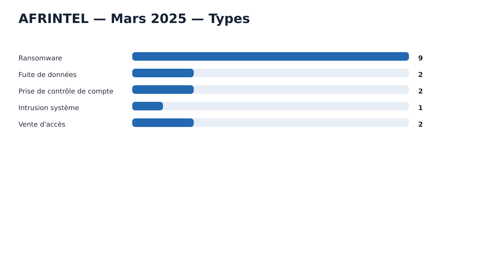
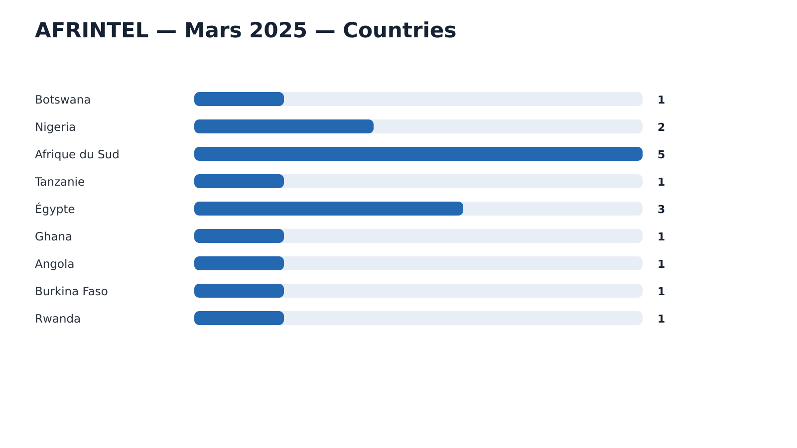
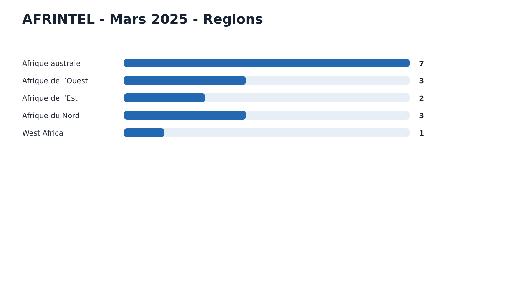
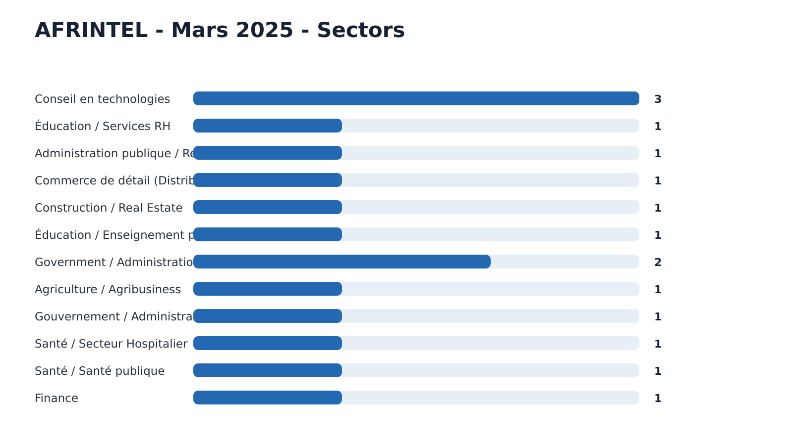
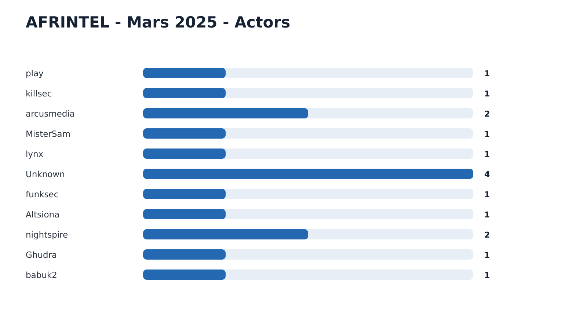
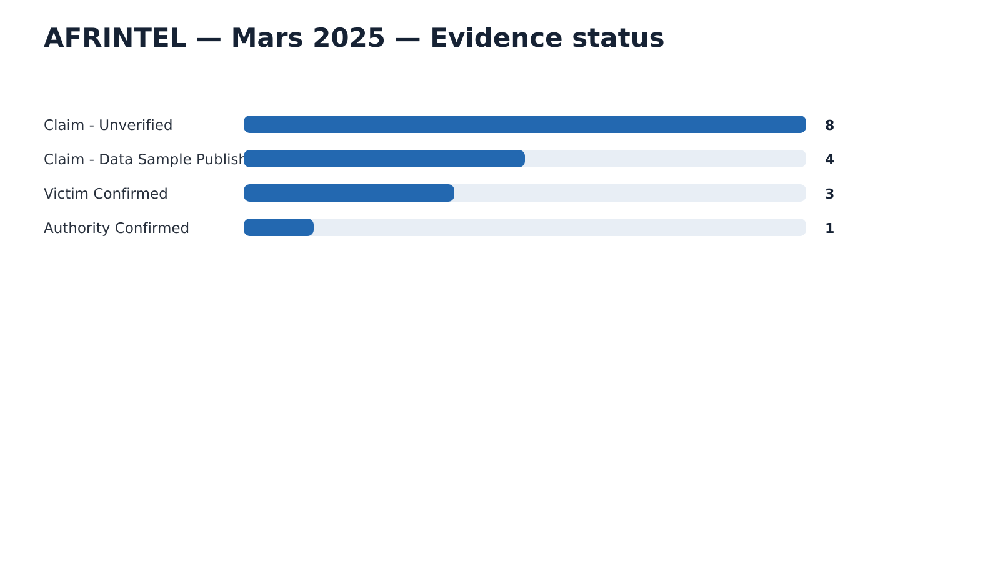

# AFRINTEL | Rapport mensuel de cyber threat intelligence
## Cybermenaces visant les organisations africaines, mars 2025

   

**Public cible :** RSSI, directions des risques, responsables SOC/CERT et responsables de la continuité d'activité.
**Période étudiée :** 1er au 31 mars 2025, selon les publications et événements documentés.
**Diffusion :** TLP:CLEAR.
👉🏾 [English version](./README.md) | [Fiches détaillées en français](./victims_FR.md) | [Corpus anglais](./victims.md)

> **Méthodologie de preuve - lecture du rapport.** AFRINTEL distingue les publications observées, les échantillons effectivement examinés, les corroborations et les confirmations officielles. Une revendication ne prouve pas automatiquement une compromission complète, un volume global ou une exfiltration exhaustive. Les données personnelles, secrets et identifiants bruts ne sont pas reproduits.

Corpus documenté : **16 incidents**.

## 1. Synthèse exécutive

### 1.1 Comparaison avec le mois précédent

| Indicateur | Précédent | Mars 2025 | Évolution |
| Total | 11 | 16 | 5 |
| Ransomware | 8 | 9 | 1 |
| Data Leak | 1 | 2 | 1 |
| Access Sale | 0 | 2 | 2 |

Le corpus est dominé par **Ransomware (9, 56.2 %)**. Les chiffres représentent la visibilité documentée par AFRINTEL.

## 2. Périmètre, méthode et limites

Le périmètre couvre les organisations et services liés à l'Afrique. Les **16 fiches** de `victims_FR.md` et les **16 fiches** de `victims.md` ont été contrôlées dans le même ordre. Une fiche canonique correspond à une observation documentée ; la date de publication ou de première observation n'est pas automatiquement la date de compromission.

### Protocole AFRINTEL de validation

| Nature du dossier | Examen | Portée du constat |
|---|---|---|
| Ransomware / extorsion | Publication, chronologie, aperçus ou documents accessibles et contexte de la victime | Publication et éléments disponibles ; chiffrement, accès initial et volume total restent distincts. |
| Fuite de données | Structure, champs, dates, volumes observés et cohérence des éléments accessibles | Données examinées ; pas de validation automatique de la totalité annoncée. |
| Vente d'accès | Publication, interface ou éléments de capacité visibles | Existence d'une offre présentée ; validité et profondeur de l'accès restent à établir. |
| Incident confirmé | Déclaration de la victime ou d'une autorité, dans sa portée exacte | Faits confirmés par la source, sans étendre la confirmation aux assertions externes. |

Les fréquences mesurent la visibilité du corpus AFRINTEL et non la fréquence réelle des compromissions en Afrique.

## 3. Vue d'ensemble et typologie

| Type | Fiches | Part |
| Ransomware | 9 | 56.2 % |
| Fuite de données | 2 | 12.5 % |
| Prise de contrôle de compte | 2 | 12.5 % |
| Vente d'accès | 2 | 12.5 % |
| Intrusion système | 1 | 6.2 % |
| **Total** | **16** | **100 %** |

## 4. Répartition géographique et régionale

| Pays | Ransomware | Fuite | Vente d'accès | ATO | Intrusion système | Total |
| Afrique du Sud | 2 | 1 | 0 | 1 | 1 | **5** |
| Égypte | 3 | 0 | 0 | 0 | 0 | **3** |
| Nigeria | 1 | 1 | 0 | 0 | 0 | **2** |
| Botswana | 1 | 0 | 0 | 0 | 0 | 1 |
| Tanzanie | 1 | 0 | 0 | 0 | 0 | 1 |
| Ghana | 0 | 0 | 0 | 1 | 0 | 1 |
| Angola | 0 | 0 | 1 | 0 | 0 | 1 |
| Burkina Faso | 0 | 0 | 1 | 0 | 0 | 1 |
| Rwanda | 1 | 0 | 0 | 0 | 0 | 1 |
| **Total** | **9** | **2** | **2** | **2** | **1** | **16** |

### Répartition régionale

| Région | Occurrences |
| Southern Africa | 7 |
| West Africa | 4 |
| North Africa | 3 |
| East Africa | 2 |
| **Total** | **16** |

## 5. Exposition sectorielle et risques métiers

| Secteur | Fiches | Part |
| Government / Administration | 5 | 31.2 % |
| Technology / IT | 3 | 18.8 % |
| Education / University | 2 | 12.5 % |
| Healthcare / Medical | 2 | 12.5 % |
| Commerce / E-commerce | 1 | 6.2 % |
| Construction / Real Estate | 1 | 6.2 % |
| Agriculture / Agribusiness | 1 | 6.2 % |
| Finance / Banking | 1 | 6.2 % |
| **Total** | **16** | **100 %** |

## 6. Acteurs, groupes et maturité des preuves

| Acteur / groupe | Fiches |
| Unknown | 4 |
| arcusmedia | 2 |
| nightspire | 2 |
| play | 1 |
| killsec | 1 |
| MisterSam | 1 |
| lynx | 1 |
| funksec | 1 |
| Altsiona | 1 |
| Ghudra | 1 |
| babuk2 | 1 |

### 6.1 Maturité des preuves

| Statut de preuve | Fiches | Part |
|---|---:|---:|
| Claim - Unverified | 8 | 50,0 % |
| Claim - Data Sample Published | 4 | 25,0 % |
| Victim / Authority Confirmed | 4 | 25,0 % |
| **Total** | **16** | **100 %** |

Les statuts décrivent le niveau de validation disponible et ne modifient pas le type technique de l'incident.

### 6.2 Appréciation des zones de risque

| Zone | Priorité de veille RSSI | Justification tirée du corpus |
|---|---|---|
| Afrique du Sud | Élevée | 5 observations, dont un accès de compte confirmé et une intrusion opérationnelle confirmée. |
| Égypte | Renforcée | 3 publications ransomware, dont un échantillon hospitalier examiné. |
| Services publics et santé | Renforcée | Données et accès sensibles, avec incidents confirmés et revendications d'accès. |
| Autres pays documentés | Ciblée | Suivi selon la sensibilité et la qualité des éléments. |

## 7. Incidents à retenir pour le comité de sécurité

| Pays | Organisation | Type | Statut | Impact | Confiance |
|---|---|---|---|---|---|
| Nigeria | Workforce Group | Ransomware | Claim - Data Sample Published | Level 4 | High |
| Rwanda | Ministère de la Santé | Ransomware | Claim - Data Sample Published | Level 4 | Very High |
| Afrique du Sud | Parliament of South Africa | Account Takeover | Victim Confirmed | Level 4 | Very High |
| Ghana | Office of the President | Account Takeover | Authority Confirmed | Level 3 | Very High |
| Afrique du Sud | Astral Foods | System Intrusion | Victim Confirmed | Level 3 | Very High |

> Ce tableau met en avant cinq fiches selon l'impact, la confirmation et la confiance structurés. Il ne constitue pas un classement absolu de gravité.

## 8. Tendances et principales lacunes de renseignement

Le corpus combine **9 revendications ransomware**, **2 fuites**, **2 offres de vente d'accès**, **2 prises de contrôle de comptes** et **1 intrusion système**. Les éléments les plus solides concernent les déclarations de Pam Golding, du Parlement sud-africain, d'Astral Foods et de la Cyber Security Authority du Ghana. Les échantillons Workforce Group, Misr Al Mahaba et le ministère rwandais de la Santé relèvent de niveaux d'examen différents et ne doivent pas être extrapolés à l'ensemble des données revendiquées.

| Lacune | Effet | Vérification attendue |
|---|---|---|
| Vecteur d'accès initial | Limite l'attribution et la remédiation | Journaux IAM, VPN, EDR, WAF et chronologies DFIR |
| Exhaustivité des échantillons | Risque de surestimer ou sous-estimer l'exposition | Inventaire, déduplication et échantillonnage fiable |
| Validité des accès proposés | Profondeur et persistance inconnues | Confirmation par le propriétaire, sans tester les accès publiés |
| Lien entre publications mars/avril | Risque de double comptage | Comparaison des dates, structures et preuves indépendantes |

## 9. MITRE ATT&CK : correspondances défensives

Les correspondances ci-dessous orientent la chasse défensive ; elles ne constituent pas une attribution technique de tous les cas.

| Technique | Niveau de preuve | Risque associé | Télémétrie |
|---|---|---|---|
| [T1078 - Valid Accounts](https://attack.mitre.org/techniques/T1078/) | Risque observé pour les comptes compromis ; vecteur initial non établi | Abus de comptes légitimes | IAM, MFA, VPN, journaux de plateforme |
| [T1486 - Data Encrypted for Impact](https://attack.mitre.org/techniques/T1486/) | Hypothèse liée aux revendications ransomware | Chiffrement et indisponibilité | EDR, journaux fichiers, sauvegardes |
| [T1005 - Data from Local System](https://attack.mitre.org/techniques/T1005/) | Hypothèse pour les fuites et échantillons | Collecte de documents et bases | EDR, audit fichiers, DLP |
| [T1567 - Exfiltration Over Web Service](https://attack.mitre.org/techniques/T1567/) | Hypothèse ; canal non établi | Transferts sortants anormaux | Proxy, DNS, cloud, réseau |

## 10. Plan opérationnel SOC : détecter, qualifier, contenir

| Cas d'usage | Signaux à corréler | Action défensive |
|---|---|---|
| Compte institutionnel compromis | Nouveaux appareils, activité inhabituelle, changement de contenu | Révoquer sessions, réinitialiser le compte, préserver les journaux |
| Chiffrement suspect | Renommages massifs, notes de rançon, suppressions de sauvegardes | Isoler les hôtes, protéger les sauvegardes, préserver les preuves |
| Export ou accès massif | Lectures volumineuses, archives, hausse d'egress | Restreindre l'egress et déclencher le plan de réponse aux données |
| Accès administrateur proposé | Interface d'administration ou activité anormale visible | Vérifier hors bande, renforcer IAM, ne pas tester l'accès publié |

**Workflow recommandé :** alerte horodatée → consolidation par identité/hôte/service → qualification `observé / hypothèse / inconnu` → confinement proportionné → notification RSSI et métiers → préservation des preuves.

## 11. Feuille de route RSSI priorisée

| Horizon | Priorité | Action attendue | Preuve de mise en œuvre |
|---|---|---|---|
| 0 à 72 h | P0 | Revoir comptes privilégiés, MFA, VPN, sauvegardes et services publics | Revue des accès et test de restauration |
| 7 à 30 jours | P1 | Déployer détections ATO, extraction massive, ransomware et intégrité web | Règles actives et tests de détection |
| 30 à 90 jours | P1 | Exercer une crise combinant compte compromis, fuite et interruption | Compte rendu d'exercice et actions suivies |
| 30 à 90 jours | P2 | Industrialiser la veille CTI et les contrôles de parité FR/EN | Traçabilité des observations et contrôles automatisés |

## 12. Méthodologie détaillée

Les fiches sont classées selon la date de publication ou de première observation documentée. La date de compromission n’est pas déduite.

## 13. Conclusion et décisions attendues

Mars 2025 compte **16 incidents documentés** dans **9 pays africains**. Le corpus combine ransomware, exposition de données, offres de vente d'accès, prises de contrôle de comptes et une intrusion opérationnelle confirmée. La priorité défensive consiste à distinguer le statut de publication de l'impact technique, tout en renforçant la protection des identités, la résilience des sauvegardes, la réponse aux expositions de données et la vérification indépendante des offres d'accès.

👉🏾 [Voir les victimes du mois](./victims_FR.md)

**AFRINTEL** - TLP:CLEAR
