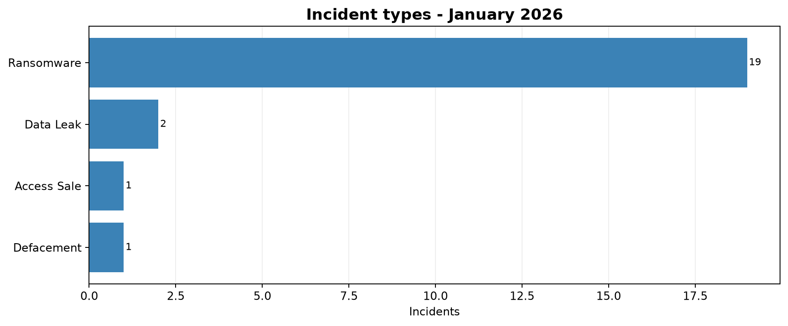
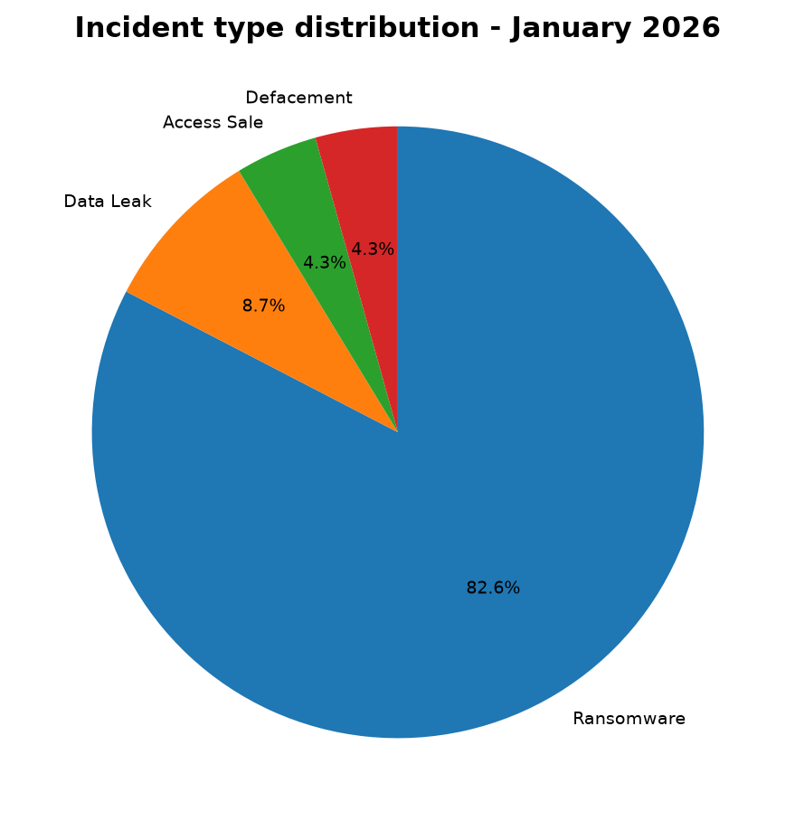
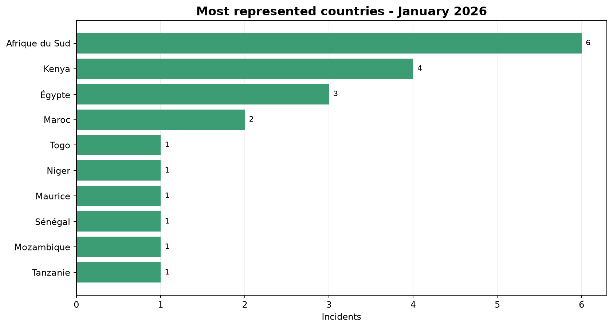
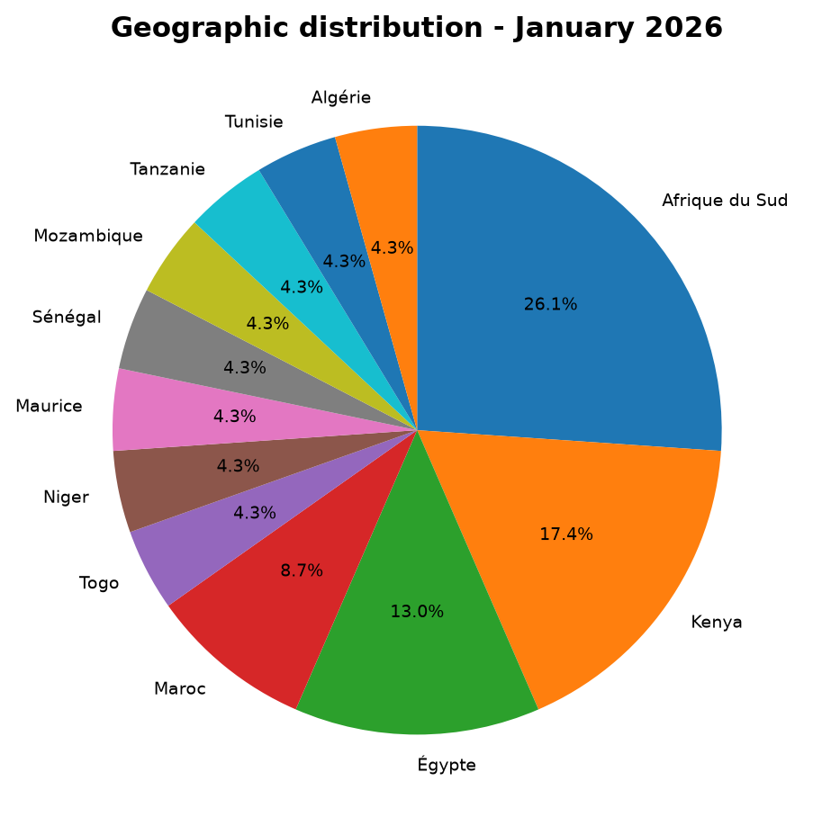
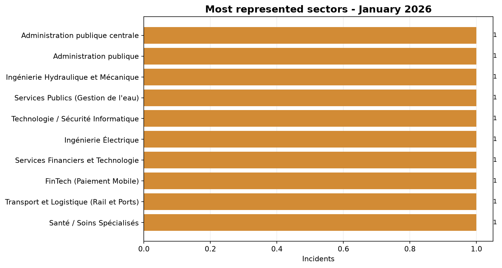
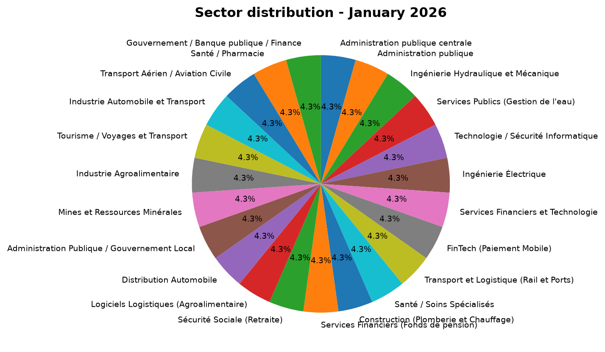
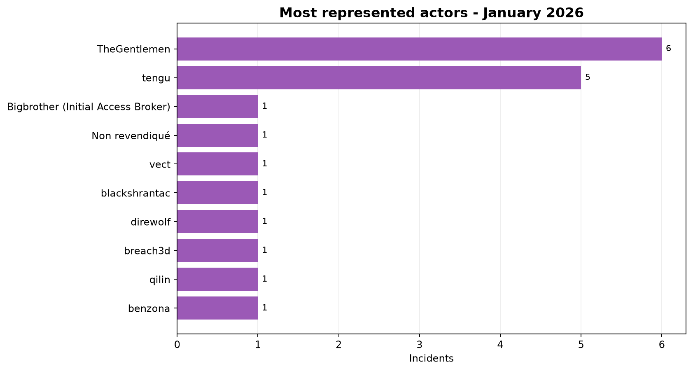
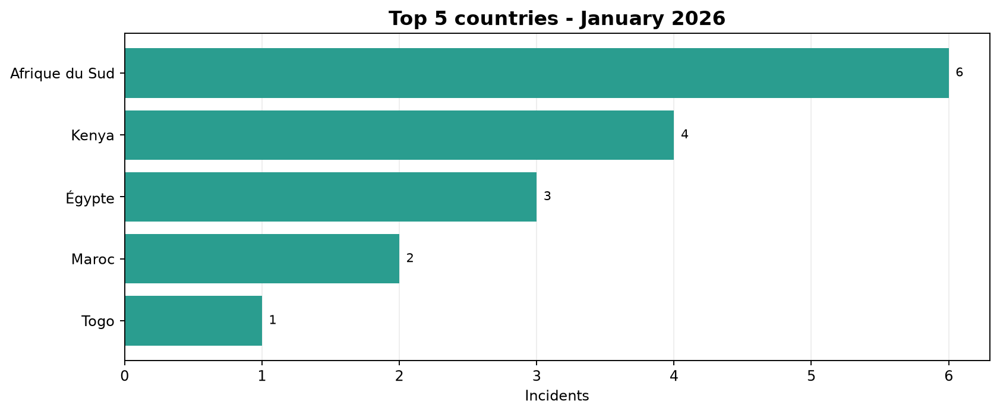

# AFRINTEL CTI report - cyber incidents in Africa (January 2026)

This validated corpus contains **23 incidents or documented cases** first published or first observed by AFRINTEL in January 2026. The month assignment follows the publication or first documented observation date; a compromise date is not inferred when it is unavailable.

## Validated monthly breakdown

| Incident type | Count | Share |
|---|---:|---:|
| Ransomware | 19 | 82.6% |
| Data Leak | 2 | 8.7% |
| Access Sale | 1 | 4.3% |
| Defacement | 1 | 4.3% |
| **Total** | **23** | **100.0%** |

## Countries most represented

| Country | Count |
|---|---:|
| Afrique du Sud | 6 |
| Kenya | 4 |
| Égypte | 3 |
| Maroc | 2 |
| Togo | 1 |
| Niger | 1 |
| Maurice | 1 |
| Sénégal | 1 |
| Mozambique | 1 |
| Tanzanie | 1 |
| Tunisie | 1 |
| Algérie | 1 |

## Actor labels most represented

| Actor label | Count |
|---|---:|
| TheGentlemen | 6 |
| tengu | 5 |
| Bigbrother (Initial Access Broker) | 1 |
| Non revendiqué | 1 |
| vect | 1 |
| blackshrantac | 1 |
| direwolf | 1 |
| breach3d | 1 |
| qilin | 1 |
| benzona | 1 |

## Sectors most represented

| Sector | Count |
|---|---:|
| Administration publique centrale | 1 |
| Administration publique | 1 |
| Ingénierie Hydraulique et Mécanique | 1 |
| Services Publics (Gestion de l'eau) | 1 |
| Technologie / Sécurité Informatique | 1 |
| Ingénierie Électrique | 1 |
| Services Financiers et Technologie | 1 |
| FinTech (Paiement Mobile) | 1 |
| Transport et Logistique (Rail et Ports) | 1 |
| Santé / Soins Spécialisés | 1 |

## Methodology

The figures are derived once from `victims_FR.md`, checked against `victims.md`, and reused in the reports, comparisons and STIX bundle. A multi-country incident counts once globally; country occurrences may therefore exceed the global total. The corpus measures documented AFRINTEL visibility, not the actual prevalence of cyberattacks.

[Victim records](./victims.md)

### Visualisations

