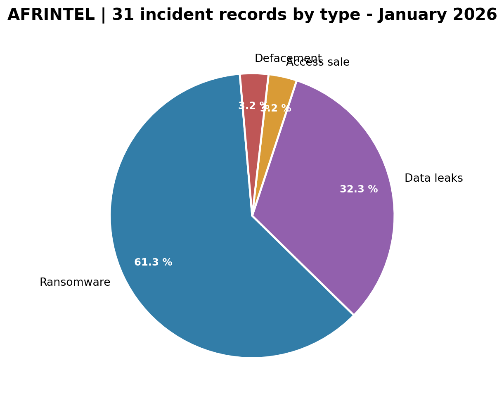
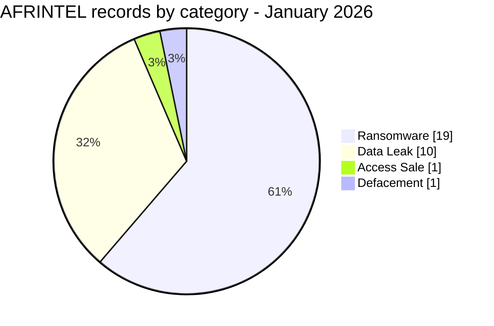
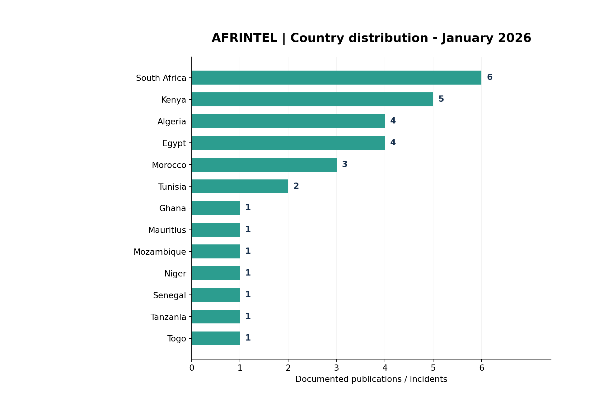
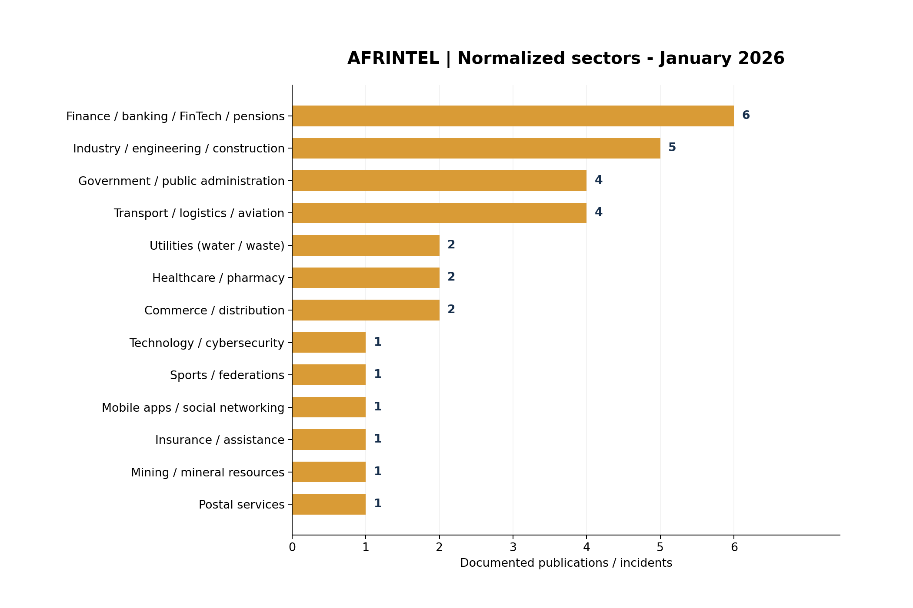
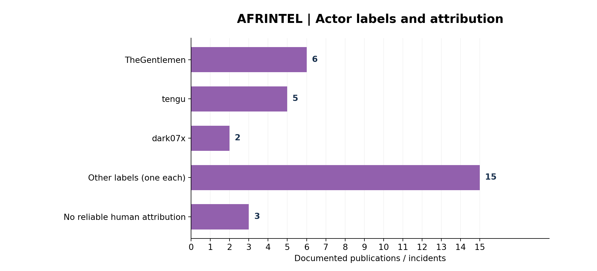
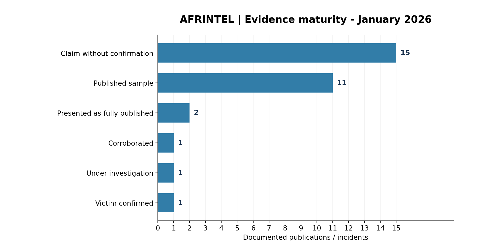

   

# AFRINTEL | Monthly cyber threat intelligence report
## Cyber threats targeting African organizations, January 2026

**Audience:** CISOs, risk committees, SOC/CERT leads and business continuity managers.  
**Period:** January 1–31, 2026, based on documented publications and events.  
**Edition:** November 6, 2026 | **Distribution:** TLP:CLEAR.  
👉🏾 [Version française](./README_FR.md) | [Detailed records in English](./victims.md) | [French records](./victims_FR.md)

> **Evidence method - how to read this report.** AFRINTEL consolidates the OSINT investigations and post-disclosure examinations already documented in its victim records. **For ransomware listings**, analysts review the post and, when published, file inventories, previews and released documents to characterise the exposure. **For data leaks**, available samples are assessed for structure, fields, consistency, observed volume and business impact. Readers can therefore distinguish material actually reviewed from volumes merely claimed. First-party confirmations are identified separately; intrusion, encryption and full exfiltration are not assumed without supporting evidence.

## 1. Executive summary

AFRINTEL's January 2026 corpus contains **31 documented observations across 13 African countries**: **19 ransomware records (61.3%)**, **10 data-leak records (32.3%)**, **one access-sale offer** and **one coordinated defacement** (3.2% each). These figures reflect the visibility of documented threats in monitored sources, rather than national breach rates or an exhaustive census of attacks.

**South Africa (6)** has the largest number of records, followed by **Kenya (5)**, **Egypt (4)** and **Algeria (4)**. Together they account for **19 of 31 records (61.3%)**. The largest normalized sector groups are finance and related services (6), industry and engineering (5), government and public administration (4), and transportation and logistics broadly defined (4). These risks reach beyond IT operations, with potential effects on payments, public services, digital identity and supplier relationships.

Two ransomware labels stand out: **TheGentlemen (6 publications)** and **tengu (5)**, representing **11 of 19 ransomware entries (57.9%)**. Concentrated publication activity does not by itself prove a coordinated campaign or a measurable increase in operational capability. Sensitive data publications also concern Ghanaian waste-billing platform Nerasolgh, payment configuration material attributed to PixPay in Senegal and PAYGO financing records associated with Kenya.

**South Africa's Land Bank** is the most clearly confirmed ransomware incident in the monthly set. Public reporting describes encryption affecting some devices and exfiltration of files. Several other entries are supported by ransomware listings, file inventories or samples, while their full operational extent remains unknown. For boards and CISOs, the key priorities are to **sustain critical operations, prevent fraud and demonstrate rapid containment when credentials or sensitive information are exposed**.

### 1.1 Comparison with December 2025

> The comparison is **provisional**, recalculated from **20 records** present in each of AFRINTEL's December 2025 French and English victim files: **14 ransomware and 6 data leaks**. Their introductory text still reports 19 incidents (14 + 5). This prior-month editorial inconsistency requires correction before the series can be treated as fully validated. Changes in collected records do not establish changes in the true number of cyberattacks.

| Indicator | December 2025, recounted records | January 2026 | Provisional change |
|---|---:|---:|---:|
| Total records | 20 | **31** | **+11 (+55.0%)** |
| Ransomware | 14 | **19** | +5 (+35.7%) |
| Data Leak | 6 | **10** | +4 (+66.7%) |
| Access Sale | 0 | **1** | +1 (new) |
| DDoS | 0 | **0** | 0 (stable) |
| Defacement | 0 | **1** | +1 (new) |
| Account Takeover | 0 | **0** | 0 (stable) |
| System Intrusion | 0 | **0** | 0 (stable) |
| Malware | 0 | **0** | 0 (stable) |
| Operational Fraud | 0 | **0** | 0 (stable) |

**CISO interpretation:** growth in recorded entries may reflect retrospective additions, broader coverage, new source availability and repeat publications. It does not establish a 55% increase in real intrusions across Africa.

## 2. Scope, methodology and limitations

Monitoring covers all **54 African countries**; an entry must have an explicit African organizational, operational or data nexus. The source corpus comprises the supplied January [victims_FR.md](./victims_FR.md) and [victims.md](./victims.md). Structured values were normalized using the French file, with **31 matching cards in the same order** in the English file. Statistics were recalculated from the individual records, not copied from their headers or the eight supplied charts.

Each record is counted **once** under one primary type and country. Other countries referenced in the Kenyan PAYGO archive are not counted as separately identified victims. Many record dates are **publication dates**, not established dates of initial compromise. BazookaEgy, for example, is a January 2026 publication whose relationship to an older leak is unresolved.

The victim records document post-disclosure reviews of ransomware leak sites, criminal forums, file inventories and available samples, supplemented by independent reporting where relevant. This edition consolidates those **documented AFRINTEL sample examinations**, stating the specific material reviewed in each case; it does not claim to have conducted a fresh forensic examination of victim infrastructure. Case-level evidence and scope remain traceable to the victim records.

**Data-quality finding.** The supplied January headings contain inconsistent, outdated figures (21 in English and 23 in French), with an old breakdown of 17 + 2 + 1 + 1 = 21. The supplied charts cover 23 entries, versus **31 actual victim cards**. All graphics in this edition were rebuilt. Some older cards omit `Incident type`, `Confidence level` or `Impact level`; the primary type can be inferred where a ransomware-group label makes it explicit, but no missing confidence or impact values have been fabricated.

### AFRINTEL post-disclosure validation protocol

AFRINTEL's analysis begins **after an actor post or reported disclosure has been observed**. The reports do more than reproduce a listing: accessible evidence is compared with the organisation's context, assessed for technical consistency and assigned an explicit scope. The underlying **victim records** document the review that supports each reported finding.

| Case category | Assessment performed when material is available | What the evidence supports |
|---|---|---|
| **Ransomware / extortion** | Post-disclosure review of the listing, chronology, file trees, previews and publicly released documents; comparison with the victim's business activity; independent-source checks. | The published claim and, when supported, the nature of the data actually disclosed. Encryption, disruption, total volume and initial access require separate evidence. |
| **Data leak** | Examination of **available samples** (CSV, SQL, JSON, documents, screenshots or metadata), their schema, fields, dates, observed counts and internal inconsistencies; comparison with the platform's context. | Content, consistency and sensitivity of the reviewed material; not automatic validation of the entire claimed dataset. |
| **Claim with no usable sample** | Documentation of the listing, date, source and named organisation; independent corroboration attempts. | Existence of the claim only; no affirmative finding about unseen data. |
| **Officially acknowledged incident** | Cross-checking victim or relevant authority statements, preserving the stated dates and scope. | Precisely what the primary source confirms, without extending it to unrelated actor assertions. |

**Evidence workflow:** *observed publication* → *available material examined* → *consistency and scope assessed* → *independent corroboration where available* → *business impact and SOC hypotheses*. Sensitive values and individual identities are not reproduced. **Where no sample was available, the record states that explicitly; this does not weaken the methodology applied to cases with reviewed material.**

**Traceable case examples:** **Nerasolgh** describes three examined exports totalling **1,652,992 rows**; **PixPay** concerns a configuration file attributed to a production environment; **Rogers Capital** describes roughly **102 documents**. **Land Bank** also has first-party confirmation. An extortion post without disclosed evidence is not represented as an examination of leaked data.

## 3. Overview and incident categories

| Category | Records | Share |
|---|---:|---:|
| Ransomware | **19** | **61.3%** |
| Data Leak | **10** | **32.3%** |
| Access Sale | **1** | **3.2%** |
| Defacement | **1** | **3.2%** |
| **Total** | **31** | **100%** |

A ransomware leak-site listing does not automatically establish encryption, exfiltration or ransom payment. Land Bank has documented operational effects; the Tahkout listing includes images consistent with ransomware execution; most other ransomware entries primarily record publication or claim activity.

## 4. Country and regional distribution

| Country | Ransomware | Data Leak | Access Sale | Defacement | Total |
|---|---:|---:|---:|---:|---:|
| 🇿🇦 South Africa | 6 | 0 | 0 | 0 | **6** |
| 🇰🇪 Kenya | 4 | 1 | 0 | 0 | **5** |
| 🇩🇿 Algeria | 1 | 3 | 0 | 0 | **4** |
| 🇪🇬 Egypt | 3 | 1 | 0 | 0 | **4** |
| 🇲🇦 Morocco | 1 | 2 | 0 | 0 | **3** |
| 🇹🇳 Tunisia | 1 | 1 | 0 | 0 | **2** |
| 🇬🇭 Ghana | 0 | 1 | 0 | 0 | 1 |
| 🇲🇺 Mauritius | 1 | 0 | 0 | 0 | 1 |
| 🇲🇿 Mozambique | 1 | 0 | 0 | 0 | 1 |
| 🇳🇪 Niger | 0 | 0 | 0 | 1 | 1 |
| 🇸🇳 Senegal | 0 | 1 | 0 | 0 | 1 |
| 🇹🇿 Tanzania | 1 | 0 | 0 | 0 | 1 |
| 🇹🇬 Togo | 0 | 0 | 1 | 0 | 1 |
| **Total** | **19** | **10** | **1** | **1** | **31** |

| Region | Countries represented | Records | Share |
|---|---|---:|---:|
| North Africa | Algeria, Egypt, Morocco, Tunisia | 13 | 41.9% |
| Southern Africa | South Africa, Mozambique | 7 | 22.6% |
| East Africa | Kenya, Tanzania | 6 | 19.4% |
| West Africa | Ghana, Niger, Senegal, Togo | 4 | 12.9% |
| Indian Ocean | Mauritius | 1 | 3.2% |
| Central Africa | No record in this corpus | 0 | 0% |
| **Total** | **13 countries** | **31** | **100%** |

The rankings reflect **observations available to AFRINTEL**, not an objective league table of national cyber risk. Kenyan and South African cases involve public and financial services; Algerian publications notably touch identity documents, insurance, sports administration and industrial systems.

## 5. Sector exposure and business implications

The 31 raw sector labels have been **normalized into 13 business-sector groups**, with one primary group per record. The underlying cards retain the original organizational context.

| Sector family | Records | Share | Business exposure |
|---|---:|---:|---|
| Finance, banking, FinTech and pensions | **6** | **19.4%** | fraud, payment disruption, customer confidentiality |
| Industry, engineering and construction | **5** | **16.1%** | production stoppage, payroll and contract disclosures |
| Government and public administration | **4** | **12.9%** | public service disruption, institutional impersonation |
| Transport, logistics, aviation and tourism | **4** | **12.9%** | supply-chain disruption, supplier fraud |
| Public utilities: water and waste | 2 | 6.5% | service continuity, billing records |
| Healthcare and pharmacies | 2 | 6.5% | clinical continuity, sensitive applications |
| Commerce and distribution | 2 | 6.5% | customer data, transactions and sales |
| Technology and cybersecurity | 1 | 3.2% | technical environments |
| Sports and federations | 1 | 3.2% | identity documents and player files |
| Mobile apps and social networking | 1 | 3.2% | profiles and location privacy |
| Insurance and assistance | 1 | 3.2% | claims fraud and document abuse |
| Mining and mineral resources | 1 | 3.2% | ERP, staff data and backups |
| Postal services | 1 | 3.2% | identity impersonation and citizen services |
| **Total** | **31** | **100%** | |

**Strategic implication:** financial exposure includes banks but also payment platforms, pension bodies and consumer financing services. In industrial settings, a payroll archive, accounting backup or identity-system access may affect several business functions simultaneously.

## 6. Threat actor labels and evidence maturity

| Actor / group or publication label | Records | CTI interpretation |
|---|---:|---|
| **TheGentlemen** | **6** | Listings in South Africa (3), Egypt (1), Kenya (1) and Mauritius (1). |
| **tengu** | **5** | Listings in Morocco, Kenya, Tunisia, Egypt and Algeria. |
| **dark07x** | **2** | Publications attributed to the LRFA/Foot'Up and Inter Partner Assistance in Algeria. |
| Other one-off labels | 15 | One record each; some denote a poster or republisher rather than the intruder. |
| No reliable human attribution | 3 | Constantia Pharmacy, Land Bank and the Niger defacement. `Want_to_cry` names observed ransomware, not an identified human operator. |
| **Total** | **31** | **Publication accounts must not be conflated with attributed intrusion groups.** |

### 6.1 Evidence status

| Status in source records | Count | Meaning |
|---|---:|---|
| `Claim - Unverified` | 15 | Claim or listing; underlying compromise not independently established. |
| `Claim - Data Sample Published` | 11 | A sample is displayed or available; the full claim may remain unverified. |
| `Data Fully Published` | 2 | Data described as published; completeness is not automatically verified. |
| `Corroborated` | 1 | Converging evidence regarding Constantia Pharmacy. |
| `Victim Confirmed` | 1 | Land Bank publicly acknowledged the incident. |
| `Under Investigation` (legacy term) | 1 | Coordinated Niger defacement remains under investigation. |
| **Total** | **31** | |

**Evidence maturity is not a severity score.** A lack of public confirmation does not mean an incident is harmless, while an impressive actor-claimed dataset size does not prove the actual number of people affected.

### 6.2 Geographic monitoring priorities

| Area | CISO monitoring priority | Corpus-based rationale |
|---|---|---|
| 🔴 South Africa, Kenya | High | Six and five entries involving financial, public and industrial systems. |
| 🟠 Algeria, Egypt, Morocco | Reinforced | Industrial and identity-document publications, data exposure or alleged sales. |
| 🟡 Other countries represented | Targeted | Case-specific prioritization according to sensitivity and evidence quality. |

These are **collection and monitoring priorities for this dataset**, not official national cyber-risk ratings.

## 7. Incidents for security and risk committees

### 7.1 🇿🇦 Land Bank: confirmed ransomware at a public financial institution

On **January 12**, Land Bank detected unauthorized activity. Reporting referenced in the source record describes encryption of some servers and laptops, alongside file exfiltration. Critical ERP, core-banking and CRM systems were reportedly not compromised. The operator has not been publicly attributed. Detailed reporting followed on **March 9, 2026**. **AFRINTEL impact: Level 4; confidence: Very High.**

**CISO takeaway:** segment critical systems and verify incident containment. Restoration alone does not resolve confidentiality risk when file exfiltration is also reported.

### 7.2 🇬🇭 Nerasolgh: identity, payment and technical-access information combined

The **January 7** publication advertises **26,082,134 records**. The analysis already recorded by AFRINTEL covers **three database exports totaling 1,652,992 rows**: **293,232** customer rows, **2,604** user/agent rows and **1,357,156** USSD mobile-money transaction rows. Described fields include contact and GPS data, bank-related fields, bcrypt hashes and, in user records, API and session tokens. **Status: Data Fully Published; confidence: Very High; impact: Level 4.** The actor's claimed 26-million total was not independently validated.

**CISO takeaway:** combine revocation of potentially exposed application secrets with account/session review and payment-fraud monitoring. Different row categories must not be counted as unique affected individuals.

### 7.3 🇸🇳 PixPay: exposed production configuration, not an established customer dump

On **January 16**, an attributed sample corresponds to a production environment configuration containing service endpoints, connection settings and secret keys. The material does **not** demonstrate that a customer database was exposed. Current secret validity is unknown. **Status: Claim - Data Sample Published.**

**CISO takeaway:** implement a secrets-exposure response: rotate and invalidate confirmed exposed credentials, review permissions and investigate abnormal API activity **without attempting to use published secrets**.

### 7.4 🇩🇿 Tahkout Group: warning signs involving identity and HR shares

On **January 28**, `tengu` advertised **83 GB** and published images consistent with a Windows Server environment showing **Active Directory Domain Services, DHCP and DNS** roles, network shares relating to HR, payroll, contracts and facial attendance, and a ransom message. These observations support concern about sensitive internal-system access and execution on at least one host. They do **not** independently validate the advertised 83 GB, initial entry vector, breadth of privileges or enterprise-wide impact.

**CISO takeaway:** test domain-controller protection, share-access monitoring, backup isolation and recovery procedures rather than treating the ransom listing as a complete forensic timeline.

### 7.5 🇰🇪 PAYGO: cloud exposure and debt-collection fraud risk

A **January 16** forum post mirrored a reportedly public cloud-storage exposure and a **1.28 GB** archive, without claiming a breach. The Kenyan portion describes **27,526 rows** containing names, contact details, financed devices, installments, payments, balances and assigned field collection agents. The precise commercial operator remains unidentified. **Status: Data Fully Published; confidence: High; impact: Level 4.**

**CISO takeaway:** review SaaS storage access controls, notification ownership and the possibility of collection-agent impersonation or fraudulent payment requests. The other markets referenced in the archive are not counted as separately established victims.

### 7.6 🇲🇺 Rogers Capital: corporate and regulatory document exposure

On **January 14**, a `TheGentlemen` listing included about **102 documents** previously reviewed in the source records, involving FATCA/CRS, licences, trusts, funds and financial statements. The described information could affect several counterparties and business relationships. **The available material does not establish encryption or the technical initial-access method.**

**CISO takeaway:** strengthen bank-detail change controls, independent payment verification and defenses against business email compromise using knowledge of confidential commercial relationships.

### 7.7 🇲🇦 Morocco: three materially different evidence situations

**Nafae Sanitaire** appears in a `tengu` listing advertising **18.2 GB** of accounting, commercial, HR and backup material; original files were not reviewed. The **Moroccan Public Procurement Portal** is the subject of an alleged **16 GB** offer involving roughly 35,000 records and 25,000 documents, but **no usable supporting sample is visible** and confidence is low. An SQL sample attributed to **AOM Aviation Group** contains supplier-management records and business contacts, raising supplier-impersonation risk. The appropriate defensive work differs: ERP continuity assessment, verification of a weakly supported claim, and supplier relationship protection.

### 7.8 🇳🇪 Niger and 🇹🇬 Togo: government-facing exposure

A **January 4** case describes a coordinated political **defacement** of official Niger websites, without evidence that data was exfiltrated. On **January 3**, **Bigbrother** advertised unauthorized **access for sale** to several Togolese government platforms; access depth was not independently established. Key defensive priorities include verified website integrity restoration, privileged access review and correlation of authentication and administrative logs.

## 8. Trends and priority intelligence gaps

**Extortion is the dominant publication source.** The 19 ransomware entries span many sectors. TheGentlemen and tengu each list victims across several markets, but the records do not establish a common intrusion infrastructure, initial access vector or single coordinated campaign.

**Data-leak risk goes beyond contact lists.** At varying evidence levels, Nerasolgh, PAYGO, PixPay, LRFA/Foot'Up and Inter Partner Assistance involve payment information, government documents, application tokens or location data. Fraud risk may outlast the remediation of an underlying technical flaw.

**Publication chronology matters.** January's BazookaEgy record is a repost with an unresolved relationship to a **September 2024** publication; it does not prove a fresh 2026 breach. The PAYGO material was linked to public cloud storage rather than a claimed intrusion. A new publication therefore need not indicate a new compromise.

| Priority intelligence gap | Consequence | Evidence needed |
|---|---|---|
| Intrusion dates and entry vectors | Constrains attribution and behavioral mapping | DFIR timelines, VPN/SSO/EDR/WAF logs, technical statements |
| Actual exfiltrated volume | Risk of overstating exposure | Data inventories, representative samples, duplicate checks |
| Validity of PixPay/Nerasolgh secrets | Residual exposure cannot be assessed | Secret rotation evidence and owner-led access reviews |
| Relationship between BazookaEgy releases | Risk of double-counting a compromise | Date/schema/hash comparisons, victim confirmation |
| Identity of PAYGO operator | Complicates affected-person notifications | Confirmation of data controller and SaaS ownership |
| Ransomware claim validation | Business impact and release status remain unknown | Listing lifecycle follow-up, victim statements, robust public evidence |

## 9. MITRE ATT&CK: defensive mapping

The following mappings support **threat hunting and detection design**. They are not a claim that every technique occurred in the cited cases. Unless explicitly marked as observed, mappings are **detection hypotheses**.

| ATT&CK technique | Evidence level | Linked risk | Telemetry |
|---|---|---|---|
| [T1486 - Data Encrypted for Impact](https://attack.mitre.org/techniques/T1486/) | **Observed/corroborated** at Land Bank; execution indicators in Tahkout material | Encryption and ransom notes | EDR, file events, backup alerts, Sysmon, Windows logs |
| [T1491.002 - External Defacement](https://attack.mitre.org/techniques/T1491/002/) | **Reported effect** in Niger | Unauthorized external site modification | WAF, web and CMS logs, integrity controls |
| [T1078 - Valid Accounts](https://attack.mitre.org/techniques/T1078/) | **Detection hypothesis**, not confirmed initial access | Privileged-account misuse and alleged access sales | IdP/SSO, VPN, IAM, AD and application logs |
| [T1005 - Data from Local System](https://attack.mitre.org/techniques/T1005/) | **Detection hypothesis** | Collection of business documents or HR files | EDR, file-access audit, SMB, DLP |
| [T1567 - Exfiltration Over Web Service](https://attack.mitre.org/techniques/T1567/) | **Detection hypothesis**; transfer channels unestablished | Abnormal outbound uploads | Proxy, DNS, network flows, CASB, cloud audit logs |

## 10. SOC operational plan: detect, investigate, contain

| Use case | Signals to correlate | SOC L1/L2 triage | Defensive action |
|---|---|---|---|
| Suspected file encryption | Sudden renames/writes, ransom-note creation, deletion of backups or shadow copies | Process lineage, affected hosts/shares, privileges and time window | Isolate affected hosts according to playbook, preserve evidence and backups |
| Unusual privileged access | New VPN sessions, atypical sign-ins, admin-group changes, out-of-hours activity | Identity, device, geography, MFA and lateral movement | Revoke sessions, reset compromised accounts, reinforce access control |
| Bulk data export | Large database reads, archive creation followed by egress, unusual cloud transfer | Actor, service, volume, destination and business justification | Restrict access and egress, initiate data-exposure response |
| Exposed application secret | Secrets in deployments, reused tokens, unusual API calls | Confirm ownership and validity with application teams, **without testing exposed credentials** | Rotate/invalidate, reduce privileges, audit transactions |
| Web content integrity | Unplanned page change, new CMS admins, WAF errors | Compare against authorized release pipeline | Restore content, remediate verified cause, monitor recurrence |
| Supplier/payment fraud | New beneficiary account details, unexpected remittance instructions | Independently confirm with established counterparties | Dual payment approval, hold suspicious changes |

**Recommended workflow:** timestamp and ingest → correlate identity/asset/service → seek independent evidence → label `observed / hypothesis / unknown` → proportionate containment → CISO and business notification → preserve evidence → close with tested remediation.

## 11. Prioritized CISO action plan

| Timeline | Priority | Required action | Evidence of completion |
|---|---|---|---|
| **0–72 hours** | P0 | Review privileged access to identity, VPN, ERP, payment and backup environments; investigate any known secret exposure | Critical account inventory, reviewed risky sessions, exposure-based rotation records |
| **0–72 hours** | P0 | Verify critical backups, immutability/isolation and recovery capability outside production | Restore logs, measured RPO/RTO, successful recovery test |
| **7–30 days** | P1 | Deploy or tune SOC scenarios for ransomware, bulk extraction, privileged accounts, web integrity and supplier fraud | Active rules, dashboards, validation tests, escalation process |
| **7–30 days** | P1 | Review SaaS vendors and partners hosting customer, billing, finance or sensitive documents | Data-flow map, accountable data owners, IAM and storage reviews |
| **30–90 days** | P1 | Run a cyber crisis exercise combining encryption, data leak and payment fraud | Cross-functional exercise, tracked lessons and decisions |
| **30–90 days** | P2 | Operationalize CTI case tracking across SIEM, OpenCTI and TheHive without sharing secrets or raw personal data | Traceable observations, statuses and case handling times |

### 11.1 Board-level indicators

Recommended reporting includes **EDR coverage of critical assets**, **phishing-resistant MFA coverage for privileged accounts**, **time to revoke an exposed secret**, **successful restoration-test rate**, **MTTD/MTTR for encryption and leakage scenarios**, and **assessment coverage of critical suppliers**. These are recommended KPIs: January's corpus provides no values and performance outcomes are not assumed.

### 11.2 Prospective defense exercise scenarios

The evidence supports three prudent **forward-looking simulations**: **(1)** a privileged account reaches HR shares and backups; **(2)** a payment production-configuration file exposes operational secrets; **(3)** publicly accessible SaaS storage leaks financing and collection records. These are not presented as proven forensic reconstructions of the listed events.

## 12. Conclusion and decision points

January is dominated by visible **ransomware extortion claims**, but the incidents most relevant to risk governance are not necessarily those with the largest advertised volumes. Land Bank's confirmed event, the billing and payment datasets described for Nerasolgh, the PixPay configuration material, and industrial and financial document exposures point to a converging risk: **operational disruption can coincide with longer-lived compromise of data, identities and commercial relationships**.

A CISO's priority is not to accumulate unattributed indicators. It is to **test resilience**, **correlate anomalous access and extraction behavior**, **neutralize exposed secrets quickly**, and **prepare business functions for fraud response and notification duties**. The next corpus update should fix inconsistent headers, enrich evidence states, and keep initial publication, discovery and confirmation dates separate.

**AFRINTEL | Open African Cyber Threat Intelligence Monitoring Initiative**  
Repository: https://github.com/Hatchepsoute/AFRINTEL  
Primary source records: January 2026 `victims_FR.md` and `victims.md`; comparison: `CyberAttackAfrica/2025/12-december/victims_FR.md` and `victims.md`.  
**TLP:CLEAR - suitable for publication provided these evidentiary and methodological caveats are retained.**
