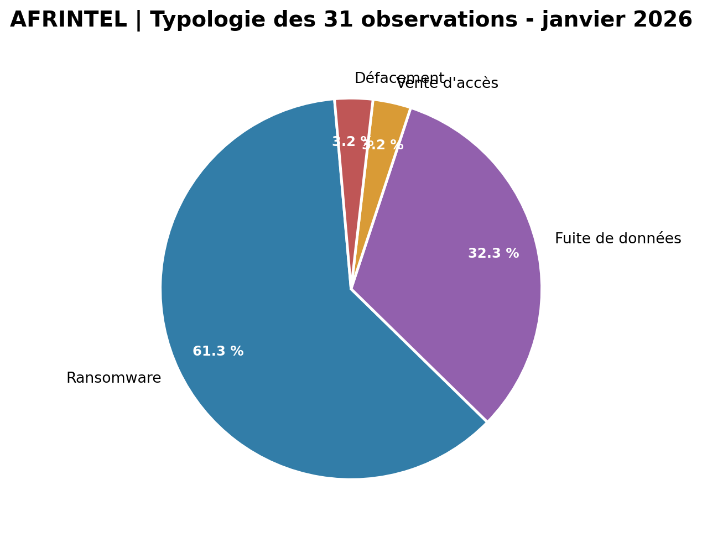
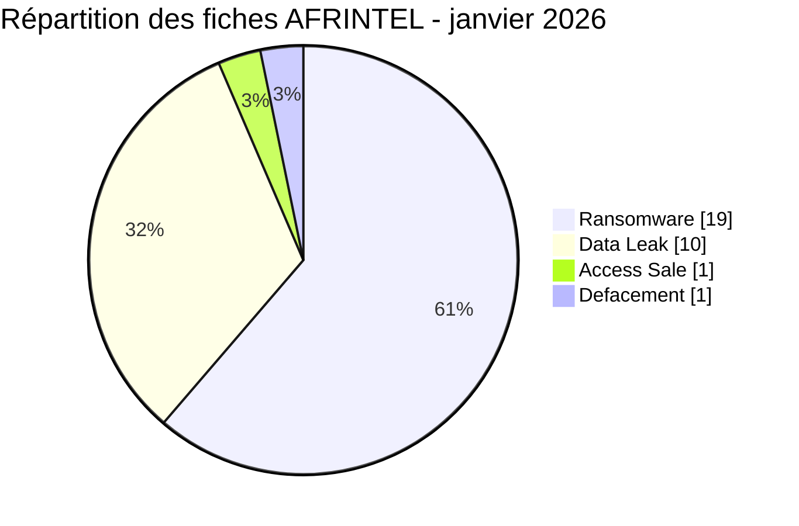
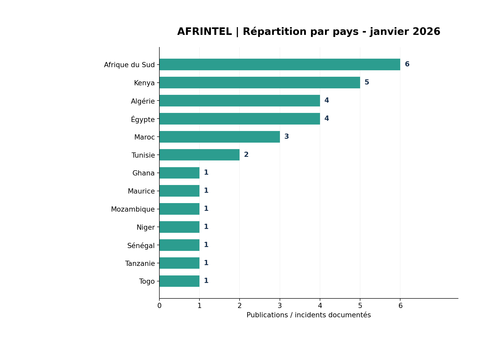
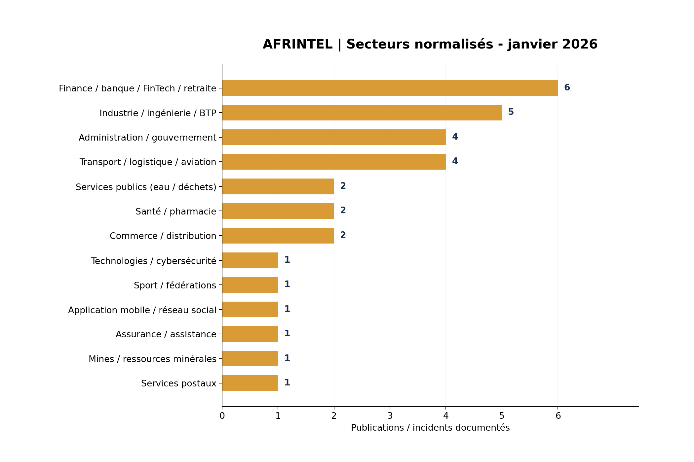
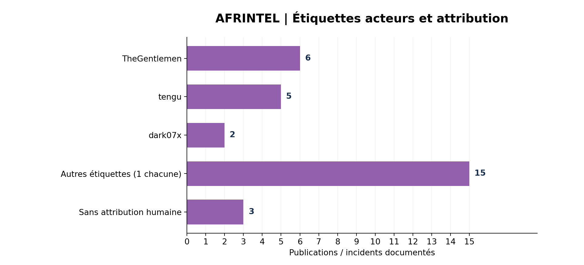
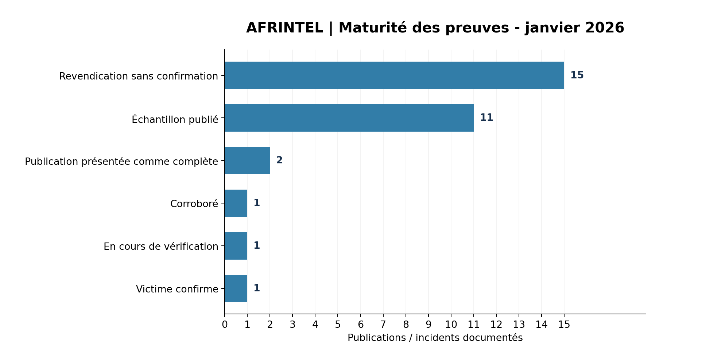

   

# AFRINTEL | Rapport mensuel de cyber threat intelligence
## Cybermenaces visant les organisations africaines, janvier 2026

**Public cible :** RSSI, directions des risques, responsables SOC/CERT, responsables de la continuité d'activité.  
**Période étudiée :** 1er au 31 janvier 2026, selon les publications et événements documentés.  
**Édition :** 6 novembre 2026 | **Diffusion :** TLP:CLEAR.  
👉🏾 [English version](./README.md) | [Fiches détaillées en français](./victims_FR.md) | [Corpus anglais](./victims.md)

> **Méthodologie de preuve - lecture du rapport.** AFRINTEL consolide les investigations OSINT et analyses post-divulgation déjà consignées dans les fiches victimes. **Pour les dossiers ransomware**, les annonces et, lorsque publiés, les inventaires, aperçus et documents divulgués sont analysés afin de caractériser l'exposition. **Pour les fuites de données**, les échantillons disponibles sont examinés (structure, champs, cohérence, volume observé et risque métier). Le lecteur peut ainsi distinguer un contenu effectivement analysé d'un volume simplement revendiqué. Les confirmations officielles sont identifiées séparément ; le rapport ne suppose ni intrusion, ni chiffrement, ni exfiltration exhaustive sans pièces correspondantes.

## 1. Synthèse exécutive

Le corpus AFRINTEL de janvier 2026 regroupe **31 observations documentées dans 13 pays africains**. La menace d'extorsion domine avec **19 fiches ransomware (61,3 %)**, devant **10 publications de fuite de données (32,3 %)**, **une offre de vente d'accès** et **un défacement coordonné** (3,2 % chacun). Le décompte décrit d'abord la visibilité de la menace dans les sources collectées. Il ne constitue ni un taux de compromission national ni un indicateur exhaustif des attaques effectivement subies.

L'**Afrique du Sud (6)** concentre le plus grand nombre de fiches, suivie du **Kenya (5)**, de l'**Égypte (4)** et de l'**Algérie (4)**. Ces quatre pays représentent **19 observations sur 31 (61,3 %)**. Les secteurs agrégés les plus représentés sont les services financiers et assimilés (6), l'industrie et l'ingénierie (5), l'administration publique (4) et le transport et la logistique au sens large (4). Cette diversité rappelle qu'une campagne d'extorsion ou une fuite de données n'est pas seulement une question d'IT : elle peut affecter les paiements, les services publics, l'identité numérique et les relations avec des prestataires.

Deux étiquettes ransomware ressortent : **TheGentlemen (6 publications)** et **tengu (5)**. Ensemble, elles représentent **11 des 19 fiches ransomware (57,9 %)** ; cette concentration des publications ne démontre pas à elle seule une campagne coordonnée ni une hausse de la capacité opérationnelle de ces groupes. En parallèle, des publications de données sensibles concernent le système de facturation de Nerasolgh au Ghana, des configurations de paiement attribuées à PixPay au Sénégal et des archives de financement PAYGO associées au Kenya.

La **Land Bank sud-africaine** constitue le cas de ransomware le plus clairement confirmé du mois : l'incident a été publiquement reconnu, avec chiffrement de certains équipements et exfiltration de fichiers rapportés. D'autres cas sont documentés par des publications de groupes, des listes de fichiers ou des échantillons, mais leur périmètre opérationnel reste souvent inconnu. Le rapport retient une priorité de direction : **prévenir l'arrêt d'activité, limiter le risque de fraude et démontrer la capacité à contenir une exposition d'identifiants ou de données sensibles en quelques heures**.

### 1.1 Comparaison avec décembre 2025

> Base comparative indicative recalculée à partir des **20 fiches** présentes dans chacun des deux fichiers victimes de décembre 2025 du dépôt AFRINTEL : **14 ransomwares et 6 fuites**. Leur en-tête annonce encore 19 incidents (14 + 5). Ce décalage historique doit être corrigé dans les fichiers de décembre avant d'utiliser cette comparaison comme série mensuelle définitivement validée. Une variation du corpus documenté ne démontre pas une variation de la fréquence réelle des attaques.

| Indicateur | Décembre 2025, fiches recomptées | Janvier 2026 | Évolution indicative |
|---|---:|---:|---:|
| Total des fiches | 20 | **31** | **+11 (+55,0 %)** |
| Ransomware | 14 | **19** | +5 (+35,7 %) |
| Data Leak | 6 | **10** | +4 (+66,7 %) |
| Access Sale | 0 | **1** | +1 (nouveau) |
| DDoS | 0 | **0** | 0 (stable) |
| Defacement | 0 | **1** | +1 (nouveau) |
| Account Takeover | 0 | **0** | 0 (stable) |
| System Intrusion | 0 | **0** | 0 (stable) |
| Malware | 0 | **0** | 0 (stable) |
| Operational Fraud | 0 | **0** | 0 (stable) |

**Lecture RSSI :** l'augmentation des fiches documentées peut résulter de découvertes ou d'enrichissements rétrospectifs, de nouvelles sources et de publications répétées. Elle ne permet pas d'affirmer une augmentation de 55 % du nombre réel d'intrusions en Afrique.

## 2. Périmètre, méthode et limites

L'analyse couvre les **54 pays africains** ; seuls les cas dont le lien avec une organisation, une activité ou des données africaines est explicite sont recensés. Les données sources sont les deux fichiers [victims_FR.md](./victims_FR.md) et [victims.md](./victims.md) fournis pour janvier. Le fichier français sert à normaliser les catégories ; le fichier anglais a été contrôlé en correspondance, à raison de **31 fiches dans chaque langue, dans le même ordre**. Les chiffres ont été recalculés à partir des fiches elles-mêmes, et non repris des résumés initiaux ou des huit graphiques joints.

Une fiche est comptée **une seule fois** dans une catégorie principale et un pays principal. Les publications multi-pays mentionnées à l'intérieur d'un jeu de données PAYGO ne créent pas de nouvelles victimes par pays sans attribution suffisante. La date portée dans les fiches est très souvent une **date de publication**, pas la date certaine de l'accès initial. Les cas de republication, notamment BazookaEgy, restent des événements documentaires distincts sans preuve d'une nouvelle intrusion.

Les sources comprennent les publications de groupes ransomware, les forums, les inventaires et échantillons **examinés et décrits lors des analyses post-divulgation d’AFRINTEL**, ainsi que les confirmations publiques disponibles. Cette édition consolide ces analyses documentées, avec indication précise des contenus effectivement consultés par dossier ; elle ne revendique pas une nouvelle expertise forensique sur les infrastructures des victimes. Les références et la portée de chaque pièce figurent dans les fiches.

**Contrôle qualité du corpus.** Les deux résumés mensuels joints affichent des totaux obsolètes ou incohérents (21 en anglais, 23 en français), avec un détail de 17 + 2 + 1 + 1 = 21. Les graphiques fournis sont également établis sur 23 entrées, contre **31 fiches réellement listées**. Les graphiques présents dans cette édition ont été intégralement recalculés. Plusieurs champs `Type d'incident`, `Niveau de confiance` et `Niveau d'impact` manquent dans les anciennes fiches ; le type principal peut être déduit du contexte explicite « Groupe ransomware », mais aucun niveau de confiance ou d'impact absent n'a été inventé.

### Protocole AFRINTEL de validation post-publication

L'analyse AFRINTEL intervient **après l'observation de la publication de l'acteur ou la divulgation signalée**. Le rapport ne se limite pas à reprendre une annonce : il rapproche les éléments accessibles des informations sur l'organisation, examine leur cohérence technique et qualifie leur portée. Le travail effectué est retracé dans les **fiches victimes**, qui constituent la base probatoire du rapport.

| Nature du dossier | Examen réalisé lorsque la matière est disponible | Ce que l'analyse permet d'établir |
|---|---|---|
| **Ransomware / extorsion** | Revue post-divulgation de l'annonce, de la chronologie, des arborescences, aperçus de fichiers et documents rendus publics ; comparaison des catégories de données avec l'activité de la victime ; recherche de recoupements indépendants. | Existence d'une publication et, selon les pièces, nature des données effectivement exposées. Le chiffrement, la panne, le volume total et l'accès initial restent des faits distincts, à justifier séparément. |
| **Fuite de données** | Examen des **échantillons accessibles** (CSV, SQL, JSON, documents, captures ou métadonnées), de leur structure, des champs, des dates, des volumes réellement observés et des incohérences éventuelles ; rapprochement avec le contexte de la plateforme. | Contenu, cohérence et sensibilité des éléments examinés ; non pas validation automatique de la totalité du jeu annoncé. |
| **Revendication sans échantillon exploitable** | Qualification de la publication, de sa source, de sa date et de l'organisation citée ; tentative de corroboration dans des sources indépendantes. | Existence de la revendication uniquement ; aucune conclusion affirmative sur des données non consultées. |
| **Incident officiellement reconnu** | Confrontation aux communiqués de l'organisation ou d'autorités compétentes, avec respect de leurs limites de portée et de date. | Faits précisément confirmés par la source, sans étendre cette confirmation aux assertions de l'acteur. |

**Chaîne de lecture des constats :** *publication constatée* → *pièces accessibles examinées* → *cohérence et portée évaluées* → *sources indépendantes recoupées, si disponibles* → *impacts métiers et hypothèses SOC*. Les valeurs sensibles et les identités individuelles ne sont pas reproduites. **Une absence d'échantillon est notée comme telle ; elle ne remet pas en cause la méthode appliquée aux autres dossiers.**

**Exemples traçables dans ce corpus :** la fiche **Nerasolgh** documente l'examen de trois exports représentant **1 652 992 lignes** ; celle de **PixPay** porte sur un fichier de configuration attribué à l'environnement de production ; **Rogers Capital** décrit environ **102 documents**. Pour **Land Bank**, le niveau de preuve repose aussi sur la confirmation publique. En revanche, une annonce d'extorsion sans pièce publiée n'est pas comptabilisée comme une analyse de données divulguées.

## 3. Vue d'ensemble et typologie

| Type | Fiches | Part |
|---|---:|---:|
| Ransomware | **19** | **61,3 %** |
| Fuite de données | **10** | **32,3 %** |
| Vente d'accès | **1** | **3,2 %** |
| Défacement | **1** | **3,2 %** |
| **Total** | **31** | **100 %** |

**Point de vigilance :** une victime publiée sur un site d'extorsion ne signifie pas que le chiffrement, l'exfiltration et le paiement d'une rançon sont tous avérés. Le dossier Land Bank documente des effets opérationnels ; le dossier Tahkout comporte des éléments visuels d'exécution de ransomware ; la majorité des autres fiches correspondent avant tout à des revendications ou publications.

## 4. Répartition géographique et régionale

| Pays | Ransomware | Fuite | Vente d'accès | Défacement | Total |
|---|---:|---:|---:|---:|---:|
| 🇿🇦 Afrique du Sud | 6 | 0 | 0 | 0 | **6** |
| 🇰🇪 Kenya | 4 | 1 | 0 | 0 | **5** |
| 🇩🇿 Algérie | 1 | 3 | 0 | 0 | **4** |
| 🇪🇬 Égypte | 3 | 1 | 0 | 0 | **4** |
| 🇲🇦 Maroc | 1 | 2 | 0 | 0 | **3** |
| 🇹🇳 Tunisie | 1 | 1 | 0 | 0 | **2** |
| 🇬🇭 Ghana | 0 | 1 | 0 | 0 | 1 |
| 🇲🇺 Maurice | 1 | 0 | 0 | 0 | 1 |
| 🇲🇿 Mozambique | 1 | 0 | 0 | 0 | 1 |
| 🇳🇪 Niger | 0 | 0 | 0 | 1 | 1 |
| 🇸🇳 Sénégal | 0 | 1 | 0 | 0 | 1 |
| 🇹🇿 Tanzanie | 1 | 0 | 0 | 0 | 1 |
| 🇹🇬 Togo | 0 | 0 | 1 | 0 | 1 |
| **Total** | **19** | **10** | **1** | **1** | **31** |

| Région analytique | Pays recensés | Fiches | Part |
|---|---|---:|---:|
| Afrique du Nord | Algérie, Égypte, Maroc, Tunisie | 13 | 41,9 % |
| Afrique australe | Afrique du Sud, Mozambique | 7 | 22,6 % |
| Afrique de l'Est | Kenya, Tanzanie | 6 | 19,4 % |
| Afrique de l'Ouest | Ghana, Niger, Sénégal, Togo | 4 | 12,9 % |
| Océan Indien | Maurice | 1 | 3,2 % |
| Afrique centrale | Aucun cas dans ce corpus | 0 | 0 % |
| **Total** | **13 pays** | **31** | **100 %** |

Ce classement mesure l'intensité des **observations accessibles à AFRINTEL**, non le niveau absolu de cyberrisque des États. Le Kenya et l'Afrique du Sud présentent des expositions de services financiers et publics ; l'Algérie se distingue par des publications mêlant documents d'identité, assurance, sport et environnement industriel.

## 5. Exposition sectorielle et risques métiers

Le classement est établi sur une **normalisation de 31 secteurs bruts vers 13 familles métiers**, une seule catégorie principale par fiche. Ce regroupement n'efface pas l'activité précise des victimes, conservée dans les fichiers détaillés.

| Famille de secteur | Fiches | Part | Risques métier principaux |
|---|---:|---:|---|
| Finance, banque, FinTech et retraite | **6** | **19,4 %** | fraude, détournement de paiements, indisponibilité, confidentialité client |
| Industrie, ingénierie et BTP | **5** | **16,1 %** | arrêt de production, exposition des contrats et de la paie |
| Administration et gouvernement | **4** | **12,9 %** | interruption des services, usurpation institutionnelle, confiance publique |
| Transport, logistique, aviation et tourisme | **4** | **12,9 %** | perturbation de la chaîne logistique, fraude fournisseur |
| Services publics : eau et déchets | 2 | 6,5 % | continuité de service, données de facturation |
| Santé et pharmacie | 2 | 6,5 % | continuité des soins, systèmes métier sensibles |
| Commerce et distribution | 2 | 6,5 % | informations clients, transactions, activité commerciale |
| Technologie et cybersécurité | 1 | 3,2 % | compromission d'environnements techniques |
| Sport et fédérations | 1 | 3,2 % | documents d'identité, licences, dossiers sportifs |
| Applications mobiles et réseaux sociaux | 1 | 3,2 % | confidentialité des profils et géolocalisation |
| Assurance et assistance | 1 | 3,2 % | fraude documentaire et aux sinistres |
| Mines et ressources minérales | 1 | 3,2 % | ERP, gestion du personnel et sauvegardes |
| Services postaux | 1 | 3,2 % | usurpation d'identité, services aux citoyens |
| **Total** | **31** | **100 %** | |

**Enseignement stratégique :** l'exposition du secteur financier ne se résume pas aux banques. Les plateformes de paiement, les organismes de retraite et les systèmes PAYGO concentrent aussi des données d'identité et de transaction susceptibles d'alimenter une fraude ciblée. Pour les industriels, l'exposition d'un répertoire RH, d'une sauvegarde comptable ou d'un accès au système d'identité est susceptible d'affecter simultanément plusieurs processus métier.

## 6. Acteurs, groupes et maturité des preuves

| Acteur / groupe ou étiquette de publication | Fiches | Lecture CTI |
|---|---:|---|
| **TheGentlemen** | **6** | Revendications visant l'Afrique du Sud (3), l'Égypte (1), le Kenya (1) et Maurice (1). |
| **tengu** | **5** | Publications visant le Maroc, le Kenya, la Tunisie, l'Égypte et l'Algérie. |
| **dark07x** | **2** | Publications de données attribuées à la LRFA/Foot'Up et à Inter Partner Assistance en Algérie. |
| Autres étiquettes individuelles | 15 | Une fiche chacune ; certaines identifient un auteur de publication ou un republicateur et non l'auteur de l'intrusion. |
| Sans attribution humaine fiable | 3 | Constantia Pharmacy, Land Bank et défacement au Niger. `Want_to_cry` est une désignation de ransomware observé, pas une attribution humaine. |
| **Total** | **31** | **Les comptes de publication ne sont pas équivalents à des groupes d'intrusion attribués.** |

### 6.1 Maturité des preuves

| Statut figurant dans les fiches | Cas | Interprétation |
|---|---:|---|
| `Claim - Unverified` | 15 | Revendication ou publication ; intrusion non établie indépendamment. |
| `Claim - Data Sample Published` | 11 | Un échantillon est présenté ou accessible ; périmètre global non nécessairement vérifié. |
| `Data Fully Published` | 2 | Données présentées comme publiées ; exhaustivité non automatiquement vérifiée. |
| `Corroborated` | 1 | Éléments convergents pour Constantia Pharmacy. |
| `Victim Confirmed` | 1 | Land Bank : reconnaissance publique de l'incident. |
| `Under Investigation` (ancien libellé) | 1 | Défacement coordonné au Niger, qualification maintenue en investigation. |
| **Total** | **31** | |

La **maturité probatoire** n'est pas une mesure de la gravité. L'absence de confirmation officielle ne signifie pas que la menace est bénigne ; inversement, un volume important affiché sur un forum ne constitue pas une preuve du nombre réel de personnes touchées.

### 6.2 Appréciation des zones de risque

| Zone | Priorité de veille RSSI | Justification tirée du corpus |
|---|---|---|
| 🔴 Afrique du Sud, Kenya | Élevée | Six et cinq observations ; exposition de finance publique, retraite, industrie et services. |
| 🟠 Algérie, Égypte, Maroc | Renforcée | Publications industrielles et d'identité, fuite de données ou revendications de vente. |
| 🟡 Autres pays documentés | Ciblée | Suivi au cas par cas selon sensibilité des systèmes et fiabilité des éléments. |

Ces priorités concernent **ce corpus et les besoins de veille**, pas un classement officiel du risque cyber des pays.

## 7. Incidents à retenir pour le comité de sécurité

### 7.1 🇿🇦 Land Bank : ransomware confirmé dans la finance publique

Le **12 janvier**, Land Bank a détecté une activité non autorisée dans son environnement. Les informations publiques reprises dans la fiche décrivent le chiffrement de certains serveurs et ordinateurs portables ainsi qu'une exfiltration de fichiers. Les systèmes ERP, core banking et CRM critiques n'auraient pas été compromis. L'auteur n'est pas publiquement attribué. Une confirmation détaillée a été rapportée le **9 mars 2026**. **Impact AFRINTEL : Level 4 ; confiance : Very High.**

**Lecture RSSI :** la segmentation des systèmes critiques et la capacité de confinement constituent un enjeu immédiat pour les établissements financiers. L'exfiltration signifie aussi que le retour en service ne clôt pas le risque de confidentialité. [Références documentées dans la fiche](./victims_FR.md).

### 7.2 🇬🇭 Nerasolgh : une exposition qui combine identité, paiement et accès techniques

Une publication du **7 janvier** revendique **26 082 134 enregistrements**. Les analyses déjà consignées dans AFRINTEL portent sur **trois exports totalisant 1 652 992 lignes** : **293 232** lignes de clients, **2 604** d'utilisateurs/agents et **1 357 156** lignes de transactions mobile money USSD. Les champs documentés comprennent coordonnées personnelles et GPS, références bancaires, empreintes bcrypt et, dans des données d'utilisateurs, jetons d'accès API et de session. **Statut : Data Fully Published ; confiance : Very High ; impact : Level 4.** Le total revendiqué de 26 millions n'est pas vérifié.

**Lecture RSSI :** la combinaison « données personnelles + historique transactionnel + secrets d'application potentiels » expose à l'usurpation, à la fraude de paiement et à l'extension d'une compromission si des jetons sont toujours valides. La mesure défensive déterminante est la **révocation contrôlée des secrets exposés**, couplée à la revue des transactions et sessions.

### 7.3 🇸🇳 PixPay : un risque de configuration de production avant même la preuve d'une fuite clients

Le **16 janvier**, un échantillon attribué à PixPay correspond à un fichier de configuration d'environnement de production, avec points d'accès, paramètres de connexion et clés secrètes. Il ne s'agit **pas** d'une base clients démontrée par les pièces examinées. La validité actuelle des identifiants n'est pas établie. **Statut : Claim - Data Sample Published.**

**Lecture RSSI :** les identifiants d'API ou de base de données exigent une réponse de type exposition de secrets : rotation, vérification des accès, revue des permissions, puis recherche d'appels anormaux, sans tenter d'utiliser les secrets publiés.

### 7.4 🇩🇿 Groupe Tahkout : un signal fort sur le système d'identité et les partages RH

Le **28 janvier**, `tengu` publie une revendication portant sur **83 Go** et des images montrant un environnement Windows Server avec des rôles **Active Directory Domain Services, DHCP et DNS**, des partages associés aux RH, à la paie, aux contrats et au pointage facial, ainsi qu'un message de rançon. Ces éléments sont cohérents avec un accès à des systèmes internes sensibles et l'exécution d'un ransomware sur au moins un hôte. **Ils ne valident pas les 83 Go revendiqués**, le vecteur initial, l'étendue des privilèges obtenus ou les effets sur tout le SI.

**Lecture RSSI :** une visibilité sur l'AD et les données RH accroît le risque de propagation, d'interruption des activités et de pression par divulgation de documents sensibles. La protection des contrôleurs de domaine, des partages et des sauvegardes doit être testée de manière opérationnelle.

### 7.5 🇰🇪 PAYGO : exposition cloud et risque de fraude de recouvrement

Une publication du **16 janvier** relaie un stockage cloud publiquement exposé et une archive de **1,28 Go**, sans revendiquer une intrusion. Le fichier kényan décrit **27 526 lignes** avec identités, téléphones, produits financés, échéances, montants payés et soldes, ainsi que l'agent de collecte affecté. Le nom commercial précis de l'opérateur n'est pas établi. **Statut : Data Fully Published ; confiance : High ; impact : Level 4.**

**Lecture RSSI :** un stockage mal configuré chez un fournisseur ou dans une plateforme SaaS peut exposer un écosystème commercial entier. Le risque direct concerne la fraude à l'encaissement, le phishing et l'usurpation d'agents de recouvrement. Aucun incident distinct n'est automatiquement ajouté pour les autres pays cités dans l'archive.

### 7.6 🇲🇺 Rogers Capital : diffusion de documents corporatifs et réglementaires

Le **14 janvier**, une revendication de `TheGentlemen` est accompagnée d'un corpus d'environ **102 documents** analysés dans les fiches, relatifs notamment à FATCA/CRS, licences, trusts, fonds et états financiers. Ces éléments indiquent une exposition potentielle de relations commerciales et réglementaires multi-entités. **Aucune preuve de chiffrement ou de méthode d'accès initiale n'est établie dans les pièces décrites.**

**Lecture RSSI :** les activités de gestion d'actifs, de trusts et de fonds doivent anticiper la fraude au changement de coordonnées bancaires, l'usurpation de contreparties et les campagnes de phishing adaptées aux flux de conformité.

### 7.7 🇲🇦 Maroc : trois situations à ne pas confondre

Le groupe **Nafae Sanitaire** apparaît sur un site d'extorsion `tengu` avec **18,2 Go revendiqués**, dont des catégories comptables, commerciales, RH et sauvegardes ; le contenu intégral n'a pas été examiné. Le **Portail des marchés publics** fait l'objet d'une **offre alléguée de 16 Go** et environ 35 000 enregistrements / 25 000 documents, mais **aucun échantillon exploitable n'est visible** : confiance faible. Enfin, un échantillon SQL attribué à **AOM Aviation Group** présente des fiches de fournisseurs et contacts professionnels, avec risque de fraude à la relation commerciale. Ces trois dossiers imposent des réponses différentes : continuité/ERP, vérification d'une revendication peu étayée et protection de la chaîne fournisseurs.

### 7.8 🇳🇪 Niger et 🇹🇬 Togo : exposition des services gouvernementaux

Le **4 janvier**, plusieurs sites officiels nigériens font l'objet d'un **défacement coordonné**, avec messages politiques ; le corpus ne permet pas de conclure à une exfiltration. Le **3 janvier**, l'étiquette **Bigbrother** revendique une **vente d'accès** à plusieurs plateformes gouvernementales togolaises, sans preuve indépendante de la profondeur de cet accès. Les priorités sont la **restauration vérifiée de l'intégrité des sites**, l'audit des accès privilégiés et la corrélation des journaux d'authentification et d'administration.

## 8. Tendances et principales lacunes de renseignement

**Premier constat, l'extorsion est la première source d'observations.** Les 19 publications ransomware concernent des secteurs très différents. L'activité de TheGentlemen et de tengu couvre plusieurs pays, mais les fiches ne suffisent pas à relier tous les cas à une même infrastructure, à un même accès initial ou à une campagne coordonnée.

**Deuxième constat, le risque lié aux données dépasse les simples listes de contacts.** Les dossiers Nerasolgh, PAYGO, PixPay, LRFA/Foot'Up et Inter Partner Assistance décrivent, à des niveaux de preuve différents, des données financières, des documents officiels, des jetons applicatifs ou des informations de localisation. Leur valeur pour la fraude peut persister après la correction d'une vulnérabilité.

**Troisième constat, les publications doivent être replacées dans leur chronologie.** BazookaEgy présente une republication de janvier 2026 dont la relation avec un post de **septembre 2024** n'est pas établie : cela ne permet pas d'affirmer une nouvelle compromission en 2026. Le jeu PAYGO a pour origine signalée un stockage cloud exposé, non une intrusion revendiquée. Une publication peut donc être nouvelle sans que l'attaque le soit.

**Questions non résolues et éléments nécessaires :**

| Lacune prioritaire | Effet sur l'évaluation | Vérification attendue |
|---|---|---|
| Dates d'intrusion et chemin d'accès initial | Limite l'attribution et le suivi des techniques | Chronologies DFIR, logs VPN/SSO/EDR/WAF, déclarations techniques |
| Volume réel de données exfiltrées | Risque de surestimer l'exposition | Inventaire des données, échantillonnage fiable, comparaison des fichiers et doublons |
| Statut des secrets/jetons PixPay et Nerasolgh | Impossibilité de mesurer l'exposition résiduelle | Révocation/rotation attestée par les propriétaires, journalisation des accès |
| Origine du corpus BazookaEgy | Risque de compter deux fois la même intrusion | Comparaison des dates, structures et empreintes, confirmation de la victime |
| Identification de l'opérateur PAYGO | Notification des personnes concernées potentiellement compliquée | Confirmation du responsable de traitement et du fournisseur SaaS |
| Vérification des revendications d'extorsion | Impact métier et publication effective inconnus | Suivi de disponibilité des échantillons, confirmations de la victime, éléments publics solides |

## 9. MITRE ATT&CK : correspondances défensives

La matrice ATT&CK ci-dessous sert à orienter la **chasse et la détection**. Elle ne doit pas être lue comme une attribution technique de tous les incidents. Les techniques « hypothèse de détection » ne sont **pas observées** dans les cas cités, sauf mention expresse.

| Technique ATT&CK | Niveau de preuve | Cas ou risque associé | Télémétrie pertinente |
|---|---|---|---|
| [T1486 - Data Encrypted for Impact](https://attack.mitre.org/techniques/T1486/) | **Observé / corroboré** pour Land Bank ; indicateurs d'exécution chez Tahkout | Chiffrement d'équipements, note de rançon | EDR, journaux fichiers, sauvegardes, Sysmon, événements Windows |
| [T1491.002 - External Defacement](https://attack.mitre.org/techniques/T1491/002/) | **Effet rapporté** pour les sites du Niger | Modification non autorisée de pages publiques | WAF, logs web, contrôle d'intégrité, événements CMS |
| [T1078 - Valid Accounts](https://attack.mitre.org/techniques/T1078/) | **Hypothèse de détection**, non établie comme vecteur initial | Risques d'abus de comptes privilégiés, de secrets exposés ou d'accès proposés à la vente | IdP/SSO, VPN, IAM, journaux AD et applications |
| [T1005 - Data from Local System](https://attack.mitre.org/techniques/T1005/) | **Hypothèse de détection** | Collecte potentielle de fichiers métiers ou documents RH | EDR, audit d'accès fichiers, SMB, DLP |
| [T1567 - Exfiltration Over Web Service](https://attack.mitre.org/techniques/T1567/) | **Hypothèse de détection** ; le canal d'exfiltration des dossiers n'est pas établi | Transferts anormaux vers services externes | Proxy, DNS, flux réseau, CASB, logs cloud |

## 10. Plan opérationnel SOC : détecter, qualifier, contenir

| Cas d'usage | Signaux à corréler | Qualification L1/L2 | Action défensive |
|---|---|---|---|
| Chiffrement suspect | Hausse rapide de modifications/renommages, note de rançon, suppressions de sauvegardes ou shadow copies | Vérifier processus parent, hôtes et partages atteints, privilèges, fenêtre de temps | Isoler les hôtes selon playbook, protéger sauvegardes, préserver preuves |
| Accès privilégié anormal | Authentification inhabituelle, nouvelle session VPN, changement de groupe admin, utilisation hors horaires | Corréler identité, appareil, géographie, MFA, mouvements entre serveurs | Révoquer sessions, réinitialiser comptes compromis, imposer contrôle renforcé |
| Export massif de données | Lectures volumineuses de bases, archives créées puis transferts sortants, hausse d'egress cloud | Identifier compte, service, volume, destination et justification métier | Restreindre accès/egress, déclencher réponse à l'incident de confidentialité |
| Secret applicatif exposé | Déploiements contenant des secrets, jetons réutilisés, appels API anormaux, connexions depuis sources nouvelles | Faire confirmer la propriété et la validité par les équipes applicatives, **sans tester les secrets divulgués** | Rotation et invalidation, moindre privilège, audit des appels et transactions |
| Intégrité du portail web | Modification non planifiée de pages, changement de comptes CMS, erreurs WAF et accès admin | Comparer avec pipeline de déploiement et référentiel de contenu | Retirer la modification, corriger le vecteur vérifié, surveiller récidive |
| Fraude fournisseur / paiement | Demande de changement de RIB, nouvel IBAN, anomalies d'API de paiement | Corroboration hors bande avec la contrepartie connue | Double validation des paiements, gel des changements litigieux |

**Workflow recommandé :** collecte et horodatage de l'alerte → consolidation par identité/hôte/service → recherche d'indices indépendants → qualification `observé / hypothèse / inconnu` → confinement proportionné → notification RSSI et métiers → préservation des preuves → clôture avec actions correctives testées.

## 11. Feuille de route RSSI priorisée

| Horizon | Priorité | Décision / action attendue | Preuve de mise en œuvre |
|---|---|---|---|
| **0 à 72 h** | P0 | Contrôler l'accès aux environnements d'identité, VPN, ERP, systèmes de paiement et sauvegardes ; examiner toute exposition de secrets connue | Inventaire des comptes critiques, sessions à risque analysées, secrets révoqués si exposés |
| **0 à 72 h** | P0 | Vérifier les sauvegardes essentielles, leur immutabilité ou isolation et la possibilité d'une restauration hors production | Journal de restauration, RPO/RTO mesurés, sauvegardes testées |
| **7 à 30 jours** | P1 | Déployer ou ajuster les scénarios SOC ransomware, extraction massive, compte privilégié, intégrité web et fraude fournisseur | Règles actives, tableaux de bord, tests de détection, procédure d'escalade |
| **7 à 30 jours** | P1 | Évaluer les prestataires SaaS et partenaires qui hébergent données clients, facturation, finance ou documents sensibles | Cartographie des flux, propriétaires de traitement, revues IAM et stockage cloud |
| **30 à 90 jours** | P1 | Organiser un exercice de crise cyber : chiffrement + fuite de données + fraude au paiement | Exercice RSSI/métiers/juridique, enseignements, décisions suivies |
| **30 à 90 jours** | P2 | Industrialiser la veille CTI et l'enrichissement des cas dans le SIEM/OpenCTI/TheHive, sans diffuser de secrets ou PII | Traçabilité des observations, statuts, cas SOC et délais de traitement |

### 11.1 Indicateurs à présenter au comité risques

Le comité de sécurité doit suivre : **taux de couverture EDR des actifs critiques**, **taux de MFA résistant au phishing sur les comptes privilégiés**, **temps de révocation d'un secret exposé**, **taux de succès des restaurations testées**, **MTTD/MTTR par scénario ransomware et fuite** ainsi que **proportion des fournisseurs critiques évalués**. Ces KPI sont **recommandés**, leurs valeurs ne figurant pas dans le corpus de janvier ; aucun résultat de performance n'est présumé.

### 11.2 Hypothèses de risque pour les prochains exercices de défense

Les cas de janvier justifient trois scénarios de simulation : **(1)** compromission d'un compte privilégié donnant accès à des partages RH et sauvegardes ; **(2)** exposition d'une configuration de paiement contenant des secrets opérationnels ; **(3)** stockage SaaS public exposant des données de clients et de recouvrement. Il s'agit de **scénarios prospectifs**, pas de reconstructions forensiques démontrées des attaques observées.

## 12. Conclusion et décisions attendues

Le panorama de janvier met en évidence une forte visibilité des **revendications d'extorsion**, mais les dossiers les plus utiles au pilotage des risques ne sont pas nécessairement les plus spectaculaires en volume. La confirmation d'un ransomware à la Land Bank, les données de facturation et de paiement examinées pour Nerasolgh, l'échantillon de configuration lié à PixPay et les documents associés aux environnements industriels et financiers dessinent un risque convergent : **une interruption de service peut s'accompagner d'une exposition durable de données, d'identités ou de relations commerciales**.

Pour un RSSI, la réponse prioritaire n'est pas d'accumuler des IoC non attribués. Elle consiste à **tester la résilience**, **corréler les comportements d'accès et d'extraction**, **neutraliser rapidement les secrets exposés** et **préparer avec les métiers la réponse à la fraude et aux notifications**. La prochaine version du corpus devrait corriger ses en-têtes, enrichir les statuts de preuve et documenter les dates de publication, de découverte et de confirmation séparément.

**AFRINTEL | Open African Cyber Threat Intelligence Monitoring Initiative**  
Dépôt : https://github.com/Hatchepsoute/AFRINTEL  
Sources de données principales : `victims_FR.md` et `victims.md`, janvier 2026 ; source comparative : `CyberAttackAfrica/2025/12-december/victims_FR.md` et `victims.md`.  
**TLP:CLEAR - publication possible sous réserve de maintenir les limites et avertissements méthodologiques ci-dessus.**
