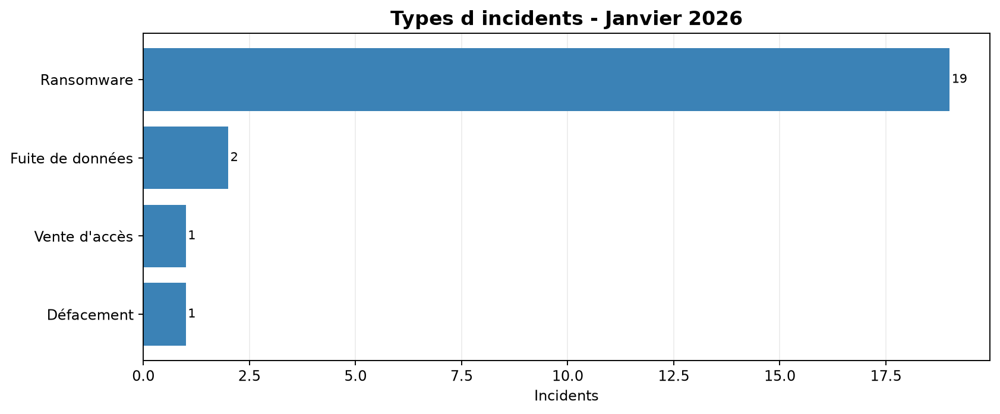
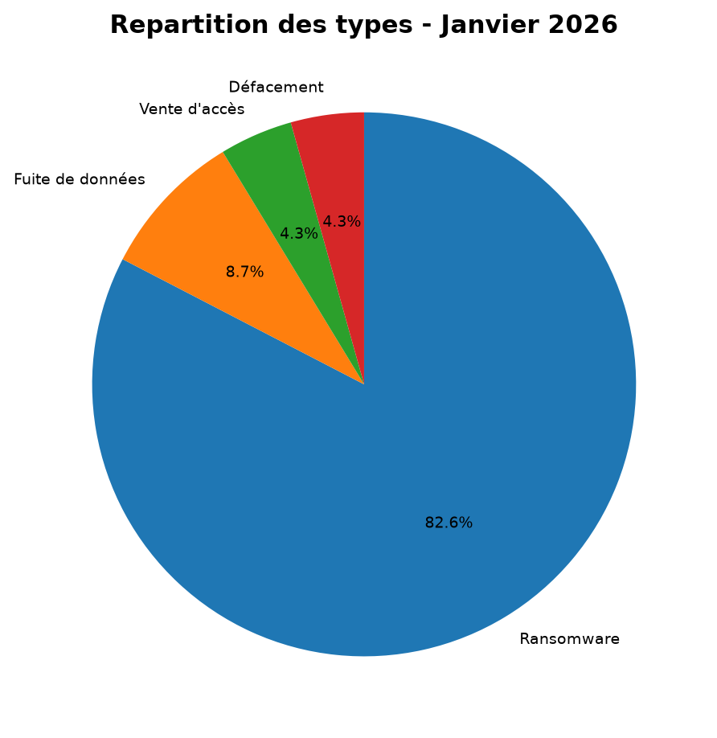
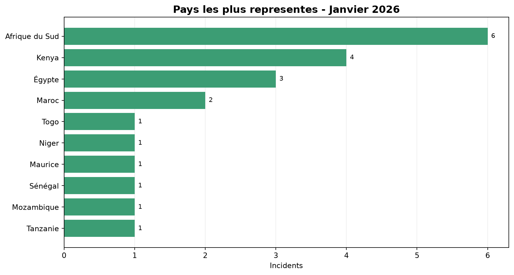
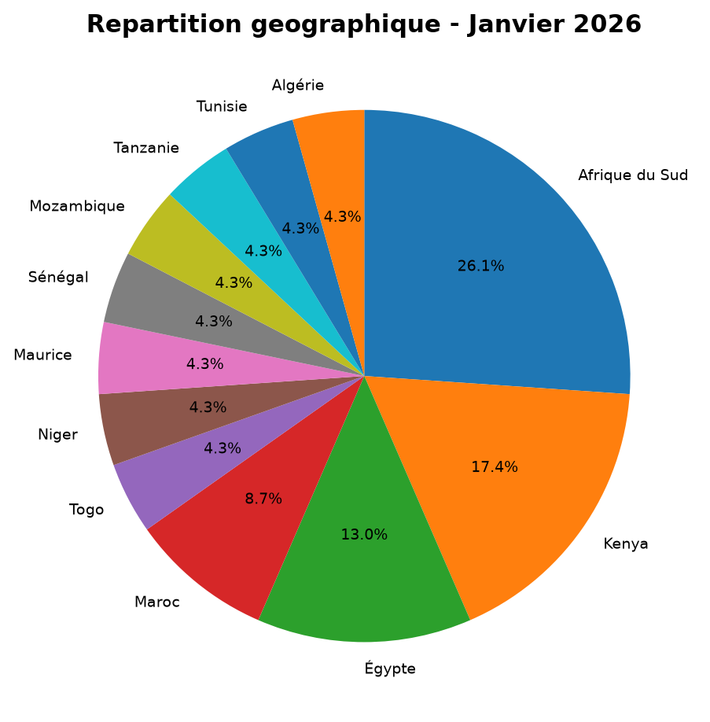
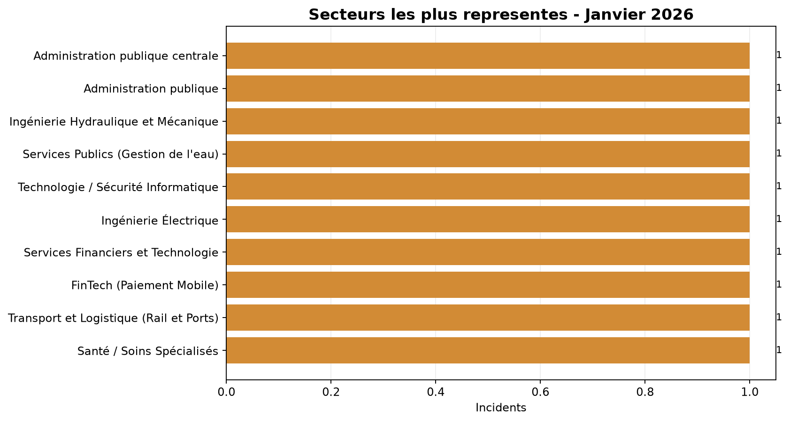
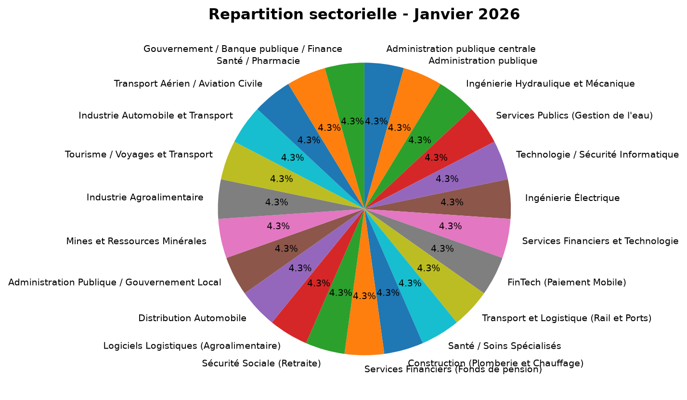
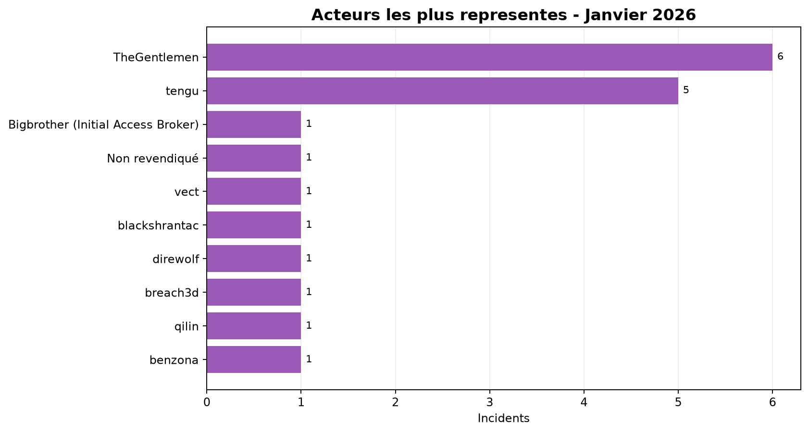
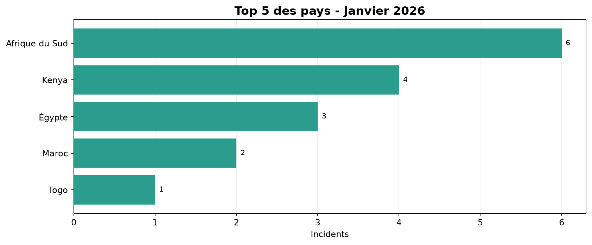

# Rapport CTI AFRINTEL - cyberincidents en Afrique (janvier 2026)

Ce corpus validé contient **23 incidents ou cas documentés** publiés pour la première fois ou observés pour la première fois par AFRINTEL en janvier 2026. Le rattachement mensuel suit la date de publication ou de première observation documentée ; aucune date de compromission n est déduite lorsqu elle est indisponible.

## Ventilation mensuelle validée

| Type d incident | Nombre | Part |
|---|---:|---:|
| Ransomware | 19 | 82.6% |
| Fuite de données | 2 | 8.7% |
| Vente d'accès | 1 | 4.3% |
| Défacement | 1 | 4.3% |
| **Total** | **23** | **100.0%** |

## Pays les plus représentés

| Pays | Nombre |
|---|---:|
| Afrique du Sud | 6 |
| Kenya | 4 |
| Égypte | 3 |
| Maroc | 2 |
| Togo | 1 |
| Niger | 1 |
| Maurice | 1 |
| Sénégal | 1 |
| Mozambique | 1 |
| Tanzanie | 1 |
| Tunisie | 1 |
| Algérie | 1 |

## Acteurs les plus représentés

| Libellé acteur | Nombre |
|---|---:|
| TheGentlemen | 6 |
| tengu | 5 |
| Bigbrother (Initial Access Broker) | 1 |
| Non revendiqué | 1 |
| vect | 1 |
| blackshrantac | 1 |
| direwolf | 1 |
| breach3d | 1 |
| qilin | 1 |
| benzona | 1 |

## Secteurs les plus représentés

| Secteur | Nombre |
|---|---:|
| Administration publique centrale | 1 |
| Administration publique | 1 |
| Ingénierie Hydraulique et Mécanique | 1 |
| Services Publics (Gestion de l'eau) | 1 |
| Technologie / Sécurité Informatique | 1 |
| Ingénierie Électrique | 1 |
| Services Financiers et Technologie | 1 |
| FinTech (Paiement Mobile) | 1 |
| Transport et Logistique (Rail et Ports) | 1 |
| Santé / Soins Spécialisés | 1 |

## Méthodologie

Les chiffres sont calculés une seule fois depuis `victims_FR.md`, contrôlés contre `victims.md`, puis réutilisés dans les rapports, comparaisons et bundles STIX. Un incident multi-pays compte une fois au total ; les occurrences par pays peuvent donc dépasser le total global. Le corpus mesure la visibilité documentée par AFRINTEL, pas la prévalence réelle des cyberattaques.

[Victim records](./victims_FR.md)

### Visualisations

