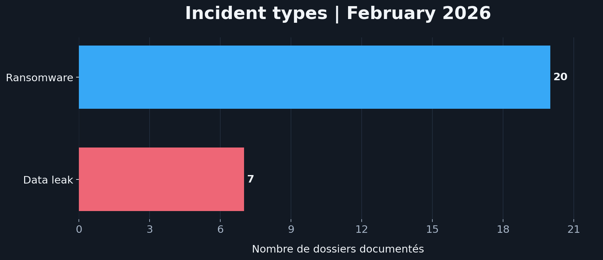
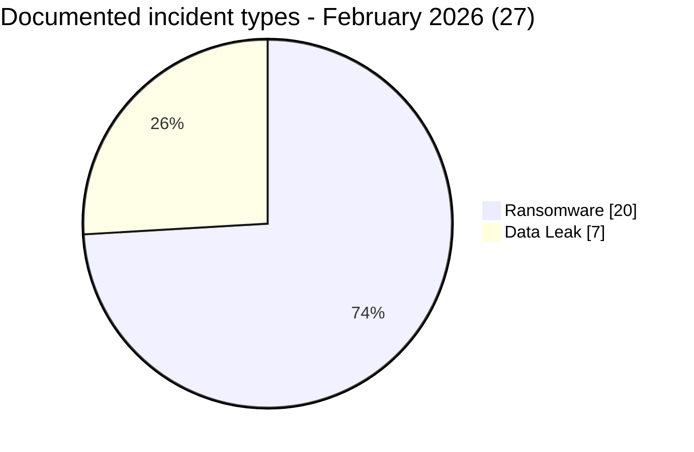
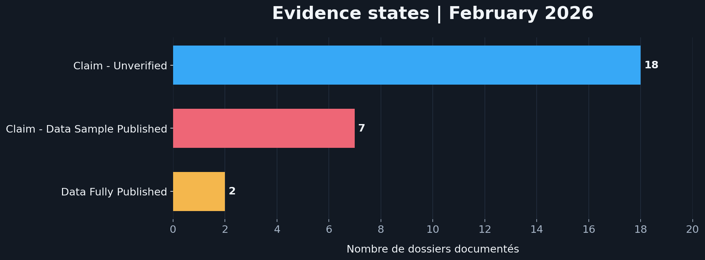
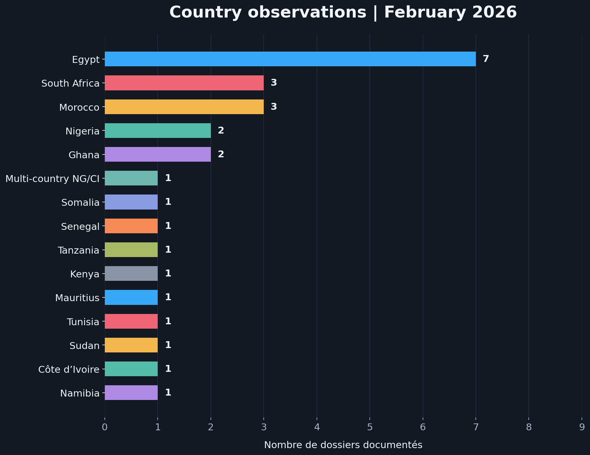
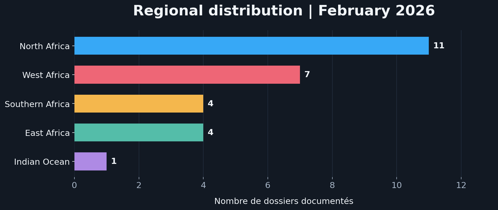
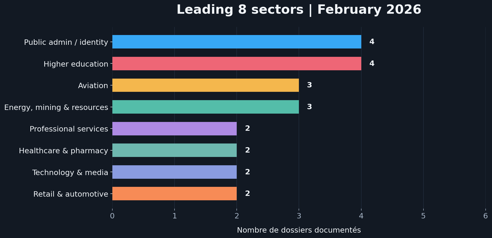
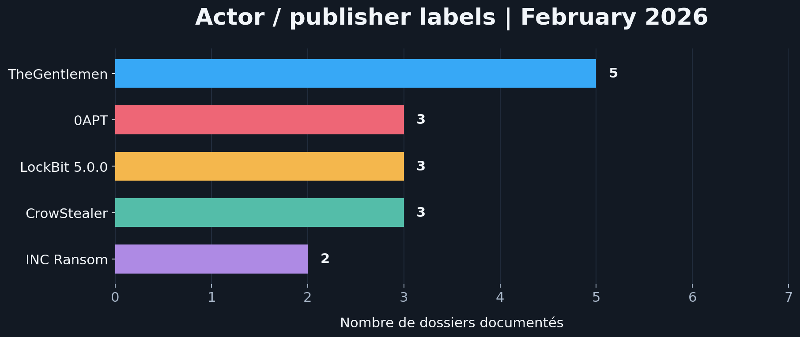

   

# AFRINTEL | Monthly cyber threat intelligence report
## Cyber threats affecting African organisations, February 2026

**Audience:** CISOs, CIOs, SOC/CERT leaders, risk and business continuity teams.  
**Period:** February 1–28, 2026, based on the initial publications described in the source corpus.  
**Edition:** November 6, 2026 | **Distribution:** TLP:CLEAR.  
👉🏾 [Version française](./README_FR.md) | [French victim records](./victims_FR.md) | [Detailed English records](./victims.md)

> **Evidence method - how to read this report.** AFRINTEL consolidates the OSINT investigations and post-disclosure examinations already documented in its victim records. **For ransomware listings**, analysts review the post and, when published, file inventories, previews and released documents to characterise the exposure. **For data leaks**, available samples are assessed for structure, fields, consistency, observed volume and business impact. Readers can therefore distinguish material actually reviewed from volumes merely claimed. First-party confirmations are identified separately; intrusion, encryption and full exfiltration are not assumed without supporting evidence.

## 1. Executive summary

In February 2026, AFRINTEL documents **27 records across 14 African countries**. Ransomware publications account for **20 cases (74.1%)**, while **seven records (25.9%)** concern data leaks. The supplied corpus contains no access sale, DDoS or defacement case. The month's defining issue is not a single technical attack pattern, but a convergence of business risks: exposure of sensitive data, release of professional documents, pressure on business continuity and third-party dependencies.

**Egypt (seven records)** leads the observed distribution, reflecting in particular leaks involving higher education and medical laboratory platforms. **South Africa and Morocco** follow with **three records each**. Aviation-related listings concern Somalia, Egypt and Côte d'Ivoire, while other publications involve energy, public administration and financial-service ecosystems.

The labels **TheGentlemen (five)**, **0APT (three)** and **LockBit 5.0.0 (three)** feature most prominently among ransomware listings. The name **CrowStealer (three)** appears in three Egyptian data-leak publications. These figures count **labels in records**, not independently attributed intrusions proven through forensics.

Three cases deserve prompt leadership attention: **Air Côte d'Ivoire**, due to an internal payroll document exposed in the context of a claimed 208 GB disclosure; **Getly**, due to KYC identity documents described in the sample; and **Shora Advisory**, due to possible exposure of files belonging to multiple client organisations. **Midwestern Oil & Gas** also illustrates the potential intelligence value of internal industrial and procurement documentation, without evidence of operational-technology compromise.

**Decisions for CISOs and CIOs:** identify the most sensitive data and business processes, check privileged and provider access, test isolated backup recovery, control bulk exports and prepare an antifraud response. **SOC priorities:** detect identity anomalies, unusual access to document repositories, large exports and early extortion indicators.

### 1.1 Comparison with January 2026

> This comparison uses the **31 recounted January records** and the **27 February records**. A change in AFRINTEL's publication count is not proof of an equivalent change in actual intrusions. Legacy headers in the source victim files still require editorial correction.

| Indicator | January | February | Documented change |
|---|---:|---:|---:|
| **Total** | **31** | **27** | **-4 (-12.9%)** |
| Ransomware | 19 | 20 | +1 (+5.3%) |
| Data Leak | 10 | 7 | -3 (-30.0%) |
| Access Sale | 1 | 0 | -1 (-100.0%) |
| DDoS | 0 | 0 | 0 (stable) |
| Defacement | 1 | 0 | -1 (-100.0%) |
| Account Takeover | 0 | 0 | 0 (stable) |
| System Intrusion | 0 | 0 | 0 (stable) |
| Malware | 0 | 0 | 0 (stable) |
| Operational Fraud | 0 | 0 | 0 (stable) |

Ransomware's share moves from **61.3% in January** to **74.1% in February**, primarily because the overall record count falls while ransomware listings remain close to the previous month's level. The relative increase does not prove an increase in attacks.

## 2. Scope, method and limitations

AFRINTEL monitors the **54 African countries** and publications affecting African organisations, infrastructure or individuals. February records are reconciled between `victims_FR.md` and `victims.md`. The **first documented publication date** is used when the technical incident date is unknown. The date of an older document does not automatically establish a February breach date.

The analysis distinguishes **observed** (a listing, sample structure or document described in the records), **claimed** (actor-reported volume, access or impact), **confirmed** (explicit independent recognition) and **unknown** (initial access, actual extent, persistence, encryption and ransom payment). A `Data Fully Published` label does not independently demonstrate the completeness of a release or official victim confirmation.

**Consistency review:** Both FR and EN source files contain **27 entries in the same order**. Their snapshot summaries still state “21 unique incidents, 20 ransomware, one data leak”, whereas the detailed records support **20 ransomware cases and seven data leaks**. The **Al Akhawayn University** and **Chezpara** leak records lack an explicit `Incident type` field; `Data Leak` is derived here from their headings and descriptions and should be added to both files. The initially supplied February charts cover only the **20 ransomware records** and therefore are not reused as whole-corpus charts in this report.

A claim concerning identity photographs linked to **Nigeria and Côte d'Ivoire** is counted as **one multi-country record**. It appears as `MULTI (NG/CI)` in the geographic table to avoid double-counting, while both countries remain included in the **14-country footprint**. No personal name, identity document, financial account detail, secret or sensitive sample is reproduced.

### AFRINTEL post-disclosure validation protocol

AFRINTEL's analysis begins **after an actor post or reported disclosure has been observed**. The reports do more than reproduce a listing: accessible evidence is compared with the organisation's context, assessed for technical consistency and assigned an explicit scope. The underlying **victim records** document the review that supports each reported finding.

| Case category | Assessment performed when material is available | What the evidence supports |
|---|---|---|
| **Ransomware / extortion** | Post-disclosure review of the listing, chronology, file trees, previews and publicly released documents; comparison with the victim's business activity; independent-source checks. | The published claim and, when supported, the nature of the data actually disclosed. Encryption, disruption, total volume and initial access require separate evidence. |
| **Data leak** | Examination of **available samples** (CSV, SQL, JSON, documents, screenshots or metadata), their schema, fields, dates, observed counts and internal inconsistencies; comparison with the platform's context. | Content, consistency and sensitivity of the reviewed material; not automatic validation of the entire claimed dataset. |
| **Claim with no usable sample** | Documentation of the listing, date, source and named organisation; independent corroboration attempts. | Existence of the claim only; no affirmative finding about unseen data. |
| **Officially acknowledged incident** | Cross-checking victim or relevant authority statements, preserving the stated dates and scope. | Precisely what the primary source confirms, without extending it to unrelated actor assertions. |

**Evidence workflow:** *observed publication* → *available material examined* → *consistency and scope assessed* → *independent corroboration where available* → *business impact and SOC hypotheses*. Sensitive values and individual identities are not reproduced. **Where no sample was available, the record states that explicitly; this does not weaken the methodology applied to cases with reviewed material.**

**Traceable case examples:** **Air Côte d'Ivoire** describes a payroll document covering **529 employees**, distinct from the **208 GB** claimed; **Shora Advisory** includes released sample documents and file trees; **Midwestern Oil & Gas** has document previews; **Getly** has KYC documents. Other listings without examined samples remain documented claims, not verified full releases.

## 3. Statistical overview

### 3.1 Incident types

| Type | Records | Share |
|---|---:|---:|
| **Ransomware** | **20** | **74.1%** |
| **Data Leak** | **7** | **25.9%** |
| Other AFRINTEL incident types | 0 | 0.0% |
| **Total** | **27** | **100%** |

The 20 ransomware records are **extortion-related listings associated with a group or publishing account**. Their existence does not establish encryption, complete exfiltration or operational disruption in every case. The seven data leaks describe sales, publications or samples; some may concern older data or third-party environments.

### 3.2 Evidence states

| AFRINTEL status | Records | Share |
|---|---:|---:|
| `Claim - Unverified` | 18 | 66.7% |
| `Claim - Data Sample Published` | 7 | 25.9% |
| `Data Fully Published` | 2 | 7.4% |
| **Total** | **27** | **100%** |

The two `Data Fully Published` cases are **Canadian International College (CIC)** and **Air Côte d'Ivoire**. This label describes the disclosure status recorded in the victim files, not independent verification of the complete advertised content.

## 4. Geographic distribution and regional exposure

| Country or scope | Records | Country or scope | Records |
|---|---:|---|---:|
| 🇪🇬 Egypt | 7 | 🇸🇴 Somalia | 1 |
| 🇿🇦 South Africa | 3 | 🇸🇳 Senegal | 1 |
| 🇲🇦 Morocco | 3 | 🇹🇿 Tanzania | 1 |
| 🇳🇬 Nigeria | 2 | 🇰🇪 Kenya | 1 |
| 🇬🇭 Ghana | 2 | 🇲🇺 Mauritius | 1 |
| 🇹🇳 Tunisia | 1 | 🇸🇩 Sudan | 1 |
| 🇨🇮 Côte d'Ivoire | 1 | 🇳🇦 Namibia | 1 |
| **MULTI: Nigeria / Côte d'Ivoire** | **1** | **Total** | **27** |

Egypt's share (**25.9% of the corpus**) reflects **four data-leak publications** concerning medical laboratories, CIC, Heliopolis University and HIMS University. This concentration also depends on the visibility of collected sources, not solely on actual adversary activity.

| Monitoring region | Records | Share |
|---|---:|---:|
| North Africa (Egypt, Morocco, Tunisia) | 11 | 40.7% |
| West Africa (including one NG/CI case) | 7 | 25.9% |
| Southern Africa (South Africa, Namibia) | 4 | 14.8% |
| East Africa (Somalia, Kenya, Tanzania, Sudan) | 4 | 14.8% |
| Indian Ocean (Mauritius) | 1 | 3.7% |
| **Total** | **27** | **100%** |

**Geographic convention:** Mauritius is shown separately under “Indian Ocean” rather than incorrectly placed in Central Africa. Sudan is assigned to East Africa for this analysis. Month-to-month comparisons must apply the same grouping to both periods or explicitly recalculate both.

## 5. Sector impact and critical dependencies

The sector distribution reflects the **main business activity of the victim or the exposed information**, rather than only the raw label used in a listing. It is not directly comparable with a January table built using a different taxonomy.

| Normalised sector family | Records | Main risk |
|---|---:|---|
| Public administration and identity-related data | 4 | Essential services, citizen records, administrative integrity; includes a dataset with no named institutional victim |
| Higher education | 4 | Student accounts, academic information, credentials and targeted fraud |
| Air transport / aviation | 3 | Service continuity, HR/payroll data and supplier relationships |
| Energy, mining and resources | 3 | Operational intelligence, contracts and industrial dependencies |
| Professional services (legal/accounting) | 2 | Client file confidentiality and downstream impact |
| Healthcare and pharmacy distribution | 2 | Patient or customer data confidentiality |
| Technology and media | 2 | Digital services, internal accounts and third-party exposure |
| Retail and automotive distribution | 2 | Commercial disruption, customer and supplier data |
| Finance / FinTech | 1 | KYC identity verification and fraud |
| Security and logistics | 1 | Provider networks and service operations |
| Hospitality | 1 | Booking services and business application availability |
| Real estate | 1 | Contract and commercial data |
| Agriculture / agribusiness | 1 | Sensitive operations and supplies |
| **Total** | **27** | |

The **public administration/identity** and **higher education** families each comprise four records. For CIOs, the cross-cutting issue is an accurate inventory of interconnected platforms and providers with broad data access. For CISOs, the priority is identifying data that can cause long-lasting harm even when production systems remain available.

## 6. Actor, group and publishing-account profile

| Observed label | Records | Publication context |
|---|---:|---|
| **TheGentlemen** | **5** | Ransomware: Kenya, Ghana, Egypt, South Africa, Tunisia |
| **0APT** | **3** | Ransomware: Somalia, Ghana, Tanzania |
| **LockBit 5.0.0** | **3** | Ransomware: Mauritius, Egypt, South Africa |
| **CrowStealer** | **3** | Egyptian data-leak publications (laboratories, CIC, Heliopolis) |
| **INC Ransom (`incransom`)** | **2** | Ransomware: Nigeria and Côte d'Ivoire |
| 11 other labels appearing once each | 11 | Separate claims and publishing accounts |
| **Total** | **27** | |

This table does not automatically attribute initial access to the publishing account. `CrowStealer` is treated as an **observed publishing label**, not evidence on its own of a particular malware, unified campaign or structured group. Likewise, the name `apt73/bashe` in one record does not justify an attribution to an established APT group. Repeated ransomware branding measures publication activity, without proving a common intrusion chain.

## 7. Analysis of the two incident categories

### 7.1 Ransomware: service pressure and third-party data

The 20 ransomware records cover government services, transportation, energy, industry and service providers. The potential consequences combine **system unavailability** and **document disclosure** that may remain damaging long after the original publication. The supplied records do not establish outages in every case.

**Aviation:** BlueSky Aviation (Somalia), Nile Air (Egypt) and Air Côte d'Ivoire appear in separate publications. For Air Côte d'Ivoire, INC Ransom's leak site advertises **approximately 208 GB**. A payroll document reviewed by AFRINTEL concerns **529 employees** and is dated **June 21, 2022**; this establishes exposure of a sensitive excerpt in the reviewed corpus, **not independent verification of 208 GB exfiltrated or a February 2026 initial-access date**. Airlines should protect HR data, payroll transfers, booking systems and provider dependencies without presuming that flight safety systems were affected.

**Energy and industrial operations:** the **Midwestern Oil & Gas** record describes previews of finance, audit, pipeline maintenance, HSE, engineering and procurement documents. Their variety is consistent with broad access to shared documents; **no intrusion into OT/ICS has been demonstrated**. **EnerTec** (South Africa) is also named in a claim, without enough technical detail to establish impact.

**Providers and downstream risk:** for **Shora Advisory** (Morocco), the actor advertises **approximately 23.5 GB**, **16,000 files** and **2,000 folders**. The described samples contain accounting documents and client-organised directories. Because Shora is an accounting/audit provider, several client organisations could be indirectly exposed. Payment-redirection fraud, supplier impersonation and targeted phishing are plausible consequences, but the complete archive has not been verified.

**Government and continuity:** the claims naming **DAF Senegal**, **Egypt's Ministry of Agriculture** and **Intsika Yethu Municipality** warrant monitoring for status changes and public announcements. The DAF Senegal snapshot mentions **139 TB claimed**; the individual record does not provide sufficient evidence to independently check that volume. It must not be stated as verified exfiltration.

### 7.2 Data leaks: identities, user accounts and sensitive records

**Egyptian education:** publications concerning **Canadian International College (2,925 advertised records)**, **Heliopolis University (19,790 claimed; 62 accounts in the described workbook)** and **HIMS University (28,124 claimed)** illustrate student/staff impersonation and phishing risks. For HIMS, the displayed file-level figures total **28,004**, **120 fewer** than the advertised figure. The material does not independently validate claims of plaintext credentials or payment API secrets. Heliopolis samples include password hashes, but no malicious reuse is established.

**Healthcare:** a publishing account called CrowStealer claims data linked to **four Egyptian laboratory platforms**, with **5,529 advertised patient-result records**. Data ownership and relationships between the four domains are unresolved. **Chezpara.ma** (Morocco) is associated with a claim of **about 400,000 customer records**, a volume not independently validated by the supplied source.

**Identity data:** a publication claims **10,669 identity-document photographs** from Nigeria and Côte d'Ivoire, including **1,500 allegedly shared**. No reliable institutional owner is established and the complete collection has not been verified. The potential identity-fraud impact is material, but the source record's confidence remains **Low**.

**Al Akhawayn University (Morocco):** the publisher asserts a new dataset is authentic and calls an earlier leak fabricated. This does not amount to independent validation. The unresolved history calls for careful sample comparison and repost monitoring rather than an immediate conclusion that a second compromise occurred.

## 8. Cases requiring leadership review

| Review priority | Case | Usable documentary evidence | Main business risk | Key limitation |
|---|---|---|---|---|
| **P1** | Air Côte d'Ivoire | Internal payroll document for 529 employees; 208 GB claimed by leak site | Financial fraud, employee protection, providers, reputation | Full volume and intrusion date unknown |
| **P1** | Getly (Nigeria) | KYC/NIN documents visible in described samples | Identity theft and fraudulent onboarding | Scope and access vector unknown |
| **P1** | Shora Advisory (Morocco) | Client accounting sample; 23.5 GB archive claimed | Client confidentiality and payment fraud | Full archive not examined |
| **P1** | Midwestern Oil & Gas (Nigeria) | Previews of HSE, pipeline, contracts and engineering records | Sensitive business intelligence and supplier fraud | No evidence of OT/ICS compromise |
| **P2** | Heliopolis / CIC / HIMS (Egypt) | Published/advertised student and user account data | Targeted phishing, account reuse, confidentiality | Claimed totals not fully verified |
| **P2** | Medical laboratories (Egypt) | Claimed patient-result schema | Confidentiality of health information | Ownership unresolved |
| **P2: enhanced monitoring** | DAF Senegal / NG-CI identity dataset | Sensitive claims with insufficient evidence | Public-sector and identity exposure | Attribution and volumes unresolved |

**P1/P2 indicate a defensive review priority**, not a forensic severity score or confirmation of operational outages at the named victims. They help organisations prioritise comparable exposure scenarios.

## 9. Publication timeline

| Initial publication | Main signal |
|---|---|
| February 1–2 | Grouped leaks involving Egyptian laboratories and universities; BlueSky Aviation; multi-country identity data |
| February 5–6 | Claims involving DAF Senegal, Global Media Alliance, Vertex Law Chambers and Wells Fargo Kenya |
| February 8–12 | Al Akhawayn University, Getly, Ghana Bauxite and Midwestern Oil & Gas |
| February 13–18 | Nile Air, Sands Suites, Intsika Yethu, BITS, SODIC and Amtaar Investment |
| February 19–20 | Air Côte d'Ivoire, Shora Advisory and Egypt's Ministry of Agriculture |
| February 22–27 | CYMOT, Chezpara, EnerTec and Diesel-Electric |

The publication sequence is not a technical initial-access timeline. Older evidence, notably the 2022 payroll document in the Air Côte d'Ivoire case, retains its original date.

## 10. CTI findings and priority intelligence gaps

**First finding:** ransomware listings remain the majority, but leaked accounts, identity data and financial documents create durable fraud exposure independent of encryption. **Second:** providers, including accounting firms, digital suppliers and financing platforms, may expose multiple downstream organisations. **Third:** adversary-side publication visibility far exceeds the available understanding of intrusion mechanisms; most cases lack a public DFIR chronology in the supplied corpus.

| Intelligence gap | Why it matters | Useful follow-up |
|---|---|---|
| Real published volume in Air Côte d'Ivoire / Shora / DAF | Exposure scope and notifications | Release status, verified inventory, official statement |
| Technical provenance of HIMS / Heliopolis / lab data | Distinguish direct compromise, provider loss and repost | Minimised sample comparison, access logs, institutional notice |
| Ownership of NG/CI identity dataset | Avoid unfounded government attribution | Non-PII metadata, authoritative confirmation, source provenance |
| Diesel-Electric repost risk | Avoid counting the same incident again in subsequent months | Dates, file trees, samples, volume and operator context |
| Ransomware operational impact | Distinguish leak listing from outage | Public statements, service indicators and DFIR evidence |

Future collection should preserve **listing observation date, sample state, countdown, disclosure state, victim confirmation and last verification** separately. An expired deadline or removed listing is not evidence of payment, successful negotiation or data resale.

## 11. MITRE ATT&CK mapping and SOC hypotheses

> **Contextual ATT&CK:** these techniques support defensive control development. **They are not attributed to actors in this corpus**, as the supplied records do not contain the DFIR telemetry needed to establish actual TTPs.

| Technique | Behavioural hypothesis | SOC telemetry | Relevant case category |
|---|---|---|---|
| [T1078 - Valid Accounts](https://attack.mitre.org/techniques/T1078/) | Privileged account access in an unusual context followed by sensitive-data access | IdP/SSO, AD, VPN, PAM, application logs | Education, professional services and business platforms |
| [T1190 - Exploit Public-Facing Application](https://attack.mitre.org/techniques/T1190/) | Abnormal activity on an exposed app preceding extraction | WAF, reverse proxy, API gateway, application | Portals and data platforms |
| [T1213 - Data from Information Repositories](https://attack.mitre.org/techniques/T1213/) | Bulk read/copy from HR, financial or technical repositories | File audit, Microsoft 365, NAS, DLP, EDR | Shora, Midwestern, Air Côte d'Ivoire |
| [T1074 - Data Staged](https://attack.mitre.org/techniques/T1074/) | Unusual collection of large archives before transfer | Sysmon, EDR, file audit, storage logs | Client folders and internal documents |
| [T1486 - Data Encrypted for Impact](https://attack.mitre.org/techniques/T1486/) | Rapid encryption, mass file modification, suspicious processes | EDR, Sysmon, file audit, backup events | Ransomware scenarios; **not confirmed in each listing** |
| [T1490 - Inhibit System Recovery](https://attack.mitre.org/techniques/T1490/) | Suspicious deletion or tampering with backup snapshots | EDR, backup logs, hypervisor | Preventive ransomware control |

### 11.1 Recommended L1/L2 SOC workflow

1. **Qualify context:** identify the asset, application owner, technical accounts, data sensitivity and any known incident; a leak-site name is not itself a confirmed internal alert.
2. **Correlate identity and access:** align authentication, privileges, MFA, VPN/PAM and permission changes around anomalous access. Relevant Windows event IDs include `4624`, `4672` and `4728/4732`, where available and applicable.
3. **Hunt for collection and export:** compare file reads, download volume, archive creation, API traffic and storage changes against the account's historical behaviour.
4. **Evaluate the sequence:** unusual exports **plus** privilege escalation **plus** a novel destination is generally more meaningful than a single threshold; document expected business operations and false positives.
5. **Contain and preserve:** escalate to N2/N3/CSIRT, preserve evidence, revoke actually compromised access and isolate assets only according to approved playbooks; assess business impact before disruption.
6. **Report to CISO/CIO:** clearly separate established facts, hypotheses, data affected, investigation scope, downstream risks and notification decisions.

### 11.2 Priority detection use cases

| SIEM use case | Detection hypothesis | SOC validation |
|---|---|---|
| **Bulk document exports** | Unusually high number or volume of sensitive document downloads | Compare to baseline, account role and planned accounting operations |
| **Privileged account / new context** | Login from unusual device/country followed by sensitive share access | Verify authorised changes, VPN, MFA, bastion and previous behaviour |
| **Accounting / HR file collection** | Rapid access to client/payroll folders followed by archive creation | Identify process, host, destination and legitimate workflows |
| **Ransomware precursors** | Mass file writes, unusual extensions and concurrent EDR alerts | Identify process, initial host, privilege context and backups |
| **API or secret misuse** | Abnormal API calls, authentication errors, tokens used after rotation | Check gateway, secret manager and known application exceptions |

## 12. Prioritised recommendations for CISOs, CIOs and SOC teams

| Timing | CISO / governance | CIO / operations | SOC / CTI |
|---|---|---|---|
| **0–7 days** | Validate critical data and services; assign incident/fraud owners; require out-of-band bank-detail change verification | Review backups, privileged/provider access to essential services and log preservation | Hunt for abnormal exports and privileged logins; reconcile external claims with internal evidence |
| **8–30 days** | Reassess provider obligations, notifications and retention; rank high-access vendors | Deploy strong MFA/PAM, harden APIs/storage, test representative restoration | Test behavioural SIEM rules; improve EDR/AD/cloud/API visibility and ingestion coverage |
| **31–90 days** | Exercise a ransomware + data leak + fraud scenario; measure data-protection outcomes | Segment sensitive zones, limit large exports, ensure isolated and restorable backups | Operationalise L1/L2/N3 playbooks, lessons learned, status monitoring and CTI deduplication |

**Suggested metrics:** coverage of critical assets with EDR and searchable logs; proportion of privileged identities protected by MFA/PAM; secret revocation time; restoration test success; time to triage a suspicious export; coverage of high-access vendors; and documented closure rate of CTI notifications.

**Executive recommendation:** maintain a shared view of **business risk + application dependency + detection capability**. CISOs decide the priority risk scenarios, CIOs ensure telemetry and resilience, and SOC teams demonstrate detection and escalation. Without this linkage, leak intelligence remains descriptive rather than operationally useful.

## 13. Conclusion and monitoring outlook

The February 2026 corpus combines **20 ransomware publications** and **seven data-leak records**, with notable exposure across higher education, public administration, aviation and organisations holding client information. Air Côte d'Ivoire, Getly, Shora Advisory and Midwestern Oil & Gas illustrate different consequences: financial fraud, identity theft, loss of client confidentiality and exposure of sensitive business documents.

The priority is not to treat all **27 publications** as confirmed intrusions. It is to track evidence, identify actual exposure, strengthen resilience and give the SOC testable hypotheses. **Statuses and claimed volumes should be updated as evidence changes, without overwriting the historical timeline.**

*AFRINTEL - Open African Cyber Threat Intelligence Monitoring | TLP:CLEAR*  
*Corpus: [victims_FR.md](./victims_FR.md) · [victims.md](./victims.md) · [AFRINTEL repository](https://github.com/Hatchepsoute/AFRINTEL)*
