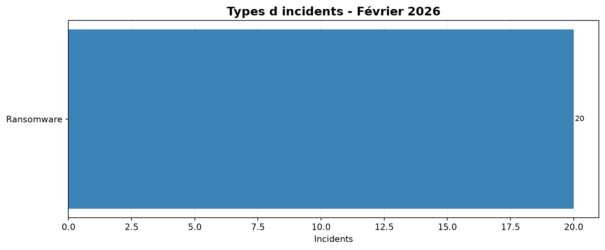
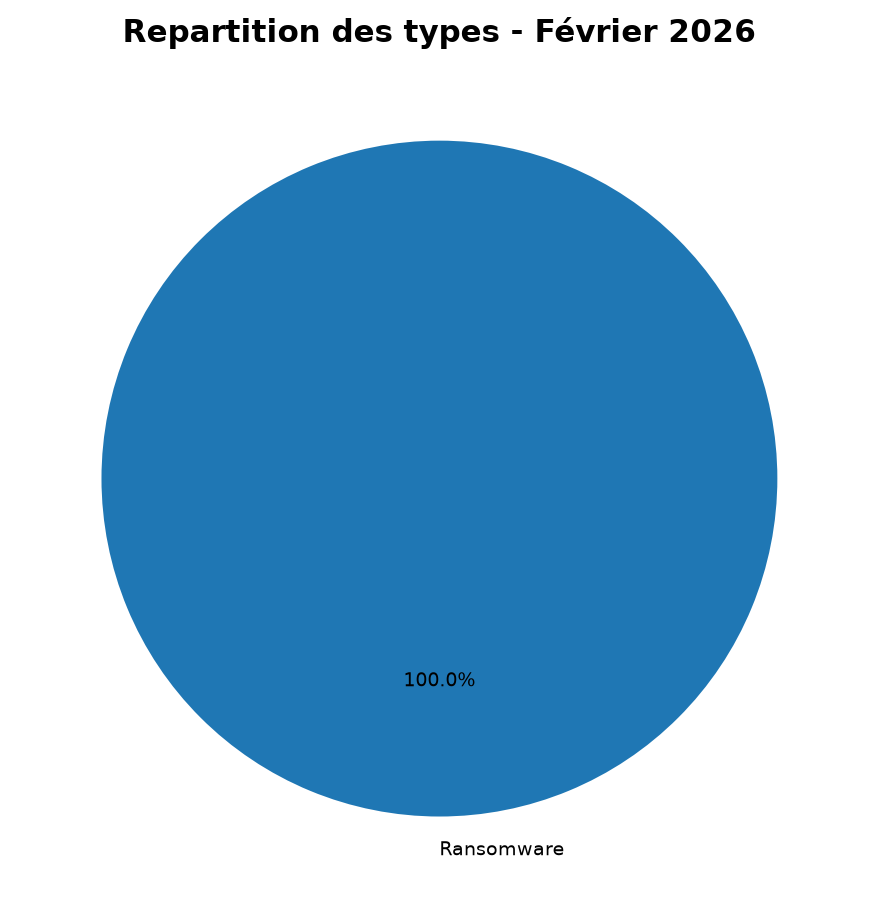
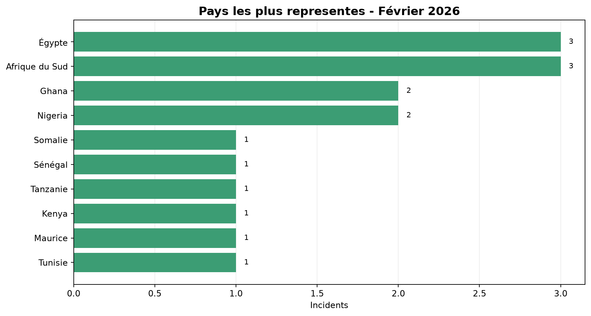
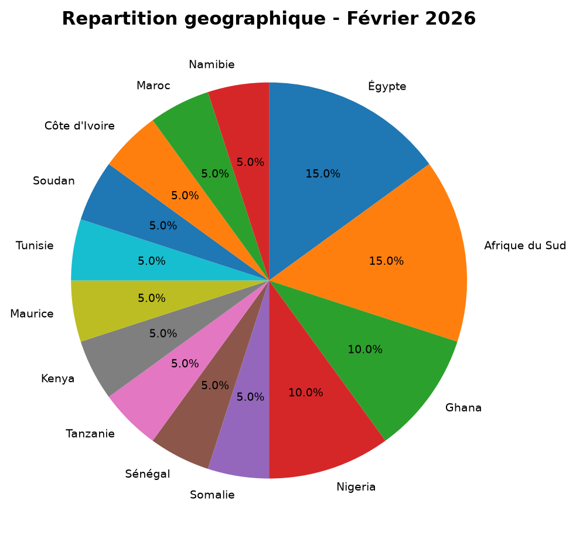
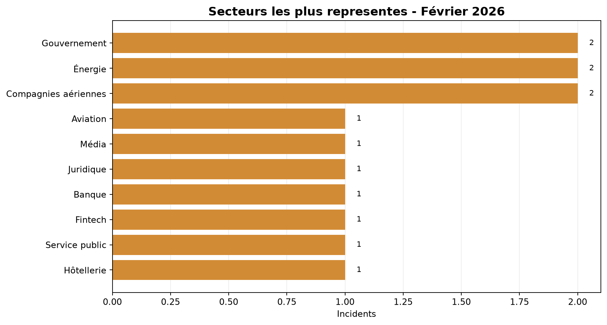
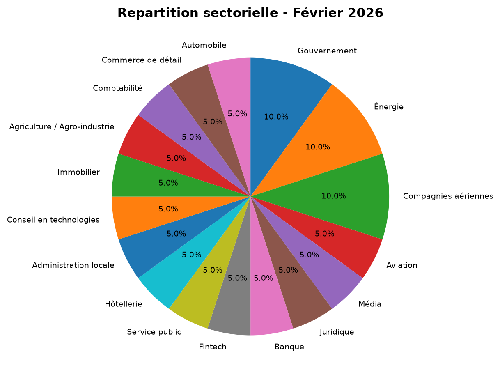
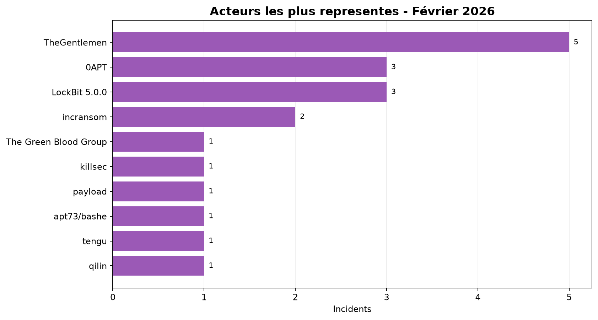
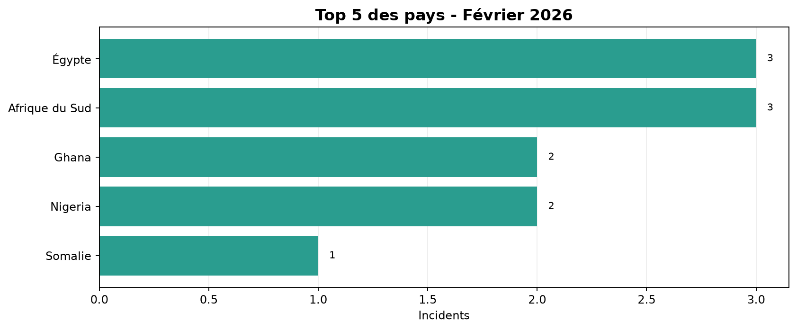

# Rapport CTI AFRINTEL - cyberincidents en Afrique (février 2026)

Ce corpus validé contient **21 incidents ou cas documentés** publiés pour la première fois ou observés pour la première fois par AFRINTEL en février 2026. Le rattachement mensuel suit la date de publication ou de première observation documentée ; aucune date de compromission n est déduite lorsqu elle est indisponible.

## Ventilation mensuelle validée

| Type d incident | Nombre | Part |
|---|---:|---:|
| Ransomware | 20 | 100.0% |
| Fuite de données | 1 | 4.8% |
| **Total** | **21** | **100.0%** |

## Pays les plus représentés

| Pays | Nombre |
|---|---:|
| Égypte | 4 |
| Afrique du Sud | 3 |
| Ghana | 2 |
| Nigeria | 2 |
| Somalie | 1 |
| Sénégal | 1 |
| Tanzanie | 1 |
| Kenya | 1 |
| Maurice | 1 |
| Tunisie | 1 |
| Soudan | 1 |
| Côte d'Ivoire | 1 |
| Maroc | 1 |
| Namibie | 1 |

## Acteurs les plus représentés

| Libellé acteur | Nombre |
|---|---:|
| TheGentlemen | 5 |
| 0APT | 3 |
| LockBit 5.0.0 | 3 |
| incransom | 2 |
| The Green Blood Group | 1 |
| killsec | 1 |
| payload | 1 |
| apt73/bashe | 1 |
| tengu | 1 |
| qilin | 1 |

## Secteurs les plus représentés

| Secteur | Nombre |
|---|---:|
| Gouvernement | 2 |
| Énergie | 2 |
| Compagnies aériennes | 2 |
| Aviation | 1 |
| Média | 1 |
| Juridique | 1 |
| Banque | 1 |
| Fintech | 1 |
| Service public | 1 |
| Hôtellerie | 1 |

## Méthodologie

Les chiffres sont calculés une seule fois depuis `victims_FR.md`, contrôlés contre `victims.md`, puis réutilisés dans les rapports, comparaisons et bundles STIX. Un incident multi-pays compte une fois au total ; les occurrences par pays peuvent donc dépasser le total global. Le corpus mesure la visibilité documentée par AFRINTEL, pas la prévalence réelle des cyberattaques.

[Victim records](./victims_FR.md)

### Visualisations

