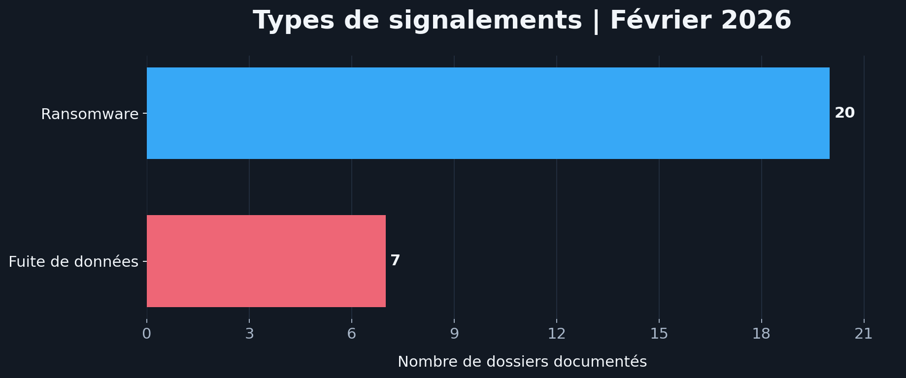
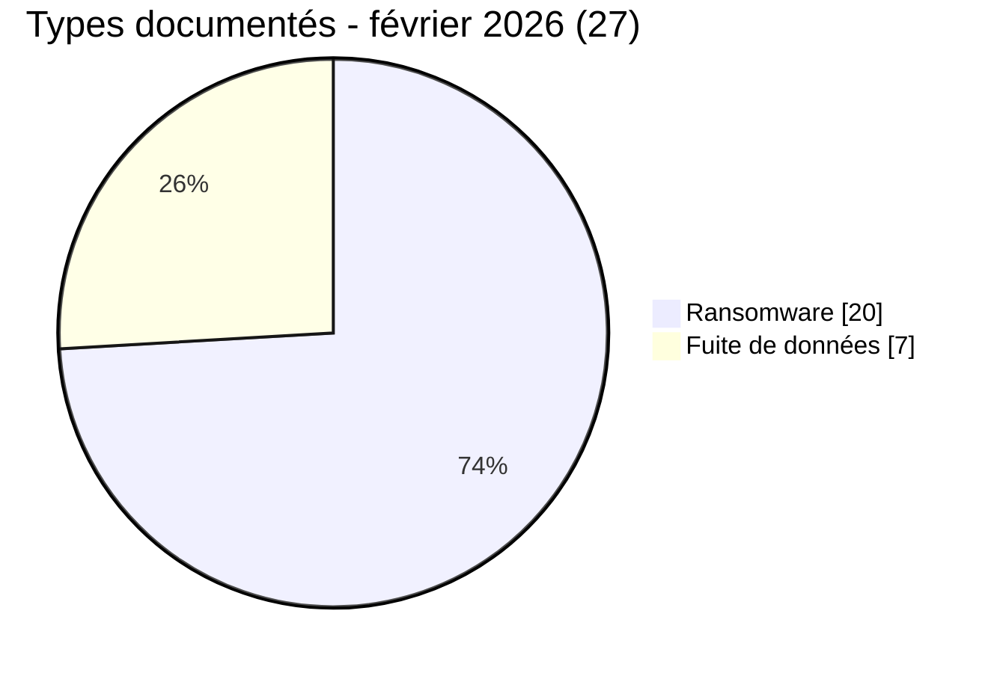
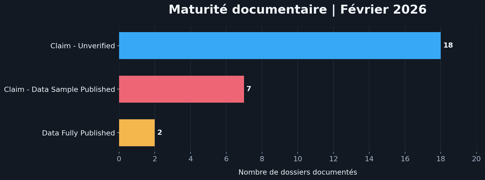
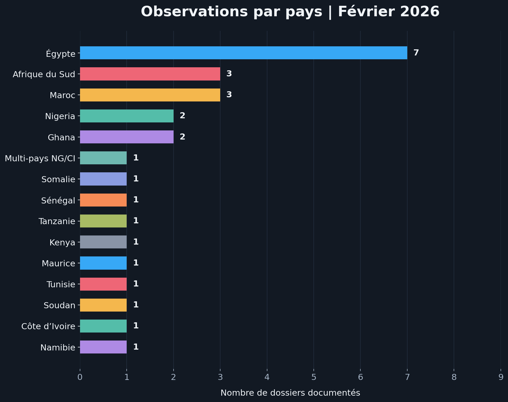
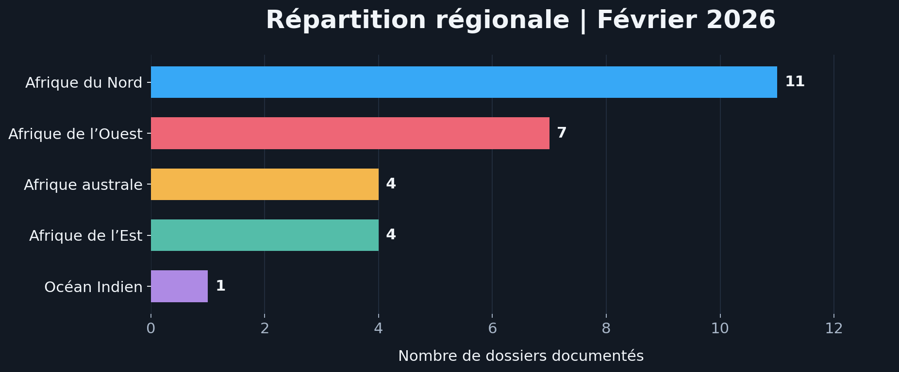
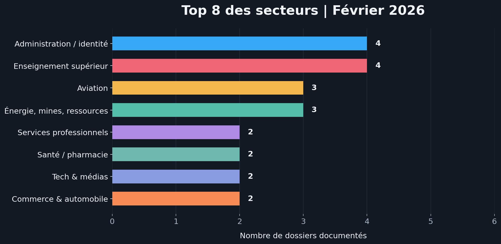
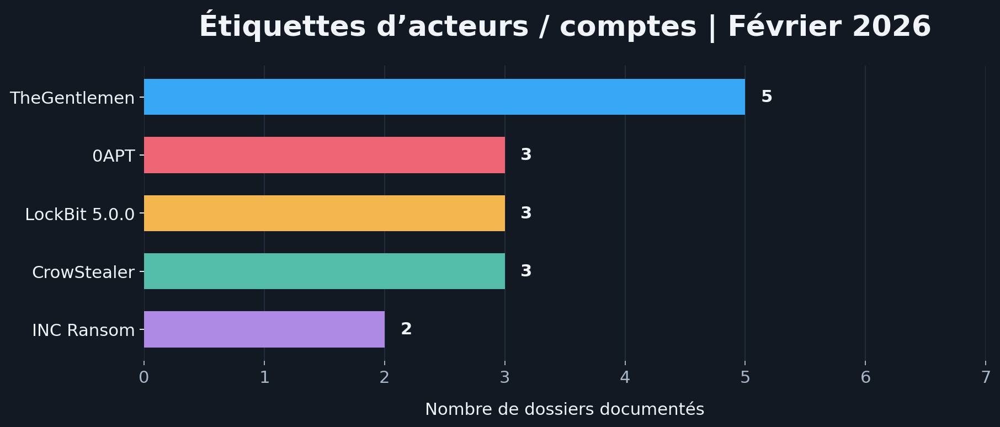

   

# AFRINTEL | Rapport mensuel de cyber threat intelligence
## Cybermenaces visant les organisations africaines, février 2026

**Public cible :** RSSI, DSI, responsables SOC/CERT, directions des risques et de la continuité d'activité.  
**Période couverte :** 1er au 28 février 2026, sur la base des publications initiales décrites dans le corpus.  
**Édition :** 6 novembre 2026 | **Diffusion :** TLP:CLEAR.  
👉🏾 [English version](./README.md) | [Fiches victimes en français](./victims_FR.md) | [Victim records in English](./victims.md)

> **Méthodologie de preuve - lecture du rapport.** AFRINTEL consolide les investigations OSINT et analyses post-divulgation déjà consignées dans les fiches victimes. **Pour les dossiers ransomware**, les annonces et, lorsque publiés, les inventaires, aperçus et documents divulgués sont analysés afin de caractériser l'exposition. **Pour les fuites de données**, les échantillons disponibles sont examinés (structure, champs, cohérence, volume observé et risque métier). Le lecteur peut ainsi distinguer un contenu effectivement analysé d'un volume simplement revendiqué. Les confirmations officielles sont identifiées séparément ; le rapport ne suppose ni intrusion, ni chiffrement, ni exfiltration exhaustive sans pièces correspondantes.

## 1. Synthèse exécutive

En février 2026, AFRINTEL documente **27 dossiers dans 14 pays africains**. Les publications ransomware dominent avec **20 cas (74,1 %)** ; **7 fiches (25,9 %)** relèvent des fuites de données. Aucune vente d'accès, attaque DDoS ou opération de défacement n'est enregistrée dans le corpus fourni. Le mois se caractérise moins par une homogénéité technique des attaques que par une convergence des risques : divulgation de données sensibles, exposition de documents professionnels, pression sur la continuité d'activité et dépendance envers les prestataires.

L'**Égypte (7 dossiers)** arrive en tête, portée notamment par des publications visant l'enseignement supérieur et des plateformes de laboratoires médicaux. L'**Afrique du Sud** et le **Maroc** suivent avec **3 dossiers chacun**. Les signalements concernant l'aviation couvrent la Somalie, l'Égypte et la Côte d'Ivoire ; d'autres publications ciblent l'énergie, l'administration publique et la chaîne de services financiers.

Les libellés **TheGentlemen (5)**, **0APT (3)** et **LockBit 5.0.0 (3)** dominent les publications de type ransomware. Le compte **CrowStealer (3)** est associé à trois publications de fuites en Égypte. Ce classement mesure des **mentions dans les dossiers**, pas des intrusions indépendantes attribuées de manière forensique.

Trois affaires appellent une attention prioritaire des directions : **Air Côte d'Ivoire**, pour l'exposition d'un document interne de paie dans le contexte d'une divulgation revendiquée de 208 Go ; **Getly**, pour des pièces d'identité KYC visibles dans des échantillons ; et **Shora Advisory**, pour la possible exposition de dossiers appartenant à plusieurs organisations clientes. Le cas **Midwestern Oil & Gas** ajoute un risque de renseignement sur des processus industriels et des relations fournisseurs, sans preuve de compromission des systèmes opérationnels.

**Décisions proposées aux RSSI et DSI :** identifier les données et processus métiers les plus sensibles, vérifier les accès privilégiés et prestataires, éprouver la restauration hors ligne, contrôler les extractions massives et préparer une réponse antifraude. **Pour le SOC :** détecter les anomalies de comptes, les consultations de dépôts documentaires, les exportations inhabituelles et les signaux précurseurs d'extorsion.

### 1.1 Comparaison avec janvier 2026

> Comparaison entre les **31 fiches recomptées de janvier** et les **27 fiches de février**. Une variation du nombre de publications dans AFRINTEL n'établit pas une évolution du nombre réel de compromissions sur le continent. Les en-têtes historiques des fichiers victimes nécessitent une correction éditoriale.

| Indicateur | Janvier | Février | Évolution documentée |
|---|---:|---:|---:|
| **Total** | **31** | **27** | **-4 (-12,9 %)** |
| Ransomware | 19 | 20 | +1 (+5,3 %) |
| Data Leak | 10 | 7 | -3 (-30,0 %) |
| Access Sale | 1 | 0 | -1 (-100,0 %) |
| DDoS | 0 | 0 | 0 (stable) |
| Defacement | 1 | 0 | -1 (-100,0 %) |
| Account Takeover | 0 | 0 | 0 (stable) |
| System Intrusion | 0 | 0 | 0 (stable) |
| Malware | 0 | 0 | 0 (stable) |
| Operational Fraud | 0 | 0 | 0 (stable) |

La part du ransomware passe de **61,3 % en janvier** à **74,1 % en février**, principalement parce que le nombre total de fiches baisse alors que les revendications ransomware restent proches du mois précédent. Cette hausse relative n'implique pas une recrudescence prouvée des attaques.

## 2. Périmètre, méthode et limites

Le périmètre AFRINTEL comprend les **54 pays africains** et les publications visant des organisations, des infrastructures ou des personnes africaines. Les dossiers sont rapprochés des fichiers `victims_FR.md` et `victims.md` du mois. La date de **première publication documentée** est utilisée quand la date technique de l'incident est inconnue. La date d'une preuve plus ancienne ne devient pas automatiquement une date de compromission en février.

L'analyse distingue : **observé** (publication, structure d'échantillon ou document cité dans les fiches), **revendiqué** (volume, accès ou portée annoncés), **confirmé** (reconnaissance indépendante explicite) et **inconnu** (vecteur d'entrée, périmètre réel, persistance, chiffrement, paiement de rançon). Un libellé `Data Fully Published` ne démontre pas l'exhaustivité d'un corpus et ne constitue pas une confirmation de la victime.

**Contrôle de cohérence :** les fichiers FR et EN contiennent **27 fiches dans le même ordre**. Leurs synthèses indiquent encore « 21 incidents uniques, 20 ransomwares et 1 fuite », mais les fiches détaillées documentent **20 ransomwares et 7 fuites**. Les deux fiches de fuite concernant **Al Akhawayn University** et **Chezpara** ne comportent pas de champ explicite `Type d'incident` ; la qualification `Data Leak` est ici dérivée de leur intitulé et de leur description et devra être inscrite dans les deux langues. Les graphiques initiaux transmis pour février portent sur les **20 ransomwares uniquement** : ils ne sont pas utilisés comme tableaux globaux dans ce rapport.

La revendication de photos d'identité concernant **le Nigeria et la Côte d'Ivoire** constitue **un seul dossier multi-pays**. Dans le tableau géographique, ce dossier est classé sous `MULTI (NG/CI)` afin d'éviter de le compter deux fois, tout en reconnaissant les deux pays dans le périmètre des **14 pays concernés**. Aucun nom de personne, pièce d'identité, numéro de compte, secret ni échantillon sensible n'est reproduit.

### Protocole AFRINTEL de validation post-publication

L'analyse AFRINTEL intervient **après l'observation de la publication de l'acteur ou la divulgation signalée**. Le rapport ne se limite pas à reprendre une annonce : il rapproche les éléments accessibles des informations sur l'organisation, examine leur cohérence technique et qualifie leur portée. Le travail effectué est retracé dans les **fiches victimes**, qui constituent la base probatoire du rapport.

| Nature du dossier | Examen réalisé lorsque la matière est disponible | Ce que l'analyse permet d'établir |
|---|---|---|
| **Ransomware / extorsion** | Revue post-divulgation de l'annonce, de la chronologie, des arborescences, aperçus de fichiers et documents rendus publics ; comparaison des catégories de données avec l'activité de la victime ; recherche de recoupements indépendants. | Existence d'une publication et, selon les pièces, nature des données effectivement exposées. Le chiffrement, la panne, le volume total et l'accès initial restent des faits distincts, à justifier séparément. |
| **Fuite de données** | Examen des **échantillons accessibles** (CSV, SQL, JSON, documents, captures ou métadonnées), de leur structure, des champs, des dates, des volumes réellement observés et des incohérences éventuelles ; rapprochement avec le contexte de la plateforme. | Contenu, cohérence et sensibilité des éléments examinés ; non pas validation automatique de la totalité du jeu annoncé. |
| **Revendication sans échantillon exploitable** | Qualification de la publication, de sa source, de sa date et de l'organisation citée ; tentative de corroboration dans des sources indépendantes. | Existence de la revendication uniquement ; aucune conclusion affirmative sur des données non consultées. |
| **Incident officiellement reconnu** | Confrontation aux communiqués de l'organisation ou d'autorités compétentes, avec respect de leurs limites de portée et de date. | Faits précisément confirmés par la source, sans étendre cette confirmation aux assertions de l'acteur. |

**Chaîne de lecture des constats :** *publication constatée* → *pièces accessibles examinées* → *cohérence et portée évaluées* → *sources indépendantes recoupées, si disponibles* → *impacts métiers et hypothèses SOC*. Les valeurs sensibles et les identités individuelles ne sont pas reproduites. **Une absence d'échantillon est notée comme telle ; elle ne remet pas en cause la méthode appliquée aux autres dossiers.**

**Exemples traçables dans ce corpus :** pour **Air Côte d'Ivoire**, la revue décrite porte notamment sur un document de paie comprenant **529 salariés**, distinct des **208 Go** annoncés ; **Shora Advisory** dispose de documents et arborescences d'échantillons ; **Midwestern Oil & Gas** de prévisualisations documentaires ; **Getly** de pièces KYC. Les autres annonces sans échantillon analysé demeurent des revendications documentées, non des divulgations intégralement vérifiées.

## 3. Panorama statistique

### 3.1 Types de signalements

| Type | Dossiers | Part |
|---|---:|---:|
| **Ransomware** | **20** | **74,1 %** |
| **Fuite de données** | **7** | **25,9 %** |
| Autres types AFRINTEL | 0 | 0,0 % |
| **Total** | **27** | **100 %** |

Les 20 publications ransomware sont des **dossiers d'extorsion attribués à un groupe ou à un compte de publication**. Leur présence n'établit pas, cas par cas, un chiffrement de serveurs, une exfiltration intégrale ou un arrêt d'activité. Les sept fuites documentent des ventes, des publications ou des échantillons, dont certaines pourraient concerner des données anciennes ou des systèmes tiers.

### 3.2 États documentaires

| Statut AFRINTEL | Dossiers | Part |
|---|---:|---:|
| `Claim - Unverified` | 18 | 66,7 % |
| `Claim - Data Sample Published` | 7 | 25,9 % |
| `Data Fully Published` | 2 | 7,4 % |
| **Total** | **27** | **100 %** |

Les deux publications classées `Data Fully Published` correspondent à **Canadian International College (CIC)** et **Air Côte d'Ivoire**. Cette étiquette décrit l'état de publication renseigné dans les fiches ; elle ne valide pas indépendamment le contenu intégral annoncé.

## 4. Répartition géographique et exposition régionale

| Pays ou périmètre | Dossiers | Pays ou périmètre | Dossiers |
|---|---:|---|---:|
| 🇪🇬 Égypte | 7 | 🇸🇴 Somalie | 1 |
| 🇿🇦 Afrique du Sud | 3 | 🇸🇳 Sénégal | 1 |
| 🇲🇦 Maroc | 3 | 🇹🇿 Tanzanie | 1 |
| 🇳🇬 Nigeria | 2 | 🇰🇪 Kenya | 1 |
| 🇬🇭 Ghana | 2 | 🇲🇺 Maurice | 1 |
| 🇹🇳 Tunisie | 1 | 🇸🇩 Soudan | 1 |
| 🇨🇮 Côte d'Ivoire | 1 | 🇳🇦 Namibie | 1 |
| **MULTI : Nigeria / Côte d'Ivoire** | **1** | **Total** | **27** |

La part élevée de l'Égypte (**25,9 % des fiches**) s'explique notamment par **quatre publications de fuites** : laboratoires médicaux, CIC, Heliopolis University et HIMS University. Cette concentration dépend aussi de la visibilité des publications collectées, pas uniquement de l'activité adversaire réelle.

| Région de suivi | Dossiers | Part |
|---|---:|---:|
| Afrique du Nord (Égypte, Maroc, Tunisie) | 11 | 40,7 % |
| Afrique de l'Ouest (dont une fiche NG/CI) | 7 | 25,9 % |
| Afrique australe (Afrique du Sud, Namibie) | 4 | 14,8 % |
| Afrique de l'Est (Somalie, Kenya, Tanzanie, Soudan) | 4 | 14,8 % |
| Océan Indien (Maurice) | 1 | 3,7 % |
| **Total** | **27** | **100 %** |

**Convention géographique :** Maurice est ici distinguée dans « Océan Indien » pour éviter tout rattachement erroné à l'Afrique centrale. Le Soudan est classé dans l'Afrique de l'Est pour cette analyse. Toute comparaison intermensuelle doit conserver cette convention ou recalculer les deux périodes avec une même nomenclature.

## 5. Impact sectoriel et dépendances critiques

La ventilation repose sur le **secteur métier dominant de la victime ou de la donnée concernée**, et non uniquement sur la catégorie brute figurant dans une publication. Elle n'est pas directement comparable à une ventilation de janvier élaborée avec d'autres regroupements.

| Famille sectorielle normalisée | Dossiers | Lecture de risque |
|---|---:|---|
| Administration publique et données identitaires | 4 | Services essentiels, dossiers citoyens, intégrité administrative ; comprend un jeu de données sans victime institutionnelle identifiée |
| Enseignement supérieur | 4 | Comptes étudiants, données académiques, identifiants et fraude ciblée |
| Transport aérien / aviation | 3 | Continuité d'activité, données RH, relations de paie et fournisseurs |
| Énergie, mines et ressources | 3 | Informations d'exploitation, contrats et dépendances industrielles |
| Services professionnels (juridique / comptable) | 2 | Confidentialité des dossiers clients et effet de chaîne |
| Santé et distribution pharmaceutique | 2 | Données de patients ou de clients, risque de confidentialité |
| Technologie et médias | 2 | Prestations numériques, comptes internes, effet de tiers |
| Commerce et distribution automobile | 2 | Perturbation commerciale, données clients et fournisseurs |
| Finance / FinTech | 1 | Vérification d'identité KYC et fraude |
| Sécurité et logistique | 1 | Réseau de prestataires, opérations de service |
| Hôtellerie | 1 | Réservations et disponibilité des applications métier |
| Immobilier | 1 | Dossiers contractuels et données commerciales |
| Agriculture / agro-industrie | 1 | Processus et approvisionnements sensibles |
| **Total** | **27** | |

Les familles **administration/données identitaires** et **enseignement supérieur** réunissent chacune quatre dossiers. Pour la DSI, l'enjeu transversal est l'inventaire des plateformes interconnectées et des prestataires ayant un accès étendu aux données. Pour le RSSI, il s'agit de hiérarchiser les données susceptibles de provoquer un dommage durable même si la production n'est pas interrompue.

## 6. Acteurs, groupes et comptes de publication

| Étiquette observée | Dossiers | Nature des publications |
|---|---:|---|
| **TheGentlemen** | **5** | Ransomware : Kenya, Ghana, Égypte, Afrique du Sud, Tunisie |
| **0APT** | **3** | Ransomware : Somalie, Ghana, Tanzanie |
| **LockBit 5.0.0** | **3** | Ransomware : Maurice, Égypte, Afrique du Sud |
| **CrowStealer** | **3** | Publications de fuites en Égypte (laboratoires, CIC, Heliopolis) |
| **INC Ransom (`incransom`)** | **2** | Ransomware : Nigeria, Côte d'Ivoire |
| 11 autres étiquettes, à une occurrence chacune | 11 | Revendications et publications distinctes |
| **Total** | **27** | |

Ce tableau n'attribue pas automatiquement les accès initiaux aux comptes qui ont publié les données. `CrowStealer` est ici une **étiquette de publication** ; elle ne suffit pas à identifier un malware, une campagne unique ou un groupe structuré. De même, le nom `apt73/bashe` rencontré dans une fiche ne justifie pas, à lui seul, une attribution à un groupe APT établi. La répétition d'une marque de ransomware signale une activité de publication, sans preuve d'un lien entre toutes les intrusions revendiquées.

## 7. Analyse des deux familles d'incidents

### 7.1 Ransomware : pression sur les services et données de tiers

Les 20 dossiers ransomware couvrent les services publics, le transport, l'énergie, l'industrie et les prestataires. Le risque est double : **indisponibilité potentielle des systèmes** et **divulgation documentaire** pouvant prolonger les conséquences plusieurs mois après la publication. Les fiches ne permettent pas d'établir une interruption de service dans tous les cas.

**Aviation :** BlueSky Aviation (Somalie), Nile Air (Égypte) et Air Côte d'Ivoire apparaissent dans des publications distinctes. Pour Air Côte d'Ivoire, le site de fuite d'INC Ransom annonce **environ 208 Go**. Un document de paie examiné par AFRINTEL concerne **529 salariés** et porte la date du **21 juin 2022** ; ce document établit l'exposition d'un extrait sensible dans le corpus consulté, **pas l'exfiltration vérifiée de 208 Go ni un accès initial en février 2026**. Une compagnie aérienne doit surveiller les données RH, les virements de masse, les systèmes de réservation et les dépendances fournisseurs, sans présumer que les systèmes de sécurité des vols ont été touchés.

**Énergie et opérations industrielles :** la fiche **Midwestern Oil & Gas** mentionne des aperçus de rapports financiers, d'audit, de maintenance des pipelines, de procédures HSE, d'ingénierie et d'approvisionnement. La diversité des documents est compatible avec un accès large à des dossiers partagés ; **aucune intrusion dans un environnement OT/ICS n'est démontrée**. **EnerTec** (Afrique du Sud) est également nommée dans une revendication, sans détails techniques suffisants pour conclure sur l'impact.

**Prestataires et effet de chaîne :** pour **Shora Advisory** (Maroc), l'acteur annonce **environ 23,5 Go**, **16 000 fichiers** et **2 000 dossiers**. Des documents attribués à la structure comptable et des dossiers organisés par clients apparaissent dans les échantillons décrits. Le risque dépasse la société directement citée : les pièces financières, sociales et contractuelles de ses clients pourraient faciliter fraude au changement de RIB, usurpation de fournisseurs et hameçonnage ciblé. Le volume et la couverture de l'archive ne sont pas confirmés.

**Administration et continuité :** les publications visant la **DAF Sénégal**, le **ministère égyptien de l'Agriculture** et la **municipalité sud-africaine d'Intsika Yethu** méritent une veille de statut et une surveillance des canaux de notification officiels. La synthèse de la fiche DAF Sénégal mentionne **139 To revendiqués** ; ce chiffre ne dispose pas, dans la fiche détaillée fournie, d'élément permettant de vérifier le volume. Il ne doit pas être repris comme exfiltration établie.

### 7.2 Fuites de données : exposition d'identités, comptes et dossiers sensibles

**Éducation en Égypte :** les publications concernant **Canadian International College (2 925 enregistrements annoncés)**, **Heliopolis University (19 790 revendiqués ; 62 comptes présents dans le classeur décrit)** et **HIMS University (28 124 revendiqués)** illustrent un risque d'usurpation et de phishing ciblé des étudiants et personnels. Pour HIMS, les volumes affichés par fichier totalisent **28 004**, soit **120 de moins** que l'annonce. Les éléments visibles ne permettent pas de confirmer les prétendus identifiants en clair ou le matériel d'API de paiement. Pour Heliopolis, des empreintes de mots de passe figurent dans l'échantillon décrit, mais leur exploitation ou réutilisation malveillante n'est pas observée.

**Santé :** un compte dénommé CrowStealer publie une revendication concernant **quatre plateformes de laboratoires égyptiens**, avec **5 529 enregistrements annoncés** de résultats et références médicales. L'organisation propriétaire des données et la relation entre les quatre domaines ne sont pas établies. Le dossier **Chezpara.ma** (Maroc) annonce **environ 400 000 enregistrements clients** ; ce volume reste une allégation sans validation indépendante dans le corpus.

**Données identitaires :** une publication annonce **10 669 photographies de pièces d'identité** concernant le Nigeria et la Côte d'Ivoire, dont **1 500 prétendument diffusées**. Aucun rattachement fiable à une administration responsable ni authentification complète des pièces n'est établi. Le risque potentiel d'usurpation est important, mais le niveau de confiance de la fiche est **faible**.

**Al Akhawayn University (Maroc) :** l'auteur affirme qu'une nouvelle base serait authentique et qu'une précédente fuite aurait été fabriquée. Il ne s'agit pas d'une vérification indépendante. Cette ambiguïté justifie une surveillance des republications et une comparaison de corpus, plutôt qu'une conclusion immédiate à une seconde compromission.

## 8. Dossiers prioritaires pour la direction

| Priorité d'analyse | Dossier | Élément documentaire exploitable | Risque métier prioritaire | Limite à conserver |
|---|---|---|---|---|
| **P1** | Air Côte d'Ivoire | Document interne de paie concernant 529 employés ; 208 Go revendiqués par le site de fuite | Fraude financière, protection du personnel, sous-traitance, réputation | Volume global et date d'intrusion inconnus |
| **P1** | Getly (Nigeria) | Pièces KYC/NIN visibles dans les échantillons décrits | Usurpation d'identité et fraude à l'ouverture de compte | Volume et vecteur inconnus |
| **P1** | Shora Advisory (Maroc) | Échantillons de dossiers clients et documents de comptabilité ; archive 23,5 Go revendiquée | Confidentialité des tiers, fraude aux paiements | Archive non examinée intégralement |
| **P1** | Midwestern Oil & Gas (Nigeria) | Aperçus de documents HSE, pipeline, contrats et ingénierie | Divulgation d'informations internes et fraude fournisseur | Pas de preuve d'atteinte OT/ICS |
| **P2** | Heliopolis University / CIC / HIMS (Égypte) | Données de comptes et d'étudiants publiées ou annoncées | Phishing ciblé, reprise de comptes, confidentialité | Volumes globaux partiellement ou non vérifiés |
| **P2** | Plateformes de laboratoires (Égypte) | Schéma de résultats et références médicales revendiquées | Confidentialité des données de santé | Propriété des systèmes non établie |
| **P2 : veille renforcée** | DAF Sénégal / pièces d'identité NG-CI | Revendications sensibles mais preuves insuffisantes dans le corpus | Risque souverain et atteinte à l'identité | Attribution et volumes à confirmer |

Les niveaux **P1/P2 représentent une priorité de revue défensive**, pas une notation forensique de l'incident ni un constat d'indisponibilité opérationnelle chez les victimes. Ils servent à prioriser l'analyse de risques des organisations exposées à des scénarios similaires.

## 9. Chronologie documentaire

| Date de publication | Signal principal |
|---|---|
| 1er-2 février | Regroupement de publications concernant laboratoires et établissements d'enseignement égyptiens ; BlueSky Aviation et jeu de pièces d'identité multi-pays |
| 5-6 février | Revendications visant DAF Sénégal, Global Media Alliance, Vertex Law Chambers et Wells Fargo Kenya |
| 8-12 février | Al Akhawayn University ; Getly ; Ghana Bauxite ; Midwestern Oil & Gas |
| 13-18 février | Nile Air, Sands Suites, Intsika Yethu, BITS, SODIC et Amtaar Investment |
| 19-20 février | Air Côte d'Ivoire ; Shora Advisory ; ministère égyptien de l'Agriculture |
| 22-27 février | CYMOT, Chezpara, EnerTec et Diesel-Electric |

La succession des publications ne constitue pas la chronologie technique des accès initiaux. Les pièces anciennes, notamment le document de paie de 2022 associé au dossier Air Côte d'Ivoire, sont conservées avec leur date d'origine.

## 10. Enseignements CTI et lacunes prioritaires

**Premier constat :** les publications ransomware restent largement majoritaires, mais les fuites de comptes, de données d'identité et de documents financiers présentent un risque de fraude durable, indépendant d'un éventuel chiffrement. **Deuxième constat :** les prestataires (cabinet comptable, fournisseurs numériques, plateformes de financement) peuvent exposer indirectement plusieurs organisations. **Troisième constat :** la visibilité du côté adversaire est meilleure que celle des mécanismes d'intrusion ; la plupart des dossiers ne disposent pas dans le corpus d'un rapport DFIR ou d'une chronologie technique complète.

| Lacune de renseignement | Pourquoi elle compte | Vérification utile |
|---|---|---|
| Volume réel des publications Air Côte d'Ivoire / Shora / DAF | Mesurer l'étendue de l'exposition et les notifications nécessaires | État de divulgation, inventaire vérifié de pièces, déclaration officielle |
| Origine technique des pièces HIMS / Heliopolis / laboratoires | Distinguer compromission directe, prestataire et republication | Comparaison d'échantillons minimisés, traces d'accès, avis institutionnel |
| Identité de la source du jeu NG/CI | Éviter une attribution institutionnelle erronée | Métadonnées non personnelles, confirmation d'autorité, provenance OSINT fiable |
| Re-publication de Diesel-Electric | Éviter de compter deux fois une même intrusion au fil des mois | Dates, arborescences, volumes, échantillons et identité de l'opérateur |
| Conséquences opérationnelles ransomware | Ne pas confondre fiche de site de fuite et arrêt du SI | Communiqués, événements de service, éléments de réponse aux incidents |

Les futures collectes doivent enregistrer séparément **première observation, présence d'échantillon, échéance, état de divulgation, confirmation de la victime et dernière vérification**. Une fiche d'extorsion retirée ou une échéance échue ne démontre ni paiement, ni négociation réussie, ni revente.

## 11. Cartographie MITRE ATT&CK et hypothèses SOC

> **ATT&CK contextuel :** les techniques ci-dessous servent à construire des contrôles défensifs. **Elles ne sont pas attribuées aux acteurs du corpus**, faute de télémétrie DFIR permettant d'établir les TTP réellement employées.

| Technique | Hypothèse comportementale à valider | Sources SOC | Dossiers qui motivent le contrôle |
|---|---|---|---|
| [T1078 - Valid Accounts](https://attack.mitre.org/techniques/T1078/) | Connexion d'un compte privilégié depuis un contexte atypique, suivie d'accès à des données sensibles | IdP/SSO, AD, VPN, PAM, logs applicatifs | Éducation, cabinets et plateformes métier |
| [T1190 - Exploit Public-Facing Application](https://attack.mitre.org/techniques/T1190/) | Activité anormale sur une application exposée précédant une extraction | WAF, reverse proxy, API gateway, application | Portails et plateformes de données |
| [T1213 - Data from Information Repositories](https://attack.mitre.org/techniques/T1213/) | Consultation ou copie de nombreux documents RH, financiers ou techniques | Audit de fichiers, Microsoft 365, NAS, DLP, EDR | Shora, Midwestern, Air Côte d'Ivoire |
| [T1074 - Data Staged](https://attack.mitre.org/techniques/T1074/) | Regroupement anormal d'archives volumineuses avant transfert | Sysmon, audit fichiers, EDR, journaux de stockage | Répertoires clients / documents internes |
| [T1486 - Data Encrypted for Impact](https://attack.mitre.org/techniques/T1486/) | Chiffrement rapide, modification massive de fichiers et processus suspects | EDR, Sysmon, audit fichiers, alertes sauvegardes | Scénarios ransomware, **pas confirmé pour chaque fiche** |
| [T1490 - Inhibit System Recovery](https://attack.mitre.org/techniques/T1490/) | Suppression ou altération suspecte des sauvegardes et instantanés | EDR, événements sauvegardes, hyperviseur | Mesure préventive face à l'extorsion |

### 11.1 Workflow SOC L1/L2 recommandé

1. **Qualifier le contexte :** identifier l'actif, le propriétaire applicatif, les comptes techniques, le niveau de sensibilité des données et l'existence d'un incident connu ; ne pas traiter un nom sur un leak site comme une alerte interne confirmée.
2. **Corréler l'identité et l'accès :** rapprocher authentifications, privilèges, MFA, VPN/PAM et modifications de droits autour des accès anormaux ; sur Windows, privilégier notamment les événements `4624`, `4672`, `4728/4732` lorsque journalisés et pertinents.
3. **Rechercher la collecte / l'export :** confronter volumes téléchargés, nombre de fichiers consultés, création d'archives, accès API inhabituels et changements de stockage aux habitudes du compte et du service.
4. **Qualifier la séquence :** une hausse des exports **plus** une élévation de privilèges **plus** une destination nouvelle constitue un signal plus robuste qu'un seuil isolé ; documenter les faux positifs métiers.
5. **Contenir et préserver :** déclencher l'escalade N2/N3/CSIRT, préserver les traces, révoquer les accès effectivement compromis et isoler les systèmes uniquement selon le playbook validé ; vérifier les conséquences métiers avant toute interruption.
6. **Clôturer avec le RSSI/DSI :** distinguer constat établi, hypothèse, données touchées, périmètre d'investigation, impacts sur les tiers et décision de notification.

### 11.2 Cas d'usage à tester en priorité

| Cas d'usage SIEM | Logique de détection | Vérification SOC |
|---|---|---|
| **Export massif de documents** | Compte téléchargeant un nombre ou volume inhabituel de documents sensibles sur une courte période | Comparer au comportement historique, type de compte, opérations de clôture comptable |
| **Compte privilégié + nouveau contexte** | Connexion depuis un appareil / pays inhabituel puis lecture de partages critiques | Confirmer le changement autorisé, VPN, MFA, bastion et activité antérieure |
| **Collecte de fichiers comptables / RH** | Accès en rafale à des dossiers client/paie puis création d'archives | Rechercher processus, hôte, destination, opération métier planifiée |
| **Signaux ransomware** | Écritures massives de fichiers, extensions anormales, alertes EDR concomitantes | Identifier processus source, hôte initial, privilèges, sauvegardes |
| **Abus d'API ou secrets révoqués** | Appels API inhabituels, erreurs d'authentification répétées, jetons réutilisés après rotation | Vérifier API gateway, gestionnaire de secrets et exceptions applicatives |

## 12. Recommandations prioritaires aux RSSI, DSI et SOC

| Échéance | RSSI / gouvernance | DSI / exploitation | SOC / CTI |
|---|---|---|---|
| **0 à 7 jours** | Valider les actifs et données critiques ; désigner des responsables incident/fraude ; rappeler la validation hors bande des changements de RIB | Vérifier sauvegardes, accès privilégiés et comptes prestataires des services vitaux ; conserver les journaux | Rechercher exportations anormales et connexions privilégiées atypiques ; rapprocher revendications et signalements internes |
| **8 à 30 jours** | Réexaminer les clauses prestataires, notification et conservation des données ; prioriser les tiers à fort accès | Déployer MFA robuste/PAM, durcir API et stockage, tester un scénario de restauration représentatif | Tester des règles SIEM comportementales, compléter la visibilité EDR/AD/cloud/API, mesurer la couverture d'ingestion |
| **31 à 90 jours** | Organiser un exercice de crise ransomware + fuite + fraude ; suivre les indicateurs de protection des données | Segmenter les zones sensibles, limiter les exports massifs, garantir sauvegardes isolées et restaurables | Industrialiser les playbooks N1/N2/N3, les retours d'expérience, le suivi des statuts et la déduplication CTI |

**Indicateurs de pilotage recommandés :** pourcentage d'actifs critiques couverts par EDR et journaux exploitables ; proportion des comptes privilégiés sous MFA/PAM ; temps de révocation des secrets ; réussite des restaurations ; délai de qualification d'un export suspect ; couverture des prestataires à accès sensible ; taux de clôture documentée des signalements CTI.

**Recommandation de direction :** construire une vue commune **risque métier + dépendance applicative + capacité de détection**. Le RSSI décide des priorités et des scénarios de risque, la DSI garantit la disponibilité des traces et la résilience, le SOC démontre la capacité de détection et d'escalade. Sans ce lien, les informations de fuite restent descriptives et produisent peu d'amélioration opérationnelle.

## 13. Conclusion et suites de veille

Le corpus de février 2026 associe **20 publications ransomware** à **7 dossiers de fuite**, avec une exposition particulière des secteurs de l'enseignement supérieur, des administrations, de l'aviation et des organisations manipulant des données de clients. Les dossiers Air Côte d'Ivoire, Getly, Shora Advisory et Midwestern Oil & Gas illustrent plusieurs conséquences possibles d'une exposition : fraude financière, usurpation d'identité, perte de confidentialité chez les partenaires et divulgation d'informations métier sensibles.

La priorité n'est pas de traiter les **27 publications** comme autant de compromissions établies. Il faut suivre les preuves, identifier les organisations réellement exposées, renforcer la résilience et donner au SOC des hypothèses vérifiables. **Les statuts et volumes des cas doivent évoluer avec les observations, sans effacer leur chronologie.**

*AFRINTEL - Open African Cyber Threat Intelligence Monitoring | TLP:CLEAR*  
*Corpus : [victims_FR.md](./victims_FR.md) · [victims.md](./victims.md) · [Dépôt AFRINTEL](https://github.com/Hatchepsoute/AFRINTEL)*
