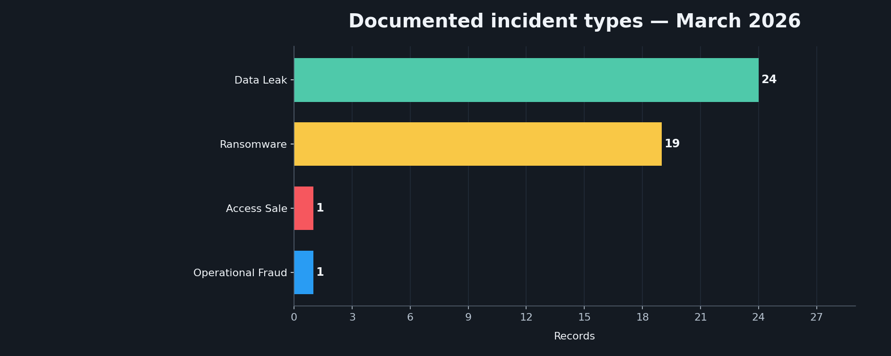
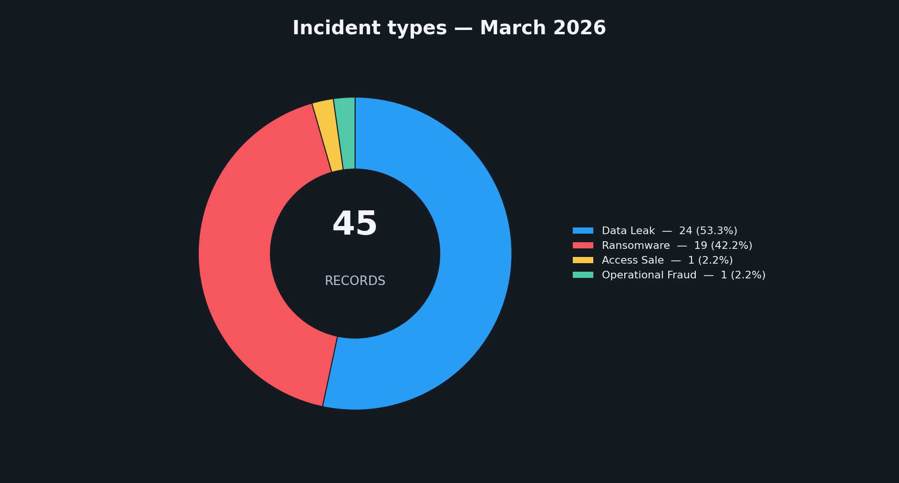
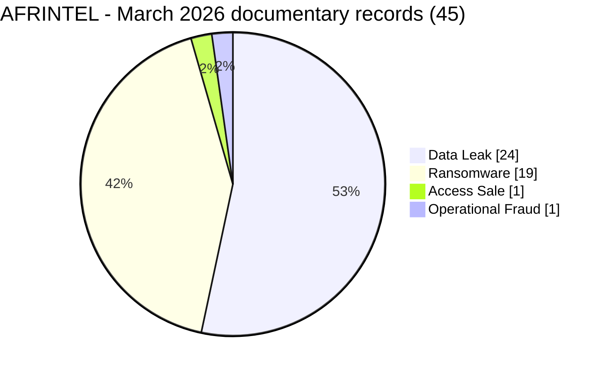
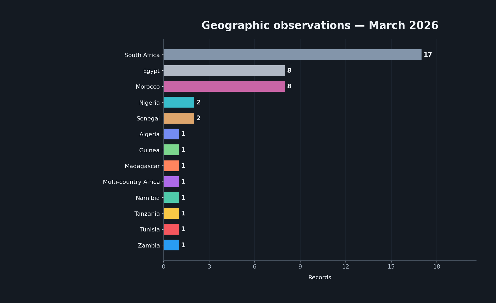
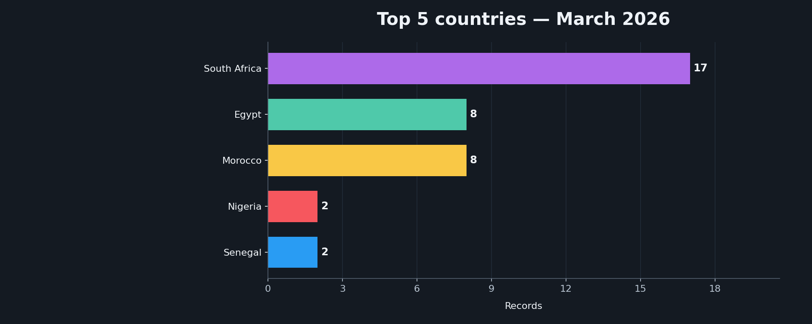
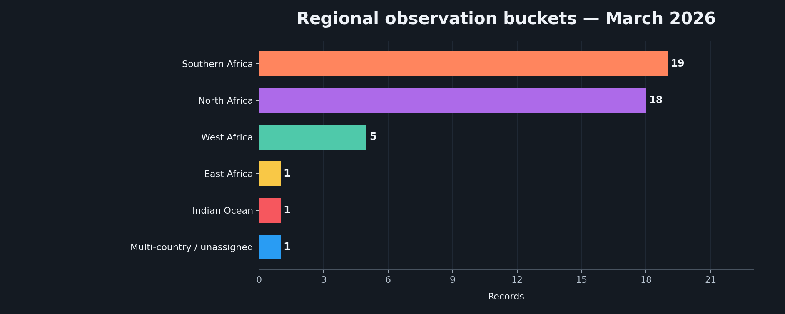
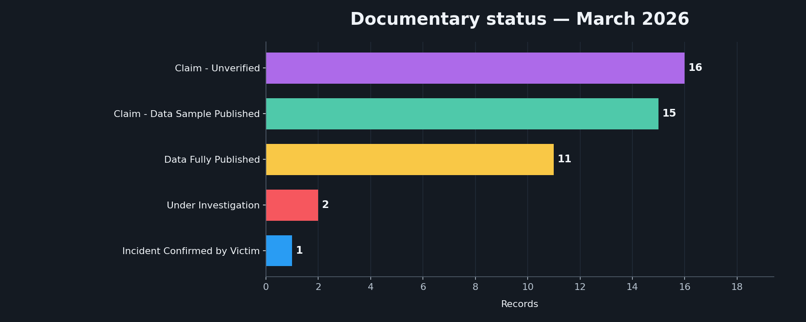
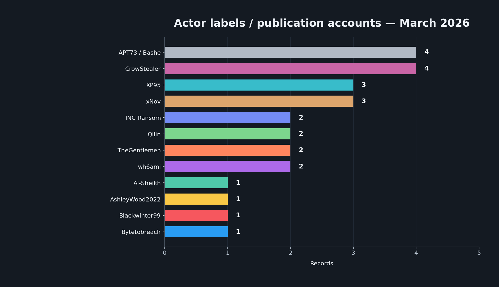
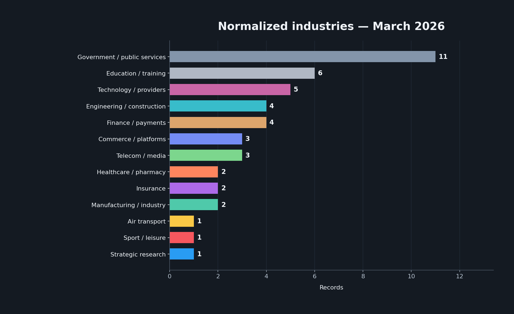

   

# AFRINTEL | Monthly Cyber Threat Intelligence Report
## Cyber threats affecting African organisations - March 2026

**Audience:** CISOs, CIOs, SOC/CSIRT managers and operational risk leaders.  
**Documentary period:** 1–31 March 2026. **Editorial review and external-source checks:** 6 November 2026.  
**Disclosure:** TLP:CLEAR - aggregated information only; no personal records, secrets or illicit data-download links.  
**Data:** [French victim records](./victims_FR.md) · [English victim records](./victims.md) · [Rapport français](./README_FR.md) · [Validation and corrections](./VALIDATION.md)

> **Evidence method - how to read this report.** AFRINTEL consolidates the OSINT investigations and post-disclosure examinations already documented in its victim records. **For ransomware listings**, analysts review the post and, when published, file inventories, previews and released documents to characterise the exposure. **For data leaks**, available samples are assessed for structure, fields, consistency, observed volume and business impact. Readers can therefore distinguish material actually reviewed from volumes merely claimed. First-party confirmations are identified separately; intrusion, encryption and full exfiltration are not assumed without supporting evidence.

---

## 1. Executive summary

**March 2026 marks a shift in AFRINTEL's documented visibility: data-leak records now outnumber ransomware listings.** The two supplied files contain **45 records**: **24 data leaks (53.3%)**, **19 ransomware claims (42.2%)**, **one access-sale listing (2.2%)** and **one operational fraud case (2.2%)**. Twelve African countries are represented, alongside **one pan-African multi-country record**. **South Africa (17 records), Egypt (8) and Morocco (8)** account for 33 entries (73.3%). This measures collection and disclosure visibility - **not a ranking of national vulnerability**.

The most important findings relate to **the types of assets potentially exposed rather than the number of posts**. AFRINTEL's documented post-disclosure review of **Remita/SystemSpecs** (Nigeria) describes accessible repository and configuration material, KYC and transaction-table references, financial integration components and filenames suggesting key material, while separating examined evidence from actor-claimed volumes. **Standard Bank South Africa** independently acknowledged unauthorised access to some data on **23 March** and subsequently stated in April that its transactional and core banking platforms were not accessed. A national CERT advisory corroborated the cash-out fraud involving **UBA Senegal**, an event that occurred in **late January** and was indexed in March.

In the public sector, the **ZISPIS social-protection registry in Zambia**, **Egypt's Ministry of Health**, **Morocco's Ministry of Justice**, **Gauteng** and **Statistics South Africa** appear in disclosures alleging access to identity, healthcare, citizen and government material. Actor-claimed totals remain distinct from the samples described by AFRINTEL. Among suppliers, **Smarteez, Outsourcia, Maroc Telecom** and **2M TV** demonstrate the importance of monitoring third-party accounts, application secrets and email exports, without assuming that every connected customer was compromised.

**Three leadership decisions follow:** tighten privileged-access and secrets governance; make data extraction across applications and organisations genuinely auditable; and validate operational resilience and fraud response without waiting for an unrelated organisation to confirm a breach. The SOC should translate these priorities into behavioural detections and clear investigative decisions rather than treating unverified indicators as facts.

### 1.1 Decision brief

| Owner | Priority decision | Expected evidence |
|---|---|---|
| **CISO / risk management** | Identify critical identity, payment, social and legal data; prioritise high-trust suppliers | Critical-data inventory, third-party risk review, crisis exercises |
| **CIO / application owners** | Reduce persistent privileges, test recovery and revocation, secure APIs, Git, cloud and mail | IAM/PAM reports, secrets inventory, verified restore test |
| **SOC / CSIRT** | Detect bulk exports, account misuse, abnormal repository access and authorisation changes | Tested SIEM use cases, validated logs, escalation playbooks |
| **Finance / fraud / compliance** | Prevent bank-detail substitution and unusual card/ATM operations | Out-of-band verification, transaction thresholds and antifraud dashboards |

## 2. Methodology and reconciliation

The audit recounts **all `####` victim records** in the supplied French and English files, checks their order and assigns **one primary type per record**. Multi-country datasets remain one observation when separate underlying breaches are not supported. Primary-sector assignment is documented in [VALIDATION.json](./VALIDATION.json) and should not be confused with the full operational footprint of an organisation.

**Main data-quality findings:**

- The detailed files contain **45 records**, whereas their historic summary cites **41**, and the user-supplied charts reflect another partial scope. The claimed access sale targeting Senegal's public treasury is absent from the historic type counters, as are several data-leak entries.
- **Corrected country counts:** South Africa **17**, Egypt **8**, Morocco **8**, Senegal **2**. The multi-country Loozap dataset counts **once**, not once for each market where the platform operated.
- Some records entered the March corpus although their earliest described publications were older: **Eventing South Africa (16 January), Loozap (28 January), Semsar Masr (28 January) and Bridges (2 February)**. UBA Senegal's fraud occurred in January; the Guinea Ministry of Health entry references alleged activity as far back as July 2025. These must not be described as all having occurred in March.
- **Possible inter-month overlap:** the February and March **Diesel-Electric** LockBit records require deduplication. The **May Kazu** Gauteng post is linked to March's XP95 entry rather than added as a new canonical March case.
- Keep five dimensions separate: visible post, described sample, asserted complete disclosure, official corroboration and verified technical intrusion method.

A ransomware leak-site listing does not by itself establish encryption, an outage or exhaustive exfiltration. Likewise, 45 records do not equal 45 individually affected organisations, employees or people.

### AFRINTEL post-disclosure validation protocol

AFRINTEL's analysis begins **after an actor post or reported disclosure has been observed**. The reports do more than reproduce a listing: accessible evidence is compared with the organisation's context, assessed for technical consistency and assigned an explicit scope. The underlying **victim records** document the review that supports each reported finding.

| Case category | Assessment performed when material is available | What the evidence supports |
|---|---|---|
| **Ransomware / extortion** | Post-disclosure review of the listing, chronology, file trees, previews and publicly released documents; comparison with the victim's business activity; independent-source checks. | The published claim and, when supported, the nature of the data actually disclosed. Encryption, disruption, total volume and initial access require separate evidence. |
| **Data leak** | Examination of **available samples** (CSV, SQL, JSON, documents, screenshots or metadata), their schema, fields, dates, observed counts and internal inconsistencies; comparison with the platform's context. | Content, consistency and sensitivity of the reviewed material; not automatic validation of the entire claimed dataset. |
| **Claim with no usable sample** | Documentation of the listing, date, source and named organisation; independent corroboration attempts. | Existence of the claim only; no affirmative finding about unseen data. |
| **Officially acknowledged incident** | Cross-checking victim or relevant authority statements, preserving the stated dates and scope. | Precisely what the primary source confirms, without extending it to unrelated actor assertions. |

**Evidence workflow:** *observed publication* → *available material examined* → *consistency and scope assessed* → *independent corroboration where available* → *business impact and SOC hypotheses*. Sensitive values and individual identities are not reproduced. **Where no sample was available, the record states that explicitly; this does not weaken the methodology applied to cases with reviewed material.**

**Traceable case examples:** **Remita** describes examination of tables, screenshots, repository trees and configuration references; **2M TV** describes HR documents and a **1,777-message** mailbox export; **ZISPIS** includes JSON records and activity logs; **Maroc Telecom** includes customer-support interface screenshots. **Standard Bank** is anchored in first-party statements. These findings do not by themselves validate the **complete actor-advertised volumes**.

### 2.1 January → February → March

| Metric (documentary records) | January | February | March | Feb → Mar |
|---|---:|---:|---:|---:|
| **Total** | **31** | **27** | **45** | **+18 (+66.7%)** |
| Ransomware | 19 | 20 | 19 | −1 (−5.0%) |
| Data leaks | 10 | 7 | 24 | +17 (+242.9%) |
| Access sales | 1 | 0 | 1 | +1 |
| Defacements | 1 | 0 | 0 | No change |
| Operational fraud | 0 | 0 | 1 | +1 |

> **Interpretation:** the increase in documented leaks partly reflects corpus expansion and older posts newly identified in March. It does **not prove** a 242.9% rise in actual intrusions. Date conventions and deduplication must be stabilised before using the series to measure the real incidence of attacks.

## 3. March intelligence picture

### 3.1 Incident categories

| Primary category | Records | Share |
|---|---:|---:|
| **Data Leak** | **24** | **53.3%** |
| Ransomware | 19 | 42.2% |
| Access Sale | 1 | 2.2% |
| Operational Fraud | 1 | 2.2% |
| **Total** | **45** | **100%** |

### 3.2 Geography

| Country / scope | Records | Corpus share |
|---|---:|---:|
| **South Africa** | **17** | **37.8%** |
| **Egypt** | **8** | **17.8%** |
| **Morocco** | **8** | **17.8%** |
| Nigeria | 2 | 4.4% |
| Senegal | 2 | 4.4% |
| Algeria, Guinea, Madagascar, Namibia, Tanzania, Tunisia and Zambia | 7 | 15.6% |
| **Multi-country Africa (Loozap)** | **1** | **2.2%** |
| **Total** | **45** | **100%** |

**AFRINTEL reporting buckets:** Southern Africa **19**, North Africa **18**, West Africa **5**, East Africa **1**, Indian Ocean **1**, plus **one unassigned multi-country dataset**. These are documentary records and cannot establish the relative number of cyberattacks per population or industry.

### 3.3 Evidence quality

After normalising two non-standard status values, the March corpus contains **16 unverified claims**, **15 claims with samples reported**, **11 entries marked `Data Fully Published`**, **one incident confirmed directly by its victim** and **two cases under investigation**. One of the latter concerns ATM fraud corroborated by a CERT, but without independent attribution of the intrusion mechanism.

A structured sample strengthens a description's **internal consistency**, but does not prove its origin. Verifying an official website does not validate a breach. Full-publication labels do not establish that the complete claimed archive is authentic and accessible.

### 3.4 Actor and publication labels

| Observed label | Records | Analytical reading |
|---|---:|---|
| **CrowStealer** | **4** | Egyptian data-leak posts; no forensic attribution of initial access |
| **APT73 / Bashe** | **4** | Extortion listings, including several Moroccan organisations |
| **xNov** | **3** | Published or claimed data leaks |
| **XP95** | **3** | Claims concerning South African public datasets |
| **Qilin** | **2** | Ransomware brand cited in listings |
| **TheGentlemen** | **2** | Ransomware brand cited in listings |
| **INC Ransom** | **2** | Extortion listings |
| **wh6ami** | **2** | Posts targeting local/provincial government data |
| Other individually cited labels | 21 | One mention each, plus two records without attributed actors |

**Attribution caveat:** `APT73 / Bashe` is a label in the supplied material and cannot be taken as proof of a recognised APT operation or intelligence-service link. Chart counts refer to **publication mentions**, not independent threat campaigns. An older chart lists five `CrowStealer` events although the supplied files explicitly label **four** entries that way.

### 3.5 Normalised sectors

| Sector family | Records | Defensive exposure |
|---|---:|---|
| **Government / public services** | **11** | Citizen registries, administrative workflows and service integrity |
| **Education / training** | **6** | Student accounts, platforms and mailboxes |
| **Technology / providers** | **5** | Supplier identities, SaaS and cross-organisation reach |
| Finance / payments | 4 | KYC, transactions, secrets and fraud |
| Engineering / construction | 4 | Projects, tenders and intellectual property |
| Telecom / media | 3 | Customer support, editorial and messaging assets |
| Commerce / platforms | 3 | Customer data, account takeover and fraud |
| Insurance | 2 | Client information and sensitive records |
| Healthcare / pharmacy | 2 | Health confidentiality and beneficiary information |
| Manufacturing / industry | 2 | Operational continuity and suppliers |
| Air transport, sport and strategic research | 3 | Sector-specific confidentiality and continuity |
| **Total** | **45** | |

Each entry receives **one primary business-sector label** for reproducible counting. A public university is assigned to education, whereas a central statistics agency is assigned to public administration. The choice does not imply that other sector dependencies are absent.

---

## 4. Strategic cases and business consequences

### 4.1 🇳🇬 Remita / SystemSpecs - a potential payments supply-chain exposure

**Record:** the `Bytetobreach` post dated **31 March** claims **3 TB** of data and **800 GB** of KYC documents. The supplied AFRINTEL analysis separately describes a list of **~35,800 email/hash pairs**, screenshots of KYC and transaction tables, a Git archive with **~34,800 files** in **~40 repositories**, numerous configuration files and a cloud bucket depicted as holding **~657,000 objects, ~588 GB**. These are **described evidentiary elements**, not an independent forensic validation of the entire claimed archive or its provenance.

**CTI assessment:** identity data, source code, configurations, backups and references to interbank integrations create a significant **credential and third-party propagation risk**. Filenames associated with banks or encryption keys do **not prove** that the keys are valid or that named banks' core systems were accessed. The initial-access mechanism remains unknown. Nigeria's **Data Protection Commission (NDPC)** opened an investigation into Remita-related allegations in April. This corroborates **regulatory investigation**, not the claimed scope. [Source: Premium Times, NDPC statement](https://www.premiumtimesng.com/news/top-news/869669-ndpc-investigates-remita-sterling-bank-for-alleged-data-breach.html).

**CISO/CIO/SOC actions:** inventory CI/CD secrets, review cloud identities, rotate genuinely affected keys through authorised channels, audit repository and KYC-storage downloads, separate development from production and validate supplier-access logs. Do **not** test actor-published credentials or redistribute KYC files.

### 4.2 🇿🇦 Standard Bank - first-party confirmation with defined boundaries

On **23 March**, Standard Bank acknowledged **unauthorised access to select data**. Its **14 April** update named **internal administrative and document-filing systems**, while stating that **core banking and transactional systems were not accessed**. Potentially affected fields include personal identifiers and contact details, depending on the individual. First-party sources: [23 March announcement](https://www.standardbank.co.za/southafrica/news-and-media/newsroom/an-important-message-from-standard-bank); [14 April update](https://www.standardbank.co.za/southafrica/news-and-media/newsroom/an-important-data-incident-update-14-april).

**Business impact:** credible social-engineering and identity-based fraud are more directly relevant than any proven payment-platform outage. Monitor document repositories, sensitive account access, client notifications and suspicious bank-detail changes. Do **not** treat this as a confirmed transactional-system breach.

### 4.3 🇸🇳 UBA Senegal - corroborated ATM fraud, unattributed intrusion method

The coordinated withdrawal operation took place on **30–31 January 2026** and was indexed by AFRINTEL in **March**. The Nigerian national CERT's [25 June 2026 advisory ngCERT-2026-060005](https://cert.gov.ng/advisories/alert-on-cyber-enabled-atm-cash-out-attacks-targeting-african-financial-institutions) mentions **3,421 ATM withdrawals** and losses of **over USD 2 million**. It considers privileged card-authorisation access a likely scenario, but does not provide a complete public forensic chain or establish a particular insider, ATM malware or phishing episode in this case.

**Banking SOC implications:** track withdrawal concentration, changes to card-authorisation parameters and limits, unusual card activity, geographically incompatible withdrawals and vendor access to payment systems. This is an **operational fraud** case, not a ransomware or data-leak entry.

### 4.4 🇿🇲 ZISPIS - welfare identities, agents and payments

An actor posting as `Spirigatito` claimed access to Zambia's **ZISPIS** social-protection registry and asserted **more than 34 million records** relating to approximately **15 million beneficiaries**. AFRINTEL describes JSON samples with categories of personal identity, household welfare conditions, payments and government agent activity logs. **The overall claimed volume remains unverified.** The [Zambian Ministry of Community Development and Social Services](https://www.mcdss.gov.zm/) confirms the institutional programme, **not the compromise claim**.

**Potential harms:** benefit-payment fraud, targeting of vulnerable households, misuse of government-agent accounts and manipulation of eligibility decisions. Defensive priorities include immutable audit logs, separation of beneficiary editing from payment approval and monitoring of mass exports.

### 4.5 Government datasets - Morocco, Egypt and South Africa

**Egypt's Ministry of Health and Population:** a `CrowStealer` post asserts **3.8 million** records with medical information; full scope and origin are not proven. **Morocco's Ministry of Justice:** an actor claims **300 GB** and **more than 150,000 judicial case files**. The `Data Fully Published` state must not be read as independent validation of those totals. Both cases warrant protective treatment of sensitive healthcare or legal records without claiming all systems were accessed.

**Gauteng / XP95:** the **13 March** entry claims **3.8 TB** and roughly **3.6 million files**. A separate **16 May Kazu** post has similar dimensions; it remains a **linked secondary claim**, not a new canonical March incident. **Statistics South Africa** and **Gauteng City Region Academy** were named in XP95 posts on 29 March with **154 GB** and **147 GB** claimed, respectively. Neither figure establishes complete compromise of national statistical data or scholarship records.

**Local administration and infrastructure:** Buffalo City and the Northern Cape Roads & Public Works department are linked to samples resembling administrative communications and logs. Prioritise identity audit trails, tender-related supplier changes and unusual application access. The access-sale advertisement involving **Senegal's DGCPT** (VPN, servers and claimed domain-controller access) is an **unverified initial-access-broker-style claim**: the advertised privileges and prices cannot establish actual working access.

### 4.6 Morocco - suppliers, telecom support and professional mail

**Maroc Telecom, 2M TV and IRES** share the `APT73 / Bashe` publication label, but this does not prove a coordinated intrusion or common entry point. Maroc Telecom screenshots relate to fixed-line/fibre **complaint handling and customer support**, not evidence of a complete subscriber-database export. The 2M TV record describes a **1,777-message** professional mailbox export and HR material; this is consistent with potential mailbox exposure, **not proven compromise of broadcast equipment**. IRES evidence is limited to professional or researcher documents.

For **Smarteez**, the source record describes **296 pharmacies**, **361,000 sales/KPI records** and **22 alleged OAuth2 application secrets**. This calls for immediate authorised review of application identities, API access and suppliers. The relationship to **L'Oréal Morocco's field operations** does **not prove** a direct breach of L'Oréal systems. The `Qilin` claim involving BPO provider **Outsourcia** raises a supply-chain concern, while specific downstream customer impact is not established.

### 4.7 Credentials, platforms and education

**Loozap (multi-country), Semsar Masr (Egypt), UNISA, Walter Sisulu University and Ahmadu Bello University** feature distinct risks of account takeover and profiling. Loozap's reviewed sample is described as containing **SHA1-format password hashes** and geolocation data; weak password storage increases risk if passwords are reused. Semsar Masr's post shows **ten alleged plaintext-password records**, while **185,024** total records are claimed - these must not be conflated. The UNISA alleged admin-credential publication does not establish present-day validity. For ABU Zaria, the review describes **237 rows** from one section against **over 11,000 claimed**.

The Guinea Ministry of Health/DHIS2 entry references alleged activity dating to **July 2025**, with AFRINTEL identification in March. Access controls and public-health data integrity should be reviewed without declaring any proven alteration of health indicators.

---

## 5. Strategic risk interpretation

**1 - Identity joined with business context.** Sensitive cases mix personal, financial, welfare and medical information with possible technical credentials. Such data can fuel impersonation, benefit fraud and account takeover long after an initial post.

**2 - Third-party and platform concentration.** CRM, BPO, Git, cloud, professional email and shared service platforms aggregate information for many organisations. A supplier exposure can affect several clients even when no independent intrusion occurred in each client's own systems.

**3 - Document-centred extortion.** Ransomware labels increasingly accompany document samples. The SOC must monitor collection, archiving and export stages as well as encryption indicators, without equating every listing with observed file-encryption behaviour.

## 6. MITRE ATT&CK defensive hypotheses (not attributed techniques)

| Behavioural hypothesis | ATT&CK technique | Useful telemetry / SOC correlation | Operational trigger |
|---|---|---|---|
| Abnormal use of legitimate or supplier accounts | [T1078](https://attack.mitre.org/techniques/T1078/) | Identity provider/SSO, VPN, PAM, AD, EDR | New device or impossible travel + privileged operations + exports |
| Secrets stored in code or configurations | [T1552.001](https://attack.mitre.org/techniques/T1552/001/) | Git/CI scans, secrets manager, cloud IAM | Newly exposed credential + subsequent service-role use |
| Abnormal reads from cloud storage | [T1530](https://attack.mitre.org/techniques/T1530/) | Object-access logs, CloudTrail-equivalent, CASB | Unusually high object-read volume by one identity |
| Excessive document-repository downloads | [T1213](https://attack.mitre.org/techniques/T1213/) | M365/SharePoint, NAS, DLP, export API logs | Cross-folder downloads outside expected business patterns |
| Remote collection of email | [T1114.002](https://attack.mitre.org/techniques/T1114/002/) | Exchange/M365 audit, eDiscovery, EWS/Graph | Large mailbox exports, anomalous OAuth consent or forwarding rule |
| Account / privilege manipulation | [T1098](https://attack.mitre.org/techniques/T1098/) | AD/Entra, PAM, IAM, GPO | New admin membership + remote logon + defence tampering |
| Potential encryption or backup tampering - **hunt hypothesis only** | [T1486](https://attack.mitre.org/techniques/T1486/) / [T1490](https://attack.mitre.org/techniques/T1490/) | EDR, file monitoring, VSS, backups, hypervisors | Burst of file modification plus snapshot manipulation |

**Additional business-specific scenario:** for ATM/card-authorisation fraud, correlate limit or authorisation parameter changes, velocity-check exceptions, card edits and geographically distributed withdrawals with operator access and rule changes. ngCERT provides sector-wide guidance, **not proof of the exact methods used against UBA**.

### 6.1 SOC investigation workflow

1. **Triage**: identify asset, owner, criticality and whether the trigger is a claim, observed sample or confirmed event.
2. **Unify the timeline**: IdP/VPN/PAM → application/API → object/file access → transfers → follow-on activity. Distinguish event time, actor-post date and AFRINTEL discovery date.
3. **Test behavioural sequences**: unusual authentication, privilege escalation, archive/export, external transfers and secret use; document alternative explanations.
4. **Preserve and contain**: retain logs, revoke only appropriately verified credentials, reduce exposure through authorised teams and avoid destroying forensic evidence.
5. **Escalate**: involve CISO/CIO, business owner, antifraud, data-protection and CSIRT teams according to impact and legal obligations.
6. **Record evidence**: source, timestamp, confidence, action, outstanding unknowns and criteria for closing or reopening the case.

## 7. Ninety-day action plan and KPIs

| Horizon | CISO / risk | CIO / architecture | SOC / CSIRT | Evidence of progress |
|---|---|---|---|---|
| **0–7 days** | List critical data and supplier dependencies; prioritise high-risk cases | Revoke genuinely affected secrets, secure privileges, verify backups | Targeted hunts for exports, OAuth changes and unusual sign-ins | Available IAM/API logs, assessed alerts, action records |
| **8–30 days** | Review supplier contracts, fraud controls and notification processes | PAM/MFA, DLP, object-access logging and restore testing | Test T1078/T1213/T1530/T1114 use cases and payment correlations | Asset coverage, detection latency and alert quality |
| **31–90 days** | Exercise a combined data leak, fraud and supplier incident | Segmentation, lifecycle rotation, immutable backups and cross-org access review | Automate CTI enrichment/STIX, tune playbooks and reduce false positives | MTTR/MTTC, revocation time, validated restores and evidence quality |

**KPIs:** percentage of critical assets with auditable logs; median exposed-secret revocation time; privileged-account MFA/PAM coverage; unexplained bulk exports; tested recovery success; antifraud decision latency; proportion of CTI cases with a primary source and explicit evidence state.

## 8. Gaps, validation and next intelligence work

The reviewed external sources do not independently validate the **complete claimed volumes** in several major cases, including ZISPIS, Morocco's Ministry of Justice, XP95/Gauteng, Stats SA, GCRA and Remita. An **official investigation** is not confirmation of the amount claimed by an actor. An official institutional website may be identified without a forensic connection between that site and the alleged dataset. No unauthorised access or active testing of leaked credentials took place.

**Verified/institutionally sourced domains:** [Buffalo City](https://www.buffalocitymetro.gov.za/) (also listed by [gov.za](https://www.gov.za/nso/about-government/contact-directory/ec-municipalities/buffalo-city-metropolitan-municipality)); [Northern Cape Roads & Public Works](http://ncrpw.ncpg.gov.za/) (domain recorded in an [institutional directory](https://provincialgovernment.co.za/units/view/94/northern-cape/roads-and-public-works)); [Standard Bank](https://www.standardbank.co.za/southafrica/personal); and [Egyptian WMRA](https://wmra.gov.eg/en/). The previously cited `garb.gov.eg` domain has not been technically linked to the WMRA data-leak allegation. The enriched victim records and [validation log](./VALIDATION.md) document those edits.

**AFRINTEL priorities:** unify initial-post/discovery/incident dates, resolve February–March overlap (notably Diesel-Electric), reconcile publication-label counts, preserve independent sources for major volumes, retain the distinction between taxonomic status and analyst confidence, normalise industry and include an auditable change trail in each record.

### Principal sources

- AFRINTEL March victim records, edition of 6 November 2026: these retain the **documented post-disclosure sample assessments** (released documents, structured exports, file inventories and screenshots as applicable). This edition **consolidates that existing documented work**; where an underlying source artifact is not bundled here, the conclusion is attributed to its victim record and is not described as a new independent inspection.
- [Standard Bank - 23 March 2026 statement](https://www.standardbank.co.za/southafrica/news-and-media/newsroom/an-important-message-from-standard-bank) and [14 April update](https://www.standardbank.co.za/southafrica/news-and-media/newsroom/an-important-data-incident-update-14-april) - first-party confirmations and scope limitations.
- [ngCERT - 25 June 2026, ngCERT-2026-060005](https://cert.gov.ng/advisories/alert-on-cyber-enabled-atm-cash-out-attacks-targeting-african-financial-institutions) - corroborating the UBA Senegal cash-out and providing broader defensive guidance.
- [Premium Times - 6 April 2026 NDPC Remita investigation](https://www.premiumtimesng.com/news/top-news/869669-ndpc-investigates-remita-sterling-bank-for-alleged-data-breach.html) - formal investigative follow-up, **not confirmation of the claimed dataset**.
- Institutional references: [Buffalo City](https://www.gov.za/nso/about-government/contact-directory/ec-municipalities/buffalo-city-metropolitan-municipality), [Northern Cape Roads & Public Works](https://provincialgovernment.co.za/units/view/94/northern-cape/roads-and-public-works), [Egyptian WMRA](https://wmra.gov.eg/en/) and [Zambia MCDSS](https://www.mcdss.gov.zm/).
- [MITRE ATT&CK Enterprise](https://attack.mitre.org/) - **defensive behavioural hypotheses, not forensic attribution**.

---

## Conclusion for CISOs and CIOs

**The main March signal is not merely the increased number of documented leaks: it is the intersection of identities, business files, welfare and medical records and application secrets in interconnected environments.** Data can enable fraud long after a system has been restored, including against organisations never named in a criminal post.

Leadership should therefore pursue **three measurable outcomes**: tightly controlled access, real detection of sensitive exports and manipulation, and a tested ability to respond to fraud and disclosure. That is how AFRINTEL intelligence can support risk decisions rather than simply catalogue adversarial claims.

*AFRINTEL - Cyber Threat Intelligence for Africa · March 2026 · Reviewed 6 November 2026 · TLP:CLEAR*
