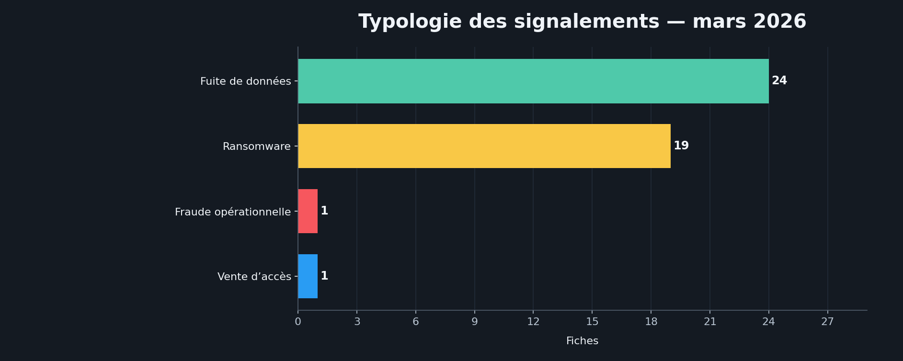
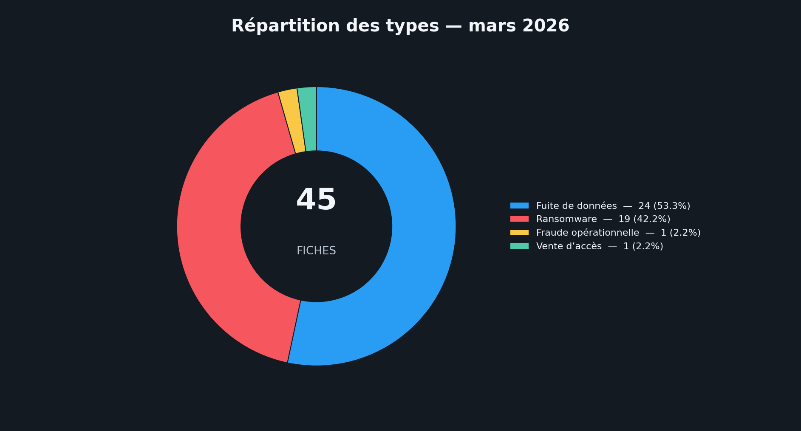
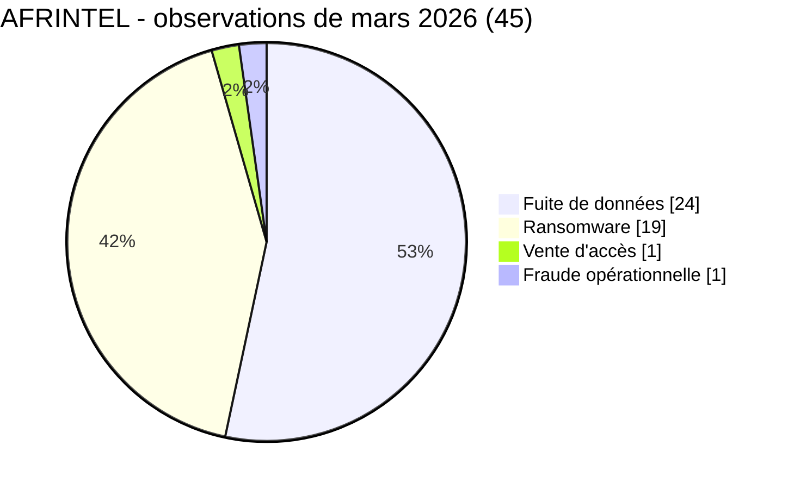
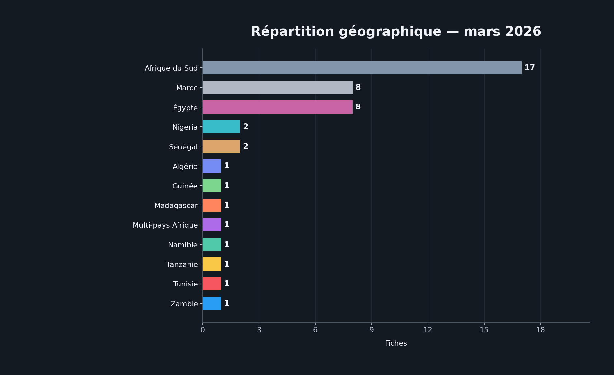
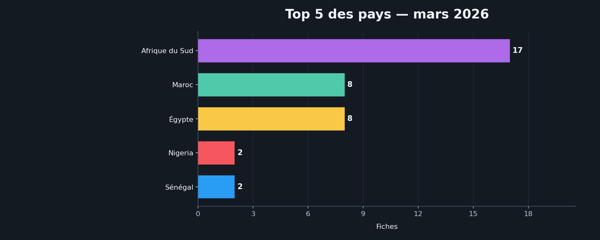
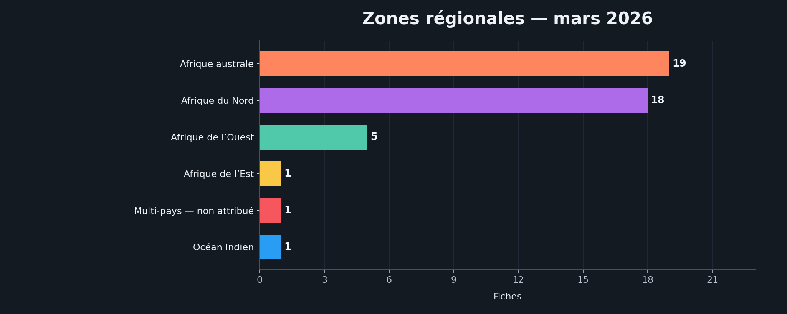
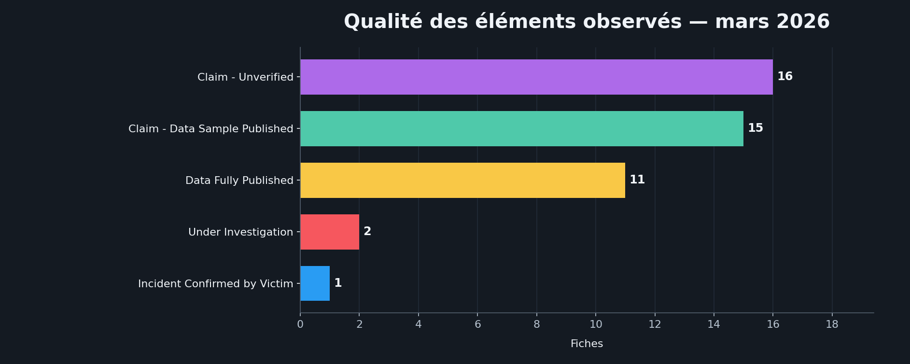
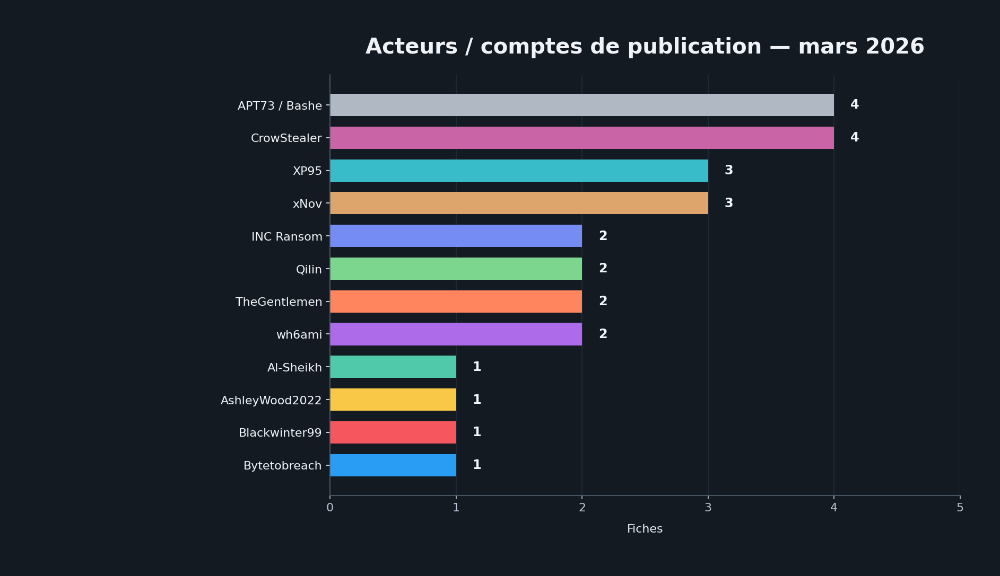
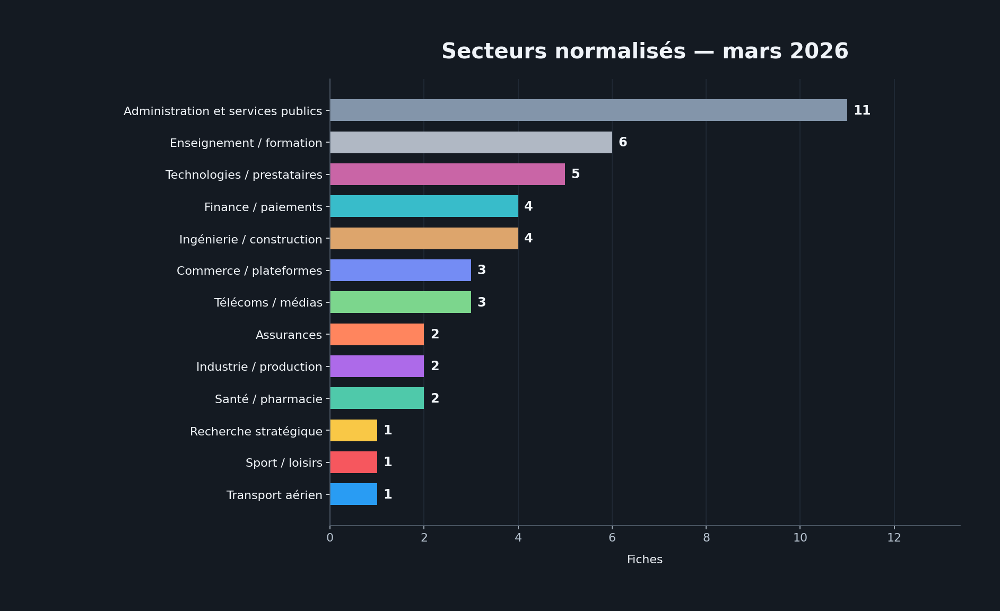

   

# AFRINTEL | Rapport mensuel de cyber threat intelligence
## Cybermenaces visant les organisations africaines - Mars 2026

**Édition RSSI · DSI · SOC/CERT · Directions des risques**  
**Période documentaire :** 1er–31 mars 2026. **Revue des informations et sources externes :** 6 novembre 2026.  
**Diffusion :** TLP:CLEAR - informations agrégées exclusivement, sans données personnelles, secrets ni liens de téléchargement illicites.  
**Corpus :** [Fiches victimes FR](./victims_FR.md) · [Victim records EN](./victims.md) · [English report](./README.md) · [Méthodologie/contrôles](./VALIDATION.md)

> **Méthodologie de preuve - lecture du rapport.** AFRINTEL consolide les investigations OSINT et analyses post-divulgation déjà consignées dans les fiches victimes. **Pour les dossiers ransomware**, les annonces et, lorsque publiés, les inventaires, aperçus et documents divulgués sont analysés afin de caractériser l'exposition. **Pour les fuites de données**, les échantillons disponibles sont examinés (structure, champs, cohérence, volume observé et risque métier). Le lecteur peut ainsi distinguer un contenu effectivement analysé d'un volume simplement revendiqué. Les confirmations officielles sont identifiées séparément ; le rapport ne suppose ni intrusion, ni chiffrement, ni exfiltration exhaustive sans pièces correspondantes.

---

## 1. Synthèse exécutive

**Mars 2026 marque une évolution de la visibilité AFRINTEL : les publications de fuites de données deviennent majoritaires, devant les annonces ransomware.** Le corpus FR/EN transmis comporte **45 fiches**, réparties entre **24 fuites de données (53,3 %)**, **19 revendications ransomware (42,2 %)**, **une vente d'accès (2,2 %)** et **une fraude opérationnelle (2,2 %)**. Douze pays africains sont représentés, auxquels s'ajoute **un dossier panafricain multi-pays**. L'**Afrique du Sud (17 fiches)**, l'**Égypte (8)** et le **Maroc (8)** concentrent 33 publications (73,3 % du corpus) - indicateur de collecte documentaire et **non classement de la vulnérabilité des pays**.

La valeur des dossiers les plus sensibles tient moins au nombre de publications qu'à **la nature des actifs potentiellement exposés**. L’analyse post-divulgation consignée par AFRINTEL pour **Remita/SystemSpecs** (Nigeria) décrit les pièces accessibles - configurations et dépôts de code, références KYC et transactionnelles, intégrations financières et arborescences de fichiers de clés - en distinguant le contenu consulté des volumes revendiqués. **Standard Bank South Africa** a, de son côté, confirmé le 23 mars un accès non autorisé à certaines données, puis précisé en avril que les systèmes bancaires transactionnels et centraux n'avaient pas été accédés. Une source CERT nationale corrobore également la fraude aux retraits visant **UBA Sénégal**, événement ayant eu lieu **fin janvier** mais documenté ensuite dans le corpus AFRINTEL de mars.

Dans le secteur public, les revendications touchant le **registre social ZISPIS en Zambie**, le **ministère de la Santé égyptien**, le **ministère marocain de la Justice**, **Gauteng** et **Statistics South Africa** posent un risque de divulgation durable des identités, données de santé, dossiers de citoyens et informations administratives. Les volumes avancés par les acteurs restent distincts des échantillons effectivement décrits. Dans les chaînes de sous-traitance, les cas **Smarteez**, **Outsourcia**, **Maroc Telecom** et **2M TV** renforcent la nécessité de surveiller les comptes prestataires, les secrets applicatifs et les exports de messagerie.

**Trois arbitrages sont proposés à la direction :** renforcer immédiatement la gouvernance des secrets et des accès privilégiés ; rendre les extractions de données et les échanges entre organisations réellement traçables ; tester la résilience opérationnelle et la réponse à la fraude sans attendre la confirmation publique d'une attaque visant un tiers. Le SOC doit transformer ces priorités en règles comportementales et en procédures d'investigation documentées, plutôt qu'en blocages aveugles d'IoC non vérifiés.

### 1.1 Ce qu'il faut décider

| Destinataire | Décision prioritaire | Preuve attendue de mise en œuvre |
|---|---|---|
| **RSSI / direction des risques** | Classer les données d'identité, financières, sociales et juridiques ; prioriser les prestataires à accès sensible | Registre des actifs/données critiques, revue des risques tiers, exercices de crise |
| **DSI / responsables applicatifs** | Réduire les privilèges persistants ; tester restauration et révocation ; sécuriser API, Git, cloud et messagerie | Export IAM/PAM, inventaire des secrets, preuve d'une restauration testée |
| **SOC / CSIRT** | Détecter exports massifs, abus de comptes, accès inhabituels aux dépôts et modifications d'autorisation financière | Cas d'usage SIEM testés, sources de logs validées, playbooks d'escalade |
| **Finance / conformité / fraude** | Prévenir les changements frauduleux de RIB et les opérations GAB ou paiements anormales | Double validation hors bande, seuils transactionnels, tableau de bord antifraude |

## 2. Méthodologie et audit du corpus

La revue reprend **chaque en-tête `####` des deux fichiers fournis**, vérifie la parité FR/EN et attribue un **type principal unique par fiche**. Elle conserve les dossiers multi-organisations comme une observation lorsque les sources ne permettent pas d'établir des intrusions séparées. Les regroupements sectoriels sont documentés dans [VALIDATION.json](./VALIDATION.json) et ne servent pas à inférer la gravité réelle d'un incident.

**Contrôles de qualité ayant modifié les résultats :**

- **45 fiches détaillées**, alors que le tableau historique annonce **41** et les graphiques fournis ne couvrent qu'un périmètre partiel. La catégorie *vente d'accès* relative à la DGCPT sénégalaise n'était pas comptée comme type autonome ; plusieurs publications de fuite étaient absentes de la synthèse.
- **Répartition géographique corrigée :** Afrique du Sud **17** (au lieu de 13–14 selon les anciens tableaux), Égypte **8**, Maroc **8**, Sénégal **2**. Le multi-pays Loozap est compté **une seule fois**, sans duplication artificielle dans chaque pays desservi.
- **Temporalité :** certaines publications sont datées antérieurement au mois : **Eventing South Africa (16 janvier)**, **Loozap (28 janvier)**, **Semsar Masr (28 janvier)** et **Bridges (2 février)** ; les fiches sont néanmoins indexées en mars selon leur découverte/entrée dans le corpus. La fraude UBA a eu lieu en janvier, et l'activité relative au ministère guinéen de la Santé serait antérieure (juillet 2025). Ces dossiers ne doivent pas être présentés comme « attaques de mars » sans nuance.
- **Dédoublonnage :** **Diesel-Electric** apparaît également dans le corpus de février sous LockBit ; deux publications ne prouvent pas deux intrusions. Le post **Kazu** sur Gauteng en mai est une revendication liée au dossier XP95, *non comptée* comme nouvelle fiche de mars.
- **Niveaux de preuve :** existence d'un post, présence d'échantillons décrits, publication annoncée comme complète, recoupement CERT, confirmation officielle et mécanisme d'accès sont des questions distinctes.

Le classement `Ransomware` reflète une **publication d'extorsion** et ne constitue pas une preuve de chiffrement, d'indisponibilité ou d'exfiltration exhaustive. Les 45 observations ne sont pas non plus un nombre de victimes individuelles (plusieurs comptes, personnes ou institutions peuvent figurer dans une seule fiche).

### Protocole AFRINTEL de validation post-publication

L'analyse AFRINTEL intervient **après l'observation de la publication de l'acteur ou la divulgation signalée**. Le rapport ne se limite pas à reprendre une annonce : il rapproche les éléments accessibles des informations sur l'organisation, examine leur cohérence technique et qualifie leur portée. Le travail effectué est retracé dans les **fiches victimes**, qui constituent la base probatoire du rapport.

| Nature du dossier | Examen réalisé lorsque la matière est disponible | Ce que l'analyse permet d'établir |
|---|---|---|
| **Ransomware / extorsion** | Revue post-divulgation de l'annonce, de la chronologie, des arborescences, aperçus de fichiers et documents rendus publics ; comparaison des catégories de données avec l'activité de la victime ; recherche de recoupements indépendants. | Existence d'une publication et, selon les pièces, nature des données effectivement exposées. Le chiffrement, la panne, le volume total et l'accès initial restent des faits distincts, à justifier séparément. |
| **Fuite de données** | Examen des **échantillons accessibles** (CSV, SQL, JSON, documents, captures ou métadonnées), de leur structure, des champs, des dates, des volumes réellement observés et des incohérences éventuelles ; rapprochement avec le contexte de la plateforme. | Contenu, cohérence et sensibilité des éléments examinés ; non pas validation automatique de la totalité du jeu annoncé. |
| **Revendication sans échantillon exploitable** | Qualification de la publication, de sa source, de sa date et de l'organisation citée ; tentative de corroboration dans des sources indépendantes. | Existence de la revendication uniquement ; aucune conclusion affirmative sur des données non consultées. |
| **Incident officiellement reconnu** | Confrontation aux communiqués de l'organisation ou d'autorités compétentes, avec respect de leurs limites de portée et de date. | Faits précisément confirmés par la source, sans étendre cette confirmation aux assertions de l'acteur. |

**Chaîne de lecture des constats :** *publication constatée* → *pièces accessibles examinées* → *cohérence et portée évaluées* → *sources indépendantes recoupées, si disponibles* → *impacts métiers et hypothèses SOC*. Les valeurs sensibles et les identités individuelles ne sont pas reproduites. **Une absence d'échantillon est notée comme telle ; elle ne remet pas en cause la méthode appliquée aux autres dossiers.**

**Exemples traçables dans ce corpus :** **Remita** fait l'objet d'une analyse documentée de tables, captures, arborescences de dépôts et références de configurations ; **2M TV** d'un ensemble de documents RH et d'un export de messagerie de **1 777 messages** ; **ZISPIS** d'extraits JSON et de journaux d'activité ; **Maroc Telecom** de captures d'interfaces de support client. Pour **Standard Bank**, le socle de confirmation est constitué de communiqués officiels. Ces observations ne valent pas validation des **volumes globaux revendiqués**.

### 2.1 Comparaison janvier → février → mars

| Indicateur (fiches documentaires) | Janvier | Février | Mars | Évolution février → mars |
|---|---:|---:|---:|---:|
| **Total** | **31** | **27** | **45** | **+18 (+66,7 %)** |
| Ransomware | 19 | 20 | 19 | −1 (−5,0 %) |
| Fuites de données | 10 | 7 | 24 | +17 (+242,9 %) |
| Ventes d'accès | 1 | 0 | 1 | +1 |
| Défacement | 1 | 0 | 0 | Stable à zéro |
| Fraude opérationnelle | 0 | 0 | 1 | +1 |

> **Interprétation :** la progression spectaculaire des fuites recensées reflète en partie l'enrichissement du corpus et des dossiers anciens identifiés en mars. Elle **ne démontre pas** une croissance de 242,9 % des intrusions effectives. Les dates, la déduplication et la couverture des sources doivent être harmonisées avant toute comparaison annuelle ou mesure d'incidence réelle.

## 3. Indicateurs de mars

### 3.1 Typologie

| Type principal | Fiches | Part |
|---|---:|---:|
| **Fuite de données** | **24** | **53,3 %** |
| Ransomware | 19 | 42,2 % |
| Vente d'accès | 1 | 2,2 % |
| Fraude opérationnelle | 1 | 2,2 % |
| **Total** | **45** | **100 %** |

### 3.2 Pays et périmètre

| Pays / périmètre | Fiches | Part du corpus |
|---|---:|---:|
| **Afrique du Sud** | **17** | **37,8 %** |
| **Égypte** | **8** | **17,8 %** |
| **Maroc** | **8** | **17,8 %** |
| Nigeria | 2 | 4,4 % |
| Sénégal | 2 | 4,4 % |
| Algérie, Guinée, Madagascar, Namibie, Tanzanie, Tunisie et Zambie | 7 | 15,6 % |
| **Multi-pays Afrique (Loozap)** | **1** | **2,2 %** |
| **Total** | **45** | **100 %** |

**Régions analytiques AFRINTEL.** Les classements sont construits à des fins de reporting : Afrique australe **19**, Afrique du Nord **18**, Afrique de l'Ouest **5**, Afrique de l'Est **1**, Océan Indien **1**, et **1 multi-pays non attribué**. La somme doit être lue comme des fiches, non comme des attaques nationales indépendantes. Maurice ne figure pas dans le corpus de mars.

### 3.3 Qualité documentaire

Après normalisation de deux statuts non conformes à la nomenclature v2, le corpus distingue : **16 revendications non vérifiées**, **15 revendications avec échantillons signalés**, **11 publications classées `Data Fully Published`**, **1 incident confirmé par la victime** et **2 dossiers en investigation**. L'une de ces enquêtes porte sur une fraude corroborée par le ngCERT, mais non attribuée techniquement.

Un échantillon structuré peut renforcer la **cohérence** d'un récit sans établir son origine technique. Un domaine officiel permet de retrouver une institution mais n'atteste pas qu'elle soit compromise. L'étiquette de publication `Data Fully Published` ne prouve pas que l'ensemble des archives promises est disponible, intègre ou récent.

### 3.4 Acteurs, groupes et comptes

| Libellé observé | Fiches | Lecture CTI |
|---|---:|---|
| **CrowStealer** | **4** | Publications de fuites égyptiennes ; identité et accès initial non attribués forensiquement |
| **APT73 / Bashe** | **4** | Revendications d'extorsion, notamment plusieurs entités marocaines |
| **xNov** | **3** | Fuites publiées / revendiquées |
| **XP95** | **3** | Revendications de données publiques sud-africaines |
| **Qilin** | **2** | Marque de ransomware citée |
| **TheGentlemen** | **2** | Marque de ransomware citée |
| **INC Ransom** | **2** | Revendications d'extorsion |
| **wh6ami** | **2** | Comptes de publication visant des administrations provinciales/municipales |
| Autres étiquettes connues | 21 | Une mention chacune ; 2 dossiers restent non attribués |

**Précision d'attribution.** `APT73 / Bashe` est un libellé de publication du corpus : sa présence **ne constitue pas** une attribution forensique à une campagne d'espionnage ou à un groupe APT reconnu. Les classements mesurent des **mentions**, pas le nombre de campagnes distinctes ni l'identité réelle des opérateurs. Le graphique antérieur affichant cinq cas CrowStealer ne correspond pas aux **quatre fiches** explicitement identifiées par ce libellé dans le corpus livré.

### 3.5 Secteurs normalisés

| Famille sectorielle | Fiches | Enjeu défensif dominant |
|---|---:|---|
| **Administration et services publics** | **11** | Données de citoyens, registres, administration, intégrité des démarches |
| **Enseignement et formation** | **6** | Identifiants, données étudiants, plateformes et messagerie |
| **Technologies et prestataires** | **5** | Accès de tiers, SaaS, applications, diffusion inter-organisations |
| Finance et paiements | 4 | Comptes, KYC, opérations, secrets, fraude |
| Ingénierie et construction | 4 | Contrats, projets, appels d'offres, propriété intellectuelle |
| Télécoms et médias | 3 | Relation client, archives éditoriales, messagerie |
| Commerce et plateformes | 3 | Données clients et comptes, usurpation |
| Assurances | 2 | Dossiers clients et données sensibles |
| Santé et pharmacie | 2 | Confidentialité de données de santé et bénéficiaires |
| Industrie et production | 2 | Continuité et dépendances fournisseurs |
| Transport aérien, sports et recherche stratégique | 3 | Confidentialité et continuité sectorielles |
| **Total** | **45** | |

La normalisation affecte chaque fiche à **un seul secteur primaire** : une université publique entre dans « enseignement », alors qu'une agence centrale de statistiques entre dans « administration ». Il ne s'agit pas de prétendre que les autres dépendances sectorielles sont absentes.

---

## 4. Dossiers stratégiques et conséquences métiers

### 4.1 🇳🇬 Remita / SystemSpecs : exposition potentielle d'une chaîne de paiement

**Signalement :** publication du **31 mars**, sous le compte `Bytetobreach`. La revendication évoque **3 To** de données et **800 Go** de documents KYC. La fiche AFRINTEL décrit des éléments techniques distincts : un fichier de **~35 800 couples email/hash**, des copies visuelles de tables KYC et transactionnelles, une archive Git d'environ **34 800 fichiers** répartis sur **~40 dépôts**, plusieurs centaines de fichiers de configuration et un compartiment cloud affiché comme contenant **~657 000 objets pour ~588 Go**. Ces chiffres correspondent à **des éléments décrits dans l'analyse**, non à une vérification indépendante de toute l'archive et de sa provenance.

**Lecture CTI :** l'association de données clients, code source, configurations, dépôts de sauvegarde et références d'intégration interbancaire crée un **risque de propagation par secrets et dépendances**. Les noms de fichiers associés à des banques ou à des clés ne permettent pas de conclure que ces clés étaient valides, ni que les systèmes centraux des banques citées ont été accédés. Le mécanisme d'accès initial ne peut pas être établi à partir du corpus. **Suivi externe :** la Nigeria Data Protection Commission (NDPC) a annoncé l'ouverture d'une enquête sur les allégations concernant Remita et Sterling Bank début avril, ce qui constitue une **confirmation de l'investigation réglementaire**, pas de l'intégralité de la compromission alléguée. [Source : Premium Times / déclaration NDPC](https://www.premiumtimesng.com/news/top-news/869669-ndpc-investigates-remita-sterling-bank-for-alleged-data-breach.html).

**Priorités RSSI/DSI/SOC :** inventaire des secrets de CI/CD, contrôle des identités cloud, révocation défensive des clés réellement concernées, audit des téléchargements des dépôts et stockages KYC, séparation des environnements de développement et de production, journalisation des accès aux objets et revue des connexions de fournisseurs. **Ne pas tester** les secrets publiés et ne pas diffuser de KYC.

### 4.2 🇿🇦 Standard Bank : incident confirmé, périmètre technique borné

Le **23 mars**, Standard Bank a déclaré un **accès non autorisé à certaines données**. La communication de suivi du **14 avril** situe les systèmes concernés dans des **environnements administratifs internes et de gestion documentaire** ; la banque indique que ses systèmes de cœur bancaire et de transactions n'ont pas été accédés. Les catégories possibles de données comprennent des identifiants et coordonnées, dont la portée exacte dépend des personnes concernées. Sources de première main : [communication du 23 mars](https://www.standardbank.co.za/southafrica/news-and-media/newsroom/an-important-message-from-standard-bank) et [mise à jour du 14 avril](https://www.standardbank.co.za/southafrica/news-and-media/newsroom/an-important-data-incident-update-14-april).

**Impact métier prioritaire :** phishing et fraude ciblée exploitant des informations crédibles, plus qu'une indisponibilité prouvée de la banque. Pour les équipes défensives : contrôler les systèmes documentaires, notifications des clients, usages inhabituels des identités et demandes suspectes de modification de coordonnées. **Ne pas assimiler** cet incident à une compromission des transactions ni à une revendication non corroborée de tiers.

### 4.3 🇸🇳 UBA Sénégal : fraude aux retraits corroborée, intrusion non attribuée

L'opération a eu lieu **les 30 et 31 janvier 2026**, avec une prise en compte dans les observations AFRINTEL de **mars**. Dans l'[avis ngCERT-2026-060005 du 25 juin 2026](https://cert.gov.ng/advisories/alert-on-cyber-enabled-atm-cash-out-attacks-targeting-african-financial-institutions), le CERT nigérian cite **3 421 retraits** et une perte **supérieure à 2 millions USD**. L'avis estime plausible un accès privilégié aux systèmes d'autorisation des cartes, mais ne fournit pas une chaîne forensique complète de l'incident et ne démontre pas une implication interne, un logiciel ATM particulier ou un phishing précis.

**Enjeu DSI/SOC bancaire :** alerter sur la concentration de retraits, les changements de paramètres d'autorisation et de plafonds, les modifications de cartes, les opérations simultanées géographiquement incompatibles et l'accès des prestataires aux systèmes de paiement. Le dossier relève de la **fraude opérationnelle**, et non d'un ransomware ou d'une fuite de données.

### 4.4 🇿🇲 ZISPIS : l'identité sociale et les bénéficiaires comme cible

La publication attribuée à `Spirigatito` vise le registre de protection sociale zambien **ZISPIS**. L'acteur revendique **plus de 34 millions d'enregistrements** et **environ 15 millions de bénéficiaires**. AFRINTEL décrit des échantillons JSON comprenant des catégories d'identité, de situation socio-économique, de paiements et de journaux d'agents administratifs. **Le volume global n'a pas été vérifié.** La documentation du [Ministry of Community Development and Social Services](https://www.mcdss.gov.zm/) confirme l'existence de ZISPIS, **pas la revendication de compromission**.

**Impact potentiel :** fraude aux aides sociales, ciblage de ménages vulnérables, compromission de comptes d'agents, manipulation de paiements ou de décisions administratives. **Actions :** journaux d'audit immuables, séparation des rôles d'administration et de validation des prestations, double contrôle des modifications de bénéficiaires et revue des exports massifs.

### 4.5 Administrations et données souveraines : Maroc, Égypte, Afrique du Sud

**Ministère égyptien de la Santé et de la Population.** Publication sous `CrowStealer` évoquant **3,8 millions d'enregistrements** médicaux ; la totalité et l'origine technique ne sont pas établies. Les risques portent sur la vie privée, l'extorsion des patients et les communications frauduleuses. **Ministère marocain de la Justice.** L'acteur annonce **300 Go** et **plus de 150 000 dossiers judiciaires** ; ces volumes demeurent revendiqués, même si la fiche est classée `Data Fully Published`. La protection du secret judiciaire, des accès aux dossiers et des données bancaires associées est prioritaire.

**Gauteng / XP95.** La fiche du **13 mars** indique **3,8 To et environ 3,6 millions de fichiers revendiqués**. Une publication Kazu du **16 mai**, portant sur un volume proche, est **liée à ce dossier sans être comptée comme nouvelle intrusion**. Les hypothèses de republication, de revente ou de compromission distincte restent ouvertes. **Stats SA** et **Gauteng City Region Academy** apparaissent dans deux publications XP95 du 29 mars, respectivement **154 Go** et **147 Go annoncés** ; ces volumes ne prouvent pas que les jeux de données nationaux ou les dossiers de bourses aient été intégralement exfiltrés.

**Municipalités et infrastructures.** Les échantillons attribués à **Buffalo City** et au **Northern Cape Department of Roads & Public Works** sont décrits comme des journaux et échanges administratifs : priorités de détection sur les formulaires, comptes d'édition de contenus, fournisseurs et appels d'offres. La vente d'accès présumée visant la **DGCPT sénégalaise** (VPN, serveurs, contrôleur de domaine) reste un **signal IAB non vérifié** : aucune connexion active ne doit être inférée des prix affichés sur un forum.

### 4.6 Maroc : chaîne de prestataires, télécommunications et messagerie

**Maroc Telecom**, **2M TV** et **IRES** sont réunis par le même libellé de publication `APT73 / Bashe`, mais cela ne suffit pas à établir une opération commune ni à attribuer un accès initial. Dans le cas **Maroc Telecom**, les captures concernent la **gestion des réclamations et le support fixe/fibre**, non une preuve d'extraction de l'ensemble des abonnés. Pour **2M TV**, la fiche décrit un export de **1 777 courriels** avec pièces jointes et documents RH ; il s'agit d'un indicateur possible d'exposition d'une boîte professionnelle, **pas d'une intrusion démontrée dans les équipements de diffusion**. Pour **IRES**, seuls des documents de profils professionnels sont décrits.

La fiche **Smarteez** indique des informations sur **296 pharmacies**, **361 000 lignes commerciales/KPI** et **22 secrets OAuth2 annoncés**. Ces éléments appellent une revue urgente des identités applicatives, interfaces API et fournisseurs. Le rattachement de Smarteez à la chaîne d'opérations de **L'Oréal Maroc** ne démontre **pas une compromission directe des systèmes L'Oréal**. Enfin, la revendication **Qilin** concernant le BPO **Outsourcia** souligne le risque d'accès transverse aux données de clients : l'impact de chacun de ces clients n'est pas confirmé.

### 4.7 Identifiants, plateformes et enseignement supérieur

Les données publiées ou revendiquées sur **Loozap** (portée panafricaine), **Semsar Masr** (Égypte), **UNISA**, **Walter Sisulu University** et **Ahmadu Bello University** posent des risques distincts de prise de contrôle de compte et de profilage. Pour Loozap, l'échantillon décrit contient des **hashs SHA1** et des données de géolocalisation ; la présence d'un algorithme faible augmente le risque si les secrets sont réutilisés. Pour Semsar Masr, **dix lignes** contiendraient des mots de passe en clair, pour **185 024 lignes annoncées** : ces deux niveaux de preuve ne doivent pas être confondus. La publication UNISA d'accès administrateur allégué ne démontre pas que les mots de passe sont toujours valides. Pour ABU Zaria, **237 lignes** d'une section sont décrites ; **plus de 11 000** restent revendiquées.

**En Guinée**, l'activité associée au système de santé/DHIS2 et au compte `Keymous` remonterait à **juillet 2025**, mais la fiche a été identifiée en mars 2026. L'intégrité des indicateurs sanitaires et les accès applicatifs doivent être vérifiés sans conclure à une altération de données sur la seule base de captures.

---

## 5. Analyse stratégique : trois dynamiques de risque

**1 - Identité + données métiers.** Les dossiers les plus sensibles combinent données identitaires, informations financières, contexte social/médical et parfois accès techniques. Ils peuvent alimenter une fraude bien après la publication initiale : faux remboursements, faux appels de banque, usurpation administrative et prise de contrôle de comptes.

**2 - Accès aux prestataires et effet de chaîne.** Des environnements CRM, BPO, Git, cloud, messagerie et plateformes tierces concentrent les informations de plusieurs clients. Une fuite chez un fournisseur peut exposer indirectement plusieurs organisations, sans que celles-ci aient subi une intrusion propre.

**3 - Extorsion documentaire plutôt que seule indisponibilité.** Les publications d'acteurs ransomware produisent souvent des preuves documentaires partielles. Le SOC doit rechercher les étapes de collecte, d'archivage et d'export autant que les signaux de chiffrement, sans présumer que les outils chiffrants ont été déployés dans chaque cas.

## 6. Hypothèses de détection MITRE ATT&CK (non attribuées)

| Hypothèse comportementale | Technique ATT&CK | Télémétrie / corrélation SOC | Déclencheur opérationnel |
|---|---|---|---|
| Usage inhabituel d'un compte légitime ou fournisseur | [T1078](https://attack.mitre.org/techniques/T1078/) | SSO/IdP, VPN, bastion, PAM, AD, EDR | Nouveau terminal + pays atypique + privilèges + accès aux exports |
| Secrets dans code et configurations | [T1552.001](https://attack.mitre.org/techniques/T1552/001/) | Scans Git/CI, gestionnaire de secrets, logs cloud IAM | Secret exposé + utilisation d'un rôle/service après commit suspect |
| Lecture anormale de données stockées dans le cloud | [T1530](https://attack.mitre.org/techniques/T1530/) | Logs d'accès aux objets, CloudTrail/équivalent, CASB | Volume de lectures massif ou atypique d'un même rôle de service |
| Extraction de dossiers documentaires | [T1213](https://attack.mitre.org/techniques/T1213/) | M365/SharePoint, NAS, audit fichiers, DLP, API exports | Téléchargements multi-répertoires hors activité métier habituelle |
| Collecte de courriels via API/boîte distante | [T1114.002](https://attack.mitre.org/techniques/T1114/002/) | Exchange/M365 Unified Audit, eDiscovery, EWS/Graph | Export volumineux, permissions OAuth inhabituelles, règle de transfert |
| Modification de comptes/privilèges | [T1098](https://attack.mitre.org/techniques/T1098/) | AD/Entra, annuaire, IAM, PAM, GPO | Ajout groupe admin + connexion distante + suppression des logs |
| Chiffrement ou neutralisation de sauvegardes **à rechercher**, pas observés automatiquement | [T1486](https://attack.mitre.org/techniques/T1486/) / [T1490](https://attack.mitre.org/techniques/T1490/) | EDR, fichiers, VSS, sauvegardes, hyperviseur | Pic de renommages/chiffrement + action sur snapshots |

**Scénario additionnel non spécifique ATT&CK :** pour le risque de fraude ATM/autorisation, corréler **modifications de plafonds, velocity checks, opérations de carte et retraits multizones** avec comptes de service, accès opérateurs, changements de règles et exceptions. L'avis ngCERT constitue une base de veille sectorielle, **pas une preuve des TTP utilisées contre UBA**.

### 6.1 Workflow SOC recommandé

1. **Qualifier l'alerte** : application, propriétaire métier, données et criticité ; vérifier si la source est une revendication, un échantillon ou une confirmation.
2. **Constituer une chronologie unifiée** : SSO/VPN/PAM → API/applicatif → accès fichiers/objets → transferts → activités postérieures. Ne pas confondre `event_time`, date du post et date de découverte.
3. **Chercher la chaîne comportementale** : authentification atypique, permission nouvelle, export, compression, déchargement, activité sur secrets. Sans séquence vérifiable, retenir l'hypothèse comme telle.
4. **Contenir sans détruire les preuves** : préservation des journaux, révocation ciblée des sessions et clés, réduction des droits, contrôle des flux sortants par les équipes autorisées.
5. **Escalader** : RSSI et DSI selon seuil de données/impact, responsable métier en cas d'opération financière, conformité/délégué à la protection des données selon les obligations applicables.
6. **Documenter** : faits observés, hypothèses alternatives, identifiants de preuve, source, date, niveau de confiance, actions effectuées, résidu de risque et critères de clôture.

## 7. Feuille de route et indicateurs de pilotage

| Horizon | RSSI / gouvernance | DSI / architecture | SOC / CSIRT | Indicateurs de preuve |
|---|---|---|---|---|
| **0–7 jours** | Identifier jeux de données et tiers critiques, remonter risques P1 | Révoquer les secrets réellement exposés, sécuriser privilèges, vérifier sauvegardes | Hunt ciblé sur exports, sessions OAuth, authentifications anormales | Sources IAM/API disponibles ; incidents triés ; actions tracées |
| **8–30 jours** | Revue contractuelle fournisseurs ; procédures de fraude et notification | MFA/PAM, DLP/exports, journalisation objet/cloud, tests de restauration | Cas d'usage T1078/T1213/T1530/T1114 et corrélations paiements | % actifs couverts, réduction délais MTTD, alertes qualifiées |
| **31–90 jours** | Exercice de crise combinant fuite, fraude et fournisseur | Segmentation, rotation cyclique, sauvegardes immuables, audit accès inter-organisation | Automatisation enrichissement CTI/STIX, mise à jour playbooks et suppression des faux positifs | MTTR/MTTC, temps de révocation, qualité des preuves, restauration réussie |

**KPI recommandés :** taux de couverture de journalisation des applications critiques ; délai médian de révocation d'un secret ; % de comptes administratifs couverts par MFA/PAM ; ratio d'exports expliqués/inexpliqués ; réussite de tests de restauration ; délai de décision antifraude ; taux de fiches CTI dotées d'une source primaire et d'un niveau de preuve explicite.

## 8. Limites, angles morts et priorités AFRINTEL

La revue publique de cette édition n'a pas permis de confirmer les **volumes globaux revendiqués** pour plusieurs dossiers sensibles, notamment ZISPIS, le ministère marocain de la Justice, XP95/Gauteng, Stats SA, GCRA ou Remita. Une **enquête institutionnelle** n'est pas une confirmation des chiffres d'un acteur. Certains sites officiels peuvent être identifiés sans que les données de la fuite soient reliées techniquement à ces domaines. Aucun accès illicite, test de mots de passe ou vérification active de secrets n'a été entrepris.

**Sites institutionnels vérifiés ou complétés :** [Buffalo City](https://www.buffalocitymetro.gov.za/) (également référencé par [gov.za](https://www.gov.za/nso/about-government/contact-directory/ec-municipalities/buffalo-city-metropolitan-municipality)), [Northern Cape Roads & Public Works](http://ncrpw.ncpg.gov.za/) (domaine indiqué dans un [annuaire institutionnel](https://provincialgovernment.co.za/units/view/94/northern-cape/roads-and-public-works)), [Standard Bank](https://www.standardbank.co.za/southafrica/personal) et [WMRA Égypte](https://wmra.gov.eg/en/) (à distinguer du domaine `garb.gov.eg` antérieurement cité sans lien de provenance confirmé). Les fiches FR/EN enrichies et le [journal des corrections](./VALIDATION.md) répertorient chaque modification.

**Lacunes prioritaires à résoudre :** réconcilier les dates initiales de publication, les doublons intermensuels (notamment Diesel-Electric) et les comptes de publications ; établir des références indépendantes pour les volumes sensibles ; harmoniser une taxonomie de statuts distincte du niveau de confiance ; normaliser les secteurs et produire une piste d'audit par fiche ; documenter toute correction avec sa source et sa date.

### Sources principales consultées

- Fiches AFRINTEL : `victims_FR.md` et `victims.md` (45 fiches, édition du 6 novembre 2026), contenant les comptes rendus des **analyses post-divulgation** (documents, exports, fichiers structurés, arborescences et captures selon le dossier). Le présent rapport **consolide ces examens déjà réalisés et documentés** ; lorsqu’une pièce source n’est pas jointe au présent livrable, son constat est attribué explicitement à la fiche correspondante plutôt que présenté comme une nouvelle vérification.
- [Standard Bank - communication du 23 mars 2026](https://www.standardbank.co.za/southafrica/news-and-media/newsroom/an-important-message-from-standard-bank) et [mise à jour du 14 avril](https://www.standardbank.co.za/southafrica/news-and-media/newsroom/an-important-data-incident-update-14-april) : sources institutionnelles de première main.
- [ngCERT - avis du 25 juin 2026, ngCERT-2026-060005](https://cert.gov.ng/advisories/alert-on-cyber-enabled-atm-cash-out-attacks-targeting-african-financial-institutions) : corroboration du cash-out UBA Sénégal et recommandations défensives sectorielles.
- [Premium Times - NDPC, enquête Remita, 6 avril 2026](https://www.premiumtimesng.com/news/top-news/869669-ndpc-investigates-remita-sterling-bank-for-alleged-data-breach.html) : corroboration de l'ouverture d'une enquête, **pas confirmation de la totalité de la fuite alléguée**.
- Références institutionnelles de domaines : [Buffalo City](https://www.gov.za/nso/about-government/contact-directory/ec-municipalities/buffalo-city-metropolitan-municipality), [Northern Cape Roads & Public Works](https://provincialgovernment.co.za/units/view/94/northern-cape/roads-and-public-works), [WMRA Égypte](https://wmra.gov.eg/en/), [Zambia MCDSS](https://www.mcdss.gov.zm/).
- Référentiel de détection : [MITRE ATT&CK Enterprise](https://attack.mitre.org/). Les techniques citées sont **des hypothèses comportementales défensives**, pas des attributions confirmées.

---

## Conclusion à destination des RSSI et DSI

**Le signal de mars n'est pas simplement la hausse des fuites documentées : c'est la coexistence d'identités, de dossiers métier, de données sociales et de secrets applicatifs dans des environnements interconnectés.** Le risque majeur ne disparaît pas lorsqu'un poste est restauré ou qu'un groupe de ransomware cesse sa publication : une donnée sensible réutilisable peut nourrir des fraudes pendant des mois, parfois chez des organisations qui n'ont jamais été nommées sur un site de fuite.

Le pilotage doit donc couvrir **trois résultats vérifiables** : des accès effectivement maîtrisés, une capacité de détection des exports et manipulations sensibles, et une organisation prête à répondre à la fraude et à la divulgation. C'est à cette condition que la veille AFRINTEL devient un outil de décision cyber plutôt qu'une compilation de revendications.

*AFRINTEL - Cyber Threat Intelligence for Africa · Mars 2026 · Revue du 6 novembre 2026 · TLP:CLEAR*
