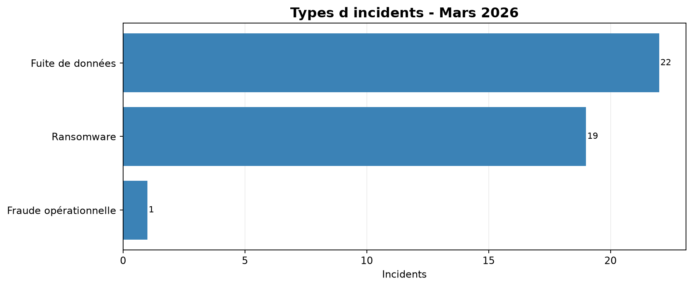
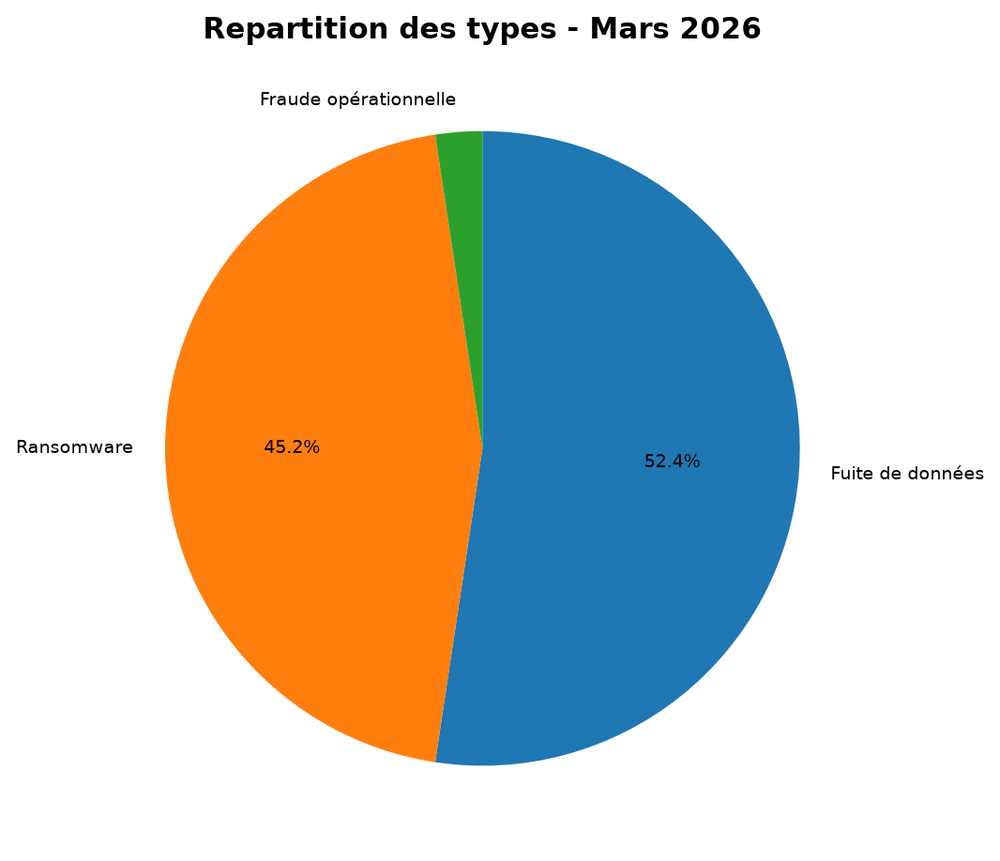
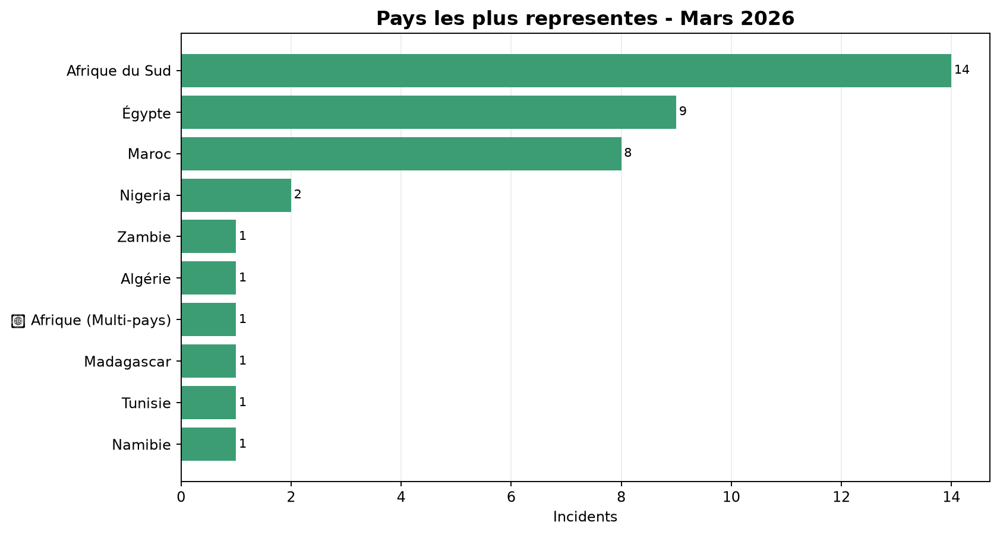
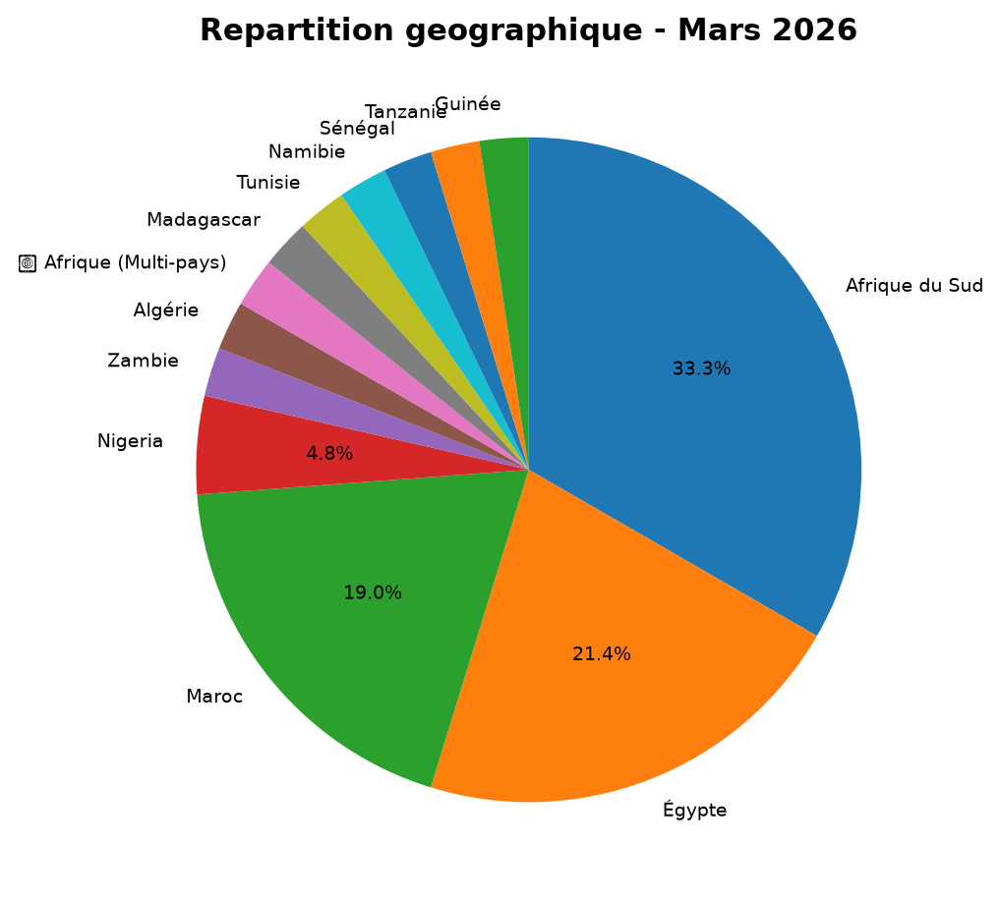
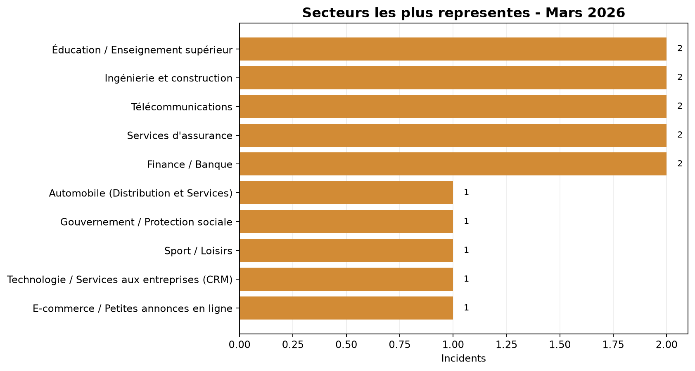
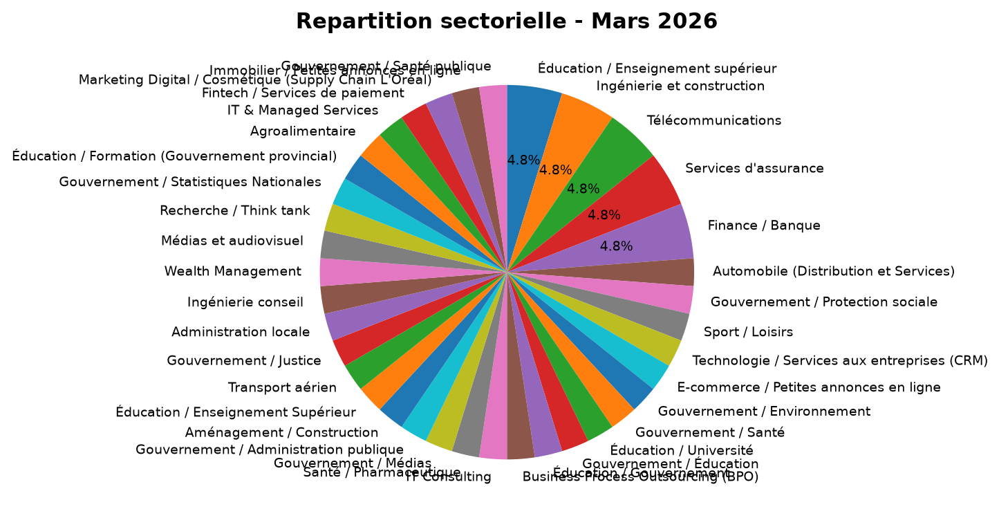
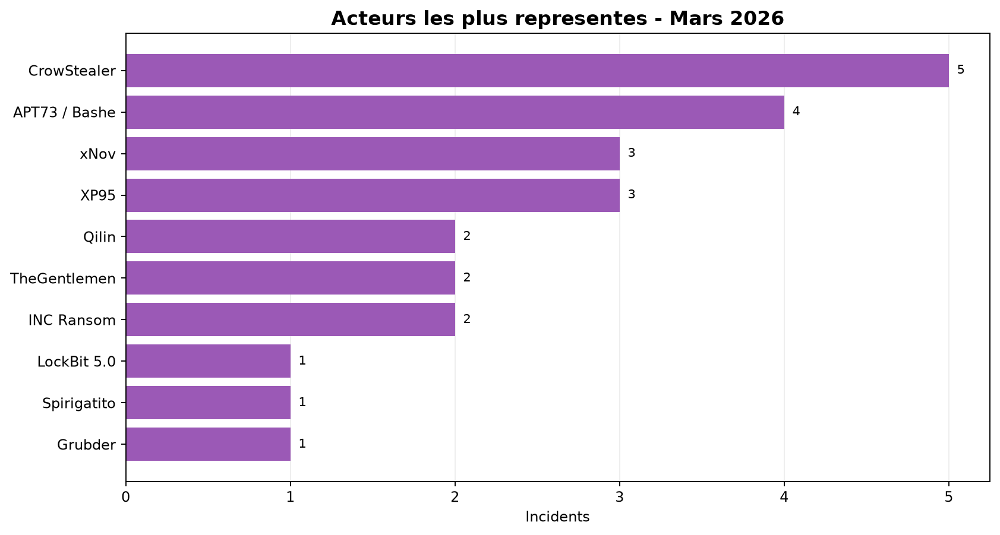
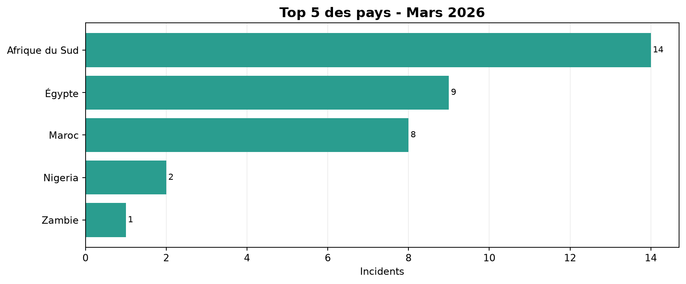

# Rapport CTI AFRINTEL - cyberincidents en Afrique (mars 2026)

Ce corpus validé contient **41 incidents ou cas documentés** publiés pour la première fois ou observés pour la première fois par AFRINTEL en mars 2026. Le rattachement mensuel suit la date de publication ou de première observation documentée ; aucune date de compromission n est déduite lorsqu elle est indisponible.

## Ventilation mensuelle validée

| Type d incident | Nombre | Part |
|---|---:|---:|
| Fuite de données | 21 | 51.2% |
| Ransomware | 19 | 45.2% |
| Fraude opérationnelle | 1 | 2.4% |
| **Total** | **41** | **100.0%** |

## Pays les plus représentés

| Pays | Nombre |
|---|---:|
| Afrique du Sud | 14 |
| Égypte | 9 |
| Maroc | 8 |
| Nigeria | 2 |
| Zambie | 1 |
| Algérie | 1 |
| 🌍 Afrique (Multi-pays) | 1 |
| Madagascar | 1 |
| Tunisie | 1 |
| Namibie | 1 |
| Sénégal | 1 |
| Tanzanie | 1 |
| Guinée | 1 |

## Acteurs les plus représentés

| Libellé acteur | Nombre |
|---|---:|
| CrowStealer | 5 |
| APT73 / Bashe | 4 |
| xNov | 3 |
| XP95 | 3 |
| Qilin | 2 |
| TheGentlemen | 2 |
| INC Ransom | 2 |
| LockBit 5.0 | 1 |
| Spirigatito | 1 |
| Grubder | 1 |

## Secteurs les plus représentés

| Secteur | Nombre |
|---|---:|
| Éducation / Enseignement supérieur | 2 |
| Ingénierie et construction | 2 |
| Télécommunications | 2 |
| Services d'assurance | 2 |
| Finance / Banque | 2 |
| Automobile (Distribution et Services) | 1 |
| Gouvernement / Protection sociale | 1 |
| Sport / Loisirs | 1 |
| Technologie / Services aux entreprises (CRM) | 1 |
| E-commerce / Petites annonces en ligne | 1 |

## Méthodologie

Les chiffres sont calculés une seule fois depuis `victims_FR.md`, contrôlés contre `victims.md`, puis réutilisés dans les rapports, comparaisons et bundles STIX. Un incident multi-pays compte une fois au total ; les occurrences par pays peuvent donc dépasser le total global. Le corpus mesure la visibilité documentée par AFRINTEL, pas la prévalence réelle des cyberattaques.

[Victim records](./victims_FR.md)

### Visualisations

