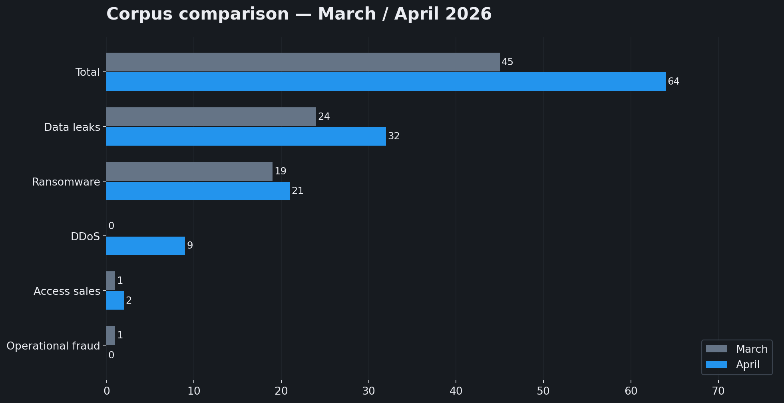
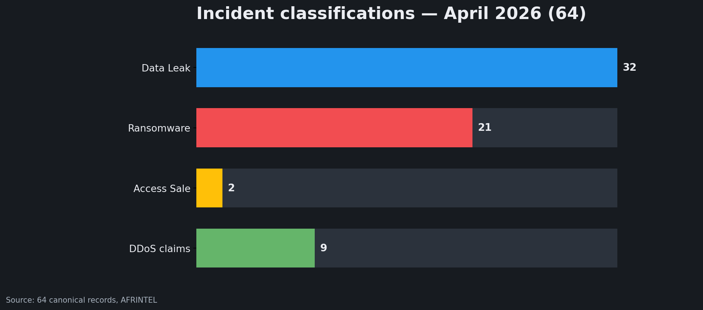
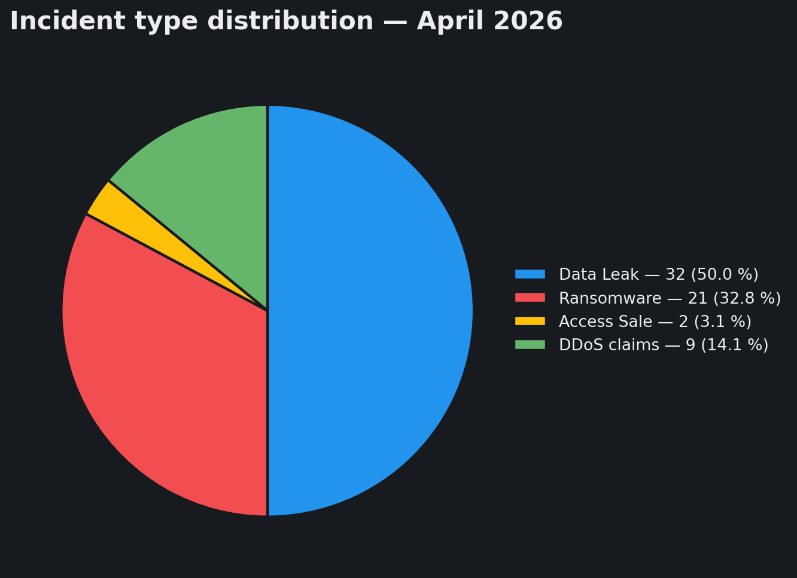
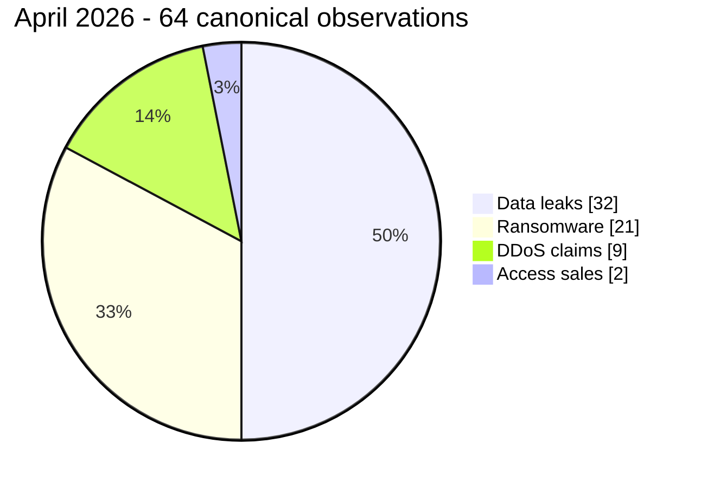
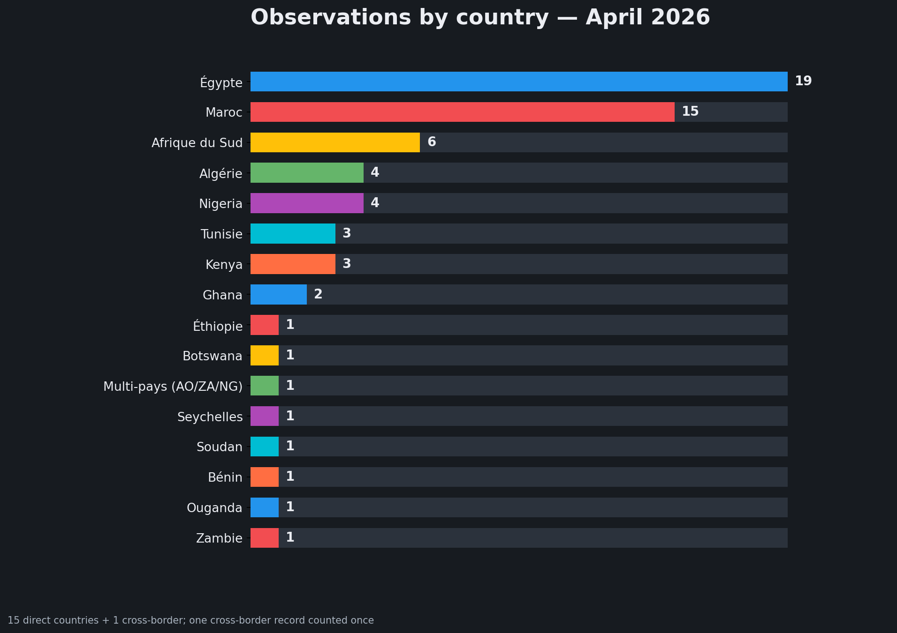
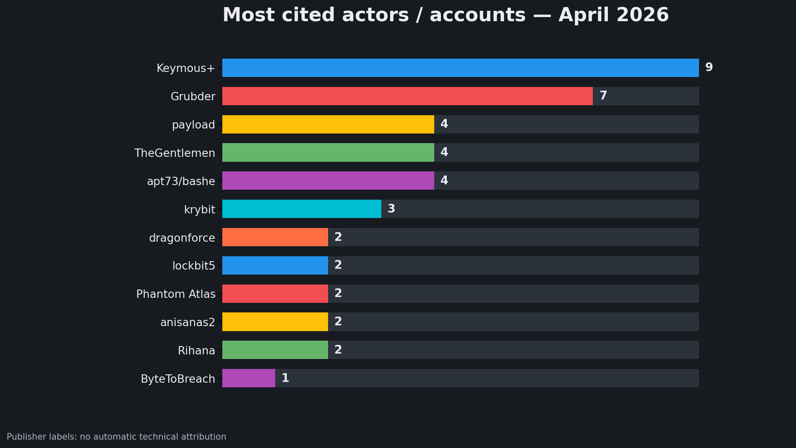
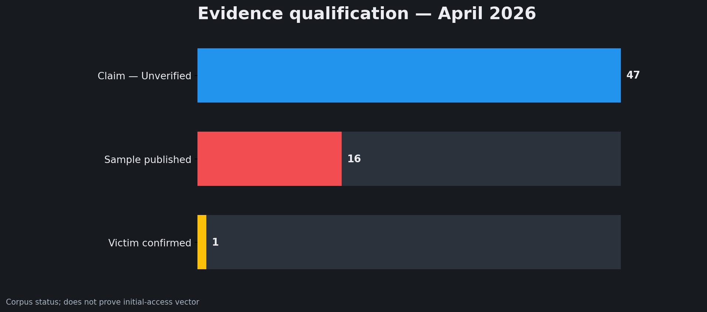
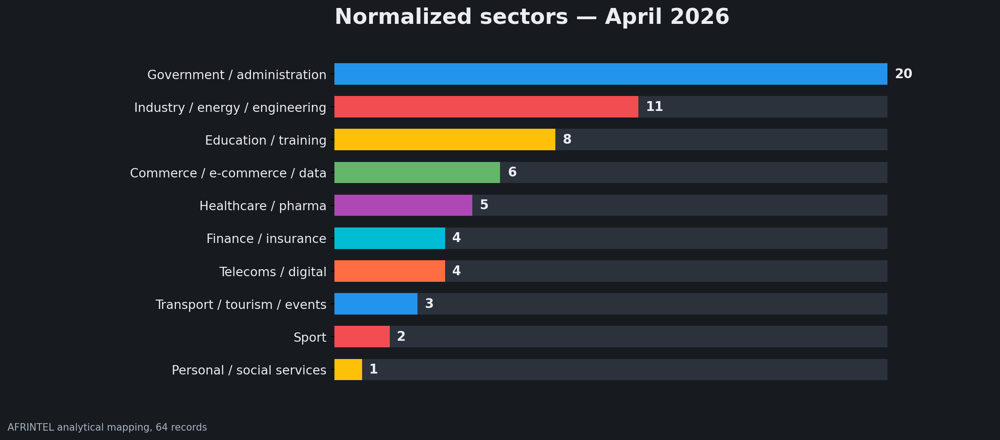
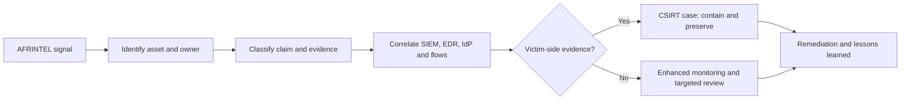

    

# AFRINTEL | Monthly Cyber Threat Intelligence Report
## Cyber threats affecting African organisations - April 2026

**Prepared for CISOs, CIOs, SOC/CERT teams and risk executives**  
**Record period:** 1–30 April 2026 · **Documentary review:** 6 November 2026  
**Sources:** [French victim records](./victims_FR.md), [English victim records](./victims.md), post-disclosure examinations described in those records, official institutional statements, and OSINT sources listed below.  
**Version française :** [README_FR.md](./README_FR.md) · **Quality checks:** [VALIDATION.md](./VALIDATION.md)

> **Reliability and evidence note.** This report consolidates the publications recorded by AFRINTEL and any post-disclosure examination documented in the victim records. For ransomware entries, an extortion-site listing is distinguished from accessible leaked documents, independently established encryption and a victim statement. For data leaks, the analysis considers samples, exports, schemas and screenshots **only where examination is documented in the underlying record**. Actor statements lacking verifiable material remain claims. This report does **not** imply that every dataset or victim system was directly inspected during drafting. It publishes no personal data, secrets or illicit archive links.

---

## 1. Executive summary

**April 2026 shows continued dominance of data-disclosure reporting within AFRINTEL and substantial concentration of claims concerning public administration, industry and education.** A direct audit of the French and English victim files finds **65 documentary records**, of which **64 are included in the canonical reporting population**. **Bank of Kigali** remains a separately tracked retrospective case under investigation and is excluded from canonical totals under the counting rule stated in its source record.

The **64 canonical observations** comprise **32 data leaks (50.0%)**, **21 ransomware-classified records (32.8%)**, **nine DDoS claims (14.1%)** and **two access-sale listings (3.1%)**. The geographic view covers **15 directly named countries** plus **one cross-border record** relating to Angola, South Africa and Nigeria, counted once. **Egypt (19)**, **Morocco (15)** and **South Africa (6)** account for **40 observations (62.5%)**. This reflects the visibility of collection rather than a reliable ranking of national attack likelihood.

The most distinctive change from March is **nine DDoS claims associated with Keymous+**, concentrated on 11–12 April and including Egyptian government services. Screenshots and availability checks supplied by the account are not technical confirmation of the method, duration or success of a distributed denial-of-service attack. They nevertheless provide reasonable triggers for monitoring service availability and validating DDoS mitigation readiness.

Three cases warrant immediate executive attention. **Ahmed Al-Kadi Private Hospital**, South Africa, has **confirmed unauthorised access and partial ransomware encryption**. **CNSS Benin** is associated with an alleged institutional mailbox exposure involving social-security, medical and banking records. **Algérie Télécom Satellite (ATS)** has a record documenting examination of **88 payroll-related files**. Other high-consequence claims affect **National Oil Ethiopia**, the **Kenya Airports Authority**, the **University of Chlef** and multiple Moroccan institutions; their reported data, operational impact and attribution must remain tied to the available evidence.

**Decisions required:** CISOs should prioritise critical datasets and third parties with sensitive privileges. CIOs should validate identity security, recoverable backups and separation of critical systems. SOC teams should operationalise behavioural detections for unusual data exports, mailbox access, privileged sessions, encryption and service-availability anomalies. Baselines and thresholds must be tested against each organisation's telemetry.

### 1.1 Month-over-month comparison

> Based on **45 documented March records** and **64 canonical April observations**. Growth in recorded publications does not by itself prove growth in actual intrusions. Publication, incident and discovery dates do not always match.

| Indicator | March 2026 | April 2026 | Observed change |
|---|---:|---:|---:|
| **Total incidents / observations** | **45** | **64** | **+19 (+42.2%)** |
| Ransomware | 19 | 21 | +2 (+10.5%) |
| Data Leak | 24 | 32 | +8 (+33.3%) |
| Access Sale | 1 | 2 | +1 (+100.0%) |
| DDoS | 0 | 9 | +9 (new) |
| Defacement | 0 | 0 | 0 (stable) |
| Account Takeover | 0 | 0 | 0 (stable) |
| System Intrusion | 0 | 0 | 0 (stable) |
| Malware | 0 | 0 | 0 (stable) |
| Operational Fraud | 1 | 0 | −1 (−100.0%) |

**Interpretation:** March largely featured disclosures involving internal datasets and systems; April combines data-leak reporting, ransomware listings and a distinct series of claimed DDoS operations. Egypt rises from **eight March records to 19 in April**, **eight of which are DDoS claims from one publishing account**. Reading the trend by actor and evidence type is therefore essential.

## 2. Methodology and evidence traceability

AFRINTEL monitors cyber-threat reporting across 54 African countries. The dataset draws on extortion-site listings, forum posts, access-sale advertisements, actor accounts and institutional sources. A record's primary category describes its **main documented report**, not the automatically assumed full intrusion lifecycle.

**Post-publication evidence chain, where the material is available:** collect the listing → describe or examine the accessible pieces and samples → assess field structure, timestamps, metadata and observed volume → corroborate the organisation and independent sources → derive business exposure and SOC requirements. When only a victim name and actor statement are present, **encryption and data theft are not treated as established facts**.

| Reading level | Operational meaning |
|---|---|
| **Observed publication / claim** | The account or group published the listing; access authenticity and effects are not necessarily established. |
| **Published or documented sample** | Fields, documents or screenshots are described; their consistency can be assessed without confirming completeness. |
| **Victim-confirmed incident** | The scope recognised by the victim is established; additional actor claims remain distinct. |
| **Contextual analysis** | Attack scenarios and MITRE techniques are detection **hypotheses** without victim-side telemetry proving a procedure. |

**Counting decision.** Historical file headers state **70 documented / 69 canonical victims**, but the uploaded files each contain **65 actual victim headings**. The mutually exclusive breakdown is **32 + 21 + 9 + 2 + 1 = 65**; the final **one** is the Bank of Kigali case (`Under Investigation - Alleged`, `Operational Fraud`), explicitly excluded from canonical statistics in its record. Consequently, the report's canonical charts use **64**, not 65 or 69. The Angola/South Africa/Nigeria record counts once. Details are documented in [VALIDATION.md](./VALIDATION.md).

**Time discipline.** The event, initial disclosure, first known actor post and AFRINTEL ingestion date may differ. The **Pharmacie.ma** record filed under April identifies an earlier **27 January 2026** post and a claimed **September 2025** breach; **GET/General Electric Trading** refers to a **September 2024** SQL dump, while **National Oil Ethiopia** lists **24 March 2026** as the leak date. These are not automatically new technical intrusions occurring in April.

## 3. Global overview

### 3.1 Incident classifications

| Primary category | Observations | Share |
|---|---:|---:|
| **Data Leak** | **32** | **50.0%** |
| **Ransomware / extortion listing** | **21** | **32.8%** |
| **DDoS claim** | **9** | **14.1%** |
| **Access Sale** | **2** | **3.1%** |
| **TOTAL** | **64** | **100.0%** |

### 3.2 Geographic distribution

| Country / scope | Records | Share of 64 |
|---|---:|---:|
| Egypt | **19** | **29.7%** |
| Morocco | **15** | **23.4%** |
| South Africa | **6** | **9.4%** |
| Algeria | 4 | 6.3% |
| Nigeria | 4 | 6.3% |
| Tunisia | 3 | 4.7% |
| Kenya | 3 | 4.7% |
| Ghana | 2 | 3.1% |
| Benin, Botswana, Ethiopia, Uganda, Seychelles, Sudan, Zambia | 7 | 10.9% |
| **Cross-border (Angola / South Africa / Nigeria)** | **1** | **1.6%** |
| **TOTAL** | **64** | **100.0%** |

Egypt leads in **documented publications**, but **eight of its 19 records** are DDoS claims without independent technical corroboration. Morocco has 15 entries, predominantly disclosure and extortion-related. South Africa has six, including **one officially confirmed ransomware incident**. A multi-country dossier is a cross-border scope label, not a sixteenth African state.

### 3.3 Accounts, groups and actor labels

| Displayed label | Associated records | CTI interpretation |
|---|---:|---|
| **Keymous+** | **9** | DDoS claims and availability screenshots, not proof of attack success. |
| **Grubder** | **7** | Database advertisements and alleged disclosures covering several industries. |
| **payload** | **4** | Extortion-site label; not all cases independently corroborated. |
| **TheGentlemen** | **4** | Cross-sector ransomware listings. |
| **apt73/bashe** | **4** | Displayed label without separately validated APT affiliation. |
| **krybit** | **3** | Ransomware listings. |
| dragonforce, lockbit5, Phantom Atlas, anisanas2, Rihana | 2 each | Mixed threat groups, online accounts and publisher labels. |

**Attribution caution:** a forum handle does not necessarily identify the operator of an intrusion, an affiliate or an accountable threat group. The name `apt73/bashe` is not automatically equated with a separately attributed APT campaign.

### 3.4 Documentary evidence status

| Recorded status | Canonical records | Share |
|---|---:|---:|
| `Claim - Unverified` | **47** | **73.4%** |
| `Claim - Data Sample Published` | **16** | **25.0%** |
| `Victim Confirmed` | **1** | **1.6%** |
| **TOTAL** | **64** | **100.0%** |

The **16 sample-published records** do not mean complete archives were examined. These are documentary status categories rather than automatic authenticity scores. The official statement of **Ahmed Al-Kadi Private Hospital** confirms unauthorised access and partial encryption, but makes no established public claim of data exfiltration.

## 4. Priority incidents and business implications

### 4.1 South Africa - Ahmed Al-Kadi Private Hospital: confirmed ransomware impact

**Established fact.** The hospital states that an unauthorised third party accessed its IT environment on **18 April 2026** and deployed ransomware that **encrypted part of the environment**. It describes containment steps, external specialists and notification to the South African Information Regulator under POPIA. Public information does not establish the entry vector or whether data was removed. [Primary source: hospital notification](https://ahmedalkadi.com/notification-of-data-incident/).

**CISO/CIO implication:** test prioritised restoration of clinical services, segment critical systems and validate business continuity. **SOC implication:** hunt for mass file modification, unexpected privilege changes and backup tampering. **Only the encryption-for-impact technique `T1486` is directly substantiated by the victim's statement**; other behaviours are detection hypotheses.

### 4.2 Benin - CNSS: institutional mailbox exposure and benefit-fraud risk

**Recorded evidence.** The **25 April** CNSS record, attributed to **NormalLeVrai**, describes a publication associated with an institutional mailbox. It references approximately **5,993 messages**, **9,019 attachments**, **over 31,000 files** and **7.1 GB**. The data categories include certificates of life, pension records, identity documents, banking information and medical and HR files. These figures are **as recorded in the incident file**, not a new independent recount of leaked material for this report.

**Strategic implication:** identity records, pension documentation and banking details can support benefits fraud, impersonation and convincing phishing. **The exact acquisition mechanism - mailbox access, server export or backup access - is not established.** **SOC priorities:** inspect mailbox-access and forwarding rules, OAuth and legacy-protocol events, bulk export and unusual logins; preserve evidence and revoke suspect sessions when justified by the institution's own investigation.

### 4.3 Algeria - Algérie Télécom Satellite: payroll records exposed

**Analysis documented by AFRINTEL.** The **16 April Phantom Atlas** entry records examination of **88 files (~29 MB)**, chiefly payroll slips dated **2023–2024**. Described fields include employment, pay, social-security and banking information across several regional directorates. Consistent formatting and plausible organisational markings support the **plausibility** of the material, not proof of ongoing access to every ATS system.

**CISO implication:** payroll, HR identity and staff payment details require strong access control to prevent targeted impersonation and payment diversion. **Immediate actions:** investigate HR exports, log access to payroll repositories, review vendor accounts and notify exposed staff through established antifraud procedures when appropriate.

### 4.4 Algeria - University of Chlef: claimed database-management access

The **10 April Phantom Atlas** record describes screenshots of **phpMyAdmin** displaying a CMS-type database and a staff-administration database with **19 tables** and approximately **13,630 displayed rows**. A visible staff excerpt includes HR attributes and a **40-character hexadecimal password hash**. The actor claims access dating to November 2025; its duration remains independently unverified. No complete export is available in the underlying record.

**SOC implication:** monitor administrative database access from unusual networks, bulk export requests, access to HR tables and misuse of application accounts. Database security requires network restriction, least privilege, audit logs, robust authentication and segmentation, not merely hiding an administration page.

### 4.5 Morocco - institutional, financial, sport and healthcare data

The April records show several **high-sensitivity exposures with differing evidence levels**:

| Case | Documented element | Dominant risk / reservation |
|---|---|---|
| **Dataset attributed to Royal Palace staff** | Described sample of **approximately 3,300 records** containing identity, national ID, addresses and hiring dates. | Targeted impersonation and document fraud; **exact source not independently established**. |
| **Al Barid Bank** | Extracts presented as 2025 transaction logs with post-transaction balances. | Targeted fraud and misuse of financial metadata; scope unknown. |
| **LNM6 medical laboratory** | Described medical PDFs covering highly sensitive biological and patient information. | Medical confidentiality, coercion and personal harm; do not reproduce records. |
| **Royal Moroccan Football Federation (FRMF)** | Sports licence samples; **1.2 TB** advertised for sale. | Identities, contacts and **minors**; overall advertised volume unverified. |
| **GET / General Electric Trading** | SQL dump identified as dating to **September 2024**, including ERP/CRM content. | Historical account, financial and contract exposure; **not a confirmed April intrusion**. |
| **Pharmacie.ma** | Described SQL samples; source post dated **27 January 2026**. | Account reuse and phishing; indexed in April but no new attack established. |

Across the cases, CISOs should prioritise extraction accountability, database segmentation, supplier data protection, protection of minors and appropriate medical-data incident handling.

### 4.6 Ethiopia - National Oil Ethiopia: technically detailed claim, unconfirmed intrusion chain

A **ByteToBreach** post alleges compromise of several systems, an ERP dataset exceeding **800 GB** and a sequence from **Microsoft Exchange ProxyLogon** exploitation to ransomware deployment. The underlying record describes these as **actor claims** accompanied by technical screenshots and narrative. This report does not independently confirm the exploit chain, full ERP volume or control of all systems.

**Energy-sector implication:** protect messaging infrastructure, ERP dependencies, privileged identities, backups and exposed management services. An alleged intrusion chain must not become attributed TTP evidence without technical corroboration.

### 4.7 Kenya - Kenya Airports Authority: sensitive-data claim without established operational disruption

The **16 April RubiconH4ck** listing advertises about **2 TB** of data allegedly linked to the **Kenya Airports Authority**. The victim record classifies it as **Data Leak**, not ransomware. It does not establish encryption, airport operational disruption or independent verification of the advertised volume.

**CISO/CIO response:** distinguish documentation and office networks from operational aviation systems, review contractor access and restrict sensitive data transfers. **Do not describe this as a confirmed interruption of Kenyan aviation services.**

## 5. Analysis by incident type

### 5.1 Ransomware / extortion (21 records)

Listings touch healthcare, industry, energy, digital infrastructure, public bodies, finance and other services. Presence on an extortion site is an intelligence signal but is **not automatically proof of full intrusion**, encryption, complete data loss or ransom payment. **Ahmed Al-Kadi** is the victim-confirmed ransomware case among the canonical records.

A useful **hypothesis-led hunting sequence** is: initial access → account abuse → discovery and collection → unusual export → backup degradation → encryption. None of these steps is automatically attributed to the other 20 cases without incident-specific evidence.

### 5.2 Data leaks (32 records)

The corpus includes sensitive payroll, mailbox, medical, social-security, identity, application and customer data. The relevant analytical test is the **consistency of the material actually described or examined**, not simply the size asserted in a forum. Records without inspectable evidence retain their claim status.

Long-term consequences can include targeted fraud, identity misuse, recombination of historical records, account compromise through reused secrets and third-party exposure.

### 5.3 DDoS claims (nine records)

All nine entries involve **Keymous+**: **eight Egypt-related**, **one Sudan-related**. Actor-side Check-Host-style outputs make the claims documentable but do not reveal attack traffic, rate, duration or origin. SOCs should correlate CDN/WAF telemetry, NetFlow, HTTP `5xx`, latency and application monitoring before declaring an actual DDoS incident.

### 5.4 Access-sale listings (two records)

**AckLine** offered alleged **Fortinet-related access** to an unspecified Algerian government organisation without naming a victim or presenting technical proof. **DarkMafiaX** posted purported administrative-access details for **TikoHUB, Kenya**, without evidence that privileges worked or that AFRINTEL tested any credentials. Defender response consists of justified session and privilege review, log analysis and revocation of at-risk access - **not testing leaked credentials**.

## 6. Sector impacts and dependencies

The following editorial sector mapping assigns one primary business sector to each canonical record, avoiding double counting of hybrid organisations. It is not a legal categorisation of victims.

| Normalised sector | Records | Share | Leading CISO question |
|---|---:|---:|---|
| Government / administration | **20** | **31.3%** | Protect public services, personnel and citizen data. |
| Industry / energy / engineering | **11** | **17.2%** | Isolate ERP, messaging, production and partner access. |
| Education / training | **8** | **12.5%** | Control student and staff databases and admin consoles. |
| Commerce / e-commerce / data | 6 | 9.4% | Detect CRM exports and customer-location disclosure. |
| Healthcare / pharmacy | 5 | 7.8% | Safeguard sensitive records and continuity of care. |
| Finance / insurance | 4 | 6.3% | Detect payment fraud and transaction-data exposure. |
| Telecoms / digital | 4 | 6.3% | Limit service-provider privileges and admin interfaces. |
| Transport / tourism / events | 3 | 4.7% | Protect service delivery and customer workflows. |
| Sport | 2 | 3.1% | Protect member identities, especially minors. |
| Personal / social services | 1 | 1.6% | Safeguard beneficiary records. |
| **TOTAL** | **64** | **100.0%** | |

**Supply-chain consideration:** an outsourced database, shared mailbox or managed-service provider may expose several institutions without proving separate intrusions at each. Data location, retention and export logging are therefore central to third-party risk management.

## 7. Key trends and intelligence gaps

**Supported trends:** recurring exposure of identity and business records; notable reporting on government and energy-related targets; **all nine DDoS claims concentrated in a single account**; multiple historical publication dates within the April collection month. These justify distinct **event, disclosure and detection** timestamps.

| Priority gap | Why it matters | Evidence needed |
|---|---|---|
| Provenance and volume of data attributed to sensitive institutions | Avoid inflated impact and false victim mapping. | Representative samples, metadata, provenance checks and victim-side statements. |
| Initial access and persistence at ATS, NOC, universities and public entities | Directs remediation and targeted hunting. | Authorised IdP/VPN, mail, server, SIEM and DFIR records. |
| Technical reality of the nine DDoS claims | Prevents confusing outages, external checks and malicious flooding. | CDN/NetFlow/WAF telemetry, HTTP errors, operator confirmation. |
| Actual scope of the CNSS Benin publication | Determines notification, beneficiary protection and account remediation. | Institution-controlled investigation and inventory of exposed content. |
| Historical leak deduplication | Prevents April indexing being mistaken for April intrusions. | Primary timestamps, related postings and safe content fingerprints. |

**Separately tracked Bank of Kigali case.** A **1 April** media report describes phishing and transaction disruption; a **6 April** report discusses arrests and quotes the bank as saying the campaign affected customers rather than internal infrastructure. These developments justify additional fraud-focused review but **do not automatically override** the record's separate status or turn it into a confirmed internal bank breach. [Taarifa, 1 April](https://taarifa.rw/2026/04/01/cyberattack-disrupts-bank-of-kigali-operations-amid-phishing-scheme/) · [6 April update](https://taarifa.rw/2026/04/06/rib-arrests-five-suspects-in-bk-mobile-banking-scam-as-losses-remain-limited/).

## 8. Contextual MITRE ATT&CK mapping

> A dataset or access-sale post alone does not reveal how it was acquired. This table structures defensive hunting. **Only `T1486`, encryption for impact at Ahmed Al-Kadi, is directly supported by a victim statement in this corpus.**

| Tactic | Technique | Case/context | Evidence level |
|---|---|---|---|
| Impact | [`T1486`](https://attack.mitre.org/techniques/T1486/) - Data Encrypted for Impact | Ahmed Al-Kadi, partial environment encryption | **Victim confirmed** |
| Impact | [`T1498`](https://attack.mitre.org/techniques/T1498/) - Network Denial of Service | Nine Keymous+ claims | **Hypothesis**, DDoS unconfirmed |
| Collection | [`T1114`](https://attack.mitre.org/techniques/T1114/) - Email Collection | CNSS Benin mailbox publication | **Collection-mechanism hypothesis** |
| Collection | [`T1213`](https://attack.mitre.org/techniques/T1213/) - Data from Information Repositories | ERP/CRM, payroll and university repositories | **Hypothesis**, no victim-side collection logs |
| Credential Access | [`T1552.001`](https://attack.mitre.org/techniques/T1552/001/) - Credentials In Files | Records mentioning secrets and configuration files | **Hypothesis**, credential search not established |
| Defense Evasion / Persistence | [`T1078`](https://attack.mitre.org/techniques/T1078/) - Valid Accounts | Algeria and TikoHUB access-sale listings | **Hypothesis**, access not validated |
| Exfiltration | [`T1567`](https://attack.mitre.org/techniques/T1567/) - Exfiltration Over Web Service | Potential bulk data exports | **Preventive**, channel not established |

## 9. Operational recommendations by audience

| Priority | CISO / risk governance | CIO / IT operations | SOC / incident response |
|---|---|---|---|
| **P0 (0–7 days)** | Identify critical citizen, HR, payroll, health and KYC data and privileged third parties. | Review high-risk privileges, exposed consoles and restoration of at least one critical service. | Confirm ingestion of IdP/VPN, EDR, mailbox, DB audit, WAF/CDN and network telemetry; monitor unusual exports. |
| **P1 (8–30 days)** | Prioritise legal/contractual notification readiness and protections for minors and beneficiaries. | Harden MFA/PAM, isolate backups, restrict data exports and audit application tokens. | Validate behavioural detections through authorised tests and drill L1/L2–CSIRT escalation. |
| **P2 (31–90 days)** | Run cross-organisation crisis exercises and review residual supplier exposure. | Implement tested recovery, segmentation and just-in-time access. | Measure ATT&CK coverage, false positives and detection/containment times. |

## 10. SOC detection hypotheses and correlation workflow

| Use case | Data sources / useful fields | Detection hypothesis to validate | SOC action |
|---|---|---|---|
| **Bulk data export** (published content documented; method unknown) | DB audit, API gateway, proxy, object-storage logs; `user`, `database`, `rows`, `bytes_out`, `src_ip` | Unusual export volume or destination outside known business workflows. | Validate ticket/business rationale, preserve queries and flows, escalate unexplained activity. |
| **Suspicious mailbox harvesting** (CNSS hypothesis) | M365/Exchange/IMAP, IdP, OAuth; `MailboxAccess`, `MailItemsAccessed`, `New-InboxRule`, `app_id` | Many messages accessed or new forwarding rules after atypical authentication. | Verify identity, contain justified suspicious session, preserve evidence. |
| **Privileged-account abuse** (access-sale hypothesis) | VPN, firewall, PAM, AD, cloud audit; `user`, `device`, `src_ip`, `privilege` | First anomalous login followed by administrator creation or export. | Restrict affected access after qualification and investigate lateral scope. |
| **Potential malicious encryption** (confirmed business impact at Ahmed Al-Kadi) | EDR, file telemetry, backup logs; process creation, rewrite rate, snapshots | High file-rewrite rate plus ransom artefacts or backup manipulation. | Isolate endpoint/VM, preserve forensics and activate ransomware playbook. |
| **Availability anomaly / possible DDoS** (claims only) | CDN/WAF, NetFlow, SLO, HTTP status, `request_rate`, `asn` | Traffic spikes and errors with distributed sources not explained by deployment. | Compare baseline and mitigate at edge; do not declare DDoS without corroboration. |
| **Fraudulent beneficiary-payment changes** (preventive) | ERP/CRM, IdP, finance approvals; `beneficiary_change`, `approver`, `mfa` | Bank-detail changes combined with unusual session or bypassed approval. | Suspend payment and confirm out-of-band. |

### Recommended SOC workflow

Always separate an **external intelligence alert** from a **locally corroborated security incident**. Do not invent IoCs or block a victim's domain solely because it appears in an adversary's announcement.

## 11. Strategic 90-day plan and measures of success

| Deadline | Deliverable | Measurable indicator |
|---|---|---|
| **Day 7** | Sensitive-data and privileged-asset register; security-log coverage evidence | % of critical assets with assigned owner and accessible logs |
| **Day 30** | Privilege, export and backup review; four SOC detection exercises | % privileged users with phishing-resistant MFA; 4 tested detections |
| **Day 60** | Ransomware and data-leak response drill incorporating notification and suppliers | Escalation/isolation time, restoration outcomes and false positives |
| **Day 90** | ATT&CK coverage review, sensitive-data crisis plan and business-continuity validation | Closed gaps, documented MTTD/MTTR, approved playbooks |

**Investment principle:** fund exploitable telemetry, account security and validated recovery before expanding undifferentiated SIEM alert volumes. Sensitive data can remain harmful long after a temporary service disruption has been resolved.

## 12. Strategic conclusion

April 2026 is more than a rise in cybercrime publications. The corpus highlights **persistent identity and administrative-data exposure**, **ransomware operational risk** and a **concentrated stream of DDoS claims**. The hospital's confirmed encryption provides firm ground truth; the ATS, CNSS Benin and University of Chlef cases demonstrate both the value and the limitations of examining documentary material after publication.

For **CISOs**, the goal is governable and traceable risk. For **CIOs**, it is reduced attack exposure and demonstrable recovery. For **SOCs**, it is converting external publications into **testable detection hypotheses** around abnormal authentication, bulk exports, mailbox collection, privileged accounts and destructive file activity. Keeping **observation, interpretation and decision** separate is essential to making AFRINTEL useful to both executive leadership and defensive operators.

### Sources and review limitations

- **Primary documentary basis:** [AFRINTEL April victim records FR](./victims_FR.md), [EN](./victims.md), and [quality / recoding notes](./VALIDATION.md).
- **Primary victim confirmation:** [Ahmed Al-Kadi Private Hospital - Notification of Data Incident](https://ahmedalkadi.com/notification-of-data-incident/).
- **Additional press:** [Taarifa Rwanda - Bank of Kigali, 1 April 2026](https://taarifa.rw/2026/04/01/cyberattack-disrupts-bank-of-kigali-operations-amid-phishing-scheme/) and [6 April update](https://taarifa.rw/2026/04/06/rib-arrests-five-suspects-in-bk-mobile-banking-scam-as-losses-remain-limited/). **Not part of canonical April statistics.**
- **Defensive references:** [MITRE ATT&CK Enterprise](https://attack.mitre.org/) and [CISA / MS-ISAC Ransomware Guide](https://www.cisa.gov/stopransomware/ransomware-guide).
- **No personal medical records, individual identifiers, secrets or links to underground downloads appear here.** Unverified actor-advertised totals are explicitly qualified.

---

**AFRINTEL - African Cyber Threat Intelligence**  
[AFRINTEL public repository](https://github.com/Hatchepsoute/AFRINTEL) · **TLP:CLEAR** · Documentary review: 6 November 2026
