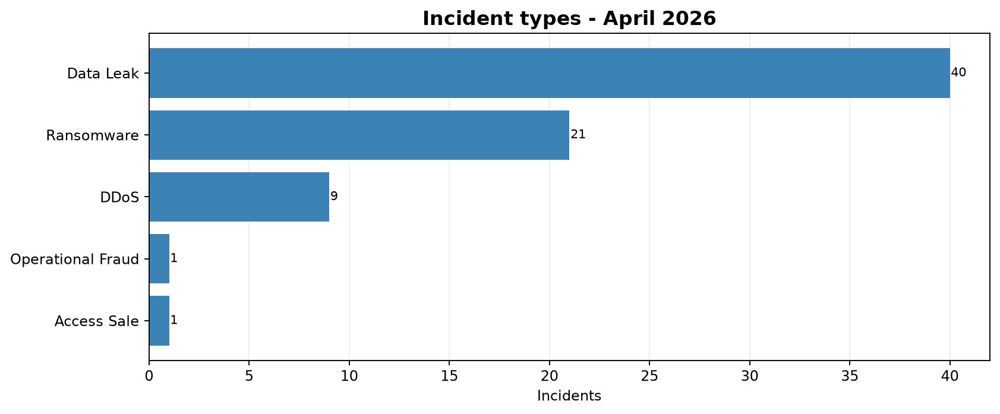
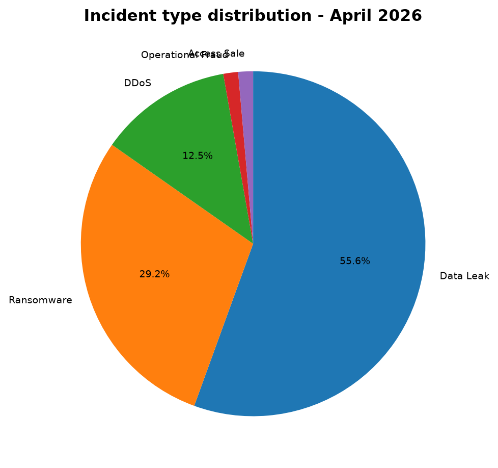
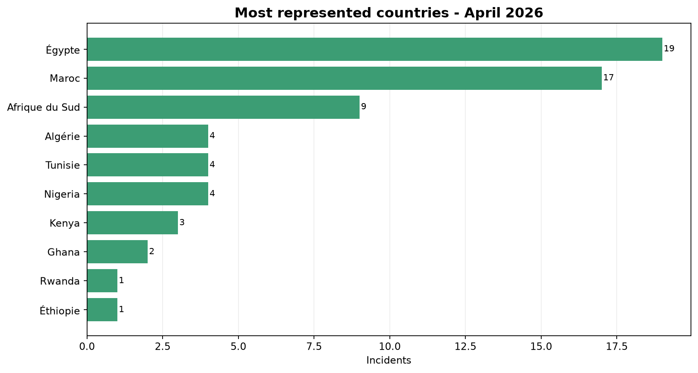
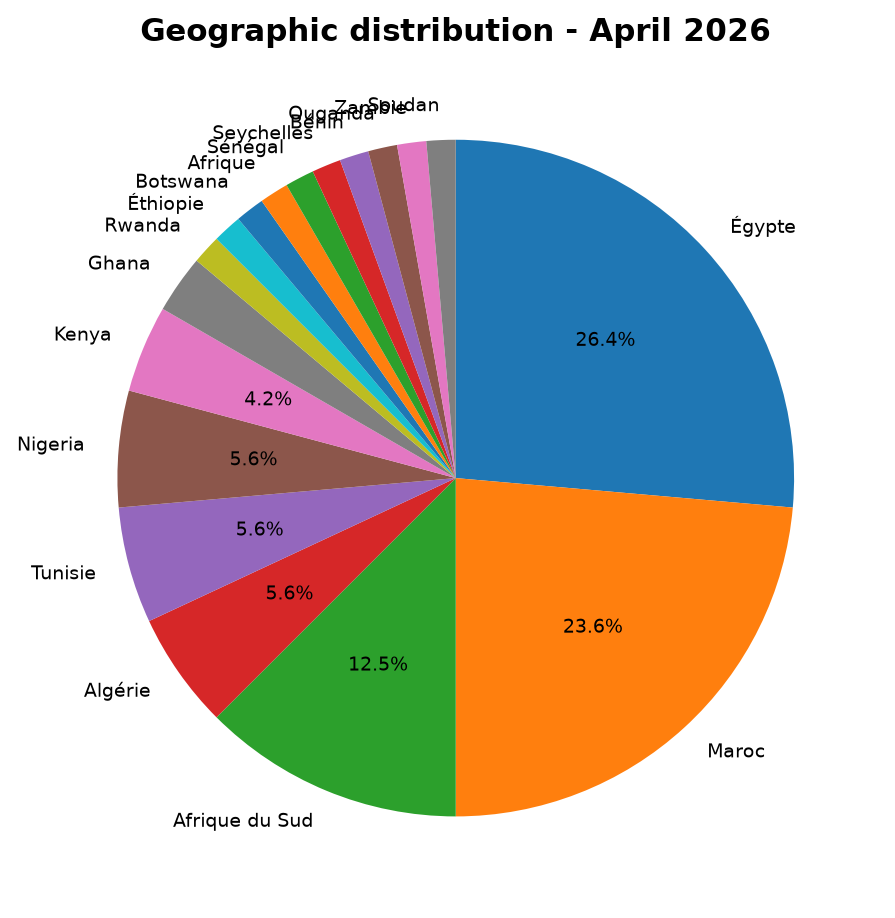
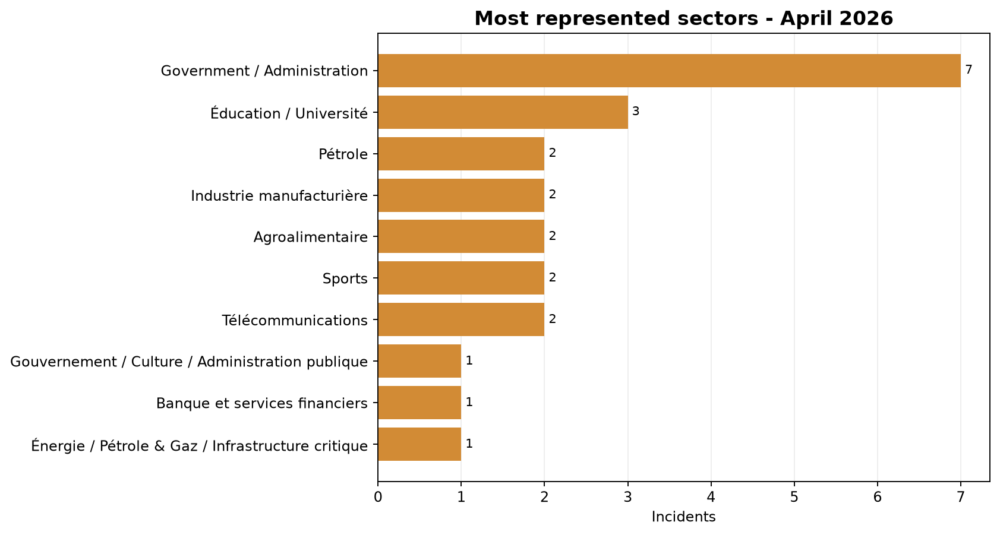
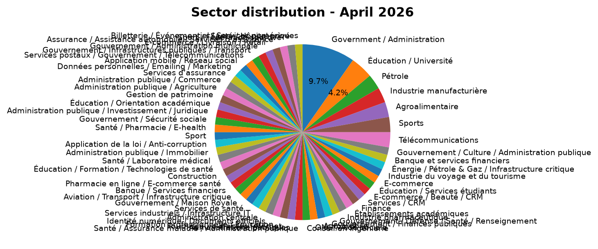
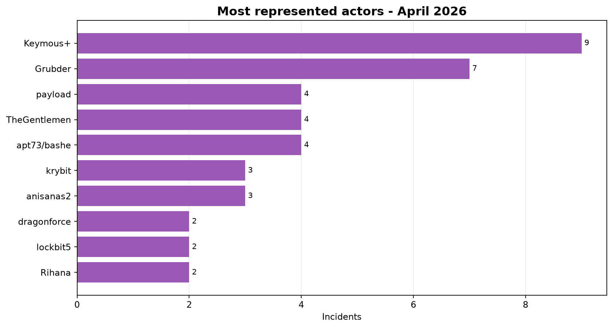
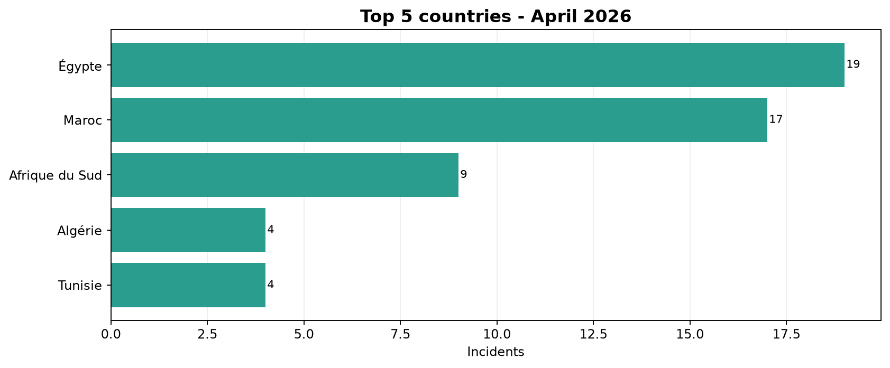

# AFRINTEL CTI report - cyber incidents in Africa (April 2026)

This validated corpus contains **72 incidents or documented cases** first published or first observed by AFRINTEL in April 2026. The month assignment follows the publication or first documented observation date; a compromise date is not inferred when it is unavailable.

## Validated monthly breakdown

| Incident type | Count | Share |
|---|---:|---:|
| Data Leak | 40 | 55.6% |
| Ransomware | 21 | 29.2% |
| DDoS | 9 | 12.5% |
| Operational Fraud | 1 | 1.4% |
| Access Sale | 1 | 1.4% |
| **Total** | **72** | **100.0%** |

## Countries most represented

| Country | Count |
|---|---:|
| Égypte | 19 |
| Maroc | 17 |
| Afrique du Sud | 9 |
| Algérie | 4 |
| Tunisie | 4 |
| Nigeria | 4 |
| Kenya | 3 |
| Ghana | 2 |
| Rwanda | 1 |
| Éthiopie | 1 |
| Botswana | 1 |
| Afrique | 1 |
| Sénégal | 1 |
| Seychelles | 1 |
| Bénin | 1 |
| Ouganda | 1 |
| Zambie | 1 |
| Soudan | 1 |

## Actor labels most represented

| Actor label | Count |
|---|---:|
| Keymous+ | 9 |
| Grubder | 7 |
| payload | 4 |
| TheGentlemen | 4 |
| apt73/bashe | 4 |
| krybit | 3 |
| anisanas2 | 3 |
| dragonforce | 2 |
| lockbit5 | 2 |
| Rihana | 2 |

## Sectors most represented

| Sector | Count |
|---|---:|
| Government / Administration | 7 |
| Éducation / Université | 3 |
| Pétrole | 2 |
| Industrie manufacturière | 2 |
| Agroalimentaire | 2 |
| Sports | 2 |
| Télécommunications | 2 |
| Gouvernement / Culture / Administration publique | 1 |
| Banque et services financiers | 1 |
| Énergie / Pétrole & Gaz / Infrastructure critique | 1 |

## Methodology

The figures are derived once from `victims_FR.md`, checked against `victims.md`, and reused in the reports, comparisons and STIX bundle. A multi-country incident counts once globally; country occurrences may therefore exceed the global total. The corpus measures documented AFRINTEL visibility, not the actual prevalence of cyberattacks.

[Victim records](./victims.md)

### Visualisations

