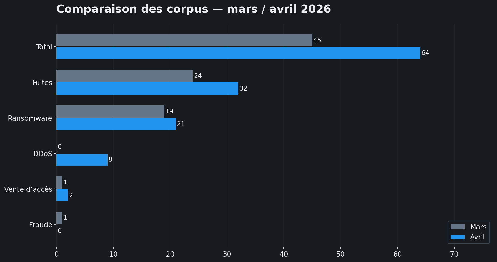
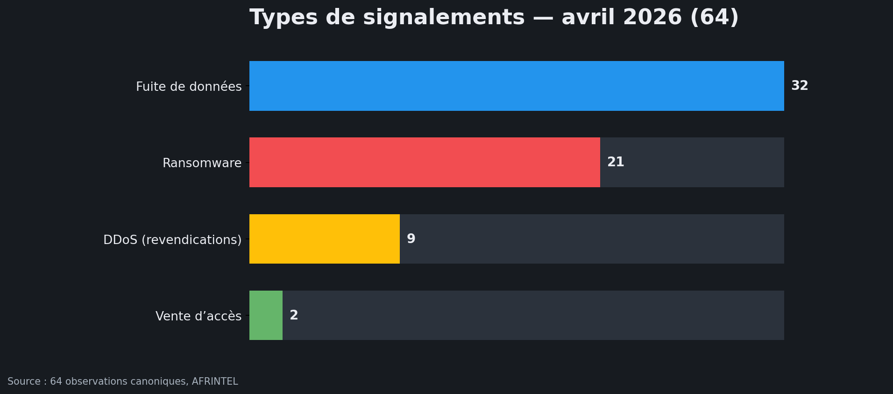
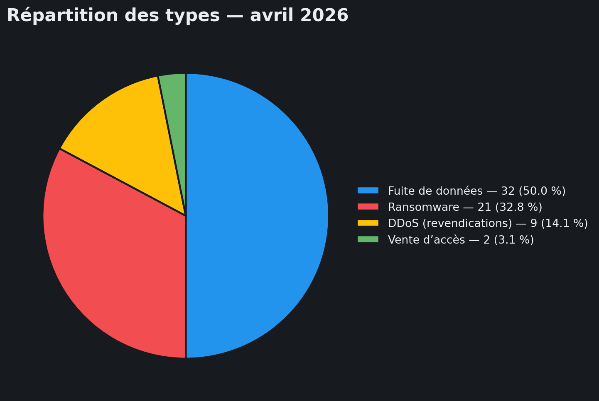
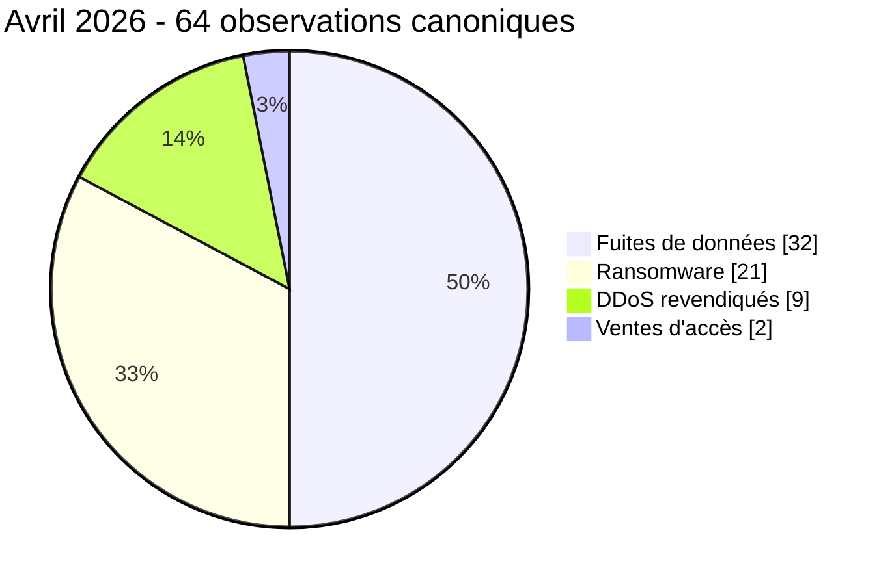
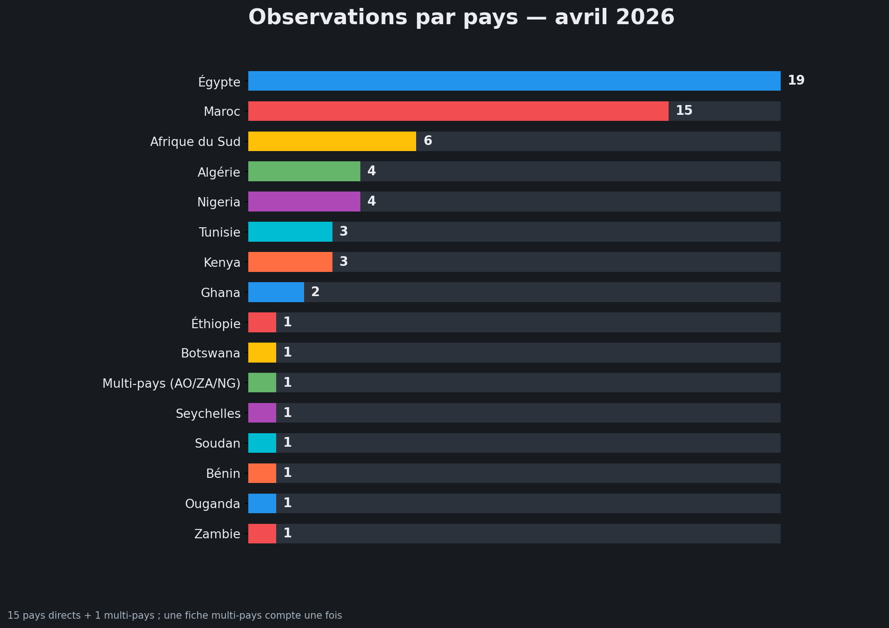
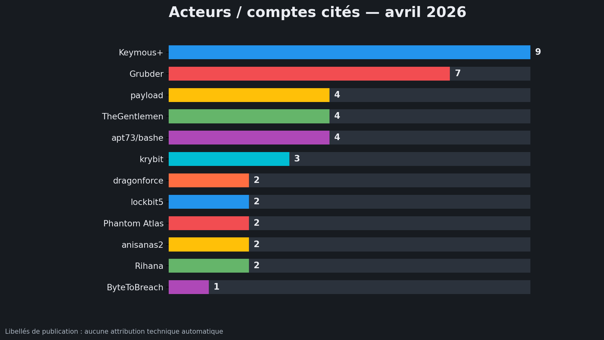
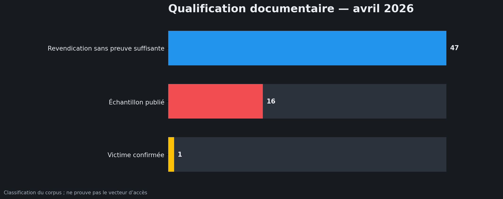
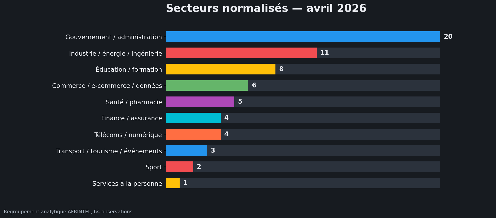
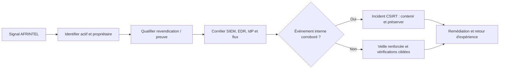

    

# AFRINTEL | Rapport mensuel de Cyber Threat Intelligence
## Cybermenaces visant les organisations africaines - Avril 2026

**Édition destinée aux RSSI, DSI, SOC/CERT et directions des risques**  
**Période des fiches :** 1er au 30 avril 2026 · **Revue documentaire :** 6 novembre 2026  
**Sources :** fiches victimes [FR](./victims_FR.md) / [EN](./victims.md), publications et échantillons décrits dans ces fiches, communications des organisations, sources OSINT citées en fin de rapport.  
**Version anglaise :** [README.md](./README.md) · **Contrôles :** [VALIDATION.md](./VALIDATION.md)

> **Note de fiabilité - approche AFRINTEL.** Ce rapport consolide des publications effectivement consignées dans le corpus et les analyses post-divulgation associées à certaines fiches. Pour les dossiers ransomware, l'inscription sur un site d'extorsion est distinguée de l'accès à des documents divulgués, du chiffrement et d'une confirmation officielle. Pour les fuites, les éléments analysés sont décrits à partir des échantillons, exports, structures et captures **lorsque leur examen est tracé dans la fiche**. Une description fournie par un acteur sans échantillon vérifiable demeure une revendication. Le rapport ne prétend **pas** que tous les jeux de données ou toutes les infrastructures ont été examinés directement lors de sa rédaction. Aucun secret, identifiant personnel ou lien vers des archives illicites n'est reproduit.

---

## 1. Synthèse exécutive

**Avril 2026 confirme la prépondérance des divulgations de données dans la veille AFRINTEL et montre une concentration élevée de publications visant les administrations, le secteur industriel et l'éducation.** Le contrôle des deux fichiers victimes donne **65 fiches documentaires**, dont **64 observations retenues pour le reporting canonique**. La différence correspond à **Bank of Kigali**, conservée comme événement rétrospectif à instruire, mais exclue des statistiques selon la décision inscrite dans le corpus.

Sur les **64 observations**, on compte **32 fuites de données (50,0 %)**, **21 dossiers classés ransomware (32,8 %)**, **9 revendications DDoS (14,1 %)** et **2 offres de vente d'accès (3,1 %)**. Le corpus comprend **15 pays directement désignés** et **une publication multi-pays** (Angola, Afrique du Sud, Nigeria), comptée une seule fois. **L'Égypte (19)**, **le Maroc (15)** et **l'Afrique du Sud (6)** concentrent **40 observations (62,5 %)**, ce qui mesure la visibilité documentaire de la collecte, **pas la probabilité nationale de cyberattaque**.

La principale rupture par rapport à mars tient aux **neuf publications DDoS revendiquées par le compte Keymous+**, concentrées les 11–12 avril et visant notamment des services publics égyptiens. Les captures ou tests de disponibilité publiés par le compte n'attestent ni la méthode, ni la durée, ni le succès d'une attaque DDoS. Cette série peut néanmoins alimenter la surveillance de disponibilité et les dispositifs anti-DDoS.

Trois dossiers justifient une attention immédiate des responsables de la sécurité : **Ahmed Al-Kadi Private Hospital** (Afrique du Sud), où le ransomware et le chiffrement partiel sont **confirmés par l'hôpital** ; **la CNSS Bénin**, pour une publication attribuée à une messagerie institutionnelle impliquant des dossiers sociaux, médicaux et bancaires ; et **Algérie Télécom Satellite (ATS)**, dont la fiche décrit un examen de **88 fichiers** de paie sensibles. À ceux-ci s'ajoutent **National Oil Ethiopia**, **Kenya Airports Authority**, **l'Université de Chlef** et plusieurs organismes marocains, où les revendications, les échantillons et les accès allégués doivent être traités à leur niveau de preuve respectif.

**Décisions recommandées :** pour le **RSSI**, prioriser les données critiques et les tiers disposant d'accès sensibles ; pour la **DSI**, renforcer l'identité, les sauvegardes restaurables et l'isolement des environnements ; pour le **SOC**, opérationnaliser les détections comportementales portant sur les exports de données, l'accès aux messageries, les privilèges, le chiffrement et les anomalies de disponibilité. Les seuils et contrôles doivent être validés sur la télémétrie de chaque organisation.

### 1.1 Comparaison avec le mois précédent

> Comparaison fondée sur les **45 fiches documentées en mars** et les **64 observations canoniques d'avril**. Une variation des publications recensées ne prouve pas, à elle seule, une variation équivalente des intrusions effectives. Les dates de publication, d'incident et de découverte ne sont pas toujours identiques.

| Indicateur | Mars 2026 | Avril 2026 | Évolution observée |
|---|---:|---:|---:|
| **Total incidents / observations** | **45** | **64** | **+19 (+42,2 %)** |
| Ransomware | 19 | 21 | +2 (+10,5 %) |
| Data Leak | 24 | 32 | +8 (+33,3 %) |
| Access Sale | 1 | 2 | +1 (+100,0 %) |
| DDoS | 0 | 9 | +9 (nouveau) |
| Defacement | 0 | 0 | 0 (stable) |
| Account Takeover | 0 | 0 | 0 (stable) |
| System Intrusion | 0 | 0 | 0 (stable) |
| Malware | 0 | 0 | 0 (stable) |
| Operational Fraud | 1 | 0 | −1 (−100,0 %) |

**Lecture comparative :** mars était principalement caractérisé par des publications relatives à des données et environnements internes, tandis qu'avril réunit une concentration de **publications de fuite**, de **dossiers ransomware** et d'**actions de visibilité DDoS alléguées**. Le volume égyptien passe de 8 dossiers en mars à 19 en avril, **dont huit revendications DDoS d'un même compte** ; la lecture par acteur et par nature de preuve est donc indispensable.

## 2. Méthodologie et traçabilité des preuves

AFRINTEL surveille les menaces affectant les organisations ou les données associées aux 54 pays africains. Les fiches regroupent publications de sites de fuite, forums, annonces de vente d'accès, comptes d'acteurs et sources institutionnelles. La catégorie d'un dossier reflète **le signalement principal documenté**, non une conclusion automatique sur l'ensemble du cycle d'intrusion.

**Chaîne d'analyse post-publication appliquée lorsque les éléments existent :** publication recensée → pièces et échantillons accessibles décrits → cohérence des champs, métadonnées et volumes observés → recoupement avec l'identité de l'organisation et des sources indépendantes → impacts métier et besoins SOC. Dans les fiches où seuls le nom de victime et la revendication sont disponibles, **aucune validation d'exfiltration ou de chiffrement n'est présumée**.

| Niveau de lecture | Signification opérationnelle |
|---|---|
| **Publication / revendication observée** | Le compte ou groupe a publié le dossier ; l'authenticité des accès et les impacts restent à déterminer. |
| **Échantillon publié ou documenté** | Des champs, documents ou captures sont décrits ; la cohérence du contenu peut être évaluée, sans confirmer l'exhaustivité. |
| **Incident confirmé par la victime** | Le périmètre reconnu publiquement est établi ; les affirmations non reprises par la victime demeurent séparées. |
| **Analyse contextuelle** | Les scénarios d'attaque et hypothèses MITRE sont des **axes de détection** lorsqu'aucune télémétrie victime ne démontre la technique. |

**Décision de comptage.** Les fichiers affichent des en-têtes historiques annonçant **70 fiches / 69 victimes canoniques**, mais ils contiennent **65 en-têtes de fiches dans chaque langue**. La ventilation réductible est **32 + 21 + 9 + 2 + 1 = 65** ; le dernier terme correspond à **Bank of Kigali** (`Under Investigation - Alleged`, `Operational Fraud`), **hors dénominateur canonique** conformément à sa fiche. Les graphiques canoniques du présent rapport utilisent **64**, non 65 ni 69. La publication multi-pays **Angola / Afrique du Sud / Nigeria** est comptée une fois, sans multiplier les pays ou les victimes. Les règles sont détaillées dans [VALIDATION.md](./VALIDATION.md).

**Contrôle temporel.** La publication observée, la fuite initiale, la date réelle de compromission et l'entrée dans AFRINTEL peuvent diverger. Ainsi, la fiche **Pharmacie.ma**, classée dans l'inventaire d'avril, rapporte une première annonce au **27 janvier 2026** et une compromission revendiquée en **septembre 2025** ; le dump GET/General Electric Trading renvoie à **septembre 2024** ; la fiche **National Oil Ethiopia** mentionne une fuite au **24 mars 2026**. Ces événements ne doivent pas être décrits comme autant de nouvelles intrusions découvertes techniquement en avril.

## 3. Panorama quantitatif

### 3.1 Typologies des signalements

| Type principal | Observations | Part |
|---|---:|---:|
| **Fuite de données** | **32** | **50,0 %** |
| **Ransomware / publication d'extorsion** | **21** | **32,8 %** |
| **DDoS revendiqué** | **9** | **14,1 %** |
| **Vente d'accès** | **2** | **3,1 %** |
| **TOTAL** | **64** | **100,0 %** |

### 3.2 Répartition géographique

| Pays ou périmètre | Dossiers | Part des 64 |
|---|---:|---:|
| Égypte | **19** | **29,7 %** |
| Maroc | **15** | **23,4 %** |
| Afrique du Sud | **6** | **9,4 %** |
| Algérie | 4 | 6,3 % |
| Nigeria | 4 | 6,3 % |
| Tunisie | 3 | 4,7 % |
| Kenya | 3 | 4,7 % |
| Ghana | 2 | 3,1 % |
| Bénin, Botswana, Éthiopie, Ouganda, Seychelles, Soudan, Zambie | 7 | 10,9 % |
| **Multi-pays (Angola / Afrique du Sud / Nigeria)** | **1** | **1,6 %** |
| **TOTAL** | **64** | **100,0 %** |

L'Égypte est en tête des **publications visibles**, mais **huit de ses 19 entrées** sont des revendications DDoS non corroborées indépendamment. Le Maroc compte 15 dossiers, essentiellement des publications relatives aux données et à l'extorsion. L'Afrique du Sud recense six entrées, dont **un incident ransomware confirmé**. Le suivi multi-pays ne constitue pas un seizième État africain ; il est conservé comme catégorie transversale.

### 3.3 Activité des comptes et libellés de groupe

| Acteur ou compte cité | Dossiers associés | Lecture CTI |
|---|---:|---|
| **Keymous+** | **9** | Revendications DDoS / résultats de disponibilité, non preuve de succès. |
| **Grubder** | **7** | Publications ou ventes alléguées de bases hétérogènes. |
| **payload** | **4** | Libellé de site d'extorsion ; attaques non toutes corroborées. |
| **TheGentlemen** | **4** | Publications d'extorsion ciblant plusieurs secteurs. |
| **apt73/bashe** | **4** | Libellé observé, sans validation d'une affiliation APT indépendante. |
| **krybit** | **3** | Publications ransomware. |
| dragonforce, lockbit5, Phantom Atlas, anisanas2, Rihana | 2 chacun | Hétérogénéité des groupes, comptes et publications. |

**Attention à l'attribution :** le pseudonyme affiché par un compte de forum n'identifie pas nécessairement l'opérateur technique de l'intrusion, un groupe affilié ou un commanditaire. Les analyses ne rattachent pas automatiquement `apt73/bashe` à une opération APT reconnue.

### 3.4 Qualité des preuves consignées

| Statut déclaré | Fiches canoniques | Part |
|---|---:|---:|
| `Claim - Unverified` | **47** | **73,4 %** |
| `Claim - Data Sample Published` | **16** | **25,0 %** |
| `Victim Confirmed` | **1** | **1,6 %** |
| **TOTAL** | **64** | **100,0 %** |

Les **16 fiches avec échantillon signalé** n'impliquent pas que l'intégralité de chaque archive ait été analysée ou validée. Les indicateurs décrivent le **niveau documentaire des fiches**, non des scores automatiques d'authenticité. À l'inverse, la notification d'**Ahmed Al-Kadi Private Hospital** constitue une confirmation de première main de l'accès illicite et du chiffrement partiel, sans précision sur une éventuelle exfiltration.

## 4. Incidents majeurs et conséquences pour les organisations

### 4.1 Afrique du Sud - Ahmed Al-Kadi Private Hospital : ransomware confirmé

**Fait établi.** L'hôpital indique qu'un tiers non autorisé a accédé à son environnement informatique le **18 avril 2026** et déployé un ransomware ayant **chiffré une partie de l'environnement**. Il rapporte des mesures de confinement, l'intervention d'experts et une notification au régulateur sud-africain au titre de la POPIA. Les informations disponibles ne précisent ni la méthode d'entrée, ni l'éventuelle exfiltration de données. [Source primaire : notification de l'hôpital](https://ahmedalkadi.com/notification-of-data-incident/).

**Lecture RSSI/DSI :** ce cas confirme l'importance d'une restauration priorisée des applications cliniques, du cloisonnement des systèmes et des capacités de continuité des soins. **Lecture SOC :** rechercher les séquences de modifications massives de fichiers, les changements de privilèges et les actions sur sauvegardes. **Seule la technique de chiffrement pour impact `T1486` est étayée par la déclaration ; les autres techniques restent des hypothèses de chasse.**

### 4.2 Bénin - CNSS : messagerie institutionnelle et fraude sociale

**Éléments consignés.** La fiche CNSS du **25 avril**, attribuée au compte **NormalLeVrai**, décrit une publication associée à une boîte de messagerie institutionnelle. Les volumes mentionnés sont d'environ **5 993 messages**, **9 019 pièces jointes**, plus de **31 000 fichiers** et **7,1 Go**. Les catégories citées incluent certificats de vie, dossiers de pension, pièces d'identité, données bancaires, RH et médicales. Ces nombres sont **ceux consignés dans la fiche de l'incident**, non un nouveau recomptage des fichiers bruts pour ce rapport.

**Lecture stratégique :** la combinaison entre identité administrative, documents de pension et coordonnées bancaires facilite la fraude aux prestations, l'usurpation de bénéficiaires et le phishing crédible. **La méthode exacte de collecte des messages (accès au compte, export serveur, copie de sauvegarde) n'est pas établie.** **Priorité SOC :** audit des accès à la boîte, règles de transfert, événements OAuth/IMAP/POP/Graph, exports massifs et connexions inhabituelles ; préserver les journaux et révoquer les sessions suspectes si l'organisation confirme une exposition.

### 4.3 Algérie - Algérie Télécom Satellite : exposition de données de paie

**Éléments analysés selon la fiche AFRINTEL.** La publication attribuée à **Phantom Atlas** du **16 avril** est accompagnée d'un examen documentaire de **88 fichiers (~29 Mo)**, surtout des bulletins de salaire datés **2023–2024**. Les pièces décrites comprennent des éléments RH et bancaires (matricule, salaire, catégorie, numéro de sécurité sociale, compte bancaire), couvrant plusieurs directions régionales. La cohérence de structure, la variété des périodes et les marques institutionnelles visibles étayent la **plausibilité** des documents ; elles ne démontrent pas à elles seules un accès actuel à tous les systèmes d'ATS.

**Lecture RSSI :** les RH, l'identité du personnel et la paie sont des actifs à protéger contre le ciblage individualisé, la fraude documentaire et les tentatives de changement de coordonnées de paiement. **Mesure prioritaire :** audit des exports RH, contrôle des accès aux répertoires de paie, traçabilité des comptes de prestataires et dispositif d'alerte antifraude interne.

### 4.4 Algérie - Université de Chlef : exposition alléguée d'interfaces et de tables administratives

La fiche **Phantom Atlas** du **10 avril** décrit des vues d'un environnement **phpMyAdmin** montrant deux ensembles : une base de type CMS et une base de gestion du personnel avec **19 tables** et environ **13 630 lignes** affichées. L'extrait visible comprend des attributs RH, dont un hachage de mot de passe à **40 caractères hexadécimaux**. Le récit de l'acteur évoque un accès depuis novembre 2025, sans preuve indépendante de sa durée réelle. Aucun export complet n'a été fourni dans les éléments de cette fiche.

**Lecture SOC :** surveiller les accès aux interfaces d'administration de bases depuis des réseaux inhabituels, les requêtes d'export, l'énumération de tables sensibles et l'utilisation de comptes applicatifs hors périmètre. La sécurisation ne doit pas se limiter à masquer phpMyAdmin : segmentation, MFA lorsque pris en charge, restriction réseau, moindre privilège et journaux d'audit sont nécessaires.

### 4.5 Maroc - données institutionnelles, financières, sportives et de santé

Le corpus regroupe plusieurs situations de **sensibilité élevée mais de niveaux de preuve différents** :

| Dossier | Élément documenté | Risque métier dominant / réserve |
|---|---|---|
| **Données attribuées au personnel du Palais royal** | Échantillon décrit d'**environ 3 300 enregistrements** (identité, CNIE, adresses, dates de recrutement). | Usurpation ciblée et fraude documentaire ; **l'origine exacte du registre n'est pas confirmée**. |
| **Al Barid Bank** | Extraits présentés comme des logs de transactions et soldes post-opération (2025). | Fraude ciblée et exploitation de données transactionnelles ; étendue inconnue. |
| **LNM6** | Rapports médicaux PDF décrits avec résultats biologiques et données de patients. | Confidentialité médicale, chantage et atteinte aux personnes ; ne pas exposer les documents. |
| **FRMF** | Échantillons de licences sportives ; **1,2 To** avancés dans une annonce de vente. | Données de licenciés, **mineurs**, identité et contacts ; volume total non vérifié. |
| **GET / General Electric Trading** | Dump SQL mentionné comme provenant de **septembre 2024**, lié à des données ERP/CRM. | Comptes historiques, données financières et contractuelles ; **éviter de dater l'intrusion d'avril**. |
| **Pharmacie.ma** | Échantillons SQL décrits, mais annonce initiale datée du **27 janvier 2026**. | Phishing et réutilisation de comptes ; publication réindexée en avril, pas nouvelle attaque établie. |

Pour les RSSI, l'enjeu transversal est la **traçabilité des extractions**, le cloisonnement des bases de données et la protection des données sensibles des citoyens et des partenaires. La protection des mineurs et des informations médicales exige un circuit de notification et de traitement spécifique.

### 4.6 Éthiopie - National Oil Ethiopia : récit technique avancé, mécanisme non confirmé

La publication attribuée à **ByteToBreach** évoque une compromission de plusieurs systèmes, une base ERP de **plus de 800 Go** et un chemin allant de **ProxyLogon** sur Microsoft Exchange à un déploiement ransomware. **La fiche qualifie ce contenu comme revendiqué** et mentionne des captures et descriptions techniques : le présent rapport ne confirme pas indépendamment cette chaîne d'exploitation, le volume ERP ou l'accès à l'ensemble des systèmes.

**Enseignement pour l'énergie :** traiter les passerelles de messagerie, les ERP, les accès administrateurs et les systèmes de secours comme des dépendances critiques. Prioriser inventaire d'exposition, mises à jour, authentification forte, sauvegardes isolées et surveillance des exports. Une chaîne d'attaque revendiquée ne devient un TTP attribué qu'après corroboration technique.

### 4.7 Kenya - Kenya Airports Authority : un scénario de risque majeur sans preuve d'impact opérationnel

Le compte **RubiconH4ck** propose, selon la fiche du **16 avril**, des données présentées comme liées à la **Kenya Airports Authority**, avec un volume annoncé d'environ **2 To**. La fiche classe le dossier en **fuite de données**, pas en ransomware : elle ne décrit ni chiffrement confirmé ni indisponibilité aéroportuaire établie. Le volume et l'origine des données restent à valider.

**Priorité DSI/RSSI :** distinguer systèmes de gestion documentaire, identités, réseaux bureautiques et systèmes d'exploitation aéroportuaire ; revoir les accès des prestataires et les transferts de données sensibles. **Ne pas présenter cette revendication comme une interruption de l'aviation kényane.**

## 5. Analyse des risques par typologie

### 5.1 Ransomware et extorsion (21 dossiers)

Les publications concernent la santé, l'industrie, l'énergie, les opérateurs numériques, l'administration, la finance et d'autres services. L'observation d'une fiche sur un site de fuite est un signal de veille pertinent ; **elle ne suffit pas à établir une intrusion complète**, un chiffrement, une fuite intégrale ou un paiement. **Ahmed Al-Kadi** est le cas officiellement confirmé parmi les fiches canoniques.

**Chaîne de risque à surveiller, non attribuée automatiquement aux 20 autres cas :** accès initial → abus de compte → découverte de données → export anormal → dégradation de la restauration → chiffrement. La disponibilité des échantillons et la chronologie de publication doivent être suivies dossier par dossier, sans spéculer sur les éventuels paiements de rançon.

### 5.2 Fuites de données (32 dossiers)

Les catégories les plus sensibles comprennent documents de paie, contenus de messageries, dossiers médicaux, données sociales, identifiants, accès applicatifs et bases CRM. **La preuve recherchée est la cohérence du contenu effectivement examiné**, pas uniquement le volume annoncé sur un forum. Pour les fiches dépourvues de preuve accessible, la formulation conserve explicitement la source de la revendication.

L'impact se prolonge au-delà de la publication : campagnes de fraude, usurpation, recoupement de données historiques, compromission de comptes si des secrets demeurent valides, et exposition indirecte de fournisseurs.

### 5.3 Revendications DDoS (9 dossiers)

**Keymous+** est associé aux neuf entrées : **huit en Égypte** et **une au Soudan**. Les captures de type Check-Host / tests de disponibilité rendent la revendication traçable mais ne permettent pas d'identifier un flux d'attaque, son intensité, sa durée ou son origine. Le SOC doit croiser métriques edge/CDN, WAF, NetFlow, taux d'erreurs `5xx`, latence et observabilité applicative avant de qualifier l'événement de DDoS.

### 5.4 Ventes d'accès (2 dossiers)

L'annonce **AckLine** visant un équipement **Fortinet** d'une administration algérienne ne nomme pas l'organisme et n'apporte pas de preuve d'accès. L'annonce **DarkMafiaX** concernant **TikoHUB (Kenya)** montre des champs présentés comme des identifiants d'administration, sans validation des privilèges ni connexion effectuée par AFRINTEL. La réponse défensive consiste à contrôler les sessions et privilèges, à vérifier les journaux et à révoquer les accès à risque sur justification - **pas à tenter les identifiants publiés**.

## 6. Impacts sectoriels et interdépendances

La grille suivante est une **normalisation éditoriale** à partir de l'activité principale des entités (et non un reclassement juridique des victimes). Les cas hybrides restent rangés dans une seule famille pour éviter le double comptage.

| Famille sectorielle normalisée | Dossiers | Part | Question prioritaire pour le RSSI |
|---|---:|---:|---|
| Gouvernement / administration | **20** | **31,3 %** | Protéger identité, services publics, agents et données de citoyens. |
| Industrie / énergie / ingénierie | **11** | **17,2 %** | Isoler ERP, messagerie, production et accès partenaires. |
| Éducation / formation | **8** | **12,5 %** | Contrôler bases étudiants/personnel et interfaces d'administration. |
| Commerce / e-commerce / données | 6 | 9,4 % | Surveiller CRM, comptes clients, données de localisation. |
| Santé / pharmacie | 5 | 7,8 % | Sécuriser dossiers sensibles et continuité des soins. |
| Finance / assurance | 4 | 6,3 % | Détecter fraude et exports transactionnels. |
| Télécoms / numérique | 4 | 6,3 % | Isoler comptes prestataires, consoles et interfaces clientes. |
| Transport / tourisme / événements | 3 | 4,7 % | Protéger systèmes de services et parcours clients. |
| Sport | 2 | 3,1 % | Protéger identités des licenciés, notamment des mineurs. |
| Services à la personne | 1 | 1,6 % | Maîtriser les données bénéficiaires. |
| **TOTAL** | **64** | **100,0 %** | |

**Risque transversal de chaîne d'approvisionnement :** une base externalisée, une messagerie partagée ou un prestataire de gestion des données peut affecter plusieurs institutions sans qu'elles aient toutes subi une intrusion distincte. Les scénarios **Takealot**, **CNSS**, **ATS** et les données financières illustrent la nécessité de revoir la localisation, la durée de conservation et la journalisation des fichiers exportés.

## 7. Tendances suivies et lacunes de renseignement

**Tendances suffisamment documentées dans le corpus :** (i) présence importante des données d'identité et de dossiers métier dans les publications ; (ii) visibilité accrue des revendications ciblant les services publics et l'énergie ; (iii) **concentration des neuf revendications DDoS chez un seul compte** ; (iv) coexistence de plusieurs périodes de fuite au sein du mois de collecte, renforçant l'intérêt de dater **l'incident, la publication et la découverte** séparément.

| Lacune prioritaire | Pourquoi elle compte | Source ou contrôle à rechercher |
|---|---|---|
| Origine et volume réel des données attribuées aux institutions sensibles | Évite de surestimer l'impact ou d'attribuer la mauvaise victime. | Preuve d'échantillon, métadonnées, analyse de provenance et communication de l'organisation. |
| Chaîne et délai d'accès à ATS, NOC, universités et comptes publics | Conditionne la correction des accès initiaux et la chasse à la persistance. | Journaux VPN/IdP, messagerie, serveurs, SIEM, DFIR autorisé. |
| Authenticité et effet des neuf revendications DDoS | Ne pas confondre panne de site, contrôle depuis l'extérieur et trafic DDoS. | NetFlow/CDN/WAF, `5xx`, RUM, supervision et constat de l'exploitant. |
| Portée réelle de la publication CNSS Bénin | Détermine notification, protection des bénéficiaires et assainissement des accès. | Inventaire des messages/pièces concernés et investigation messagerie de la CNSS. |
| Dédoublonnage et datation des divulgations anciennes | Évite d'assimiler publication d'avril à compromission survenue en avril. | Horodatages primaires, suivi de republications, hachages de contenus non sensibles. |

**Note sur Bank of Kigali.** Une première publication du **1er avril** évoque une campagne de phishing et une perturbation des transactions ; une source de presse du **6 avril** rapporte des arrestations et précise, selon la banque, que la fraude ciblait des clients et non une intrusion dans les systèmes internes. Ces informations méritent un suivi séparé du risque de fraude, **sans réintégrer automatiquement** la fiche aux 64 observations canoniques ni la transformer en fuite bancaire confirmée. [Taarifa, 1er avril](https://taarifa.rw/2026/04/01/cyberattack-disrupts-bank-of-kigali-operations-amid-phishing-scheme/) · [Taarifa, 6 avril](https://taarifa.rw/2026/04/06/rib-arrests-five-suspects-in-bk-mobile-banking-scam-as-losses-remain-limited/).

## 8. MITRE ATT&CK - correspondances contextuelles

> **Qualification essentielle :** la présence d'un type de donnée ou d'une annonce de vente ne démontre pas le procédé technique d'acquisition. Le tableau sert à organiser la chasse SOC. L'unique technique directement corroborée par une déclaration de victime dans ce corpus est le **chiffrement pour impact `T1486`** chez Ahmed Al-Kadi.

| Phase | Technique | Dossier / contexte | Niveau de support |
|---|---|---|---|
| Impact | [`T1486`](https://attack.mitre.org/techniques/T1486/) - Data Encrypted for Impact | Ahmed Al-Kadi, environnement partiellement chiffré | **Confirmé par la victime** |
| Impact | [`T1498`](https://attack.mitre.org/techniques/T1498/) - Network Denial of Service | Neuf revendications Keymous+ | **Hypothèse**, DDoS non confirmé |
| Collection | [`T1114`](https://attack.mitre.org/techniques/T1114/) - Email Collection | Messagerie attribuée à CNSS Bénin | **Hypothèse de mécanisme**, contenu messagerie revendiqué |
| Collection | [`T1213`](https://attack.mitre.org/techniques/T1213/) - Data from Information Repositories | Exports ERP/CRM, paie, bases universitaires | **Hypothèse**, extraction non observée en télémétrie victime |
| Credential Access | [`T1552.001`](https://attack.mitre.org/techniques/T1552/001/) - Credentials In Files | Cas de données incluant identifiants ou fichiers de configuration | **Hypothèse**, recherche de secrets non prouvée |
| Defense Evasion / Persistence | [`T1078`](https://attack.mitre.org/techniques/T1078/) - Valid Accounts | Offres d'accès algérienne et TikoHUB | **Hypothèse**, accès effectif non validé |
| Exfiltration | [`T1567`](https://attack.mitre.org/techniques/T1567/) - Exfiltration Over Web Service | Exports massifs potentiels | **Préventif**, canal d'exfiltration non établi |

## 9. Recommandations opérationnelles par destinataire

| Priorité | RSSI / Gouvernance | DSI / Exploitation | SOC / CSIRT |
|---|---|---|---|
| **P0 (0–7 jours)** | Identifier les jeux de données citoyens, RH, paie, santé et KYC les plus critiques ; lancer une revue des tiers et secrets exposables. | Réviser privilèges des comptes sensibles, sécuriser consoles externes, tester restauration d'au moins un service critique. | Vérifier l'ingestion IdP/VPN, EDR, messagerie, audit DB, WAF/CDN et SIEM ; mettre sous surveillance les exports anormaux. |
| **P1 (8–30 jours)** | Prioriser notifications et plans de crise selon les obligations applicables ; revoir la protection des mineurs et des bénéficiaires sociaux. | Mettre en place MFA robuste, PAM, isolation des sauvegardes et restrictions des exports ; audit des clés et jetons applicatifs. | Tester les règles par simulation défensive, corréler comptes + données + volume sortant, entraîner l'escalade L1/L2 vers CSIRT. |
| **P2 (31–90 jours)** | Exercice de crise multi-entités et fournisseurs, revue des contrats et de l'exposition résiduelle des données. | Architecture de récupération, segmentation et droits Just-In-Time ; preuves de restauration et de révocation de sessions. | Couverture ATT&CK mesurée, taux de faux positifs, délai de détection et temps de containment documentés. |

## 10. Hypothèses de détection SOC et workflows de corrélation

| Cas d'usage | Sources / champs utiles | Logique de détection à valider | Action SOC |
|---|---|---|---|
| **Export massif de données** (observé sous forme de données publiées ; mécanisme inconnu) | DB audit, API gateway, proxy, S3/object storage ; `user`, `database`, `rows`, `bytes_out`, `src_ip` | Un compte ou service exporte un volume inhabituel, hors horaires ou vers une destination rare. | Vérifier changement métier et ticket, préserver requêtes et flux, escalader si aucune justification. |
| **Collecte suspecte de messagerie** (hypothèse CNSS) | M365 audit/Exchange/IMAP, IdP, OAuth ; `MailboxAccess`, `MailItemsAccessed`, `New-InboxRule`, `app_id` | Accès à un grand nombre de messages ou création de règles de transfert après authentification atypique. | Valider l'identité, isoler la session et préserver la chaîne de preuves selon le playbook. |
| **Abus de comptes privilégiés** (hypothèse ventes d'accès) | VPN, firewall, PAM, AD, cloud audit ; `user`, `device`, `src_ip`, `privilege`, `action` | Première connexion depuis un contexte inhabituel puis création d'administrateur ou export. | Suspendre compte concerné après qualification, révoquer sessions et investiguer la portée. |
| **Chiffrement potentiellement malveillant** (cas confirmé au niveau métier pour Ahmed Al-Kadi) | EDR, file telemetry, sauvegardes ; création processus, taux de réécriture, suppression snapshots | Forte hausse de modifications de fichiers + artefacts de rançon ou modifications de sauvegarde. | Isoler endpoint/VM, préserver journaux et activer le plan ransomware. |
| **Anomalie de disponibilité / DDoS possible** (revendications uniquement) | CDN/WAF, NetFlow, SLO, HTTP status, `request_rate`, `asn`, `country` | Pics de requêtes et erreurs, latence anormale, origine répartie, sans changement applicatif connu. | Comparer baseline, mitigation edge et supervision de bout en bout ; ne pas annoncer un DDoS sans corroboration. |
| **Modification frauduleuse des coordonnées de paiement** (préventif) | ERP/CRM, identité, workflows finance ; `beneficiary_change`, `approver`, `mfa`, `device` | Changement de RIB associé à création de session inhabituelle ou contournement de double validation. | Geler l'opération, confirmation hors bande et protection des bénéficiaires. |

### Workflow SOC recommandé

L'escalade doit distinguer **l'alerte externe** de **l'incident détecté localement**. Ne pas importer des indicateurs de compromission inexistants ni bloquer une infrastructure simplement parce qu'un domaine d'organisation apparaît dans une publication.

## 11. Plan stratégique à 90 jours et indicateurs de réussite

| Échéance | Livrable attendu | Indicateur mesurable |
|---|---|---|
| **J+7** | Registre des données sensibles et des comptes externes critiques ; preuve de collecte des journaux de sécurité | % actifs critiques avec logs disponibles et propriétaire identifié |
| **J+30** | Revue des accès privilégiés, règles d'export et sauvegardes ; tests SOC sur 4 scénarios prioritaires | % comptes à MFA résistante au phishing ; 4 détections testées, résultats consignés |
| **J+60** | Exercices d'investigation ransomware et fuite de données, intégrant notification et relation fournisseur | Temps d'escalade/isolement, réussite des restaurations, taux de faux positifs |
| **J+90** | Revue de couverture MITRE ATT&CK, crise de données sensibles et plan de continuité | Écarts fermés, MTTD/MTTR mesurés, procédures approuvées |

**Arbitrage budgétaire prioritaire :** privilégier d'abord la **télémétrie réellement exploitable**, la sécurité des comptes et la récupération testée, plutôt qu'un accroissement aveugle du volume d'alertes SIEM. Les dossiers étudiés mettent en cause des catégories de données dont l'exposition demeure préjudiciable bien après la résolution d'une panne technique.

## 12. Conclusion stratégique

Avril 2026 ne se résume pas à une hausse de publications. Le corpus fait apparaître des **risques de long terme liés à l'identité et aux données administratives**, des **risques opérationnels ransomware**, ainsi qu'une **activité de revendication DDoS concentrée**. La confirmation d'un chiffrement chez Ahmed Al-Kadi offre un point d'appui factuel ; les dossiers ATS, CNSS Bénin et Université de Chlef montrent la valeur et les limites d'une analyse structurée des pièces accessibles après divulgation.

Pour le **RSSI**, la priorité est de rendre le risque gouvernable et traçable. Pour la **DSI**, elle est de réduire les chemins de compromission et de démontrer la capacité de reprise. Pour le **SOC**, elle consiste à transformer les publications externes en **hypothèses de détection vérifiables** : accès atypiques, exports massifs, collecte de messagerie, comptes privilégiés et altération de fichiers. C'est cette discipline de séparation entre **observation, interprétation et décision** qui rend l'analyse AFRINTEL utile au comité de direction comme aux équipes de défense.

### Sources de référence et limites de vérification

- **Source documentaire principale :** [fiches AFRINTEL d'avril - FR](./victims_FR.md) et [EN](./victims.md), données telles que fournies pour cette édition ; contrôles et regroupements dans [VALIDATION.md](./VALIDATION.md).
- **Confirmation primaire :** [Ahmed Al-Kadi Private Hospital - Notification of Data Incident](https://ahmedalkadi.com/notification-of-data-incident/).
- **Source médiatique complémentaire :** [Taarifa Rwanda - Bank of Kigali, 1er avril 2026](https://taarifa.rw/2026/04/01/cyberattack-disrupts-bank-of-kigali-operations-amid-phishing-scheme/) ; [mise à jour du 6 avril](https://taarifa.rw/2026/04/06/rib-arrests-five-suspects-in-bk-mobile-banking-scam-as-losses-remain-limited/). **Hors statistiques canoniques.**
- **Référentiel de détection :** [MITRE ATT&CK Enterprise](https://attack.mitre.org/) ; [CISA / MS-ISAC - Ransomware Guide](https://www.cisa.gov/stopransomware/ransomware-guide).
- **Aucune preuve individuelle, donnée de santé personnelle, secret ni lien underground sensible n'est publié dans ce rapport.** Les volumes d'acteurs non indépendamment vérifiés sont signalés comme revendications.

---

**AFRINTEL - African Cyber Threat Intelligence**  
[Ressources et corpus AFRINTEL](https://github.com/Hatchepsoute/AFRINTEL) · **TLP:CLEAR** · Revue documentaire du 6 novembre 2026
