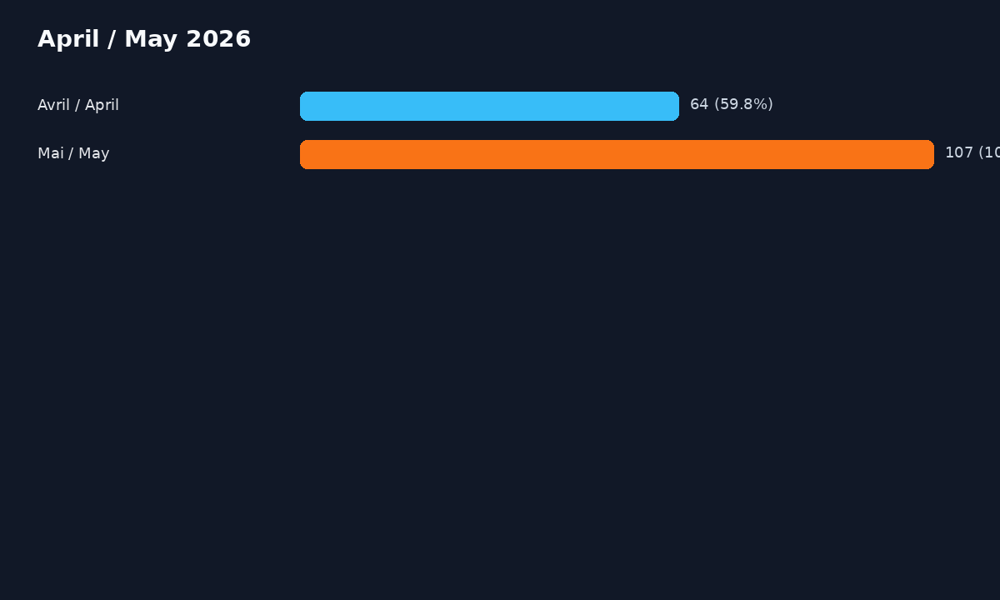
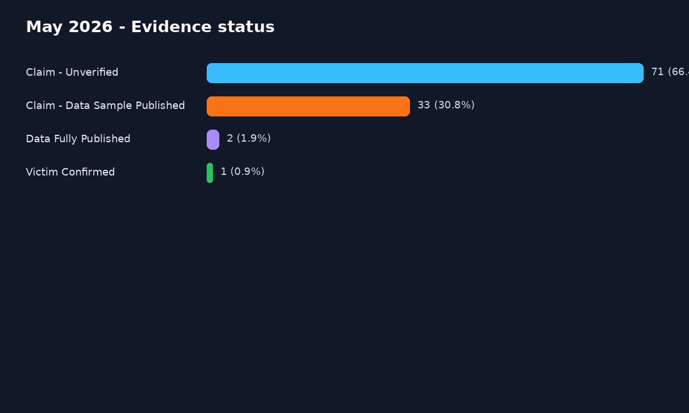
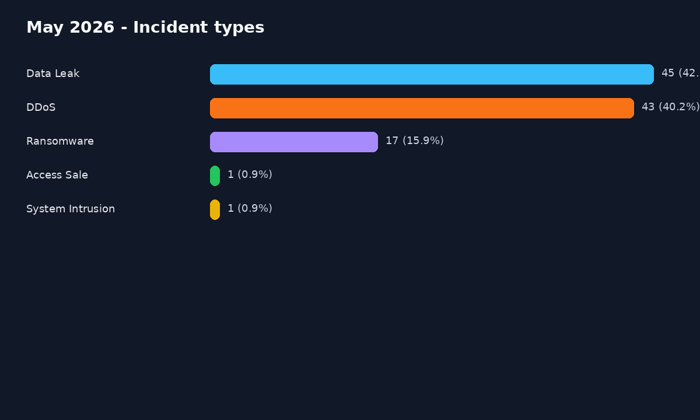
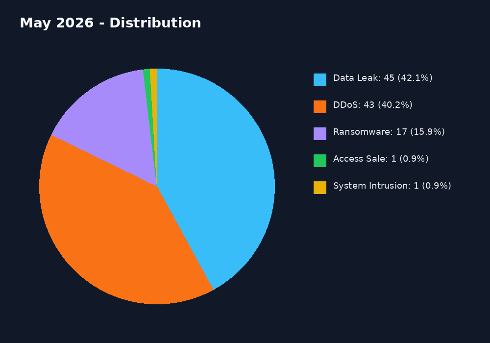
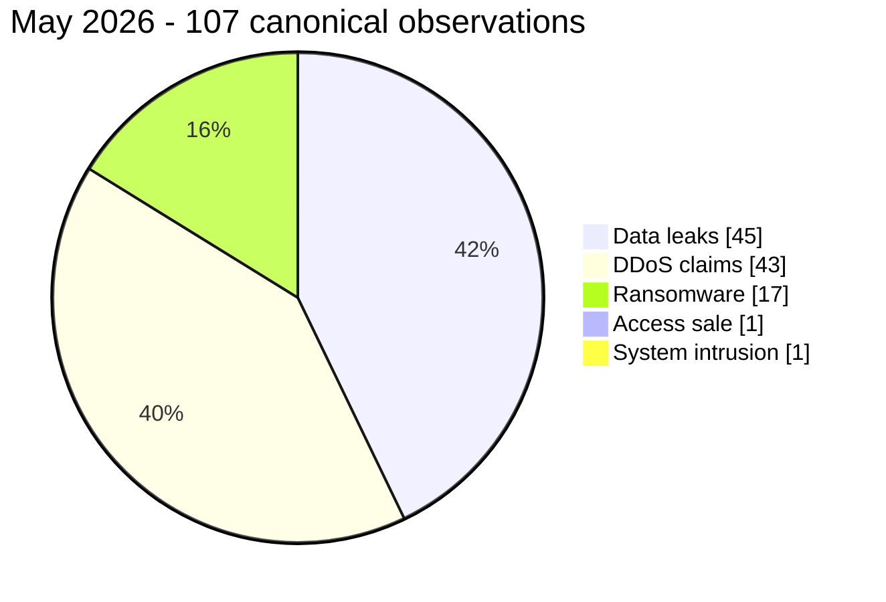
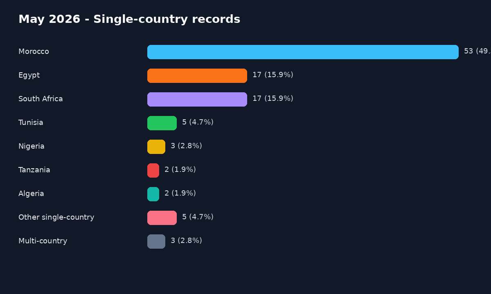
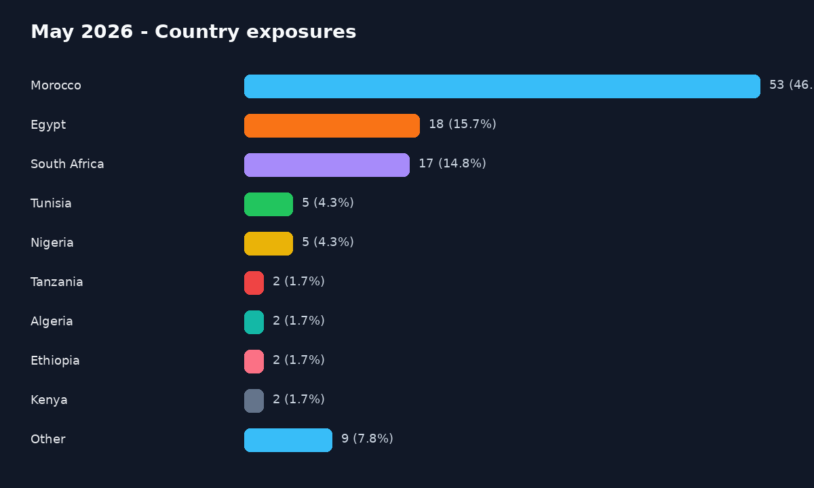
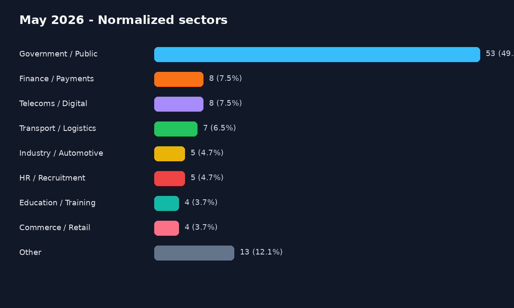
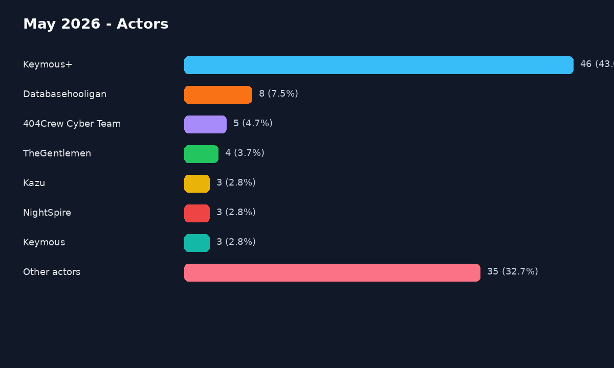

    

# AFRINTEL | Monthly Cyber Threat Intelligence Report
## Cyber threats affecting African organizations - May 2026

**Audience:** CISOs, CIOs, risk executives, SOC/CERT managers and national cyber authorities.  
**Canonical reporting window:** 1–31 May 2026 · **Documentary review:** 6 November 2026.  
**Primary material:** [Victim records EN](./victims.md) · [French victim records](./victims_FR.md) · [Validation](./VALIDATION.md) · [Reproducible statistics](./AUDIT_STATISTIQUES.json).  
👉🏾 **[Lire le rapport français](./README_FR.md)**

> **Reliability note - observation, analysis and confirmation.** AFRINTEL documents threat-actor publications, ransomware extortion listings, offered datasets and samples examined after disclosure. Where a victim record documents a technical or documentary examination, this report describes **the data categories identified, the actual amount examined and the limitations of that review**. Adversary-claimed volumes are not automatically verified totals. A ransomware listing does not prove encryption, and an availability screenshot does not independently prove a DDoS attack. Institutional confirmations are cited independently. No personal identifiers, secrets or individual exposed documents are reproduced.

---

## 1. Executive summary

The 107 observations comprise **45 data leaks (42.1%)**, **43 DDoS claims (40.2%)**, **17 ransomware-related records (15.9%)**, **one access sale (0.9%)** and **one system intrusion (0.9%)**. Single-country records concentrate in **Morocco (53)**, **Egypt (17)** and **South Africa (17)**. **Three multi-country records** extend the geographical scope to 18 African countries. The 107 canonical incidents represent **115 country exposures** after expanding each multi-country record to the explicitly named countries; the two denominators should never be conflated.

The **Senegalese Public Treasury** is the foremost systemic-risk case. The documented data examination covers **about 1,659,735 database entries across three tables**, plus operational payment files. In a **18 May** institutional statement, the Treasury confirmed malicious acts, disruption to services and irregular dissemination of information. That statement does **not** validate AuditTeam's precise data volumes or prove ransomware encryption. South Africa's **Centre for High Performance Computing (CHPC)/Lengau** is the other institutionally confirmed case: authorities acknowledged a late-May intrusion involving an ageing high-performance computing environment, which should not be described as ransomware in the absence of such evidence.

Further significant documentary findings concern **Gauteng Provincial Government**, **Gauteng City Region Academy**, **SDTM**, **Mansoura University**, **Egypt's Professional Academy for Teachers**, **RADEM Meknès**, **DHIS2** health systems and advertised Tanzanian police webmail credentials. The common risk factor is not a proven shared intrusion technique, but potential reuse of exposed **identities, banking coordinates, public-administration records, HR datasets and technical configuration data** to conduct fraud or subsequent compromise.

**Management decisions:** the CISO should prioritize exposed identities and third-party oversight; the CIO should demonstrate recoverability and strengthen API, ERP and mail access controls; the SOC should deploy behavioral correlations spanning authentication anomalies, bulk extraction, configuration changes, service availability and encryption. The 43 DDoS claims must not be reported as 43 confirmed outages.

**Detailed source corpus:** [victims.md](./victims.md) · [victims_FR.md](./victims_FR.md).

### 1.1 Month-over-month comparison

> This comparison uses **64 canonical April observations** and **107 May observations**. Counts are **documented AFRINTEL records**, not an estimate of actual compromises or national attack probability. An additional retrospective April record had been excluded from April's denominator. Categories follow AFRINTEL taxonomy v2.

| Indicator | April 2026 | May 2026 | Observed change |
|---|---:|---:|---:|
| **Total canonical incidents / observations** | **64** | **107** | **+43 (+67.2%)** |
| Ransomware | 21 | 17 | −4 (−19.0%) |
| Data Leak | 32 | 45 | +13 (+40.6%) |
| Access Sale | 2 | 1 | −1 (−50.0%) |
| DDoS | 9 | 43 | **+34 (+377.8%)** |
| Defacement | 0 | 0 | 0 (stable) |
| Account Takeover | 0 | 0 | 0 (stable) |
| System Intrusion | 0 | 1 | +1 (new) |
| Malware | 0 | 0 | 0 (stable) |
| Operational Fraud | 0 | 0 | 0 (stable) |

**CTI interpretation.** The **43-record increase** is primarily explained by **34 additional DDoS claims**, associated in the records with the same Keymous+ account. This concentration may reflect a coordinated publication campaign rather than a comparable increase in technically confirmed attacks. The four-record decrease in ransomware reflects fewer **listings in the corpus**, not proof of lower actual intrusion rates. Data-leak publications remain prominent and increase by thirteen records.

## 2. Methodology: collection, evidence and quality assurance

AFRINTEL monitors 54 African countries through ransomware leak sites, underground-forum posts, data-sale advertisements, actor channels, published samples, institutional statements and specialist media. For entries with sufficient available material, the analytical chain is: **record publication → examine available document or sample → qualify fields and observed volumes → assess organizational association → cross-check OSINT → assess business exposure → formulate SOC detection hypotheses**. The analytical depth depends on the actual evidence available and recorded in each case.

A `Ransomware` category indicates a record in an **extortion/ransomware publication context** or an explicitly confirmed compromise; it does not assert proven encryption in all 17 cases. For leaks, a visible sample can support a finding of exposure without validating every claimed row. An `Access Sale` claim does not prove that the credentials still work; **AFRINTEL did not attempt authentication**. DDoS is counted as **actor-side claims or observations**, without assuming traffic volume, attack duration or sustained service disruption.

**Timeline caveat.** Canonical assignment is based on a documented publication when the technical initial-access date cannot be established. Datasets may have been collected much earlier. May's **Gauteng** and **Stats SA** publications require comparison to **March XP95** claims; a May post does not by itself prove a second intrusion. The **Mansoura** record was supplemented by a **July 2026 sample review**, which is retrospective. The detailed **Lengau** public confirmation was reported on **24 August 2026** and must not be backdated as a May public announcement.

### 2.1 Evidence-status distribution

| Status in May records | Records | Share | Interpretation |
|---|---:|---:|---|
| `Claim - Unverified` | 71 | 66.4% | Publication recorded; impact, source or full scope not independently proven. |
| `Claim - Data Sample Published` | 33 | 30.8% | Sample described; authenticity and attribution assessed case by case. |
| `Data Fully Published` | 2 | 1.9% | Full publication reported, not a blanket verification of the whole dataset. |
| `Victim Confirmed` (normalization pending) | 1 | 0.9% | The CHPC/Lengau incident was institutionally acknowledged. |
| **Total** | **107** | **100%** | Original status classification before external enrichment. |

**Important corroboration:** the Senegalese Treasury's **18 May** statement confirms malicious activity and irregular information disclosure. The source record remains marked `Claim - Data Sample Published`; its status should be **reassessed with a scoped explanation**, without implying that the victim officially validated all 1.66 million records.

## 3. Quantitative overview

### 3.1 Types and shares

| Canonical type | Records | Share |
|---|---:|---:|
| **Data Leak** | **45** | **42.1%** |
| **DDoS (claims)** | **43** | **40.2%** |
| **Ransomware (extortion records)** | **17** | **15.9%** |
| Access Sale | 1 | 0.9% |
| System Intrusion | 1 | 0.9% |
| **TOTAL** | **107** | **100%** |

### 3.2 Geography: 107 incidents, 115 country exposures

| Single-country scope | Canonical records | Share of 107 |
|---|---:|---:|
| **Morocco** | **53** | **49.5%** |
| **Egypt** | **17** | **15.9%** |
| **South Africa** | **17** | **15.9%** |
| Tunisia | 5 | 4.7% |
| Nigeria | 3 | 2.8% |
| Tanzania | 2 | 1.9% |
| Algeria | 2 | 1.9% |
| Ghana, Ethiopia, Kenya, Senegal, Ivory Coast | 1 each | 4.7% combined |
| **Three multi-country records** | **3** | **2.8%** |
| **Total** | **107** | **100%** |

The three multi-country records concern: (1) résumé data attributed to **Kenya, Ethiopia, Nigeria and Zimbabwe**, (2) alleged **DHIS2** exposures in **Mozambique, Liberia, Nigeria, Togo and Sierra Leone**, and (3) passport scans involving **Egypt and Libya**. Expanding these to their explicitly listed geographies creates **115 country exposures**. Morocco accounts for **53/115 (46.1%)**, Egypt **18/115 (15.7%)**, and South Africa **17/115 (14.8%)**. The audit separates these counting methods.

**Concentration requires context.** All 43 DDoS claims target **Morocco**. In addition, the corpus contains nine other Morocco-linked leaks or access-sale records. Nigeria appears in **three single-country** and **two multi-country** files, creating five country exposures, not five extra canonical incidents. The Moroccan Embassy in Egypt is assigned to **Morocco** as the primary victim; Egypt is the mission location, not a second incident.

### 3.3 Normalized sectors

| Primary sector | Records | Share |
|---|---:|---:|
| Government / Public administration | **53** | **49.5%** |
| Finance / Payments | 8 | 7.5% |
| Telecoms / Digital | 8 | 7.5% |
| Transport / Logistics | 7 | 6.6% |
| Industry / Automotive | 5 | 4.7% |
| HR / Recruitment | 5 | 4.7% |
| Education / Training | 4 | 3.8% |
| Commerce / Retail | 4 | 3.8% |
| Other explicitly identified sectors | 13 | 12.3% |
| **Total** | **107** | **100%** |

The **normalized government** category contains **53** records, compared with **49** records using the literal `Government / Administration` source label. It consolidates public-administration, diplomatic and government aviation labels. **GCRA**, as a bursary programme, is mapped to education based on its functional mandate. The **17 normalized sector families** are fully enumerated in the audit file; no additional organization is inferred from a technical artifact alone.

## 4. Detailed analysis by incident type

### 4.1 Data leaks: 45 observations

The most important operational risk is **reuse of exposed information**: identities, payment data, tax records, recruitment files, educational records and access-related information can be exploited long after initial publication. A coherent sample does not automatically establish a complete database extraction or continuing access to the source system.

**🇸🇳 Senegalese Public Treasury - strategic risk.** The AuditTeam record describes **three analyzed database datasets**, totaling about **1,659,735 entries**: staff/payroll (~40,394), taxpayers/debtors (~960,146) and public payment orders (~659,195). Additional transfer files dated through **8 May** and **323 days of SICA operational files** establish sensitive business context. Exposed fields include tax IDs, bank coordinates, payment orders, staff and government suppliers. **Institutionally corroborated:** the Treasury reported an incident beginning **10 May**, and on **18 May** confirmed malicious acts, service disruption and irregular dissemination of information while services were progressively resumed. **Not established:** execution of ransomware encryption, initial access mechanism, or official validation of every dataset. **CISO impact:** supplier fraud, diverted transfers, identity abuse and cross-government exposure. [APS - 11 May](https://aps.sn/le-tresor-public-victime-dun-piratage-informatique/) · [APS - 18 May](https://aps.sn/le-tresor-public-annonce-la-reprise-progressive-de-ses-services-a-la-suite-de-lincident-informatique/).

**🇿🇦 Gauteng Provincial Government / Gauteng City Region Academy (GCRA).** The Gauteng post claims **3.8 TB / 3,673,556 files**, while the **locally examined sample contains 1,905 files (~1.905 GB)**, including **1,632 PDF**, **175 JPG** and **89 DOCX** items (plus a few other formats). Extractable text covers administrative material, procurement, taxation, contracts, housing and identity-related documents. GCRA's publisher claims **147 GB / 429,473 files**, whereas **2,945 PDF documents (~1.145 GB)** were actually examined, covering students, bursaries, payments and banking references. PDFs without a text layer were not exhaustively reviewed. The material supports the existence of sensitive documentary samples but **cannot validate the full advertised volumes**. March **XP95** claims concerning the same entities make **possible resale/republication** an important scenario to examine, not proof of a new independent compromise.

**🇪🇬 Education - Ministry of Education, PAT and Mansoura.** **Revesky** advertises **22.6 GB**, **26.8 million** student records and **3.8 million** education staff records, plus claimed administrative privileges. These are **adversary figures and capabilities**, not independently audited access to Egyptian education systems. The **Professional Academy for Teachers (PAT)** record describes samples including teacher identifiers, institutional affiliations and administrative data; the claimed total is **8–10 GB compressed**. For **Mansoura**, a later July examination covers exactly **4,239 sample entries**, versus **989,000 records claimed** in the earlier publication. **ISSA Egypt (19 June)** described the Revesky allegations as unconfirmed, with no official authentication of the advertised scale or privileges. [ISSA Egypt](https://issa-eg.org/alleged-data-breach-claims-involving-egypts-ministry-of-education-highlight-potential-cybersecurity-risks/).

**🇲🇦 SDTM / Barid Al-Maghrib - ERP identities and financial flows.** **Sejjil** advertises **129 CSV files** attributed to SAGE ERP and associated systems. The record documents accounting information, bank identifiers, ERP users, MD5 password hashes and session tokens described by the source as active. **Current validity was not tested.** The CIO's key priorities are **secret rotation, ERP export auditing, control of messaging gateways and financial-environment segregation**.

**🇲🇿 🇱🇷 🇳🇬 🇹🇬 🇸🇱 DHIS2 - regional technology dependency.** A post attributed to **Keymous** (kept distinct from Keymous+) contains alleged URL/username/password combinations for health-information instances in **five African countries**. **No access attempt was made.** The presumed exposure justifies credential revocation and authentication-log review but **does not prove data manipulation or continuing access**. Two countries outside Africa appear in the source context but are excluded from AFRINTEL counts.

**🇹🇿 Tanzanian police / 🇲🇦 RADEM / 🇪🇬 FutureShop.** A seller advertises credentials for **over 10,000 police webmail accounts**, without proof of current validity. RADEM is associated with a claim of **1.1 million documents**, compared with a reported first release of **about 18,000 PDFs**; these are different scopes. FutureShop's record discusses an **allegedly unauthenticated API** and object storage exposing customer and delivery data, without independent active testing of the live infrastructure at report time. Relevant defenses include mail-account security, document segregation and API authorization review.

**Attribution caution.** The **SARS** record contains credential pairs linked to SARS login URLs, but many visible addresses belong to international third parties. **Credentials paired with a target URL do not by themselves prove that the target organization's database was breached.** The same provenance checks are needed for commercially advertised datasets that use generic Contacts/Orders/Tickets schemas.

### 4.2 DDoS: 43 Keymous+ claims

The publications target **Moroccan public portals and digital-service providers**, including ministries, government workflows, banks and payment platforms, transport entities and hosting services. The records mainly describe **screenshots or availability-check results**. Domains including `maroc.ma`, `diplomatie.ma`, `justice.gov.ma` and `sante.gov.ma` appear on more than one date. **Forty-three claims do not represent 43 unique targets or 43 proven independent attacks.**

**Observed:** repeated actor publications with named targets and dates, and some apparent unavailability checks. **Unknown:** network flood traffic, origin, method, duration, transactional impact, failure location and technical confirmation. **CIO/SOC action:** correlate publication windows with WAF/CDN telemetry, edge logs, NetFlow, DNS failures, service-level indicators and APM to distinguish outage, application failure and technically supported DDoS. Defensive DDoS readiness is appropriate; attributing every outage to an actor is not.

### 4.3 Ransomware/extortion: 17 records

Listings include **TheGentlemen (4)**, **NightSpire (3)**, **AuditTeam**, **Qilin**, **LockBit 5.0**, **MedusaLocker**, **Stormous**, **KillSec** and other names. Victim sectors include finance, industry, logistics, hospitality, HR and business services. A listing warrants review of exposure, backups and privileged access, **but is not itself evidence of encryption**.

The **AuditTeam/Treasury** entry is categorized as ransomware based on the extortion-publication context. The underlying malicious incident has been institutionally corroborated, but the reviewed institutional statement **does not prove deployment of an encryptor**. For other May listings, the recorded disclosure stage is preserved without inferring negotiations or ransom payments. SOC hunting hypotheses include account abuse, unusual transfers, backup access and bulk encryption, to be validated against the victim's internal telemetry.

### 4.4 Access sale: 1 / system intrusion: 1

**🇲🇦 Spacex.ma** - a **DarkMafiaX** publication advertises supposed administrator credentials. Publication does not establish the account is usable; AFRINTEL did not attempt to authenticate. Defenses include targeted rotation/revocation, MFA, administrator activity review and removal of unnecessary administrative exposure.

**🇿🇦 CHPC/Lengau** - South African authorities confirmed an **intrusion** affecting part of the HPC environment in late May. Details reported on **24 August** highlighted **vulnerabilities in a legacy HPC environment** and disruption to computing resources. This is distinct from extortion listings: **no ransomware or specific exfiltration is attributed without evidence**. The case underscores risks involving critical research infrastructure, legacy administration systems and the integrity of scientific workloads. [ITWeb - 24 August](https://www.itweb.co.za/article/cause-of-breach-on-sas-supercomputer-revealed/KPNG878NLeGq4mwD).

## 5. Sector impact and business consequences

| Domain | Documented May exposure | Principal business risk | Control decision |
|---|---|---|---|
| **Public finance / banking** | Treasury datasets, ERP and payroll, payment-service claims | Payment diversion, supplier fraud, service interruption | Out-of-band bank-detail validation; export/payment-order controls |
| **Government / identity** | DDoS claims, citizen records and official documents | Impersonation, public trust and online-service degradation | Identity governance, portal protection and access logs |
| **Education** | PAT, Mansoura, Egyptian ministry, GCRA bursaries | Student/staff identity misuse, benefit fraud | Separate user roles; limit access to documents and exports |
| **Healthcare** | DHIS2, CERVI and provider records | Data exposure, provider fraud, risk to health workflows | Rotate credentials, segment sensitive data, monitor APIs |
| **Essential services** | RADEM, logistics, energy, transport and alleged DDoS targets | Indirect continuity impacts | Proven BCP/DRP, IT/OT segregation, availability telemetry |
| **Research / legacy infrastructure** | Confirmed Lengau incident | Computing disruption and loss of project integrity | Upgrade unsupported components and restrict management plane |

Sector visibility is shaped by the collection sources and monitored campaigns. The **53 normalized government records** largely reflect claims against Moroccan public portals; they **do not mean that 53 ministries were compromised**.

## 6. Threat actor and publisher overview

| Actor / account | Canonical May publications | Analytical interpretation |
|---|---:|---|
| **Keymous+** | **46** | **43 DDoS claims** plus **3 data-leak publications**; Morocco concentration. |
| **Databasehooligan** | **8** | Offers to sell recruitment, telecom, customer and business datasets. |
| **404Crew Cyber Team** (direct label, excluding coalitions) | **5** | Data publications and participation in campaign alliances. |
| **TheGentlemen** | **4** | Ransomware/extortion listings across countries. |
| **Kazu** | **3** | Documentary samples, potentially overlapping XP95 claims. |
| **NightSpire** | **3** | Several Egyptian organization listings. |
| **Keymous** | **2** | Retained as distinct from Keymous+ until an identity link is established. |
| **INT3X / cc5ab / anisanas2** | **2 each** | Education records, API data, infrastructure and data sales. |

The non-DDoS chart avoids having the **43 posts attributed to one account** conceal other leak and extortion activity. The table includes Keymous+'s full total. Actor names, marketplace usernames and temporary coalitions are **publication identities**, not proof of technical attribution to the same operator. Coalition labels (such as NullSec and 404Crew) are preserved rather than merged into stand-alone actor counts.

### 6.1 Geographic prioritization for CISOs (signals, not national risk rankings)

| Attention | Area | Basis and operational focus |
|---|---|---|
| 🔴 Very high | **Morocco** | Heavy DDoS publication campaign plus ERP, identity and public-record exposure. Correlate availability, WAF and SSO. |
| 🔴 Very high | **Senegal** | Institutionally confirmed malicious Treasury incident; financial data examined. Strengthen payment and supplier controls. |
| 🟠 High | **Egypt** | Numerous education/personal-data claims, not a confirmation of all advertised volumes. Protect identity and student records. |
| 🟠 High | **South Africa** | Gauteng/GCRA samples and confirmed Lengau incident; focus on data reuse and legacy systems. |
| 🟡 Targeted watch | **Tanzania, DHIS2 countries, others** | Advertised mailbox credentials and multi-country health-system exposure; rotate secrets and hunt anomalous sign-ins. |

## 7. Trends and intelligence gaps

**Trend 1 - concentrated publication activity.** Keymous+ DDoS claims dominate the May dataset. The **43/107 (40.2%)** share measures the weight of an actor-side campaign against Moroccan sites, not the volume of attack traffic. Independent network telemetry is needed to validate attack technique and impact.

**Trend 2 - monetization of administrative datasets.** The records describe payroll, public procurement, employment, identity, ERP and account data. The combination of bank details and identity attributes makes **supplier-bank-detail fraud**, **business email compromise** and public-sector impersonation important SOC and fraud-detection hypotheses.

**Trend 3 - recycled datasets and timeline uncertainty.** **Kazu/XP95** overlaps, and records supplemented after their initial publications, require clear separation between a **new post, resale, new sample and new compromise**. This reduces overcounting in quarterly reports.

**Priority gaps:** (i) no independently supplied WAF/CDN evidence for the 43 DDoS claims; (ii) no validation of complete Egyptian education database volumes; (iii) uncertain technical provenance for some brokered datasets; (iv) unresolved XP95–Kazu relationships; and (v) incomplete deadlines or disclosure states for some ransomware listings. Not finding a public DFIR report in reviewed sources **does not mean no investigation exists**.

## 8. MITRE ATT&CK: behavioral hypotheses and limitations

> **Method warning:** except where expressly supported by victim telemetry, these are **defensive detection hypotheses**, not techniques attributed to named actors. Detection requires verification in the organization's own evidence.

| ATT&CK technique | Behavioral monitoring hypothesis | AFRINTEL trigger | Assessment |
|---|---|---|---|
| [T1078 - Valid Accounts](https://attack.mitre.org/techniques/T1078/) | Unusual ERP/mail/admin sign-ins, new devices plus privilege/export activity | Tanzania police, DHIS2, SDTM, Spacex.ma credentials | Operational hypothesis |
| [T1190 - Exploit Public-Facing Application](https://attack.mitre.org/techniques/T1190/) | Suspicious public-API activity, errors followed by exports | FutureShop, LSB - public API exposure described | Hypothesis; entry vector not established |
| [T1213 - Data from Information Repositories](https://attack.mitre.org/techniques/T1213/) | Mass access to documentary, CRM and financial stores | Treasury, GCRA, SDTM, CGCSA | Hypothesis supported by data categories |
| [T1530 - Data from Cloud Storage](https://attack.mitre.org/techniques/T1530/) | Unexpected object access, unintended public storage policies | FutureShop object-storage reference | Hypothesis; configuration review needed |
| [T1567 - Exfiltration Over Web Service](https://attack.mitre.org/techniques/T1567/) | Unusual outbound volume by identity/service | Disclosed datasets; transfer method not established | Hypothesis; no exfil destination attributed |
| [T1486 - Data Encrypted for Impact](https://attack.mitre.org/techniques/T1486/) | Rapid mass writes/renames, ransom notes, backup tampering | 17 ransomware-related records; **encryption not generally proven** | Preventive/hunting |
| [T1498 - Network Denial of Service](https://attack.mitre.org/techniques/T1498/) | Correlated bandwidth/RPS spikes and elevated 5xx | 43 Keymous+ DDoS claims | Hypothesis; technique not proven |

## 9. Recommendations by organization type

**Government and public service operators:** catalogue citizen-facing portals and CDN dependencies; ensure privileged access and administrative changes are logged; segregate identity, payroll and sensitive case-file repositories. Treasury, healthcare and civil-record platforms deserve critical-service protection even where only a sample exposure is documented.

**Banks, fintechs and insurers:** require independent confirmation for supplier bank-detail changes; monitor API requests and bulk client-record exports; connect fraud teams to the SOC so technical anomalies can be reconciled with actual transactions.

**Education, HR and bursary organizations:** review student/applicant data permissions, recruitment portals, documentary evidence and export histories; remove shared administrator accounts; enforce data-retention limits and structured deletion.

**Healthcare, utilities, transport and research:** segregate legacy components, management networks and sensitive datasets; test recovery of essential workloads; build availability telemetry capable of distinguishing network saturation, application errors and infrastructure failures.

## 10. SOC and tactical detection recommendations

| Detection use case | Required telemetry | Testable correlation | L2/L3 verification |
|---|---|---|---|
| **Abuse of exposed identities** | IdP/AD, VPN, SSO, mail, ERP | New device/location + privileged account sign-in + export/role change | Check approved travel/change windows; revoke sessions if corroborated. |
| **Bulk database extraction** | SQL audit, app audit, EDR, proxy, DLP | Unusual sensitive-table reads + archive creation + outbound transfer | Quantify objects, identify owner, confirm destination and authorization. |
| **ERP / payments / bank details** | ERP audit, transfer logs, EDR, email | Bank-detail change + exceptional payment + anomalous finance-account sign-in | Freeze suspect process and validate with supplier outside email channel. |
| **Claimed DDoS wave** | WAF/CDN, NetFlow, load balancer, DNS, SLO/APM | RPS/bandwidth spike + 429/5xx rise + observable user impact | Differentiate valid demand spike, app outage, DNS/CDN failure and network attack. |
| **Public API or cloud storage exposure** | API gateway, CloudTrail/object access, CSPM, WAF | Anonymous export requests + unusual object access/public-policy change | Review authorization and ACL safely without accessing third-party data. |
| **Ransomware precursors** | EDR, Sysmon/auditd, backup, hypervisor | Mass file modifications + snapshot deletion + unexpected service stop | Isolate if corroborated, preserve evidence and validate recoverability. |

**Investigation workflow:** **(1)** establish the actor/date/victim context; **(2)** identify relevant assets and identities; **(3)** correlate with internal logs; **(4)** qualify business impact; **(5)** contain and notify per response plan; **(6)** preserve evidence, uncertainties and remediation actions. Thresholds must be tuned against organizational baselines; **a single large transfer is not proof of exfiltration**.

## 11. Strategic 90-day roadmap

| Timing | Priority | Owner | Verifiable deliverable | Nature |
|---|---|---|---|---|
| **Days 0–7** | **P0** | CISO + IAM + SOC | Inventory exposed identities/accounts; targeted revocation or rotation and retrospective sign-in hunt | Response to observed exposure |
| **Days 0–7** | **P0** | CIO + Finance | Out-of-band beneficiary verification; ERP privilege and backup review | Response to documented payment-data exposure |
| **Days 0–15** | **P1** | Network/CDN + SOC | RPS/5xx/latency dashboard and evidence-based DDoS qualification procedure | Response to claimed campaign |
| **Days 8–30** | **P1** | CIO + Applications | API/bucket authorization and RBAC reviews; sensitive-export inventory | Preventive, triggered by exposure cases |
| **Days 8–30** | **P1** | SOC + Anti-fraud | Two deployed correlations: data extraction and suspicious beneficiary/payment changes | Proactive detection |
| **Days 31–60** | **P2** | CISO + Data owners | Data classification and third-party delegated-access review | Supply-chain risk reduction |
| **Days 31–90** | **P2** | CIO + CERT/SOC | Recovery drills, segmentation tests, ransomware/DDoS tabletop | Resilience/prevention |
| **Days 31–90** | **P2** | CISO + Internal audit | Legacy critical-system review and remediation/compensating-control plan | Lengau lesson learned |

**Suggested KPIs:** privileged-identity MFA coverage, time to revoke exposed credentials, successful recovery-test ratio, application/cloud log coverage, availability measured through real customer journeys, time to triage a leak signal, and percentage of high-risk payment changes validated out of band. No baseline performance figures are assumed for organizations not directly examined.

## 12. Conclusion - implications for cyber defense

The increase from **64 to 107 canonical observations** should not be described as a comparable rise in actual intrusions. The corpus documents three distinct dynamics: **intensified actor-side availability claims against Morocco**, **circulation of sensitive financial and government datasets**, and **institutionally confirmed incidents** whose technical nature may differ from criminal group headlines.

For executives, the useful response is not simply to track actor names. It is to **reduce the ongoing value of exposed data, defend payment workflows, strengthen identities and demonstrate service resilience**. For SOCs, the priority is reproducible correlation between external intelligence and internal telemetry; without that link, a claim remains a publication, not an attributed intrusion sequence.

**AFRINTEL - African Cyber Threat Intelligence**  
**Coverage:** 54 African countries · **Sharing:** TLP:CLEAR · **Method:** OSINT-safe, sample traceability and explicit uncertainty control.  
**Repository:** [Hatchepsoute/AFRINTEL](https://github.com/Hatchepsoute/AFRINTEL) · **Records:** [victims.md](./victims.md) · **QA:** [VALIDATION.md](./VALIDATION.md).

### External corroboration and reference sources

- **Agence de presse sénégalaise (APS), 11 May 2026** - initial Treasury statement: <https://aps.sn/le-tresor-public-victime-dun-piratage-informatique/>.
- **APS, 18 May 2026** - malicious acts, irregular information disclosure and service recovery: <https://aps.sn/le-tresor-public-annonce-la-reprise-progressive-de-ses-services-a-la-suite-de-lincident-informatique/>.
- **ITWeb, 24 August 2026** - parliamentary response reporting on CHPC/Lengau: <https://www.itweb.co.za/article/cause-of-breach-on-sas-supercomputer-revealed/KPNG878NLeGq4mwD>.
- **ISSA Egypt, 19 June 2026** - Revesky allegations and confirmation limitations: <https://issa-eg.org/alleged-data-breach-claims-involving-egypts-ministry-of-education-highlight-potential-cybersecurity-risks/>.
- **MITRE ATT&CK Enterprise** - behavioral detection hypotheses: <https://attack.mitre.org/techniques/>.

*All other case information comes from the supplied victim records; operational links to criminal sites or illicit leaked datasets are deliberately omitted.*
