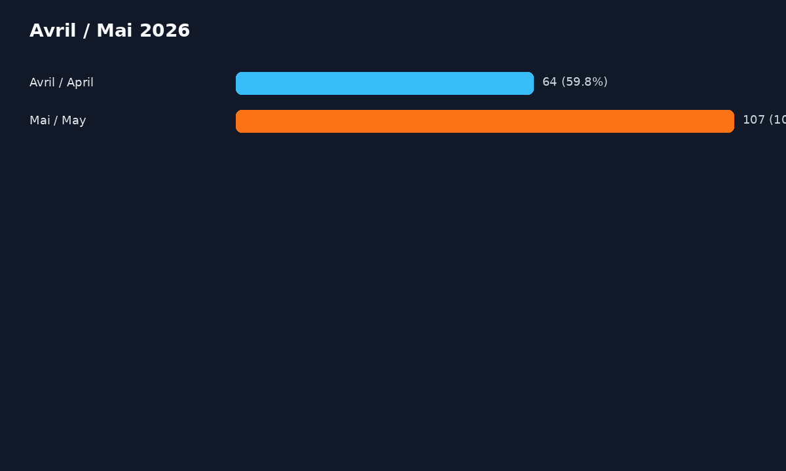
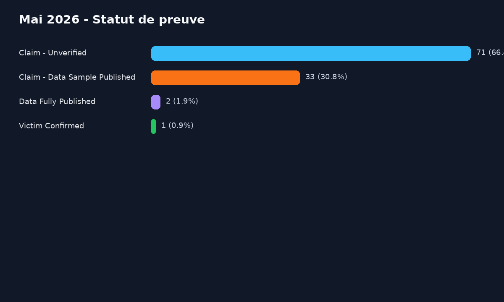
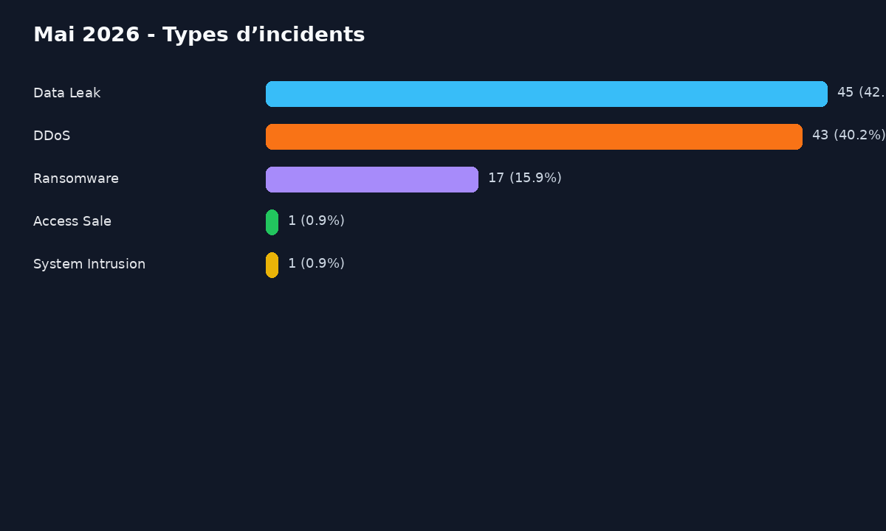
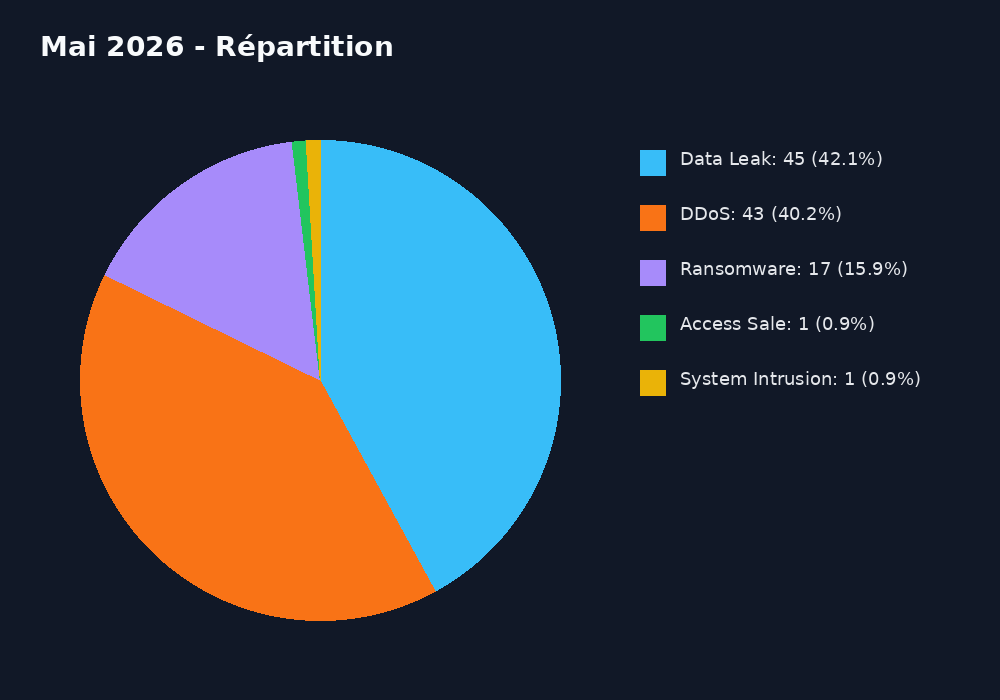
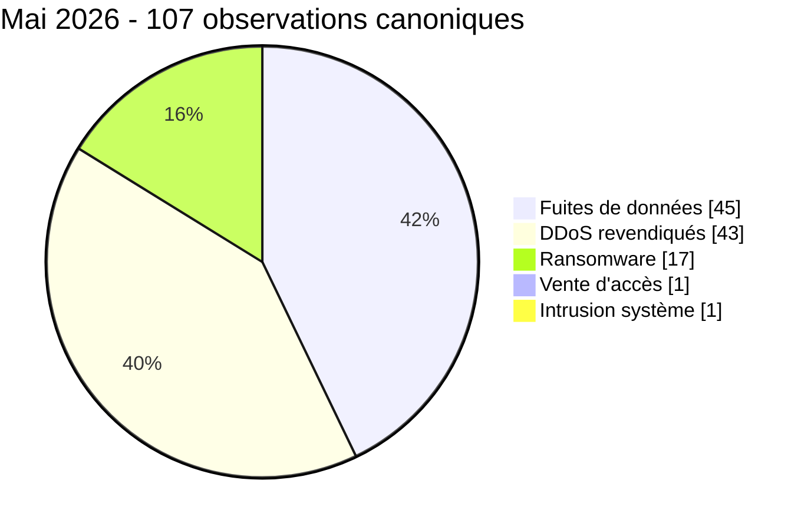
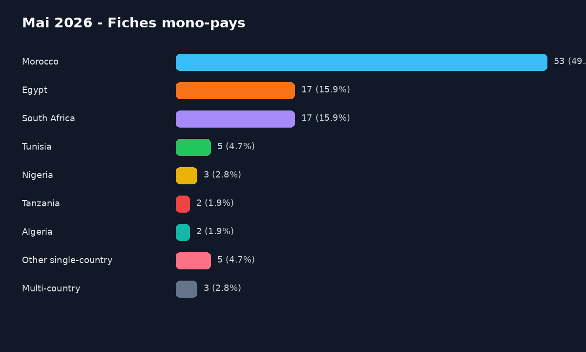
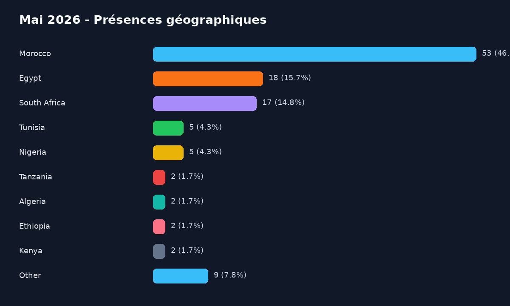
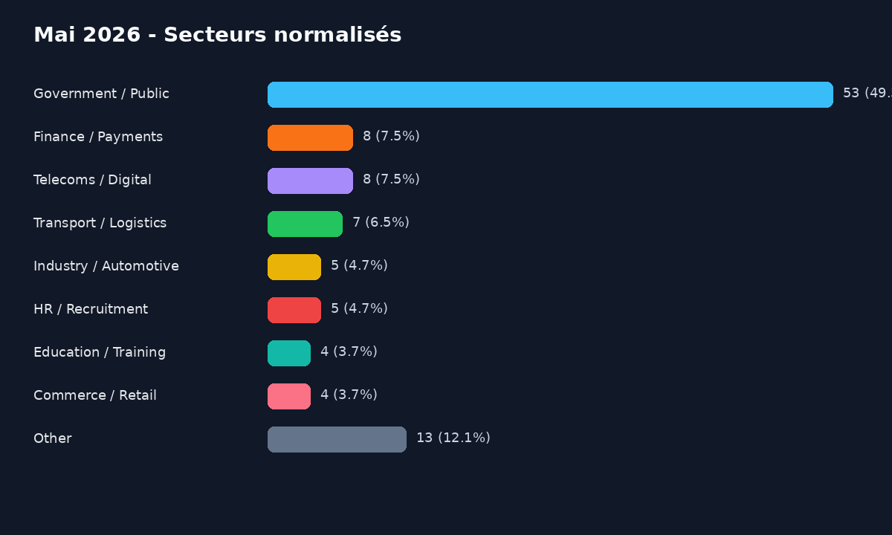
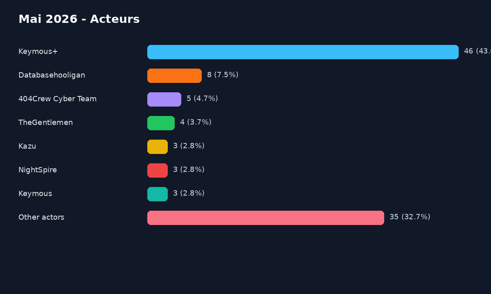

    

# AFRINTEL | Rapport mensuel de Cyber Threat Intelligence
## Cybermenaces visant les organisations africaines - Mai 2026

**Public :** RSSI, DSI, directeurs des risques, responsables SOC/CERT, autorités de cybersécurité.  
**Période de classement :** 1er–31 mai 2026 · **Revue et consolidation :** 6 novembre 2026.  
**Documents sources :** [Fiches victimes FR](./victims_FR.md) · [Victim records EN](./victims.md) · [Contrôle de cohérence](./VALIDATION.md) · [Statistiques reproductibles](./AUDIT_STATISTIQUES.json).  
👉🏾 **[Read the English report](./README.md)**

> **Note de fiabilité - observation, analyse, confirmation.** AFRINTEL documente des publications d'acteurs, des dossiers d'extorsion, des jeux de données offerts à la vente et des échantillons examinés après divulgation. Lorsque les fiches renseignent une analyse technique ou documentaire, le présent rapport en restitue **les catégories observées, le nombre d'éléments effectivement examinés et leurs limites**. Les volumes revendiqués par les auteurs ne sont pas automatiquement considérés comme vérifiés. Une inscription sur un site ransomware ne prouve pas un chiffrement. Une capture de disponibilité ne prouve pas à elle seule un DDoS. Les confirmations institutionnelles sont citées séparément. Aucun secret, identifiant personnel ou document individuel n'est reproduit.

---

## 1. Synthèse exécutive

Les 107 observations comprennent **45 fuites de données (42,1 %)**, **43 revendications DDoS (40,2 %)**, **17 dossiers ransomware (15,9 %)**, **une vente d'accès (0,9 %)** et **une intrusion système (0,9 %)**. Les fiches mono-pays se concentrent sur le **Maroc (53)**, l'**Égypte (17)** et l'**Afrique du Sud (17)** ; **trois dossiers multi-pays** étendent le périmètre à 18 pays africains au total. Les 107 événements canoniques produisent **115 présences géographiques** lorsqu'une publication multi-pays est ventilée vers chacun des pays cités ; ces deux dénominateurs ne sont pas interchangeables.

Le **Trésor public du Sénégal** est le dossier majeur pour le risque systémique. Le corpus décrit **environ 1 659 735 enregistrements** dans trois tables analysées, ainsi que des fichiers d'opérations financières. Un communiqué institutionnel du **18 mai** confirme des actes malveillants, des perturbations de services et une diffusion irrégulière d'informations ; il ne confirme cependant ni le volume exact revendiqué par AuditTeam, ni le déploiement d'un logiciel de chiffrement. Le **Centre for High Performance Computing (CHPC)/Lengau**, en Afrique du Sud, représente le second cas de confirmation institutionnelle : des autorités ont reconnu un incident affectant l'environnement de calcul intensif fin mai, associé à des vulnérabilités d'une infrastructure ancienne, sans qu'il faille lui attribuer un ransomware.

Sur le versant des données, les analyses documentées concernent notamment **Gauteng Provincial Government**, **Gauteng City Region Academy**, **SDTM**, **Mansoura University**, **l'Académie professionnelle des enseignants en Égypte**, **RADEM Meknès**, des services **DHIS2** et des identifiants de messagerie de la police tanzanienne. Le point commun n'est pas un vecteur d'attaque démontré, mais l'exposition possible d'**identités, coordonnées bancaires, dossiers administratifs, informations RH et composants techniques** susceptibles de faciliter des fraudes et de nouvelles compromissions.

**Décisions de direction :** le RSSI doit prioriser la réduction des expositions d'identité et la gestion des tiers ; la DSI doit démontrer sa capacité de restauration et renforcer le contrôle des API, ERP et messageries ; le SOC doit développer des détections comportementales sur l'authentification, l'extraction de données, les changements de configuration, la disponibilité des services et le chiffrement. Les revendications DDoS ne doivent pas être confondues avec 43 interruptions établies.

**Accès au corpus détaillé :** [victims_FR.md](./victims_FR.md) · [victims.md](./victims.md).

### 1.1 Comparaison avec le mois précédent

> Comparaison entre **64 observations canoniques d'avril** et **107 de mai**. Il s'agit de **signalements documentés dans la collecte AFRINTEL**, pas d'une estimation du nombre réel de compromissions ni d'un taux de risque national. Avril disposait d'un dossier rétrospectif supplémentaire exclu du dénominateur. Les catégories restent celles de la taxonomie AFRINTEL v2.

| Indicateur | Avril 2026 | Mai 2026 | Évolution observée |
|---|---:|---:|---:|
| **Total incidents / observations canoniques** | **64** | **107** | **+43 (+67,2 %)** |
| Ransomware | 21 | 17 | −4 (−19,0 %) |
| Data Leak | 32 | 45 | +13 (+40,6 %) |
| Access Sale | 2 | 1 | −1 (−50,0 %) |
| DDoS | 9 | 43 | **+34 (+377,8 %)** |
| Defacement | 0 | 0 | 0 (stable) |
| Account Takeover | 0 | 0 | 0 (stable) |
| System Intrusion | 0 | 1 | +1 (nouveau) |
| Malware | 0 | 0 | 0 (stable) |
| Operational Fraud | 0 | 0 | 0 (stable) |

**Lecture CTI.** L'écart de **+43 dossiers** provient surtout des **+34 observations DDoS**, attribuées dans les fiches à la même étiquette Keymous+. Cette concentration peut refléter un effort coordonné de publication autant qu'une modification des attaques réelles. À l'inverse, le recul de quatre dossiers ransomware est un **recul de listings dans le corpus**, et non une démonstration de diminution des intrusions sur le continent. Les fuites restent élevées et progressent de treize publications documentées.

## 2. Méthodologie : collecte, preuve et contrôle du corpus

AFRINTEL couvre les 54 pays africains à partir des sites de divulgation ransomware, publications de forums, annonces de vente, canaux d'acteurs, échantillons, communiqués institutionnels et presse spécialisée. La chaîne de traitement suivie pour les fiches disposant de matière exploitable est : **publication recensée → échantillon ou document examiné → comptage et qualification des champs → attribution organisationnelle → recoupement OSINT → risque métier → hypothèses SOC**. La profondeur varie selon les pièces réellement disponibles et conservées dans le dossier.

Un incident classé `Ransomware` correspond à une **publication dans un contexte d'extorsion** ou à une compromission explicitement confirmée ; il ne signifie pas que le chiffrement a été prouvé dans chacun des 17 cas. Pour les fuites, un échantillon visible peut étayer la présence de données exposées sans valider l'ensemble des lignes annoncées. La **vente d'accès** distingue l'annonce d'identifiants de leur validité actuelle ; **aucune authentification n'a été tentée**. Enfin, les DDoS sont comptés comme **revendications publiées**, sans inférence de débit, durée ou indisponibilité soutenue.

**Chronologie.** Le mois est celui de l'entrée documentaire canonique lorsque la date réelle d'accès initial reste inconnue. Plusieurs fuites peuvent concerner des données plus anciennes. Le dossier **Gauteng** du 16 mai et celui **Stats SA** du 17 mai doivent être rapprochés de publications **XP95 de mars 2026** : l'existence de nouveaux posts en mai ne démontre pas une deuxième compromission. Le dossier **Mansoura** contient une analyse d'échantillon publié en **juillet 2026**, consignée rétrospectivement. La confirmation publique détaillée de **Lengau** est intervenue le **24 août 2026** et ne doit pas être antidatée.

### 2.1 Qualité des éléments documentés

| Statut inscrit dans les fiches de mai | Fiches | Part | Interprétation |
|---|---:|---:|---|
| `Claim - Unverified` | 71 | 66,4 % | Publication observée ; impact, origine ou portée non établis indépendamment. |
| `Claim - Data Sample Published` | 33 | 30,8 % | Échantillon décrit dans la fiche ; attribution et exhaustivité à qualifier cas par cas. |
| `Data Fully Published` | 2 | 1,9 % | Publication totale signalée ; ne signifie pas authenticité intégrale validée. |
| `Victim Confirmed` (à normaliser) | 1 | 0,9 % | Incident CHPC/Lengau reconnu institutionnellement. |
| **Total** | **107** | **100 %** | Statut d'origine du corpus avant enrichissement externe. |

**Enrichissement externe important :** la déclaration de la **DGCPT sénégalaise** publiée le 18 mai **confirme un incident malveillant** et la diffusion irrégulière d'informations. La fiche source du Trésor porte encore `Claim - Data Sample Published` ; il faut **réviser son statut avec une note de périmètre**, sans transformer automatiquement les 1,66 million de lignes examinées en volume officiellement confirmé par la victime.

## 3. Panorama quantitatif

### 3.1 Typologies et proportions

| Type canonique | Nombre | Pourcentage |
|---|---:|---:|
| **Data Leak** | **45** | **42,1 %** |
| **DDoS (revendications)** | **43** | **40,2 %** |
| **Ransomware (dossiers d'extorsion)** | **17** | **15,9 %** |
| Access Sale | 1 | 0,9 % |
| System Intrusion | 1 | 0,9 % |
| **TOTAL** | **107** | **100 %** |

### 3.2 Pays : 107 incidents, 115 présences géographiques

| Pays ou périmètre mono-pays | Observations canoniques | Part des 107 |
|---|---:|---:|
| **Maroc** | **53** | **49,5 %** |
| **Égypte** | **17** | **15,9 %** |
| **Afrique du Sud** | **17** | **15,9 %** |
| Tunisie | 5 | 4,7 % |
| Nigeria | 3 | 2,8 % |
| Tanzanie | 2 | 1,9 % |
| Algérie | 2 | 1,9 % |
| Ghana, Éthiopie, Kenya, Sénégal, Côte d'Ivoire | 1 chacun | 4,7 % cumulés |
| **Trois fiches multi-pays** | **3** | **2,8 %** |
| **Total** | **107** | **100 %** |

Trois fiches multi-pays concernent (1) des CV attribués au **Kenya, à l'Éthiopie, au Nigeria et au Zimbabwe**, (2) des accès DHIS2 présumés au **Mozambique, Liberia, Nigeria, Togo et Sierra Leone**, et (3) des scans de passeports concernant **l'Égypte et la Libye**. En ventilant chaque observation vers les pays cités, les 107 fiches deviennent **115 présences géographiques** ; le Maroc en représente **53/115 (46,1 %)**, l'Égypte **18/115 (15,7 %)** et l'Afrique du Sud **17/115 (14,8 %)**. Le fichier `AUDIT_STATISTIQUES.json` distingue explicitement ces deux modes de calcul.

**Concentration à interpréter avec précaution.** Les 43 revendications DDoS concernent le **Maroc**, qui représente par ailleurs neuf fuites et revendications d'accès dans le corpus. Le Nigeria est mentionné dans **trois fiches mono-pays** et **deux fiches multi-pays** : le total étendu est donc cinq, et non deux incidents supplémentaires. L'affectation d'une ambassade marocaine en Égypte reste **Maroc**, l'Égypte étant la localisation de la mission, pas un second incident.

### 3.3 Secteurs normalisés

| Secteur métier principal | Fiches | Part |
|---|---:|---:|
| Gouvernement / Administration publique | **53** | **49,5 %** |
| Finance / Paiements | 8 | 7,5 % |
| Télécommunications / Numérique | 8 | 7,5 % |
| Transport / Logistique | 7 | 6,6 % |
| Industrie / Automobile | 5 | 4,7 % |
| Ressources humaines / Recrutement | 5 | 4,7 % |
| Éducation / Formation | 4 | 3,8 % |
| Commerce / Distribution | 4 | 3,8 % |
| Autres secteurs explicitement identifiés | 13 | 12,3 % |
| **Total** | **107** | **100 %** |

La catégorie gouvernementale **normalisée** comprend **53** fiches, contre **49** sous le libellé brut `Government / Administration` dans les fichiers. Elle agrège notamment la diplomatie, les administrations et une publication liée à l'aviation civile ; le programme de bourses **GCRA** est classé dans l'éducation en fonction de son activité. Le détail des **17 familles normalisées** figure dans le fichier d'audit : aucune organisation n'est réattribuée par simple inférence d'une victime technique.

## 4. Analyses par typologie et incidents prioritaires

### 4.1 Fuites de données : 45 observations

Le principal risque opérationnel du mois est **l'effet de réutilisation de données exposées** : les informations d'identité, de paie, de fiscalité, de recrutement, d'école et d'accès peuvent être exploitées plusieurs mois après leur publication. L'apparition de champs sensibles dans un échantillon n'établit pas nécessairement une extraction exhaustive ou un accès persistant au système source.

**🇸🇳 Trésor public du Sénégal - signal stratégique majeur.** La fiche AuditTeam contient l'analyse de **trois ensembles de bases**, totalisant environ **1 659 735 enregistrements** : personnel/paie (~40 394), contribuables/débiteurs (~960 146), ordres de paiement (~659 195). Des fichiers de virement datés jusqu'au **8 mai** et **323 jours d'opérations SICA** fournissent un contexte métier important. Les champs observés touchent identifiants fiscaux, comptes bancaires, mandats, agents et fournisseurs. **Confirmé séparément :** la DGCPT a signalé un incident affectant ses systèmes à partir du **10 mai**, puis, le **18 mai**, des **actes malveillants**, des **perturbations** et une **diffusion irrégulière d'informations**, avec reprise progressive. **Non établi :** déploiement d'un chiffreur, méthode d'accès, correspondance officielle entre chaque jeu de données et la compromission. **Impact RSSI :** fraude aux fournisseurs, détournement de virements, compromission d'identités et propagation de risques à l'ensemble des services publics payés par le Trésor. [APS - 11 mai](https://aps.sn/le-tresor-public-victime-dun-piratage-informatique/) · [APS - 18 mai](https://aps.sn/le-tresor-public-annonce-la-reprise-progressive-de-ses-services-a-la-suite-de-lincident-informatique/).

**🇿🇦 Gauteng Provincial Government / Gauteng City Region Academy (GCRA).** La fiche Gauteng distingue **3,8 To / 3 673 556 fichiers revendiqués** d'une **archive effectivement examinée de 1 905 fichiers (~1,905 Go)** ; l'examen comprend **1 632 PDF**, **175 JPG** et **89 DOCX** (plus quelques autres formats). Les documents lisibles portent sur l'administration, les achats, la fiscalité, les contrats, le logement et des dossiers d'identité. Pour GCRA, **147 Go / 429 473 fichiers sont revendiqués**, tandis que l'échantillon examiné comporte **2 945 PDF (~1,145 Go)**, relatifs notamment aux étudiants, bourses, paiements et coordonnées bancaires. Les PDF sans couche de texte n'ont pas été qualifiés exhaustivement. Ces expositions ont une matérialité documentaire, **sans valider le volume total annoncé**. Les chevauchements avec les publications XP95 de mars appellent à surveiller une **revente ou republication possible**, non à conclure à deux intrusions certaines.

**🇪🇬 Éducation : ministère de l'Éducation, PAT, Mansoura.** Le compte **Revesky** annonce **22,6 Go**, **26,8 millions** de dossiers d'élèves et **3,8 millions** de dossiers du personnel éducatif, avec une revendication de privilèges administrateurs. Il s'agit de **volumes et de capacités allégués**, non d'un audit d'accès des services égyptiens. La fiche **PAT** décrit des échantillons d'identifiants enseignants, affiliations, codes et documents administratifs, dans un volume de **8–10 Go compressés revendiqués**. Pour **Mansoura**, l'analyse secondaire en juillet porte précisément sur **4 239 entrées**, tandis que **989 000** dossiers étudiants sont revendiqués ; ne pas confondre les deux. La communication d'**ISSA Egypt (19 juin)** qualifie la revendication Revesky de **non confirmée**, sans authentification publique du volume ni des accès. [ISSA Egypt](https://issa-eg.org/alleged-data-breach-claims-involving-egypts-ministry-of-education-highlight-potential-cybersecurity-risks/).

**🇲🇦 SDTM / Barid Al-Maghrib - identité applicative et flux financiers.** L'acteur **Sejjil** annonce **129 CSV** issus de l'environnement SAGE ERP et de systèmes associés. La fiche décrit des données de comptabilité, des coordonnées bancaires, des comptes ERP, des condensats MD5 et des jetons de session présentés comme actifs. Leur **validité actuelle n'est pas testée**. L'enjeu pour la DSI ne se limite pas à une fuite clients : il concerne **la rotation des secrets, le contrôle des exports ERP, les passerelles de communication et la séparation des environnements financiers**.

**🇲🇿 🇱🇷 🇳🇬 🇹🇬 🇸🇱 DHIS2 - risque régional de dépendance technologique.** Une publication attribuée à **Keymous** (étiquette distincte de Keymous+) associe des combinaisons URL/identifiants/mots de passe à des instances de santé dans **cinq pays africains**. **Aucun accès n'a été testé.** La seule exposition présumée de secrets doit justifier, pour les organisations concernées, une invalidation rapide et une revue des journaux d'accès ; elle **ne confirme ni manipulation de données sanitaires ni accès continu**. Deux pays extra-africains sont mentionnés dans le contexte source, mais exclus du comptage AFRINTEL.

**🇹🇿 Police tanzanienne / 🇲🇦 RADEM / 🇪🇬 FutureShop.** Des **identifiants de plus de 10 000 comptes webmail policiers** sont annoncés à la vente, sans vérification de leur validité. Pour RADEM, **1,1 million de documents sont revendiqués** contre **un premier lot annoncé d'environ 18 000 PDF** ; ces deux grandeurs doivent rester séparées. Pour FutureShop, le corpus décrit des risques liés à une **API présentée comme non authentifiée** et à un stockage objet, avec des données clients et de livraison ; il n'y a pas eu de test actif indépendant de l'exposition au moment du rapport. Ces dossiers justifient respectivement la protection des messageries, le cloisonnement documentaire et une revue d'autorisation des API.

**Vigilance sur l'attribution.** Les informations commerciales attribuées au **SARS** sud-africain montrent dans la fiche des identifiants majoritairement liés à des tiers internationaux : **un recueil de credentials associé à des URL d'un organisme ne prouve pas que sa base source a été compromise**. Le même contrôle de provenance s'impose pour les lots commercialisés sous des schémas génériques (« Contacts / Orders / Tickets »).

### 4.2 DDoS : 43 revendications attribuées au compte Keymous+

Les publications se concentrent sur des **sites institutionnels et des prestataires numériques marocains**, notamment des ministères, des portails administratifs, des acteurs bancaires et des services de paiement, du transport et de l'hébergement. Les fiches décrivent principalement des **captures ou résultats de tests de disponibilité**. Des domaines tels que `maroc.ma`, `diplomatie.ma`, `justice.gov.ma` et `sante.gov.ma` apparaissent à plusieurs dates : **43 publications ne signifient donc ni 43 organisations uniques ni 43 attaques indépendantes prouvées**.

**Observé :** revendications répétées, cibles et dates, certains résultats d'indisponibilité apparente. **Non établi :** trafic volumétrique, origine du trafic, méthode DDoS, durée, impact transactionnel, point de défaillance et confirmation de l'exploit. **Action DSI/SOC :** corréler les périodes de revendication avec WAF/CDN, logs d'edge, NetFlow, requêtes DNS, SLO/SLA et données APM, puis qualifier incident de disponibilité / incident réseau / DDoS confirmé. Les contrôles anti-DDoS sont justifiés par l'exposition, mais le rapport **n'attribue pas automatiquement chaque baisse de disponibilité au groupe**.

### 4.3 Ransomware et extorsion : 17 dossiers

Les fiches portent sur des publications de groupes tels que **TheGentlemen** (4), **NightSpire** (3), **AuditTeam**, **Qilin**, **LockBit 5.0**, **MedusaLocker**, **Stormous**, **KillSec** et d'autres. Les secteurs couvrent notamment finance, industrie, logistique, hôtellerie, RH et services. Un **listing** doit conduire à une revue de l'exposition, des sauvegardes et des accès privilégiés, mais ne saurait tenir lieu de preuve de chiffrement.

Le dossier **AuditTeam/Trésor** est classé ransomware dans la taxonomie des publications. **L'incident malveillant est officiellement corroboré**, mais aucun élément de la déclaration institutionnelle consultée n'établit l'exécution d'un chiffreur. Pour les autres dossiers du mois, la fiche conserve le stade observé et les catégories éventuelles de données publiées, sans supposer de rançon payée ni de négociation. Les hypothèses SOC pertinentes sont l'abus de comptes, les transferts inhabituels, l'accès aux sauvegardes et le chiffrement massif, **à valider par les journaux de la victime**.

### 4.4 Vente d'accès : 1 dossier / intrusion système : 1 dossier

**🇲🇦 Spacex.ma** : la publication attribuée à **DarkMafiaX** présente un accès administratif présumé. La présence d'un identifiant dans une publication ne prouve pas que le compte était utilisable ; AFRINTEL ne l'a pas testé. Les contrôles attendus sont suspension/rotation des secrets concernés, MFA, revue de l'activité administrateur et blocage des chemins d'administration inutiles.

**🇿🇦 CHPC/Lengau** : des autorités sud-africaines ont confirmé une **intrusion** affectant une partie de la plateforme de calcul intensif fin mai. La communication détaillée relayée le **24 août** pointe des **vulnérabilités d'un environnement HPC ancien** et des conséquences sur les ressources de calcul. C'est un cas distinct des publications d'extorsion : **aucun ransomware ni exfiltration spécifique ne sont attribués sans preuve**. Le risque porte sur les équipements de recherche critiques, les services hérités et l'intégrité des traitements scientifiques. [ITWeb - 24 août](https://www.itweb.co.za/article/cause-of-breach-on-sas-supercomputer-revealed/KPNG878NLeGq4mwD).

## 5. Impact sectoriel : risques métier

| Domaine | Exposition documentée en mai | Risque métier prioritaire | Décision de contrôle |
|---|---|---|---|
| **Finances publiques / banques** | Dossiers du Trésor, ERP/paie, publications sur les moyens de paiement | Détournement de paiements, fraude fournisseurs, rupture de service | Double validation bancaire hors bande ; contrôle des exports et des mandats |
| **Administrations et identité** | Revendications DDoS, registres de citoyens, documents officiels | Usurpation, perte de confiance, dégradation de services | Gestion des identités, protection des portails et journaux d'accès |
| **Éducation** | PAT, Mansoura, ministère égyptien, bourses GCRA | Exploitation d'identifiants d'élèves et de personnels, fraude aux allocations | Cloisonnement étudiants/personnels, audit IAM, protection des pièces |
| **Santé** | DHIS2, prestataires CERVI et documents associés | Risque de divulgation, fraude, atteinte aux programmes sanitaires | Rotation des identifiants, segmentation des données et suivi API |
| **Services essentiels** | RADEM, logistique, énergie, transport, sites ciblés par DDoS allégués | Effets indirects sur la continuité et les usagers | PRA/PCA prouvé, séparation IT/OT, supervision de disponibilité |
| **Recherche et infrastructures héritées** | Incident confirmé Lengau | Perturbation des calculs, perte d'intégrité de projets | Modernisation des composants non maintenus ; contrôle du plan de gestion |

La visibilité d'un secteur dépend des sources et des campagnes suivies. Les **53 dossiers gouvernementaux normalisés** reflètent en grande partie la concentration des revendications sur des portails marocains ; ils ne signifient pas 53 compromissions de ministères.

## 6. Acteurs et comptes de publication

| Acteur / Compte observé | Publications canoniques | Lecture analytique |
|---|---:|---|
| **Keymous+** | **46** | **43 revendications DDoS** et **3 publications de fuite** ; concentration sur le Maroc. |
| **Databasehooligan** | **8** | Offres de vente de bases clients, RH, recrutement et télécommunications. |
| **404Crew Cyber Team** (libellé direct, sans coalitions) | **5** | Publications de jeux de données et collaborations sous des bannières collectives. |
| **TheGentlemen** | **4** | Publications ransomware/extorsion, plusieurs pays. |
| **Kazu** | **3** | Échantillons documentaires ; doublons possibles avec XP95. |
| **NightSpire** | **3** | Plusieurs publications concernant des entités égyptiennes. |
| **Keymous** | **2** | Label distinct de Keymous+ tant que l'équivalence n'est pas démontrée. |
| **INT3X / cc5ab / anisanas2** | **2 chacun** | Données d'éducation, API, infrastructures et ventes. |

Le graphique hors DDoS évite que les **43 publications d'un même compte** écrasent la lecture des activités de fuite et d'extorsion. Le tableau réintègre Keymous+ pour mesurer l'ensemble de sa présence. Les groupes revendiqués, les pseudonymes commerciaux et les alliances de circonstance sont **des identifiants de publication**, pas des attributions techniques à un opérateur unique. Les mentions de coalition (ex. NullSec et 404Crew) sont conservées comme telles et **non fusionnées** avec les fiches attribuées à chaque groupe isolément.

### 6.1 Priorisation géographique pour les RSSI (signal, non classement de risque national)

| Attention | Géographie | Justification et priorité opérationnelle |
|---|---|---|
| 🔴 Très élevée | **Maroc** | Forte campagne de revendications DDoS + risques d'ERP, identités et données administratives. Corréler disponibilité, WAF et SSO. |
| 🔴 Très élevée | **Sénégal** | Incident malveillant confirmé du Trésor ; exposition de données financières décrite. Contrôles de paiements et chaîne fournisseur. |
| 🟠 Élevée | **Égypte** | Publications multiples sur l'éducation et les données personnelles, sans confirmation générale de tous les volumes. Protection IAM et des données des élèves. |
| 🟠 Élevée | **Afrique du Sud** | Archives Gauteng/GCRA et incident Lengau confirmé ; prévenir la réutilisation des données et les failles des systèmes hérités. |
| 🟡 Surveillance ciblée | **Tanzanie, pays DHIS2, autres** | Comptes de messagerie revendiqués et plateformes sanitaires multi-pays ; rotation des secrets et chasse sur l'authentification. |

## 7. Tendances vérifiables et lacunes de renseignement

**Tendance 1 - concentration de l'activité de publication.** Les revendications DDoS Keymous+ passent au premier plan dans les chiffres de mai. Le ratio **43/107 (40,2 %)** illustre surtout le poids d'une campagne de communication concentrée sur des domaines marocains. Le SOC ne peut inférer ni volume de trafic, ni méthode DDoS sans données réseau.

**Tendance 2 - valeur monétisable des bases administratives.** Les fiches décrivent des données de paie, d'achats, de recrutement, d'identité, d'ERP et d'assurances. La présence simultanée de coordonnées bancaires et d'identifiants augmente la pertinence des scénarios de **fraude au changement de RIB**, de **BEC** et d'usurpation d'entités publiques.

**Tendance 3 - réapparition de corpus et confusion sur la date.** Les chevauchements **Kazu/XP95** et les cas enregistrés après leur publication initiale obligent à distinguer **nouvelle publication, revente, nouvel échantillon et nouvelle compromission**. Cette discipline réduit le risque de double comptage dans les comparaisons trimestrielles.

**Lacunes prioritaires :** (i) absence de journaux WAF/CDN indépendants sur les 43 revendications ; (ii) absence de confirmation des volumes complets de plusieurs bases éducatives ; (iii) difficulté à prouver la provenance technique de certains jeux de données ; (iv) rapprochement à finaliser entre les annonces XP95 et Kazu ; (v) échéances et états de divulgation parfois absents dans les fiches ransomware. Une absence de rapport public dans les sources consultées **ne signifie pas qu'aucun rapport d'investigation n'existe**.

## 8. MITRE ATT&CK - hypothèses comportementales et limites

> **Avertissement de méthode :** sauf indication contraire, le tableau constitue une **cartographie des hypothèses à rechercher**, pas une liste de techniques attribuées aux acteurs des fiches. L'usage d'une technique doit être confirmé par la télémétrie de l'organisation.

| Technique ATT&CK | Scénario de détection défensif | Signal AFRINTEL déclencheur | Niveau |
|---|---|---|---|
| [T1078 - Valid Accounts](https://attack.mitre.org/techniques/T1078/) | Connexion anormale de comptes ERP, webmail et administrateurs, impossible travel + élévation | Identifiants allégués police TZ, DHIS2, SDTM, Spacex.ma | Hypothèse opérationnelle |
| [T1190 - Exploit Public-Facing Application](https://attack.mitre.org/techniques/T1190/) | Exploitation suspecte d'API publiques, erreurs applicatives suivies d'exports | FutureShop, LSB - exposition de surfaces/API décrite | Hypothèse, vecteur non démontré |
| [T1213 - Data from Information Repositories](https://attack.mitre.org/techniques/T1213/) | Lecture massive de dépôts documentaires, CRM et données financières | Trésor, GCRA, SDTM, CGCSA | Hypothèse soutenue par catégories de données |
| [T1530 - Data from Cloud Storage](https://attack.mitre.org/techniques/T1530/) | List/GetObject anormaux, bucket avec exposition non voulue | Stockage objet mentionné dans FutureShop | Hypothèse ; contrôle de configuration prioritaire |
| [T1567 - Exfiltration Over Web Service](https://attack.mitre.org/techniques/T1567/) | Volume de transfert inhabituel par compte ou service | Jeux de données divulgués ; transport non identifié | Hypothèse, aucune destination attribuée |
| [T1486 - Data Encrypted for Impact](https://attack.mitre.org/techniques/T1486/) | Renommages/écritures massifs, notes de rançon, suppression de sauvegardes | 17 dossiers ransomware ; chiffrement **non systématiquement prouvé** | Préventif / chasse |
| [T1498 - Network Denial of Service](https://attack.mitre.org/techniques/T1498/) | Saturation de débit, hausse RPS et erreurs 5xx corrélées | 43 revendications DDoS Keymous+ | Hypothèse : méthode non établie |

## 9. Recommandations par type d'organisation

**Administrations et opérateurs de services publics :** inventorier les portails publics, les prestataires CDN et leur protection de disponibilité ; imposer des traces d'authentification et de modifications de privilèges ; cloisonner les dépôts d'identité, de paie et de dossiers administratifs. Traiter les fonctions de trésorerie, de santé et les registres d'état civil comme **ressources métier critiques**, même lorsqu'un incident observé concerne seulement un échantillon.

**Banques, fintechs et assureurs :** appliquer le principe de double contrôle sur tout changement de bénéficiaire, compte bancaire ou coordonnées de virement ; surveiller les accès API et exports de dossiers clients ; mettre les équipes antifraude en relation directe avec le SOC pour croiser l'événement technique et le flux de paiement.

**Enseignement, RH et organismes de bourses :** auditer les droits d'accès aux bases étudiants et candidats, les portails de recrutement, les pièces justificatives et l'historique des exports ; interdire les comptes partagés sur les tableaux de bord ; revoir les politiques de durée de conservation et de suppression.

**Santé, énergie, transports et recherche :** segmenter les équipements hérités, réseaux de gestion et données sensibles ; tester la restauration de composants clés ; assurer une supervision de disponibilité capable de distinguer saturation réseau, erreur d'application et incident d'infrastructure.

## 10. Recommandations SOC et scénarios de corrélation

| Cas de détection | Télémétrie requise | Logique SOC testable | Vérification L2/L3 |
|---|---|---|---|
| **Abus d'identités publiées** | IdP/AD, VPN, SSO, webmail, ERP | Nouvel appareil ou pays + connexion sur compte sensible + export/élévation de rôle | Confronter à changement approuvé, voyage et service attendu ; invalider sessions si confirmé. |
| **Extraction volumétrique de bases** | Audit SQL, logs applicatifs, EDR, proxy, DLP | Lecture inhabituelle de tables sensibles + création d'archive + transfert sortant | Quantifier lignes/fichiers, identifier propriétaire métier, vérifier autorisation et destination. |
| **ERP / paiements / RIB** | Audit ERP, comptabilité, transferts, EDR, messagerie | Modification de RIB + paiement exceptionnel + connexion suspecte sur compte gestionnaire | Geler processus suspect, vérification hors bande avec fournisseur et équipe antifraude. |
| **Campagne DDoS présumée** | WAF/CDN, NetFlow, LB, DNS, SLO/APM | Pic RPS/bande passante + augmentation 429/5xx + dégradation client corrélée temporellement | Distinguer pic légitime, panne applicative, DNS/CDN et attaque réseau ; conserver PCAP/flow. |
| **Exposition API / stockage cloud** | API gateway, CloudTrail/S3 access logs, CSPM, WAF | Appels anonymes répétés sur exports + lecture d'objets inhabituelle ou politique publique | Contrôler authN/authZ et ACL sans accéder aux données d'autrui ; documenter les réponses attendues. |
| **Précurseurs de chiffrement** | EDR, Sysmon/auditd, journaux backups, hyperviseur | Modification rapide de milliers de fichiers + suppression de snapshots + désactivation de services | Isoler si corroboré, préserver preuves, évaluer la restauration et le périmètre. |

**Workflow court de traitement :** **(1)** contextualiser la publication par date/acteur/victime, **(2)** identifier les actifs et comptes potentiellement concernés, **(3)** rechercher une corrélation dans les journaux internes, **(4)** qualifier l'impact métier, **(5)** contenir puis notifier selon le plan de réponse, **(6)** documenter preuves, limites et actions correctives. Les seuils doivent être calibrés sur les comportements habituels ; **un volume isolé n'est pas une preuve d'exfiltration**.

## 11. Feuille de route de direction à 90 jours

| Échéance | Priorité | Responsable | Livrable vérifiable | Nature |
|---|---|---|---|---|
| **0–7 jours** | **P0** | RSSI + IAM + SOC | Inventaire des comptes/identifiants associés à des expositions potentielles, révocation ou rotation ciblée, chasse sur les connexions récentes | Réponse à exposition observée |
| **0–7 jours** | **P0** | DSI + métiers finance | Validation hors bande des changements de RIB, revue des privilèges ERP et sauvegardes financières | Réponse aux données de paiement documentées |
| **0–15 jours** | **P1** | Réseau/CDN + SOC | Tableau de bord RPS/5xx/latence et procédure de qualification DDoS avec preuves réseau | Réponse aux campagnes revendiquées |
| **8–30 jours** | **P1** | DSI + équipes applications | Revue des autorisations API/buckets, contrôles RBAC, inventaire des exports sensibles | Préventif, déclenché par cas d'exposition |
| **8–30 jours** | **P1** | SOC + antifraude | Deux corrélations en production : exfiltration de données ; modification suspecte de bénéficiaire/paiement | Détection proactive |
| **31–60 jours** | **P2** | RSSI + responsables de données | Classification des données et revue des délégations à fournisseurs/partenaires | Réduction du risque de chaîne d'approvisionnement |
| **31–90 jours** | **P2** | DSI + CERT/SOC | Exercices de restauration, tests de segmentation et simulation de crise ransomware/DDoS | Résilience / prévention |
| **31–90 jours** | **P2** | RSSI + audit interne | Revue des systèmes hérités critiques et matrice de mise à jour/compensation | Retour d'expérience Lengau |

**Indicateurs de suivi proposés :** % d'identités privilégiées couvertes par MFA, délai de révocation après exposition, taux de succès des restaurations testées, couverture des logs applicatifs et cloud, disponibilité mesurée par parcours utilisateur, délai de qualification d'un signal de fuite, part des paiements sensibles revus hors bande. Aucun chiffre de performance interne n'est présumé pour des organisations non observées directement.

## 12. Conclusion - ce que mai change pour la défense

La hausse de **64 à 107 observations canoniques** ne doit pas être présentée comme un bond équivalent des intrusions réelles. Elle révèle trois phénomènes documentés : **l'intensification des revendications de disponibilité visant le Maroc**, la **circulation de jeux de données administratifs et financiers sensibles**, et des **incidents institutionnellement confirmés** dont la nature précise peut être moins spectaculaire que les intitulés des groupes criminels.

La réponse la plus utile pour les directions n'est pas de suivre uniquement les noms d'acteurs. Elle consiste à **réduire la valeur réutilisable des données exposées, protéger les flux financiers, renforcer les identités et prouver la résilience des services**. Pour les SOC, la priorité est une corrélation reproductible entre renseignement externe et télémétrie interne ; sans cette jonction, une revendication reste une publication, et non une chaîne d'attaque attribuable.

**AFRINTEL - African Cyber Threat Intelligence**  
**Périmètre :** 54 pays africains · **Diffusion :** TLP:CLEAR · **Méthode :** OSINT-safe, traçabilité des échantillons et contrôle des incertitudes.  
**Dépôt :** [Hatchepsoute/AFRINTEL](https://github.com/Hatchepsoute/AFRINTEL) · **Fiches :** [victims_FR.md](./victims_FR.md) · **Contrôle QA :** [VALIDATION.md](./VALIDATION.md).

### Sources externes de corroboration et référentiels

- **Agence de presse sénégalaise (APS), 11 mai 2026** - déclaration initiale DGCPT : <https://aps.sn/le-tresor-public-victime-dun-piratage-informatique/>.
- **APS, 18 mai 2026** - actes malveillants, diffusion irrégulière d'informations et reprise des services DGCPT : <https://aps.sn/le-tresor-public-annonce-la-reprise-progressive-de-ses-services-a-la-suite-de-lincident-informatique/>.
- **ITWeb, 24 août 2026** - compte rendu d'une réponse parlementaire sur l'incident Lengau/CHPC : <https://www.itweb.co.za/article/cause-of-breach-on-sas-supercomputer-revealed/KPNG878NLeGq4mwD>.
- **ISSA Egypt, 19 juin 2026** - revendication Revesky et limites de confirmation : <https://issa-eg.org/alleged-data-breach-claims-involving-egypts-ministry-of-education-highlight-potential-cybersecurity-risks/>.
- **MITRE ATT&CK Enterprise** - identifiants de techniques utilisés à titre de modèles comportementaux : <https://attack.mitre.org/techniques/>.

*Les autres éléments cités proviennent des fiches victimes du corpus fourni ; les annonces de forums et de sites d'extorsion ne sont pas reproduites sous forme d'URL opérationnelle.*
