    

# AFRINTEL | Monthly Cyber Threat Intelligence Report
## Cyber threats affecting African organizations — June 2026

**Audience:** CISOs, CIOs, risk directors, SOC/CERT teams, data-protection leaders and essential-service operators.  
**Reporting period:** 1–30 June 2026 · **Retrospective consolidation:** 6 November 2026.  
**Working sources:** [47 French victim records](./victims_FR.md) · [47 English victim records](./victims.md) · [Statistics audit](./AUDIT_STATISTIQUES.json) · [Validation log](./VALIDATION.md).  
👉🏾 **[Lire le rapport en français](./README_FR.md)**

> **Reliability note.** The figures measure posts, extortion listings, samples and events documented in AFRINTEL, not the true total number of cyberattacks across Africa. Released materials were examined where the underlying records describe an accessible sample or archive; actor-advertised volumes are kept separate from counts actually reviewed. A victim listing on a leak site proves that the listing appeared, not necessarily that encryption occurred. An institutional statement may corroborate an incident without establishing its technical mechanism. **No raw identifiers, credentials, secrets or sensitive documents are reproduced.**

---

## 1. Executive summary

**June 2026 differs sharply from May in the AFRINTEL collection: DDoS claims are absent from the June records, while data exposures and ransomware-group victim listings account for almost the entire observed signal.** A synchronized review of the French and English victim files establishes **47 canonical observations**: **22 data leaks (46.8%), 20 ransomware-related records (42.6%), 4 access-sale listings (8.5%) and 1 event catalogued as system intrusion (2.1%)**.

**Morocco (9)** is the most represented primary geography, followed by **South Africa (7)**, **Egypt (6)** and **Tunisia (6)**. Two multi-country listings concern access or credentials attributed to public institutions. Across the direct and multi-country entries, the collection references **19 sovereign African countries**, plus **Mayotte**, a French overseas territory in the Indian Ocean documented for geographic coverage. Mayotte must not be treated as a fifty-fifth African state. An observed listing also does not necessarily correspond to a unique compromised organization: one publication may expose several companies, or multiple publications may refer to the same source data.

The most consequential cases combine **material examined after publication** with a plausible business impact. In South Africa, a **Black X** release attributed to the ANC includes **2,310,865 rows** in its main file; the additional **98,026-row** file largely duplicates the main data and must not be added to the total. In Egypt, the **Local Services Portal** case is supported by a **9,938-row sample**, compared with an **actor claim of 13.1 million rows**. In Tunisia, the **Tayara.tn** sample contains account information, password hashes and private-key-like cryptographic material.

Evidence emerging **after a ransomware leak-site announcement** is also important: files attributed to the **Court of Auditors of Senegal**, **MUPRAS RAM in Morocco** and the **municipality of Ouangani, Mayotte**, were subsequently described and examined in the victim records. Their disclosure supports a sensitive documentary exposure without automatically proving ransomware encryption. In **Gabon**, the **SEEG/EDAN** service disruption of 14–15 June was acknowledged by the government; in **South Africa**, a partner of **MIP Holdings** publicly described unauthorized access to one of MIP's legacy development/support environments. These are **institutionally corroborated events**, although their full technical mechanisms or consequences remain qualified.

**Leadership decision:** prioritize identity protection, unusual data-export monitoring, continuity of essential services and third-party risk. This report consistently distinguishes **observed evidence**, **defensive interpretation** and **unresolved facts**.

**Detailed evidence:** [victims.md](./victims.md) · [victims_FR.md](./victims_FR.md).

### 1.1 Month-over-month comparison

> This comparison uses **106 validated canonical observations in May** and **47 in June**. It reflects the AFRINTEL collection, **not a demonstrated decrease in the actual number of cyber incidents in Africa**. May had an unusual concentration of DDoS claims associated with one publication campaign; no DDoS cases are present in the June source records.

| Indicator | May 2026 | June 2026 | Observed change |
|---|---:|---:|---:|
| **Total incidents** | **106** | **47** | **-59 (-55.7%)** |
| Ransomware | 17 | 20 | +3 (+17.6%) |
| Data Leak | 44 | 22 | -22 (-50.0%) |
| Access Sale | 1 | 4 | +3 (+300.0%) |
| DDoS | 43 | 0 | -43 (-100.0%) |
| Defacement | 0 | 0 | 0 (stable) |
| Account Takeover | 0 | 0 | 0 (stable) |
| System Intrusion | 1 | 1 | 0 (stable) |
| Malware | 0 | 0 | 0 (stable) |
| Operational Fraud | 0 | 0 | 0 (stable) |

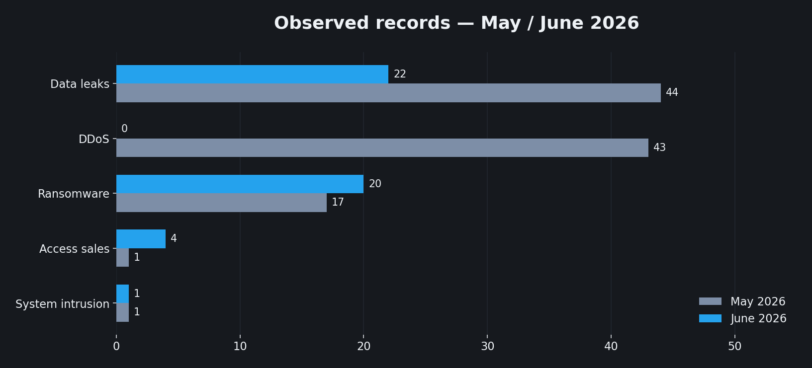

**CTI interpretation.** The net fall of **59 records (−55.7%)** is largely explained by the absence of the **43 May DDoS claims** from June. Ransomware listings increased from **17 to 20 (+17.6%)**, which does not establish increased ransomware deployment. Data-leak records went from **44 to 22 (−50.0%)**, while access-sale listings increased from **1 to 4**. Incorporating the six cases missing from the initially supplied graphics makes data leaks, rather than ransomware, the largest category in June's final dataset.

## 2. Methodology, scope and evidentiary assessment

AFRINTEL monitors the **54 African sovereign countries** through ransomware leak sites, cybercriminal forums, sales listings, public actor channels, observed samples and screenshots, institutional releases and other OSINT sources. The evidence workflow is: **observe publication → establish victim and geography → examine the available sample → correlate sources → classify → assess business risk → formulate SOC detection hypotheses**. A step is claimed only where supporting evidence is present.

**Dataset reconciliation.** Each of the supplied FR/EN files contains **47 aligned `####` entries**. The eight supplied figures represent only **41 records**: they omit **four data-leak records** (two in Egypt, one in Tunisia and one in Libya) and **two Tunisian access-sale records**. The principal charts in this package have therefore been **recomputed from all 47 entries**. The original 41-record charts are retained separately under `assets/graphiques_fournis_41_observations/` for traceability and **must not be treated as final statistical charts**. The supplied victim files are copied without rewriting their contents; the matching and classifications are available in [AUDIT_RECORDS.csv](./AUDIT_RECORDS.csv).

**Counting policy.** One multi-country listing = **one canonical record**, regardless of the number of countries named. The two multi-country listings create **15 country mentions** (8 for Convince, 7 for Governor). Together with the **45 single-territory records**, this produces **60 geographic presences**, **not 60 incidents or confirmed intrusions**. The Moroccan startup-management archive remains one case even though documents belonging to four separate companies appear in the publication. A follow-up concerning `examens.tn` is explicitly assigned to **December 2025**, not June. **Finam Gabon's initial claim dates back to 5 May** and enters June's collection due to AFRINTEL's first documented follow-up, not because a second June attack was demonstrated.

**Evidence levels.** `Claim - Unverified` denotes an observed claim or listing lacking independently substantiating material; `Claim - Data Sample Published` means a sample is visible or discussed; `Data Fully Published` describes substantial or supposedly complete released material, not a guarantee of authentic completeness; `Victim Confirmed` is the source-record label for institutionally corroborated incidents. This label should eventually be normalized against AFRINTEL's `Incident Confirmed by Victim` taxonomy after determining who issued the confirmation. **Confidence in a sample is not the same as confidence in an advertised full dataset**.

| Source-record status | Records | Corpus share |
|---|---:|---:|
| `Claim - Unverified` — Observed claim | 18 | 38.3 % |
| `Claim - Data Sample Published` — Sample published | 16 | 34.0 % |
| `Data Fully Published` — Published data | 11 | 23.4 % |
| `Victim Confirmed` — Institutional confirmation | 2 | 4.3 % |
| **Total** | **47** | **100 %** |

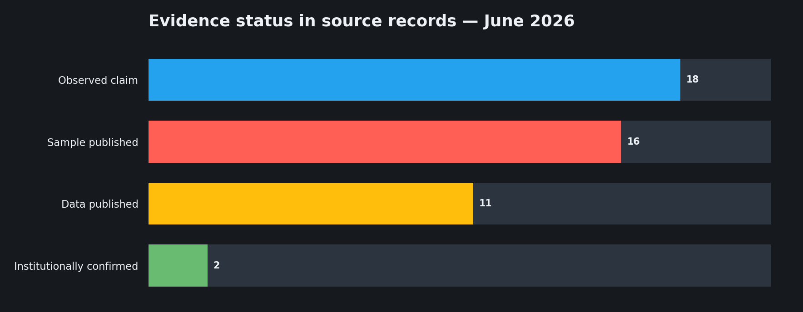

Among the 47 entries, **18** retain the unverified-claim status, **16** the sample-published status, **11** the fully-published status and **2** the institutionally confirmed label. These classifications do not imply encryption, exfiltration and initial-access proof for every case. External verification was conducted on 6 November 2026 for **SEEG** and **MIP/LegalWise**; this report does not claim to have re-verified all 47 original publication sources live.

## 3. Global overview and geographic coverage

### 3.1 Documented incident types

| Category | Records | Share |
|---|---:|---:|
| Data Leak | 22 | 46.8 % |
| Ransomware | 20 | 42.6 % |
| Access Sale | 4 | 8.5 % |
| System Intrusion | 1 | 2.1 % |
| **Total** | **47** | **100 %** |

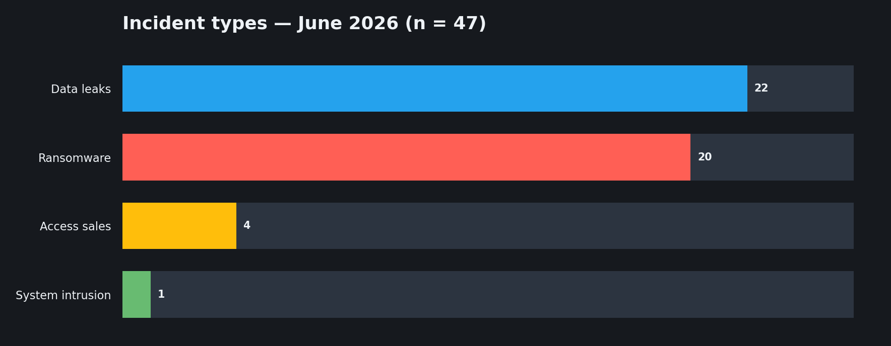

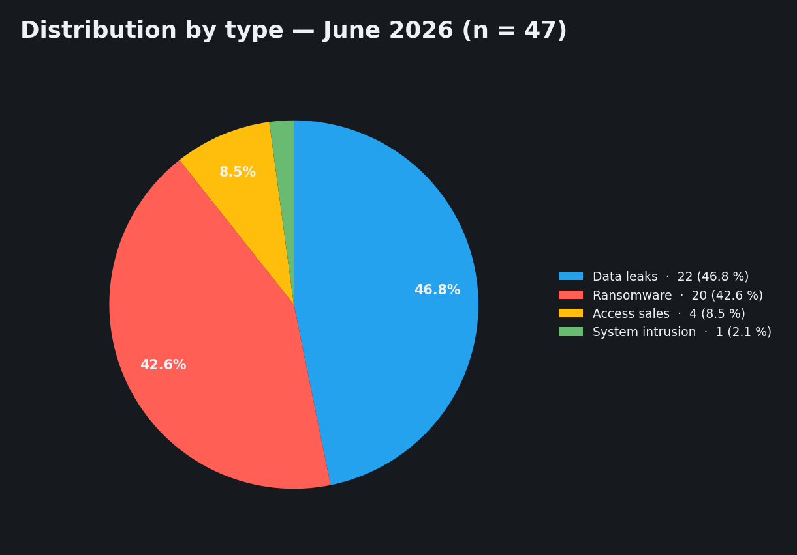

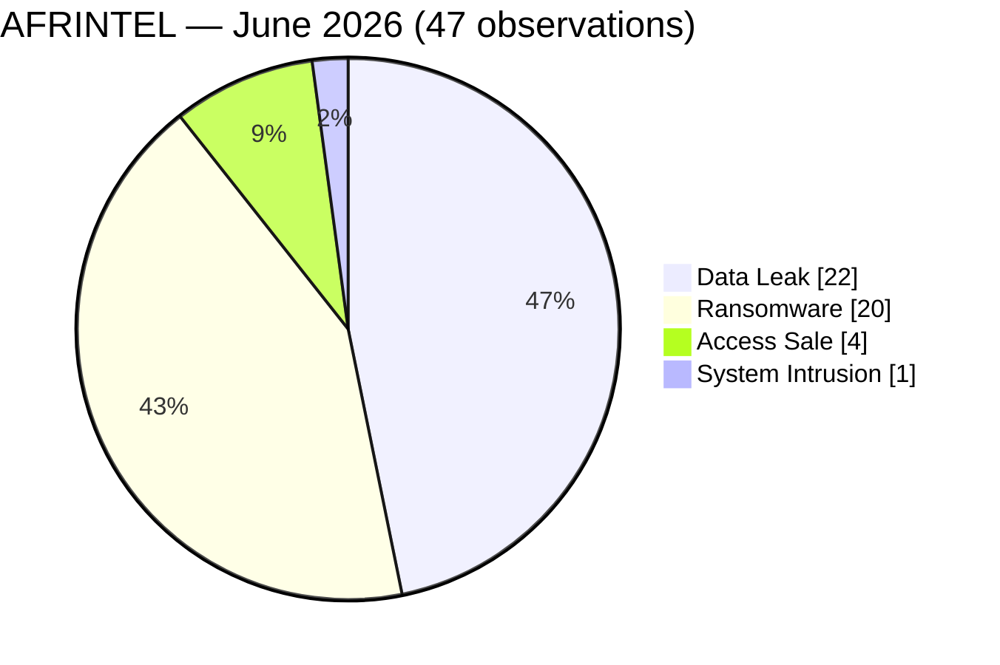

Twenty **ransomware-related listings** do not mean twenty confirmed instances of malicious encryption. The category follows observed ransomware/extortion publications, with the cases containing reviewed releases kept distinct from listings without available data.

### 3.2 Primary geographies: 47 records, including two multi-country entries

| Primary country / territory | Records | Share of 47 | Distribution |
|---|---:|---:|---|
| Morocco | 9 | 19.1 % | █████████ |
| South Africa | 7 | 14.9 % | ███████ |
| Egypt | 6 | 12.8 % | ██████ |
| Tunisia | 6 | 12.8 % | ██████ |
| Libya | 4 | 8.5 % | ████ |
| Nigeria | 4 | 8.5 % | ████ |
| Gabon | 2 | 4.3 % | ██ |
| Multi-country (2 listings) | 2 | 4.3 % | ██ |
| Botswana | 1 | 2.1 % | █ |
| Kenya | 1 | 2.1 % | █ |
| Mauritius | 1 | 2.1 % | █ |
| Senegal | 1 | 2.1 % | █ |
| Tanzania | 1 | 2.1 % | █ |
| Mayotte (France) | 1 | 2.1 % | █ |
| Zimbabwe | 1 | 2.1 % | █ |
| **Total** | **47** | **100 %** | |

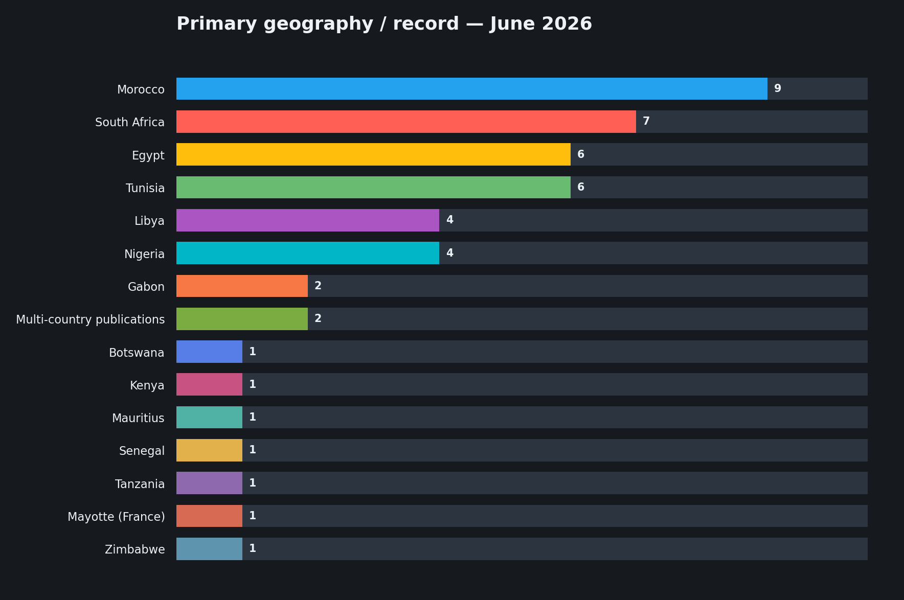

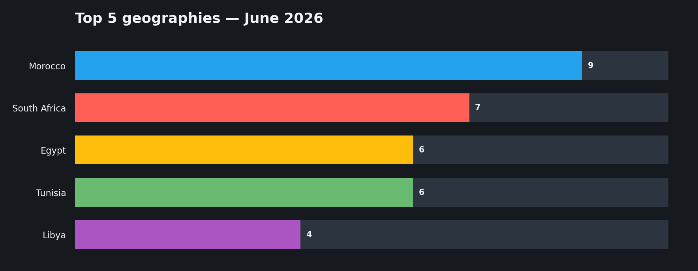

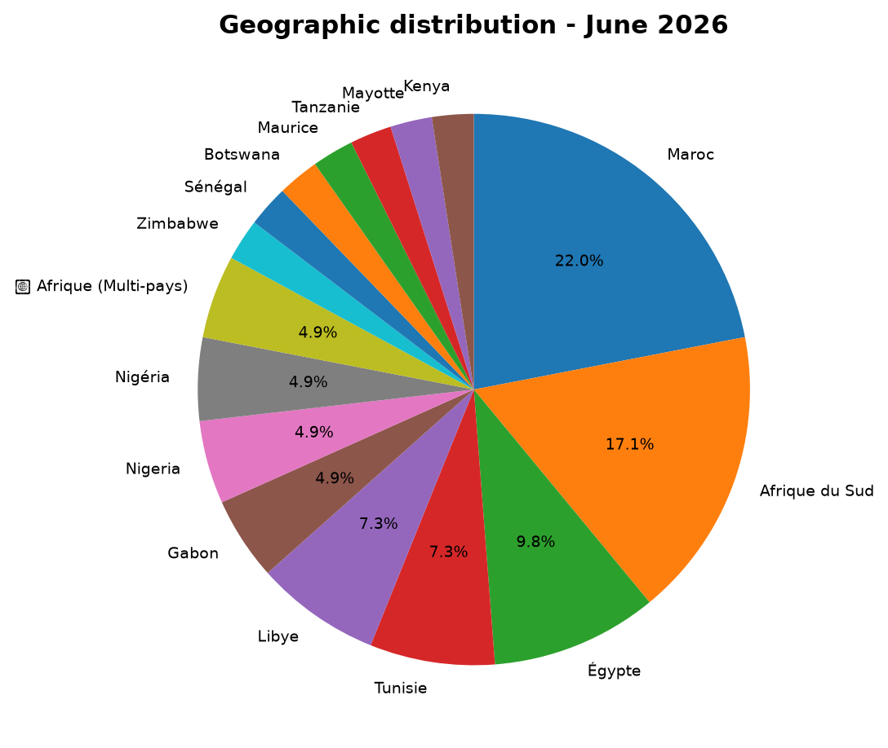

**Use the correct denominator:** the table describes a record's **primary country/territory** (47 records total). Counting exposure to each country named in multi-country listings produces **60 geographic presences** across 19 African states and Mayotte. Thus Morocco's **9/47 = 19.1%** measures a share of **AFRINTEL records**, not a share of all real-world African cyberattacks. Country-name variants (`Nigeria` / `Nigéria`) and actor-name capitalization (`anisanas2` / `Anisanas2`) have been normalized to prevent artificial splitting.

The **45 single-territory** records comprise **25 in North Africa** (Morocco, Egypt, Tunisia, Libya), **9 in Southern Africa** (South Africa, Zimbabwe, Botswana), **5 in West Africa** (Nigeria, Senegal), **2 in Central Africa** (Gabon), and **4 in East Africa and associated islands** (Kenya, Tanzania, Mauritius, Mayotte). The two multi-country listings remain **separate**. This is a reporting distribution, not an objective country-level threat score.

### 3.3 Normalized sectors

| Normalized sector | Records | Share |
|---|---:|---:|
| Government / Administration | 15 | 31.9 % |
| Finance / Banking | 6 | 12.8 % |
| E-commerce / Retail | 5 | 10.6 % |
| Healthcare / Medical | 3 | 6.4 % |
| Education / University | 3 | 6.4 % |
| Transport / Logistics | 3 | 6.4 % |
| Industry / Manufacturing | 3 | 6.4 % |
| Political organizations | 1 | 2.1 % |
| Telecommunications / Media | 1 | 2.1 % |
| Energy / Water / Critical Infrastructure | 1 | 2.1 % |
| Hospitality / Tourism | 1 | 2.1 % |
| Construction / Real Estate | 1 | 2.1 % |
| Food / Beverage | 1 | 2.1 % |
| Business Services / Technology | 1 | 2.1 % |
| Security Services | 1 | 2.1 % |
| Technology / Software / Provider | 1 | 2.1 % |
| **Total** | **47** | **100 %** |

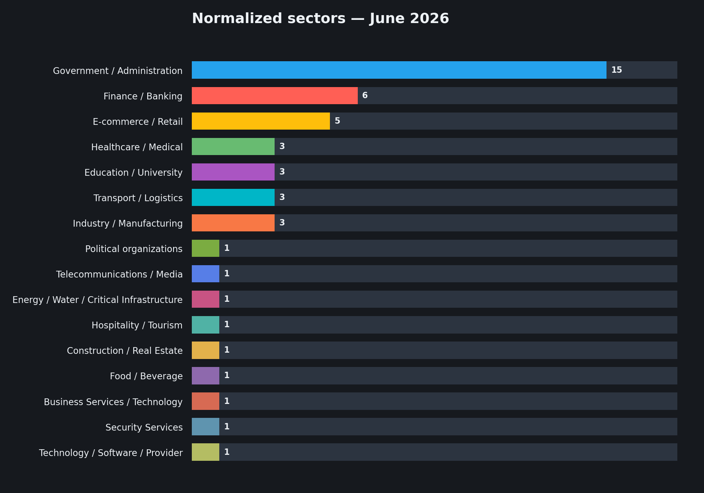

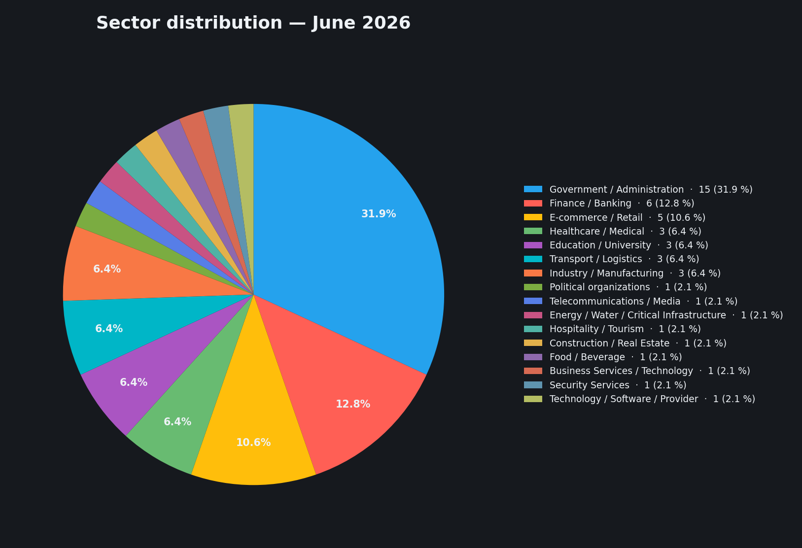

**Government / Administration** leads with **15 records (31.9%)**, followed by **Finance / Banking (6; 12.8%)** and **E-commerce / Retail (5; 10.6%)**. Public-sector exposure spans identity, tax, land, education, administrative archives and extortion listings. The dominant concern is not simply record count; it is the potential for **identity reuse, official-document fraud and service-continuity failures**.

## 4. Detailed analysis by incident type and priority cases

### 4.1 Data leaks: 22 cases

**South Africa — ANC / Black X (2 June).** The main examined file contains **2,310,865 rows across 17 columns**, encompassing identity and membership-related information. The **98,026-row secondary file** is largely a subset and must not be added as a separate population. Portraits were also present, without a validated record-level match. **Observed:** a structured, sensitive dataset was published. **Unresolved:** direct compromise of the original application, encryption, acquisition date and completeness. Political-affiliation information heightens the potential for profiling, harassment and document fraud.

**Egypt — Local Services Portal (5 June).** **R3D3MPTION** advertises **13,117,317 rows**, more than **70 GB of documents** and **5 GB of personal information**. The sample actually examined in the record contains **9,938 rows, 42 columns and 9,933 distinct citizen identifiers**. Visible creation dates of **2 and 3 June** make some sample records recent but do not date the initial intrusion. The data structure and accompanying documents are functionally consistent with **`lgs.gov.eg` or an associated back-end**; the attribution is **probable, not officially confirmed**. Defensive action: review bulk exports, database and API activity, and sensitive-document handling.

**Tunisia — Tayara.tn (8 June).** The actor advertises **over two million rows and 4 GB**, but the complete corpus was not obtained or validated. The reviewed sample contains account identifiers, historical contact details, **PBKDF2-SHA256 password hashes** and, in a subset, **private-key-like RSA material**. A possible stored-XSS payload in a displayed record merits application-integrity review without proving active exploitation. Security priorities include scoped **key rotation**, session revocation and investigation of abnormal authentication. The specific cryptographic use of the keys is not established by the excerpt alone.

**Egypt — Ministry of Agriculture (11 June).** The examined material includes land contracts, debt-recovery documentation, maps, administrative correspondence and organization details. An inventory refers to **389 computers, 87 scanners and 214 printers (690 devices)**; a government application view shows **30,456 land-related requests**. These are figures visible in the published documents, **not a verified up-to-date inventory**. Combined disclosure may facilitate targeted phishing, land-related fraud and technical reconnaissance.

**Tanzania — BRELA (20 June).** The seller claims **10.2 million records** involving approximately **8 million people**, including tax references and company registries. The detailed sub-counts in the source record derive from the **actor's advertisement**, not an independent full-dataset count by AFRINTEL. The core risk is the combination of civil identity, tax identifiers and company roles, potentially supporting ownership-related fraud and impersonation of company principals.

**Nigeria — Jeroid.co (10 June).** According to the seller, the listing involves **312,433 user accounts**, **110,282 BVNs**, **64,300 NINs** and facial-verification assets. These figures and the alleged open cloud bucket are **claim-derived, not independently measured here**. Financial services should nonetheless prioritize KYC audit trails, bulk access to identity documents and controls on biometric storage. National banking-system compromise cannot be inferred from the listing.

**Morocco — business and logistics ecosystem (26–27 June).** The record for an **unidentified delivery operator** describes a reviewed file of **486,024 rows**, approximately **344.5 MiB**, including recipient and delivery information, cash-on-delivery amounts and parcel histories. The **Stellantis Morocco** listing concerns **992 reviewed rows**; competing car brands in the sample suggest a multi-brand CRM or lead source rather than confirmed extraction from a Stellantis system. **Avito.ma** features **200,000 advertised listings**, structurally consistent with **scraping of public advertisements**, without visible evidence of internal account access. These cases share customer-fraud implications but **not a demonstrated common intrusion method**. A separate **unidentified startup-management platform** exposed folders tied to four Moroccan companies and is counted once, with the platform operator still unknown.

**Libya — education ministries (29–30 June).** Two **EvaN47** publications involve student records and academic documents. The first claims **900,000 students**, the second **287 GB**. The visible screenshots show student-related tables, account references and galleries of identity/education documents, but do not substantiate the full volumes or technical source. A later **September** follow-up should not be counted as an independent June compromise.

**South Africa — MIP Holdings (June).** On **26 June 2026**, **LegalWise** stated that its technology supplier MIP Holdings had identified **unauthorized access to a legacy software-development and support environment**. Its **6 July** update described an ongoing review of potentially involved personal, banking and membership information, while stating that unauthorized access to LegalWise's core platforms had not been identified. **The unauthorized third-party access is corroborated; the full data scope and population affected are not established here.** This is a tangible **software supply-chain risk**.

### 4.2 Ransomware and extortion: 20 cases

The **20 ransomware records** are observed victim listings in a ransomware/extortion context, **not 20 proven encryptions**. The leading publication labels are **DeadLock (4)**, **LockBit 5 (3)**, **NightSpire (2)** and **Krybit (2)**. Other cases involve TheGentlemen, WorldLeaks, Aurora, Lamashtu, Qilin, SETTRA, Stormous and CMD Organization.

**Four ransomware-classified cases include substantial published material in the source records:** **ANC / Black X** (membership database), **Court of Auditors of Senegal / Krybit** (internal notes, meeting agendas, audit and institutional records), **MUPRAS RAM / Krybit** (health reimbursements, membership, bank/beneficiary and supplier documents), and **Ouangani / DeadLock** (about **138 MB** of administrative, HR, banking and civil-status material). These provide concrete evidence of sensitive documentary exposure and could support impersonation, payment diversion, harassment and targeted phishing. They **do not on their own reconstruct initial access or demonstrate ransomware deployment**.

For the other **16 listings**, the records document victims appearing on group sites but describe no accessible data at collection. **Finam Gabon** illustrates a recurring ambiguity: the previously advertised **May** disclosure deadline had elapsed, but the June follow-up found no accessible dataset (HTTP 403 at the download endpoint). Payment, successful negotiations, resale, an amended publication strategy or a false initial claim are all **unresolved possibilities**, not conclusions.

**SOC implication:** investigate a listing affecting one's own organization in a proportionate manner, while separating **leak-site publication**, **sample availability**, **data disclosure**, **operational disruption** and **confirmed encryption**. Do not label an event as ransomware deployment without supporting internal or independently confirmed evidence.

### 4.3 Access sales: 4 cases

**Two multi-country posts** (Convince, **17 June**, and Governor, **20 June**) offer institutional identities or accounts that could facilitate **authority impersonation** in data-request workflows directed at online platforms. The posts list several African countries. Neither the current validity of each purported account nor a successful fraudulent emergency disclosure request is demonstrated. Non-African entries mentioned by sellers are excluded from AFRINTEL's geographic coverage.

The **other two entries** concern **Adex.tn** and **Tunisia's Ministry of Vocational Training and Employment**. Both are explicitly tagged as **reposts** by **BIGBROTHER**, not first-hand intrusion claims. An Adex screenshot displays **15,301 shipment entries**, consistent with the advertised order of magnitude. The ministry screenshot shows administrative case information and identity fields, but **does not validate the advertised 4,000 records**. The original attacker and persistence of access remain unknown.

### 4.4 System intrusion / service disruption: 1 case

**Gabon — SEEG / EDAN (14–15 June).** The government confirmed an EDAN service disruption and progressive recovery on **15 June**. Its initial investigation found indications possibly consistent with malicious activity, and a judicial investigation was opened. The victim record also references subsequent SEEG statements about suspected computer sabotage. **Confirmed:** major service disruption, publicly raised suspicion of malicious activity. **Not established by the cited evidence:** a specific external intrusion path, ransomware deployment or data exfiltration. The case retains the source document's `System Intrusion` classification with an **explicit caveat regarding mechanism**.

## 5. Sectoral impact and business consequences

| Sector | Potentially affected information or services | Priority business risk | Key control |
|---|---|---|---|
| Public administration, taxation and identity | Citizen, land and tax registers, administrative workflows, official IDs | Official impersonation, case-file manipulation and document fraud | Export auditing, separation of duties and sensitive-change monitoring |
| Banking, fintech, pensions and mutual benefits | KYC, medical reimbursements, account information and beneficiaries | Payment fraud, identity reuse and fraudulent beneficiary changes | Out-of-band payment verification, API/KYC hardening, anti-fraud analytics |
| Energy/water and essential services | Service and transaction availability, utility customer operations | Operational disruption and loss of public confidence | Tested BCP/DR, appropriate IT/OT segmentation, dependency monitoring |
| Education and civic membership | Student certificates, member records and sensitive affiliation | Profiling, harassment, diploma fraud, account abuse | Data minimization, historical-export control, least privilege |
| Commerce, logistics and automotive | Customer leads, telephones, parcels, orders and payment values | Delivery scams, dealership impersonation and customer targeting | Scraping detection, CRM export governance and customer advisories |
| Technology suppliers | Legacy development/support platforms and downstream client data | Cross-customer impact from shared services | Supplier assurance, secret inventory and support/production separation |

## 6. Threat actors and publishing accounts

| Actor / publishing account (canonical form) | Records | Interpretation |
|---|---:|---|
| anisanas2 | 7 | Capitalization normalized: anisanas2 / Anisanas2 |
| DeadLock | 4 | Account or group listed in the source records |
| LockBit 5 | 3 | Account or group listed in the source records |
| NightSpire | 2 | Account or group listed in the source records |
| 404Crew Cyber Team | 2 | Account or group listed in the source records |
| Non attribué publiquement | 2 | Attribution missing; not an actor |
| Krybit | 2 | Account or group listed in the source records |
| BIGBROTHER | 2 | Two reposts; original source unknown |
| EvaN47 | 2 | Account or group listed in the source records |
| Black X | 1 | Account or group listed in the source records |
| TheGentlemen | 1 | Account or group listed in the source records |
| WorldLeaks | 1 | Account or group listed in the source records |

**Note:** Top 12 only; remaining account labels have one observation each, as detailed in `AUDIT_RECORDS.csv`.

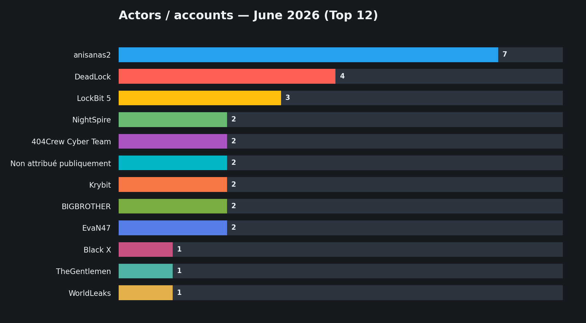

**Canonicalization matters:** `anisanas2` and `Anisanas2` are a single name with **7 records**; `Nightspire` is normalized as `NightSpire` (**2**). **Not publicly attributed (2)** is missing attribution, **not a threat group**. Actor nicknames on forums are publication labels, not verified civilian identities. Similar labels or targets alone cannot establish shared tooling or access methods.

### 6.1 Geographic investigation priorities for CISOs and SOCs

| Investigation priority | Geographies | Observed signal | Interpretation boundary |
|---|---|---|---|
| 🔴 High | **Morocco** | Reviewed delivery/customer and benefit records; 7 publications under anisanas2 | Does not mean nine separate confirmed intrusions |
| 🔴 High | **South Africa** | ANC dataset, MIP supplier event, UNISA support data and ransomware listings | Each case has a different evidence threshold |
| 🟠 Elevated | **Egypt** | Civil and land-related records; probable Local Services attribution | 13.1m advertised vs 9,938 sample rows must stay distinct |
| 🟠 Elevated | **Tunisia** | Tayara hashes/key material, two reposted access listings, ransomware claims | Access validity and overall population unresolved |
| 🟠 Elevated | **Gabon** | SEEG disruption corroborated; Finam listed by DeadLock | Technical cause unresolved; Finam first appeared in May |
| 🟡 Targeted | **Nigeria, Tanzania, Senegal, Libya, Mayotte** | Sensitive identity, financial and administrative records | Corpus concentration is not a national threat ranking |

This geographic prioritization represents **AFRINTEL observation intensity and the sensitivity of particular cases**, not an independent quantitative model of country cyber risk.

## 7. Verifiable trends and intelligence gaps

**1 — A shift in visible claims, not a proven end of DDoS.** May had 43 recorded DDoS claims; June had none. The change may reflect different publication campaigns, source access or collection conditions. It does not prove DDoS attacks ceased in Africa.

**2 — Compound identity and institutional-document exposures.** The ANC, Egyptian local services, MUPRAS, Ouangani, BRELA and Libyan education records illustrate combinations of identifiers and business context that could enable highly persuasive impersonation. Advertised volumes cannot be summed without eliminating duplicate identities, historical versions and reused datasets.

**3 — Shared platforms and supply-chain concentration.** The similarly structured archives of four Moroccan businesses and the confirmed unauthorized access to MIP's legacy environment place **third-party and shared-service risk** at the center of investigations. Neither case establishes compromise of every downstream customer or company represented in the records.

**4 — Reposted data is not necessarily a new intrusion.** The **June Avito.ma** publication is materially different from the May listing: the 200,000 June records look primarily like public-ad scraping. Tunisian entries explicitly tagged `REPOST` also require source tracing before being counted as fresh compromises in historical incident series. The `examens.tn` case is assigned to **December 2025**.

**5 — Priority intelligence gaps.** Most sources lack **initial-access evidence**, technical logs, access duration, full-archive authenticity, reliable victim-response records and evidence of encryption. The correct CTI practice is to preserve those unknowns while gathering corroboration rather than filling the fields with plausible attack stories.

## 8. MITRE ATT&CK — contextual detection hypotheses, not automatic attribution

| ATT&CK technique | Defensive hypothesis | Relevant cases / signals | Recommended telemetry |
|---|---|---|---|
| **T1213.006 — Data from Information Repositories: Databases** | Abnormal extraction of business tables using atypical access | Egyptian local services, BRELA, logistics, UNISA | Database audits, queries, IAM, API records and response size |
| **T1005 — Data from Local System** | Large-scale collection of sensitive internal documents | Court of Auditors, MUPRAS, Ouangani, ministerial files | EDR, file servers, SMB and file-access audits |
| **T1078 — Valid Accounts** | Abusive use of exposed identities or institutional accounts | Nigerian credentials, emergency-disclosure account listings, MIP supplier | IdP, VPN, MFA and privileged-session logs |
| **T1555.003 — Credentials from Web Browsers** | Hypothesis about credentials reportedly originating from browsers | Claimed source of some Nigerian military credentials | EDR, secrets-store access and sign-in audit |
| **T1567 — Exfiltration Over Web Service** | Disproportionate outbound data transfer after collection | Published archives/datasets; **route not demonstrated** | Proxy, egress, CASB, DLP and network-flow logs |
| **T1490 — Inhibit System Recovery** | Recovery-point deletion preceding extortion | **Preventive hunt** for ransomware-listed environments, not observed in these files | EDR, backup systems, OS and hypervisor logs |

**Mapping limitation:** these are **defender-led hypotheses grounded in exposure patterns**, not observed TTPs attributed to the month's actors. No IoCs, command-and-control domains, malicious hashes or YARA rules have been fabricated. The SEEG record does not justify a specific ATT&CK for ICS technique without evidence of the affected control technology.

## 9. Recommendations by organization type

**Government and national services:** audit public APIs and storage, inventory export functions, enforce approval for bulk extraction, restrict access to identity fields and monitor sensitive administrative changes. Legal and data-protection teams should determine any notification obligations following a scoped investigation.

**Banks, fintechs, mutuals and benefit administrators:** isolate KYC and biometric repositories, review cross-application permissions, use independent confirmation for payee changes, and detect mass password resets or account downloads. Where exposed hashes or keys are credibly identified, **revoke and rotate the affected secrets** based on measured scope.

**Education, HR and community organizations:** minimize historic data retention, segment student/employee access, monitor bulk downloads and warn users about phishing that quotes authentic personal or employment details.

**Retail, delivery and digital businesses:** distinguish public-site scraping from internal exfiltration; deploy scraping and API-abuse detection, limit CRM exports and provide customer guidance on parcel and merchant impersonation.

**Critical infrastructure and suppliers:** test restore operations and transaction continuity, map service dependencies, separate legacy development/support systems from production, and request forensic evidence and containment timelines from partners.

## 10. SOC and tactical correlation playbook

| SOC use case | Behavioral triggers | Correlation and triage | Immediate response |
|---|---|---|---|
| **SOC-JUN-01 — Abnormal data export** | Spikes in database queries or bulk exports under atypical accounts | DB audit + IAM + API + egress; 30–60 min window and service baseline | Pause suspicious export, preserve logs/snapshots, validate source and authorization |
| **SOC-JUN-02 — Exposed credentials/secrets** | New ASN/location, MFA failures followed by success, unusual legacy support sign-in | IdP + VPN + SaaS + EDR + privilege history | Revoke relevant sessions and credentials; investigate actual use |
| **SOC-JUN-03 — Excess document collection** | Thousands of file reads, archive creation, unprecedented outbound volume | SMB/EDR + proxy/DLP + change approvals + account privilege | Contain suspicious activity, collect artifacts and quantify accessed files |
| **SOC-JUN-04 — Possible extortion preparation** | Snapshot deletion, security-agent stoppage, mass file renaming | EDR + OS + hypervisor + backup; **preventive hypothesis** | Contain endpoints, protect immutable backups; do not claim encryption without proof |
| **SOC-JUN-05 — Delivery/CRM fraud** | Fast scraping, repeated downloads, spikes in address/order lookups | WAF/CDN + API + CRM + application logs | Rate-limit abuse and investigate accounts; separate public scraping from private exfiltration |
| **SOC-JUN-06 — Essential-service outage** | Application availability loss combined with privileged changes or payment failure | Business monitoring + OS + IAM + appropriately scoped IT/OT telemetry | Activate incident plan, preserve evidence and validate transaction integrity |

**Investigation workflow:** 1) determine the asset and tenant involved; 2) establish telemetry and time window; 3) correlate external actor posting with internal events; 4) investigate abnormal exports and configuration changes; 5) review backups, privileged access and dependencies; 6) record **data exposure, intrusion, service outage and encryption as separate findings**; 7) preserve evidence and confidence in TheHive/OpenCTI. Thresholds require environment-specific baselining.

## 11. Strategic 90-day defense roadmap

| Timeframe | Priority | Owner | Verifiable deliverable |
|---|---|---|---|
| **Days 0–15** | P0 | CISO + IT + SOC | Priority exposure register, credential/key rotation list, supplier notifications, backup/DR review |
| **Days 15–30** | P1 | SOC + IAM + AppSec | Alert coverage for abnormal exports, API/CRM/DB review, privileged-account telemetry gap assessment |
| **Days 30–60** | P1 | CISO + DPO + business units | Identity/KYC data-flow map, payee-change fraud control tests, evidence governance and notification workflow |
| **Days 60–90** | P2 | IT + SOC + vendor management | Supplier incident exercise, timed restoration test, detection scenario validation and privilege reduction dashboard |

**Suggested performance indicators:** percentage of critical applications with export auditing, privileged MFA coverage, time to revoke exposed secrets, proportion of backups restored in tests, DB/API log coverage and time to qualify a leakage alert. These are **proposed management metrics**, not values observed in the incident corpus.

## 12. Conclusion — implications for defenders

The value of this collection lies not merely in the number of published victims, but in the **post-disclosure examination of files wherever evidence is available**, the separation of actual sample measurements from commercial claims, and corroboration of selected incidents with **institutional statements**. **June most clearly illustrates data exposure risk, third-party dependencies and the resilience of essential services**, while leaving individual intrusion sequences unresolved in many cases.

The practical priorities are consistent: **restrict privileged access**, **enforce MFA**, **protect and test backups**, **audit APIs, data stores and sensitive information**, **correlate SOC evidence** and **rehearse crisis decisions**. A criminal post warrants investigation; internal and corroborated evidence determines the final incident conclusion.

**AFRINTEL — African Cyber Threat Intelligence**  
*June 2026 corpus; consolidated 6 November 2026.*  
Repository: [Hatchepsoute/AFRINTEL](https://github.com/Hatchepsoute/AFRINTEL)

### External verification and frameworks

- [Government of Gabon — EDAN / SEEG, 15 June 2026](https://gouvernement.ga/2026/06/15/systeme-edan-retablissement-confirme-et-dispositif-de-protection-renforce-par-letat/): confirmed outage, investigation of possible malicious activity.
- [LegalWise — MIP Holdings third-party incident, 26 June 2026](https://www.legalwise.co.za/media-centre/statement-regarding-third-party-cybersecurity-incident); [6 July update](https://legalwise.co.za/media-centre/important-update-regarding-a-third-party-cybersecurity-incident): supplier unauthorized access and ongoing scope investigation.
- [MITRE ATT&CK — T1213.006](https://attack.mitre.org/techniques/T1213/006/), [T1078](https://attack.mitre.org/techniques/T1078/), [T1567](https://attack.mitre.org/techniques/T1567/): defensive analytic mappings.
- [AFRINTEL June 2026 victims corpus](./victims.md), [French corpus](./victims_FR.md), [reproducible statistics](./AUDIT_STATISTIQUES.json).
