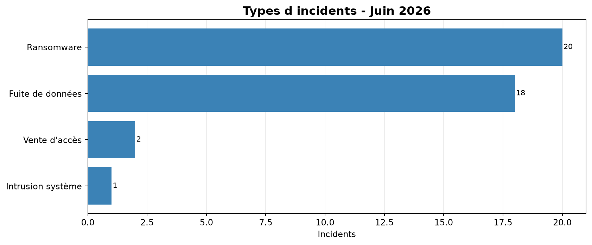
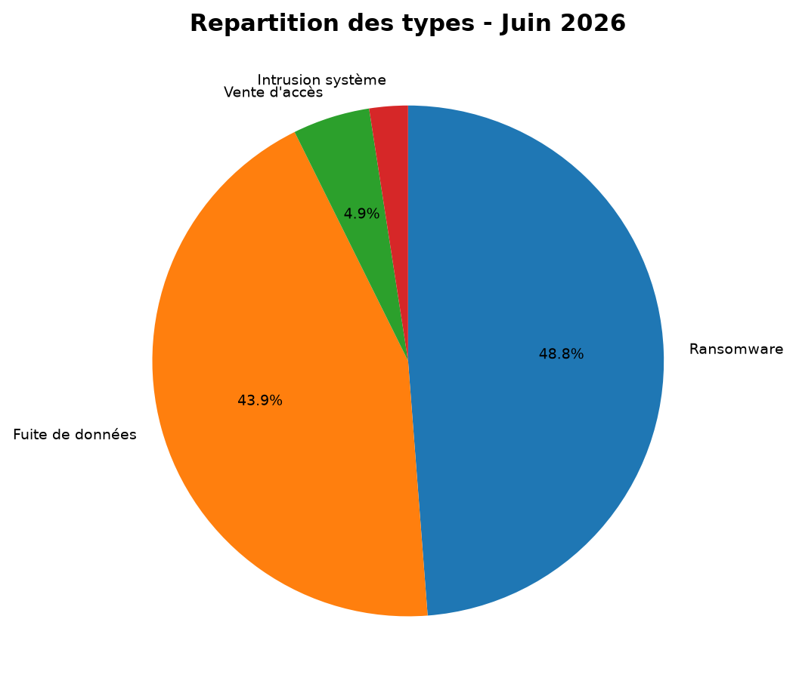
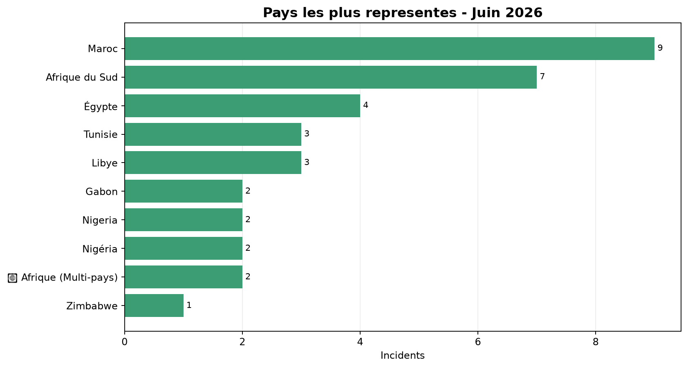
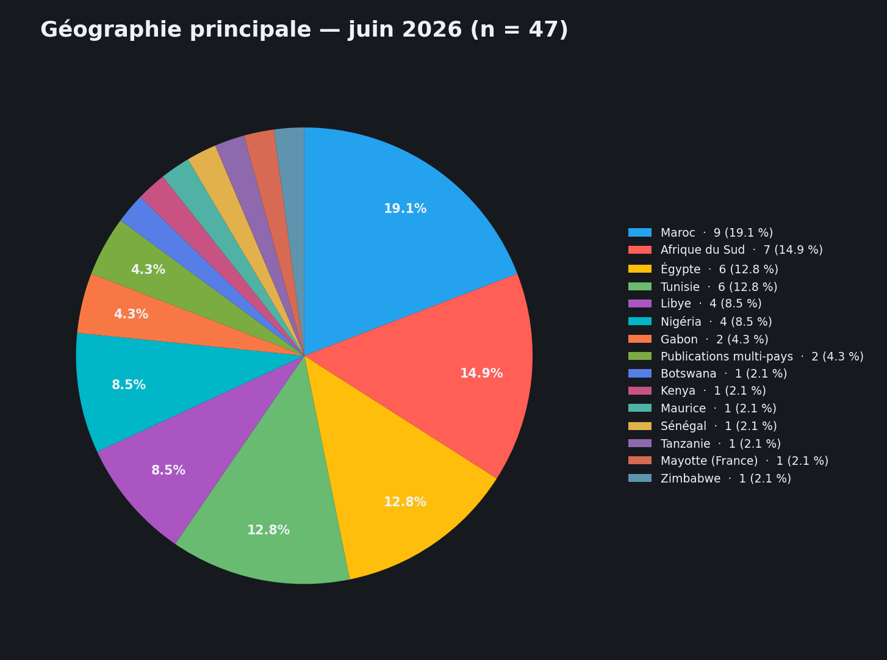
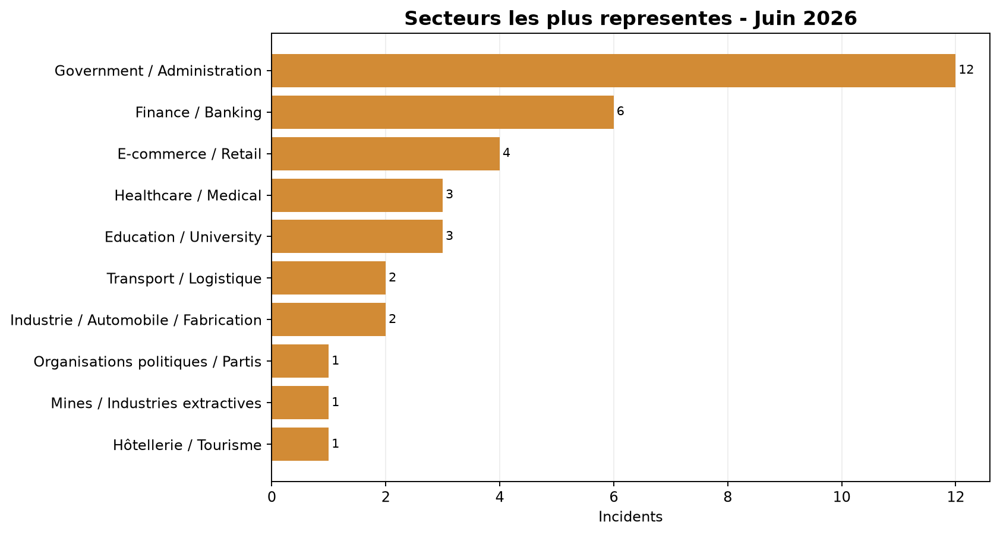
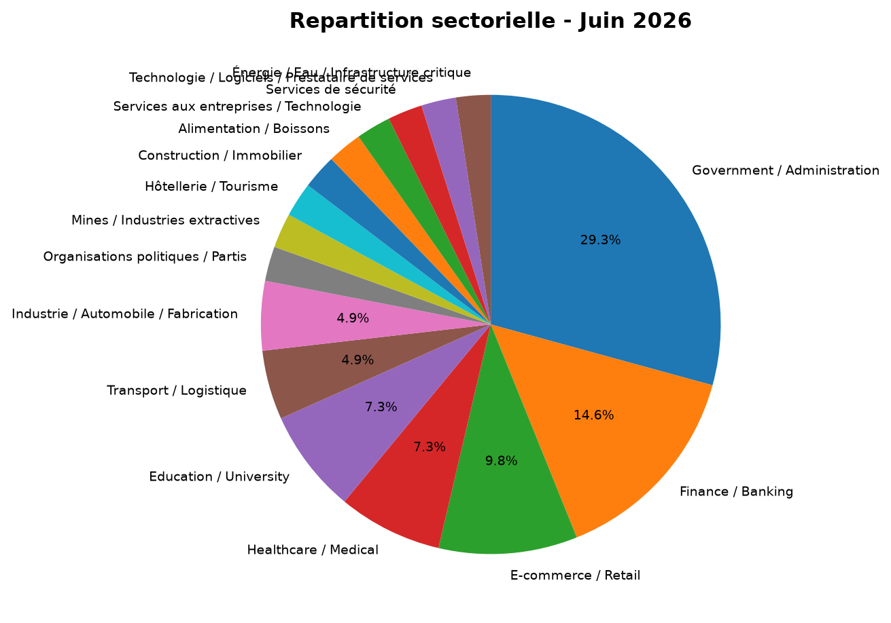
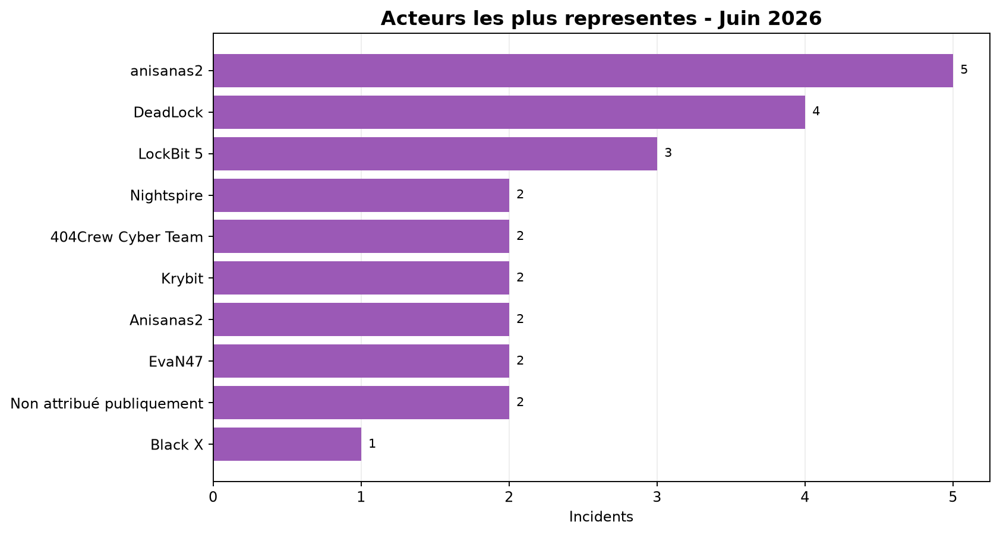
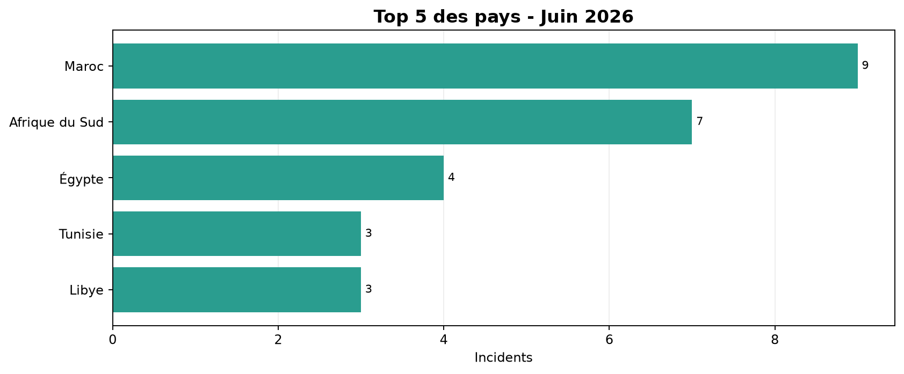

# Rapport CTI AFRINTEL - cyberincidents en Afrique (juin 2026)

Ce corpus validé contient **41 incidents ou cas documentés** publiés pour la première fois ou observés pour la première fois par AFRINTEL en juin 2026. Le rattachement mensuel suit la date de publication ou de première observation documentée ; aucune date de compromission n est déduite lorsqu elle est indisponible.

## Ventilation mensuelle validée

| Type d incident | Nombre | Part |
|---|---:|---:|
| Ransomware | 20 | 48.8% |
| Fuite de données | 18 | 43.9% |
| Vente d'accès | 2 | 4.9% |
| Intrusion système | 1 | 2.4% |
| **Total** | **41** | **100.0%** |

## Pays les plus représentés

| Pays | Nombre |
|---|---:|
| Maroc | 9 |
| Afrique du Sud | 7 |
| Égypte | 4 |
| Tunisie | 3 |
| Libye | 3 |
| Gabon | 2 |
| Nigeria | 2 |
| Nigéria | 2 |
| 🌍 Afrique (Multi-pays) | 2 |
| Zimbabwe | 1 |
| Sénégal | 1 |
| Botswana | 1 |
| Maurice | 1 |
| Tanzanie | 1 |
| Mayotte | 1 |
| Kenya | 1 |

## Acteurs les plus représentés

| Libellé acteur | Nombre |
|---|---:|
| anisanas2 | 5 |
| DeadLock | 4 |
| LockBit 5 | 3 |
| Nightspire | 2 |
| 404Crew Cyber Team | 2 |
| Krybit | 2 |
| Anisanas2 | 2 |
| EvaN47 | 2 |
| Non attribué publiquement | 2 |
| Black X | 1 |

## Secteurs les plus représentés

| Secteur | Nombre |
|---|---:|
| Government / Administration | 12 |
| Finance / Banking | 6 |
| E-commerce / Retail | 4 |
| Healthcare / Medical | 3 |
| Education / University | 3 |
| Transport / Logistique | 2 |
| Industrie / Automobile / Fabrication | 2 |
| Organisations politiques / Partis | 1 |
| Mines / Industries extractives | 1 |
| Hôtellerie / Tourisme | 1 |

## Méthodologie

Les chiffres sont calculés une seule fois depuis `victims_FR.md`, contrôlés contre `victims.md`, puis réutilisés dans les rapports, comparaisons et bundles STIX. Un incident multi-pays compte une fois au total ; les occurrences par pays peuvent donc dépasser le total global. Le corpus mesure la visibilité documentée par AFRINTEL, pas la prévalence réelle des cyberattaques.

[Victim records](./victims_FR.md)

### Visualisations

