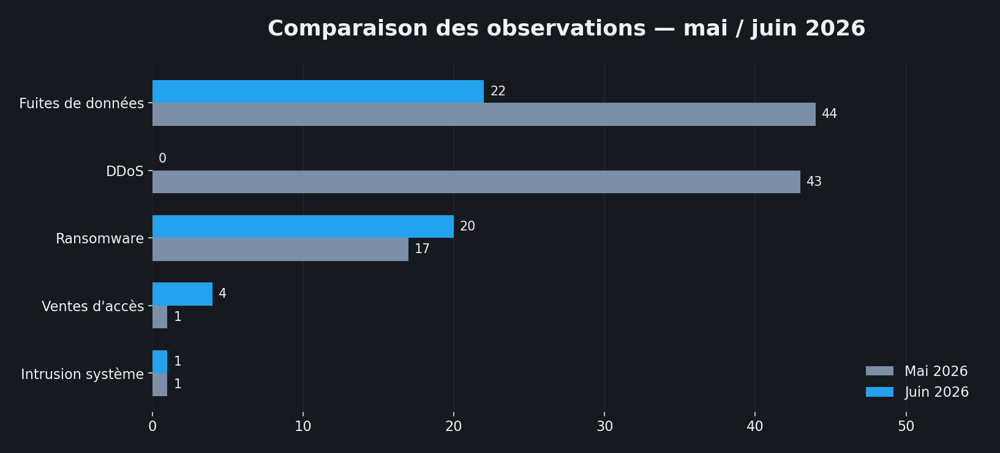
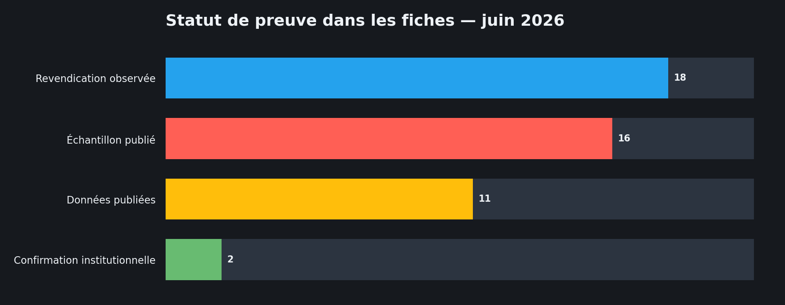
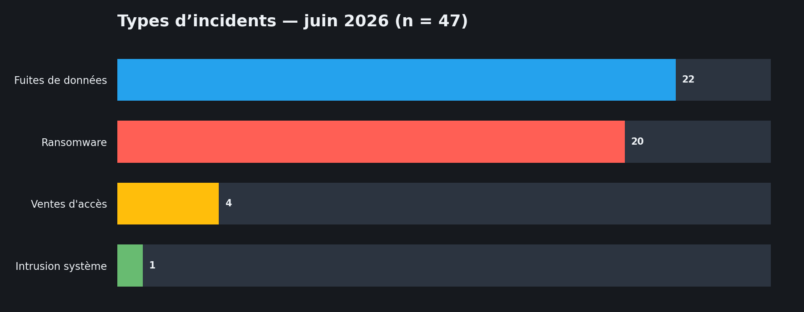
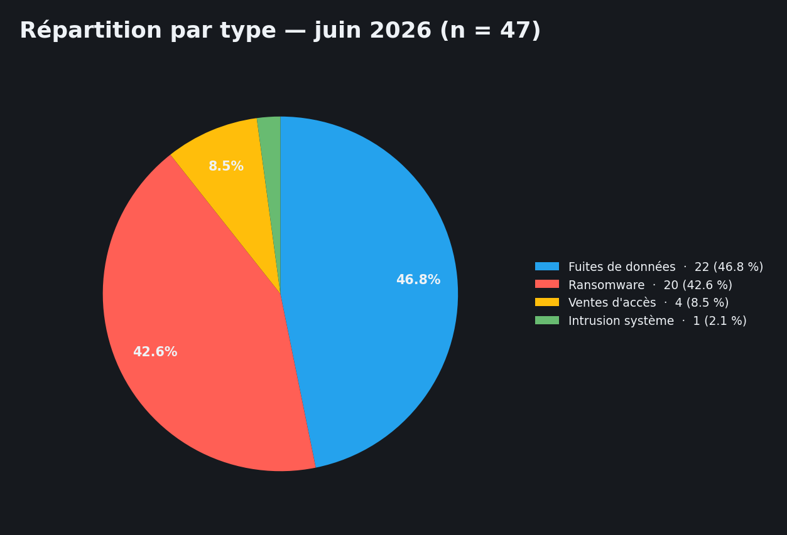
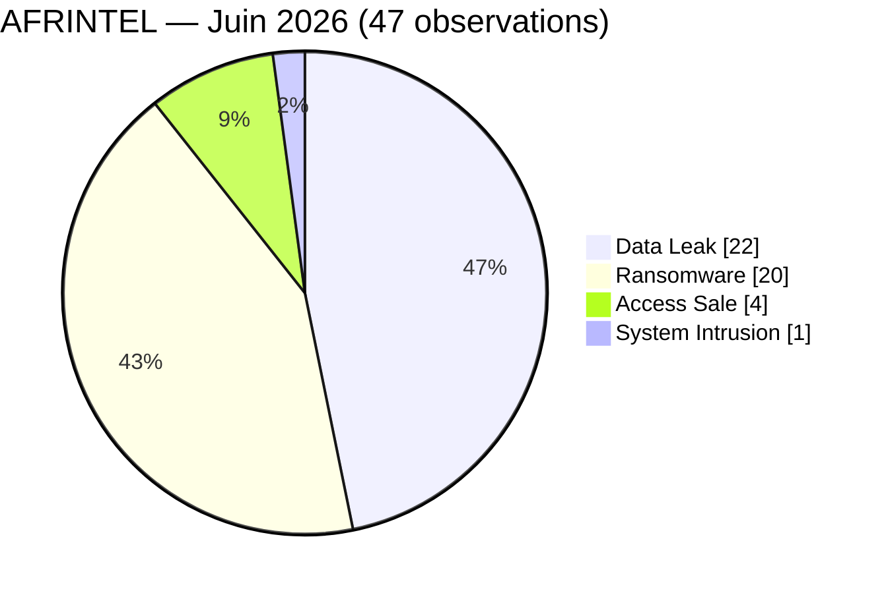
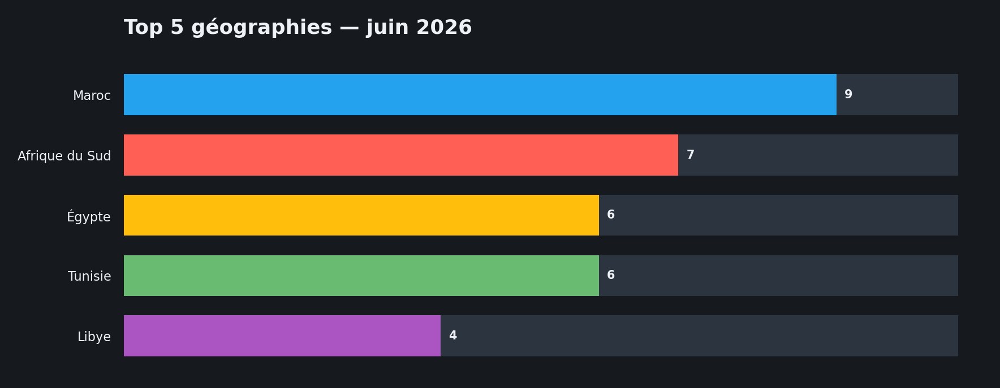
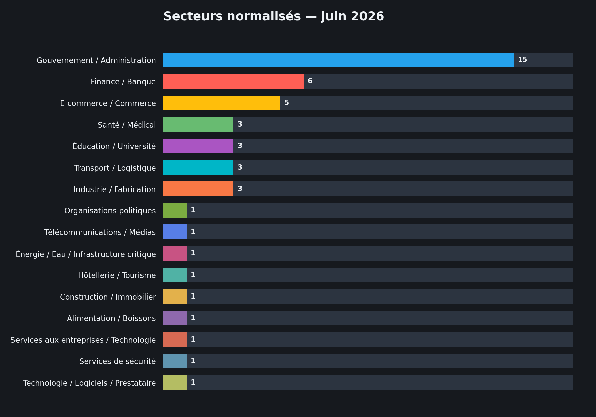
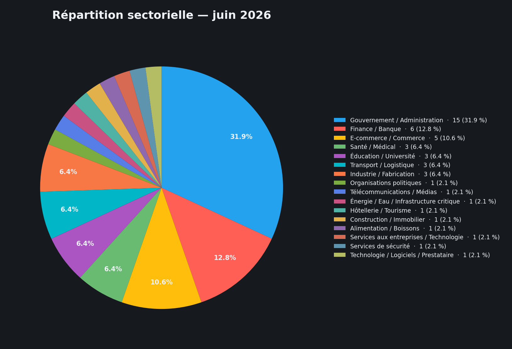
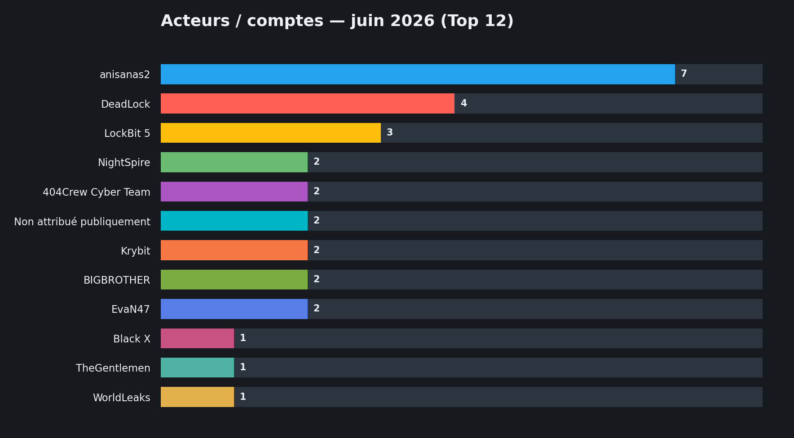

    

# AFRINTEL | Rapport mensuel de Cyber Threat Intelligence
## Cybermenaces visant les organisations africaines — Juin 2026

**Public :** RSSI, DSI, direction des risques, SOC/CERT, responsables de protection des données et opérateurs de services essentiels.  
**Période de référence :** 1er–30 juin 2026 · **Consolidation rétrospective :** 6 novembre 2026.  
**Base de travail :** [47 fiches victimes FR](./victims_FR.md) · [47 victim records EN](./victims.md) · [Registre d'audit](./AUDIT_STATISTIQUES.json) · [Validation](./VALIDATION.md).  
👉🏾 **[Read the English report](./README.md)**

> **Note de fiabilité.** Les chiffres ci-dessous mesurent les publications, dossiers d'extorsion, échantillons et événements suivis dans AFRINTEL ; ils ne mesurent pas le nombre total de cyberattaques effectivement survenues en Afrique. Les données diffusées ont été examinées lorsque les fiches documentent un échantillon ou une archive exploitable ; les volumes allégués par les acteurs sont présentés séparément des volumes analysés. Une inscription sur un *leak site* confirme l'existence de la publication, pas nécessairement l'existence d'un chiffrement. Une notification institutionnelle peut confirmer un incident sans établir tout son mécanisme. **Aucun identifiant personnel, secret ou document brut n'est reproduit.**

---

## 1. Synthèse exécutive

**Juin 2026 rompt avec la structure du mois de mai : la vague de revendications DDoS a disparu des fiches de juin, tandis que la divulgation de données sensibles et les publications de groupes ransomware constituent l'essentiel du signal.** Après rapprochement des versions française et anglaise, AFRINTEL retient **47 observations canoniques**, réparties en **22 fuites de données (46,8 %), 20 dossiers ransomware (42,6 %), 4 offres de vente d'accès (8,5 %) et 1 incident classé intrusion système (2,1 %)**.

Le **Maroc (9)** concentre le plus grand nombre de fiches nationales, devant **l'Afrique du Sud (7)**, **l'Égypte (6)** et **la Tunisie (6)**. Deux publications multi-pays relatives à des comptes institutionnels complètent le périmètre. Au total, les sources concernent **19 États souverains africains**, ainsi que **Mayotte**, territoire français situé dans l'océan Indien et suivi à titre géographique. Cette distinction évite de compter Mayotte parmi les 54 États africains. Le nombre d'observations n'est pas le nombre de victimes uniques : une publication peut concerner plusieurs organisations et un même organisme peut être cité à plusieurs dates.

Les dossiers à examiner en priorité sont ceux qui **combinent des preuves documentaires et un impact métier significatif**. En Afrique du Sud, le fichier publié par **Black X** et attribué à l'ANC comporte **2 310 865 lignes**, et le jeu complémentaire de 98 026 lignes est majoritairement redondant ; il serait erroné d'additionner mécaniquement les deux volumes. En Égypte, le dossier du **Portail des services locaux** repose sur **9 938 lignes analysées**, à comparer aux **13,1 millions de lignes revendiquées**, sans les confondre. En Tunisie, **Tayara.tn** présente une exposition potentielle de données d'identité, de hachages de mots de passe et de matériel cryptographique privé dans l'échantillon examiné.

Les **publications postérieures à l'extorsion** apportent un autre niveau de preuve : pour la **Cour des comptes du Sénégal**, **MUPRAS RAM au Maroc** et la **commune de Ouangani à Mayotte**, les fiches décrivent des documents rendus accessibles par les groupes **Krybit** ou **DeadLock**. Cela étaye une exposition documentaire, sans prouver automatiquement qu'un logiciel de chiffrement a été déployé. Au **Gabon**, la panne du système **EDAN/SEEG** des 14–15 juin a fait l'objet d'une communication gouvernementale ; en **Afrique du Sud**, l'accès non autorisé à un environnement historique de **MIP Holdings** a été reconnu dans les communications de son partenaire LegalWise. Les deux derniers cas disposent ainsi d'une **corroboration institutionnelle** mais de mécanismes techniques à préciser.

**Décision à prendre :** renforcer en priorité la protection des identités, les contrôles d'extraction de données, la résilience des services essentiels et la gestion des risques fournisseurs. Le rapport distingue à chaque étape **observation**, **interprétation** et **éléments non établis**.

**Accès aux fiches :** [victims_FR.md](./victims_FR.md) · [victims.md](./victims.md).

### 1.1 Comparaison avec le mois précédent

> Le comparatif oppose **106 observations canoniques de mai** à **47 de juin**. Il décrit une variation de la **collecte AFRINTEL**, non une baisse démontrée du nombre réel d'intrusions sur le continent. Le corpus de mai utilisait des revendications DDoS observées, fortement concentrées sur une même campagne, tandis que le corpus de juin n'en contient aucune.

| Indicateur | Mai 2026 | Juin 2026 | Évolution observée |
|---|---:|---:|---:|
| **Total incidents** | **106** | **47** | **-59 (-55,7 %)** |
| Ransomware | 17 | 20 | +3 (+17,6 %) |
| Data Leak | 44 | 22 | -22 (-50,0 %) |
| Access Sale | 1 | 4 | +3 (+300,0 %) |
| DDoS | 43 | 0 | -43 (-100,0 %) |
| Defacement | 0 | 0 | 0 (stable) |
| Account Takeover | 0 | 0 | 0 (stable) |
| System Intrusion | 1 | 1 | 0 (stable) |
| Malware | 0 | 0 | 0 (stable) |
| Operational Fraud | 0 | 0 | 0 (stable) |

**Lecture CTI.** Le recul total de **59 dossiers (−55,7 %)** est largement porté par la disparition des **43 revendications DDoS** observées en mai. Les dossiers ransomware passent de **17 à 20 (+17,6 %)**, mais cette hausse documentaire n'établit pas une intensification technique des attaques. Les fuites recensées passent de **44 à 22 (−50,0 %)** et les offres de vente d'accès de **1 à 4**. L'introduction de six fiches absentes des graphiques initiaux modifie la proportion de juin : les fuites redeviennent le premier type du mois, devant les ransomware.

## 2. Méthodologie, périmètre et valeur probante

AFRINTEL couvre les **54 États africains** et surveille les publications de sites de divulgation ransomware, forums cybercriminels, annonces de vente, canaux publics d'acteurs, fichiers et captures d'échantillons, communications institutionnelles et sources OSINT. Pour chaque cas documenté, la séquence analytique est : **publication observée → caractérisation de la victime et du pays → analyse de l'échantillon disponible → rapprochement de sources → classification → risque métier → hypothèses de détection SOC**. Seules les étapes effectivement réalisables à partir des pièces disponibles sont revendiquées.

**Réconciliation des statistiques.** Les deux fichiers sources comportent **47 fiches `####` alignées**. Les huit graphiques fournis n'en représentent que **41** : ils omettent **quatre fuites de données** (deux égyptiennes, une tunisienne et une libyenne) ainsi que **deux ventes d'accès tunisiennes**. Les graphiques principaux de ce dossier sont donc **recalculés sur les 47 fiches**. Les images de 41 observations restent dans `assets/graphiques_fournis_41_observations/` comme éléments historiques et **ne doivent pas être publiées comme statistiques finales**. Les fichiers `victims*.md` sont conservés sans réécriture du contenu initial ; le rapprochement est traçable dans [AUDIT_RECORDS.csv](./AUDIT_RECORDS.csv).

**Règles de comptage.** Une fiche multi-pays = **un dossier canonique**, même si plusieurs États sont cités. Deux offres multi-pays produisent à elles seules **15 mentions de pays** (8 pour Convince, 7 pour Governor). Les **45 fiches mono-territoire** et ces 15 mentions produisent **60 présences géographiques**, qui ne sont **ni 60 incidents ni 60 compromissions**. Une publication attribuée à plusieurs entreprises marocaines demeure un seul dossier tant que sa source commune n'est pas établie. Le suivi de `examens.tn`, expressément rattaché à **décembre 2025**, n'est pas compté comme nouvel incident de juin. La revendication Finam Gabon, initialement datée du **5 mai**, figure en juin pour raison de **premier suivi AFRINTEL**, et non comme preuve d'une nouvelle attaque intervenue en juin.

**Graduation de preuve.** `Claim - Unverified` = publication recensée, sans confirmation indépendante de la compromission ni donnée accessible suffisante ; `Claim - Data Sample Published` = échantillon visible ou examiné ; `Data Fully Published` = publication intégrale ou étendue déclarée/observée, sans validation automatique de l'exhaustivité ; `Victim Confirmed` = confirmation d'un événement de sécurité par une source institutionnelle dans le corpus. Cette dernière étiquette doit être harmonisée à terme avec la taxonomie AFRINTEL (`Incident Confirmed by Victim`) après vérification de la nature de l'émetteur. Le **niveau de confiance** porte sur la preuve disponible, pas sur une généralisation au corpus complet.

| Statut de la fiche | Cas | Part du corpus |
|---|---:|---:|
| `Claim - Unverified` — Revendication observée | 18 | 38,3 % |
| `Claim - Data Sample Published` — Échantillon publié | 16 | 34,0 % |
| `Data Fully Published` — Données publiées | 11 | 23,4 % |
| `Victim Confirmed` — Confirmation institutionnelle | 2 | 4,3 % |
| **Total** | **47** | **100 %** |

Le jeu de 47 fiches contient **18 revendications sans échantillon probant accessible**, **16 fiches avec échantillon**, **11 cas classés « Data Fully Published »** et **2 dossiers confirmés institutionnellement**. Ce dernier statut ne signifie pas que l'exfiltration, le chiffrement et le vecteur d'accès ont été établis pour les deux cas. Les confirmations externes ont été revérifiées le 6 novembre 2026 uniquement pour les cas **SEEG** et **MIP/LegalWise** ; le présent rapport ne prétend pas avoir revérifié en direct l'ensemble des 47 sources initiales.

## 3. Panorama quantitatif et lecture géographique

### 3.1 Typologies documentées

| Typologie | Dossiers | Part |
|---|---:|---:|
| Fuite de données | 22 | 46,8 % |
| Ransomware | 20 | 42,6 % |
| Vente d’accès | 4 | 8,5 % |
| Intrusion système | 1 | 2,1 % |
| **Total** | **47** | **100 %** |

Le nombre de dossiers **ransomware** ne signifie pas que vingt déploiements de maliciels ont été confirmés. Il correspond à des publications observées dans un contexte de ransomware/extorsion ; les exemples avec fichiers divulgués sont distingués des listings sans échantillon.

### 3.2 Géographies principales : 47 dossiers, dont deux multi-pays

| Pays / territoire principal | Dossiers | Part de 47 | Visualisation |
|---|---:|---:|---|
| Maroc | 9 | 19,1 % | █████████ |
| Afrique du Sud | 7 | 14,9 % | ███████ |
| Égypte | 6 | 12,8 % | ██████ |
| Tunisie | 6 | 12,8 % | ██████ |
| Libye | 4 | 8,5 % | ████ |
| Nigéria | 4 | 8,5 % | ████ |
| Gabon | 2 | 4,3 % | ██ |
| Multi-pays (2 offres) | 2 | 4,3 % | ██ |
| Botswana | 1 | 2,1 % | █ |
| Kenya | 1 | 2,1 % | █ |
| Maurice | 1 | 2,1 % | █ |
| Sénégal | 1 | 2,1 % | █ |
| Tanzanie | 1 | 2,1 % | █ |
| Mayotte (France) | 1 | 2,1 % | █ |
| Zimbabwe | 1 | 2,1 % | █ |
| **Total** | **47** | **100 %** | |

**Deux vues à ne pas confondre :** les valeurs du tableau concernent le **pays ou territoire principal** d'une fiche (47 au total). La ventilation des offres multi-pays conduit à **60 présences géographiques**, réparties entre 19 États africains et Mayotte. Ainsi, la part marocaine de **9/47 = 19,1 %** est la part des dossiers canoniques, **pas** le pourcentage des cyberattaques réelles sur le continent. Les valeurs « Nigéria/Nigeria » et « anisanas2/Anisanas2 » ont été normalisées afin d'éviter de scinder artificiellement les mêmes entités.

La lecture régionale des **45 dossiers mono-territoire** donne **25 en Afrique du Nord** (Maroc, Égypte, Tunisie, Libye), **9 en Afrique australe** (Afrique du Sud, Zimbabwe, Botswana), **5 en Afrique de l'Ouest** (Nigéria, Sénégal), **2 en Afrique centrale** (Gabon) et **4 en Afrique de l'Est et îles associées** (Kenya, Tanzanie, Maurice, Mayotte). Les **deux dossiers multi-pays restent séparés** de ces totaux. Cette ventilation traduit la couverture documentaire, pas un niveau de risque national intrinsèque.

### 3.3 Secteurs normalisés

| Secteur normalisé | Dossiers | Part |
|---|---:|---:|
| Gouvernement / Administration | 15 | 31,9 % |
| Finance / Banque | 6 | 12,8 % |
| E-commerce / Commerce | 5 | 10,6 % |
| Santé / Médical | 3 | 6,4 % |
| Éducation / Université | 3 | 6,4 % |
| Transport / Logistique | 3 | 6,4 % |
| Industrie / Fabrication | 3 | 6,4 % |
| Organisations politiques | 1 | 2,1 % |
| Télécommunications / Médias | 1 | 2,1 % |
| Énergie / Eau / Infrastructure critique | 1 | 2,1 % |
| Hôtellerie / Tourisme | 1 | 2,1 % |
| Construction / Immobilier | 1 | 2,1 % |
| Alimentation / Boissons | 1 | 2,1 % |
| Services aux entreprises / Technologie | 1 | 2,1 % |
| Services de sécurité | 1 | 2,1 % |
| Technologie / Logiciels / Prestataire | 1 | 2,1 % |
| **Total** | **47** | **100 %** |

**Gouvernement / Administration** totalise **15 dossiers sur 47 (31,9 %)** et reste en tête, devant **Finance / Banque (6 ; 12,8 %)** et **E-commerce / Commerce (5 ; 10,6 %)**. Cette présence publique comprend des jeux de données fiscaux, des identifiants institutionnels, des documents d'éducation, des archives administratives et des listes de victimes publiées par des groupes d'extorsion. Les enjeux concernent moins le seul volume que la **réutilisation possible d'identités et de documents officiels** et la continuité des services essentiels.

## 4. Analyse détaillée par typologie et incidents prioritaires

### 4.1 Fuites de données : 22 dossiers

**Afrique du Sud — ANC / Black X (2 juin).** L'archive décrite dans la fiche contient un fichier principal de **2 310 865 lignes sur 17 champs**, associé à des données d'adhésion et d'identité. Le fichier secondaire de **98 026 lignes** reprend presque totalement des éléments du principal ; il ne constitue donc pas un second volume indépendant. Des photographies sont présentes sans correspondance établie avec les personnes du tableau. **Observé :** publication d'un corpus structuré sensible. **Non établi :** compromission du système source par Black X, chiffrement, date exacte de collecte et exhaustivité. La confidentialité de l'affiliation politique renforce le potentiel de harcèlement, de profilage et de fraude documentaire.

**Égypte — Portail des services locaux (5 juin).** L'acteur **R3D3MPTION** annonce **13 117 317 lignes**, plus de **70 Go de documents** et **5 Go de données personnelles**. L'analyse figurant dans la fiche concerne en réalité **9 938 enregistrements**, **42 colonnes** et **9 933 identifiants citoyens distincts**. Les dates de création observées les **2 et 3 juin** renforcent le caractère récent de certains enregistrements, mais ne datent pas l'exfiltration. Le schéma et les pièces visibles sont fonctionnellement compatibles avec **`lgs.gov.eg` ou un back-end associé** ; cette attribution est **probable, non officiellement confirmée**. Réponse recommandée : audit des exports, journaux de bases/API et traitements de documents d'identité.

**Tunisie — Tayara.tn (8 juin).** Un acteur annonce **plus de deux millions de lignes** et **4 Go**, mais le corpus complet n'a pas été acquis ni vérifié. L'échantillon examiné présente des identifiants de comptes, des historiques de coordonnées, des **hachages PBKDF2-SHA256** et, pour certains enregistrements, du **matériel de clé privée de type RSA**. La présence visible d'un contenu susceptible d'être une charge XSS stockée appelle aussi une revue d'intégrité applicative, sans prouver une exploitation actuelle. Pour le SOC, l'enjeu immédiat est la **rotation des clés concernées**, la révocation des sessions et la recherche d'accès abusifs ; une chaîne de certification ou une fonction cryptographique précise ne peut pas être inférée du seul échantillon.

**Égypte — Ministère de l'Agriculture (11 juin).** Les documents étudiés dans la fiche couvrent des contrats fonciers, des archives de recouvrement, des cartes, des correspondances administratives et des informations organisationnelles. Un inventaire indique **389 ordinateurs, 87 scanners et 214 imprimantes (690 équipements)** ; une interface montre **30 456 demandes foncières**. Il s'agit d'éléments visibles dans les pièces attribuées à l'administration, pas d'une cartographie vérifiée de son parc actuel. Leur agrégation est exploitable pour des opérations de phishing contextuel, de fraude foncière et de reconnaissance technique.

**Tanzanie — BRELA (20 juin).** Le vendeur revendique **10,2 millions d'enregistrements** concernant **environ 8 millions de personnes**, avec références fiscales et données d'entreprises. Les sous-volumes publiés dans la fiche relèvent de l'annonce de l'acteur ; **ils ne doivent pas être présentés comme comptés par AFRINTEL**. Le risque principal porte sur l'assemblage d'identités civiles, références fiscales et rôles dans des entreprises, facilitant la fraude au changement de bénéficiaire, l'usurpation d'identité et les attaques contre les services d'enregistrement.

**Nigéria — Jeroid.co (10 juin).** La publication propose une base contenant, selon le vendeur, **312 433 utilisateurs**, **110 282 BVN**, **64 300 NIN** et du matériel de vérification faciale. Les chiffres et l'état d'exposition d'un stockage cloud sont **des affirmations du vendeur dans la fiche**, non des mesures indépendantes de ce rapport. Les organisations de paiement doivent néanmoins examiner rapidement les journaux KYC, les politiques d'accès aux justificatifs et les consultations en masse. Le risque de **fraude d'identité** est plus immédiat qu'une conclusion non démontrée sur la compromission du système bancaire national.

**Maroc — chaîne commerciale et logistique (26–27 juin).** La fiche d'une **entreprise de livraison non identifiée** rend compte de **486 024 lignes réellement analysées**, dans un CSV d'environ **344,5 Mio** : références de livraison, destinataires, téléphones, montants contre remboursement et historiques de colis. La fiche relative à **Stellantis Maroc** porte sur **992 enregistrements**, dont la présence de marques concurrentes impose de ne pas conclure à un vol direct sur une infrastructure Stellantis. La publication **Avito.ma** comprend **200 000 annonces** ; leur structure évoque surtout un **scraping de données publiquement visibles**, sans indice d'accès interne. Les trois scénarios appellent une défense antifraude, mais **ne relèvent pas du même mécanisme technique**. Un quatrième dossier, celui d'une **plateforme marocaine de gestion de startups non identifiée**, concerne les archives de quatre sociétés distinctes : il est compté une seule fois, l'opérateur central restant inconnu.

**Libye — ministères de l'Éducation (29–30 juin).** Deux publications sous le compte **EvaN47** portent sur des dossiers d'étudiants et des documents académiques. La première annonce **900 000 étudiants** ; la seconde **287 Go**. Les captures indiquent des tables de données étudiantes, des références de comptes et une galerie de documents d'identité et certificats, mais ne prouvent pas les volumes complets ni l'infrastructure d'origine. Une publication de suivi en **septembre** ne crée pas automatiquement une nouvelle compromission en juin.

**Afrique du Sud — MIP Holdings (juin).** **LegalWise** a indiqué le **26 juin 2026** qu'un prestataire technologique, MIP Holdings, avait identifié un **accès non autorisé à un ancien environnement de développement et de support**. Sa mise à jour du **6 juillet** évoque une enquête sur des catégories possibles de données personnelles, bancaires et d'adhésion, sans confirmer une atteinte aux systèmes centraux LegalWise. **L'accès non autorisé chez le fournisseur est confirmé ; la portée de la fuite et le nombre de personnes touchées ne le sont pas ici.** C'est un signal concret de **risque de chaîne d'approvisionnement numérique**.

### 4.2 Ransomware et extorsion : 20 dossiers

Les **20 dossiers** représentent la publication de victimes sur des sites dédiés ou dans un contexte d'extorsion, **pas vingt cas prouvés de chiffrement**. Les comptes les plus visibles sont **DeadLock (4 dossiers)**, **LockBit 5 (3)**, **NightSpire (2)** et **Krybit (2)** ; d'autres publications concernent TheGentlemen, WorldLeaks, Aurora, Lamashtu, Qilin, SETTRA, Stormous et CMD Organization.

**Quatre dossiers ransomware disposent d'éléments publiés substantiels dans les fiches :** **ANC / Black X** (base d'adhésion), **Cour des comptes du Sénégal / Krybit** (notes internes, ordres du jour, audits et documents institutionnels), **MUPRAS RAM / Krybit** (dossiers de remboursements de santé, cotisations, relations bancaires et prestataires) et **Ouangani / DeadLock** (environ **138 Mo** de documents administratifs, RH, bancaires et d'état civil). Leur analyse identifie des catégories d'information exploitables pour l'usurpation, la fraude aux paiements, la surveillance de bénéficiaires et le spear-phishing. Elle **ne reconstitue pas la chaîne d'intrusion ni ne valide un déploiement de ransomware**.

Pour les autres **16 dossiers**, les fiches enregistrent les listings de victimes lorsque les documents n'étaient pas accessibles à la collecte. **Finam Gabon** illustre une difficulté récurrente : une échéance de divulgation annoncée pour **mai** a été dépassée, mais le suivi de juin ne rend pas les fichiers disponibles (réponse HTTP 403 sur l'espace de téléchargement). Il est impossible de conclure à un paiement, à une négociation réussie, à une revente ou à une erreur de revendication. Les hypothèses restent ouvertes tant qu'aucune nouvelle preuve ne les départage.

**Conséquence SOC :** déclencher une enquête interne proportionnée sur chaque listing visant un actif de l'organisation, mais ne pas qualifier l'événement d'incident chiffrant sans preuve hôte, stockage ou opérationnelle. Distinguer **publication sur leak site**, **échantillon disponible**, **données divulguées**, **atteinte opérationnelle** et **confirmation institutionnelle**.

### 4.3 Ventes d'accès : 4 dossiers

**Deux publications multi-pays** (Convince, le 17 juin ; Governor, le 20 juin) annoncent des comptes ou des identités institutionnelles pouvant servir à **usurper des autorités** lors de demandes de données adressées à des plateformes numériques. Les publications listent plusieurs pays d'Afrique. Elles ne prouvent **ni la validité effective de chaque compte ni l'obtention de données par une demande frauduleuse**. Les pays non africains éventuellement mentionnés par le vendeur sont exclus du périmètre régional.

Les **deux autres dossiers** correspondent à **Adex.tn** et au **ministère tunisien de la Formation professionnelle et de l'Emploi**. Ils sont explicitement signalés comme des **republications** par le compte **BIGBROTHER**, et non comme des intrusions revendiquées directement. Une interface Adex présente une pagination de **15 301 expéditions**, cohérente avec le volume annoncé. Pour le ministère, la capture présente des données de dossiers et d'identité mais **ne permet pas de vérifier les 4 000 enregistrements annoncés**. L'origine initiale et l'actualité des accès sont inconnues.

### 4.4 Intrusion système / disponibilité : 1 dossier

**Gabon — SEEG / EDAN (14–15 juin).** Le gouvernement a confirmé une perturbation du système EDAN et son rétablissement progressif le **15 juin**. Les premières investigations rapportées faisaient état d'indices possibles de malveillance, avec ouverture d'une enquête. La fiche décrit également une communication ultérieure de la SEEG sur un sabotage informatique. **Le fait confirmé est une interruption majeure assortie de soupçons publics de malveillance ; aucune preuve publique citée ici ne démontre à elle seule une intrusion externe, un ransomware ou une exfiltration.** L'événement reste classé `System Intrusion` dans la taxonomie documentaire initiale, avec une **réserve explicite sur le mécanisme**.

## 5. Impact sectoriel : pourquoi les conséquences dépassent la publication

| Périmètre | Données ou services concernés | Risque métier prioritaire | Mesure de maîtrise |
|---|---|---|---|
| Administrations, fiscalité et identité | Registres civils, fonciers, fiscaux, dossiers de citoyens, identifiants officiels | Usurpation administrative, fraude documentaire, altération de dossiers | Journalisation des exports, séparation des rôles, surveillance des changements sensibles |
| Finance, retraite et prestations sociales | Comptes, KYC, remboursements, identités, tiers payeurs | Fraude aux virements, réutilisation de données KYC, faux bénéficiaires | Validation hors bande des changements de RIB, durcissement API/KYC, détection antifraude |
| Services essentiels / eau-électricité | Disponibilité de portails de gestion et de transaction, processus de facturation | Interruption de service, pertes opérationnelles, atteinte à la confiance | PRA/PCA testé, segmentation IT/OT adaptée, supervision des dépendances critiques |
| Éducation et vie associative | Dossiers étudiants, certificats, données d'adhésion | Profilage, harcèlement, falsification de titres, accès frauduleux aux comptes | Minimisation des données, contrôle des exports et des documents historiques |
| Commerce, logistique et automobile | Noms, téléphones, produits, montants, historiques de livraison et prospects | Faux transporteurs, escroquerie à la livraison, usurpation de concessionnaire | Détection de scraping, contrôle des exports CRM, alertes antifraude clients |
| Fournisseurs technologiques | Environnements historiques de développement et support, accès aux clients | Compromission indirecte et amplification multi-clients | Revues contractuelles, inventaire des secrets, cloisonnement support/production, notification coordonnée |

## 6. Acteurs et comptes de publication

| Acteur / compte (forme canonique) | Dossiers documentés | Observation |
|---|---:|---|
| anisanas2 | 7 | Casse harmonisée : anisanas2 / Anisanas2 |
| DeadLock | 4 | Compte / groupe mentionné dans les fiches |
| LockBit 5 | 3 | Compte / groupe mentionné dans les fiches |
| NightSpire | 2 | Compte / groupe mentionné dans les fiches |
| 404Crew Cyber Team | 2 | Compte / groupe mentionné dans les fiches |
| Non attribué publiquement | 2 | Attribution non connue ; ce n’est pas un acteur |
| Krybit | 2 | Compte / groupe mentionné dans les fiches |
| BIGBROTHER | 2 | Deux republications (origine initiale inconnue) |
| EvaN47 | 2 | Compte / groupe mentionné dans les fiches |
| Black X | 1 | Compte / groupe mentionné dans les fiches |
| TheGentlemen | 1 | Compte / groupe mentionné dans les fiches |
| WorldLeaks | 1 | Compte / groupe mentionné dans les fiches |

**Note :** Top 12 uniquement ; les autres comptes ont chacun une occurrence, conformément à `AUDIT_RECORDS.csv`.

**Normalisation impérative :** `anisanas2` et `Anisanas2` désignent **7 fiches** sous le même nom canonique ; la casse ne crée pas deux acteurs. `Nightspire` est regroupé sous `NightSpire` (2 fiches). **« Non attribué publiquement » (2)** est une information d'attribution manquante, **pas un groupe malveillant**. Les pseudonymes relevés dans des posts sont des **comptes de publication**, pas des identités civiles vérifiées. Une coïncidence de pseudonyme ou de ciblage ne suffit pas à établir des TTP identiques.

### 6.1 Priorisation géographique pour les RSSI et SOC

| Priorité d'investigation | Géographies | Signal documenté | Prudence d'interprétation |
|---|---|---|---|
| 🔴 Forte | **Maroc** | Plusieurs lots volumineux analysés (livraisons, mutuelle, documents d'entreprises), 7 publications attribuées au compte anisanas2 | Risque lié aux données et aux chaînes logistiques ; n'implique pas 9 intrusions certaines |
| 🔴 Forte | **Afrique du Sud** | Corpus ANC, incident prestataire MIP, système UNISA et listings ransomware | Les preuves diffèrent d'un dossier à l'autre |
| 🟠 Élevée | **Égypte** | Données civiques et foncières sensibles ; attribution du portail local encore probable | 13,1 millions de lignes revendiquées ≠ 9 938 lignes analysées |
| 🟠 Élevée | **Tunisie** | Tayara (hachages/clé privée), deux republications d'accès, listings ransomware | Validité des accès et exhaustivité non vérifiées |
| 🟠 Élevée | **Gabon** | SEEG/EDAN, confirmation de perturbation ; Finam listé par DeadLock | Mechanisme de la perturbation inconnu ; Finam est un suivi d'une revendication de mai |
| 🟡 Ciblée | **Nigéria, Tanzanie, Sénégal, Libye, Mayotte** | Fiches sensibles sur identité, finance, administrations et données éducatives | Signal non comparable à un classement de risque national |

La carte des pays reflète **l'intensité d'observation dans AFRINTEL**, pas un indice scientifique de danger pour les entreprises établies dans chaque pays.

## 7. Tendances vérifiables et lacunes de renseignement

**1 — Passage de la visibilité DDoS à la divulgation exploitable.** Mai comportait 43 publications DDoS ; juin, aucune. Le déplacement du signal peut refléter des campagnes, des sources ou des pratiques de collecte différentes. L'absence de DDoS dans le corpus n'établit pas leur disparition en Afrique.

**2 — Documents administratifs et identités interconnectées.** Les fiches ANC, portail local égyptien, MUPRAS, Ouangani, BRELA et certains dossiers libyens exposent des combinaisons de données personnelles et institutionnelles à forte valeur pour le social engineering. Les volumes ne peuvent être additionnés sans dédoublonner personnes, fichiers, états historiques et republications.

**3 — La plateforme intermédiaire comme point de concentration.** Les archives de quatre entreprises marocaines rangées dans une même structure et l'accès non autorisé à un environnement historique de MIP montrent l'importance du **risque fournisseur**, sans démontrer de propagation technique vers chaque client ou entreprise figurant dans un lot de documents.

**4 — Réutilisation de données versus nouvelle compromission.** La publication **Avito.ma** de juin se distingue de celle de mai : le lot de 200 000 annonces semble surtout représenter du scraping, alors que le matériel de mai avait une autre structure. Les publications tunisiennes `REPOST` ne doivent pas devenir artificiellement des compromissions nouvelles dans les séries historiques. Le dossier `examens.tn` reste un suivi de **décembre 2025**.

**5 — Lacunes prioritaires.** Les fiches ne documentent généralement pas les **vecteurs initiaux**, les **journaux techniques de compromission**, la **durée d'accès**, l'**authenticité du corpus complet**, le **résultat des notifications aux victimes**, ni l'éventuel **chiffrement**. Le travail CTI consiste à conserver ces inconnues explicitement et à collecter des preuves appropriées, non à combler les champs avec des scénarios plausibles.

## 8. MITRE ATT&CK — hypothèses comportementales, pas attribution automatique

| Technique ATT&CK | Hypothèse défensive | Situations motivant la chasse | Sources de télémétrie recommandées |
|---|---|---|---|
| **T1213.006 — Data from Information Repositories: Databases** | Extraction anormale de tables métier après usage inhabituel d'un compte | Portail égyptien, BRELA, logistique, UNISA | Audit DB, requêtes, IAM, logs API, volume de résultats |
| **T1005 — Data from Local System** | Lecture ou collecte en masse de documents sensibles | Cour des comptes, MUPRAS, Ouangani, archives ministérielles | EDR, serveurs de fichiers, logs SMB et audit fichiers |
| **T1078 — Valid Accounts** | Utilisation d'identifiants exposés ou de comptes institutionnels | Comptes nigérians, annonces EDR, fournisseur MIP | IdP, VPN, MFA, journaux de session et d'administration |
| **T1555.003 — Credentials from Web Browsers** | Recherche d'une compromission de secrets stockés en navigateur | Provenance alléguée de certains identifiants militaires nigérians | EDR, surveillance d'accès aux magasins de secrets, authentifications |
| **T1567 — Exfiltration Over Web Service** | Transfert sortant disproportionné après collecte | Incidents avec archives et bases diffusées ; **vecteur non confirmé** | Proxy, egress, CASB, DLP, NetFlow |
| **T1490 — Inhibit System Recovery** | Destruction de sauvegardes ou de points de restauration avant extorsion | **Chasse préventive** pour les listings ransomware, non observée dans ces fiches | EDR, journaux de sauvegarde, systèmes et hyperviseurs |

**Limite de mapping :** ces techniques sont **des hypothèses de détection SOC contextualisées**, et non des TTP attribuées aux acteurs du mois. Aucun identifiant IP, domaine de commande, empreinte malveillante ou règle YARA n'est inventé. Le cas SEEG ne permet pas d'attribuer un mécanisme ATT&CK ICS sans preuve sur la technologie affectée.

## 9. Recommandations par catégorie d'organisation

**Administrations et plateformes nationales.** Réviser l'exposition des API et sauvegardes, inventorier les exporteurs de données, imposer des approbations pour les exports massifs, contrôler l'accès aux champs d'identité et examiner les journaux de modification de dossiers. Les notifications aux personnes affectées doivent être déterminées par les responsables légaux et DPO après qualification du périmètre.

**Banques, fintechs, mutuelles et organismes sociaux.** Isoler les référentiels KYC et les justificatifs biométriques, contrôler les accès inter-applications, protéger les modifications des bénéficiaires de virements par une procédure hors bande et surveiller les vagues de réinitialisation de comptes. Lorsqu'une fuite de hachages ou de clés est crédible, décider de **révoquer/faire tourner les secrets affectés** sur une base vérifiée.

**Éducation, RH et organismes associatifs.** Réduire la durée de conservation des exports historiques, segmenter les accès aux dossiers étudiants et salariés, journaliser les téléchargements massifs et sensibiliser les publics aux tentatives de phishing appuyées sur des informations authentiques.

**Commerce, livraison et services numériques.** Détecter l'aspiration automatisée des annonces et catalogues, limiter les exports CRM, surveiller les accès API atypiques et avertir les utilisateurs des fraudes de livraison et des faux messages commerciaux. Ne pas traiter par défaut le scraping public comme une preuve de piratage de la plateforme.

**Opérateurs critiques et fournisseurs.** Tester un PRA avec restauration réelle, établir la liste des dépendances de transaction, isoler les systèmes historiques de développement/support des environnements de production et demander aux prestataires leurs preuves d'investigation et de confinement.

## 10. Recommandations SOC : corrélations opérationnelles

| Cas d'usage SOC | Déclencheurs comportementaux | Corrélation / triage | Action immédiate |
|---|---|---|---|
| **SOC-JUN-01 — Export de base anormal** | Hausse des `SELECT`/exports, requêtes volumineuses, extraction depuis un compte atypique | DB audit + IAM + API + egress, fenêtre 30–60 min, baseline par service | Suspendre temporairement l'export, préserver logs et snapshots, qualifier source et utilisateur |
| **SOC-JUN-02 — Compte ou secret exposé** | Connexion nouvelle géographie/ASN, échec MFA puis succès, ancien compte support utilisé | IdP + VPN + SaaS + EDR + historique des privilèges | Révoquer sessions et secrets concernés ; revue des accès réellement utilisés |
| **SOC-JUN-03 — Collecte documentaire excessive** | Lecture de milliers de fichiers, création d'archives, volume sortant inédit | SMB/EDR + proxy/DLP + ticket de changement + privilèges | Isoler l'activité suspecte, acquérir les artefacts et mesurer les données consultées |
| **SOC-JUN-04 — Préparation possible d'extorsion** | Suppression de snapshots, arrêt d'agents EDR, hausse brutale des renommages/modifications | EDR + journaux OS + hyperviseur + backup ; **hypothèse préventive** | Contenir l'hôte et préserver les sauvegardes immuables ; ne pas déclarer un chiffrement sans preuve |
| **SOC-JUN-05 — Fraude livraison/CRM** | Scraping rapide, extraction répétée, pics de consultation d'adresses/commandes | CDN/WAF + API + CRM + journaux application | Rate-limit ciblé et enquête de compte ; distinguer trafic automatisé public et exfiltration interne |
| **SOC-JUN-06 — Rupture d'un service essentiel** | Indisponibilité applicative + changement privilégié + rupture de transaction | Monitoring métier + système + IAM + observabilité IT/OT selon périmètre | Activer incident et PRA, conserver preuves, vérifier l'intégrité des transactions |

**Workflow d'enquête recommandé :** 1) établir l'actif réellement concerné ; 2) vérifier les sources de logs et la fenêtre temporelle ; 3) croiser la publication externe avec les événements internes ; 4) rechercher les activités d'export et modifications anormales ; 5) examiner les sauvegardes, privilèges et dépendances ; 6) qualifier séparément la **fuite**, l'**intrusion**, l'**indisponibilité** et le **chiffrement** ; 7) documenter preuves et limites dans TheHive/OpenCTI. Les seuils doivent être adaptés au comportement normal de chaque environnement, pas copiés comme des constantes universelles.

## 11. Feuille de route de cyberdéfense à 90 jours

| Échéance | Priorité | Responsable | Livrable contrôlable |
|---|---|---|---|
| **J+0 à J+15** | P0 | RSSI + DSI + SOC | Registre des expositions prioritaires, comptes et clés à révoquer, fournisseurs à notifier, vérification des sauvegardes et du PRA |
| **J+15 à J+30** | P1 | SOC + IAM + AppSec | Détection des exports anormaux, revue API/CRM/DB, couverture des accès privilégiés et mesure des journaux manquants |
| **J+30 à J+60** | P1 | RSSI + DPO + équipes métiers | Cartographie des flux d'identité/KYC, tests de fraude au changement de RIB, gouvernance des preuves et processus de notification |
| **J+60 à J+90** | P2 | DSI + SOC + gestion des tiers | Exercice de crise fournisseur, restauration chronométrée, validation des scénarios SOC et tableau de bord de réduction des accès à privilèges |

**Indicateurs de suivi proposés :** taux d'applications critiques avec audit d'export, couverture MFA des comptes privilégiés, délai de révocation de secrets exposés, taux de restauration testée, couverture des journaux DB/API et délai de qualification d'une alerte de fuite. Ces indicateurs sont des **objectifs de pilotage proposés**, non des métriques observées dans les incidents.

## 12. Conclusion — ce que juin change dans la défense

La valeur de ce corpus ne tient pas seulement au nombre de victimes publiées. Elle tient à l'**examen post-divulgation des documents lorsqu'ils sont disponibles**, à la séparation entre les volumes réellement analysés et les annonces commerciales, et au rapprochement de quelques incidents avec des **communications institutionnelles**. **Juin confirme surtout l'intérêt du renseignement sur les expositions de données, les risques fournisseurs et la disponibilité des services critiques**, sans permettre de reconstituer à lui seul chaque attaque.

Les priorités restent concrètes : **réduire les droits d'accès**, **renforcer la MFA**, **protéger et tester les sauvegardes**, **auditer API, stockages et données sensibles**, **corréler les événements SOC** et **exercer les décisions de crise**. Une publication sur un forum appelle une investigation ; une preuve interne détermine le diagnostic final.

**AFRINTEL — African Cyber Threat Intelligence**  
*Rapport élaboré à partir du corpus de juin 2026, consolidé le 6 novembre 2026.*  
Dépôt : [Hatchepsoute/AFRINTEL](https://github.com/Hatchepsoute/AFRINTEL)

### Références externes et référentiels

- [Gouvernement du Gabon — EDAN / SEEG, 15 juin 2026](https://gouvernement.ga/2026/06/15/systeme-edan-retablissement-confirme-et-dispositif-de-protection-renforce-par-letat/) : perturbation confirmée ; enquête sur des indices de malveillance.
- [LegalWise — Incident fournisseur MIP Holdings, 26 juin 2026](https://www.legalwise.co.za/media-centre/statement-regarding-third-party-cybersecurity-incident) ; [mise à jour du 6 juillet 2026](https://legalwise.co.za/media-centre/important-update-regarding-a-third-party-cybersecurity-incident) : accès non autorisé chez le fournisseur, portée en cours d'évaluation.
- [MITRE ATT&CK — T1213.006](https://attack.mitre.org/techniques/T1213/006/), [T1078](https://attack.mitre.org/techniques/T1078/), [T1567](https://attack.mitre.org/techniques/T1567/) : références pour les hypothèses de détection.
- [Corpus AFRINTEL de juin 2026](./victims_FR.md), [corpus anglais](./victims.md), [audit reproductible](./AUDIT_STATISTIQUES.json).
