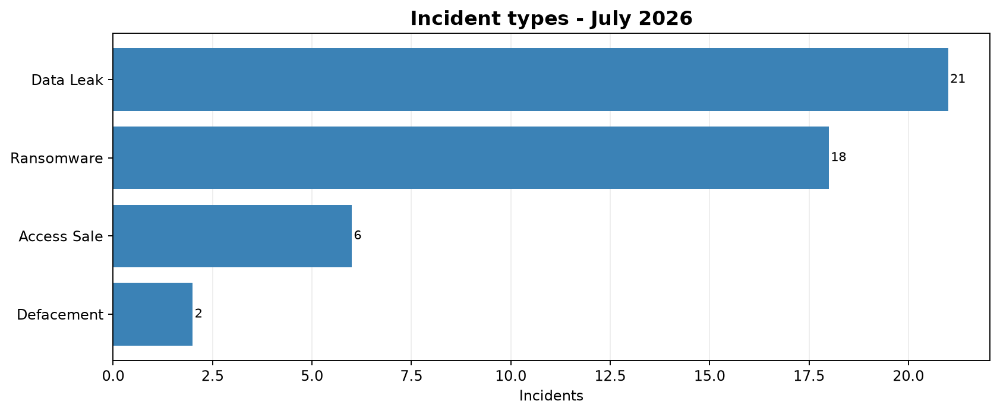
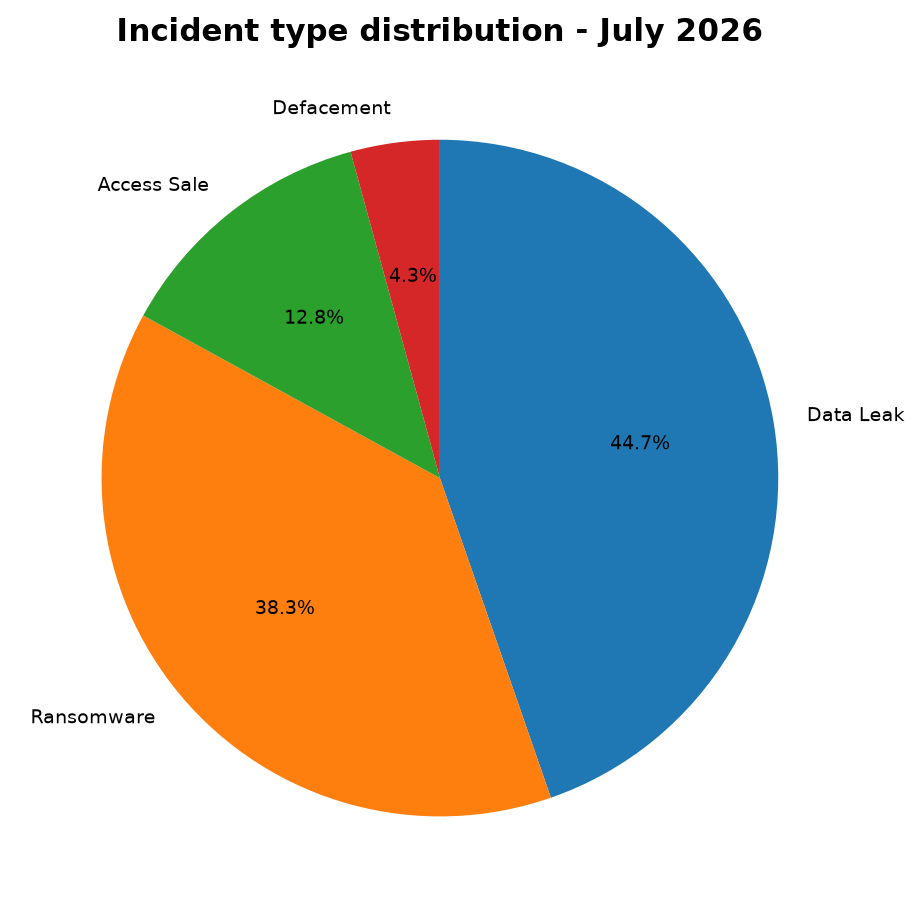
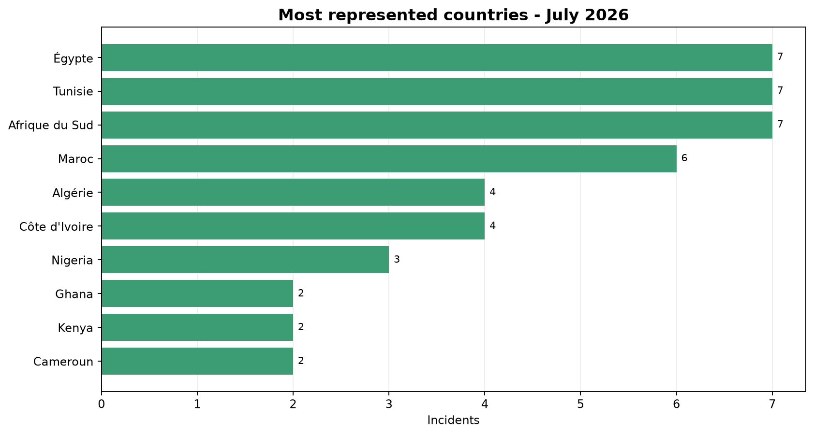
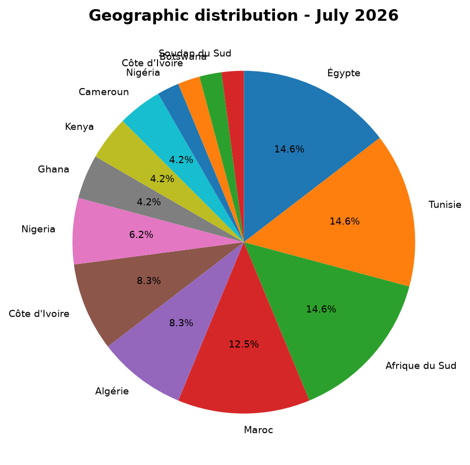
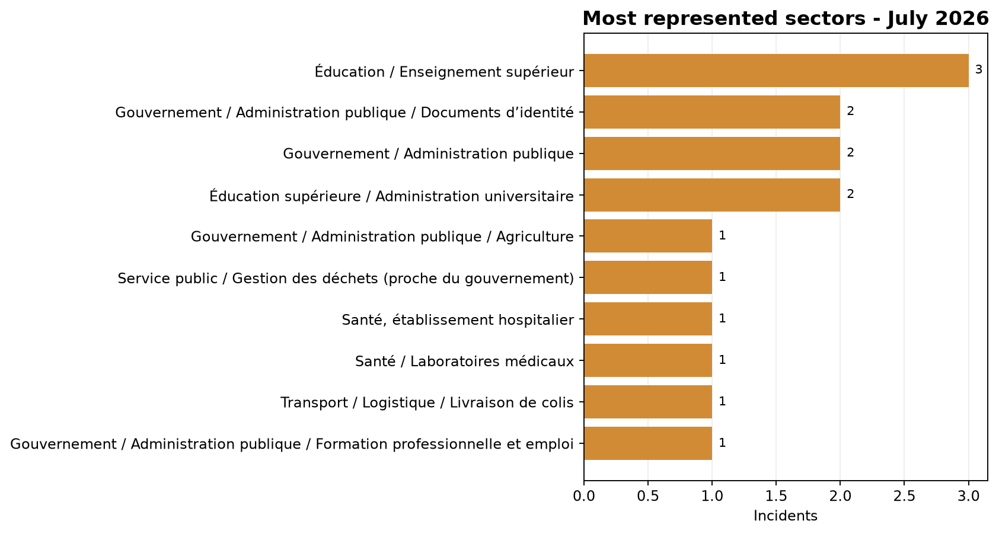
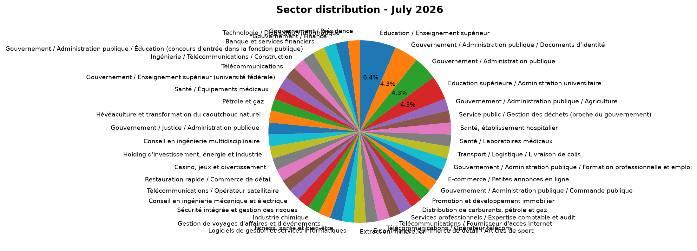
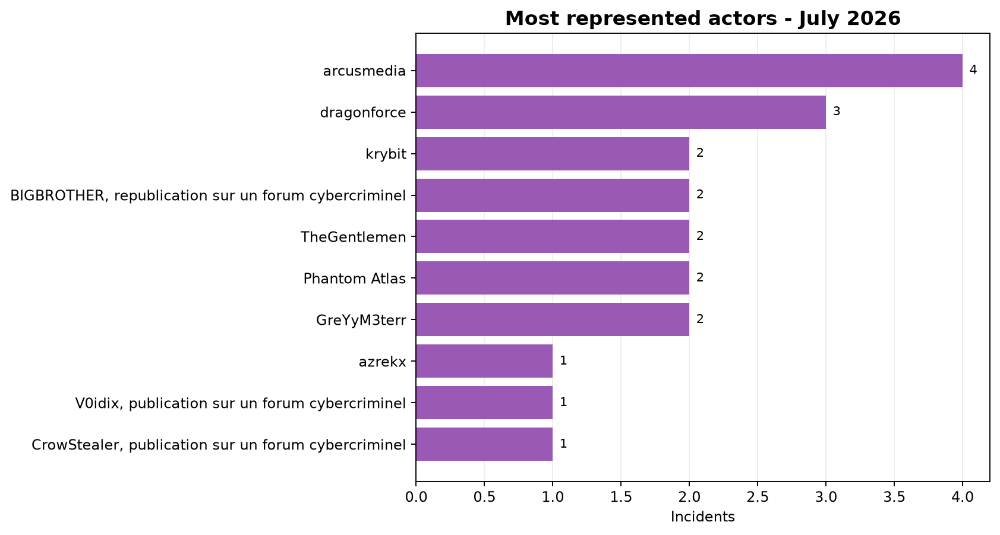
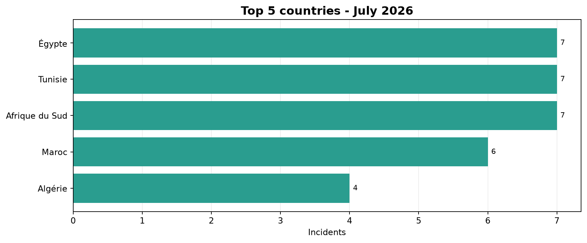

# AFRINTEL CTI report - cyber incidents in Africa (July 2026)

This validated corpus contains **47 incidents or documented cases** first published or first observed by AFRINTEL in July 2026. The month assignment follows the publication or first documented observation date; a compromise date is not inferred when it is unavailable.

## Validated monthly breakdown

| Incident type | Count | Share |
|---|---:|---:|
| Data Leak | 21 | 44.7% |
| Ransomware | 18 | 38.3% |
| Access Sale | 6 | 12.8% |
| Defacement | 2 | 4.3% |
| **Total** | **47** | **100.0%** |

## Countries most represented

| Country | Count |
|---|---:|
| Égypte | 7 |
| Tunisie | 7 |
| Afrique du Sud | 7 |
| Maroc | 6 |
| Algérie | 4 |
| Côte d'Ivoire | 4 |
| Nigeria | 3 |
| Ghana | 2 |
| Kenya | 2 |
| Cameroun | 2 |
| Nigéria / Côte d’Ivoire | 1 |
| Botswana | 1 |
| Soudan du Sud | 1 |

## Actor labels most represented

| Actor label | Count |
|---|---:|
| arcusmedia | 4 |
| dragonforce | 3 |
| krybit | 2 |
| BIGBROTHER, republication sur un forum cybercriminel | 2 |
| TheGentlemen | 2 |
| Phantom Atlas | 2 |
| GreYyM3terr | 2 |
| azrekx | 1 |
| V0idix, publication sur un forum cybercriminel | 1 |
| CrowStealer, publication sur un forum cybercriminel | 1 |

## Sectors most represented

| Sector | Count |
|---|---:|
| Éducation / Enseignement supérieur | 3 |
| Gouvernement / Administration publique / Documents d’identité | 2 |
| Gouvernement / Administration publique | 2 |
| Éducation supérieure / Administration universitaire | 2 |
| Gouvernement / Administration publique / Agriculture | 1 |
| Service public / Gestion des déchets (proche du gouvernement) | 1 |
| Santé, établissement hospitalier | 1 |
| Santé / Laboratoires médicaux | 1 |
| Transport / Logistique / Livraison de colis | 1 |
| Gouvernement / Administration publique / Formation professionnelle et emploi | 1 |

## Methodology

The figures are derived once from `victims_FR.md`, checked against `victims.md`, and reused in the reports, comparisons and STIX bundle. A multi-country incident counts once globally; country occurrences may therefore exceed the global total. The corpus measures documented AFRINTEL visibility, not the actual prevalence of cyberattacks.

[Victim records](./victims.md)

### Visualisations

