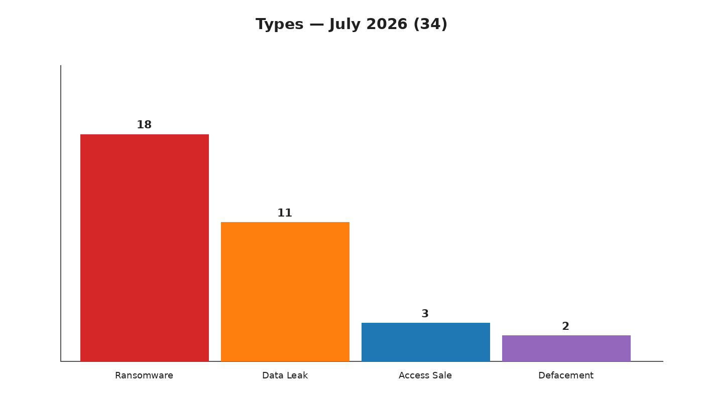
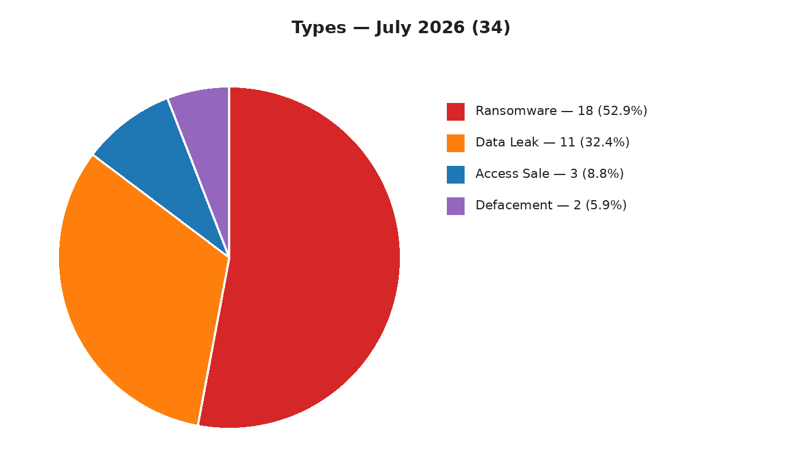
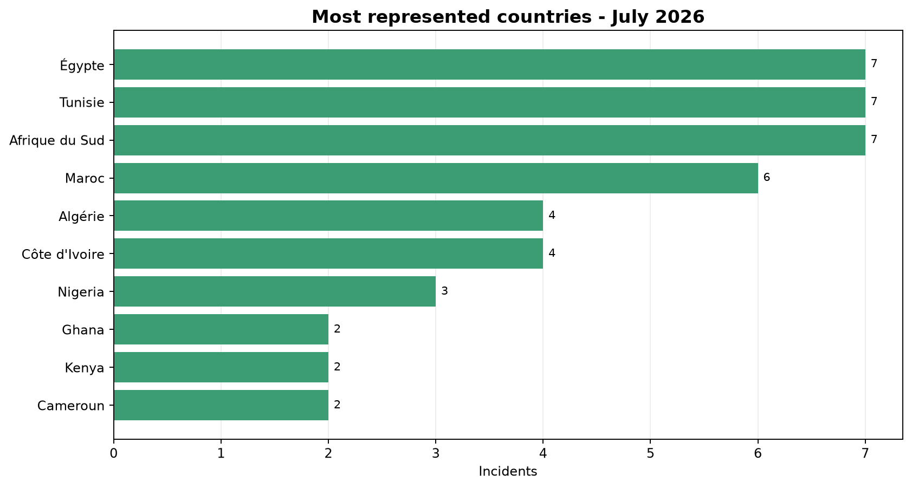
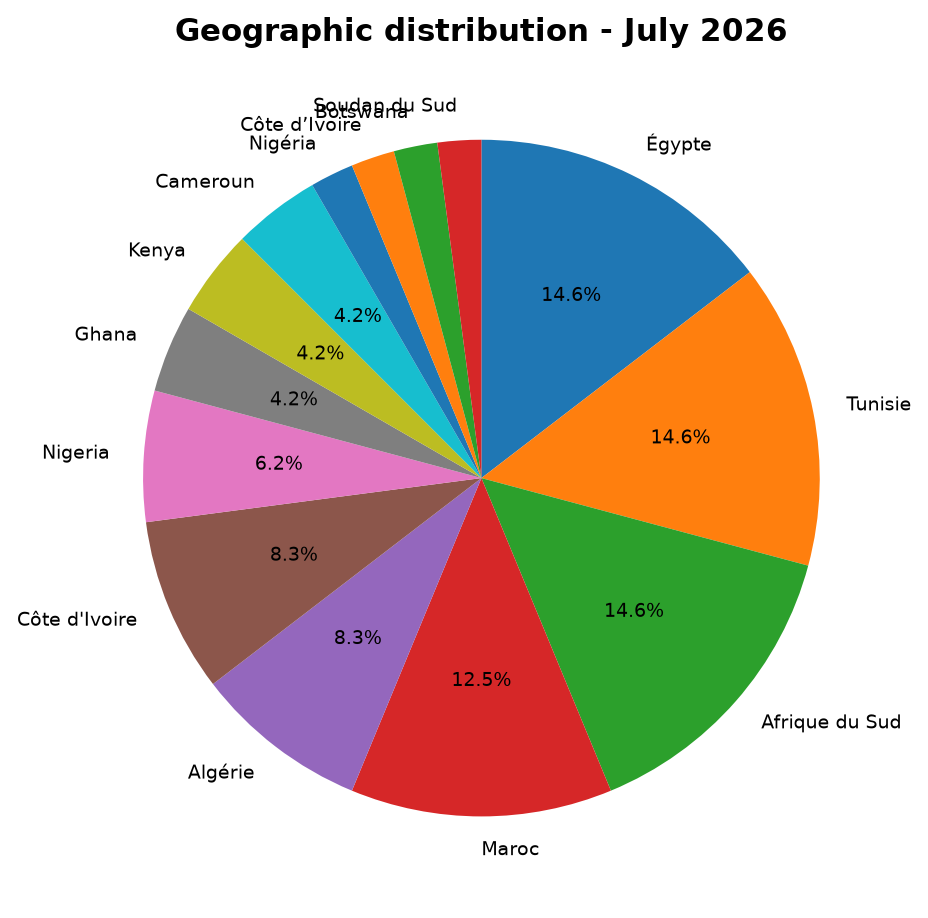
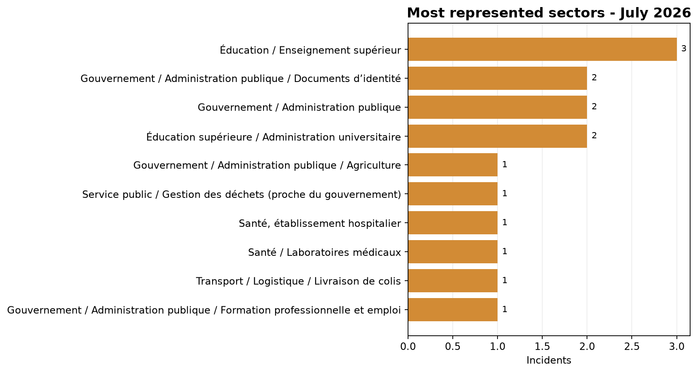
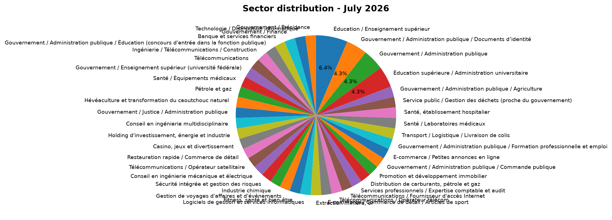
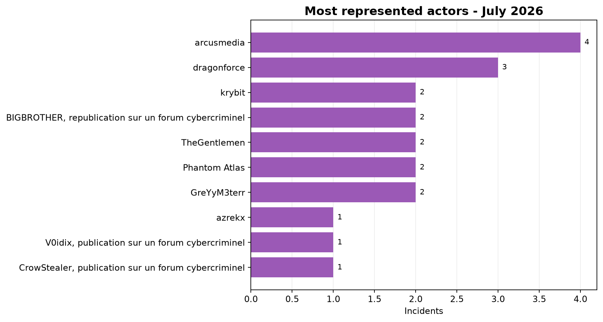
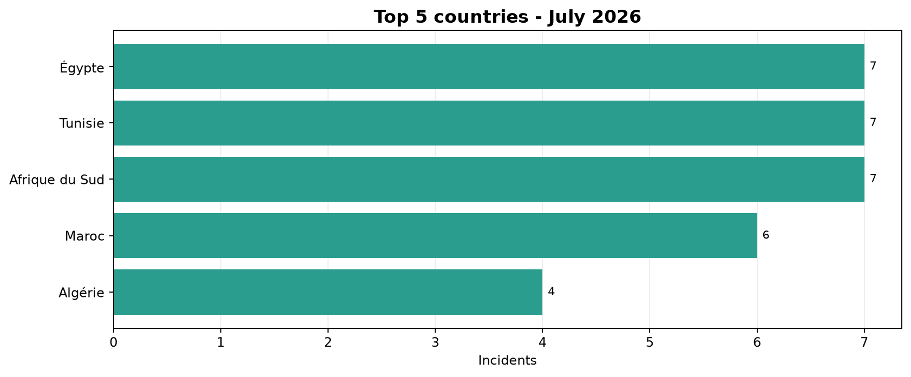

# AFRINTEL CTI report - cyber incidents in Africa (July 2026)

The validated corpus contains **34 victim records** first published or first observed by AFRINTEL in July 2026. This number exactly matches the `####` records in `victims_FR.md` and `victims.md`.

## Validated monthly breakdown

| Incident type | Count | Share |
|---|---:|---:|
| Ransomware | 18 | 52.9% |
| Data Leak | 11 | 32.4% |
| Access Sale | 3 | 8.8% |
| Defacement | 2 | 5.9% |
| **Total victims** | **34** | **100.0%** |

## Geographic distribution

| Country | Records |
|---|---:|
| South Africa | 7 |
| Morocco | 5 |
| Côte d'Ivoire | 4 |
| Tunisia | 4 |
| Egypt | 3 |
| Nigeria | 3 |
| Kenya | 2 |
| Cameroon | 2 |
| Algeria | 1 |
| Ghana | 1 |
| Botswana | 1 |
| South Sudan | 1 |
| **Total** | **34** |

## Most represented actor labels

| Actor label | Records |
|---|---:|
| arcusmedia | 4 |
| dragonforce | 3 |
| krybit | 2 |
| TheGentlemen | 2 |
| anisanas2 | 2 |
| GreYyM3terr | 2 |

All other labels occur once. A displayed publishing pseudonym is not automatically a technical attribution.

## Methodology

Figures are derived from `victims_FR.md`, checked against `victims.md`, and reused in reports, comparisons and STIX bundles. A multi-country incident counts once globally; geographic breakdowns may follow a separate stated convention. The corpus measures documented AFRINTEL visibility, not the actual prevalence of cyberattacks.

[French victim records](./victims_FR.md) · [English victim records](./victims.md)

### Visualisations

