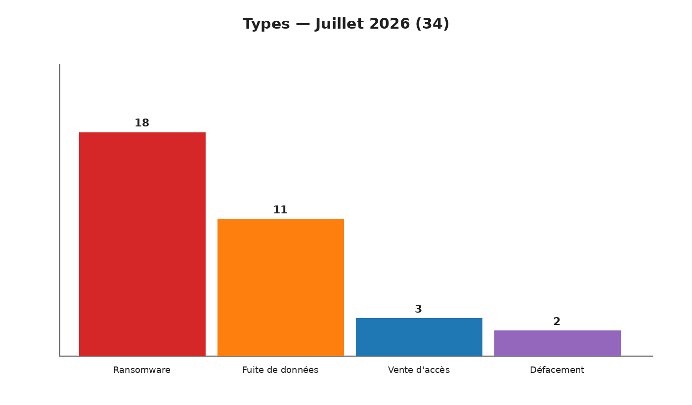
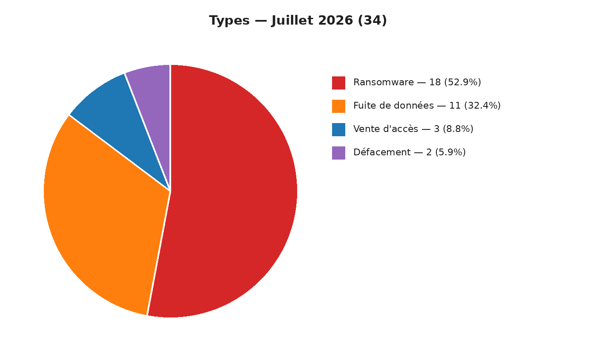
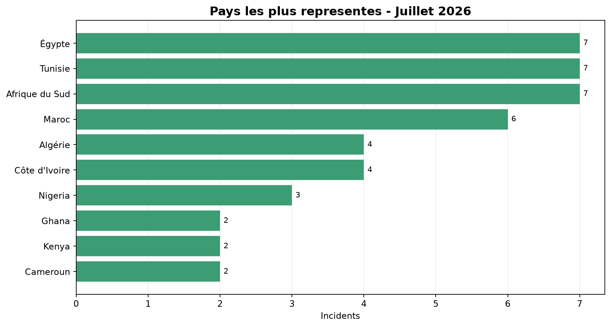
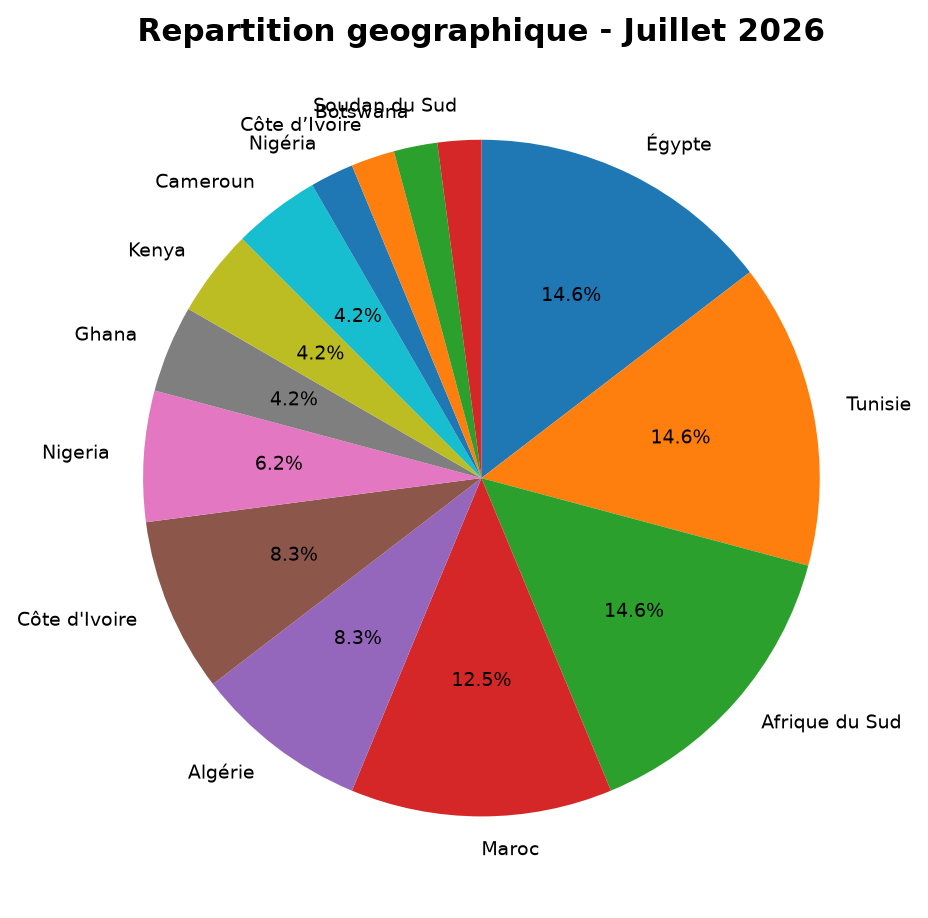
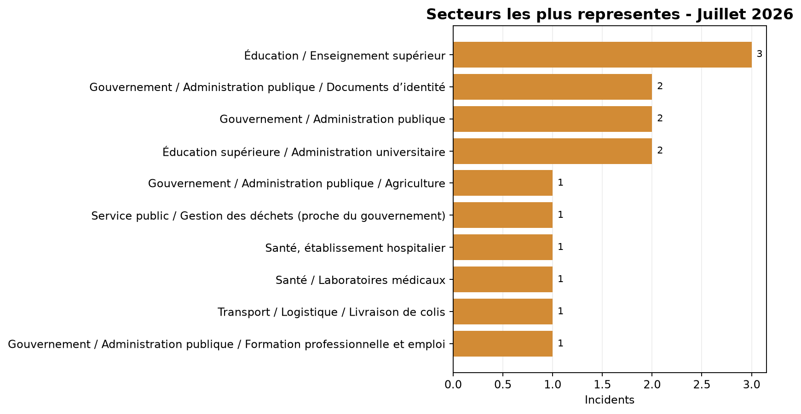
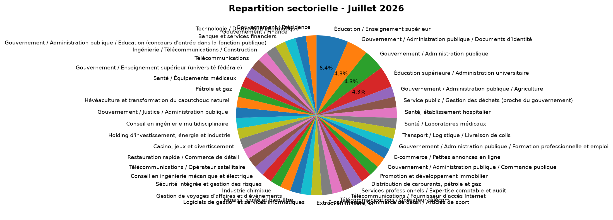
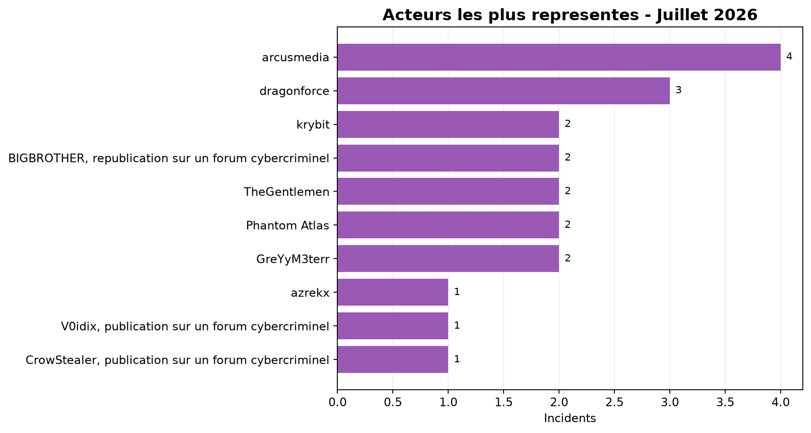
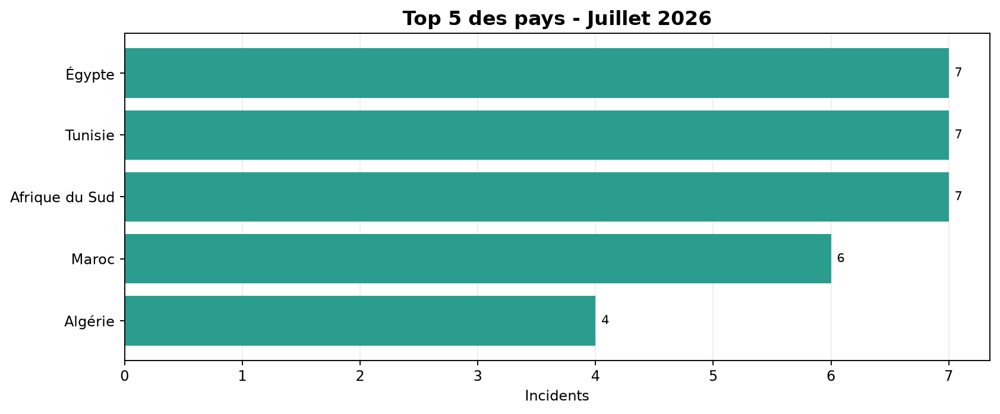

# Rapport CTI AFRINTEL - cyberincidents en Afrique (juillet 2026)

Le corpus validé contient **34 fiches victimes** publiées ou observées pour la première fois par AFRINTEL en juillet 2026. Le nombre correspond exactement aux fiches `####` présentes dans `victims_FR.md` et `victims.md`.

## Ventilation mensuelle validée

| Type d'incident | Nombre | Part |
|---|---:|---:|
| Ransomware | 18 | 52,9 % |
| Fuite de données | 11 | 32,4 % |
| Vente d'accès | 3 | 8,8 % |
| Défacement | 2 | 5,9 % |
| **Total victimes** | **34** | **100,0 %** |

## Répartition géographique

| Pays | Fiches |
|---|---:|
| Afrique du Sud | 7 |
| Maroc | 5 |
| Côte d'Ivoire | 4 |
| Tunisie | 4 |
| Égypte | 3 |
| Nigeria | 3 |
| Kenya | 2 |
| Cameroun | 2 |
| Algérie | 1 |
| Ghana | 1 |
| Botswana | 1 |
| Soudan du Sud | 1 |
| **Total** | **34** |

## Acteurs les plus représentés

| Libellé acteur | Fiches |
|---|---:|
| arcusmedia | 4 |
| dragonforce | 3 |
| krybit | 2 |
| TheGentlemen | 2 |
| anisanas2 | 2 |
| GreYyM3terr | 2 |

Les autres libellés apparaissent une fois chacun. Un pseudonyme de publication ne constitue pas automatiquement une attribution technique.

## Méthodologie

Les chiffres sont calculés depuis `victims_FR.md`, contrôlés contre `victims.md`, puis réutilisés dans les rapports, comparaisons et bundles STIX. Un incident multi-pays compte une fois au total global ; les ventilations géographiques peuvent donc suivre une convention distincte. Le corpus mesure la visibilité documentée par AFRINTEL, pas la prévalence réelle des cyberattaques.

[Fiches victimes en français](./victims_FR.md) · [Fiches victimes en anglais](./victims.md)

### Visualisations

