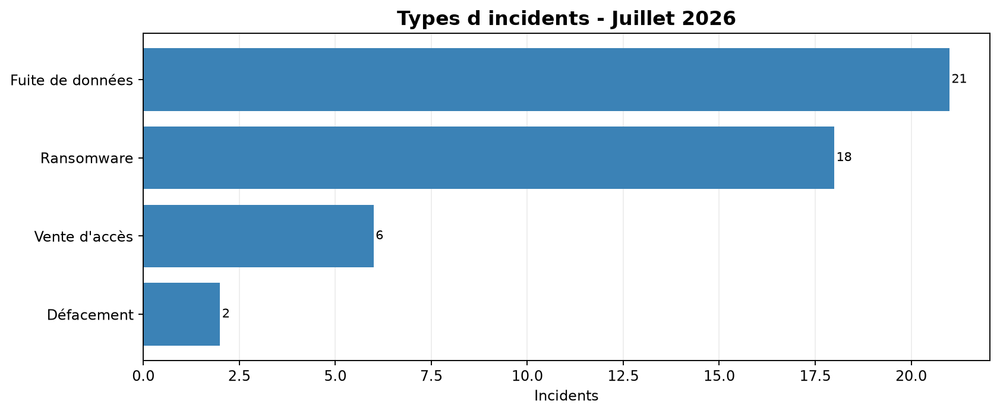
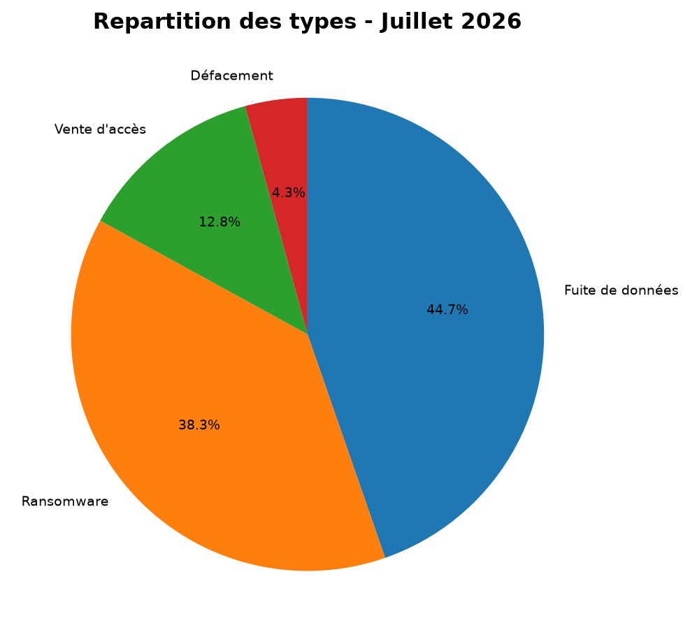
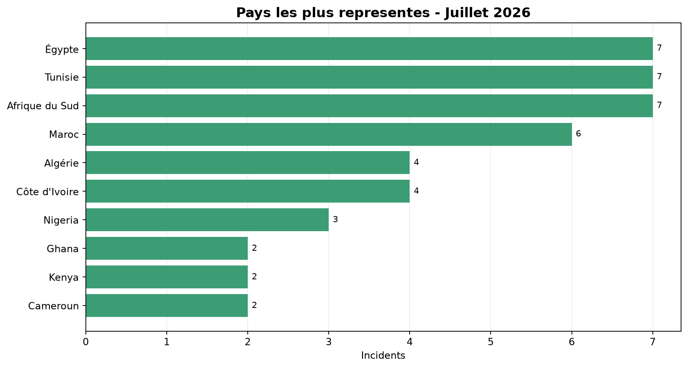
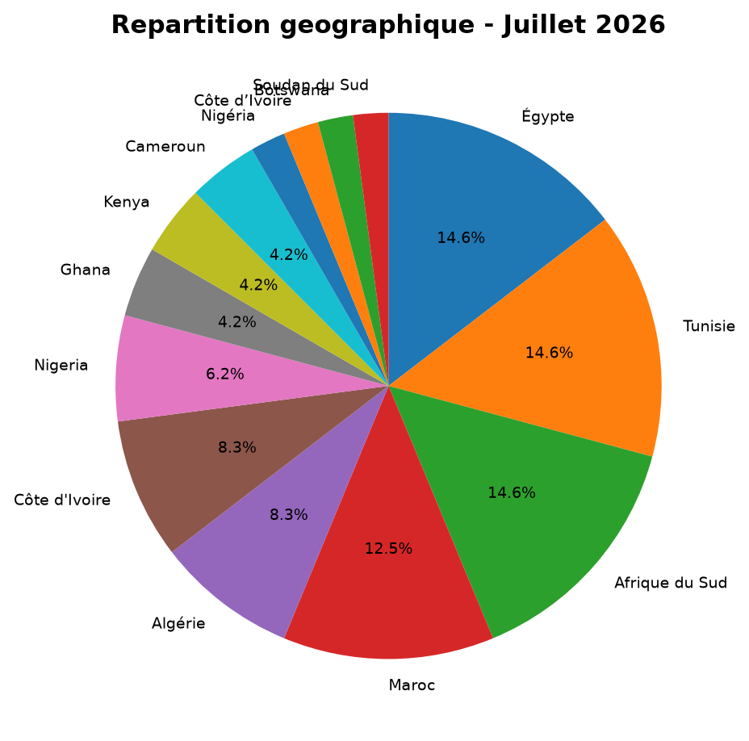
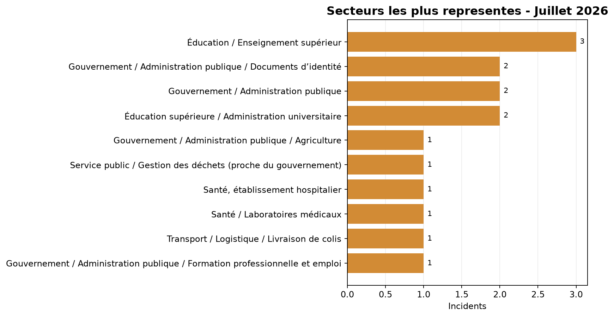
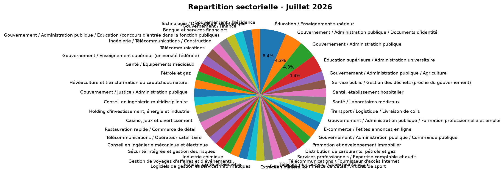
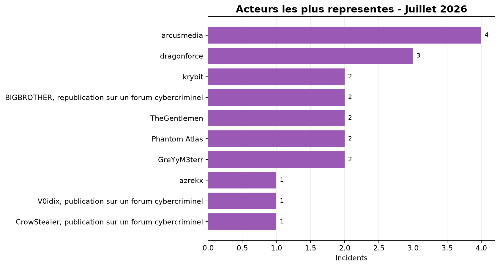
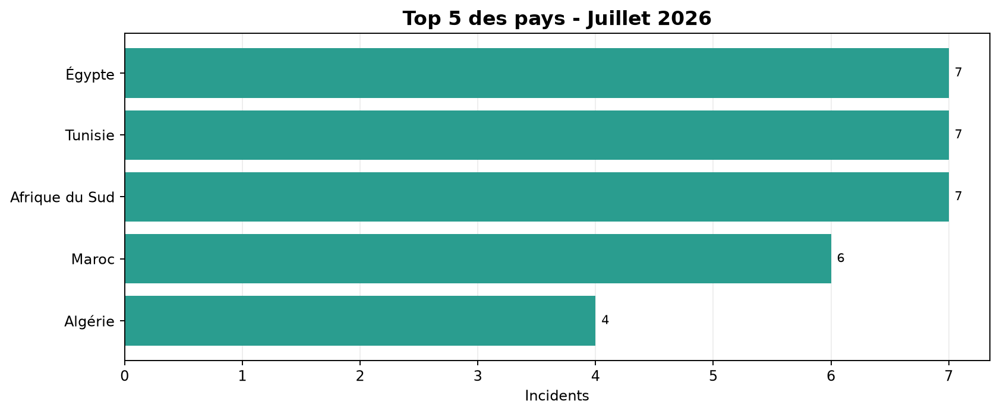

# Rapport CTI AFRINTEL - cyberincidents en Afrique (juillet 2026)

Ce corpus validé contient **47 incidents ou cas documentés** publiés pour la première fois ou observés pour la première fois par AFRINTEL en juillet 2026. Le rattachement mensuel suit la date de publication ou de première observation documentée ; aucune date de compromission n est déduite lorsqu elle est indisponible.

## Ventilation mensuelle validée

| Type d incident | Nombre | Part |
|---|---:|---:|
| Fuite de données | 21 | 44.7% |
| Ransomware | 18 | 38.3% |
| Vente d'accès | 6 | 12.8% |
| Défacement | 2 | 4.3% |
| **Total** | **47** | **100.0%** |

## Pays les plus représentés

| Pays | Nombre |
|---|---:|
| Égypte | 7 |
| Tunisie | 7 |
| Afrique du Sud | 7 |
| Maroc | 6 |
| Algérie | 4 |
| Côte d'Ivoire | 4 |
| Nigeria | 3 |
| Ghana | 2 |
| Kenya | 2 |
| Cameroun | 2 |
| Nigéria / Côte d’Ivoire | 1 |
| Botswana | 1 |
| Soudan du Sud | 1 |

## Acteurs les plus représentés

| Libellé acteur | Nombre |
|---|---:|
| arcusmedia | 4 |
| dragonforce | 3 |
| krybit | 2 |
| BIGBROTHER, republication sur un forum cybercriminel | 2 |
| TheGentlemen | 2 |
| Phantom Atlas | 2 |
| GreYyM3terr | 2 |
| azrekx | 1 |
| V0idix, publication sur un forum cybercriminel | 1 |
| CrowStealer, publication sur un forum cybercriminel | 1 |

## Secteurs les plus représentés

| Secteur | Nombre |
|---|---:|
| Éducation / Enseignement supérieur | 3 |
| Gouvernement / Administration publique / Documents d’identité | 2 |
| Gouvernement / Administration publique | 2 |
| Éducation supérieure / Administration universitaire | 2 |
| Gouvernement / Administration publique / Agriculture | 1 |
| Service public / Gestion des déchets (proche du gouvernement) | 1 |
| Santé, établissement hospitalier | 1 |
| Santé / Laboratoires médicaux | 1 |
| Transport / Logistique / Livraison de colis | 1 |
| Gouvernement / Administration publique / Formation professionnelle et emploi | 1 |

## Méthodologie

Les chiffres sont calculés une seule fois depuis `victims_FR.md`, contrôlés contre `victims.md`, puis réutilisés dans les rapports, comparaisons et bundles STIX. Un incident multi-pays compte une fois au total ; les occurrences par pays peuvent donc dépasser le total global. Le corpus mesure la visibilité documentée par AFRINTEL, pas la prévalence réelle des cyberattaques.

[Victim records](./victims_FR.md)

### Visualisations

