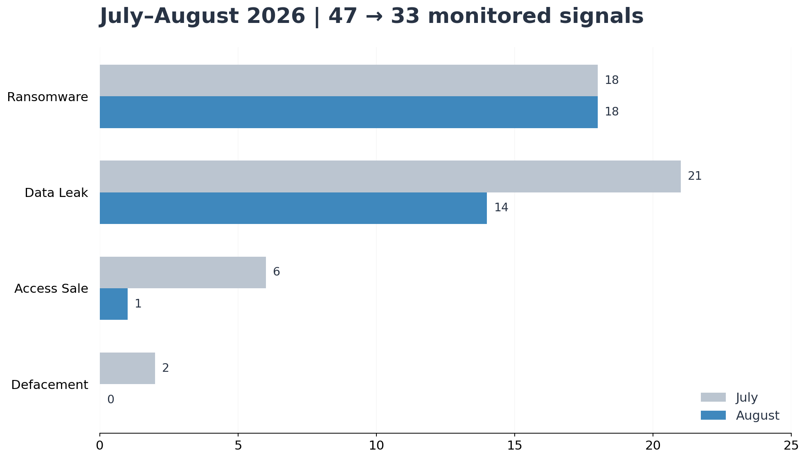
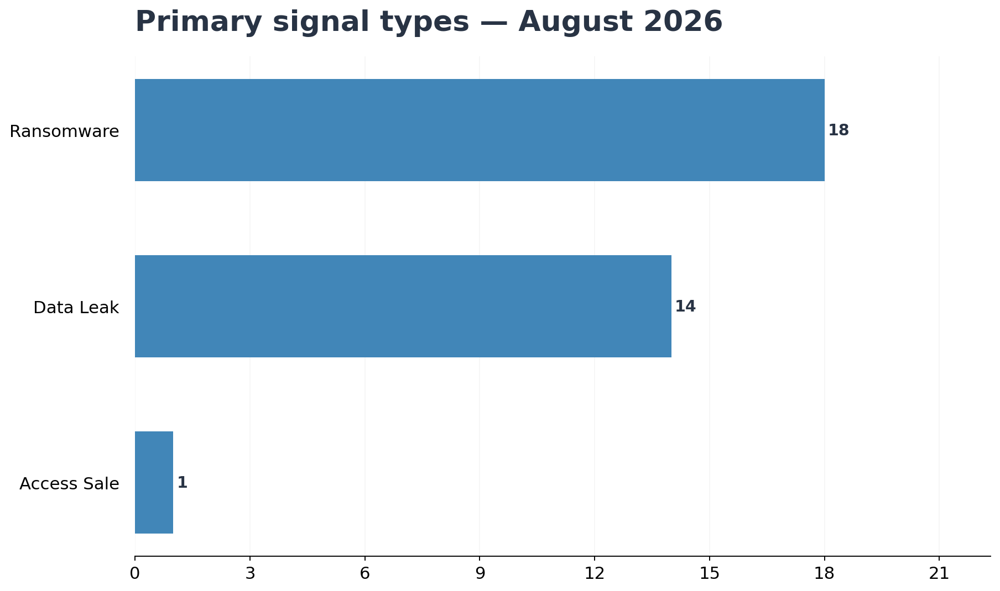
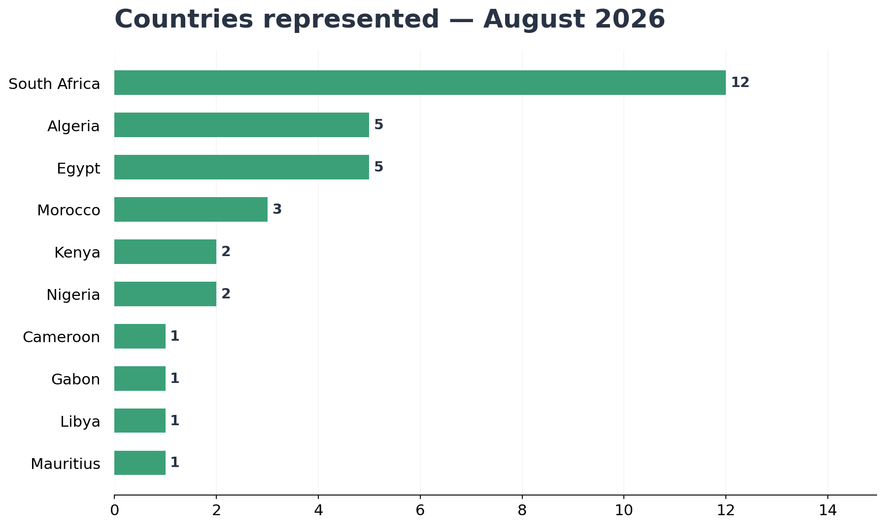
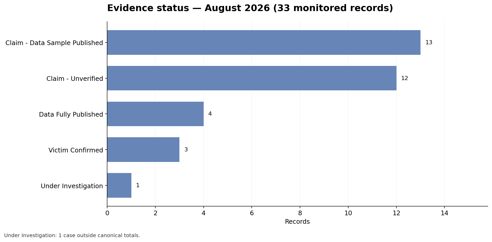
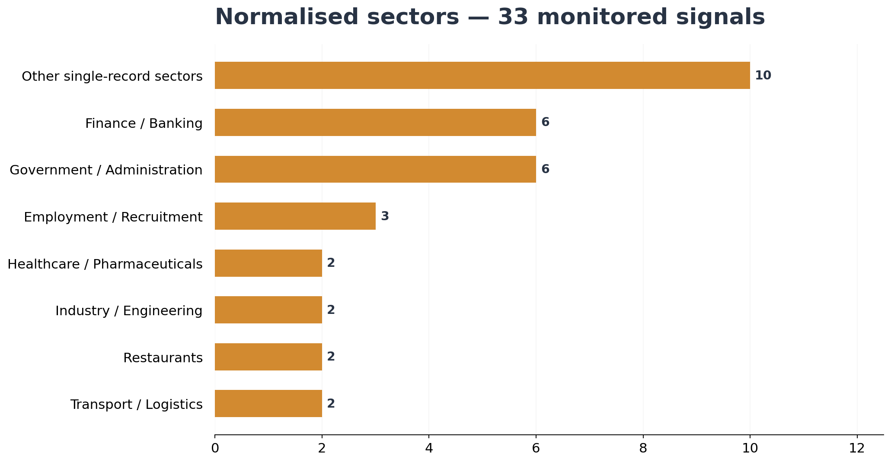
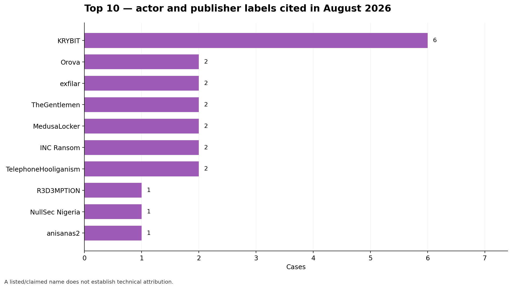

# AFRINTEL - Monthly Cyber Threat Intelligence Report
## Cyber threats across Africa | August 2026

👉🏾 [Version française](./README_FR.md) · [French victim records](./victims_FR.md) · [English victim records](./victims.md) · [Statistics JSON](./STATISTIQUES_2026-08.json)

**Period covered:** 1–31 August 2026  
**Scope:** monitoring of 54 African countries; 10 countries represented in the monthly corpus  
**Audience:** executives, CISOs, CIOs, risk leaders, CERTs and CTI/SOC analysts  
**Collection sources:** ransomware-group disclosure sites on the Dark Web, underground forums, Dark Web and Deep Web leak and data-sale locations, available samples, organisational statements and independent public corroboration.

> **Reliability note.** A criminal-group victim listing is an **observed claim**, not automatic evidence of intrusion. Reviewed datasets may support a connection to an organisation without proving the technical source. Official confirmations are explicitly identified. These figures measure **cases documented by AFRINTEL**, not all cyberattacks that occurred in Africa. Raw personal data, credentials and secrets are not reproduced in this report.

---

## 1. Executive summary - what decision-makers should know

In August 2026, AFRINTEL documented **33 signals in 10 African countries**: **18 ransomware-related records (54.5%)**, **14 data-leak records (42.4%)** and **one access-sale claim (3.0%)**. These are documented **claims, disclosures and acknowledged events**, not 33 confirmed intrusions. Each record separately describes the evidence and confidence level.

**South Africa (12)** leads the corpus, followed by **Egypt (5)** and **Algeria (5)**. This reflects source coverage and visibility, not national cybersecurity rankings. Reviewed datasets concern identity, administration, finance and recruitment information, potentially enabling fraud, impersonation and targeted phishing.

**Qualification note:** the **Yalidine** listing dated **20 August 2026** is included as a **signal requiring verification**, classified `Under Investigation` with `Low` confidence. Sample provenance is unverified. Its AFRINTEL discovery date is aligned with its publication date **for monthly recordkeeping only** and does not independently prove contemporaneous collection. No public statement specifically addressing the August 2026 allegation was found in research conducted on 5 November 2026. Yalidine's reported December 2025 denial concerns a separate claim and does not resolve the 2026 case.

**For leaders:** a criminal claim should trigger a proportionate verification process, not an automatic breach conclusion. Sensitive-data inventories, access reviews, tested backups and contextual monitoring reduce exposure.

### 1.1 Comparison with July 2026 - documented signals

Both months use a **documented signal** as the unit of analysis, with evidence quality recorded separately. July contains **47 records**, August **33**. This measures AFRINTEL's **documented coverage**, not the real-world incidence of cyberattacks.

| Indicator | July 2026 | August 2026 | Change |
|---|---:|---:|---:|
| **Total records** | **47** | **33** | **−14 (−29.8%)** |
| Ransomware | 18 | 18 | 0 (stable) |
| Data Leak | 21 | 14 | −7 (−33.3%) |
| Access Sale | 6 | 1 | −5 (−83.3%) |
| Defacement | 2 | 0 | −2 (−100%) |

### 1.2 Counting rule and alignment with September

| Metric | Value | Meaning |
|---|---:|---|
| August monitored signals | **33** | Observed claims, disclosures and victim-confirmed events, with separate evidence labels |
| Included cases under investigation | **1** | Yalidine: source attribution not corroborated |
| August baseline for September comparison | **33** | 18 ransomware, 14 data leaks, one access sale |

An under-investigation post is **not erased simply because it remains unconfirmed**. A counted signal does **not mean a confirmed breach**. Repeated postings about the same event are consolidated.

## 2. Scope, sources, dates and verification limits

AFRINTEL monitors ransomware disclosure sites, underground forums, data-leak or sale venues, available samples, official statements and public corroboration sources. Monitoring spans 54 African countries; **10 countries appear in the 33 documented records**. The absence of a reported case is not evidence that no incident occurred.

**Four dates must be kept distinct:** the incident date (when established), the **original publication date**, the **AFRINTEL discovery date**, and the **last documented verification date**. Monthly allocation uses a documented publication or event date, including retrospective additions. For example, the grouped publication regarding **six Egyptian universities** dates from August 21 but its case file records AFRINTEL integration on November 4; **Cartrack** publicly reported an August event, and AFRINTEL integrated the record in September. Neither discovery date establishes the date of initial compromise.

A record may involve several organisations or countries: **the single publication concerning six universities is counted as one grouped case**, in accordance with its case-file counting decision. Reposts and follow-on updates must not generate extra records without a separate event.

**Evidence layers:** observed post, sample actually reviewed, documentary corroboration, explicit victim or authority acknowledgement, and unknown technical circumstances. A posting is not proof of encryption; a coherent sample does not automatically prove its technical origin or acquisition date. Confidence applies to specific findings, not to every claim made by the publisher.

**Limit of this edition:** sample-level measurements and technical details are **taken from the analyses recorded in the victim case files**. The underlying clandestine archives, personal records and organisation logs **were not re-analysed** to produce this revised report. The 33 bilingual case records, base classifications and their totals were cross-checked. A documentary review does not replace DFIR, an official acknowledgement or full authenticity verification.

[French case records](./victims_FR.md) · [English case records](./victims.md) · [Reference statistics](./STATISTIQUES_2026-08.json)

## 3. Quantitative overview

### 3.1 Primary signal types - 33 records

| Primary type | Records | Share |
|---|---:|---:|
| **Ransomware** | **18** | **54.5%** |
| **Data Leak** | **14** | **42.4%** |
| **Access Sale** | **1** | **3.0%** |
| **Total** | **33** | **100%** |

Not every ransomware listing establishes encryption. A forum access-sale offer does not establish that the advertised access works.

### 3.2 Geographic distribution - 33 records

| Country | Records | Share |
|---|---:|---:|
| South Africa | 12 | 36.4% |
| Egypt | 5 | 15.2% |
| Algeria | 5 | 15.2% |
| Morocco | 3 | 9.1% |
| Nigeria | 2 | 6.1% |
| Kenya | 2 | 6.1% |
| Mauritius | 1 | 3.0% |
| Cameroon | 1 | 3.0% |
| Gabon | 1 | 3.0% |
| Libya | 1 | 3.0% |
| **Total** | **33** | **100%** |

North Africa accounts for **14** records, Southern Africa **12**, East Africa **3**, West Africa **2** and Central Africa **2**. An absence of observed claims does not imply an absence of incidents.

### 3.3 Evidence status - 33 records

| Status | Count | Interpretation |
|---|---:|---|
| `Claim - Data Sample Published` | 13 | A post with an apparent sample; origin remains a separate question |
| `Claim - Unverified` | 12 | Allegation not independently corroborated |
| `Data Fully Published` | 4 | Claimed complete disclosure; completeness may still be uncertain |
| `Victim Confirmed` | 3 | Event acknowledged, not necessarily technical attribution |
| `Under Investigation` | 1 | Yalidine, included but uncorroborated |
| **Total** | **33** | **Evidence-status distribution, not 33 confirmed breaches** |

### 3.4 Confidence and potential impact

| Confidence level | Records | Potential impact | Records |
|---|---:|---|---:|
| `Very High` | 3 | `Level 4` | 22 |
| `High` | 13 | `Level 3` | 8 |
| `Medium` | 7 | `Level 2` | 3 |
| `Low` | 9 | - | - |
| Composite `High` (corpus) / `Medium` (attribution) | 1 | - | - |
| **Total** | **33** | **Total** | **33** |

Confidence describes the strength of evidence, whereas potential impact describes consequences **if risk materialises**; neither alone proves a breach.

## 4. Analysis by incident type

### 4.1 Ransomware - criminal listings and established incidents

The **18 records** vary significantly in evidential strength. **DC Partner**, **Furniture Bargaining Council** and **Cartrack South Africa** have incidents acknowledged by the organisations concerned. DC Partner confirmed a ransomware incident on August 7 while indicating its services remained operational; linking it to a KRYBIT claim is not the same as forensic attribution. Furniture Bargaining Council acknowledged encryption of certain servers; that statement does not independently establish DeadLock's technical responsibility. Cartrack disclosed ransomware detected on **August 26**, with affected servers isolated and platform restoration reported; its statement does not formally identify the perpetrator.

Other cases, including **ASHA Microfinance Bank**, **The Courier Guy** and **Conseil Gabonais des Chargeurs**, involve structured documentary materials whose review helps assess follow-on fraud, impersonation and reconnaissance risks. For **CCA Bank**, the assessment is based on an Everest posting and a **technical file inventory**, not an exhaustive examination of the underlying source files. Actor-claimed volumes and deadlines are not treated as confirmed.

**Important qualification:** an expired countdown without an accessible release proves neither successful negotiation nor payment, resale or absence of data. Such outcomes remain unknown unless supported by evidence.

### 4.2 Data leaks - identities, administration and service providers

The **13 canonical data-leak records** involve public bodies, higher education, recruitment, financial services, security, telecommunications and online marketplaces. A common secondary risk is that structured records, once published or reused, may enable targeted fraud long after the initial exposure.

Key reviewed cases include **mPowa**, with **2,585 CV records** and **26,675 geolocation points** in a reviewed Firebase export; **SnapStar Talent**, where 300 application records correspond across CSV and TXT files; **RAMED**, with **1,098,685 analysed records** and identity photographs associated with a subset; and one grouped case involving **six Egyptian universities**, comprising **7,762,241 entries across six CSV files** and **5,540 inventoried documents**. These counts describe reviewed material; they do not prove the access method or the number of unique individuals.

The **Moroccan DGSN/DGST** record requires particular caution. A corpus of **70,381 rows** is associated with personnel, while the institutions **denied a direct intrusion** into their systems and indicated a possible third-party source. Data about individuals does not itself confirm compromise of their employer's systems.

### 4.3 Access sale - a risk signal, not evidence of working access

A forum listing advertised **VPN access allegedly associated with Algeria's Ministry of Commerce** for **USD 500**. No operational access or privilege level was demonstrated. An organisation concerned should review remote-access controls and anomalous usage without treating the advertisement alone as proof of intrusion.

## 5. Sectoral exposure - normalised primary classification

One primary sector is assigned to each documented signal. Specialised business labels remain in the case files.

| Code | Primary sector | Records |
|---|---|---:|
| FIN | Finance / Banking | 6 |
| GOV | Government / Administration | 6 |
| EMP | Employment / Recruitment | 3 |
| IND | Industry / Engineering | 2 |
| RES | Restaurants | 2 |
| HEA | Healthcare / Pharmaceuticals | 2 |
| LOG | Transport / Logistics | 2 |
| AGR | Agriculture / Food | 1 |
| ECO | Retail / E-commerce | 1 |
| REA | Real Estate | 1 |
| AUT | Automotive / Mobility | 1 |
| MED | Media / Publishing | 1 |
| LAB | Labour Relations / Work | 1 |
| SPO | Sports / Federations | 1 |
| TOU | Tourism / Travel | 1 |
| TEL | Telecommunications / Media | 1 |
| EDU | Education / University | 1 |
| **Total** | | **33** |

Finance and public administration each account for **six records**, followed by employment/recruitment (**three**). Transport/logistics accounts for **two**, including Yalidine classified `Under Investigation`. Visibility in this corpus is not equivalent to a real-world sector threat rate.

## 6. Threat actors and posting accounts - visibility is not attribution

| Displayed group/account | Records | CTI reading |
|---|---:|---|
| KRYBIT | 6 | Mentions across several countries; technical attribution not established for every case |
| TelephoneHooliganism | 3 | Three Algeria-focused claims, **including uncorroborated Yalidine** |
| Orova | 2 | South Africa and Egypt |
| exfilar | 2 | Firebase-related posting contexts |
| TheGentlemen | 2 | Two victim mentions |
| MedusaLocker | 2 | Two ransomware-context records |
| INC Ransom | 2 | Two corpus references |

**Attribution caution:** these counts refer to **names displayed in the claims or case records**, not proven technical perpetrators. A victim's confirmation does not automatically identify which claimant conducted the activity.

## 7. Trends, limits and collection priorities

**What is established:** within documented signals, ransomware remains at **18**, while data-leak records fall from **21 to 14** and access-sale records from **6 to 1**. These are changes in **documented case coverage and inclusion rules**, **not proof of reduced real-world risk**. All 33 August monitored records remain available for historical traceability; the Yalidine item is not erased.

**What needs further verification:** technical origins of the released files, validity of accounts or document links, the actual completeness of claimed releases, and follow-up disclosures after deadlines. These require documentary corroboration or authorised validation by the relevant organisation. An expired deadline does not prove payment or full release.

**What cannot be inferred:** country and industry counts do not measure national security quality; an organisation name or domain in a sample does not prove access to its primary information system; a claimed total volume is not an independently measured volume. Raw clandestine-source documents do not belong in public appendices.

**Next quality-control action:** apply consistent qualification criteria to July's 47 records, August's 33 documented records and September's case records; keep separate original-publication, discovery, latest-verification and qualification dates before recalculating canonical and historical series.

## 8. MITRE ATT&CK - contextual mapping, not attribution

| Defensive hypothesis | ATT&CK technique | Relevant telemetry | Analytical limit |
|---|---|---|---|
| Abuse of legitimate credentials | `T1078` - Valid Accounts | IAM, SSO, VPN, account logs | Not demonstrated in all cases |
| Exploitation of internet-facing applications | `T1190` - Exploit Public-Facing Application | WAF, application and proxy logs | Initial access generally unknown |
| Access to sensitive repositories | `T1213` - Data from Information Repositories | DLP, database audit, document storage | Access path and privileges require validation |
| Access to data held in cloud storage | `T1530` - Data from Cloud Storage | Cloud audit, storage ACLs, API calls | A misconfiguration does not establish exploitation |
| Encryption for impact | `T1486` - Data Encrypted for Impact | EDR, FIM, file and service logs | Relevant where encryption is acknowledged, e.g. FBC |

These techniques are **defensive detection hypotheses**. This report does not claim to have reconstructed an ATT&CK attack chain from each criminal publication.

## 9. Strategic priorities for executives and security leaders

| Decision | Owner | Expected outcome | Documentary rationale |
|---|---|---|---|
| **P1 - Govern sensitive data** | CISO + business owners + privacy | Inventory of HR, identity and finance repositories and authorised access | Several reviewed samples contain these data classes |
| **P1 - Control exposed services and identities** | CIO + IAM / Cloud teams | MFA for privileged access, reviewed storage policies, unnecessary tokens revoked after validation | Cloud-related records and an access-sale claim |
| **P1 - Protect continuity** | CIO + operations | Real restore test and measured recovery time for a critical service | Acknowledged ransomware incidents and extortion listings |
| **P2 - Manage third parties** | CISO + procurement + legal | Supplier map, reporting clauses and third-party permissions | Potentially exposed customer and supply-chain information |

**Activation rule:** these are cross-cutting priorities. If an organisation establishes that an incident affects it, it should activate its own incident-response workflow based on observed facts, obligations and impact - not on a leak-site mention alone.

## 10. SOC detection scenarios - defensive hypotheses to validate

The rules below are **illustrative behavioural analytics, not August-observed IoCs**. Thresholds must be calibrated to normal workloads, data volumes and business sensitivity.

| Hypothesis / ATT&CK | Minimum telemetry | Suggested correlation | False-positive control and validation |
|---|---|---|---|
| **Unusual bulk export** · T1213 | Database audit, API Gateway, DLP, IAM | Within a rolling 30-minute window: export exceeds the account baseline, touches sensitive tables, then shows atypical outbound transfer | Exclude authorised ETL and backups; replay a controlled test export; measure alert precision |
| **Privileged account outside normal profile** · T1078 | SSO/IdP, VPN, PAM, EDR | New device or network + privileged session + first-time access to sensitive repository within 60 minutes | Check change windows, on-call use and corporate VPN; validate user identity and MFA |
| **Overexposed cloud storage** · T1530 (context) | CloudTrail/equivalent, object ACL, IAM, storage audit | Public policy change followed by unusual reads or repeated downloads | Separate legitimate public assets; verify ACL settings before inferring access |
| **Possible exfiltration staging** · T1560 (hypothesis) | EDR, file audit, proxy, DNS | Unusual compression of business files followed by outbound-traffic spike | Exclude approved archive/maintenance jobs; examine process lineage |
| **Abnormal encryption activity** · T1486 | EDR, FIM, file logs, backups | Rapid file modifications + unusual process lineage or service termination | Test using authorised simulated logs; exclude legitimate encryption/migration |
| **Supplier access outside scope** · T1078 (hypothesis) | PAM, VPN, IAM, application logs | Third-party account + new time/resource + export or permission change | Compare with approved support windows and contractual access |

**SOC workflow:** (1) validate log completeness and user identity; (2) correlate with legitimate change and business activity; (3) assess affected data and possible transfer; (4) escalate according to confirmed risk; (5) record exceptions and tune analytics. Validate controls against authorised data before production rollout.

**ATT&CK scope:** these are **behavioural detection hypotheses**. Acknowledged encryption at Furniture Bargaining Council supports discussing T1486 as a confirmed impact at the reported level, not attributing a specific threat group.

## 11. Seven-, 30- and 90-day action plan

| Horizon | Owner | Action and verifiable output | Outcome measure |
|---|---|---|---|
| **7 days** | CISO + SOC | Inventory privileged access and identify missing critical-asset telemetry | % covered critical identities/assets |
| **7 days** | CIO + backup team | Complete an isolated restore test and record recovery time | Successful restore; measured time |
| **30 days** | Data owners + CIO | Classify sensitive repositories and restrict unjustified exports | % classified and monitored repositories |
| **30 days** | SOC / Detection Engineering | Validate three behavioural rules (exports, identities, encryption) with documented exceptions | Tests passed; false positives; missing telemetry |
| **90 days** | CISO + procurement + legal | Review critical supplier permissions and notification clauses | % critical suppliers reviewed and gaps closed |
| **90 days** | Executive crisis team | Exercise a data-leak and outage scenario with escalation decisions | Documented decisions and tracked actions |

**Management message:** threat monitoring supports **proportionate, measurable verification**. Reliable statistics and protection of affected people reinforce trust; neither calls for indiscriminate crisis declarations.

## 12. Conclusion

August 2026 demonstrates the value of intelligence grounded in **available evidence**, rather than the visibility of criminal group names alone. African organisations should neither ignore leak-site postings nor treat them automatically as proof of compromise. The most effective response is to **qualify each signal**, **establish actual exposure**, **protect people and services**, and **verify the effectiveness of controls**.

**AFRINTEL** - Cyber Threat Intelligence & SOC  
[AFRINTEL on GitHub](https://github.com/Hatchepsoute/AFRINTEL) · [August 2026 victim records](./victims.md)
