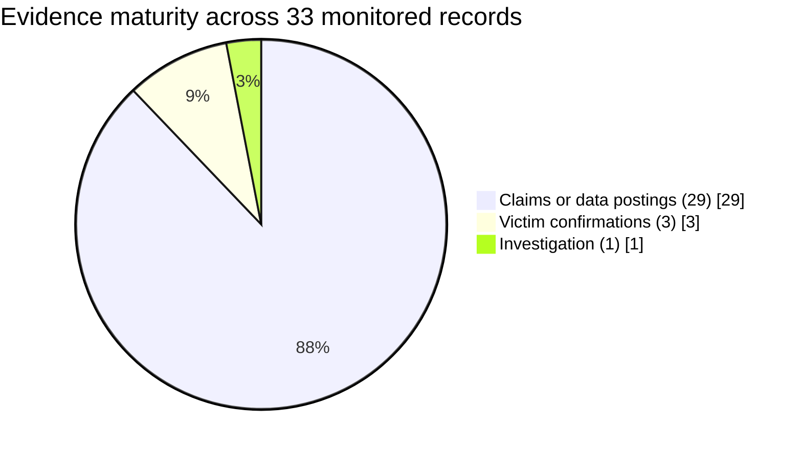

# AFRINTEL - Monthly Cyber Threat Intelligence Report
## Cyber threats across Africa | August 2026

👉🏾 [Version française](./README_FR.md) · [French victim records](./victims_FR.md) · [English victim records](./victims.md) · [Statistics JSON](./STATISTIQUES_2026-08.json)

**Period covered:** 1–31 August 2026  
**Scope:** monitoring of 54 African countries; 10 countries represented in the monthly corpus  
**Audience:** executives, CISOs, CIOs, risk leaders, CERTs and CTI/SOC analysts  
**Collection sources:** ransomware-group disclosure sites on the Dark Web, underground forums, Dark Web and Deep Web leak and data-sale locations, available samples, organisational statements and independent public corroboration.

> **Reliability note.** A criminal-group victim listing is an **observed claim**, not automatic evidence of intrusion. Reviewed datasets may support a connection to an organisation without proving the technical source. Official confirmations are explicitly identified. These figures measure **cases documented by AFRINTEL**, not all cyberattacks that occurred in Africa. Raw personal data, credentials and secrets are not reproduced in this report.

---

## 1. Executive summary - what decision-makers should know

In August 2026, AFRINTEL retained **33 records** in its documentary series, spanning **10 countries**. A review revealed one important qualification: the **Yalidine** record relates to an August 20 posting but was analysed later and is explicitly marked `Under Investigation`, with attribution not established. Under AFRINTEL's quality criteria, **32 cases are therefore included in canonical statistics**, while one remains on record for traceability only.

Of the **32 included cases**, **18 concern ransomware (56.3%)**, **13 concern data leaks (40.6%)**, and **one concerns an access-sale claim (3.1%)**. The historical distribution used in earlier summaries remains **33 records: 18 ransomware, 14 data leaks and one access sale**, because it included the case now under investigation. These two series should not be confused.

**South Africa (12)** leads the included records, followed by **Egypt (5)** and **Algeria (4)**. This concentration reflects the visibility of the corpus and is not a ranking of national cybersecurity quality.

**Three decision-relevant findings:** extortion remains visible on criminal disclosure sites; several reviewed datasets contain identity, HR and financial information; and **victim-confirmed incidents** coexist with claims that lack corroboration. Risk response should therefore depend on **evidence strength**, **data sensitivity** and **actual exposure**, not merely a listed group's name.

### 1.1 July–August 2026 comparison

| Indicator | July 2026 | August 2026 - historical series | Change |
|---|---:|---:|---:|
| **Total records** | **47** | **33** | **-14 (-29.8%)** |
| Ransomware | 18 | 18 | 0 (+0.0%) |
| Data Leak | 21 | 14 | -7 (-33.3%) |
| Access Sale | 6 | 1 | -5 (-83.3%) |
| DDoS | 0 | 0 | 0 (stable) |
| Defacement | 2 | 0 | -2 (-100.0%) |
| Account Takeover | 0 | 0 | 0 (stable) |
| System Intrusion | 0 | 0 | 0 (stable) |
| Malware | 0 | 0 | 0 (stable) |
| Operational Fraud | 0 | 0 | 0 (stable) |

*July source: [AFRINTEL July 2026 report](../07-july/README.md) - 47 cases, including 18 ransomware, 21 data leaks, six access sales and two defacements. For comparability with earlier publications, the table uses the **historical August series of 33 records**. Once the Yalidine investigation record is excluded, August's canonical total is 32. A decrease in documented cases does not, on its own, establish a decrease in real-world compromises.*

### 1.2 Counting and scope-control decision

| Metric | Value | Meaning |
|---|---:|---|
| Records retained for traceability | **33** | All monitored postings, including the case under investigation |
| Included in canonical statistics | **32** | Cases with a defensible organisational or geographic scope |
| Excluded from denominator | **1** | Yalidine: publication observed, sample attribution to the named organisation not established |

**Implication for subsequent comparisons:** the previously published September report used August's **33-record historical baseline**. A comparison explicitly labelled *canonical* should instead use **32**, without silently overwriting earlier published baselines. The same deduplication decision must be applied to every export.

## 2. Methodology and evidence assessment

AFRINTEL monitors ransomware disclosure sites, criminal forums, clandestine publishing and sales venues, disclosed archives, official notices and specialist reporting concerning African organisations and data. Included records are assigned one victim, country and primary incident type. **The posting or first-observation date is not necessarily the date of initial intrusion.** Reposts of the same event should not automatically create additional incidents. The six Egyptian universities associated with one publication and corpus are counted as **one grouped case**, not six independent incidents.

Evidence is differentiated between **observed posting**, **reviewed sample**, **corroborated information**, **victim-confirmed event** and **unknown details**. Where only screenshots or a file inventory were available, that limitation remains explicit. Personal information and secrets are not published in the repository.

Both `victims_FR.md` and `victims.md` contain **33 records in the same chronological order**, following correction of records previously misplaced at the end. Every table and figure is generated from **one counting dataset**, documented in `STATISTIQUES_2026-08.json`.

## 3. Quantitative overview

### 3.1 Primary incident types - 32 canonical cases

| Primary type | Cases | Share |
|---|---:|---:|
| **Ransomware** | **18** | **56.3%** |
| **Data Leak** | **13** | **40.6%** |
| **Access Sale** | **1** | **3.1%** |
| **Total** | **32** | **100%** |

Ransomware records are **signals associated with extortion operations**; not all prove encryption. The access-sale record is an observed forum advertisement; the claimed access and privileges have not been validated.

### 3.2 Geographic distribution - 32 canonical cases

| Country | Cases | Share |
|---|---:|---:|
| South Africa | 12 | 37.5% |
| Egypt | 5 | 15.6% |
| Algeria | 4 | 12.5% |
| Morocco | 3 | 9.4% |
| Nigeria | 2 | 6.2% |
| Kenya | 2 | 6.2% |
| Mauritius | 1 | 3.1% |
| Cameroon | 1 | 3.1% |
| Gabon | 1 | 3.1% |
| Libya | 1 | 3.1% |
| **Total** | **32** | **100%** |

The regional distribution is **North Africa: 13**, **Southern Africa: 12**, **East Africa: 3** (Kenya 2, Mauritius 1), **West Africa: 2** (Nigeria) and **Central Africa: 2** (Cameroon and Gabon). **Total: 32.**

The presence of a country in the dataset does not establish that it has weaker defences. The absence of a documented case is not evidence of an absence of attacks.

### 3.3 Evidence status - all 33 monitored records

| AFRINTEL status | Records | Interpretation |
|---|---:|---|
| `Claim - Data Sample Published` | 13 | Sample or excerpt published; technical source or intrusion not automatically confirmed |
| `Claim - Unverified` | 12 | Observed claim with insufficient evidence to validate the technical scenario |
| `Data Fully Published` | 4 | Data claimed to have been fully released; this status alone does not validate completeness |
| `Victim Confirmed` | 3 | Victim acknowledged an incident; named actor not necessarily technically confirmed |
| `Under Investigation` | 1 | Investigation record excluded from canonical totals |
| **Total monitored** | **33** | **32 included + 1 under review** |

Confidence levels assess **strength of evidence**, not the severity of harm. Impact levels describe **potential consequences**, not verified financial loss or service disruption.

## 4. Analysis by incident type

### 4.1 Ransomware - criminal listings and established incidents

The **18 records** vary significantly in evidential strength. **DC Partner**, **Furniture Bargaining Council** and **Cartrack South Africa** have incidents acknowledged by the organisations concerned. DC Partner confirmed a ransomware incident on August 7 while indicating its services remained operational; linking it to a KRYBIT claim is not the same as forensic attribution. Furniture Bargaining Council acknowledged encryption of certain servers; that statement does not independently establish DeadLock's technical responsibility. Cartrack disclosed ransomware detected on **August 26**, with affected servers isolated and platform restoration reported; its statement does not formally identify the perpetrator.

Other cases, including **ASHA Microfinance Bank**, **The Courier Guy** and **Conseil Gabonais des Chargeurs**, involve structured documentary materials whose review helps assess follow-on fraud, impersonation and reconnaissance risks. For **CCA Bank**, the assessment is based on an Everest posting and a **technical file inventory**, not an exhaustive examination of the underlying source files. Actor-claimed volumes and deadlines are not treated as confirmed.

**Important qualification:** an expired countdown without an accessible release proves neither successful negotiation nor payment, resale or absence of data. Such outcomes remain unknown unless supported by evidence.

### 4.2 Data leaks - identities, administration and service providers

The **13 canonical data-leak records** involve public bodies, higher education, recruitment, financial services, security, telecommunications and online marketplaces. A common secondary risk is that structured records, once published or reused, may enable targeted fraud long after the initial exposure.

Key reviewed cases include **mPowa**, with **2,585 CV records** and **26,675 geolocation points** in a reviewed Firebase export; **SnapStar Talent**, where 300 application records correspond across CSV and TXT files; **RAMED**, with **1,098,685 analysed records** and identity photographs associated with a subset; and one grouped case involving **six Egyptian universities**, comprising **7,762,241 entries across six CSV files** and **5,540 inventoried documents**. These counts describe reviewed material; they do not prove the access method or the number of unique individuals.

The **Moroccan DGSN/DGST** record requires particular caution. A corpus of **70,381 rows** is associated with personnel, while the institutions **denied a direct intrusion** into their systems and indicated a possible third-party source. Data about individuals does not itself confirm compromise of their employer's systems.

### 4.3 Access sale - a risk signal, not evidence of working access

A forum listing advertised **VPN access allegedly associated with Algeria's Ministry of Commerce** for **USD 500**. No operational access or privilege level was demonstrated. An organisation concerned should review remote-access controls and anomalous usage without treating the advertisement alone as proof of intrusion.

## 5. Sectoral exposure - normalised primary classification

Sectors below reflect the primary activity described in each case, with **one sector per included record**. Specialised descriptions remain in the underlying victim records.

| Code | Primary sector | Records |
|---|---|---:|
| FIN | Finance / Banking | 6 |
| GOV | Government / Administration | 6 |
| EMP | Employment / Recruitment | 3 |
| IND | Industry / Engineering | 2 |
| RES | Restaurants | 2 |
| HEA | Healthcare / Pharmaceuticals | 2 |
| AGR | Agriculture / Food | 1 |
| ECO | Retail / E-commerce | 1 |
| REA | Real Estate | 1 |
| AUT | Automotive / Mobility | 1 |
| MED | Media / Publishing | 1 |
| LAB | Labour relations / Work | 1 |
| SPO | Sports / Federations | 1 |
| TOU | Tourism / Travel | 1 |
| LOG | Transport / Logistics | 1 |
| TEL | Telecommunications / Media | 1 |
| EDU | Education / University | 1 |
| **Total** | | **32** |

**Finance/banking and government/administration each account for six cases**, followed by **employment and recruitment with three**. Other categories include industry, healthcare, restaurants, logistics and digital services. This is a corpus distribution, not a ranking of Africa's most vulnerable sectors.

## 6. Threat-actor and publisher landscape

| Actor/publisher name | Associated cases |
|---|---:|
| KRYBIT | 6 |
| Orova | 2 |
| exfilar | 2 |
| TheGentlemen | 2 |
| MedusaLocker | 2 |
| INC Ransom | 2 |
| TelephoneHooliganism | 2 |
| R3D3MPTION | 1 |
| NullSec Nigeria | 1 |
| anisanas2 | 1 |

**KRYBIT appears in six records**, not five: its name is also associated with the **DC Partner** claim, while the organisation's incident confirmation does **not** constitute formal technical attribution to KRYBIT. `exfilar` and `TelephoneHooliganism` are observed forum/publisher labels and do not prove real-world identities or group affiliation. This ranking measures **references and claims in the records**, not independently attributed offensive operations.

**Country-specific reading:** South Africa shows high ransomware-claim visibility and three victim-confirmed cases; Egypt and Morocco include sensitive documentary corpora; Algeria includes several forum postings with at least one weak victim attribution; Gabon, Cameroon, Mauritius, Nigeria and Kenya warrant case-specific monitoring. These observations should not be converted into a national security score.

## 7. Trends and intelligence gaps

**Observed pattern:** extortion postings coexist with structurally credible disclosed datasets, particularly involving identity, financial and professional records. The drop in the historical series **from 47 July records to 33 August records** reflects a change in collected cases, not necessarily in actual attacks.

The main intelligence gaps concern **technical source attribution** (often unknowable without logs or DFIR), **current validity of exposed accounts, links or access claims**, and **completeness of actor-announced volumes**. Resolving them would require incident timelines, authorised technical checks and verifiable complete inventories respectively.

**Scope correction:** Yalidine remains traceable as an August-dated posting, but the reviewed CSVs contain anomalies that prevent reliable attribution to the named organisation. It is excluded from canonical counts and remains under investigation. Similar posting dates or publisher names are insufficient by themselves to link it technically to other Algerian claims.

## 8. MITRE ATT&CK - contextual mapping, not attribution

| Defensive hypothesis | ATT&CK technique | Relevant telemetry | Analytical limit |
|---|---|---|---|
| Abuse of legitimate credentials | `T1078` - Valid Accounts | IAM, SSO, VPN, account logs | Not demonstrated in all cases |
| Exploitation of internet-facing applications | `T1190` - Exploit Public-Facing Application | WAF, application and proxy logs | Initial access generally unknown |
| Access to sensitive repositories | `T1213` - Data from Information Repositories | DLP, database audit, document storage | Access path and privileges require validation |
| Access to data held in cloud storage | `T1530` - Data from Cloud Storage | Cloud audit, storage ACLs, API calls | A misconfiguration does not establish exploitation |
| Encryption for impact | `T1486` - Data Encrypted for Impact | EDR, FIM, file and service logs | Relevant where encryption is acknowledged, e.g. FBC |

These techniques are **defensive detection hypotheses**. This report does not claim to have reconstructed an ATT&CK attack chain from each criminal publication.

## 9. Priority recommendations by organisation type

| Audience | Priority | Concrete measure |
|---|---|---|
| Public bodies | P1 | Inventory identity data and portal access; monitor exports and retain useful audit trails |
| Banking / payments / insurance | P1 | Review third-party access, transaction integrity, privileges and financial-export alerts |
| Recruitment / education | P1 | Assess CV, identity-document and document-link exposure; revoke tokens where exposure is identified |
| All organisations | P1 | Test backup restoration, enforce MFA and monitor privileged and remote access |
| Vendors and contractors | P2 | Review data exchanges, inter-company access rights and notification obligations |

These controls are proportionate to the risks described; they **do not imply all named organisations experienced these behaviours**.

## 10. SOC detection hypotheses and validation

| Scenario | Log source | SOC correlation | Qualification |
|---|---|---|---|
| Unusual large exports | Database audit, API logs, DLP | Export volume deviates from the account's established pattern | Preventive, based on data-exposure risk |
| Suspicious remote session | IdP/SSO, VPN, bastion | Unusual device/location + privileged session + sensitive-repository access | T1078 hypothesis |
| Overscoped document or API access | Cloud IAM, storage audit | Unexpected public read permission + repeated bulk reads | Preventive, relevant to cloud exposure |
| Potential exfiltration preparation | EDR, file servers, proxy | Large archive generation + abnormal outbound traffic + atypical account | Hypothesis; exfiltration not presumed |
| Suspected encryption | EDR, FIM, backup telemetry | Mass file changes + service stoppages + anomalous process behaviour | T1486, relevant to confirmed cases |
| Abuse of a vendor account | IAM, PAM, VPN | Third-party identity + privilege escalation + access beyond agreed scope | Preventive, vendor-dependency risk |

**Validation:** test detections using authorised historical or simulated logs, measure false positives, document business exceptions and only then deploy to production SIEM. No unsupported IoCs have been invented.

## 11. Seven-, 30- and 90-day action plan

| Horizon | Suggested owner | Action and expected evidence | Measure |
|---|---|---|---|
| **7 days** | CISO + SOC | Review administrative accounts, VPN and priority telemetry; record open gaps | % critical access inventoried |
| **7 days** | CIO + backup owner | Complete at least one critical-service restore test and record outcome | Test result and actual recovery time |
| **30 days** | Data owner + IT | Identify PII, HR and finance repositories; restrict bulk exports | % sensitive repositories covered |
| **30 days** | SOC / Detection Engineering | Validate rules for bulk exports, remote access and encryption in a lab | Detection coverage and false positives |
| **90 days** | CISO + procurement + legal | Review data-sharing vendors, notification clauses and supplier accounts | % critical suppliers assessed |
| **90 days** | Executive crisis team | Run a data leak or ransomware tabletop including communications and recovery | Completed exercise and tracked actions |

## 12. Conclusion

August 2026 demonstrates the value of intelligence grounded in **available evidence**, rather than the visibility of criminal group names alone. African organisations should neither ignore leak-site postings nor treat them automatically as proof of compromise. The most effective response is to **qualify each signal**, **establish actual exposure**, **protect people and services**, and **verify the effectiveness of controls**.

**AFRINTEL** - Cyber Threat Intelligence & SOC  
[AFRINTEL on GitHub](https://github.com/Hatchepsoute/AFRINTEL) · [August 2026 victim records](./victims.md)
