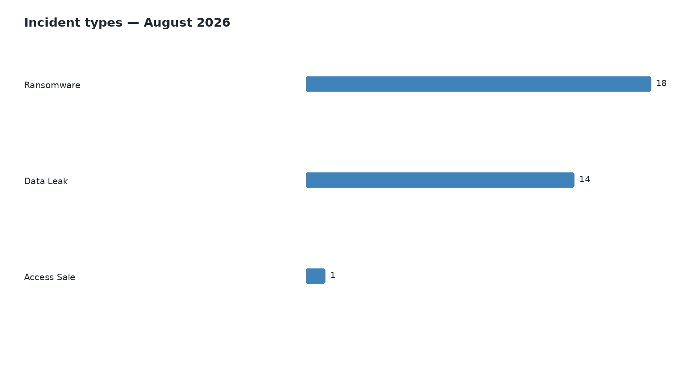
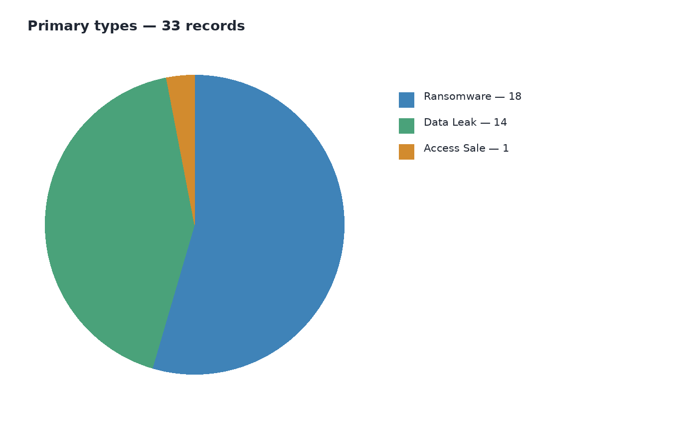
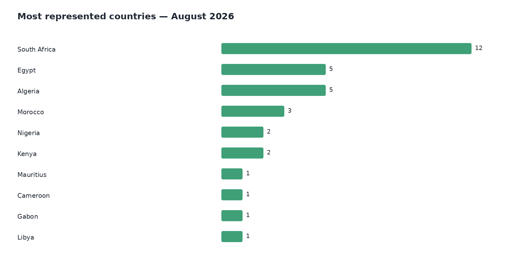
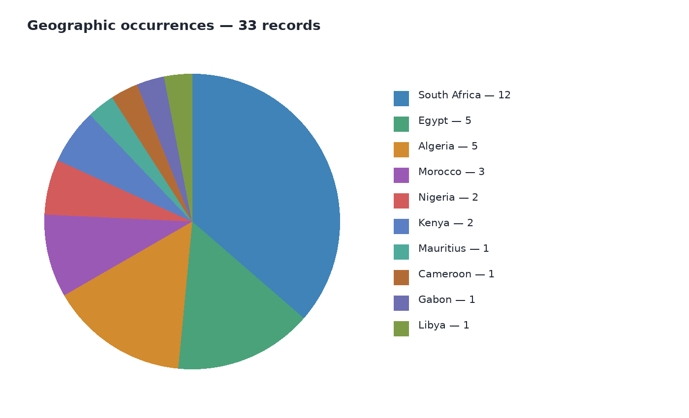
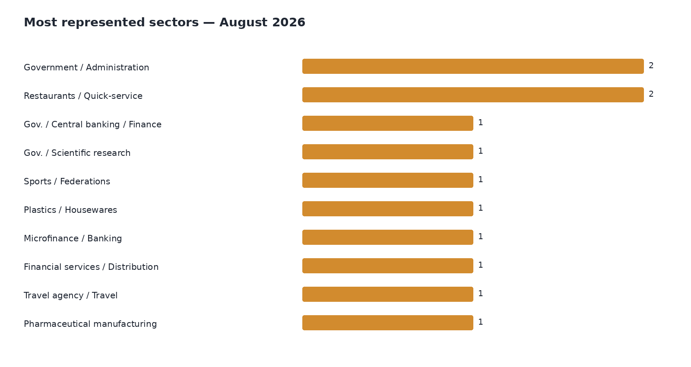
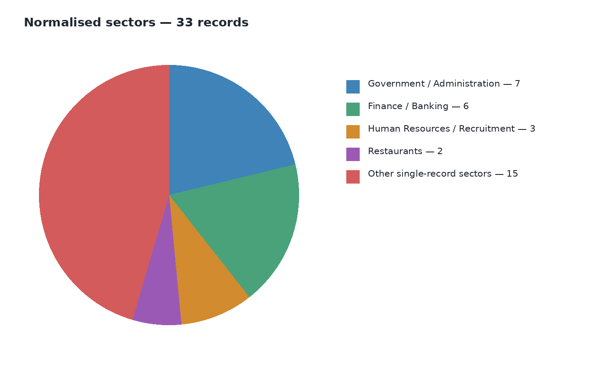
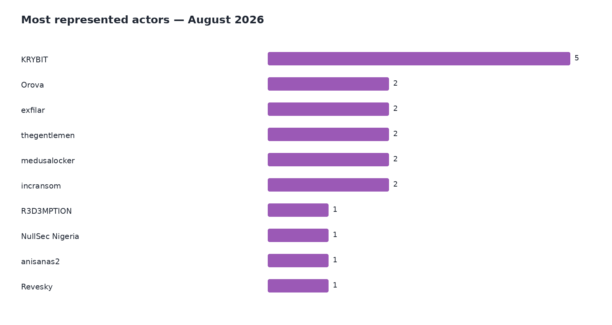
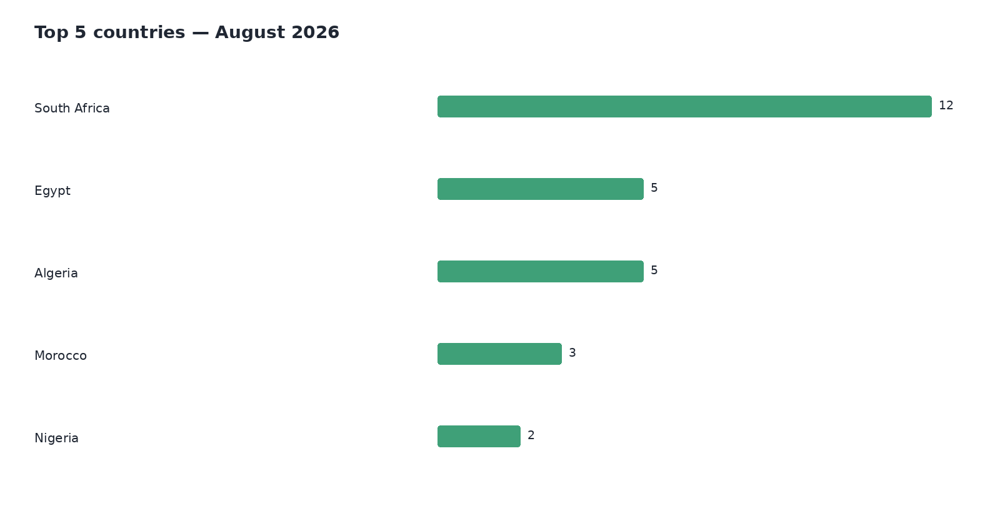

# AFRINTEL CTI report - cyber incidents in Africa (August 2026)

This documented and controlled monthly corpus contains **33 incidents or cases** first published or first observed by AFRINTEL in August 2026. The month assignment follows the publication or first documented observation date; a compromise date is not inferred when it is unavailable.

## Validated monthly breakdown

| Incident type | Count | Share |
|---|---:|---:|
| Ransomware | 18 | 54.5% |
| Data Leak | 14 | 42.4% |
| Access Sale | 1 | 3.0% |
| **Total** | **33** | **100.0%** |

## Countries most represented

| Country | Count |
|---|---:|
| South Africa | 12 |
| Algeria | 5 |
| Egypt | 5 |
| Morocco | 3 |
| Nigeria | 2 |
| Kenya | 2 |
| Mauritius | 1 |
| Cameroon | 1 |
| Gabon | 1 |
| Libya | 1 |

## Actor labels most represented

| Actor label | Count |
|---|---:|
| KRYBIT | 5 |
| Orova | 2 |
| exfilar, cybercriminal-forum post, operator/seller of a mass Firebase-scanning tool | 2 |
| thegentlemen | 2 |
| medusalocker | 2 |
| incransom | 2 |
| R3D3MPTION | 1 |
| NullSec Nigeria (alias "voss", NullsecNg forum account), DarkForums cybercriminal-forum post | 1 |
| anisanas2 | 1 |
| Revesky, cybercriminal-forum post | 1 |

## Sectors most represented

| Sector | Count |
|---|---:|
| Government / Administration | 2 |
| Restaurants / Quick-service restaurants | 2 |
| Government / Central banking / Financial services | 1 |
| Government / Scientific research | 1 |
| Sports / Federations | 1 |
| Plastics manufacturing / Housewares | 1 |
| Microfinance / Banking | 1 |
| Financial services / Payment distribution / Debt counselling support | 1 |
| Travel agency / Leisure and corporate travel | 1 |
| Pharmaceutical manufacturing | 1 |

## Methodology

The figures are derived once from `victims_FR.md`, checked against `victims.md`, and reused in the reports, comparisons and STIX bundle. A multi-country incident counts once globally; country occurrences may therefore exceed the global total. The corpus measures documented AFRINTEL visibility, not the actual prevalence of cyberattacks.

## Status and analytical levels

| AFRINTEL status | Count |
|---|---:|
| Claim - Data Sample Published | 13 |
| Claim - Unverified | 12 |
| Data Fully Published | 4 |
| Victim Confirmed | 3 |
| Under Investigation | 1 |

| Confidence level | Count |
|---|---:|
| High, including 1 composite High/Medium assessment | 14 |
| Low | 9 |
| Medium | 7 |
| Very High | 3 |

| Impact level | Count |
|---|---:|
| Level 4 | 22 |
| Level 3 | 8 |
| Level 2 | 3 |

Statuses describe the evidence available for each record and do not globally confirm the compromises. Confidence applies to the analysed elements and their attribution, while impact describes potential harm; these dimensions are not interchangeable. One record explicitly rates corpus existence and structural consistency as high confidence but technical attribution as medium confidence.

## CTI reading and priorities

South Africa accounts for 12 occurrences, followed by Algeria and Egypt with 5 each. The 14 data-leak records include examined samples involving identity, education, recruitment, financial and administrative data. The 18 ransomware records remain predominantly actor publications; access dates, data completeness, encryption and negotiations are often unknown.

Defensive priorities are protecting exposed identifiers and administrative documents, rotating potentially exposed secrets, monitoring bulk exports and anomalous portal access, and verifying backups and logs for claimed organisations. Actor-reported volumes are not extrapolated to all 33 records.

## Documentary update - Egyptian university portals

The complementary publication posted on August 23, 2026 for the Egyptian university portals has been incorporated into the grouped August 21 record. The associated local inventory contains **5,540 files** and **2,337,401,813 bytes**, including **2,257 PDFs** and **3,117 images**. Integrity review identified **4,675 unique SHA-256 hashes**, **726 duplicate groups** and **865 files duplicated beyond the first occurrence**. Accessible categories include identity documents, certificates, transcripts, results, military cards and photographs. This update does not change the monthly denominator: the case remains one August record. Exhaustive semantic reading of every page and image is not claimed because much of the corpus consists of scanned documents.

[Victim records](./victims.md)

### Visualisations

