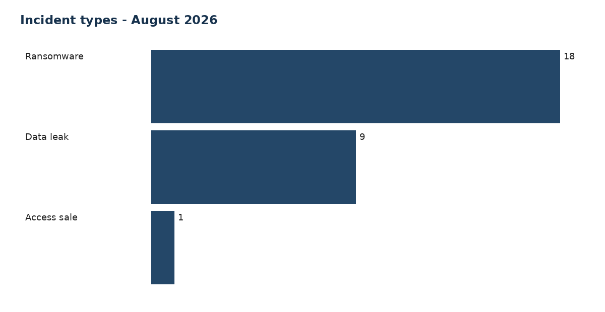
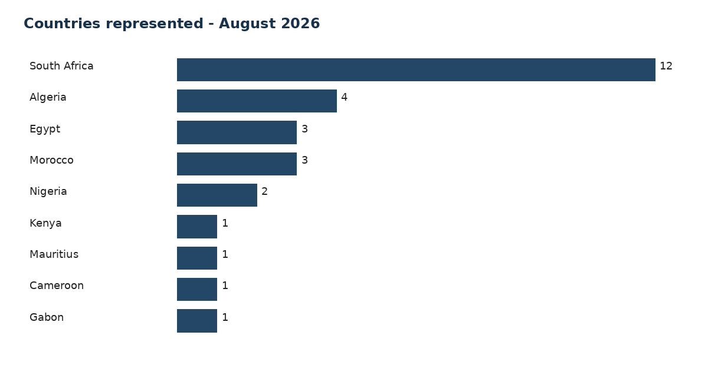
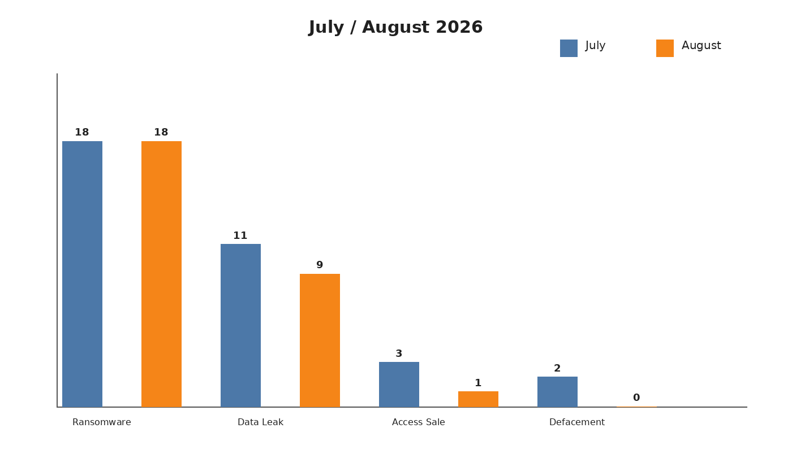
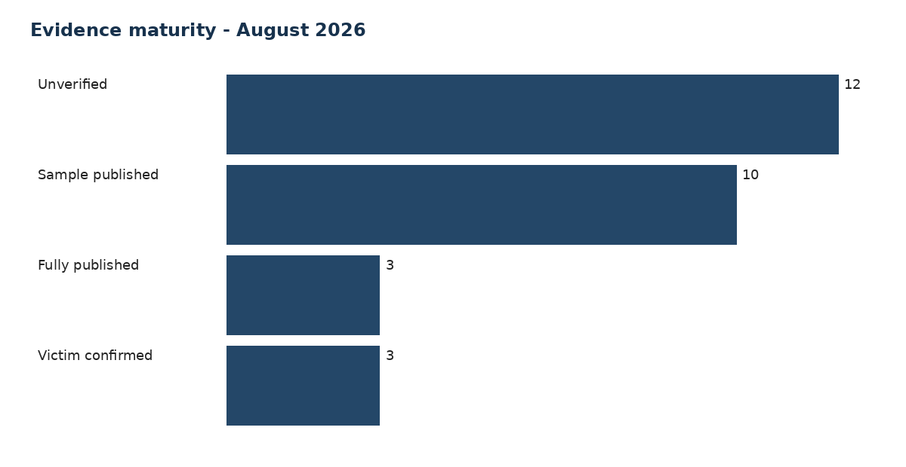
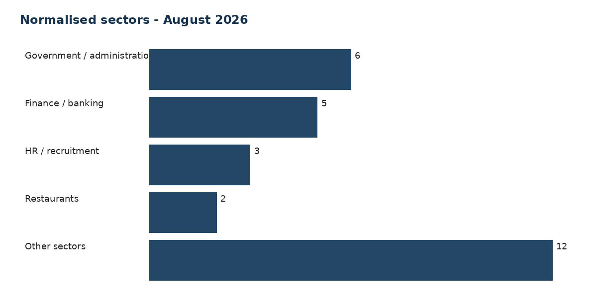
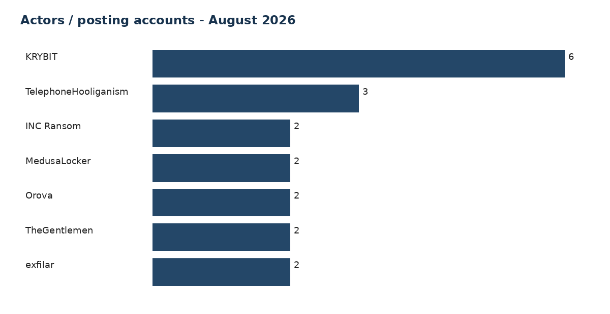

   

# AFRINTEL - Monthly cyber threat intelligence report
## Africa - August 2026 | Risk overview and operational priorities

**Period:** 1-31 August 2026 
**Audience:** CISOs, CIOs, IT operations, SOC/CERT teams, privacy and risk management 
**Sources:** monitored criminal disclosure posts, underground forums, victim case-file sample analysis, publicly documented victim statements and sources referenced in the case files. 
**Related documents:** [French report](./README_FR.md) | [English victim records](./victims.md) | [French victim records](./victims_FR.md)

> **Reliability note:** A criminal claim is evidence that a claim was made, not proof of intrusion. Structured samples may support an association with an organisation without proving how data was obtained. Victim acknowledgments confirm only what was actually disclosed by the organisation. No raw personal data, credentials or secrets are reproduced here.

> **Data-quality note:** The validated `victims_FR.md` / `victims.md` pair contains **28 canonical records**. Yalidine is now counted as `Claim - Data Sample Published` with Low confidence; this status does not confirm a compromise or technical attribution.

## 1. Executive summary

AFRINTEL's August corpus contains **28 monitored signals across 9 African countries**: **18 ransomware-related reports (64.3%)**, **9 data leaks (32.1%)** and **one access-sale claim (3.6%)**. These signals include allegations, reviewed samples and victim-acknowledged incidents. They are **not 28 proven intrusions**.

**South Africa (12)** accounts for the largest number of mentions, followed by **Egypt (5)** and **Algeria (5)**. Finance and government each account for six reported cases in the normalised sector classification, followed by employment and recruitment with three. Counts reflect collection visibility, not comparative national risk rankings.

Three messages matter for security management. First, **DC Partner, Furniture Bargaining Council and Cartrack acknowledged ransomware incidents**, although actor attribution remains separate from those confirmations. Second, documented datasets associated with mPowa, RAMED, Daily Trust, SnapStar Talent and six Egyptian universities create potential identity, fraud and privacy exposure. Third, claims such as those concerning the South African Reserve Bank, Algeria's Ministry of Interior and Yalidine must be investigated without being represented as confirmed breaches.

**Priority actions:** protect sensitive repositories and privileged access, review cloud and remote-access exposure, complete isolated backup-restoration tests and deploy context-driven SOC detections for bulk exports, account abuse and abnormal encryption.

## 2. The numbers and what they mean

### 2.1 Main signal categories

| Type | Published statistical count | Share | Operational meaning |
|---|---:|---:|---|
| Ransomware / extortion | **18** | **54.5%** | Establish whether encryption, exfiltration or service disruption actually occurred. |
| Data leak | **9** | **32.1%** | Establish data provenance, sensitivity and any downstream abuse. |
| Access sale | **1** | **3.6%** | Review remote access, session anomalies and privileged users. |
| **Total** | **28** | **100%** | **Canonical documented corpus, not confirmed attacks.** |

### 2.2 Geographic distribution

| Country | Signals | Share |
|---|---:|---:|
| South Africa | 12 | 42.9% |
| Algeria | 4 | 14.3% |
| Egypt | 3 | 10.7% |
| Morocco | 3 | 10.7% |
| Nigeria | 2 | 7.1% |
| Kenya | 1 | 3.6% |
| Mauritius | 1 | 3.6% |
| Cameroon | 1 | 3.6% |
| Gabon | 1 | 3.6% |
| **Total** | **28** | **100%** |

The detailed records and the statistical corpus cover the same **nine countries**. Libya, the two earlier Egypt records, the earlier Algeria record and the earlier Kenya record remain assigned to their original months and are not counted in August.

### 2.3 July-August trend

| Category | July, published baseline | August, supplied baseline | Change |
|---|---:|---:|---:|
| Ransomware | 18 | 18 | 0 |
| Data leak | 21 | 9 | -12 |
| Access sale | 6 | 1 | -5 |
| Defacement | 2 | 0 | -2 |
| **Total** | **47** | **28** | **-19 (-40.4%)** |

This is a change in **documented corpus coverage**, not a proven reduction in African cyberattacks. It should not be interpreted as a measure of real-world incidence.

### 2.4 Evidence maturity

| Source-statistics label | Count | Interpretation |
|---|---:|---|
| `Claim - Data Sample Published` | 10 | Apparent sample, technical origin may remain unknown. |
| `Claim - Unverified` | 12 | Allegation without sufficient independent support. |
| `Data Fully Published` | 3 | Described as full release; completeness may remain uncertain. |
| `Victim Confirmed` | 3 | Incident acknowledged, technical perpetrator not automatically proven. |
| **Total** | **28** | **Not a count of confirmed intrusions.** |

The preferred AFRINTEL canonical status is `Incident Confirmed by Victim`, whereas the uploaded source uses `Victim Confirmed`. Among the 28 canonical case files, there are 12 unverified claims, 10 sample-published cases, 3 claimed full releases and 3 acknowledgments. Yalidine is included as a sample-published claim with Low confidence and unconfirmed attribution.

## 3. Noteworthy cases for CISOs and CIOs

### 3.1 Acknowledged ransomware - South Africa

**DC Partner** acknowledged a ransomware incident on 7 August and said services remained operational. Its link to KRYBIT is an observed claim, not a forensic attribution. **Furniture Bargaining Council** acknowledged encryption of some servers, while its case-file inventory covers 69 artefacts (about 94.6 MB). The acknowledgement alone does not identify DeadLock as the technical perpetrator. **Cartrack** reported ransomware detected on 26 August, isolation of affected servers and service restoration in five hours. Subsequent reporting referred to personal information potentially accessed or disclosed, making confidentiality review necessary even after service recovery.

**Management lesson:** incident response must track service availability and possible data exposure in parallel. Restoring an application does not establish that exfiltration did not occur.

### 3.2 Finance - fraud and third-party exposure

**ASHA Microfinance Bank (Nigeria)** is linked to a KRYBIT publication. Its reviewed directory contains approximately 1,498 files and 7.15 GB, but 1,101 files consist only of null bytes. The remaining readable material includes finance-related fields; no official confirmation, initial access method or customer count is established. **CCA Bank (Cameroon)** is referenced by Everest alongside a technical inventory of 11,837 files (18.92 GB) plus nested archives. Described material spans credit, KYC/AML, financial operations and technical procedures. The full underlying files were **not exhaustively reviewed**. **SpearFin (Mauritius)** is associated with an INC Ransom claim of 416 GB and previews of investment, identity and fund-administration documents; original files were not available to validate that volume.

If authentic, these materials could support payment diversion, identity fraud, impersonation and secondary targeting of clients or suppliers. Security and finance teams should jointly review changes to bank details, unusual payments and KYC-document handling.

### 3.3 Identity and administration - Morocco, Egypt, South Africa

**RAMED (Morocco)** has 1,098,685 analysed records with identity photographs connected to some entries. Larger totals alleged by an actor have not been validated. **Moroccan DGSN/DGST:** a corpus of 70,381 rows is associated with personnel, but the institutions disputed a direct intrusion and third-party origin or reuse of historical data remains possible. Exposure of information about staff is not proof that their employer's primary systems were breached.

**Six Egyptian public universities** appear in **one grouped canonical case**, not six separate incidents. The case file describes 7,762,241 rows across six CSV files and 5,540 inventoried documents. Duplicated files and unverified provenance mean these counts must not be interpreted as unique individuals or proven direct compromise of official university systems.

**mPowa (South Africa)** involves a historically associated Firebase youth-services dataset with 2,585 CVs, 26,675 geolocation points, 19 platform accounts and three API-key entries. The currently observed content at the historical root domain is unrelated to the service; historical association does not establish the present domain operator. The defensive lesson is to review staging environments and cloud storage policies as rigorously as production.

### 3.4 Recruitment, media and logistics

**SnapStar Talent (Kenya):** 300 aligned application records across a CSV and TXT sample belong to 207 distinct profiles; CV, salary, reference and token-bearing media information may support targeted fraud if valid. The far larger advertised dataset remains unverified. **Daily Trust (Nigeria):** a reviewed workbook has 443 principal entries, with 438 populated new-password fields. Their present validity is unknown. **The Courier Guy (South Africa):** payment-related tables, recipient accounts and contact references present risks of payment redirection, although an actual ransomware intrusion remains unproven from the sample alone.

**Conseil Gabonais des Chargeurs (Gabon):** documents include organisational and directory diagnostic material that could support attacker reconnaissance even where plaintext credentials have not been observed. The source of the documents and precise intrusion path remain unknown.

### 3.5 Claims requiring careful verification - Algeria

An underground seller advertised **VPN access allegedly linked to Algeria's Ministry of Commerce** for USD 500, without demonstrating any working account, access point or privilege level. **Yalidine** was named in a TelephoneHooliganism claim advertising 563,000 records. The 90 CSV rows reviewed by AFRINTEL contain major geographic and relational inconsistencies. It remains `Claim - Data Sample Published` with `Low` confidence and unconfirmed attribution. Neither post should be turned into a confirmed-breach announcement without additional evidence.

## 4. Sectors and posting accounts

The validated corpus contains **government/administration (6)**, **finance/banking (5)**, **employment/recruitment (3)** and **restaurants (2)** as its largest normalised groups. The remaining 12 records are distributed across sectors represented once each.

| Claimed group or account | Mentions | CTI interpretation |
|---|---:|---|
| KRYBIT | 6 | Multiple observed extortion claims, technical attribution not established for every case. |
| TelephoneHooliganism | 3 | Algeria-focused posts, including Yalidine with a published sample. |
| INC Ransom | 2 | Extortion-related mentions. |
| MedusaLocker | 2 | Ransomware-context mentions. |
| Orova | 2 | South Africa and Egypt. |
| TheGentlemen | 2 | Two organisation mentions. |
| exfilar | 2 | Firebase and recruitment-related publications. |

These are **names on posts**, not proven identities of the actual technical operators.

## 5. Practical management guidance

| Business risk | Relevant operational control | Responsible team |
|---|---|---|
| Service outage and encryption | Isolated backups, restoration tests, network segmentation | CIO / IT operations |
| Sensitive customer or staff data | Data inventory, least privilege, export monitoring | CISO / Data owners / DPO |
| Payment and document fraud | Dual confirmation for bank-detail changes and high-risk transactions | Finance / Risk / CISO |
| Public cloud storage or token exposure | ACL/IAM reviews, staging separation, secret rotation after validation | Cloud / AppSec |
| Compromised accounts | Strong MFA, session baselines, device trust | IAM / SOC |
| Leaked internal technical documentation | Reduce shared permissions and monitor third-party access | IT / SOC / Suppliers |

## 6. MITRE ATT&CK-aligned SOC detection hypotheses

These are **preventive behavioural hypotheses**, not observed August attack chains.

| Hypothesis | ATT&CK | Useful telemetry | Example correlation |
|---|---|---|---|
| Unusual export of sensitive datasets | `T1213` | Database audit, DLP, API, IAM | Bulk exports + first-time sensitive repository + abnormal outbound traffic. |
| Legitimate account used outside profile | `T1078` | IdP, SSO, VPN, PAM, EDR | New device + privileged session + unusual data access. |
| Cloud storage access beyond intended scope | `T1530` (context) | Cloud audit, object access, IAM | Public policy change followed by repeated or high-volume reads. |
| Possible exploitation of public applications | `T1190` (hypothesis) | WAF, proxy, application and EDR logs | Unusual requests followed by anomalous app or host activity. |
| Suspicious archive staging | `T1560` | EDR, file audit, proxy | Mass compression of sensitive files followed by atypical outbound traffic. |
| Encryption for impact | `T1486` | EDR, file integrity, service and backup logs | Rapid file modifications or service stopping outside authorised maintenance. |

**SOC workflow:** confirm telemetry completeness, identify the user and asset, rule out authorised maintenance, correlate identity/file/network events, assess actual impact and escalate on evidence. Tune thresholds against legitimate business baselines.

## 7. Seven-, 30- and 90-day action plan

| When | Owner | Action | Evidence of completion |
|---|---|---|---|
| **7 days** | CIO / Operations | Restore one critical application into an isolated environment. | Measured recovery time and documented outcome. |
| **7 days** | CISO / IAM | Review privileged accounts, VPN and vendor access. | Access review and MFA exceptions. |
| **7 days** | SOC | Check critical logging and encryption alert coverage. | Asset coverage and tested alert evidence. |
| **30 days** | CIO / DPO / Business | Inventory customer, identity, HR and finance repositories. | Named owners and classification coverage. |
| **30 days** | Cloud / AppSec | Audit staging storage, public policies and exposed tokens. | Closed gaps with verification. |
| **30 days** | SOC engineering | Test analytics for bulk exports, unusual sessions and encryption. | Precision, exclusions, coverage and missed sources. |
| **90 days** | CISO / Procurement | Review third-party permissions and incident notice obligations. | Supplier review completion and tracked remediation. |
| **90 days** | Executive crisis team | Exercise ransomware plus data-leak response. | Decisions, elapsed times and follow-up actions. |

## 8. Methodology and quality controls

One record represents a documented publication or event. The six Egyptian universities are one grouped publication. Dates refer to documented initial publication or event dates, not inferred compromise dates. Claims, sample reviews, reported full releases and victim acknowledgments are evaluated separately.

The August canonical corpus is now fixed at **28 records**. Its category split is 18 ransomware, nine data leaks and one access sale. The tables and charts must derive exclusively from the validated FR/EN victim pair, without reintroducing the five earlier publications that belong to their original months. July's published 47-record baseline remains a separate historical comparison.

## 9. Conclusion

August shows why intelligence teams must distinguish what criminals **claim**, what analysts **actually examine**, and what organisations **confirm**. The practical priority for African enterprises is protecting people, sensitive information and business continuity while qualifying every signal using proportionate evidence. Effective CTI supports defensible decisions and measurable security improvements, not headline counts alone.

**AFRINTEL - Cyber Threat Intelligence & SOC** 
[AFRINTEL GitHub](https://github.com/Hatchepsoute/AFRINTEL) | [English case records](./victims.md) | [French case records](./victims_FR.md)
