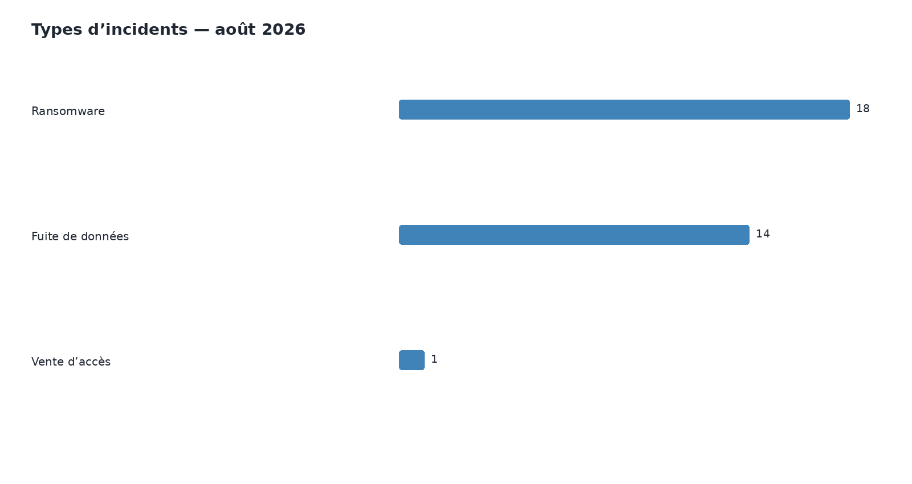
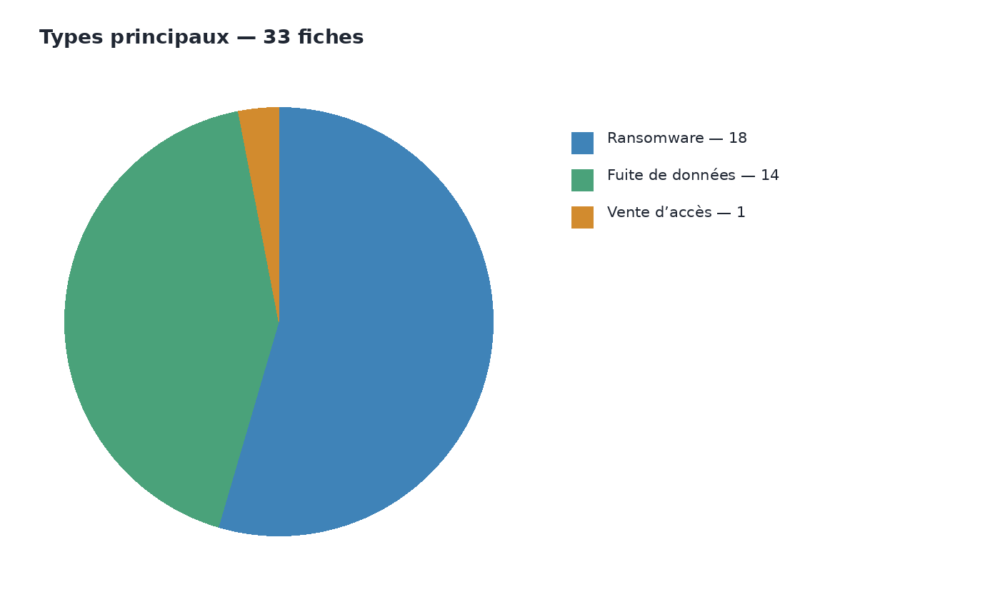
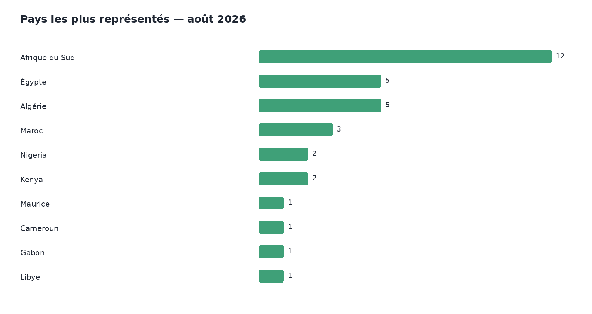
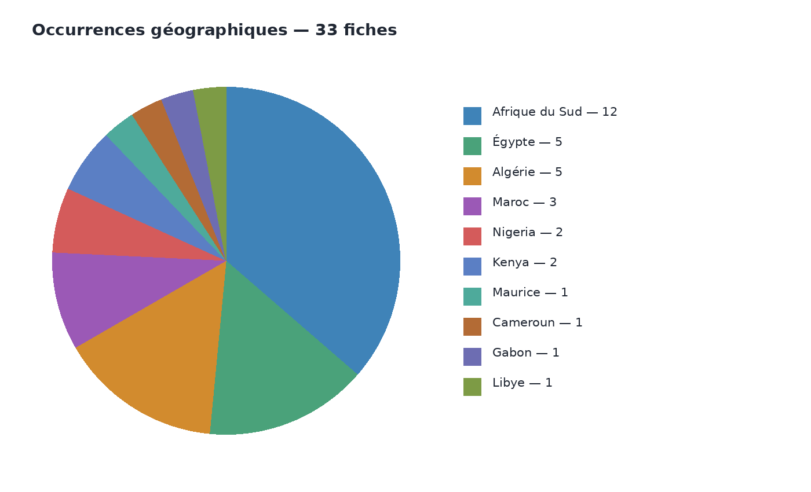
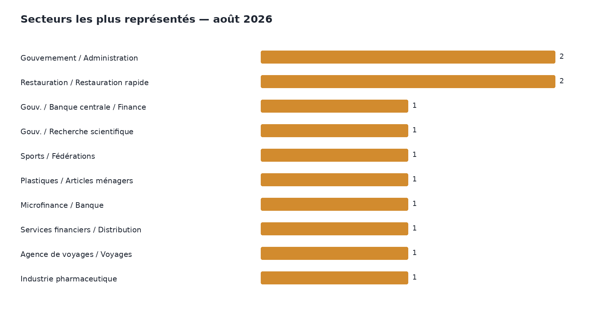
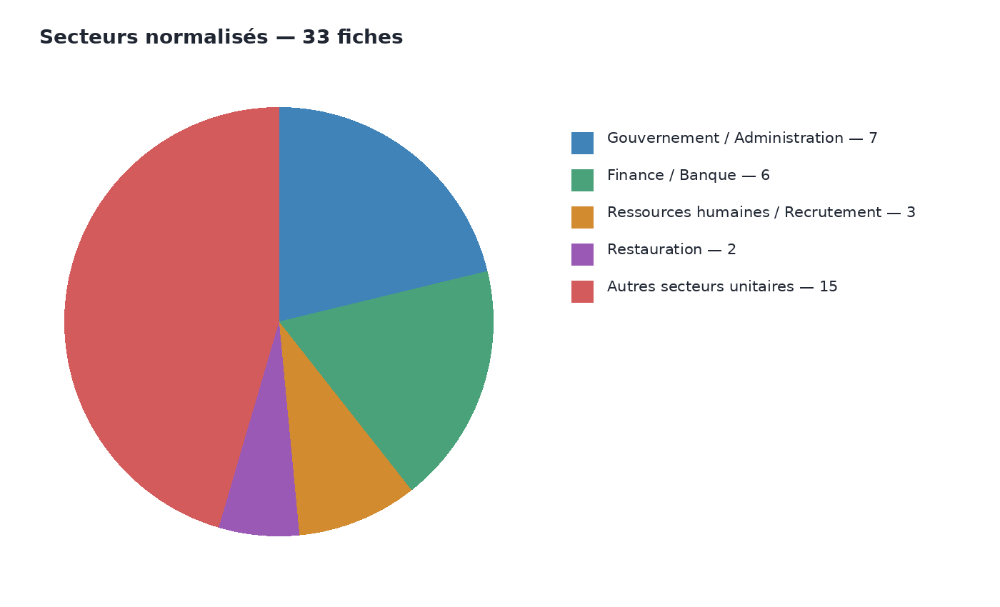
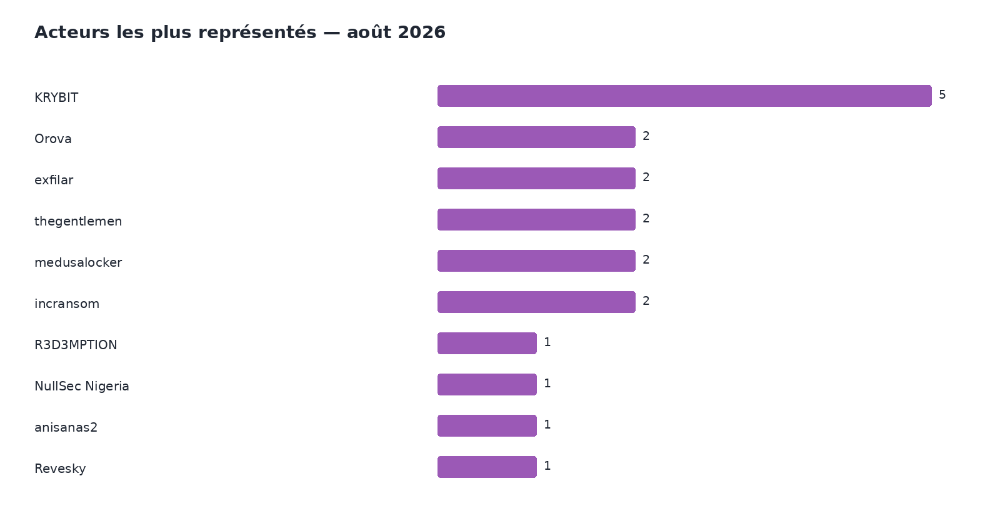
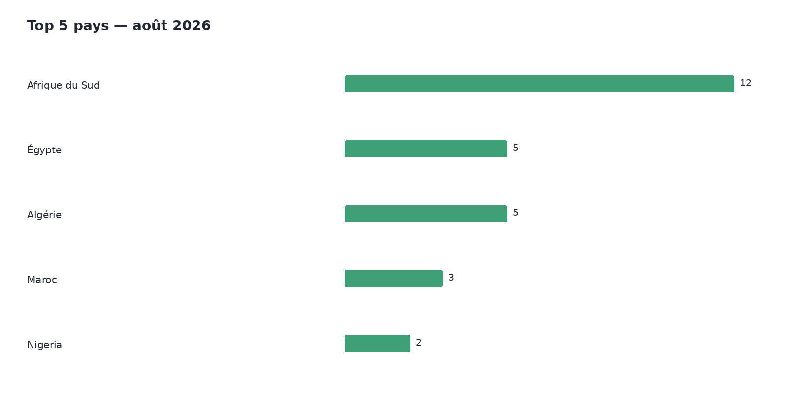

# Rapport CTI AFRINTEL - cyberincidents en Afrique (août 2026)

Ce corpus mensuel documenté et contrôlé contient **33 incidents ou cas** publiés pour la première fois ou observés pour la première fois par AFRINTEL en août 2026. Le rattachement mensuel suit la date de publication ou de première observation documentée ; aucune date de compromission n est déduite lorsqu elle est indisponible.

## Ventilation mensuelle validée

| Type d incident | Nombre | Part |
|---|---:|---:|
| Ransomware | 18 | 54.5% |
| Fuite de données | 14 | 42.4% |
| Vente d'accès | 1 | 3.0% |
| **Total** | **33** | **100.0%** |

## Pays les plus représentés

| Pays | Nombre |
|---|---:|
| Afrique du Sud | 12 |
| Algérie | 5 |
| Égypte | 5 |
| Maroc | 3 |
| Nigeria | 2 |
| Kenya | 2 |
| Maurice | 1 |
| Cameroun | 1 |
| Gabon | 1 |
| Libye | 1 |

## Acteurs les plus représentés

| Libellé acteur | Nombre |
|---|---:|
| KRYBIT | 5 |
| Orova | 2 |
| exfilar, publication sur un forum cybercriminel, opérateur/vendeur d'un outil de scan Firebase de masse | 2 |
| thegentlemen | 2 |
| medusalocker | 2 |
| incransom | 2 |
| R3D3MPTION | 1 |
| NullSec Nigeria (alias « voss », compte de forum NullsecNg), publication sur le forum cybercriminel DarkForums | 1 |
| anisanas2 | 1 |
| Revesky, publication sur un forum cybercriminel | 1 |

## Secteurs les plus représentés

| Secteur | Nombre |
|---|---:|
| Gouvernement / Administration | 2 |
| Restauration / Restauration rapide | 2 |
| Gouvernement / Banque centrale / Services financiers | 1 |
| Gouvernement / Recherche scientifique | 1 |
| Sports / Fédérations sportives | 1 |
| Fabrication de plastiques / Articles ménagers | 1 |
| Microfinance / Banque | 1 |
| Services financiers / Distribution de paiements / Accompagnement du désendettement | 1 |
| Agence de voyages / Voyages loisirs et professionnels | 1 |
| Industrie pharmaceutique | 1 |

## Méthodologie

Les chiffres sont calculés une seule fois depuis `victims_FR.md`, contrôlés contre `victims.md`, puis réutilisés dans les rapports, comparaisons et bundles STIX. Un incident multi-pays compte une fois au total ; les occurrences par pays peuvent donc dépasser le total global. Le corpus mesure la visibilité documentée par AFRINTEL, pas la prévalence réelle des cyberattaques.

## Statuts et niveaux analytiques

| Statut AFRINTEL | Nombre |
|---|---:|
| Claim - Data Sample Published | 13 |
| Claim - Unverified | 12 |
| Data Fully Published | 4 |
| Victim Confirmed | 3 |
| Under Investigation | 1 |

| Niveau de confiance | Nombre |
|---|---:|
| High, dont 1 évaluation composite High/Medium | 14 |
| Low | 9 |
| Medium | 7 |
| Very High | 3 |

| Niveau d'impact | Nombre |
|---|---:|
| Level 4 | 22 |
| Level 3 | 8 |
| Level 2 | 3 |

Les statuts décrivent le niveau de preuve disponible pour chaque fiche et ne constituent pas une confirmation globale des compromissions. Les niveaux de confiance concernent les éléments analysés et leur attribution, tandis que les niveaux d'impact décrivent le dommage potentiel ; ces dimensions ne sont pas interchangeables. Une fiche présente explicitement une confiance élevée pour l'existence et la cohérence du corpus, mais moyenne pour l'attribution technique.

## Lecture CTI et priorités

L'Afrique du Sud représente 12 occurrences, suivie de l'Algérie et de l'Égypte avec 5 chacune. Les 14 fiches de fuite de données comprennent des échantillons examinés contenant des données d'identité, d'éducation, de recrutement, de finance ou d'administration. Les 18 fiches ransomware restent majoritairement des publications d'acteurs ; les dates d'accès, l'exhaustivité des données, le chiffrement et les négociations restent souvent inconnus.

Les priorités défensives sont la protection des identifiants et documents administratifs, la rotation des secrets éventuellement exposés, la surveillance des exports massifs et des accès anormaux aux portails, ainsi que la vérification des sauvegardes et des journaux pour les organisations revendiquées. Les volumes annoncés par les acteurs ne sont pas extrapolés aux 33 fiches.

## Mise à jour documentaire - portails universitaires égyptiens

Le complément publié le 23 août 2026 pour la publication des portails universitaires égyptiens a été intégré à la fiche groupée du 21 août. L'inventaire local associé comprend **5 540 fichiers** et **2 337 401 813 octets**, dont **2 257 PDF** et **3 117 images**. Le contrôle relève **4 675 empreintes SHA-256 uniques**, **726 groupes de doublons** et **865 fichiers dupliqués au-delà de la première occurrence**. Les catégories accessibles concernent notamment les documents d'identité, certificats, relevés, résultats, cartes militaires et photographies. Cette mise à jour ne modifie pas le dénominateur mensuel : le cas reste une seule fiche d'août. L'analyse sémantique exhaustive de chaque page et image n'est pas revendiquée en raison de la proportion de documents scannés.

[Victim records](./victims_FR.md)

### Visualisations

