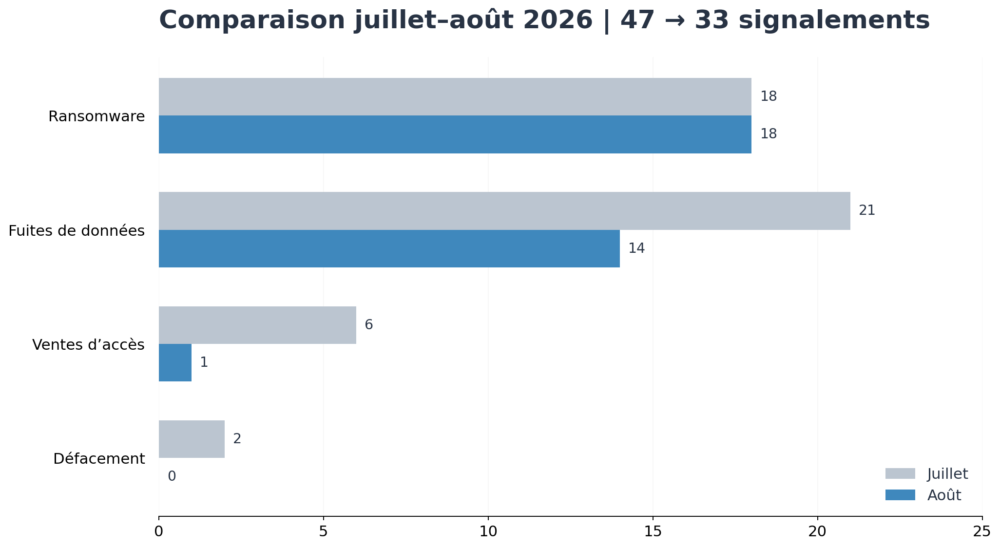
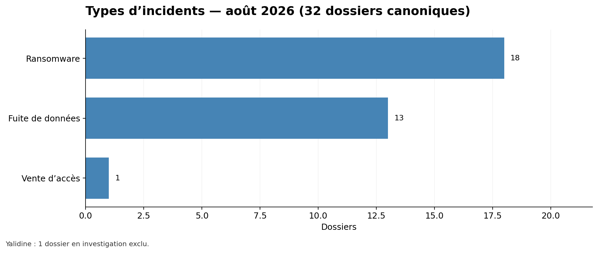
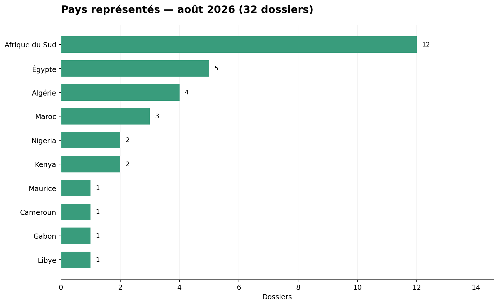
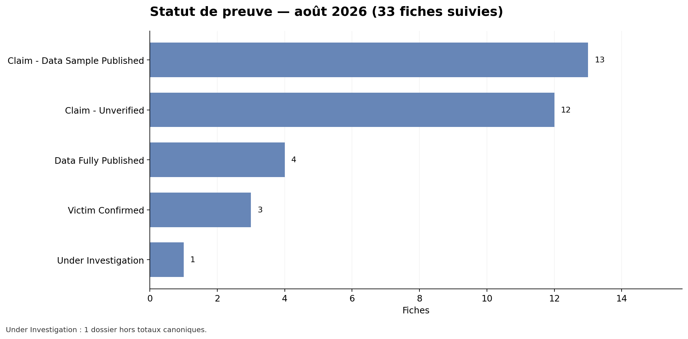
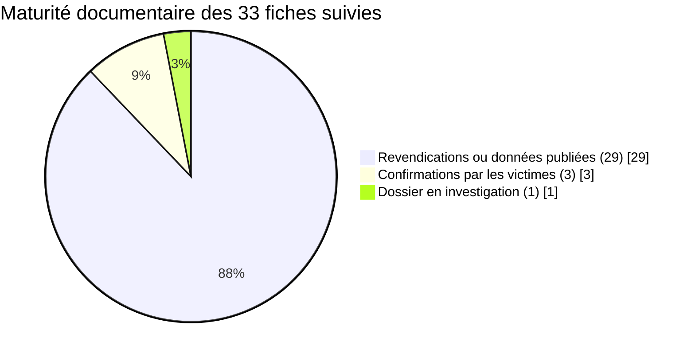
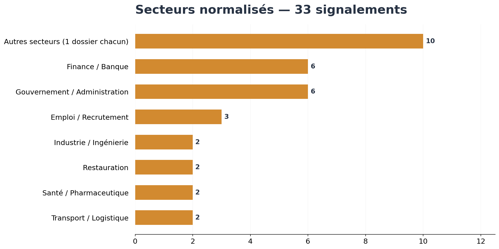
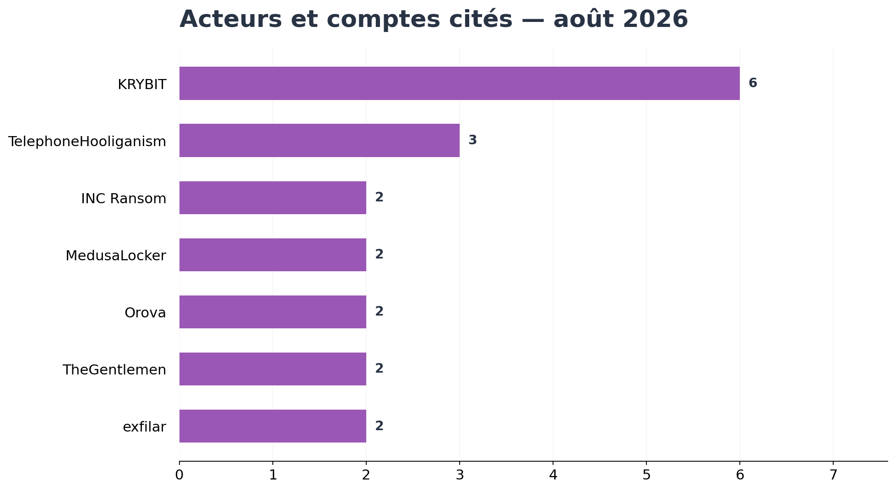

# AFRINTEL - Rapport mensuel de renseignement cyber
## Cybermenaces en Afrique | Août 2026

👉🏾 [English version](./README.md) · [Fiches victimes FR](./victims_FR.md) · [Fiches EN](./victims.md) · [Statistiques JSON](./STATISTIQUES_2026-08.json)

**Période couverte :** 1er au 31 août 2026  
**Périmètre :** veille de 54 pays africains ; 10 pays représentés dans le corpus du mois  
**Destinataires :** directions générales, RSSI, DSI, directions des risques, CERT et analystes CTI/SOC  
**Sources de collecte :** sites de publication de groupes ransomware sur le Dark Web, forums underground, espaces de divulgation et de vente de données du Dark Web et du Deep Web, échantillons disponibles, communiqués des organisations et sources publiques de recoupement.

> **Note de fiabilité.** Une fiche publiée par un groupe criminel établit l'existence d'une **revendication observée**, pas automatiquement une intrusion. Les données examinées peuvent étayer l'association avec une organisation sans démontrer leur origine technique. Les confirmations officielles sont indiquées explicitement. Les chiffres mesurent les dossiers **documentés par AFRINTEL**, pas l'ensemble des cyberattaques survenues en Afrique. Les données personnelles brutes, identifiants et secrets ne sont pas reproduits dans ce rapport.

---

## 1. Synthèse exécutive - décisions à retenir

En août 2026, **33 fiches** ont été conservées dans la série documentaire AFRINTEL, réparties entre **10 pays**. La revue du corpus met toutefois en évidence une particularité importante : **Yalidine**, associée à une publication du 20 août mais examinée plus tard, est explicitement classée `Under Investigation` avec une attribution non établie. Conformément aux règles de qualité AFRINTEL, **32 dossiers sont donc retenus dans les statistiques canoniques**, et un dossier est maintenu uniquement pour assurer la traçabilité.

Parmi les **32 dossiers retenus**, on recense **18 signalements ransomware (56,3 %)**, **13 fuites de données (40,6 %)** et **1 vente d'accès (3,1 %)**. La répartition historique, utilisée dans les précédents résumés, reste de **33 fiches : 18 ransomware, 14 fuites et 1 vente d'accès**, car elle incluait le cas aujourd'hui en investigation. Ces deux séries ne doivent pas être confondues.

L'**Afrique du Sud (12)** arrive en tête des dossiers retenus, suivie de l'**Égypte (5)** et de l'**Algérie (4)**. Cette concentration décrit la visibilité du corpus et ne classe pas la qualité de la cybersécurité des pays.

**Trois enseignements utiles aux décideurs :** l'extorsion demeure visible sur les sites criminels ; plusieurs corpus réellement examinés mettent en jeu des informations d'identité, de ressources humaines et financières ; enfin, des incidents **reconnus par des organisations** coexistent avec des revendications non corroborées. Le traitement du risque doit donc s'appuyer sur la **crédibilité des éléments**, la **sensibilité des données** et l'**exposition réelle**, pas sur le seul nom du groupe affiché.

### 1.1 Comparaison avec juillet 2026

| Indicateur | Juillet 2026 | Août 2026 - série historique | Évolution |
|---|---:|---:|---:|
| **Total des fiches** | **47** | **33** | **-14 (-29,8 %)** |
| Ransomware | 18 | 18 | 0 (+0,0 %) |
| Fuite de données | 21 | 14 | -7 (-33,3 %) |
| Vente d’accès | 6 | 1 | -5 (-83,3 %) |
| DDoS | 0 | 0 | 0 (stable) |
| Défacement | 2 | 0 | -2 (-100,0 %) |
| Prise de contrôle de compte | 0 | 0 | 0 (stable) |
| Intrusion système | 0 | 0 | 0 (stable) |
| Malware | 0 | 0 | 0 (stable) |
| Fraude opérationnelle | 0 | 0 | 0 (stable) |

*Source de juillet : [rapport AFRINTEL juillet 2026](../07-july/README_FR.md) - 47 fiches, dont 18 ransomware, 21 fuites de données, 6 ventes d'accès et 2 défacements. La comparaison ci-dessus conserve la **série historique de 33 fiches pour août** afin de rester lisible face aux publications antérieures. Après exclusion du dossier Yalidine en investigation, le corpus canonique d'août est de 32 dossiers. La baisse du nombre de fiches n'établit pas une diminution du nombre réel de compromissions.*

### 1.2 Décision de contrôle du périmètre

| Mesure | Valeur | Interprétation |
|---|---:|---|
| Fiches documentaires conservées | **33** | Toutes les publications suivies, y compris le dossier en investigation |
| Dossiers retenus pour les statistiques canoniques | **32** | Décompte fondé sur les fiches attribuables à une organisation ou un périmètre défendable |
| Dossiers hors dénominateur | **1** | Yalidine : publication observée, correspondance de l'échantillon avec la victime non démontrée |

**Conséquence pour les comparaisons intermensuelles :** le rapport de septembre précédemment publié reprend août à **33** dans sa base historique. Toute comparaison présentée comme *canonique* doit au contraire utiliser **32** pour août, sans modifier silencieusement les rapports déjà publiés. La décision de déduplication doit être appliquée de la même façon dans tous les exports.

## 2. Méthodologie et niveau de preuve

AFRINTEL surveille les publications relatives aux victimes et aux données africaines : sites de divulgation ransomware, forums, plateformes clandestines, archives divulguées, avis officiels et médias spécialisés. Les dossiers retenus sont associés à une victime, un pays et un type principal. **La date de publication ou de première observation ne vaut pas date d'accès initial.** Les publications répétées d'un même événement ne créent pas automatiquement plusieurs incidents. Les six universités égyptiennes réunies dans une publication commune sont comptées comme **un dossier groupé**, et non six incidents indépendants.

Les éléments sont distingués selon leur force probante : **publication observée**, **échantillon examiné**, **information corroborée**, **événement confirmé par une organisation** ou **information non établie**. Lorsque seules des images ou un inventaire de fichiers existent, cette limite est signalée. Les données personnelles et les secrets restent hors du dépôt public.

Les fichiers `victims_FR.md` et `victims.md` comportent chacun **33 fiches dans le même ordre chronologique**, après correction des entrées déplacées en fin de fichier. Les tableaux et graphiques sont générés depuis une **seule grille de comptage**, documentée dans `STATISTIQUES_2026-08.json`.

## 3. Panorama chiffré

### 3.1 Typologies principales - 32 dossiers canoniques

| Type principal | Dossiers | Part |
|---|---:|---:|
| **Ransomware** | **18** | **56,3 %** |
| **Fuite de données** | **13** | **40,6 %** |
| **Vente d'accès** | **1** | **3,1 %** |
| **Total** | **32** | **100 %** |

Les ransomware sont des **signalements inscrits dans un contexte d'extorsion** : ils ne prouvent pas tous un chiffrement. La vente d'accès est une annonce observée sur un forum ; l'existence et la validité de l'accès annoncé ne sont pas établies.

### 3.2 Pays représentés - 32 dossiers canoniques

| Pays | Dossiers | Part |
|---|---:|---:|
| Afrique du Sud | 12 | 37,5 % |
| Égypte | 5 | 15,6 % |
| Algérie | 4 | 12,5 % |
| Maroc | 3 | 9,4 % |
| Nigeria | 2 | 6,2 % |
| Kenya | 2 | 6,2 % |
| Maurice | 1 | 3,1 % |
| Cameroun | 1 | 3,1 % |
| Gabon | 1 | 3,1 % |
| Libye | 1 | 3,1 % |
| **Total** | **32** | **100 %** |

La ventilation régionale distingue **l'Afrique du Nord : 13**, **l'Afrique australe : 12**, **l'Afrique de l'Est : 3** (Kenya 2, Maurice 1), **l'Afrique de l'Ouest : 2** (Nigeria) et **l'Afrique centrale : 2** (Cameroun et Gabon). **Total : 32.**

La présence d'un pays dans la veille ne permet pas d'inférer son niveau de protection. L'absence de signalement documenté n'est pas une preuve d'absence d'attaque.

### 3.3 Statut de preuve - 33 fiches suivies

| Statut AFRINTEL | Fiches | Lecture correcte |
|---|---:|---|
| `Claim - Data Sample Published` | 13 | Échantillon ou extrait publié, sans confirmation automatique de l'origine ou de l'intrusion |
| `Claim - Unverified` | 12 | Revendication observée sans éléments suffisants pour valider le scénario technique |
| `Data Fully Published` | 4 | Publication annoncée comme complète ; exhaustivité non démontrée par ce seul statut |
| `Victim Confirmed` | 3 | Incident reconnu par la victime ; groupe responsable non nécessairement confirmé |
| `Under Investigation` | 1 | Dossier de vérification exclu des totaux canoniques |
| **Total suivi** | **33** | **32 retenus + 1 à vérifier** |

Les niveaux de confiance décrivent la fiabilité des éléments analysés, et **non** la gravité des conséquences. Le niveau d'impact exprime le dommage potentiel ; il ne doit jamais être présenté comme une perte financière ou une interruption constatée.

## 4. Analyse par type d'incident

### 4.1 Ransomware - publication criminelle et incidents établis

Les **18 dossiers** couvrent des situations de preuve différentes. **DC Partner**, le **Furniture Bargaining Council** et **Cartrack South Africa** ont fait l'objet de confirmations d'incident par les organisations concernées. Chez DC Partner, la confirmation du 7 août concernait un ransomware tandis que l'entreprise indiquait maintenir ses services opérationnels ; le rapprochement avec une revendication KRYBIT ne constitue pas une attribution forensique. Le Furniture Bargaining Council a reconnu le chiffrement de certains serveurs ; l'attribution à DeadLock n'est pas établie par cette seule déclaration. Cartrack a indiqué avoir détecté un ransomware le **26 août**, puis isolé les serveurs concernés et restauré sa plateforme ; sa déclaration ne désigne pas formellement un groupe auteur.

D'autres dossiers, notamment **ASHA Microfinance Bank**, **The Courier Guy** et le **Conseil Gabonais des Chargeurs**, disposent d'éléments documentaires structurés dont la lecture apporte une information concrète sur les risques de fraude, d'usurpation et de reconnaissance secondaire. Pour **CCA Bank**, l'analyse repose sur une publication attribuée à Everest et un **inventaire technique** de fichiers, non sur la lecture exhaustive des fichiers sources. Les volumes ou échéances annoncés par les groupes ne sont pas considérés comme confirmés.

**Point de vigilance :** un compte à rebours expiré sans divulgation accessible ne prouve ni négociation réussie, ni paiement, ni revente, ni inexistence des données. Ces situations restent à qualifier dossier par dossier.

### 4.2 Fuites de données - identités, administrations et prestataires

Les **13 dossiers canoniques** de fuite de données touchent des univers variés : administrations, enseignement supérieur, recrutement, services financiers, sécurité, télécommunications et commerce en ligne. Ils révèlent un même risque transversal : des données structurées publiées ou réutilisées peuvent alimenter des fraudes ciblées longtemps après leur première exposition.

Les dossiers les plus instructifs comprennent : **mPowa**, avec **2 585 CV** et **26 675 points géographiques** constatés dans un export Firebase ; **SnapStar Talent**, avec 300 candidatures cohérentes entre un CSV et un fichier TXT ; **RAMED**, avec **1 098 685 enregistrements** analysés et des photographies associées à une partie des dossiers ; et le dossier groupé de **six universités égyptiennes**, avec **7 762 241 enregistrements dans six CSV** et **5 540 documents** inventoriés. Ces chiffres décrivent les corpus examinés ; ils ne prouvent pas le vecteur d'accès ni le nombre de personnes uniques.

Le dossier **DGSN/DGST au Maroc** appelle une lecture particulièrement prudente : l'analyse décrit un corpus de **70 381 lignes** associables à des personnels, tandis que les institutions ont **démenti une intrusion directe** dans leurs systèmes et évoqué une origine tierce. La publication de données associées à des personnes ne confirme pas la compromission du système d'information de leur employeur.

### 4.3 Vente d'accès - un signal de risque, pas une preuve d'accès fonctionnel

Une annonce visant un **accès VPN présenté comme lié au ministère algérien du Commerce** est classée `Access Sale`. Le vendeur demande **500 USD**, mais aucun accès opérationnel ni niveau de privilège n'est démontré. Une organisation concernée doit vérifier ses accès distants et les usages anormaux, sans conclure à une intrusion à partir de l'annonce seule.

## 5. Secteurs exposés - classification normalisée

Les secteurs ci-dessous sont dérivés de l'activité principale documentée, avec **un seul secteur par dossier canonique**. Les libellés spécialisés restent dans les fiches victimes.

| Code | Secteur principal | Fiches |
|---|---|---:|
| FIN | Finance / Banque | 6 |
| GOV | Gouvernement / Administration | 6 |
| EMP | Emploi / Recrutement | 3 |
| IND | Industrie / Ingénierie | 2 |
| RES | Restauration | 2 |
| HEA | Santé / Pharmaceutique | 2 |
| AGR | Agriculture / Agroalimentaire | 1 |
| ECO | Commerce / E-commerce | 1 |
| REA | Immobilier | 1 |
| AUT | Mobilité / Automobile | 1 |
| MED | Médias / Édition | 1 |
| LAB | Relations sociales / Travail | 1 |
| SPO | Sports / Fédérations | 1 |
| TOU | Tourisme / Voyage | 1 |
| LOG | Transport / Logistique | 1 |
| TEL | Télécommunications / Médias | 1 |
| EDU | Éducation / Université | 1 |
| **Total** | | **32** |

La **finance/banque et l'administration** comptent chacune **6 dossiers**. Les activités d'**emploi et de recrutement** en rassemblent **3**. Les autres catégories concernent notamment l'industrie, la santé, la restauration, les transports et le numérique. Il s'agit d'une distribution du corpus, pas d'un classement des secteurs les plus vulnérables en Afrique.

## 6. Acteurs et comptes publiant des revendications

| Acteur ou compte cité | Fiches associées |
|---|---:|
| KRYBIT | 6 |
| Orova | 2 |
| exfilar | 2 |
| TheGentlemen | 2 |
| MedusaLocker | 2 |
| INC Ransom | 2 |
| TelephoneHooliganism | 2 |
| R3D3MPTION | 1 |
| NullSec Nigeria | 1 |
| anisanas2 | 1 |

**KRYBIT apparaît dans 6 fiches**, et non 5 : son nom est associé notamment à la publication concernant **DC Partner**, même si l'attaque est reconnue par l'entreprise **sans attribution technique formelle** à KRYBIT. `exfilar` et `TelephoneHooliganism` désignent des comptes de publication observés ; ils ne prouvent pas l'identité réelle d'un opérateur ni son appartenance à une structure criminelle précise. Le classement mesure des **mentions ou revendications dans les fiches**, et ne doit pas être interprété comme une mesure d'activité technique attribuée avec certitude.

**Lecture par pays :** Afrique du Sud - forte visibilité ransomware et trois cas reconnus par des victimes ; Égypte et Maroc - présence de corpus documentaires sensibles ; Algérie - plusieurs publications de forum dont au moins une attribution contestable ; Gabon, Cameroun, Maurice, Nigeria et Kenya - dossiers nécessitant un suivi ciblé selon l'exposition des données. Aucun de ces constats ne constitue une note nationale de cybersécurité.

## 7. Tendances et lacunes de renseignement

**Tendance observable :** les publications d'extorsion coexistent avec des fuites présentant des structures de données crédibles, notamment dans les domaines des identités, de la finance et des relations professionnelles. La baisse de la série historique **de 47 fiches en juillet à 33 en août** décrit une évolution du corpus collecté, pas nécessairement une baisse des attaques réelles.

Les trois principales lacunes restent : **l'origine technique des données**, souvent indémontrable sans journaux ou DFIR ; **l'état actuel des comptes, liens ou accès potentiellement exposés**, rarement vérifiable publiquement ; et **l'exhaustivité des volumes revendiqués**, que des échantillons ne suffisent pas à établir. Pour chacun de ces points, les éléments attendus sont respectivement une chronologie d'investigation, des constats techniques autorisés, et un inventaire complet vérifiable.

**Correction de périmètre :** le dossier Yalidine conserve une trace documentaire du post, mais l'examen des CSV a révélé des incohérences empêchant de les attribuer de manière fiable à l'organisation. Il reste en enquête et hors statistiques canoniques. Les deux autres cas publiés le 20 août en Algérie ne sont pas automatiquement liés sur le plan technique du seul fait d'un compte ou d'une date en commun.

## 8. MITRE ATT&CK - correspondances contextuelles, non attributions

| Hypothèse défensive | Technique ATT&CK | Télémétrie pertinente | Limite analytique |
|---|---|---|---|
| Abus d'identifiants légitimes | `T1078` - Valid Accounts | IAM, SSO, VPN, authentification, journaux de comptes | Usage non démontré pour tous les dossiers |
| Exploitation d'applications exposées | `T1190` - Exploit Public-Facing Application | WAF, applications, reverse proxy, traces d'erreur | Le vecteur initial est généralement inconnu |
| Accès à des référentiels de données | `T1213` - Data from Information Repositories | DLP, audit DB, fichiers et dépôts documentaires | Nature de l'accès et permissions à vérifier |
| Accès à des données stockées dans le cloud | `T1530` - Data from Cloud Storage | Cloud audit, règles de stockage, appels API | Misconfiguration plausible, exploit non établi |
| Chiffrement à des fins d'impact | `T1486` - Data Encrypted for Impact | EDR, FIM, fichiers et services | Applicable lorsque le chiffrement est confirmé, par exemple FBC |

Ces techniques servent de **pistes de détection préventive**. Le rapport ne prétend pas avoir reconstitué une chaîne d'attaque MITRE pour chaque publication observée.

## 9. Mesures prioritaires par type d'organisation

| Public concerné | Priorité | Mesure concrète |
|---|---|---|
| Administration / service public | P1 | Inventorier les données d'identité et les accès aux portails, vérifier les exports et la conservation des traces |
| Banque / assurance / paiement | P1 | Contrôler les accès tiers, l'intégrité des transactions, les habilitations et les alertes sur exports financiers |
| Recrutement / éducation | P1 | Évaluer l'exposition des CV, pièces d'identité et liens de documents, révoquer les jetons si une exposition est constatée |
| Toute organisation | P1 | Tester une restauration de sauvegarde, renforcer MFA et surveiller comptes privilégiés et accès distants |
| Prestataires et sous-traitants | P2 | Réexaminer les échanges de données, les accès inter-entreprises et les obligations de notification |

Ces mesures sont proportionnées aux risques décrits ; elles **n'impliquent pas que les organisations citées aient toutes subi ces scénarios**.

## 10. Recommandations SOC et hypothèses de détection

| Scénario | Journal / source | Corrélation SOC à privilégier | Qualification |
|---|---|---|---|
| Exports massifs inhabituels | Audit SGBD, API, DLP | Hausse du volume extrait par un compte, hors profil habituel et plage d'usage | Préventif, fondé sur le risque de données exposées |
| Connexion distante suspecte | IdP/SSO, VPN, bastion | Nouvelle géolocalisation ou terminal + session privilégiée + accès à des dépôts sensibles | Hypothèse T1078 |
| Partage de documents ou clés à portée excessive | Cloud IAM, storage audit | Autorisation publique anormale + lecture répétée ou volumineuse | Préventif, pertinent pour les dossiers cloud |
| Préparation d'exfiltration | EDR, serveurs de fichiers, proxy | Archivage volumineux + volume sortant inhabituel + compte atypique | Hypothèse, exfiltration non établie par défaut |
| Activité de chiffrement | EDR, FIM, sauvegardes | Création ou modification massive de fichiers + arrêt de services + anomalie de processus | T1486, pertinent pour les cas confirmés |
| Abus d'accès fournisseur | IAM, PAM, VPN | Compte tiers + élévation de privilèges + consultation ou export hors contrat | Préventif, dépendance fournisseurs |

**Validation proposée :** tester les scénarios sur journaux simulés ou historiques autorisés, mesurer faux positifs, documenter les exceptions métiers puis déployer en SIEM. Aucun IoC absent des fiches n'est inventé dans ce rapport.

## 11. Feuille de route 7 / 30 / 90 jours

| Échéance | Responsable proposé | Action et preuve attendue | Indicateur |
|---|---|---|---|
| **7 jours** | RSSI + SOC | Revoir comptes administrateurs, VPN et sources de logs sensibles ; produire une liste d'écarts prioritaires | % des accès critiques inventoriés |
| **7 jours** | DSI + sauvegarde | Tester au moins une restauration sur un service critique et documenter le résultat | Test réalisé / résultat / temps réel |
| **30 jours** | Responsable données + IT | Identifier les référentiels contenant PII et documents RH/financiers, puis restreindre les exports | % des référentiels sensibles couverts |
| **30 jours** | SOC / Detection Engineering | Valider les détections d'exports massifs, d'accès distants et de chiffrement en laboratoire | Taux de réussite et faux positifs |
| **90 jours** | RSSI + achats + juridique | Auditer les échanges avec les tiers, les clauses de notification et les comptes fournisseurs | % des tiers critiques évalués |
| **90 jours** | Comité de crise / Direction | Conduire un exercice de fuite de données ou ransomware avec prise de décision, communication et restauration | Exercice documenté, actions suivies |

## 12. Conclusion

Le mois d'août 2026 confirme l'utilité d'une veille centrée sur les **preuves disponibles**, et non sur la seule visibilité des groupes criminels. Les organisations africaines ne doivent ni ignorer les publications ni les traiter comme des preuves définitives de compromission. La réponse efficace consiste à **qualifier le signal**, **évaluer l'exposition réelle**, **protéger les personnes et les services**, puis **vérifier que les contrôles fonctionnent**.

**AFRINTEL** - Cyber Threat Intelligence & SOC  
[Dépôt GitHub AFRINTEL](https://github.com/Hatchepsoute/AFRINTEL) · [Fiches victimes août 2026](./victims_FR.md)
