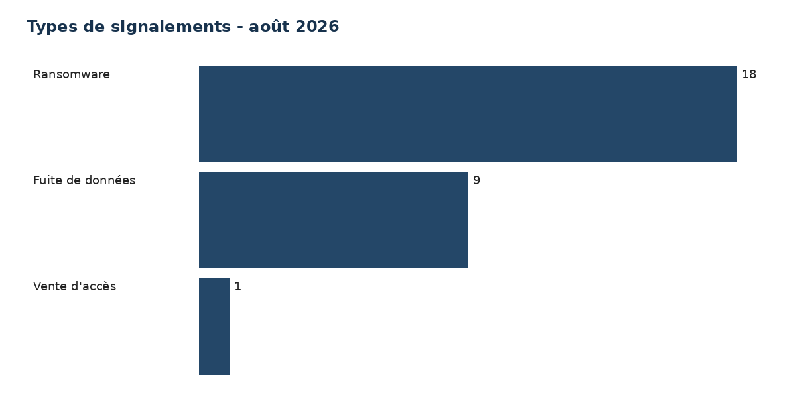
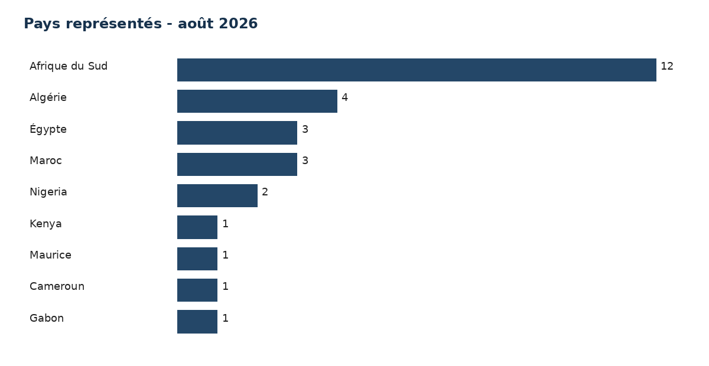
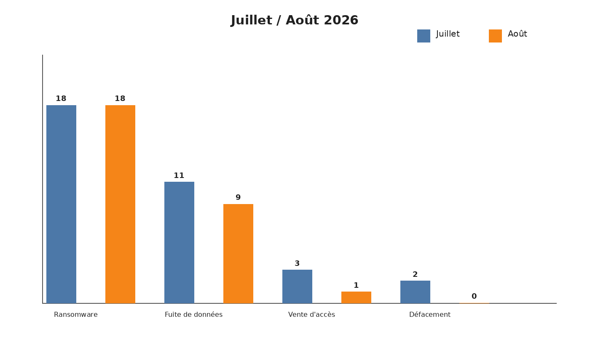
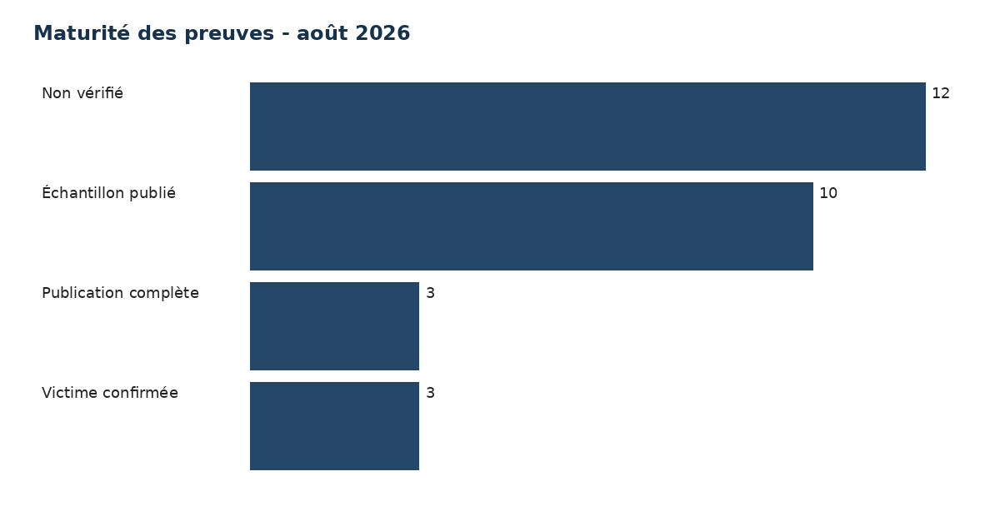
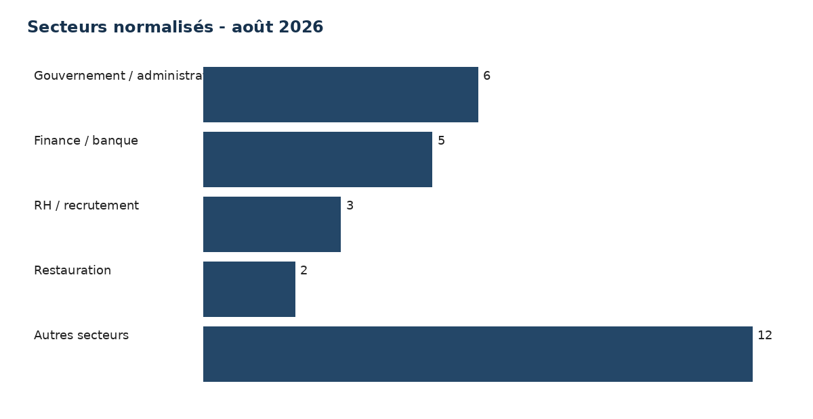
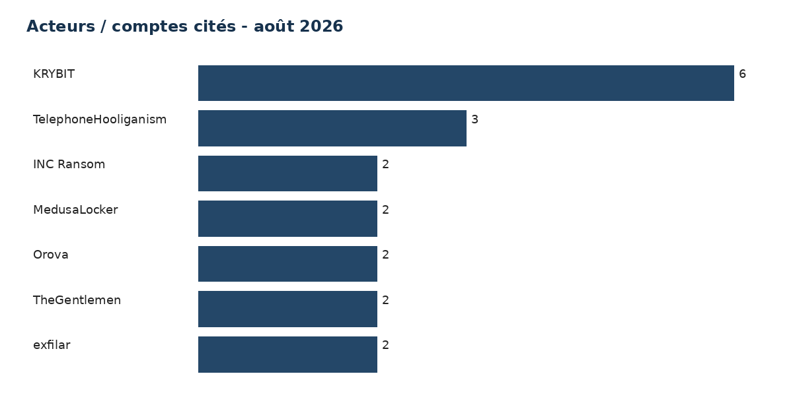

   

# AFRINTEL - Rapport mensuel de renseignement sur les cybermenaces
## Afrique - Août 2026 | Analyses et priorités de cyberdéfense

**Période de référence :** du 1er au 31 août 2026 
**Public :** directions générales, RSSI, DSI, responsables IT, SOC/CERT, conformité et gestion des risques 
**Périmètre :** veille sur les 54 pays africains, 9 pays dans le corpus statistique validé 
**Sources :** publications de groupes d'extorsion, forums clandestins, dossiers d'échantillons analysés par AFRINTEL, communications d'organisations et recoupements publics documentés dans les fiches. 
**Documents associés :** [fiches victimes FR](./victims_FR.md) | [fiches victimes EN](./victims.md) | [rapport EN](./README.md)

> **Note de fiabilité.** Une revendication publiée sur un site criminel n'est pas une preuve de compromission. Un échantillon cohérent peut corroborer une exposition sans identifier le système d'origine ni l'auteur réel. Les confirmations institutionnelles portent uniquement sur les faits publiquement reconnus. Ce rapport ne reproduit aucune donnée personnelle, aucun identifiant ni aucune clé d'accès.

> **Note de qualité des données.** Le couple validé `victims_FR.md` / `victims.md` contient **28 fiches canoniques**. Yalidine est désormais compté comme `Claim - Data Sample Published` avec une confiance faible ; ce statut ne confirme ni la compromission ni l'attribution technique.

## 1. Synthèse exécutive

La veille AFRINTEL d'août 2026 fait ressortir **28 signalements dans 9 pays**, répartis entre **18 publications classées ransomware (64,3 %)**, **9 fuites de données (32,1 %)** et **une annonce de vente d'accès (3,6 %)**. Le ransomware constitue ainsi la principale catégorie documentaire du mois, mais les faits observés couvrent des réalités différentes : simple inscription sur un site de fuite, documents publiés, ou incident reconnu par une organisation.

L'**Afrique du Sud** concentre 12 signalements, devant l'**Algérie** (4), l'**Égypte** et le **Maroc** (3 chacun). Ces chiffres traduisent la visibilité des sources suivies et les choix de collecte. Ils ne permettent pas de classer les pays selon leur niveau réel d'insécurité. Les secteurs financier, administratif et opérationnel sont les plus représentés dans le corpus.

Trois situations ressortent pour les directions :

- **Des incidents ransomware effectivement reconnus.** DC Partner, Furniture Bargaining Council et Cartrack ont communiqué sur des événements de sécurité. Leur confirmation ne prouve pas que les groupes revendiquant parfois ces organisations sont les auteurs techniques.
- **Des données structurées potentiellement réutilisables par d'autres fraudeurs.** Les dossiers mPowa, RAMED, SnapStar Talent, Daily Trust et ceux de six universités égyptiennes comportent des échantillons ou corpus décrits dans les fiches AFRINTEL. Leurs risques portent surtout sur l'usurpation d'identité, la fraude, le phishing ciblé et la confidentialité.
- **Des revendications à vérifier sans les amplifier.** Les annonces concernant la SARB, le ministère algérien de l'Intérieur ou Yalidine ne permettent pas, à ce stade, d'affirmer que leurs systèmes ont été compromis.

**Décision recommandée aux RSSI et DSI :** prioriser la protection des données et des identités, vérifier les accès distants et les espaces cloud, tester la restauration des systèmes critiques et établir des scénarios SOC de détection comportementale. Le suivi des revendications doit alimenter une qualification documentée, non des conclusions précipitées.

## 2. Ce que les chiffres montrent

### 2.1 Typologies

| Catégorie | Signalements dans la synthèse | Part | Lecture opérationnelle |
|---|---:|---:|---|
| Ransomware / extorsion | **18** | **54,5 %** | Vérifier l'existence d'un chiffrement, d'une exfiltration et d'une interruption de service, sans les présumer. |
| Fuite de données | **9** | **32,1 %** | Rechercher la nature réelle des informations, leur origine et leur réutilisation possible. |
| Vente d'accès | **1** | **3,6 %** | Contrôler les accès distants et comptes à privilèges associés à l'organisation citée. |
| **Total** | **28** | **100 %** | **Total du corpus canonique documenté par les fiches.** |

**À ne pas confondre :** 18 publications classées ransomware ne signifient pas 18 réseaux chiffrés. Une fuite de données n'implique pas non plus qu'un serveur de la victime ait été directement piraté ; un prestataire, un environnement de test ou une copie plus ancienne peuvent être en cause.

### 2.2 Répartition géographique

| Pays | Signalements déclarés | Part |
|---|---:|---:|
| Afrique du Sud | 12 | 42,9 % |
| Algérie | 4 | 14,3 % |
| Égypte | 3 | 10,7 % |
| Maroc | 3 | 10,7 % |
| Nigeria | 2 | 7,1 % |
| Kenya | 1 | 3,6 % |
| Maurice | 1 | 3,6 % |
| Cameroun | 1 | 3,6 % |
| Gabon | 1 | 3,6 % |
| **Total** | **28** | **100 %** |

Les fiches détaillées et le corpus statistique couvrent les mêmes **neuf pays**. La Libye, les deux fiches antérieures d'Égypte, la fiche antérieure d'Algérie et la fiche antérieure du Kenya restent classées dans leurs mois d'origine et ne sont pas comptées en août.

### 2.3 Comparaison avec juillet

| Type | Juillet 2026, synthèse publiée | Août 2026, synthèse fournie | Variation |
|---|---:|---:|---:|
| Ransomware | 18 | 18 | 0 |
| Fuites de données | 21 | 9 | -12 |
| Ventes d'accès | 6 | 1 | -5 |
| Défacement | 2 | 0 | -2 |
| **Ensemble** | **47** | **28** | **-19 (-40,4 %)** |

La baisse apparente de 40,4 % concerne **les corpus documentés**, pas les cyberattaques réelles sur le continent. Elle doit être interprétée comme un changement de couverture documentaire et non comme une mesure de l'incidence réelle.

### 2.4 Statut des preuves

| Statut présent dans la synthèse | Nombre | Signification |
|---|---:|---|
| `Claim - Data Sample Published` | 10 | Un échantillon est signalé, mais sa provenance technique reste à qualifier. |
| `Claim - Unverified` | 12 | Revendication sans corroboration indépendante suffisante. |
| `Data Fully Published` | 3 | Publication présentée comme complète, sans preuve automatique d'exhaustivité. |
| `Victim Confirmed` | 3 | Incident reconnu par une organisation, pas nécessairement l'attribution du groupe. |
| **Total** | **28** | **États documentaires, non nombre de compromissions confirmées.** |

Pour respecter la taxonomie AFRINTEL, le libellé `Victim Confirmed` doit être normalisé en `Incident Confirmed by Victim` lors d'une harmonisation des fichiers de référence. Le présent rapport conserve néanmoins le libellé d'origine pour permettre la comparaison avec le JSON fourni.

Dans les **28 fiches canoniques**, on retrouve 12 revendications non vérifiées, 10 dossiers avec échantillons, 3 publications classées complètes et 3 confirmations de victimes. Yalidine est inclus dans les échantillons publiés, avec une confiance faible et une attribution non établie.

## 3. Incidents à retenir pour les comités de sécurité

### 3.1 Afrique du Sud - Des ransomwares reconnus, mais des impacts différents

**DC Partner.** L'entreprise a reconnu le 7 août un incident ransomware et indiqué que ses services restaient opérationnels. Le groupe KRYBIT apparaît dans les publications associées au dossier, mais l'entreprise n'a pas publiquement établi cette attribution technique. Pour les DSI, ce cas rappelle qu'un incident peut mobiliser une réponse juridique, technique et de protection des données sans entraîner nécessairement un arrêt visible des services. [Source mentionnée dans la fiche](https://mybroadband.co.za/news/security/661578-south-african-payment-distribution-agent-for-fnb-and-the-national-credit-regulator-hit-by-cyberattack.html).

**Furniture Bargaining Council.** L'organisation a reconnu le chiffrement de certains serveurs. Le dossier AFRINTEL décrit également 69 artefacts représentant environ 94,6 Mo de documents de différentes natures. L'acteur DeadLock a revendiqué l'opération, mais sa responsabilité technique ne découle pas à elle seule de la confirmation de la victime. La priorité opérationnelle concerne la continuité des services, la segmentation et la restauration des données critiques.

**Cartrack South Africa.** La société a indiqué avoir détecté un ransomware le 26 août, isolé les serveurs concernés et restauré sa plateforme en cinq heures. Un suivi évoque également des informations personnelles potentiellement consultées ou publiées. L'enseignement est concret : **la rapidité de remise en service ne suffit pas à clore la question de l'exposition des données**. La réponse à incident doit conserver deux pistes parallèles, l'une sur la disponibilité, l'autre sur la confidentialité.

### 3.2 Données financières - Risque de fraude secondaire

**ASHA Microfinance Bank, Nigeria.** La fiche associée à KRYBIT décrit un corpus d'environ **1 498 fichiers pour 7,15 Go**. Le contrôle rapporté précise que **1 101 fichiers ne contiennent que des octets nuls** et que 397 renferment des données non nulles. Le volume annoncé ne doit donc pas être assimilé à un volume équivalent de données utiles, ni au nombre de clients touchés. Des champs financiers et transactionnels sont présents dans les éléments exploitables. Aucune confirmation officielle ni preuve de chiffrement n'est établie dans la fiche.

**CCA Bank, Cameroun.** Une publication d'Everest est associée à un inventaire technique de **11 837 fichiers pour 18,92 Go**, complété par des archives représentant environ 120 Mo. Les catégories décrites couvrent crédits, comptes clients, conformité, données KYC, documentation interne et procédures techniques. Cette lecture provient d'un **inventaire**, pas de l'examen intégral des fichiers bruts. Si la provenance est authentifiée, les risques concernent à la fois les clients, les opérations bancaires et l'exploitation d'informations sur les processus internes.

**SpearFin, Maurice.** INC Ransom revendique 416 Go et présente des aperçus de documents liés à l'administration de fonds : KYC, contrats, actionnariat, documents financiers et correspondances. Les fichiers originaux n'étant pas disponibles pour examen dans la fiche, ce volume demeure une revendication. Le risque majeur, si les documents sont authentiques, est la combinaison de fraude documentaire, usurpation d'identité et fraude aux paiements.

**Mesure transversale :** les équipes Finance, conformité et sécurité doivent coordonner la surveillance des changements de coordonnées bancaires, des demandes urgentes de paiement, des dossiers KYC et des échanges inhabituels avec les partenaires. Une publication de données peut provoquer une fraude plusieurs semaines ou mois après sa diffusion.

### 3.3 Identités et documents administratifs - Maroc, Égypte et Afrique du Sud

**RAMED, Maroc.** AFRINTEL décrit un fichier principal contenant **1 098 685 enregistrements** avec des données d'identification et des informations géographiques. Des photographies d'identité sont associées à une partie des dossiers. Ce constat est plus solide que l'affirmation d'un acteur portant sur un volume global plus important, qui demeure non validé. La combinaison identité, pièces administratives et photographie augmente le risque d'usurpation et de fraude documentaire.

**DGSN/DGST, Maroc.** Un corpus de **70 381 lignes** a été examiné et rapproché de publications concernant des personnels. Les institutions ont contesté l'hypothèse d'une intrusion directe dans leurs systèmes, et une origine tierce ou une republication de données plus anciennes reste possible. Le corpus documente une exposition d'informations associées à des personnes ; il ne démontre pas la compromission technique des systèmes de ces institutions. Cette distinction est déterminante pour toute communication publique.

**Six universités publiques, Égypte.** Le dossier regroupe **une seule publication canonique** concernant six universités. Les analyses consignées font état de **7 762 241 enregistrements dans six fichiers CSV** et de **5 540 fichiers documentaires inventoriés**. Les catégories incluent informations de scolarité, documents d'identité, certificats et données de connexion. Les 5 540 fichiers comprennent des doublons ; leur nombre n'est pas celui des étudiants concernés. La provenance exacte, la méthode d'acquisition et les accès aux systèmes officiels restent inconnus.

**mPowa, Afrique du Sud.** Une base Firebase associée historiquement à un service pour l'emploi des jeunes comprend, selon l'analyse AFRINTEL, **2 585 CV**, **26 675 points de géolocalisation**, 19 comptes de plateforme et 3 entrées de clés API. Les informations comprennent des données personnelles et professionnelles sensibles. Le service historique et l'exploitation actuelle du domaine doivent être distingués. Ce dossier souligne l'importance de sécuriser aussi les **environnements de préproduction et les espaces cloud**, souvent moins surveillés que la production.

### 3.4 Recrutement et messagerie - Une exposition durable des personnes

**SnapStar Talent, Kenya.** Le rapprochement entre un CSV et un fichier TXT donne **300 candidatures concordantes** appartenant à **207 profils distincts**. Les fichiers citent notamment informations de contact, salaires, CV et références professionnelles. Des liens vers des documents multimédias comportent des paramètres de jeton, sans que leur validité ait été testée. L'acteur annonce un corpus bien plus volumineux, que cet échantillon ne permet pas de confirmer.

**Daily Trust, Nigeria.** Le classeur analysé contient **443 enregistrements principaux** et un champ de nouveau mot de passe renseigné dans 438 lignes. Les valeurs ne sont pas reproduites et leur validité actuelle n'est pas démontrée. Si des secrets restent utilisables, le risque prioritaire est la compromission de comptes, suivie du phishing et de l'usurpation de messagerie professionnelle.

**The Courier Guy, Afrique du Sud.** Les fichiers décrits dans la fiche couvrent des paiements, comptes bénéficiaires, références et coordonnées de notification. Leur structure soutient l'hypothèse d'un lien avec l'environnement métier, mais ne prouve pas le mode de collecte ni une intrusion ransomware. Le scénario de fraude aux coordonnées bancaires mérite une surveillance particulière.

### 3.5 Gabon - Les informations techniques publiées sont aussi sensibles

**Conseil Gabonais des Chargeurs.** Le dossier KRYBIT concerne des documents internes couvrant plusieurs directions et fonctions. La fiche identifie notamment des éléments de diagnostic Active Directory et des informations d'organisation du système d'information. Même en l'absence de mots de passe en clair dans les éléments étudiés, ces documents peuvent faciliter la reconnaissance d'un environnement par un tiers. Ils justifient une revue des habilitations, des partages documentaires et des journaux d'accès. Ils ne démontrent pas à eux seuls le vecteur de la compromission ni l'identité technique de l'attaquant.

### 3.6 Algérie - Deux annonces à ne pas transformer en incidents confirmés

**Vente d'accès au ministère du Commerce.** Un compte de forum propose pour 500 USD un accès VPN présenté comme appartenant au ministère. Aucun compte fonctionnel, niveau de privilège ni accès réel n'est démontré. La vérification appropriée consiste à contrôler les sessions VPN inhabituelles, les connexions depuis de nouveaux équipements et les usages de comptes sensibles.

**Yalidine.** Une publication attribuée à TelephoneHooliganism annonce 563 000 enregistrements. AFRINTEL a relevé des incohérences majeures dans les **90 lignes CSV** étudiées : pays étrangers majoritaires, identifiants répétés et relations entre fichiers non concordantes. Le dossier est classé `Claim - Data Sample Published` avec une confiance faible. Son inclusion dans les 28 signalements ne constitue pas une confirmation de fuite chez Yalidine.

## 4. Tendances par secteur et acteurs observés

### 4.1 Répartition sectorielle

Les catégories normalisées du corpus indiquent **6 dossiers dans les administrations**, **5 dans la finance et la banque**, **3 dans l'emploi et le recrutement** et **2 dans la restauration**. Les 12 autres dossiers se répartissent entre des secteurs représentés une fois chacun.

Cette répartition ne mesure pas un taux réel de cybercriminalité par secteur. Elle identifie plutôt les fonctions les plus souvent visibles dans les publications du mois. Pour les dirigeants, trois types d'actifs méritent une attention particulière : **les systèmes financiers**, **les référentiels d'identité et de gestion administrative**, et **les plateformes contenant des données de candidats ou de clients**.

### 4.2 Acteurs / Groupes et comptes de publication

| Nom affiché | Mentions dans la synthèse | Interprétation |
|---|---:|---|
| KRYBIT | 6 | Plusieurs revendications ransomware, sans attribution technique confirmée pour tous les dossiers. |
| TelephoneHooliganism | 3 | Publications liées à l'Algérie, dont Yalidine avec échantillon publié. |
| INC Ransom | 2 | Revendications d'extorsion. |
| MedusaLocker | 2 | Dossiers classés ransomware. |
| Orova | 2 | Publications concernant des organisations sud-africaines et égyptiennes. |
| TheGentlemen | 2 | Deux mentions de victimes. |
| exfilar | 2 | Publications liées à des environnements Firebase ou de recrutement. |

**Lecture CTI :** le nombre de publications mesure la visibilité d'un pseudonyme ou d'un groupe dans le corpus. Il ne constitue ni une preuve d'identité de l'auteur réel, ni une mesure fiable de sa capacité opérationnelle. Les personnes ou organisations citées ne doivent pas être considérées comme définitivement compromises sur cette seule base.

## 5. Ce que cela signifie pour la DSI, le RSSI et le SOC

| Risque | Conséquence métier possible | Priorité de défense |
|---|---|---|
| Indisponibilité d'un service | Arrêt de production, transactions interrompues, perte de confiance | Sauvegardes isolées et testées, segmentation, exercices de reprise. |
| Exposition de données personnelles | Fraude documentaire, phishing ciblé, risques réglementaires | Inventaire des données, habilitations minimales, journalisation des exports. |
| Données financières réutilisées | Faux RIB, fraude au fournisseur, demandes de paiement frauduleuses | Double validation des changements bancaires, contrôles hors canal. |
| Accès cloud mal configuré | Consultation ou extraction de données sans authentification prévue | Revue des ACL/IAM, séparation test/production, rotation des secrets après qualification. |
| Identifiants potentiellement exposés | Prise de contrôle de comptes, fraude par messagerie | MFA résistante au phishing lorsque possible, contrôle des sessions et des appareils. |
| Documents d'administration technique publiés | Reconnaissance, ciblage d'administrateurs et de prestataires | Restriction des partages, surveillance des accès tiers, contrôle de l'inventaire exposé. |

**Pour les DSI :** l'objectif n'est pas uniquement d'empêcher l'intrusion, mais de garantir que les fonctions métiers essentielles restent récupérables. 
**Pour les RSSI :** la priorité consiste à connaître les données sensibles, les accès et les dépendances externes. 
**Pour les équipes IT et SOC :** une bonne alerte relie un comportement anormal à un compte, un actif, une période et un enjeu métier. Une liste de pseudonymes criminels ne remplace pas cette corrélation.

## 6. Hypothèses de détection SOC, alignées sur MITRE ATT&CK

Les techniques ci-dessous sont proposées **à titre défensif**. Elles ne constituent pas une reconstruction forensique des incidents d'août. Elles doivent être activées en fonction des journaux disponibles et testées sur des données autorisées.

| Scénario à détecter | ATT&CK | Journaux utiles | Logique de corrélation |
|---|---|---|---|
| Export inhabituel de dossiers clients, KYC ou RH | `T1213` - Data from Information Repositories | Audit SGBD, DLP, API, IAM | Hausse d'exports pour un compte + accès à données sensibles + transfert sortant inhabituel. |
| Usage anormal d'un compte légitime | `T1078` - Valid Accounts | IdP/SSO, VPN, PAM, EDR | Nouvel appareil ou localisation + accès privilégié + consultation inhabituelle d'un référentiel. |
| Modification suspecte d'autorisations cloud | `T1530` - Data from Cloud Storage (contexte) | Audit cloud, IAM, événements de stockage | Dépôt rendu public + consultations importantes ou nouveaux consommateurs. |
| Exploitation potentielle d'un service exposé | `T1190` - Exploit Public-Facing Application (hypothèse) | WAF, reverse proxy, application, EDR | Erreurs et requêtes anormales suivies d'une activité applicative ou système inattendue. |
| Archivage suspect de données métier | `T1560` - Archive Collected Data | EDR, accès fichiers, proxy | Compression de nombreux fichiers sensibles puis connexion sortante inhabituelle. |
| Chiffrement destructeur | `T1486` - Data Encrypted for Impact | EDR, FIM, événements fichiers, sauvegardes | Hausse brutale de modifications/renommages et arrêts de services, hors fenêtres autorisées. |

**Procédure d'investigation SOC :** (1) confirmer la qualité des journaux ; (2) identifier le compte et l'actif ; (3) éliminer les opérations de sauvegarde, migration et maintenance autorisées ; (4) rechercher accès, modifications et transferts corrélés ; (5) évaluer les données et services exposés ; (6) déclencher l'escalade selon des preuves, puis enrichir les règles.

Les seuils doivent être basés sur l'activité habituelle des utilisateurs et des applications, pas sur des volumes fixes arbitraires. Les identifiants et données des victimes ne doivent pas être recopiés dans des règles ou tableaux de bord publics.

## 7. Plan d'action priorisé à 7, 30 et 90 jours

| Horizon | Responsable | Action à mener | Preuve de réalisation / KPI |
|---|---|---|---|
| **7 jours** | DSI + exploitation | Effectuer au moins une restauration isolée d'une application critique. | Temps réel de reprise, test réussi, anomalies identifiées. |
| **7 jours** | RSSI + IAM | Contrôler les accès à privilèges, VPN, accès de prestataires et MFA. | % de comptes critiques revus, exceptions documentées. |
| **7 jours** | SOC | Vérifier les sources de journaux critiques et les alertes de chiffrement. | % des actifs critiques supervisés, alertes testées. |
| **30 jours** | DSI + métiers + DPO | Cartographier les dépôts contenant données d'identité, RH, financières et clients. | % de référentiels classifiés, propriétaires désignés. |
| **30 jours** | Cloud / AppSec | Auditer stockage cloud, environnements de test, URL à jetons et secrets applicatifs. | Expositions corrigées et preuves de contrôle des accès. |
| **30 jours** | Detection Engineering | Tester les détections d'exports massifs et d'anomalies de session. | Tests concluants, faux positifs, taux de couverture. |
| **90 jours** | RSSI + achats + juridique | Auditer les fournisseurs critiques et les clauses de notification d'incident. | % de prestataires revus, plans d'action formalisés. |
| **90 jours** | Direction + cellule de crise | Organiser un exercice combinant ransomware, fuite de données et communication. | Décisions prises, délais mesurés, actions de remédiation suivies. |

**Indicateurs utiles au comité de sécurité :** délai de qualification d'une revendication, proportion des données sensibles inventoriées, taux de succès des restaurations, couverture des comptes privilégiés par MFA, taux de détection des exports inhabituels et proportion des prestataires critiques revus.

## 8. Méthodologie, limites et contrôle qualité

- **Unité d'analyse :** un dossier de publication ou événement documenté. Un groupe de six universités dans une publication commune constitue un seul dossier canonique.
- **Datation :** l'affectation à août suit la publication initiale ou un événement daté documenté, et non la date supposée de l'intrusion.
- **Niveau de preuve :** revendication, échantillon examiné, publication étendue, confirmation par l'organisation ou investigation en cours.
- **Données de référence :** les tableaux et graphiques doivent désormais utiliser les 28 fiches du couple FR/EN validé.
- **Statuts :** le corpus documente 10 échantillons publiés, 12 revendications non vérifiées, 3 publications complètes et 3 confirmations de victimes.
- **Comparaison juillet :** les données de juillet sont reprises comme total de référence publié (47), mais un audit des fiches sources demeure nécessaire pour confirmer une série homogène.
- **Périmètre documentaire :** les valeurs d'échantillon citées sont celles des analyses figurant dans les fiches. Les documents clandestins originaux, journaux d'entreprise et données personnelles brutes n'ont pas été réexaminés dans le cadre de cette rédaction.

Le corpus canonique d'août est désormais fixé à **28 fiches**. Les tableaux, graphiques et comparaisons doivent dériver exclusivement du couple FR/EN validé, sans réintroduire les cinq publications antérieures classées dans leurs mois respectifs.

## 9. Conclusion

En août 2026, les publications suivies par AFRINTEL rappellent que la cybermenace ne se limite pas au blocage de systèmes par ransomware. La divulgation de dossiers clients, de documents d'identité, de données financières et d'informations techniques peut provoquer une seconde vague de risques : fraudes, compromissions de comptes et attaques ciblées sur les partenaires.

Pour les organisations africaines, la réponse la plus utile repose sur **quatre réflexes** : vérifier les faits avant de conclure, limiter l'accès aux données sensibles, tester la reprise après incident et détecter rapidement les comportements anormaux. Une revendication doit être prise au sérieux, mais le niveau d'urgence doit être déterminé par l'exposition constatée et l'impact réel sur les métiers.

**AFRINTEL - Cyber Threat Intelligence et SOC** 
[Projet AFRINTEL sur GitHub](https://github.com/Hatchepsoute/AFRINTEL) | [Fiches d'août 2026 FR](./victims_FR.md) | [Fiches d'août 2026 EN](./victims.md)
