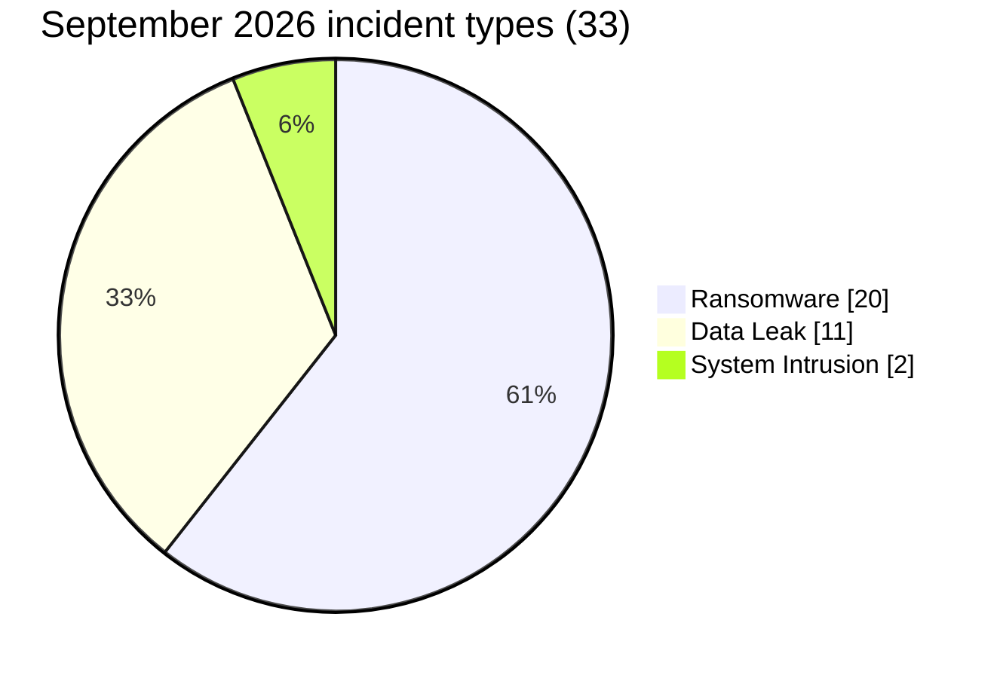

# AFRINTEL - CTI Report | Cyber incidents across Africa - September 2026

**Period:** 1–30 September 2026 · **Editorial review:** 5 November 2026
**Coverage:** 54 African countries monitored; 12 appear in the corpus
**Sources:** ransomware leak sites, underground forums and illicit marketplaces, official statements, specialist reporting and available samples
**Data:** [EN victim records](./victims.md) · [French victim records](./victims_FR.md) · [Version française](./README_FR.md)

> **Sources and approach -** This report uses AFRINTEL's observed postings, available visual evidence, organisational or authority communications and, where possible, read-only local examination of samples. Observed facts, assumptions and unknowns remain separated in the victim records. Figures describe AFRINTEL's documented visibility and do not measure the true number of compromises.

## 1. Executive summary

The September corpus contains **33 cases across 12 countries**: **20 ransomware-related records (60.6%)**, **11 data leaks (33.3%)** and **2 system intrusions (6.1%)**. Each event receives one primary type; ransomware claims without established encryption retain that limitation in the analysis.

South Africa accounts for **9 cases**, Egypt for **8**, and Morocco for **4**. Together they represent **21 of 33 cases (63.6%)**. This concentration is also shaped by source access, language coverage and collection visibility; it is not a national risk ranking.

Evidence maturity is uneven: several records include structured or visual samples reviewed read-only, while others remain listings. Two cases concern third-party exposure without an established direct breach of the named victim; Namibia includes a government confirmation of unauthorised activity in a ministry network. These statuses do not automatically validate actor claims or volumes.

### 1.1 Comparison with October 2026

| Indicator | September | October | Change |
|---|---:|---:|---:|
| **Total** | **33** | **48** | **+15 (+45.5%)** |
| Ransomware | 20 | 17 | −3 (−15.0%) |
| Data Leak | 11 | 23 | +12 (+109.1%) |
| Access Sale | 0 | 3 | +3 (new) |
| System Intrusion | 2 | 5 | +3 (+150.0%) |
| DDoS / Defacement / Account Takeover / Malware / Operational Fraud | 0 | 0 | stable |

October's increase is mainly associated with more documented data leaks. It should not be treated as an equivalent increase in real-world compromises without controlling for collection and reposts.

## 2. Scope, methodology and limitations

Monthly allocation follows the observed publication date or AFRINTEL's first documented observation. This is not necessarily the date of initial access, extraction, encryption or disclosure.

The **33 French and 33 English victim records** were checked for count, order and structured values. Statistics are determined from the French source and checked against the English synchronisation. Each event is counted once; secondary effects and multiple publications do not create duplicates.

Local samples were handled read-only. File, row, page and pattern counts are not converted into unique-person counts. No name, email, phone number, password, token, individual document or criminal link is reproduced.

## 3. September at a glance

### 3.1 Incident types

| Type | Cases | Share |
|---|---:|---:|
| **Ransomware** | **20** | **60.6%** |
| **Data Leak** | **11** | **33.3%** |
| **System Intrusion** | **2** | **6.1%** |
| **Total** | **33** | **100.0%** |

### 3.2 Countries and regions

| Country | Cases | Country | Cases |
|---|---:|---|---:|
| South Africa | 9 | Angola | 2 |
| Egypt | 8 | Kenya | 2 |
| Morocco | 4 | Mali | 1 |
| Nigeria | 2 | Namibia | 1 |
| Tunisia | 1 | Ethiopia | 1 |
| Tanzania | 1 | Uganda | 1 |
| **Total (12 countries)** | **33** |  |  |

| AFRINTEL region | Cases | Share |
|---|---:|---:|
| North Africa | 13 | 39.4% |
| Southern Africa | 12 | 36.4% |
| East Africa | 5 | 15.2% |
| West Africa | 3 | 9.1% |
| **Total** | **33** | **100.0%** |

Regions without a case are not incident-free; they are underrepresented in the collected visibility.

### 3.3 Evidence quality

| AFRINTEL status | Cases | Share |
|---|---:|---:|
| Claim - Data Sample Published | 16 | 48.5% |
| Claim - Unverified | 12 | 36.4% |
| Data Fully Published | 1 | 3.0% |
| Third-Party Exposure Confirmed - Direct Breach Not Established | 2 | 6.1% |
| Victim Confirmed - Unauthorized Access | 1 | 3.0% |
| Government Confirmed - Unauthorized Access | 1 | 3.0% |
| **Total** | **33** | **100.0%** |

Historical labels remain in the records. Third-party exposure or confirmed access does not validate every associated volume or category.

### 3.4 Actors and publishing accounts

| Observed label | Cases |
|---|---:|
| krybit | 6 |
| TheGentlemen | 4 |
| BLACKLOCKS | 2 |
| N0n | 2 |
| lockbit5 | 2 |
| Other labels | 17 |

The ranking measures source visibility, not technical identity or demonstrated responsibility. Forum accounts remain claimed attributions.

### 3.5 Normalized sectors

| Primary sector | Cases | Share |
|---|---:|---:|
| Finance / Insurance | 7 | 21.2% |
| Government / Public administration | 6 | 18.2% |
| Professional services | 4 | 12.1% |
| Healthcare | 3 | 9.1% |
| Technology / Digital services | 3 | 9.1% |
| Education | 2 | 6.1% |
| Real estate | 2 | 6.1% |
| Commerce / Logistics | 2 | 6.1% |
| Transport | 1 | 3.0% |
| Construction | 1 | 3.0% |
| Agriculture | 1 | 3.0% |
| Hospitality | 1 | 3.0% |
| **Total** | **33** | **100.0%** |

Each case receives one primary sector to avoid double counting composite sectors.

## 4. Incidents that matter most

### 4.1 Administrative and identity data

**Centre Atlantique Formation** is one of the most extensively documented cases: **4,644 files**, approximately **3.94 GB**, including **3,476 JSON**, **1,165 PDFs** and **3 JPGs**. The analysis describes **1,155 enrolment records** and identity, training and certificate categories. Internal consistency supports the documentary association, but not the access vector or full claimed volume.

The **SEPE** case in Angola includes **1,189 files** totaling **544,921,521 bytes**, with **111 JSON files** structurally inspected. Claims of **179 GB** and **110,021 users** are not validated by the sample.

The **FCT-IRS** case includes a **314-page PDF**. Email- or telephone-pattern detections are neither a person count nor proof of technical provenance.

### 4.2 Ransomware with visible material

Samples associated with **Apollo 21**, **ARCA Unlimited Architects** and **First National Bank** show commercial, financial or personal documents presented by actors. They support varying documentary associations, but do not prove encryption, complete exfiltration or claimed volumes.

For **Air Tanzania**, 114 local files were examined, including 112 valid images. This structural consistency confirms a corpus associated with the post, not its technical origin.

### 4.3 Confirmations and third-party exposure

The **Namibian Defence Force** record includes a government confirmation of unauthorised activity in the Ministry of Defence and Veterans Affairs network. Encryption, exfiltration and disclosure of military secrets are not established.

For **Hollard Insurance Group** and **Guardrisk**, the records separate third-party exposure or context from a direct breach of the insurer. This prevents automatic attribution to the named victim of data held by a provider.

### 4.4 Healthcare, finance and critical services

Cases involving **MDCN**, **Pharma 5**, **Seashell Hospital**, **FNB**, **Siinqee Bank**, **Armada Credit Bureau**, **Majani Insurance Brokers** and **RelyComply** carry potential impersonation, fraud and targeted-phishing risks. Sector sensitivity does not replace evidence of access or institutional confirmation.

## 5. Strategic reading

Actors seek cross-functional datasets linking identity, professional activity, transactions and supporting documents. Visual samples may support documentary association without establishing technical source. Providers and intermediaries expand the risk perimeter: third-party exposure must remain separate from a confirmed intrusion at the named victim.

Ransomware's dominance also reflects leak-site visibility. It does not mean other intrusion or leak forms are marginal in reality.

## 6. Priority risks

| Environment | Risk to anticipate | Defensive priority |
|---|---|---|
| Public bodies and portals | Impersonation and document fraud | Control exports, IAM and providers |
| Finance and insurance | Payment fraud and targeted phishing | MFA, logging and out-of-band validation |
| Healthcare and regulators | Privacy harm and extortion | Segment and limit bulk access |
| Training and education | Certificate fraud and student targeting | Protect portals and verification mechanisms |
| Digital services and third parties | Lateral movement and credential reuse | Review service accounts and delegated access |

## 7. Intelligence gaps

| Topic | Established | Still to establish |
|---|---|---|
| Ransomware claims | Listings and sometimes visible samples | Encryption, initial access, exfiltration and impact |
| Third-party exposure | Provider or intermediary mentioned in some cases | Scope, data flows and exact responsibility |
| Samples | Categories and internal consistency | Provenance, completeness and unique people |
| Claimed volumes | Actor-published figures | Correspondence with accessible batches |
| Underrepresented countries | Low visibility in the corpus | Local sources, CERT/CSIRT and language coverage |

## 8. MITRE ATT&CK: defensive hypotheses

These are hypotheses to test in logs; they are not attribution.

| Technique | Hypothesis | Data to correlate |
|---|---|---|
| [T1078 - Valid Accounts](https://attack.mitre.org/techniques/T1078/) | Legitimate account abuse | IAM, VPN, SSO and endpoint |
| [T1190 - Exploit Public-Facing Application](https://attack.mitre.org/techniques/T1190/) | Exposed portal exploitation | WAF, proxy and application errors |
| [T1213 - Data from Information Repositories](https://attack.mitre.org/techniques/T1213/) | Extraction from a business repository | File, DB and storage audit |
| [T1530 - Data from Cloud Storage](https://attack.mitre.org/techniques/T1530/) | Cloud-storage download | Cloud API, object logs and DLP |
| [T1486 - Data Encrypted for Impact](https://attack.mitre.org/techniques/T1486/) | Mass encryption where established | EDR, file changes and backups |

A forum file proves none of these techniques; a ransomware listing does not automatically prove T1486.

## 9. SOC recommendations and action plan

1. Alert on bulk exports from ERP, application portals, health databases and financial platforms.
2. Correlate privileged logins with country, ASN, device, time and action.
3. Log downloads, archive creation, permission changes and provider access.
4. Require out-of-band validation for bank-detail changes and sensitive transfers.
5. Prepare session revocation and controlled secret rotation where justified by the investigation.
6. Preserve evidence in restricted storage and never test published credentials.

**0–7 days:** preserve logs, identify systems holding the reported categories, block sensitive financial operations and separate facts from assumptions.
**8–30 days:** test export alerts, review service accounts and third-party access, and prepare protection measures.
**30–90 days:** exercise leak, third-party compromise and ransomware scenarios; measure logging coverage and revocation times.

## 10. Intelligence quality and reservations

Confidence measures the strength of the association or evidence reviewed; impact describes potential or established severity. High confidence in a sample does not automatically confirm an official breach.

The French and English reports use the same 33 records and structured values. Every table totals 33 and must not be recalculated independently from the two languages.

## Conclusion

September 2026 is dominated by ransomware claims, but its most informative cases expose administrative, financial, medical or professional data. Defensive priorities are limiting exports, controlling third-party access, protecting identities and monitoring secondary fraud.

AFRINTEL strictly separates publication, observation, assumption and confirmation so that heterogeneous clandestine sources can support usable CTI.

---

*AFRINTEL - Cyber Threat Intelligence for Africa*
*Detailed records: [victims.md](./victims.md) · [GitHub AFRINTEL](https://github.com/Hatchepsoute/AFRINTEL)*
