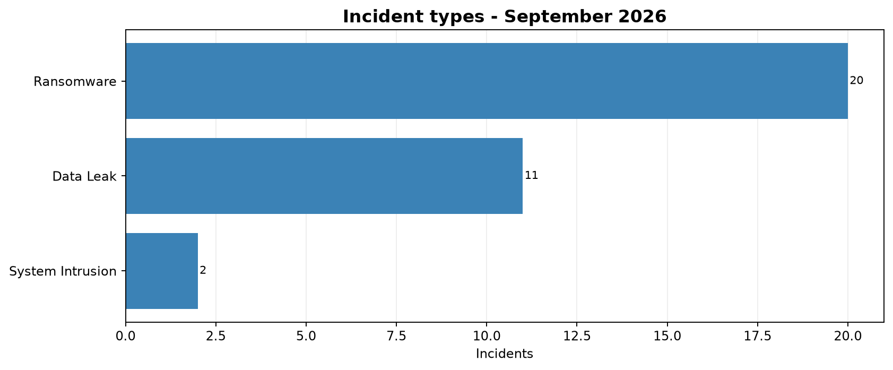
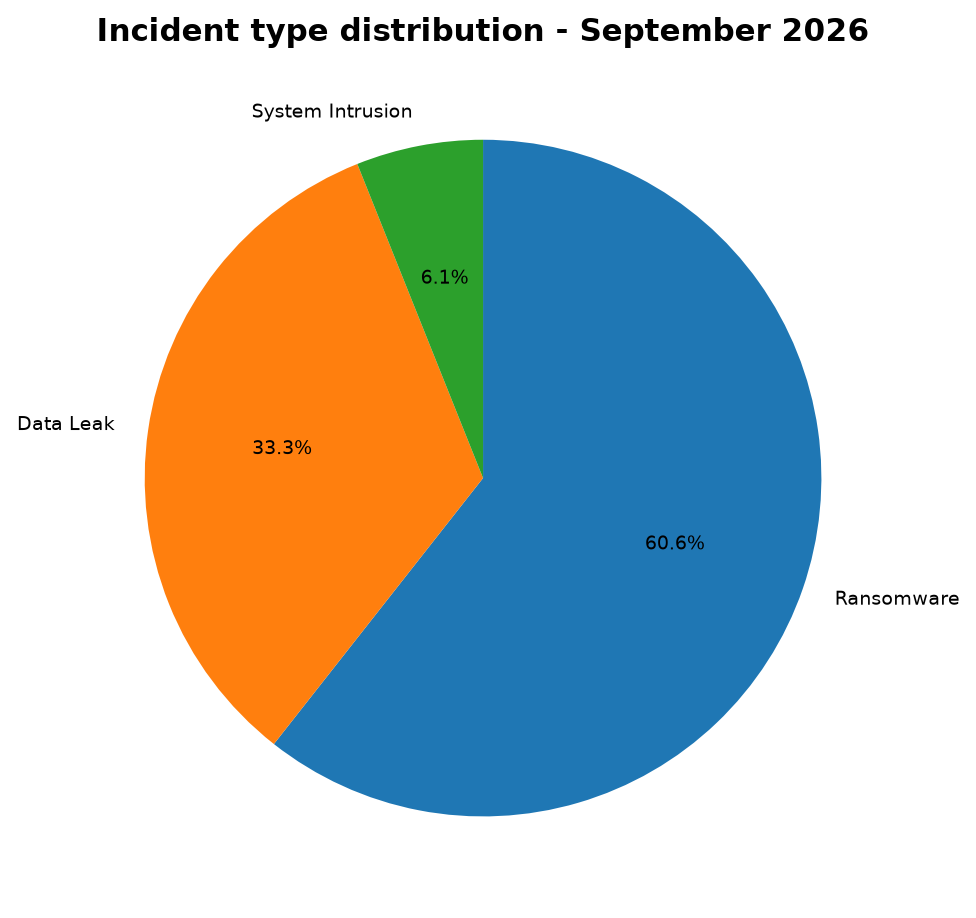
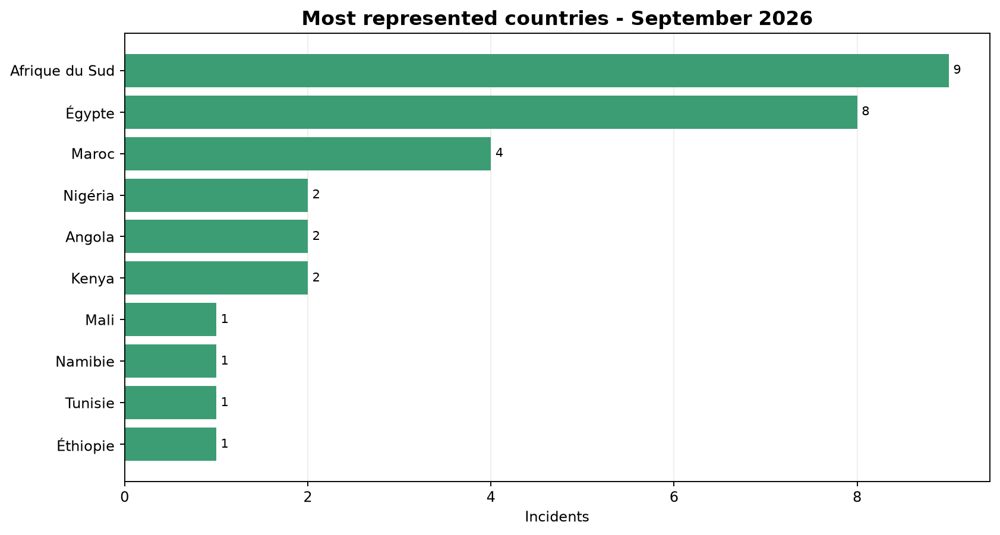
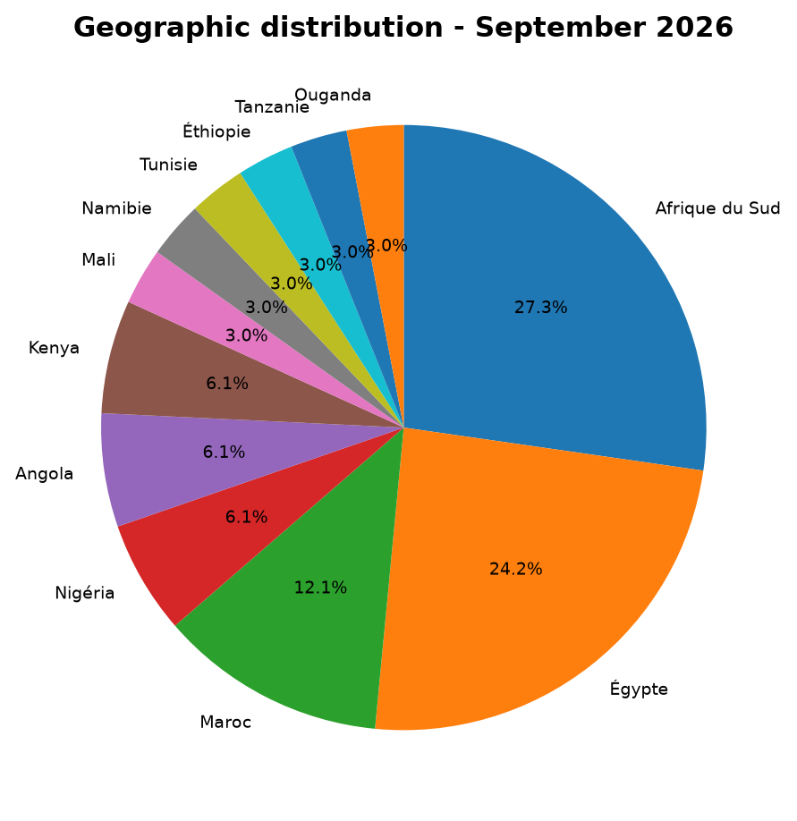
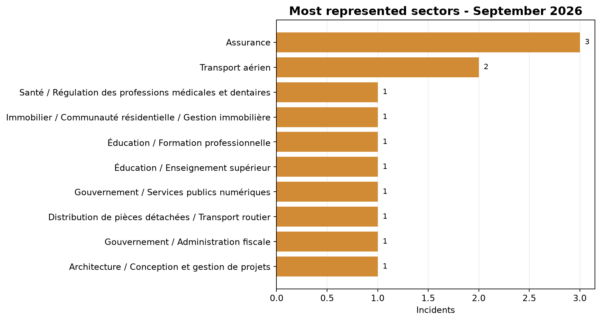
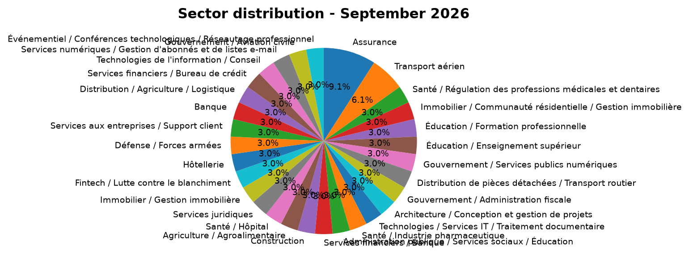
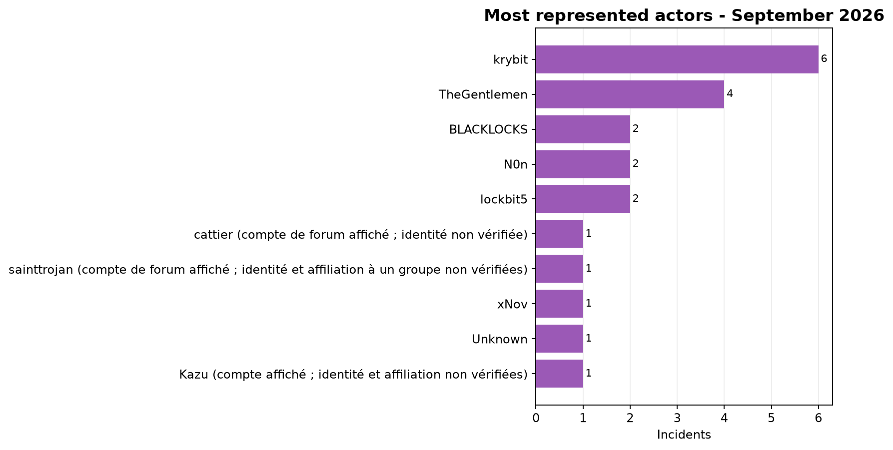
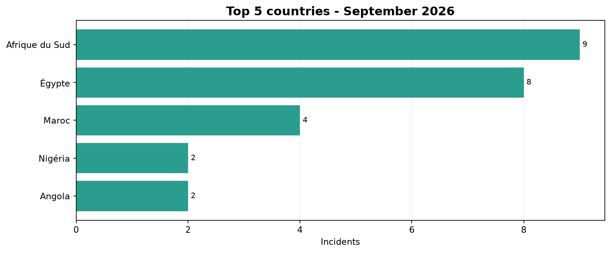

# AFRINTEL CTI report - cyber incidents in Africa (September 2026)

This validated corpus contains **33 incidents or documented cases** first published or first observed by AFRINTEL in September 2026. The month assignment follows the publication or first documented observation date; a compromise date is not inferred when it is unavailable.

## Validated monthly breakdown

| Incident type | Count | Share |
|---|---:|---:|
| Ransomware | 20 | 60.6% |
| Data Leak | 11 | 33.3% |
| System Intrusion | 2 | 6.1% |
| **Total** | **33** | **100.0%** |

## Countries most represented

| Country | Count |
|---|---:|
| Afrique du Sud | 9 |
| Égypte | 8 |
| Maroc | 4 |
| Nigéria | 2 |
| Angola | 2 |
| Kenya | 2 |
| Mali | 1 |
| Namibie | 1 |
| Tunisie | 1 |
| Éthiopie | 1 |
| Tanzanie | 1 |
| Ouganda | 1 |

## Actor labels most represented

| Actor label | Count |
|---|---:|
| krybit | 6 |
| TheGentlemen | 4 |
| BLACKLOCKS | 2 |
| N0n | 2 |
| lockbit5 | 2 |
| cattier (compte de forum affiché ; identité non vérifiée) | 1 |
| sainttrojan (compte de forum affiché ; identité et affiliation à un groupe non vérifiées) | 1 |
| xNov | 1 |
| Unknown | 1 |
| Kazu (compte affiché ; identité et affiliation non vérifiées) | 1 |

## Sectors most represented

| Sector | Count |
|---|---:|
| Assurance | 3 |
| Transport aérien | 2 |
| Santé / Régulation des professions médicales et dentaires | 1 |
| Immobilier / Communauté résidentielle / Gestion immobilière | 1 |
| Éducation / Formation professionnelle | 1 |
| Éducation / Enseignement supérieur | 1 |
| Gouvernement / Services publics numériques | 1 |
| Distribution de pièces détachées / Transport routier | 1 |
| Gouvernement / Administration fiscale | 1 |
| Architecture / Conception et gestion de projets | 1 |

## Methodology

The figures are derived once from `victims_FR.md`, checked against `victims.md`, and reused in the reports, comparisons and STIX bundle. A multi-country incident counts once globally; country occurrences may therefore exceed the global total. The corpus measures documented AFRINTEL visibility, not the actual prevalence of cyberattacks.

[Victim records](./victims.md)

### Visualisations

