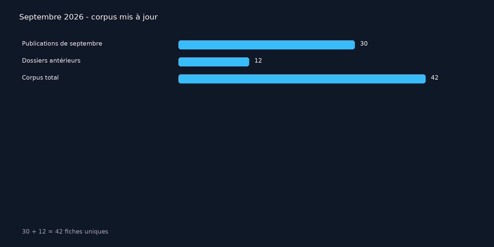
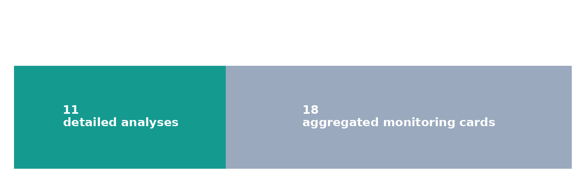
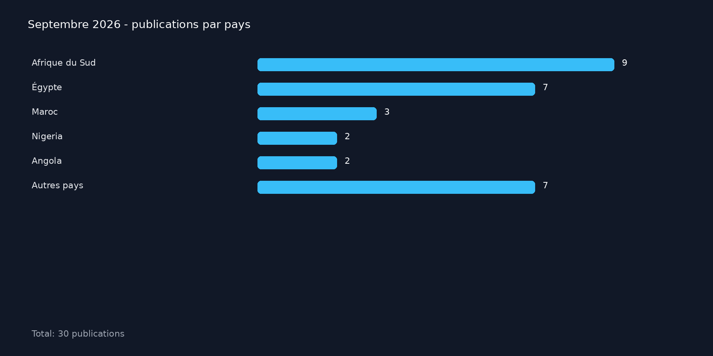
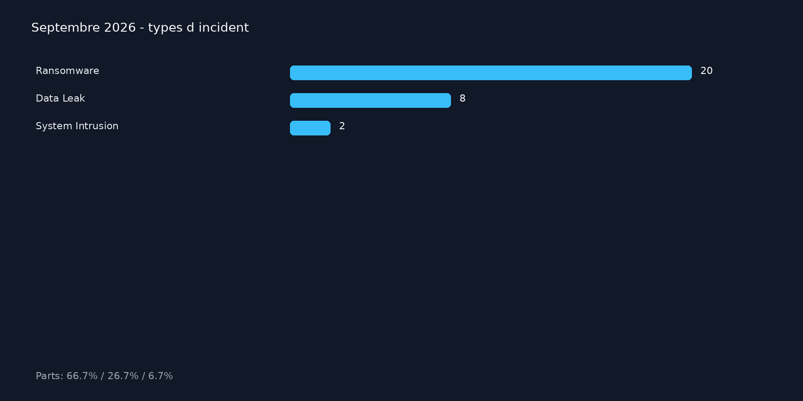
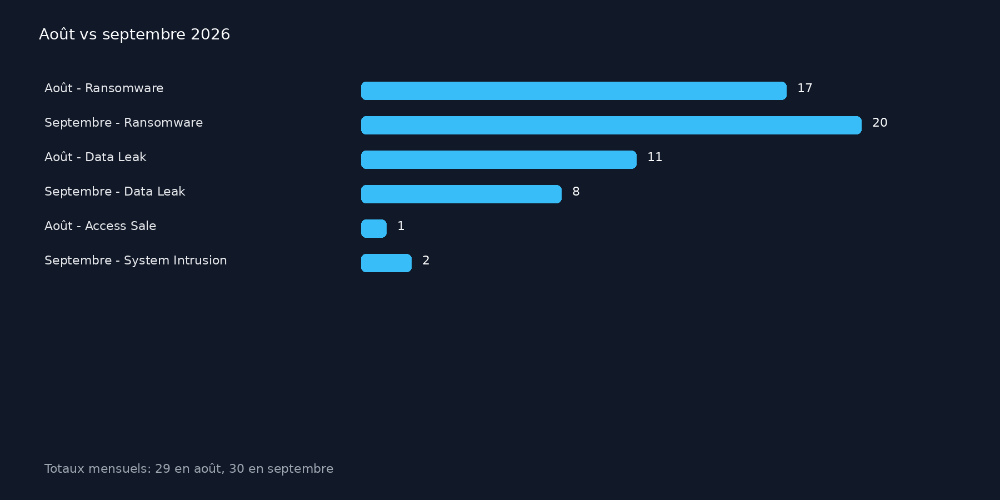
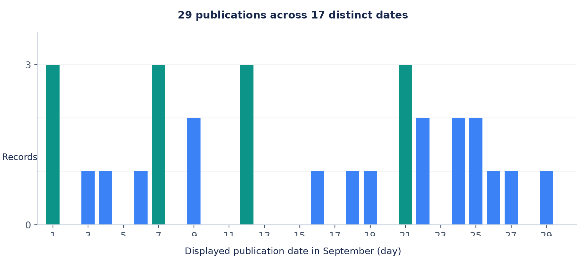
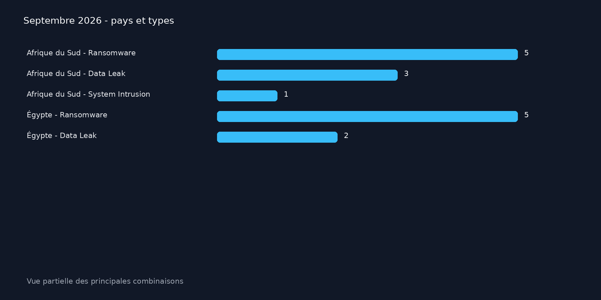
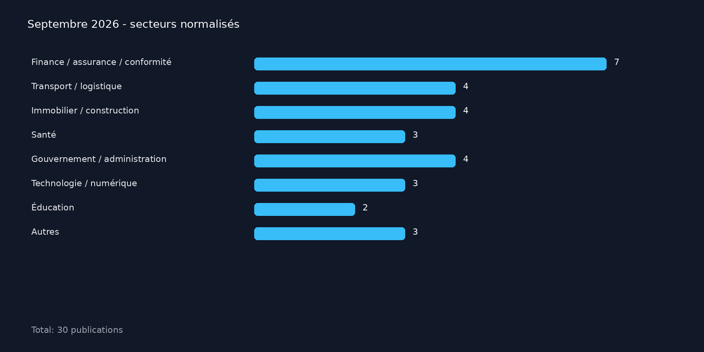
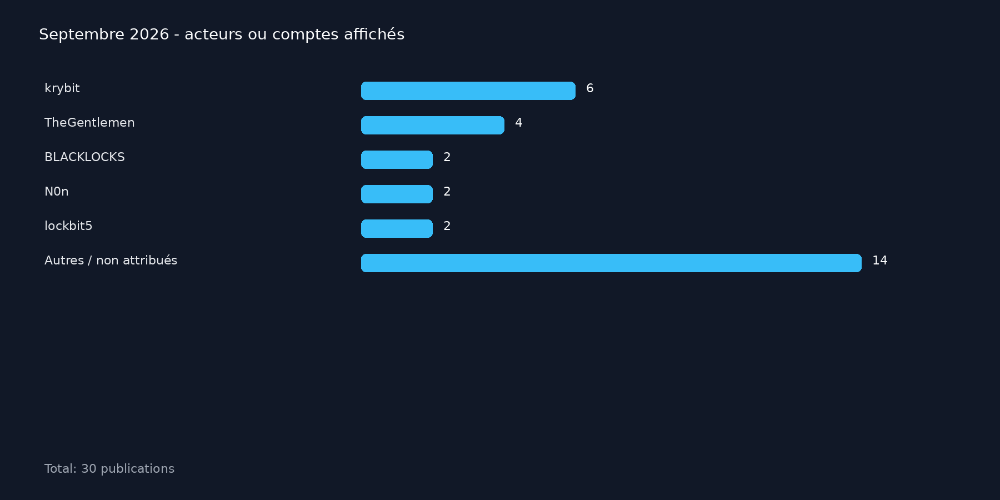

# AFRINTEL - Monthly Cyber Threat Intelligence Report
👉🏾[**French version available here**](./README_FR.md)

## Table of contents

1. [Reading note and analytical warning](#reading-note-and-analytical-warning)
2. [Executive summary](#executive-summary)
3. [01. Scope, sources and method](#01-scope-sources-and-method)
4. [02. September 2026 dashboard](#02-september-2026-dashboard)
5. [03. Priority intelligence cases](#03-priority-intelligence-cases)
6. [04. Operational lessons and attack hypotheses](#04-operational-lessons-and-attack-hypotheses)
7. [05. Hunt plan - SOC / CERT / CSIRT](#05-hunt-plan---soc--cert--csirt)
8. [06. Risk-reduction roadmap](#06-risk-reduction-roadmap)
9. [07. Earlier incidents: context not to confuse with September](#07-earlier-incidents-context-not-to-confuse-with-september)
10. [08. Intelligence prioritisation](#08-intelligence-prioritisation)
11. [Appendices A to D](#appendix-a---register-of-29-september-publications)

> The detailed English sections corresponding to items 03 to 11 are being synchronised with the French report. The current English edition retains the validated dashboard, CTI cases, defensive implications and conclusion below.
**Africa - September 2026**
**Ransomware, data leaks and extortion monitoring**

Monitoring overview of publications affecting African organisations, based on ransomware-group sites, leak sites and underground forums.

| **29** | **12** | **41** |
|:---:|:---:|:---:|
| September-dated publications | Earlier incidents integrated | Total unique corpus |

**Edition:** 17 October 2026
**Scope:** Africa, AFRINTEL OSINT and monitoring records
**Audience:** CISOs, SOC teams, CERT/CSIRT teams, risk owners and CTI analysts
**Distribution:** Monitoring analysis. No personal data or criminal links reproduced.

## Reading note

This report describes a monitoring corpus built from observed underground publications. It is not a list of 29 confirmed intrusions and it is not an exhaustive measure of cybercrime in Africa.

The English and French victim files contain the same 41 records and are treated as one bilingual source. Only 29 records concern publications dated in September 2026; the other 12 concern earlier incidents integrated retrospectively. Publication dates are not automatically incident dates. A victim listing, a visible sample and a later disclosure are separate events. Payment, negotiation, resale or removal are not inferred from the presence or absence of a file.

## Executive summary

The September signal is dominated by ransomware-related claims, but most publications are not corroborated by independent technical evidence.

| Indicator | Value | CTI reading |
|---|---:|---|
| Corpus records | 41 | 29 September publications and 12 earlier incidents |
| September publications | 29 | Across 12 countries |
| Ransomware | 20 / 29 (69.0%) | Monitoring label or claim, not proven encryption |
| Data Leak | 7 / 29 (24.1%) | Publications concerning alleged data exposure |
| System Intrusion | 2 / 29 (6.9%) | Documented access or attempt, with limited outcome |
| Claim - Unverified | 12 / 29 (41.4%) | Publication without associated public confirmation |
| Claim - Data Sample Published | 12 / 29 (41.4%) | Visible extract or local corpus, without automatic access confirmation |
| Data Fully Published | 1 / 29 (3.4%) | AFRICA-TECH: 10 released files examined |
| South Africa + Egypt | 15 / 29 (51.7%) | Monitoring concentration, not an attack rate |

## Comparison with the August 2026 corpus

This comparison uses the documented monthly corpora: **30 records in August** versus **29 September-dated publications**. The September corpus also contains 12 earlier incidents integrated retrospectively; they are excluded from this monthly comparison.

| Indicator | August 2026 | September 2026 | Observed change |
|---|---:|---:|---:|
| Monthly records / publications | 30 | 29 | -1 (-3.3%) |
| Ransomware | 17 | 20 | +3 (+17.6%) |
| Data Leak | 12 | 7 | -5 (-41.7%) |
| Access Sale | 1 | 0 | -1 (-100%) |
| System Intrusion | 0 | 2 | +2 (newly observed category) |

This comparison measures AFRINTEL collection corpora, not the actual number of compromises. Composition differences should be interpreted cautiously because five earlier records were already integrated into the August corpus and twelve earlier incidents are integrated into the full September corpus.

### Five strategic conclusions

1. Disclosure-based extortion dominates the visible signal: 20 of 29 September publications are classified as Ransomware, although encryption generally cannot be confirmed.
2. The corpus is geographically concentrated: South Africa accounts for 8 publications and Egypt for 7. This also reflects monitored sources, campaign visibility and editorial selection.
3. The intelligence value is highest where artefacts were observed: Centre Atlantique Formation, SEPE, AFRICA-TECH, Apollo 21, ARCA and FCT-IRS provide more substance than a simple leak-site listing.
4. Priority risks include identity fraud, payment fraud, reuse of administrative documents, targeted phishing and disclosure of plans, banking documents or certificates. Operational damage is not assumed.
5. Two September-dated cases have confirmation statuses in the cards: RelyComply is recorded as `Victim Confirmed - Unauthorized Access`, and the Namibian Defence Force as `Government Confirmed - Unauthorized Access`. These statuses concern access or an incident, not automatically encryption, exfiltration or claimed volumes.

## 1. Scope, sources and method

### 1.1 Three timelines to keep separate

**Incident date:** the actual time of access or disruption, often unknown for September publications.
**Initial publication date:** the date displayed on a forum, extortion list or message, used to place a record in the September publication cohort.
**Discovery or integration date:** when AFRINTEL obtained an artefact or integrated the case, which may be later than the month concerned.

An item published on 27 September and reviewed on 8 October remains a September publication. Conversely, a January 2026 incident added to the inventory in September is not treated as an incident occurring in September.

### 1.2 Observation status and documentary depth

| Status | Operational meaning | Limitation |
|---|---|---|
| Claim - Unverified | Publication observed without associated public confirmation | A listing alone does not establish access |
| Claim - Data Sample Published | Publication accompanied by an extract or images | Data origin may remain unknown |
| Data Fully Published | Release reviewed according to the collection | Does not prove that all obtained data was released |
| Victim / Government Confirmed | Public confirmation by an organisation or authority | Vector and scope may remain unknown |
| Corroborated | Several public elements converge | Does not establish every claimed effect |

To avoid conflating status and analytical depth, AFRINTEL also uses this descriptive scale:

| Level | Description | What cannot be inferred |
|---|---|---|
| P0 - Publication observed | Victim, domain, account or threat displayed at a given time | Intrusion, data authenticity or technical responsibility |
| P1 - Visible or reviewed sample | Extract, image or file structure consistent with the organisation | Certain technical source, total volume, unique persons or encryption |
| P2 - Published batch reviewed | Batch made accessible during collection and characterised locally | Complete exfiltration, initial access, restoration or payment |

This scale complements, but does not replace, AFRINTEL statuses. A third-party exposure can be confirmed at the exposure level without establishing a direct intrusion at the named organisation.

### 1.3 Methodological limits

The corpus is primarily based on monitoring ransomware-group sites, leak sites and underground forums, supplemented where available by public communications and visible material associated with the publications. These sources document listings, displayed actors, dates, deadlines, samples and possible releases. They do not always establish initial access, data completeness or the outcome of a negotiation.

The French and English victim files are the consolidated editorial record of this monitoring. Raw artefacts, screenshots and external manifests are not treated as official confirmation. No personal data, credentials, secrets or tokens are reproduced.

The corpus is not exhaustive. Visibility varies by country, language, sector, source availability and publication access. Counts measure AFRINTEL's observable monitoring activity, not the actual number of intrusions.

For ransomware cases, listing, sample, deadline, disclosure and last verification are tracked separately. Payment, negotiation, removal, resale and transfer remain `unknown` unless specific public information supports a qualification.

## 2. September dashboard

The following visualisations measure known AFRINTEL publications, not confirmed attacks.

*Figure 1 - Unique corpus: 29 September publications and 12 earlier incidents.*

*Figure 2 - Documentary depth: 11 detailed analyses and 18 complementary monitoring cards.*

The 18 complementary cards mainly provide alerting and initial qualification. They should not be treated as equivalent to cases supported by reviewed samples or local artefacts.

*Figure 3 - Countries associated with the 29 September publications.*

*Figure 4 - Incident type on the left and publication status on the right.*

The September cohort contains 12 `Claim - Unverified` records, 12 `Claim - Data Sample Published` records, 2 acknowledged indirect exposures, 1 `Victim Confirmed` record, 1 `Government Confirmed` record and 1 `Data Fully Published` record. These categories describe different observation levels and do not automatically establish complete exfiltration, access vector or claimed volumes.

*Figure 5 - Incident types in the 29 September-dated publications compared with the complete 41-record corpus.*

The September publication cohort contains 20 Ransomware records, 7 Data Leak records and 2 System Intrusion records. The complete corpus contains 24 Ransomware, 10 Data Leak, 4 System Intrusion, 2 Defacement and 1 Access Sale records.

*Figure 6 - Displayed first-publication dates in September.*

The peaks on 1, 7, 12 and 21 September each contain three publications. They may reflect grouped deposits or source selection and do not establish common intrusion dates.

*Figure 7 - Country and declared incident-type cross-tabulation.*

*Figure 8 - Editorial grouping into ten sector families.*

For the September cohort, Finance, Insurance and Compliance account for 7 publications (24.1%). Transport and Logistics and Real Estate, Construction and Architecture account for 4 each. Health, Government and Technology account for 3 each. These are corpus concentrations, not national attack rates.

*Figure 9 - Most frequent displayed actor labels in the September cohort.*

The most visible labels are `krybit` (6), `TheGentlemen` (4), `BLACKLOCKS` (2), `N0n` (2) and `lockbit5` (2). The 13 remaining records include less frequent labels and records without public attribution. Actor labels do not constitute forensic attribution or a count of distinct groups.

## 3. Geographic and sector distribution

### September-dated publications: 29 records

| Country | Records | Share |
|---|---:|---:|
| South Africa | 8 | 27.6% |
| Egypt | 7 | 24.1% |
| Morocco | 3 | 10.3% |
| Nigeria | 2 | 6.9% |
| Angola | 2 | 6.9% |
| Namibia, Tunisia, Ethiopia, Mali, Tanzania, Uganda and Kenya | 1 each | 3.4% each |
| **Total** | **29** | **100%** |

For the complete 41-record corpus, South Africa accounts for 16 records, Egypt 7, Morocco and Kenya 3 each, Nigeria and Angola 2 each, and the other countries 1 each. This complete-corpus view includes the 12 earlier incidents.

After cautious normalisation of sector labels in the complete corpus, Health and Government / Administration each account for 5 records, Insurance for 3, and Real Estate, Education, Financial Services and Air Transport for 2 each. The remaining 20 records belong to distinct or specialised sectors. For the September cohort alone, the leading sector family is Finance, Insurance and Compliance with 7 records.

## 4. Priority CTI cases

The priority selection is based on data sensitivity, analytical depth and defensive value. Each case separates observation, claim and unknowns.

### 4.1 Angola - SEPE / digital public services

The card documents 1,189 local files totalling 544,921,521 bytes, including 111 JSON files with structures related to identity, residence, contact details, documents and administrative processes. The publication claims 364,841 files, 110,021 users, 179 GB, a USD 100,000 demand and a 27 September deadline. None of these aggregates is validated by the local sample. The access vector, actual scope, encryption, payment, victim confirmation and post-22 September status remain unknown.

### 4.2 Morocco - Centre Atlantique Formation

The announced archive contains approximately 1,155 folders and 3,465 objects, including JSON records and PDF certificates. The internal consistency between the JSON and certificates supports a documentary link with training data. The claimed 27% release and USD 300 offer remain actor claims. Unique people, source system, complete extraction, access method and encryption remain unknown.

### 4.3 Mali - AFRICA-TECH

Ten published files were supplied and reviewed, totalling 2,413,673 bytes: six PDFs over 39 pages, two Word documents, one text file and one unusable temporary file. The corpus includes financial, travel, insurance, complaint and correspondence material. Claims of document encryption and backup destruction are not established by the reviewed files. The access vector, full scope, payment and independent authentication remain unknown.

### 4.4 South Africa - BLACKLOCKS: Apollo 21 and ARCA Unlimited

Apollo 21 has 14 reviewed images, including commercial documents, sales tables and three identity-document images. ARCA Unlimited has 18 images, including plans, elevations, project files, costs and an identity document. The claimed 400 GB and “400G” volumes were not measured and must not be treated as two complete 400 GB datasets. The technical origin, compromised environment, prior publication permissions, encryption, operational effect and victim confirmation remain unknown.

### 4.5 Nigeria - MDCN and FCT-IRS

The MDCN post claims 65,580 users; the supplied sample contains 50 textual rows and 24 field labels covering practitioner identity and registration. No unique-person count or MDCN intrusion is established. The FCT-IRS PDF contains 2,541 email-pattern matches, 2,540 distinct textual values and 61 Nigerian phone-pattern matches. These are technical matches, not affected-person counts, and do not establish extraction from tax-administration systems.

### 4.6 Egypt - Madinaty and Badr University

The Madinaty post claims owner and resident data and refers to 0.5% of a total. The visible extract contains identities, roles and residential identifiers, but the source organisation is not identified. A Badr University capture claims a complete extraction, with partially masked email-like identifiers and password-like strings. No valid credential, compromised account or total record count is demonstrated.

### 4.7 Morocco - Pharma 5

Four local images were documented, but two duplicate one publication and two duplicate the same quality-specification page. Only one distinct page, identified as page 1/5 and related to salicylamide, is readable. It supports a documentary link with Pharma 5 but does not establish possession of the other pages or the claimed finance, quality, supply-chain and personnel data.

### 4.8 South Africa - First National Bank

Five JPEGs show apparent business-account statements for periods in 2023 and 2025. Their appearance is consistent with FNB documents, but nothing establishes that they came from the bank's infrastructure. A customer, third party or another repository may be the source. The post does not confirm account access or financial loss.

### 4.9 Tanzania - Air Tanzania

The available record describes 114 files totalling 676,972,266 bytes: 112 valid images, including 101 MPO files with three views and 11 single-view JPEGs, representing 314 integrated views, plus two files with a different technical nature. Structural consistency does not establish acquisition from Air Tanzania's infrastructure or the number of affected people.

### 4.10 The 18 complementary monitoring cards

The 18 complementary cards include 12 `Claim - Unverified` records, two local-sample or local-corpus records, two acknowledged indirect exposures and two cases with public confirmation of access or an incident. They cover finance and insurance, strategic and transport services, professional and industrial services, tourism and distribution. Their cards generally provide neither incident-response evidence nor a verified access point or stolen quantity. The appropriate CTI action is qualification and monitoring, not adding new confirmed compromises.

## 5. Operational lessons and attack hypotheses

The presence of sensitive documents identifies surfaces to verify; the corpus does not reconstruct a single technical kill chain.

1. **Identifying-data appropriation:** identity cards, birth data, phones, practitioner records and administrative documents can support impersonation, phishing and document fraud.
2. **Financial and BEC fraud:** statements, supplier details and commercial documents can support payment redirection or fraudulent bank-detail changes.
3. **Document supply-chain risk:** quality files, plans, contracts and reports can be used to target customers and partners; their presence does not prove that those third parties were compromised.
4. **Provider pivot:** historical MIP Holdings and Rectron cases illustrate third-party risk, but this mechanism must not be projected onto September claims without evidence.

Defensive ATT&CK hypotheses include Valid Accounts (`T1078`), Data from Information Repositories (`T1213`), Data from Cloud Storage (`T1530`), Exfiltration to Cloud Storage (`T1567.002`), Data Staged (`T1074`) and Data Encrypted for Impact (`T1486`). These are investigation categories, not actor attributions. `T1486` must not be inferred from the word “ransomware” alone.

Potential post-disclosure fraud scenarios include impersonation of an authority, diversion of commercial relationships and falsification of certificates, identity documents or plans. These are defensive hypotheses only.

## 6. SOC / CERT / CSIRT hunting plan

| Priority | Hunt | Data to correlate | Trigger and validation |
|---|---|---|---|
| H01 P1 | Unusual document export | SaaS, DLP, CRM/ERP, API and proxy logs | Export volume above the user's baseline; exclude approved migrations and backups |
| H02 P1 | Privileged account and repository | IAM, Entra/IdP, VPN, PAM and database logs | New location or client followed by mass reading; verify team changes and testing |
| H03 P1 | Sensitive documents made public | SharePoint/Drive/S3 audit, CASB and ACL review | New anonymous link or public permission; validate business approval |
| H04 P1 | Abnormal encryption | EDR, Windows events, canaries and backups | Mass renames/writes and copy-destruction artefacts; exclude maintenance |
| H05 P2 | Post-exposure fraud | Mail security, DMARC, SIEM and treasury tickets | Domain impersonation plus document or IBAN-change request; validate out of band |
| H06 P2 | Certificate or QR abuse | Validation audit, WAF, API and anti-bot logs | Identifier enumeration or homogeneous response spike; exclude official campaigns |

Two generic detections should be calibrated locally: a 30-day baseline for exports by user, application and operation; and alerts for anonymous or global sharing followed by a download spike. These are behavioural detections, not signatures extracted from the corpus.

### 6.1 Claim-response decision flow

1. **Triage:** preserve the capture, internal monitoring URL, displayed time and authorised artefact hash.
2. **Linkage:** assess schema, system names and metadata against authorised internal data.
3. **Origin:** review logs, data ownership and access controls.
4. **Scope:** deduplicate lawfully and establish affected data, duration and perimeter.
5. **Decision:** determine containment or notification using legal criteria, evidence and incident-command validation.

## 7. Risk-reduction roadmap

### Immediate actions, 0 to 72 hours

- Classify assets containing identity documents, administrative records, statements, certificates, payment data and sensitive technical documents.
- Preserve access and export logs before retention periods expire.
- Audit privileged accounts, OAuth applications, API tokens and exposed provider access.
- Strengthen out-of-band validation for bank-detail changes and support authentication.
- Check offline or immutable backups and test restoration; do not infer backup destruction from a criminal README.

### Within seven days

- Review anonymous sharing, repository permissions and business exports.
- Run targeted awareness for payment fraud, fake authorities, certificates and identity requests.
- Review processing involving minors, residents and identity-document holders.
- Test authorised document-verification APIs against enumeration and extraction.
- Document crisis communication and regulatory-notification thresholds.

### Within thirty days

- Monitor republication or recycling patterns without downloading personal data.
- Deploy correlated IAM, storage and DLP detections with documented false positives.
- Update the inventory of third parties handling identity data, certificates, customer documents and plans.
- Exercise a crisis scenario based on an unverified claim to avoid premature attribution and notification.

### 7.1 Monitoring criteria for October-November 2026

| Change indicator | CTI action |
|---|---|
| Organisation publicly confirms an incident | Reassess status, chronology, scope and uncertainty |
| Documented batch becomes available to an authorised team | Review read-only and publish minimised metrics only |
| Claimed remaining data is released | Compare hashes and structures safely; do not pay for access |
| New deadline or publication by N0n / Kazu | Update the extortion lifecycle and last-check date |
| Phishing targets named organisations | Correlate fraud artefacts and publish verified IOCs only |
| New third-party regulatory notices | Separate provider, client and related-entity incidents |

No verified technical IOC, C2 address or malware hash is supplied. Domains of named organisations are not adversary infrastructure.

## 8. Earlier incidents: context, not September

Twelve records describe events from January to August 2026 and were integrated retrospectively. They are excluded from all monthly charts. This retrospective cohort contains eight `Victim Confirmed`, one `Government Confirmed`, two `Corroborated` and one `Claim - Unverified` record.

Land Bank and Ahmed Al-Kadi Private Hospital illustrate confirmed ransomware impact; SEEG documents disruption to an energy and water operator; CHPC/Lengau documents an incident affecting a high-performance-computing environment. Standard Bank, MIP Holdings and Rectron illustrate documentary exposure and third-party risk, not necessarily compromise of a banking core.

The MINEFOP and Kenyan presidential-site defacement cases illustrate integrity and reputational risk. Constantia Pharmacy shows the value of external discovery followed by defensive coordination. TikoHUB is an uncorroborated access-sale claim and does not confirm stolen credentials.

### 8.1 Inter-month follow-up: Libyan Ministry of Education

A note follows a 10 September EveN47 publication linked to an earlier June EvaN47 case. The claimed 287 GB, 800 GB and 300 GB volumes are separate assertions and must not be added. A September sample of 3,900 files totalling 900,976,395 bytes was reviewed read-only and included passports, national identifiers, student photographs and certificates. SHA-256 checks identified 169 duplicate groups and 213 excess files. This comparison does not prove initial access or the claimed total volumes. It is an inter-month note, not a 42nd record, and is excluded from every monthly total.

## 9. Intelligence prioritisation

| Priority | Cases / issue | Rationale | Expected deliverable |
|---|---|---|---|
| P1 | SEPE, Centre Atlantique, FCT-IRS, MDCN | Identity and administrative data; fraud risk | Provenance, legal perimeter and affected population |
| P1 | AFRICA-TECH | Published batch reviewed in the collection | Extortion lifecycle and minimised content record |
| P1 | Apollo 21, ARCA, Pharma 5 | Commercial, plans, quality and partner data | BEC, document-sharing and third-party risk analysis |
| P2 | FNB, ATCL, BUC, Madinaty | Documentary or visual link without proven target intrusion | Source-origin validation and confirmation status |
| P2 | 12 unconfirmed claims and two indirect exposures | Ongoing publications without conclusions on data disposition | Update monitoring without alarmist redistribution |

### 9.1 Minimum requirements for qualification changes

1. Preserve the original capture, displayed timestamp, collection date and lawful cryptographic hash.
2. Separate what links an artefact to an organisation from what proves access or extraction from a system.
3. Obtain internal data-owner validation or an official notification without testing exposed credentials or contacting criminal actors.
4. Produce deduplicated counts of objects and people, separating claimed size, supplied size, document count and population.
5. Revise statuses as new observations arrive. Strong documentary resemblance does not automatically become a confirmed incident.

## 10. Analytical conclusion

The September 2026 corpus contains 29 publications dated in the month and 12 earlier incidents integrated into the tracking corpus, for 41 records overall. It reflects AFRINTEL monitoring of ransomware sites, leak sites and underground forums. It is neither a count of intrusions that occurred in September nor an exhaustive measure of African cybercrime.

The publications are mostly ransomware claims. Some contain visible samples or released data, while a few have public confirmation of access or an incident. These observation levels remain separate from exfiltration completeness, initial vector, encryption, payment and operational effect.

The collection does not establish a common technical campaign, a dominant access vector or a real increase compared with August. It does highlight recurring risks involving identity, administrative documents, financial data, document repositories and supplier relationships.

For affected organisations, an underground publication is a signal for verification and preparation. CTI follow-up should focus on listing changes, samples, deadlines, releases, public confirmations and republications. Payments, negotiations, removals, resales and transfers remain unknown without specific public information.

## Appendix A - Register of the 29 September publications

| Date | Country / target | Displayed account or group | Type | Status |
|---|---|---|---|---|
| 01/09 | Egypt - HCCD; Mecca High Feed Factory; Seashell Hospital | krybit | Ransomware | S0 |
| 03/09 | Nigeria - MDCN | cattier | Data Leak | S1 |
| 04/09 | Egypt - Madinaty owners/residents | sainttrojan | Data Leak | S1 |
| 06/09 | Morocco - Centre Atlantique Formation | xNov | Data Leak | S1 |
| 07/09 | South Africa - Hollard; Egypt - Nile Projects Trading; South Africa - VSB Attorneys | TheGentlemen / lockbit5 | Ransomware | S0 |
| 09/09 | Egypt - Badr University; South Africa - RelyComply | elmo7areb / direwolf | Data Leak / System Intrusion | S1 / Victim Confirmed |
| 12/09 | Egypt - EAC; Morocco - La Sultana; Angola - SEPE | krybit / Kazu | Ransomware | S0 / S1 |
| 16/09 | Namibia - Namibian Defence Force | ransomhouse | System Intrusion | Government Confirmed |
| 18/09 | Tunisia - PayPal support operations | N0n | Ransomware | S0 |
| 19/09 | South Africa - Apollo 21 | BLACKLOCKS | Ransomware | S1 |
| 21/09 | Nigeria - FCT-IRS; Angola - Grupolider; Ethiopia - Siinqee Bank | individual / TheGentlemen / lockbit5 | Data Leak / Ransomware | S1 / S0 |
| 22/09 | Mali - AFRICA-TECH; South Africa - ARCA Unlimited | N0n / BLACKLOCKS | Ransomware | S2 / S1 |
| 24/09 | Tanzania - Air Tanzania; Uganda - Armada | krybit / Spirals | Ransomware | S1 / S0 |
| 25/09 | Kenya - Majani; Morocco - Pharma 5 | Vexy Ransomware / INC Ransom | Ransomware | S0 / S1 |
| 26/09 | South Africa - Guardrisk | TheGentlemen | Ransomware | S0 |
| 27/09 | South Africa - FNB | Blacknet00 | Ransomware | S1 |
| 29/09 | South Africa - BCX | incransom | Ransomware | S0 |

S0 means `Claim - Unverified`, S1 means `Claim - Data Sample Published` and S2 means `Data Fully Published`. The publication date is not an intrusion date.

## Appendix B - The 12 earlier incidents

| Source date | Target / country | Type | Status |
|---|---|---|---|
| 03/01 | South Africa - Constantia Pharmacy | Ransomware | Corroborated |
| 12/01 | South Africa - Land Bank | Ransomware | Victim Confirmed |
| 23/03 | South Africa - Standard Bank | Data Leak | Victim Confirmed |
| 18/04 | South Africa - Ahmed Al-Kadi Private Hospital | Ransomware | Victim Confirmed |
| 28/04 | Kenya - TikoHUB | Access Sale | Claim - Unverified |
| Late May | South Africa - CHPC / Lengau | System Intrusion | Victim Confirmed |
| June | South Africa - MIP Holdings | Data Leak | Victim Confirmed |
| 14-15/06 | Gabon - SEEG | System Intrusion | Victim Confirmed |
| 12/07 | Cameroon - MINEFOP | Defacement | Corroborated |
| 15/07 | South Africa - Rectron | Data Leak | Victim Confirmed |
| 18/07 | Kenya - president.go.ke | Defacement | Government Confirmed |
| 26/08 | South Africa - Cartrack | Ransomware | Victim Confirmed |

These dates and statuses refer to January-August events and are excluded from September denominators.

## Appendix C - Documented samples and limits

| Case | Observed material | What it does not prove |
|---|---|---|
| MDCN | Local 50-row CSV, 24 fields | Unique people, intrusion or source database |
| Madinaty | Visible Arabic extract; 0.5% claimed | Data holder, full authenticity or addresses |
| Centre Atlantique | 1,155 folders, 3,465 objects, about 4 GB extracted | Unique people, complete database or exact 27% |
| BUC | Capture with masked logins and strings | Valid password or account compromise |
| SEPE | 1,189 files, 111 JSON, 544,921,521 bytes | 179 GB, 110,021 people or encryption |
| Apollo 21 | 14 images, 12 samples | 400 GB, source system or encryption |
| FCT-IRS | 314-page PDF with email-pattern matches | Unique people, full breach or system extraction |
| ARCA Unlimited | 18 images, 17 samples | “400G”, client intrusion or encryption |
| VSB Attorneys | Failed test of a 1,082,440,568-byte RAR5 fragment | Content, completeness or actual disclosure |
| AFRICA-TECH | 10 published files and 39 PDF pages | Backup destruction or exfiltration volume |
| Pharma 5 | Four images, one distinct readable page | 50 GB or the full five-page document |
| FNB | Five apparent statement JPEGs | Banking provenance or account access |
| Air Tanzania | 114 files, 112 valid images, 314 views | Acquisition source or unique people |

Sensitive categories include identity and official documents, certificates, banking and payment material, project plans, supplier data and quality files. A category visible in a sample must not be generalised to the full dataset.

## Appendix D - Definitions, calculations and sources

| Term | Working definition |
|---|---|
| Publication | Observed message or listing with a publication date; not an intrusion date |
| Named victim / target | Organisation presented as affected; the term does not imply confirmation |
| Reviewed sample | Documented visible or local subset; consistency does not prove initial access |
| Double extortion | Encryption plus disclosure threat; a claim does not prove both components |
| Documentary corroboration | Convergence of fields, brands and structures with a target; distinct from technical attribution |
| Confidence | Qualitative assessment in the card, sometimes limited to a specific object |
| Impact | Editorial category; brief cards do not all have comparable scores |
| OSINT | Intelligence from accessible or lawfully collected sources as documented |

Calculations: 41 unique cards; 29 September publications and 12 earlier records. Ransomware is 20/29 = 69.0%, Data Leak 7/29 = 24.1% and System Intrusion 2/29 = 6.9%. South Africa plus Egypt is (8+7)/29 = 51.7%; Finance / Insurance / Compliance is 7/29 = 24.1%.

The FR and EN victim files are two language versions of the same AFRINTEL corpus, not independent corroborating sources. The corpus is based on monitoring ransomware sites, leak sites and underground forums. External captures, samples and manifests are not included in these files. Institutional and media links are contextual references from the cards and were not all re-verified for this report.

Editorial review must keep incident, publication and discovery dates separate; distinguish listings, samples, releases and absence of release; merge only republications of the same event; document confirmation sources and dates; keep payment, negotiation and resale as `unknown` without specific public evidence; and publish only minimised aggregated data.

**END OF REPORT - AFRINTEL / SEPTEMBER 2026**

**AFRINTEL - TLP:CLEAR**
