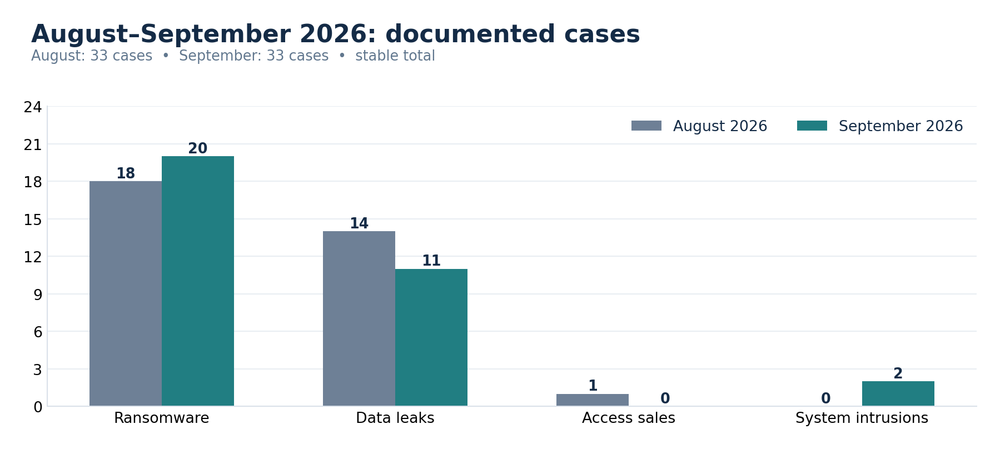
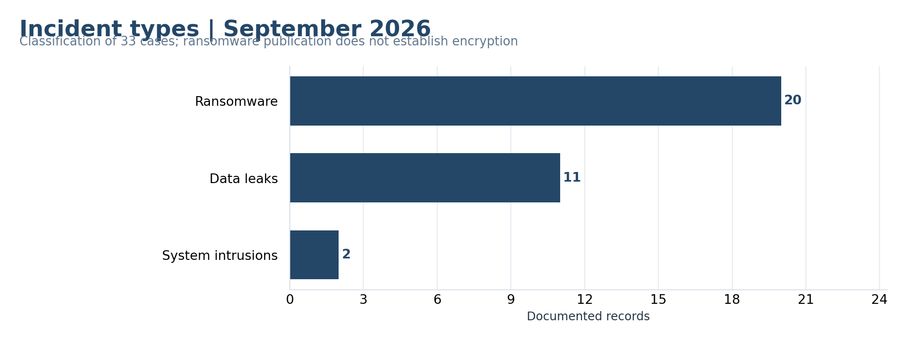
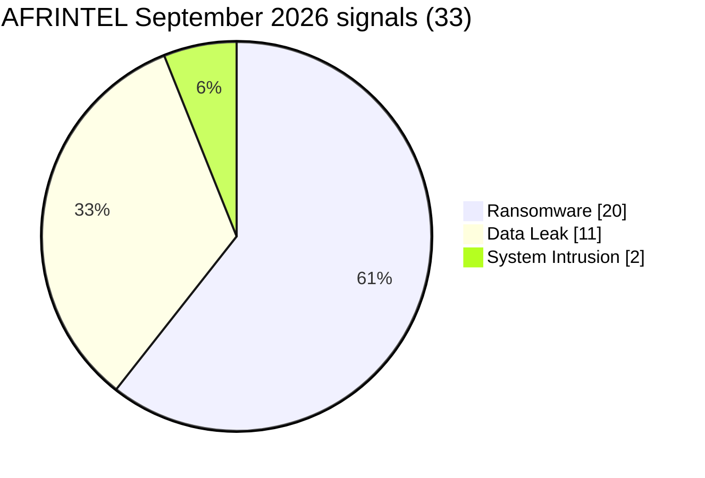
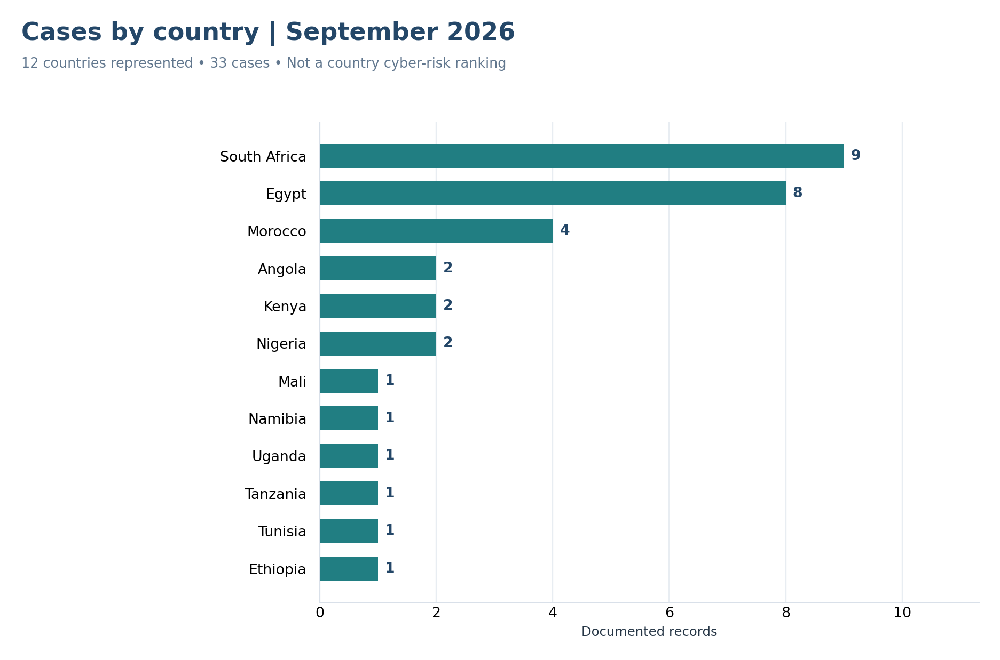
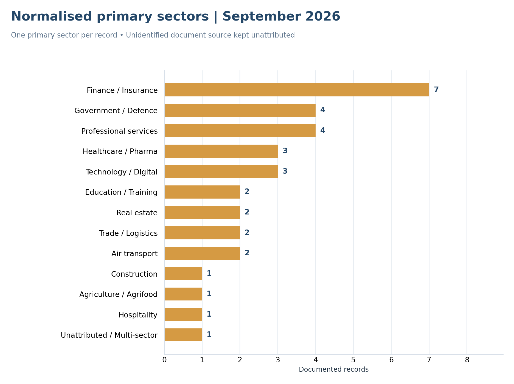
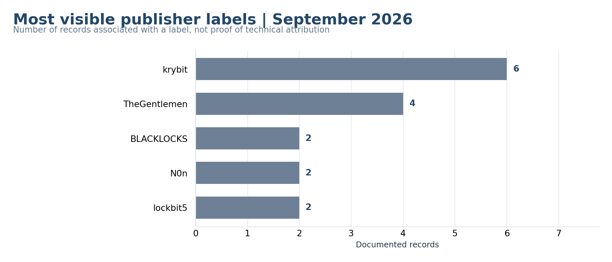

# AFRINTEL - Monthly Cyber Threat Intelligence Report
## Cyber threats across Africa | September 2026

**Corpus period:** 1–30 September 2026  
**Report revised:** 5 October 2026  
**Monitoring scope:** 54 African countries; 12 countries represented in the corpus  
**Audience:** executives, CISOs, CIOs, risk managers and CTI/SOC analysts  
**Sources:** ransomware-group disclosure sites on the Dark Web, underground forums, data leak and sales platforms on the Dark Web and Deep Web, official statements, specialist reporting and available samples.  
**Reference data:** [French victim records](./victims_FR.md) · [English victim records](./victims.md) · [Version française](./README_FR.md) · [Checked statistics](./STATISTIQUES_2026-09.json)

> **Reliability note - read before interpreting the figures.** AFRINTEL records **documented signals**: observed criminal postings, reviewed samples and, in some cases, events acknowledged by organisations or authorities. **A company named on a leak site is not necessarily a company whose systems were breached.** A sample may be genuinely published while its technical origin remains unknown. Actors' claimed data volumes are not treated as verified by default. This report supports decisions and prevention; it is not a security ranking of countries or businesses.

---

## 1. Executive summary - the key findings

In September 2026, AFRINTEL recorded **33 cases across 12 African countries**. Ransomware accounted for **20 records (60.6%)**, followed by **data leaks (11; 33.3%)** and **system intrusions (2; 6.1%)**. Each record has one primary category; a ransomware listing does not automatically prove that servers were encrypted.

**South Africa (9)**, **Egypt (8)** and **Morocco (4)** account for **21 cases, or 63.6% of the corpus**. This also reflects the visibility of criminal publications, the sources available and language coverage. It does not establish that these countries have weaker cybersecurity.

The most significant finding is not simply the number of posts. **Identity information, administrative documents, financial data and professional records** recur across several samples. Their potential exposure may later fuel fraud, identity impersonation and targeted phishing.

Two cases include a **confirmation of unauthorised access**: South Africa's **RelyComply** platform and unauthorised activity in the **Namibian Ministry of Defence and Veterans Affairs network**. Two others, **Hollard** and **Guardrisk**, concern **third-party data exposures**, without an established direct intrusion at the named insurer. These distinctions matter: **verify the facts, protect affected people and address risky access before declaring a breach.**

**For decision-makers:** September's signals call for focused vigilance, **not a generalised crisis response**. Good visibility into sensitive data, controlled access, tested backups and well-tuned detection can materially reduce exposure.

### 1.1 Comparison with the previous month: August → September 2026

| Indicator | August 2026 | September 2026 | Observed change |
|---|---:|---:|---:|
| **Total cases** | **29** | **33** | **+4 (+13.8%)** |
| Ransomware | 17 | 20 | +3 (+17.6%) |
| Data Leak | 11 | 11 | 0 (stable) |
| Access Sale | 1 | 0 | −1 (−100.0%) |
| DDoS | 0 | 0 | 0 (stable) |
| Defacement | 0 | 0 | 0 (stable) |
| Account Takeover | 0 | 0 | 0 (stable) |
| System Intrusion | 0 | 2 | +2 (new) |
| Malware | 0 | 0 | 0 (stable) |
| Operational Fraud | 0 | 0 | 0 (stable) |

*August baseline: 29 records (17 ransomware, 11 leaks, one access sale), from the [AFRINTEL August 2026 report](../08-august/README.md). This compares **records included in monthly collections**, not the exact number of real-world intrusions occurring in each month. Collection coverage and later discoveries can influence the difference.*

## 2. Scope, sources and methodology

AFRINTEL monitors all 54 African countries, but this report uses only the **33 cases documented in the September folder**. Events are allocated to the month based on the initial publication or first retained observation. The date of a criminal publication can follow the alleged compromise by days or months.

**Sources reviewed:** ransomware-group leak sites, underground forums, data sharing or sales locations, material supplied to AFRINTEL, organisational and authority statements, and public verification sources. Where documented in the case files, available samples were examined locally in read-only mode: file structures, actual received volumes, data categories and consistency with the named organisation. Sensitive raw files and personal records are not published.

Each record is assigned **one country, one primary incident type and one normalised primary sector** for statistics. Repeated publication of the same event should not create duplicates. A forum username is not automatically a technically identified group; a customer's or supplier's document does not establish breaches at every named business partner.

**Three levels guide the analysis:**

- **Observed:** a posting, document category or technical element actually recorded in the corpus.
- **Corroborated or confirmed:** an association supported by several elements, or an event acknowledged by a victim or competent authority. The scope of confirmation remains explicit.
- **Unknown:** initial-access vector, actual compromise date, technical source of files, complete volumes and operational effects when evidence is insufficient.

The 33 French and English records were cross-checked for **countries, actors, types and statuses**. All figures in this report derive from a single counting scheme. Sectors are consolidated for readability without changing the detailed business descriptions in the victim records.

## 3. Quantitative overview

### 3.1 Incident types

| Primary type | Records | Corpus share |
|---|---:|---:|
| **Ransomware** | **20** | **60.6%** |
| **Data Leak** | **11** | **33.3%** |
| **System Intrusion** | **2** | **6.1%** |
| **Total** | **33** | **100%** |

The **20 ransomware records** concern postings or events in a ransomware-extortion context. Encryption, interruption duration and the real scope of exfiltration must be **established on a case-by-case basis**.

### 3.2 Geographic distribution

| Country | Records | Country | Records |
|---|---:|---|---:|
| South Africa | 9 | Angola | 2 |
| Egypt | 8 | Kenya | 2 |
| Morocco | 4 | Mali | 1 |
| Nigeria | 2 | Namibia | 1 |
| Tunisia | 1 | Ethiopia | 1 |
| Tanzania | 1 | Uganda | 1 |
| **Total - 12 countries** | **33** | | |

Across AFRINTEL's broad regions, **North Africa accounts for 13 cases (39.4%)**, **Southern Africa for 12 (36.4%)**, **East Africa for five (15.2%)** and **West Africa for three (9.1%)**. Countries absent from the dataset are not presumed incident-free: **a gap in collection is not an absence of threats**.

### 3.3 Evidence maturity

| Status recorded in victim files | Records | Correct interpretation |
|---|---:|---|
| `Claim - Data Sample Published` | 16 | Post with a sample or excerpt; technical origin not automatically established |
| `Claim - Unverified` | 12 | Observed listing or claim; insufficient evidence of compromise |
| `Data Fully Published` | 1 | Batch presented as fully disclosed; completeness and technical origin are separate matters |
| Third-party exposure, direct breach not established | 2 | Acknowledged exposure in a provider ecosystem |
| Victim-confirmed unauthorised access | 1 | Scope described by the victim, not blanket validation of actor claims |
| Government-confirmed unauthorised access | 1 | Confirmation limited to the affected network and facts stated by the authority |
| **Total** | **33** | |

**Confidence point:** a coherent sample supports a documentary association but cannot alone prove a breach of the named organisation's systems. The **two confirmed access events** and the **two third-party exposures** are tracked separately from the other 29 records.

## 4. Analysis by incident type

### 4.1 Ransomware: extortion publications require a measured response

Ransomware dominates September's visibility. In several cases, a victim entry was observed on a leak site; some publishers displayed samples, claimed volumes or deadlines. This helps track **the public evolution of a threat**, but does not reconstruct the intrusion chain.

In South Africa, **Apollo 21** and **ARCA Unlimited Architects** illustrate the documentary risk. Depending on the record, the supplied material includes business documents, identity papers, architectural plans or project information. Their consistency with the named businesses warrants attention to confidentiality and suppliers; **neither encryption nor the claimed total data volumes is established by these excerpts alone**.

In **Mali**, a published batch of **10 files** under the **AFRICA-TECH** name was examined. It includes financial, travel and insurance documents. Publication of that batch is documented; the exact legal identity of the entity and the technical mechanics of any attack remain uncertain.

In **Tanzania**, the **Air Tanzania** record contains **114 reviewed files**, including **112 valid images**. They substantiate the existence of the examined corpus without identifying how it was obtained.

**CISO takeaway:** investigate the systems and information categories concerned, protect backups and examine unusual access. Do not publicly assert encryption without technical findings or reliable confirmation.

### 4.2 Data leaks: subsequent misuse matters most

**Centre Atlantique Formation** in **Morocco** is among the better-documented cases. The analysed local collection contains **4,644 files (approximately 3.94 GB)**, including **3,476 JSON**, **1,165 PDF** and **three JPG files**. A structured subset covers **1,155 enrolment folders** and training certificates. These are counts of **files and folders**, not a validated count of unique individuals. Consistency between records and certificates supports their association with the institution without establishing the initial-access vector.

In **Nigeria**, material attributed to the **Federal Capital Territory Internal Revenue Service (FCT-IRS)** includes a **314-page document** that was examined. Contact and identity information is represented, but its presence does not establish exfiltration from the tax authority's systems or the number of people concerned.

In **Egypt**, the **Madinaty** publication describes residents and contact information. **The organisation originally holding the data has not been identified**; the developer should not be called the technically breached victim on this basis. The **Badr University in Cairo** claim includes partially obscured identifiers but no demonstration of valid access.

The **`subscribers.co.ke`**, **`acao.org.ma`** and **Techne Summit 2026** cases add weight to the need for export controls, protection of contact databases and application access reviews. For each, claimed counts and technical provenance remain distinct from the visible sample.

**SOC takeaway:** prioritise unusual downloads, abnormal database access, archive creation and access to sensitive repositories. Subsequently watch for phishing and fraud that may reuse exposed information.

### 4.3 System intrusion: two confirmations with precisely defined scopes

**RelyComply (South Africa)** acknowledged **unauthorised access** to some systems, detected on **8 September 2026**, in connection with a third-party application's vulnerability. The company reports corrective measures including system rebuilds and access/secret revocation or rotation. This establishes an incident, **not technical attribution to the author of a ransomware claim**.

In **Namibia**, the government information reviewed confirms unauthorised activity in the **Ministry of Defence and Veterans Affairs network**. The criminal claim names the **Namibian Defence Force**; public confirmation should not be extended without proof to operational military networks, encryption or leaked military secrets.

**Takeaway:** precision about the affected network, confirming source and actions taken enables accurate communication and a better-focused investigation.

## 5. Sector reading: where to focus resources

Sectors below are **normalised by primary business activity** to avoid counting the same case several times under compound labels. The South African personal-document corpus with an unknown source organisation is deliberately kept **unattributed**.

| Normalised primary sector | Records | Share |
|---|---:|---:|
| Finance / Insurance | 7 | 21.2% |
| Government / Defence | 4 | 12.1% |
| Professional services | 4 | 12.1% |
| Healthcare / Pharmaceutical | 3 | 9.1% |
| Technology / Digital | 3 | 9.1% |
| Education / Training | 2 | 6.1% |
| Real estate | 2 | 6.1% |
| Trade / Logistics | 2 | 6.1% |
| Air transport | 2 | 6.1% |
| Construction | 1 | 3.0% |
| Agriculture / Agrifood | 1 | 3.0% |
| Hospitality | 1 | 3.0% |
| Unattributed / Multi-sector | 1 | 3.0% |
| **Total** | **33** | **100%** |

**What matters:** finance, public administration, healthcare and digital services handle information whose subsequent misuse can have serious consequences. However, greater representation in AFRINTEL does not mean a sector is necessarily the most attacked across Africa.

## 6. Threat actors, groups and publishing accounts

| Observed label | Associated records | What the number means |
|---|---:|---|
| `krybit` | 6 | Visibility in monitored publications |
| `TheGentlemen` | 4 | Visibility in monitored publications |
| `BLACKLOCKS` | 2 | Visibility in monitored publications |
| `N0n` | 2 | Visibility in monitored publications |
| `lockbit5` | 2 | Visibility in monitored publications |
| Other labels or unknown attribution | 17 | Single-post labels or unspecified attribution |
| **Total** | **33** | **Not proof of technical responsibility** |

This ranking helps **prioritise collection**: monitor future postings, reconcile names and deadlines and spot the reappearance of material. It cannot alone attribute an intrusion or establish a shared initial-access method.

### 6.1 Country reading: priorities, not a risk league table

South Africa features several financial, insurance and services cases; Egypt has a diverse mix of business and administrative targets; Morocco includes education and healthcare. The other countries supply useful signals despite lower counts. **National priorities should reflect affected assets, quality of evidence and data sensitivity-not raw publication counts.**

## 7. Trends, sensitive cases and intelligence gaps

**Three findings emerge from the reviewed material.** First, extortion postings remain the most visible category. Second, several samples combine identity, supporting documents and professional or financial details, which may remain valuable for fraud beyond the initial publication. Third, the **Hollard** and **Guardrisk** cases show how data associated with a brand can come from a **provider**. Hollard linked exposure of certain policyholders to the **MIP Holdings** incident; Guardrisk described exposure in the **CoverCubed** context. Neither should be represented as proof of a direct breach at the insurer.

**Priority unknowns:** who originally held the data where several custodians are possible; the actual affected systems and access dates; whether encryption occurred when claimed; the volumes actually disclosed; and actions subsequently taken by organisations. Official confirmations or digital forensic and incident response (DFIR) reports can help resolve these questions, but are not always publicly available in the reviewed sources.

Collection should also improve in underrepresented countries: collaboration with national CERTs/CSIRTs, local media, sources in French, English, Arabic, Portuguese and other relevant languages, and deduplication of cross-platform reposts.

## 8. MITRE ATT&CK: detection hypotheses, not attribution

Public records do not always describe technical intrusion chains. The following mappings are **defensive hypotheses** to test against internal telemetry; they **do not mean** the techniques were observed at every named organisation.

| Hypothesis to investigate | MITRE ATT&CK technique | Relevant SOC telemetry |
|---|---|---|
| Misuse of a legitimate account | [T1078 - Valid Accounts](https://attack.mitre.org/techniques/T1078/) | IAM, SSO, VPN, MFA, EDR |
| Exploitation of a public portal or service | [T1190 - Exploit Public-Facing Application](https://attack.mitre.org/techniques/T1190/) | WAF, reverse proxy, application logs, patch history |
| Excessive access to or extraction from repositories | [T1213 - Data from Information Repositories](https://attack.mitre.org/techniques/T1213/) | Database, NAS and file auditing; DLP |
| Unusual downloads from cloud storage | [T1530 - Data from Cloud Storage](https://attack.mitre.org/techniques/T1530/) | Cloud API and object logs, IAM |
| Mass encryption, **if technically established** | [T1486 - Data Encrypted for Impact](https://attack.mitre.org/techniques/T1486/) | EDR, FIM, file histories, backups |

**Caution:** a leak-site listing does not prove the use of `T1486`. Do not invent indicators of compromise from victims' ordinary business domains.

## 9. Organisational recommendations

| Audience | Most useful risk to anticipate | Priority measure |
|---|---|---|
| **Executives / CIOs** | Decisions based on an unverified claim | Small incident qualification group: security, IT, legal and communications |
| **CISOs / risk managers** | Uncontrolled copies of sensitive information | Map critical repositories, contractors and export permissions |
| **Banks and insurers** | Bank-detail diversion or client impersonation | Independent-channel validation for sensitive changes; MFA |
| **Government, healthcare, education** | Identity and document misuse | Least privilege, export control, confidentiality and retention limits |
| **Digital and other service providers** | Indirect exposure between partners | Review delegated access, notification obligations and shared logs |

A criminal posting **does not, by itself, justify shutting down a service**. Initial actions should be proportionate: verify evidence, preserve traces, strengthen relevant controls and prepare appropriate communication if an incident is established.

## 10. SOC operational plan

**Controls tied to observed information:** instrument databases and applications holding identity, contact, financial and documentary records; detect repeated or unusually large downloads and exports; protect security logs and store evidence with restricted access.

**Hypotheses to investigate:** privileged sign-in from a new device, a large export following abnormal authentication, unusual use of a contractor account and sudden creation of large archives. Correlate **identity + asset + volume + time + action**; an unusual IP address alone is not proof.

**General prevention:** phishing-resistant MFA where available, privileged-account segmentation, exposed-application hardening, EDR, offline or immutable backups and regular restore tests.

| Timeframe | Practical actions | Expected evidence of completion |
|---|---|---|
| **0–7 days** | Identify relevant assets and providers; retain logs and screenshots; review postings citing your organisation; enforce independent financial validation | Targeted inventory, assessment record, named owners |
| **8–30 days** | Test bulk-export and abnormal-access alerts; audit privileged and third-party access; fix demonstrated exposures | Validated SIEM rules, access reviews, remediation tickets |
| **30–90 days** | Exercise data-leak, supplier-incident and ransomware scenarios; restore backups in practice; improve crisis response | Exercise findings, restore-time evidence, improvement plan |

**Measure effectiveness:** sensitive-repository logging coverage, usable-alert rate, qualification delay, risky-access revocation time and restore-test results.

## 11. Strategic directions for CISOs, CIOs and decision-makers

**First: control data.** Knowing where identity files, customer records and financial documents are copied often matters more than deploying another tool. Limiting duplication and auditing exports reduces the potential impact of exposure.

**Second: include providers in defence.** September's cases illustrate why third-party risks must be tracked without confusing the company named in a post with the actual data custodian. Logging, notification and access restrictions should be agreed in advance.

**Third: make decisions from evidence.** When a claim emerges, leaders need a short brief answering: “What did we observe?”, “What is confirmed?”, “What still needs checking?” and “Which immediate action is proportionate?” This protects the organisation, its customers and its reputation.

## 12. Conclusion and usage limitations

September 2026 contains **33 documented signals across 12 countries**, with substantial visibility of ransomware and data-exposure risks. Several cases include concrete evidence, and **two unauthorised-access events have been confirmed within carefully defined scopes**. Many other publications still require investigation before conclusions can be drawn about a breach, its size or its business impact.

**The findings are serious, but the response is practical and achievable:** monitor access, control exports, protect identities, verify providers and rehearse recovery. AFRINTEL intelligence is intended to **help anticipate**, not to encourage alarm.

**Limitations:** non-exhaustive collection; possible over-representation of extortion posts; discovery dates that may differ from intrusion dates; heterogeneous samples; claimed data volumes that cannot be added together; no automatic equivalence between files, rows, folders and people. Evidence status or high confidence is not a substitute for proof of the source system's compromise. This revision uses the supplied victim records; many case-level independent verification notes are dated **18 October 2026**.

---

**AFRINTEL - Cyber Threat Intelligence for Africa**  
*Structured intelligence, measured analysis and practical cyber defence.*  
[Browse all 33 detailed records](./victims.md) · [French report](./README_FR.md) · [AFRINTEL GitHub](https://github.com/Hatchepsoute/AFRINTEL)
