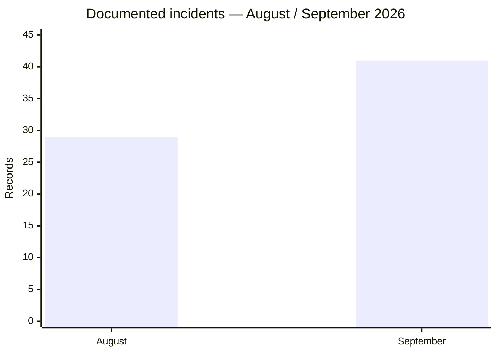
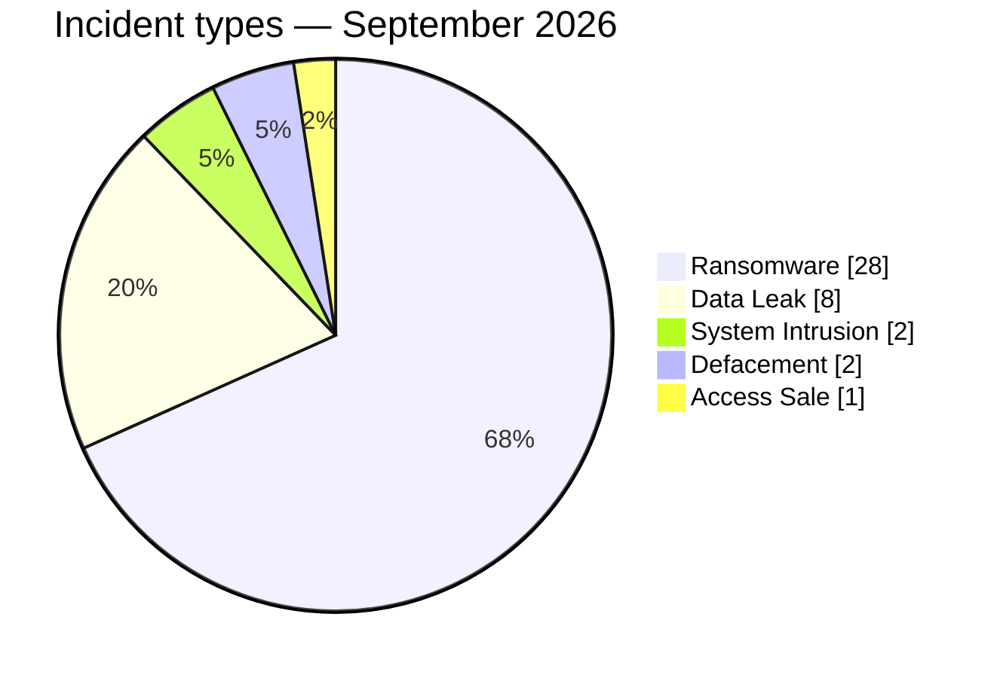
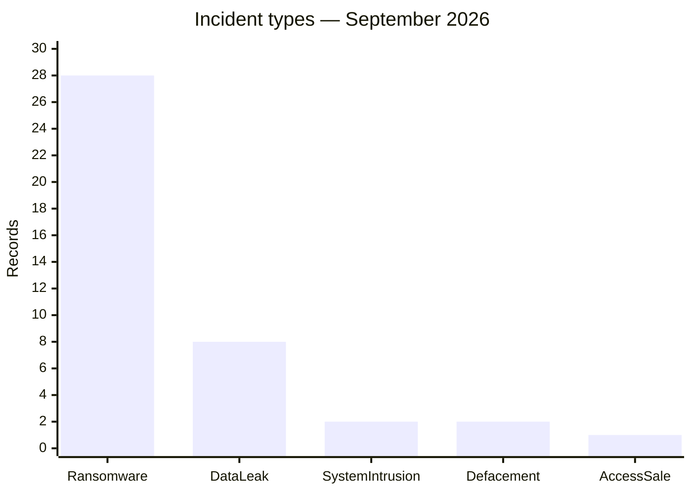
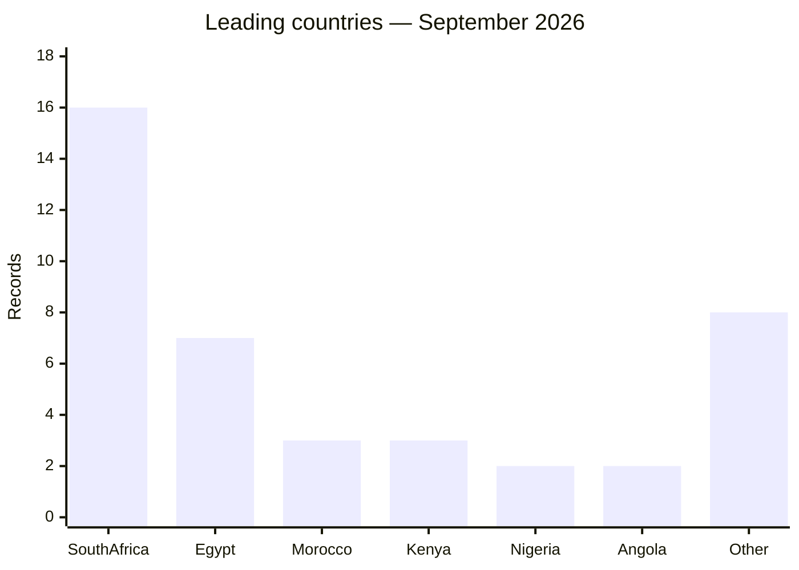
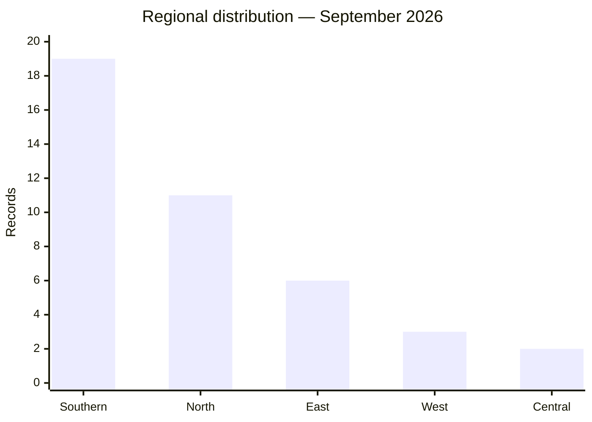
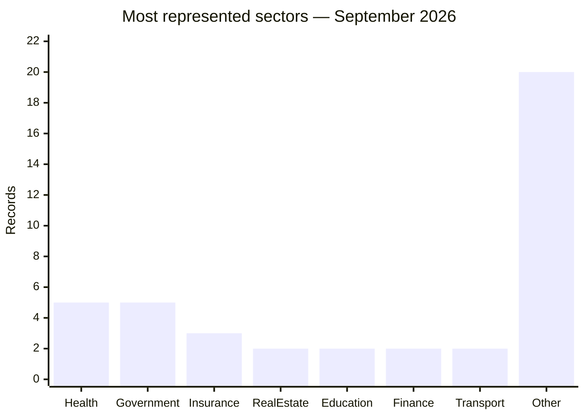
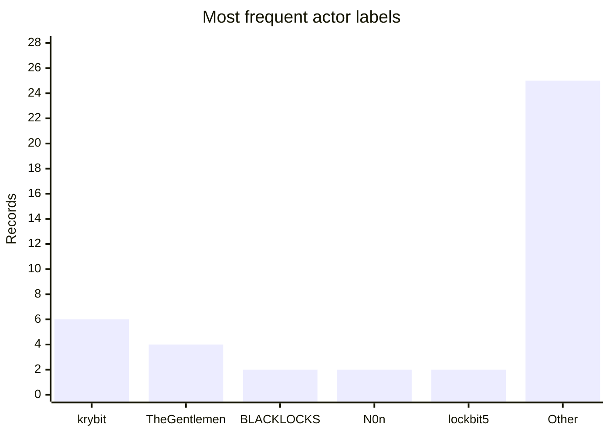
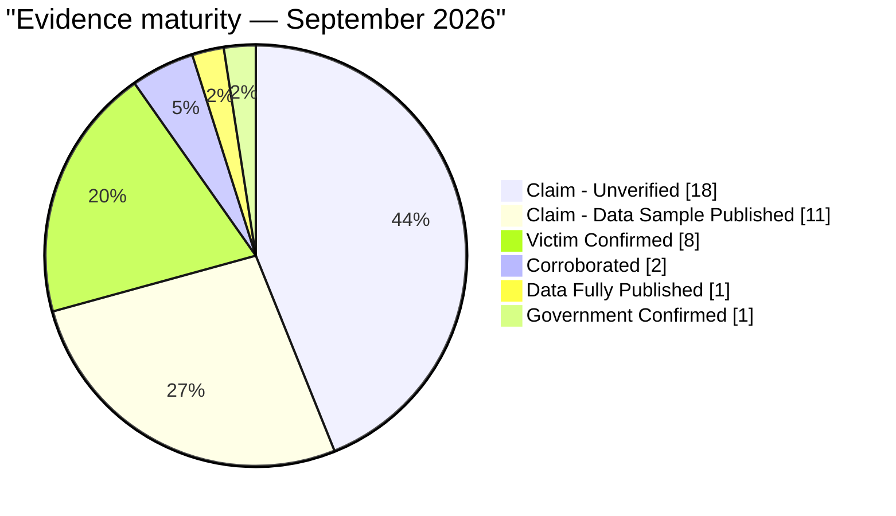
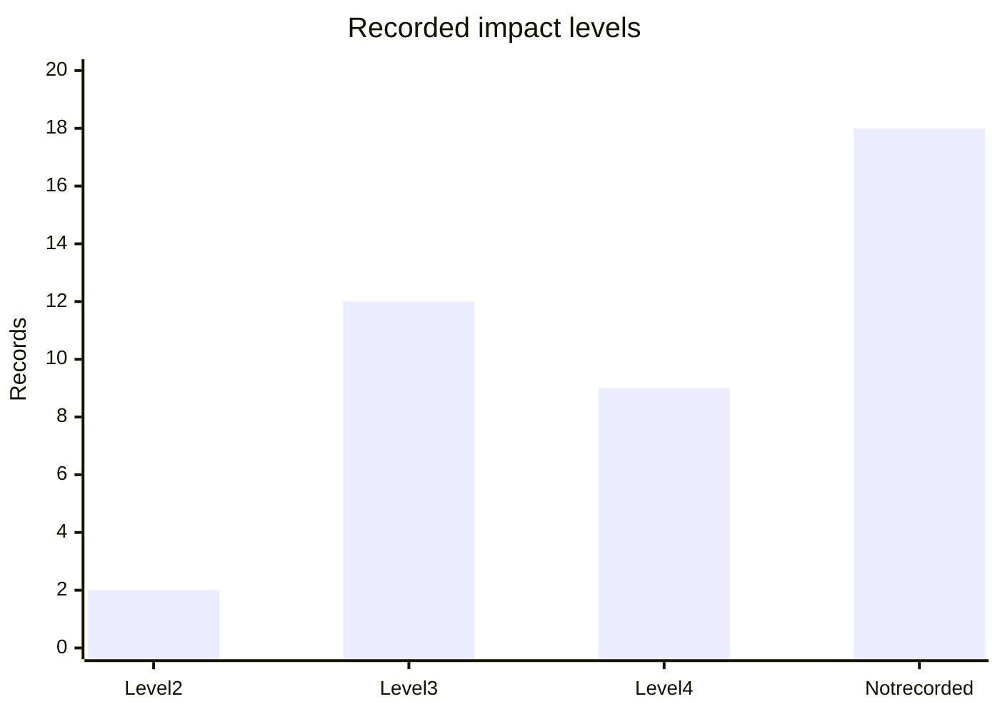
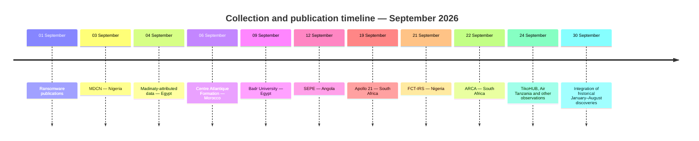

# AFRINTEL — Monthly CTI Report

## Cyberattacks in Africa — September 2026

👉🏾 [French version](./README_FR.md) · [Documented victims and incidents](./victims.md)

## 1. Executive summary

The AFRINTEL September 2026 corpus contains **41 documented incidents** across **14 African countries**. Ransomware dominates with **28 records (68.3%)**, followed by Data Leak with **8 (19.5%)**. Two System Intrusion records, two Defacements and one Access Sale complete the corpus.

The volume increased from **29 records in August to 41 in September (+12; +41.4%)**. This change describes AFRINTEL collection and is not an estimate of the real change in compromises. The corpus includes September publications as well as incidents published or discovered earlier and integrated late into the September tracking set.

South Africa accounts for **16 records (39.0%)**, followed by Egypt with 7, and Morocco and Kenya with 3 each. Health and Government / Administration each appear in five records after cautious sector normalization.

Evidence maturity is heterogeneous: **18 records** are `Claim - Unverified`, **11** are `Claim - Data Sample Published`, **8** are `Victim Confirmed`, **2** are `Corroborated`, **1** is `Data Fully Published` and **1** is `Government Confirmed`. These statuses do not change the primary technical type and do not automatically prove complete exfiltration.

## 2. Comparison with August 2026

| Indicator | August 2026 | September 2026 | Change |
|---|---:|---:|---:|
| Documented incidents | 29 | 41 | **+12 (+41.4%)** |
| Ransomware | 17 | 28 | **+11 (+64.7%)** |
| Data Leak | 11 | 8 | **-3 (-27.3%)** |
| Access Sale | 1 | 1 | **Stable** |
| System Intrusion | 0 | 2 | **New** |
| Defacement | 0 | 2 | **New** |

The comparison uses closed monthly corpora. It does not convert discovery, publication or integration dates into intrusion dates.

## 3. Scope and methodology

- Editorial source: the validated `victims_FR.md` / `victims.md` pair.
- One card represents one canonical incident documented in the September folder.
- Late-discovered cards retain their incident or publication date when known; their AFRINTEL integration date is recorded separately.
- A claim published on a criminal site or forum is not treated as technical confirmation without additional evidence.
- Samples and screenshots were handled in minimized form; no raw personal data, credentials, secrets or tokens are reproduced.
- Secondary effects do not automatically create a second record.

## 4. Global overview and incident types

| Incident type | Records | Share |
|---|---:|---:|
| Ransomware | 28 | 68.3% |
| Data Leak | 8 | 19.5% |
| System Intrusion | 2 | 4.9% |
| Defacement | 2 | 4.9% |
| Access Sale | 1 | 2.4% |
| **Total** | **41** | **100%** |

### Ransomware

The 28 Ransomware records correspond to observed victim publications or group observations. A listing alone does not establish encryption, complete exfiltration or ransom payment. The most visible labels are `krybit` with 6 records and `TheGentlemen` with 4.

### Data Leak, System Intrusion and Defacement

The eight Data Leak records include sample-backed publications, victim-confirmed cases and claims whose technical provenance remains unknown. The two System Intrusion and two Defacement records remain in their respective categories; a Defacement is not reclassified as Data Leak without separate evidence of data exposure.

## 5. Geographic distribution

| Country | Records | Share |
|---|---:|---:|
| South Africa | 16 | 39.0% |
| Egypt | 7 | 17.1% |
| Morocco | 3 | 7.3% |
| Kenya | 3 | 7.3% |
| Nigeria | 2 | 4.9% |
| Angola | 2 | 4.9% |
| Mali | 1 | 2.4% |
| Gabon | 1 | 2.4% |
| Cameroon | 1 | 2.4% |
| Namibia | 1 | 2.4% |
| Tunisia | 1 | 2.4% |
| Ethiopia | 1 | 2.4% |
| Tanzania | 1 | 2.4% |
| Uganda | 1 | 2.4% |
| **Total** | **41** | **100%** |

| Region | Records | Share |
|---|---:|---:|
| Southern Africa | 19 | 46.3% |
| North Africa | 11 | 26.8% |
| East Africa | 6 | 14.6% |
| West Africa | 3 | 7.3% |
| Central Africa | 2 | 4.9% |
| **Total** | **41** | **100%** |

Each September card receives one country assignment in this view. No additional multi-country incident is counted in this geographic distribution.

## 6. Sectors and actors

After cautious normalization, the most represented sectors are **Health (5)**, **Government / Administration (5)**, **Insurance (3)**, followed by **Real Estate (2)**, **Education (2)**, **Financial Services (2)** and **Air Transport (2)**. The other 20 occurrences belong to distinct or specialized sectors.

The most frequent actor labels are `krybit` (6), `TheGentlemen` (4), `BLACKLOCKS` (2), `N0n` (2) and `lockbit5` (2). Seven records explicitly state that no actor is publicly attributed. Account or publication labels do not necessarily constitute technical attribution.

## 7. Evidence maturity and impact

| Status | Records |
|---|---:|
| Claim - Unverified | 18 |
| Claim - Data Sample Published | 11 |
| Victim Confirmed | 8 |
| Corroborated | 2 |
| Data Fully Published | 1 |
| Government Confirmed | 1 |
| **Total** | **41** |

An impact level is explicitly recorded for 23 cards: 12 at Level 3, 9 at Level 4 and 2 at Level 2. The current corpus does not populate this field for 18 cards. A confidence level is explicitly recorded for 24 cards; the others should be interpreted cautiously.

## 8. Collection timeline

The main September publications or observations are dated 1, 3, 4, 6, 7, 9, 12, 16, 18, 19, 21, 22, 24, 25, 26 and 29 September. The folder also contains cards integrated late on 30 September for events published or situated between January and August 2026. Those cards remain in the September collection corpus for traceability without changing their historical chronology.

## 9. Defensive SOC priorities

- monitor privileged accounts, VPN/RDP access and role changes;
- detect archive creation, unusual exports and large outbound transfers;
- strengthen MFA, segmentation and isolated backups for public, financial, health and transport organisations;
- treat defacement indicators separately from data-leak indicators to avoid unsupported conclusions;
- prepare notification and exposure-reduction procedures when identity, health or payment data is published;
- retain evidence captures and manifests outside the repository with restricted access.

## 10. Conclusion and checks

September 2026 contains **41 documented incidents**, including **28 Ransomware**, **8 Data Leak**, **2 System Intrusion**, **2 Defacement** and **1 Access Sale**. South Africa accounts for the largest share, while victim confirmations increase the evidentiary strength of several records without automatically validating claimed volumes or intrusion chains.

Checks completed:

- 41 French cards and 41 English cards;
- incident-type total = 41;
- country total = 41;
- regional total = 41;
- evidence-status total = 41;
- incident, publication and late-discovery dates remain separated.

**AFRINTEL — TLP:CLEAR**

