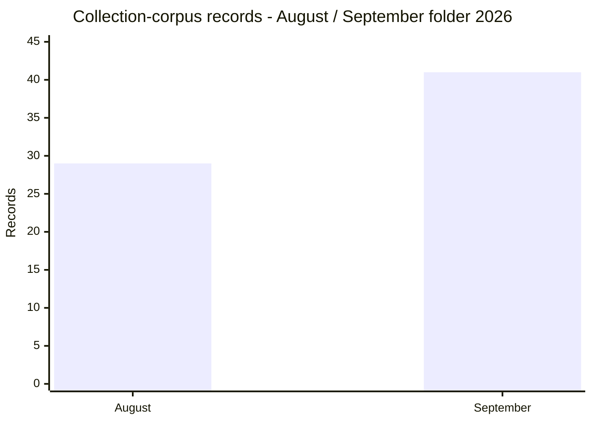
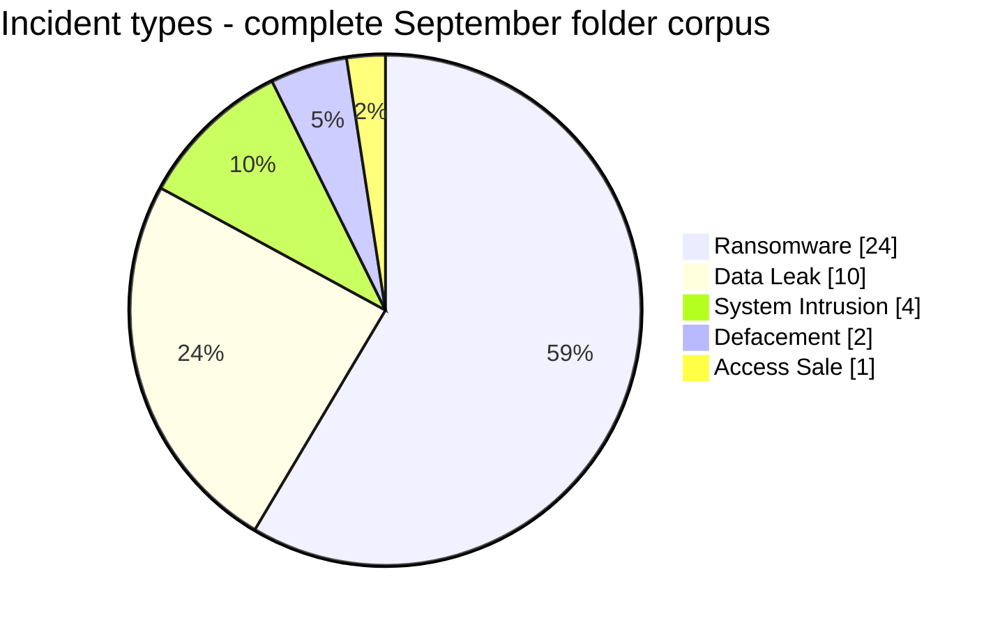
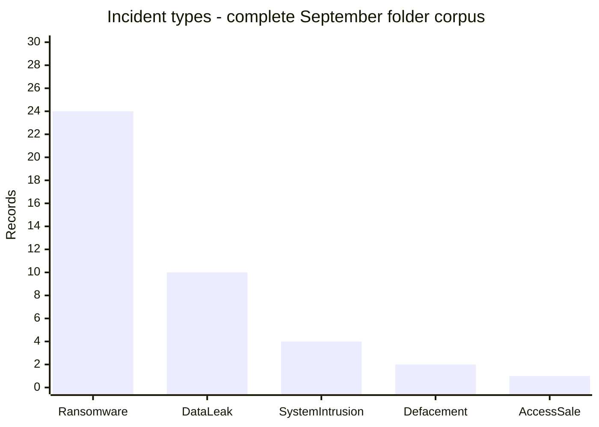
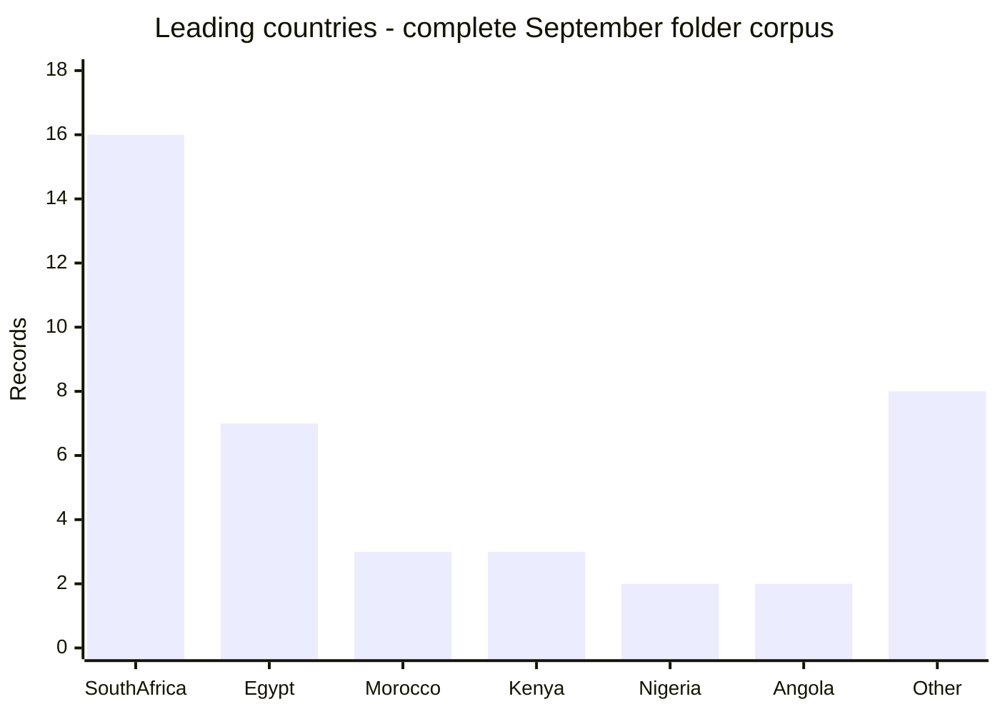
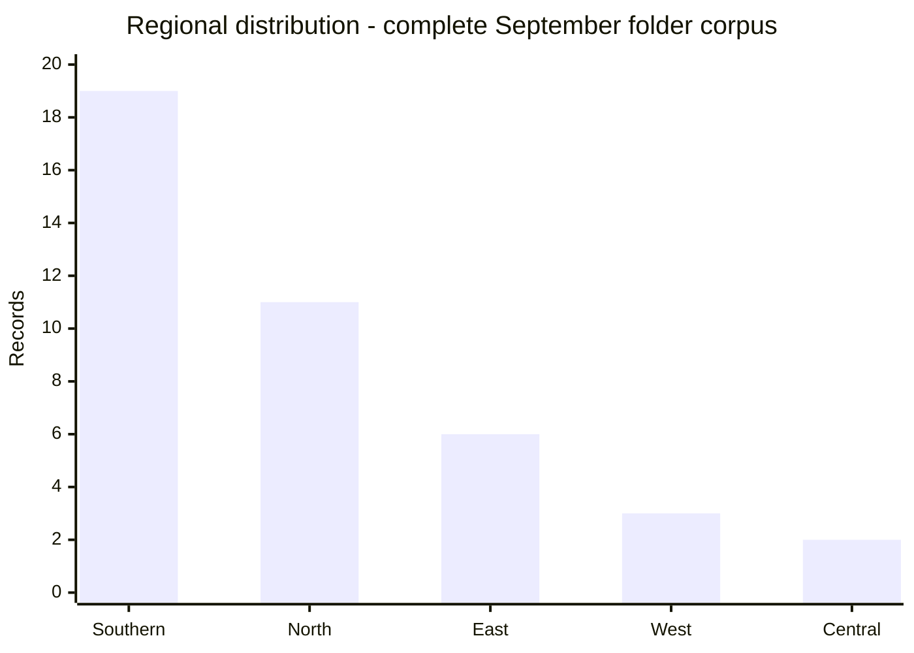
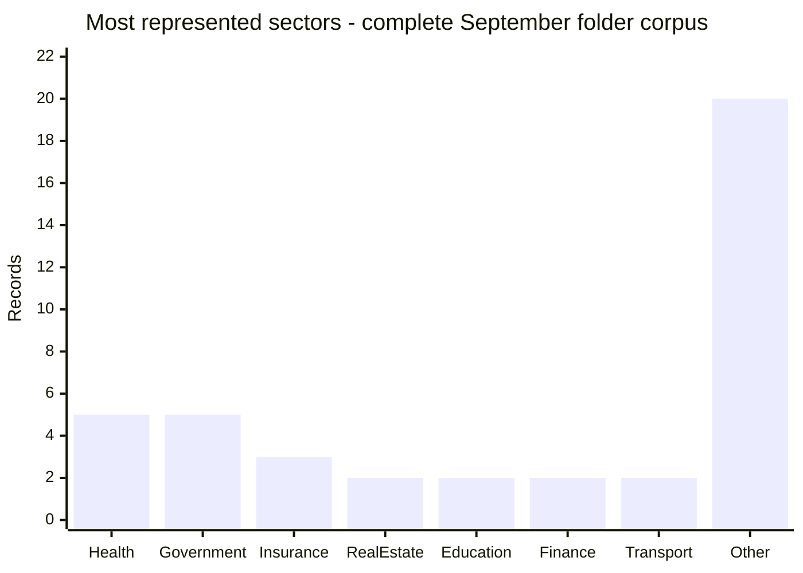
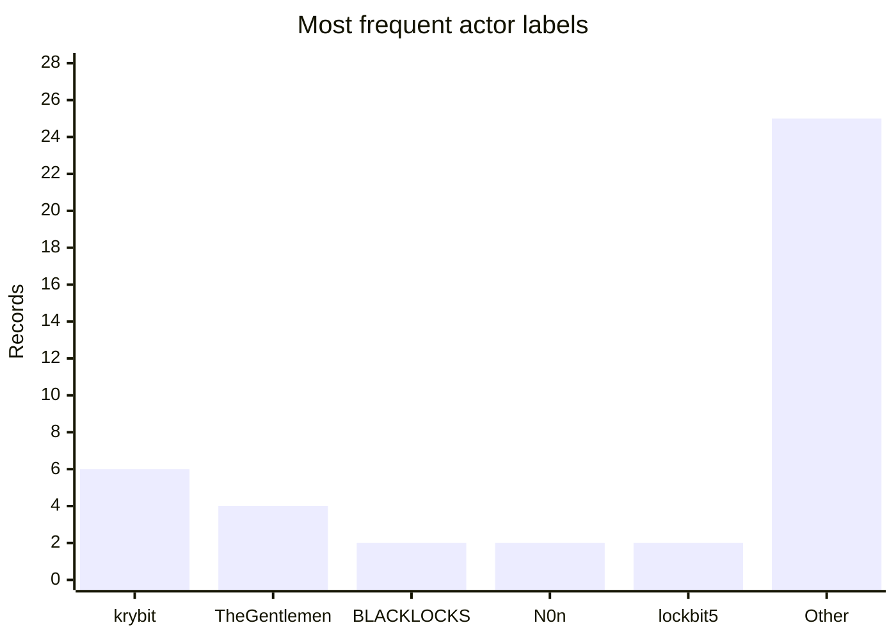
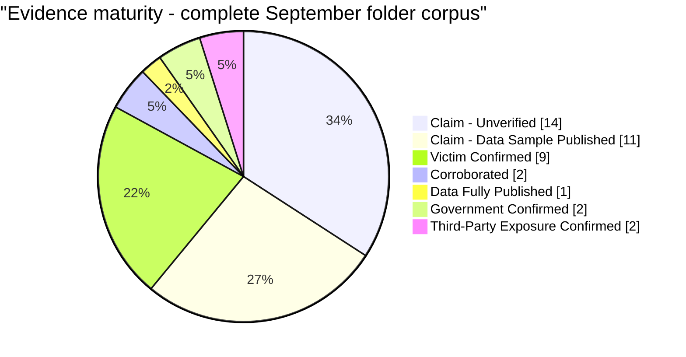
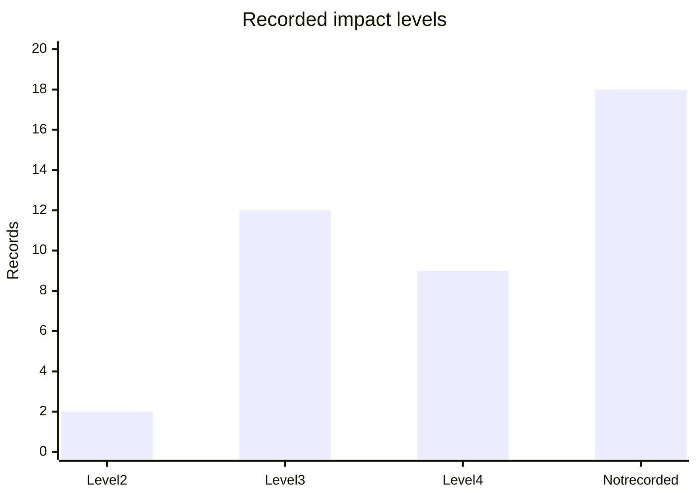
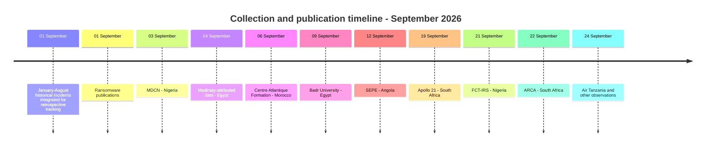

# AFRINTEL - Monthly CTI Report

## CTI Report - September 2026

**29 publications dated in September within a corpus of 41 documented records**

👉🏾 [French version](./README_FR.md) · [Documented victims and incidents](./victims.md)

## 1. Executive summary

The AFRINTEL September 2026 folder contains **41 documented records** across **14 African countries**. It includes **29 publications dated in September**, spanning **12 countries**, and **12 earlier incidents** integrated retrospectively. By the primary incident type recorded in the cards, Ransomware represents **24 records (58.5%)**, followed by Data Leak with **10 (24.4%)**. Four System Intrusion records, two Defacements and one Access Sale complete the corpus.

Within the 29-publication September subset alone, **20 records are classified as Ransomware (69.0%)**, **7 as Data Leak (24.1%)** and **2 as System Intrusion (6.9%)**. These ratios must not be mixed with the complete-corpus statistics, which include the 12 earlier records.

The collection corpus goes from **29 records in August to 41 records in the September folder (+12; +41.4%)**. This gap describes AFRINTEL collection and is not an estimate of the real change in compromises. The corpus combines September publications and earlier incidents integrated for retrospective tracking; these collection dimensions must not be added as mutually exclusive categories.

South Africa accounts for **16 records (39.0%)**, followed by Egypt with 7, and Morocco and Kenya with 3 each. Health and Government / Administration each appear in five records after cautious sector normalization.

Evidence maturity is heterogeneous: **14 records** are `Claim - Unverified`, **11** are `Claim - Data Sample Published`, **9** are `Victim Confirmed`, **2** are `Corroborated`, **1** is `Data Fully Published`, **2** are `Government Confirmed` and **2** are `Third-Party Exposure Confirmed`. These statuses are normalized from the detailed card labels and do not automatically prove complete exfiltration.

### CTI reading to retain

- The increase from **29 to 41 records** mainly reflects expanded collection and consolidation, not a demonstrated increase in real compromises.
- The **29 September publications** are dominated by ransomware labels, but most remain at the claim or published-sample stage.
- The most useful evidence consists of structured samples or released sets that were actually examined; this strengthens the assessment of a documentary link without automatically proving the access vector, complete exfiltration or encryption.
- Defensive priorities are the protection of identities and sensitive documents, monitoring of exports and privileged accounts, and prevention of payment fraud and impersonation.

The statuses must be read through three separate distinctions: **observed publication**, **sample or data examined**, and **confirmed compromise**. These levels are not interchangeable.

## 2. Collection-corpus gap: August / September 2026

| Indicator | August 2026 | September 2026 | Change |
|---|---:|---:|---:|
| Collection-corpus records | 29 | 41 | **+12 (+41.4%)** |
| Ransomware | 17 | 24 | **+7 (+41.2%)** |
| Data Leak | 11 | 10 | **-1 (-9.1%)** |
| Access Sale | 1 | 1 | **Stable** |
| System Intrusion | 0 | 4 | **New** |
| Defacement | 0 | 2 | **New** |

This comparison uses closed collection corpora. It is not a like-for-like comparison of attacks occurring during each month because the September corpus includes 12 earlier incidents. It does not convert discovery, publication or integration dates into intrusion dates. A real change in compromises cannot be inferred from these totals alone.

## 3. Scope and methodology

- Editorial source: the validated `victims_FR.md` / `victims.md` pair.
- One card represents one canonical incident documented in the September folder; the corpus also contains 12 earlier incidents integrated for retrospective tracking.
- For incidents predating the collection month, the AFRINTEL discovery/integration date is kept separately from the historical incident and publication dates. No discovery/integration field is added to incidents from the current collection month.
- A claim published on a criminal site or forum is not treated as technical confirmation without additional evidence.
- Samples and screenshots were handled in minimized form; no raw personal data, credentials, secrets or tokens are reproduced.
- Secondary effects do not automatically create a second record.

Ransomware-group sites, leak sites and underground forums are treated as **primary observation sources**: they document a publication, displayed account, date, deadline or visible sample. Their content is not treated as official confirmation. Confidence may nevertheless increase when a sample has been reviewed and shows documentary or structural consistency; attribution, access vector, completeness and encryption remain separate dimensions.

## 4. Cohorts and incident types

### 4.1 September-dated publications: 29 records

| Incident type | Records | Share |
|---|---:|---:|
| Ransomware | 20 | 69.0% |
| Data Leak | 7 | 24.1% |
| System Intrusion | 2 | 6.9% |
| **Total** | **29** | **100%** |

This cohort is the basis for typological and narrative readings that concern September-dated publications only. It excludes the 12 earlier incidents integrated retrospectively.

### 4.2 Complete September folder corpus: 41 records

| Incident type | Records | Share |
|---|---:|---:|
| Ransomware | 24 | 58.5% |
| Data Leak | 10 | 24.4% |
| System Intrusion | 4 | 9.8% |
| Defacement | 2 | 4.9% |
| Access Sale | 1 | 2.4% |
| **Total** | **41** | **100%** |

### Ransomware

The 24 Ransomware records correspond to group publications or observations in a ransomware context. A listing alone does not establish encryption, complete exfiltration or ransom payment. The most visible labels are `krybit` with 6 records and `TheGentlemen` with 4. For priority cases, the lifecycle should remain separated into listing, sample, deadline, disclosure and last verification.

### Data Leak, System Intrusion and Defacement

The ten Data Leak records include sample-backed publications, victim-confirmed cases and two indirect third-party exposures. The four System Intrusion records remain classified according to the primary observed nature, even when a ransomware claim is associated with them. The two Defacement records are not reclassified as Data Leak without separate evidence of data exposure.

## 5. Geographic distribution

### 5.1 September-dated publications: 29 records

| Country | Records | Share |
|---|---:|---:|
| South Africa | 8 | 27.6% |
| Egypt | 7 | 24.1% |
| Morocco | 3 | 10.3% |
| Nigeria | 2 | 6.9% |
| Angola | 2 | 6.9% |
| Namibia | 1 | 3.4% |
| Tunisia | 1 | 3.4% |
| Ethiopia | 1 | 3.4% |
| Mali | 1 | 3.4% |
| Tanzania | 1 | 3.4% |
| Uganda | 1 | 3.4% |
| Kenya | 1 | 3.4% |
| **Total** | **29** | **100%** |

This distribution concerns September-dated publications only. It must not be compared directly with the following table, which covers the complete 41-record corpus.

### 5.2 Complete September folder corpus: 41 records

| Country | Records | Share |
|---|---:|---:|
| South Africa | 16 | 39.0% |
| Egypt | 7 | 17.1% |
| Morocco | 3 | 7.3% |
| Kenya | 3 | 7.3% |
| Nigeria | 2 | 4.9% |
| Angola | 2 | 4.9% |
| Mali | 1 | 2.4% |
| Gabon | 1 | 2.4% |
| Cameroon | 1 | 2.4% |
| Namibia | 1 | 2.4% |
| Tunisia | 1 | 2.4% |
| Ethiopia | 1 | 2.4% |
| Tanzania | 1 | 2.4% |
| Uganda | 1 | 2.4% |
| **Total** | **41** | **100%** |

| Region | Records | Share |
|---|---:|---:|
| Southern Africa | 19 | 46.3% |
| North Africa | 11 | 26.8% |
| East Africa | 6 | 14.6% |
| West Africa | 3 | 7.3% |
| Central Africa | 2 | 4.9% |
| **Total** | **41** | **100%** |

Each record in the complete corpus receives one country assignment in this view. No additional multi-country incident is counted in this geographic distribution.

## 6. Sectors and actors  -  complete 41-record corpus

After cautious normalization  -  grouping documented analytical families without changing the raw sector in the cards  -  the most represented sectors are **Health (5)**, **Government / Administration (5)**, **Insurance (3)**, followed by **Real Estate (2)**, **Education (2)**, **Financial Services (2)** and **Air Transport (2)**. The other 20 occurrences belong to distinct or specialized sectors.

The most frequent **publication or displayed-actor labels** are `krybit` (6), `TheGentlemen` (4), `BLACKLOCKS` (2), `N0n` (2) and `lockbit5` (2). The other 25 records include less frequent labels and records without public attribution; seven records explicitly state that no actor is publicly attributed. These labels do not necessarily constitute technical attribution or a count of distinct groups.

## 7. Evidence maturity and impact

The statuses below concern the **complete 41-record corpus**. For the 29 September-dated publications alone, the normalized distribution is **13 `Claim - Unverified`**, **11 `Claim - Data Sample Published`**, **1 `Victim Confirmed`**, **1 `Government Confirmed`**, **1 `Data Fully Published`** and **2 `Third-Party Exposure Confirmed`**. Monthly tracking remains marked `In Progress`; totals are therefore valid as of the drafting date and may change if new records are validated.

| Status | Records |
|---|---:|
| Claim - Unverified | 14 |
| Claim - Data Sample Published | 11 |
| Victim Confirmed | 9 |
| Corroborated | 2 |
| Data Fully Published | 1 |
| Government Confirmed | 2 |
| Third-Party Exposure Confirmed | 2 |
| **Total** | **41** |

An impact level is explicitly recorded for 23 cards: 12 at Level 3, 9 at Level 4 and 2 at Level 2. The current corpus does not populate this field for 18 cards. A confidence level is explicitly recorded for 24 cards; the others should be interpreted cautiously.

## 8. Collection timeline

The main September publications or observations are dated 1, 3, 4, 6, 7, 9, 12, 16, 18, 19, 21, 22, 24, 25, 26 and 29 September. The corpus also contains **12 incidents predating September**, integrated into the tracking set on **September 1, 2026** for retrospective purposes. This is the corpus classification/integration date; it does not replace the historical event or publication date and must not be read as the technical discovery date when that date is unknown. The RelyComply card retains a dating caveat where its heading and initial-publication field diverge.

## 9. Extended CTI assessment

The September subset should be read as a corpus of publications and observations, not as a series of confirmed compromises. The most useful records are those where a sample or artifact is described and reviewed. Even a coherent sample primarily strengthens the documentary or structural link; it does not necessarily prove the source system, access vector, completeness of exfiltration or encryption.

| Priority case | Observed or reported elements | Still unknown |
|---|---|---|
| MDCN - Nigeria | Structured extract presented as linked to the organization | Technical provenance, unique persons, intrusion and full volume |
| Centre Atlantique Formation - Morocco | Training records and documents described in the sample | Completeness, number of people and source system |
| SEPE - Angola | Files and JSON structures analysed in the card | Actual exfiltrated volume, encryption and access vector |
| AFRICA-TECH - Mali | Published file set examined in the card | Completeness, backup destruction and victim confirmation |
| FNB - South Africa | Images of apparent statements analysed | Banking provenance, account access and full business authenticity |
| Air Tanzania - Tanzania | Files and images described in the available sample | Acquisition source, unique persons and full scope |

For each case, publication, sample and compromise are separate levels. Amounts, sizes and volumes attributed to an actor remain claimed values when not independently corroborated. References to third parties visible in a document do not automatically create a separate incident.

Full details, sources and limitations for each case are retained in the [French victim cards](./victims_FR.md) and [English victim cards](./victims.md).

### 9.1 Ransomware publication lifecycle

A leak-site listing, a sample, the expiry of a countdown and the disclosure of data are separate events. Where available, the victim card records separately the first and last observation, sample status, deadline and timezone, deadline status, disclosure status and last verification. Negotiation, payment and resale remain `unknown` unless supported by specific public evidence.

### 9.2 Unattributed defensive detection hypotheses

- search for unusual exports, archive creation and large outbound transfers;
- monitor privileged connections, VPN/RDP, role changes and account resets;
- verify MFA, segmentation, administrative logs and isolated backups;
- handle leak, access-sale, ransomware and defacement signals as separate event types;
- preserve captures and evidence manifests outside the repository without testing credentials or following criminal links.

These are defensive hunting hypotheses, not technique attributions to the observed actors:

| Hypothesis to verify | MITRE ATT&CK | Indicative defensive signal |
|---|---|---|
| Valid account use | `T1078` | Anomalous logins, MFA bypass indicators and role changes |
| Archiving before exfiltration | `T1560` | Unusual archive creation and large-scale compression |
| Collection from repositories | `T1213` | Large exports from DMS, CRM, databases or shares |
| Exfiltration to external infrastructure | `T1041` | Unusual outbound transfers and new destinations |
| Impact encryption, confirmation required | `T1486` | Mass file-extension changes and corroborating EDR events |

## 10. Defensive SOC priorities

1. **High priority  -  privileged access:** monitor administrator accounts, VPN/RDP, MFA, role changes and resets.
2. **High priority  -  exfiltration:** detect unusual exports, archive creation and large outbound transfers from CRM, DMS, databases and shares.
3. **High priority  -  resilience:** verify segmentation, isolated backups and tested restoration for public, financial, health and transport organisations.
4. **Medium priority  -  exposure:** prepare secret rotation, exposure reduction and notification procedures when identity, health or payment data is published.
5. **Permanent priority  -  evidence:** retain captures, timestamps, hashes and manifests outside the repository with restricted access, without testing credentials or following criminal links.

## 11. Conclusion and checks

The September 2026 folder contains **41 documented records**, including **24 Ransomware**, **10 Data Leak**, **4 System Intrusion**, **2 Defacement** and **1 Access Sale**. South Africa accounts for the largest share, while victim confirmations increase the evidentiary strength of several records without automatically validating claimed volumes or intrusion chains.

Checks completed:

- 41 French cards and 41 English cards;
- one FR/EN correspondence per card, preserving the analytical order;
- incident-type total = 41;
- country total = 41;
- regional total = 41;
- evidence-status total = 41;
- incident, publication and late-discovery dates remain separated;
- normalized types and statuses checked against the structured card values.

**AFRINTEL - TLP:CLEAR**

