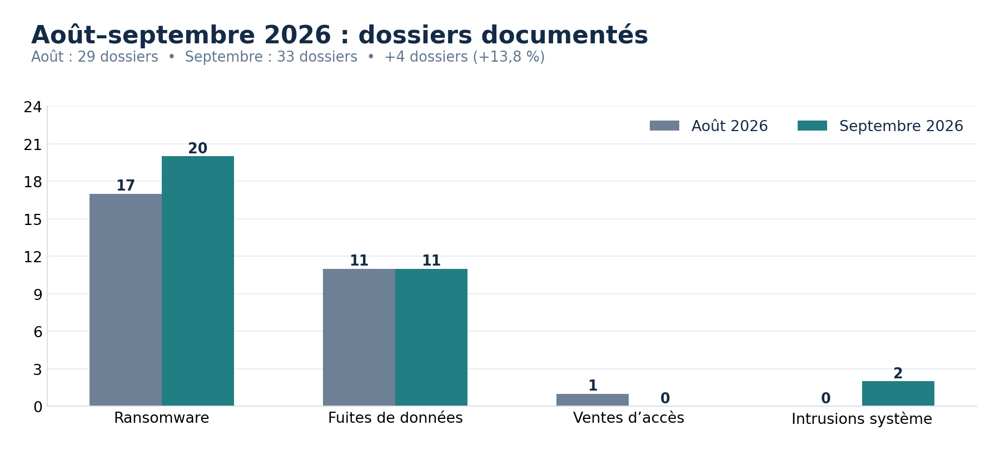
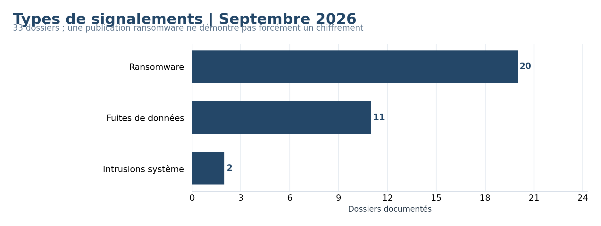
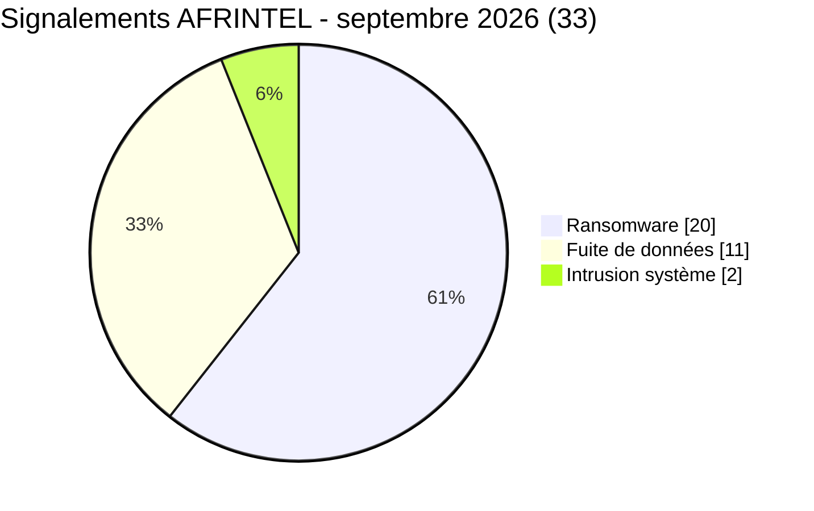
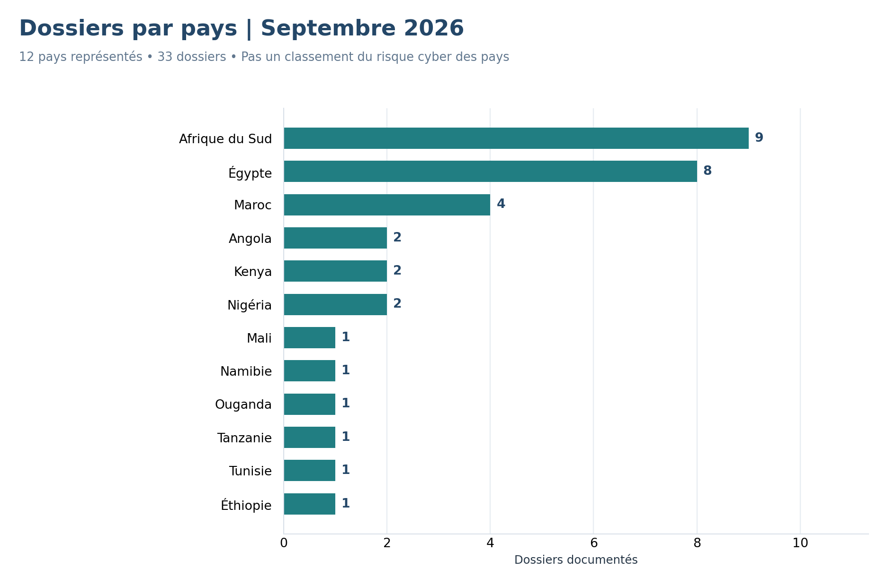
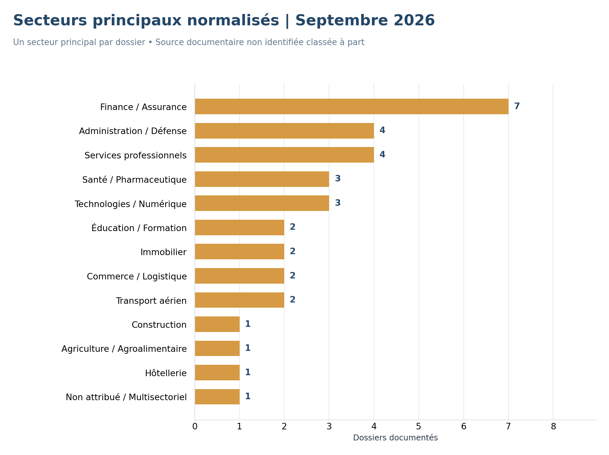
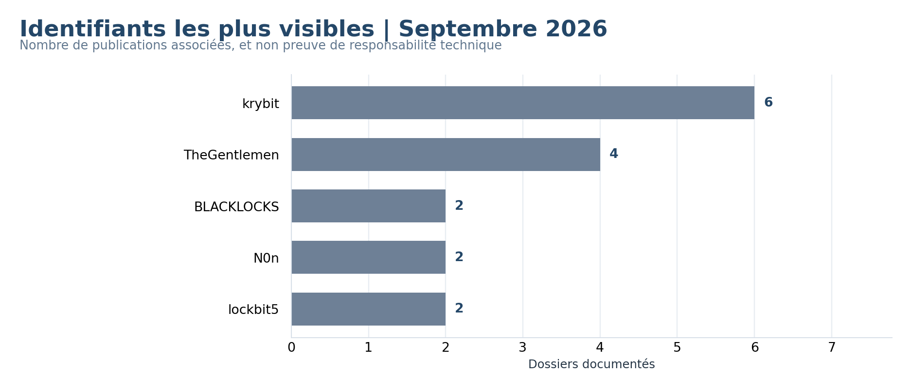

# AFRINTEL - Rapport mensuel de renseignement cyber
## Cybermenaces en Afrique | Septembre 2026

**Période du corpus :** 1er au 30 septembre 2026  
**Couverture de veille :** 54 pays africains ; 12 pays présents dans le corpus  
**Public visé :** directions générales, RSSI, DSI, responsables de la gestion des risques et analystes CTI/SOC  
**Sources :** sites de divulgation de groupes ransomware sur le Dark Web, forums underground, plateformes de publication ou de vente de données sur le Dark Web et le Deep Web, communications officielles, presse spécialisée et échantillons disponibles.  
**Données de référence :** [Fiches victimes FR](./victims_FR.md) · [Fiches EN](./victims.md) · [English report](./README.md) · [Statistiques contrôlées](./STATISTIQUES_2026-09.json)

> **Note de fiabilité - à lire avant les chiffres.** AFRINTEL décrit des **signalements documentés** : publications criminelles observées, échantillons consultés et, pour certains dossiers, événements reconnus par des organisations ou des autorités. **Une organisation citée sur un site de fuite n'est pas nécessairement une organisation dont le système a été compromis.** La publication d'un échantillon peut être constatée sans que son origine technique soit établie. Les volumes annoncés par les acteurs ne sont pas considérés comme vérifiés par défaut. Ce rapport aide à décider et à prévenir ; il ne constitue pas un classement de la sécurité des pays ou des entreprises.

---

## 1. Synthèse exécutive - ce qu'il faut retenir

En septembre 2026, AFRINTEL recense **33 dossiers répartis dans 12 pays africains**. Le ransomware représente **20 signalements (60,6 %)**, devant les **fuites de données (11 ; 33,3 %)** et les **intrusions système (2 ; 6,1 %)**. Ces catégories désignent le contexte principal de chaque dossier : un signalement ransomware ne signifie pas automatiquement que des serveurs ont été chiffrés.

L'**Afrique du Sud (9)**, l'**Égypte (8)** et le **Maroc (4)** concentrent **21 dossiers, soit 63,6 % du corpus**. Ce résultat reflète aussi la visibilité des groupes criminels, l'accès aux sources et les langues couvertes par la veille. Il ne permet pas de conclure que ces pays sont intrinsèquement moins bien protégés.

Le fait le plus important n'est pas seulement le nombre de publications. **Les informations d'identité, les documents administratifs, les données financières et les dossiers professionnels** reviennent dans plusieurs échantillons. Leur divulgation éventuelle peut alimenter, dans un second temps, des fraudes, des usurpations d'identité et des tentatives d'hameçonnage ciblé.

Deux dossiers comportent une **confirmation d'accès non autorisé** : la plateforme sud-africaine **RelyComply** et une activité non autorisée dans le réseau du **ministère namibien de la Défense et des Anciens combattants**. Deux autres dossiers, **Hollard** et **Guardrisk**, concernent des **expositions liées à des tiers**, sans intrusion directe établie chez l'assureur cité. Ces nuances changent les décisions à prendre : **vérifier les faits, protéger les personnes et traiter les accès à risque avant de conclure à une attaque.**

**Message aux décideurs :** ces observations justifient une vigilance proportionnée. Une publication criminelle doit être qualifiée avant d’être traitée comme une compromission. Si des faits confirment une atteinte grave, les dispositifs de réponse à incident et de gestion de crise doivent être activés sans délai. La visibilité sur les données sensibles, la maîtrise des accès, des sauvegardes testées et une détection adaptée réduisent concrètement les risques.

### Lecture pour les directions : trois décisions à prendre

| Priorité | Signal documenté | Décision utile |
|---|---|---|
| **P1 - Protéger les données sensibles** | Identités, dossiers administratifs et données financières apparaissent dans plusieurs échantillons. | Vérifier les dépôts critiques, les autorisations et les possibilités d’export massif. |
| **P1 - Encadrer les prestataires** | Deux expositions ont été reconnues dans un contexte tiers, sans intrusion directe confirmée chez les assureurs cités. | Identifier les données confiées, les accès délégués et les délais contractuels de notification. |
| **P2 - Vérifier la capacité de réponse** | Vingt signalements sont classés dans un contexte ransomware, sans preuve systématique de chiffrement. | Tester restauration, gestion des comptes compromis et procédures de qualification des alertes. |

*Ces priorités sont proposées à l'échelle du corpus ; chaque organisation doit les adapter à ses actifs et à ses preuves internes.*

### 1.1 Comparaison avec le mois précédent : août → septembre 2026

| Indicateur | Août 2026 | Septembre 2026 | Évolution observée |
|---|---:|---:|---:|
| **Total des dossiers** | **33** | **33** | **0 (stable)** |
| Ransomware | 18 | 20 | +2 (+11,1 %) |
| Data Leak - Fuite de données | 14 | 11 | −3 (−21,4 %) |
| Access Sale - Vente d'accès | 1 | 0 | −1 (−100,0 %) |
| DDoS | 0 | 0 | 0 (stable) |
| Defacement | 0 | 0 | 0 (stable) |
| Account Takeover | 0 | 0 | 0 (stable) |
| System Intrusion - Intrusion système | 0 | 2 | +2 (nouveau) |
| Malware | 0 | 0 | 0 (stable) |
| Operational Fraud | 0 | 0 | 0 (stable) |

**Lecture CTI :** le volume global est **stable (33 dossiers)**. Les signalements ransomware passent de 18 à 20 ; les fuites de données passent de 14 à 11. Cette variation de composition décrit la collecte AFRINTEL, pas nécessairement l’évolution des compromissions réelles.

*Base août vérifiée : 33 fiches (18 ransomware, 14 fuites de données, 1 vente d’accès), selon le [rapport AFRINTEL d’août 2026](../08-august/README_FR.md). La comparaison porte sur les **dossiers intégrés aux corpus mensuels**, pas sur le nombre exact d'intrusions qui se sont produites pendant chaque mois. La progression peut être influencée par la collecte et la découverte tardive.*

## 2. Périmètre, sources et méthode

AFRINTEL suit les 54 pays du continent, mais ne retient ici que les **33 fiches documentées dans le dossier de septembre**. Les événements sont rattachés au mois sur la base de la publication initiale ou de la première observation retenue. La date d'une publication criminelle peut être postérieure de plusieurs jours ou mois à la compromission alléguée.

**Sources exploitées :** sites de fuite des groupes ransomware, forums clandestins, espaces de partage ou de vente de données, éléments transmis à AFRINTEL, communiqués d'organisations et d'autorités, et sources publiques de vérification. Les échantillons disponibles ont fait l'objet, lorsque documenté dans les fiches, d'un examen local en lecture seule : structure des fichiers, volumes effectivement reçus, types d'informations, cohérence avec l'organisation citée. Les fichiers sensibles et les données personnelles brutes ne sont pas publiés.

Chaque dossier reçoit **un pays, un type principal et un secteur normalisé** pour les statistiques. Les publications multiples d'un même événement ne doivent pas être comptées plusieurs fois. Un compte de forum n'est pas assimilé à un groupe identifié ; un document d'un client ou d'un fournisseur ne démontre pas une intrusion chez l'ensemble de ses partenaires.

**Trois niveaux de lecture guident l'analyse :**

- **Observé :** une publication, une catégorie de documents ou un élément technique effectivement décrit dans le corpus.
- **Corroboré ou confirmé :** un lien étayé par plusieurs éléments, ou un événement reconnu par une victime ou une autorité. Le périmètre exact de la confirmation est toujours précisé.
- **Inconnu :** le vecteur d'accès, la date réelle de compromission, l'origine du fichier, les volumes complets et les effets opérationnels lorsqu'aucune preuve suffisante n'est disponible.

Les 33 fiches françaises et anglaises ont été rapprochées pour les **pays, acteurs, types et statuts**. Les statistiques présentées ici partent d'une seule grille de comptage. Les secteurs sont regroupés pour la lisibilité, sans modifier les libellés métiers détaillés des fiches.

## 3. Panorama chiffré

### 3.1 Typologie des signalements

| Type principal | Dossiers | Part du corpus |
|---|---:|---:|
| **Ransomware** | **20** | **60,6 %** |
| **Fuite de données** | **11** | **33,3 %** |
| **Intrusion système** | **2** | **6,1 %** |
| **Total** | **33** | **100 %** |

Les **20 cas classés ransomware** correspondent à des publications ou événements inscrits dans un contexte d'extorsion. Le chiffrement, la durée d'interruption et l'ampleur réelle d'une exfiltration restent **à établir dossier par dossier**.

### 3.2 Répartition géographique

| Pays | Dossiers | Pays | Dossiers |
|---|---:|---|---:|
| Afrique du Sud | 9 | Angola | 2 |
| Égypte | 8 | Kenya | 2 |
| Maroc | 4 | Mali | 1 |
| Nigéria | 2 | Namibie | 1 |
| Tunisie | 1 | Éthiopie | 1 |
| Tanzanie | 1 | Ouganda | 1 |
| **Total - 12 pays** | **33** | | |

Par grandes régions AFRINTEL, **l'Afrique du Nord compte 13 dossiers (39,4 %)**, l'**Afrique australe 12 (36,4 %)**, l'**Afrique de l'Est 5 (15,2 %)** et l'**Afrique de l'Ouest 3 (9,1 %)**. Les pays absents ne sont pas considérés comme exempts de cyberincidents : **l'absence de collecte n'est pas une absence de menace**.

### 3.3 Qualité des éléments disponibles

| Statut documentaire dans les fiches | Dossiers | Lecture correcte |
|---|---:|---|
| `Claim - Data Sample Published` | 16 | Publication avec échantillon ou extrait ; origine technique pas automatiquement établie |
| `Claim - Unverified` | 12 | Revendication ou listing observé ; éléments insuffisants pour confirmer une compromission |
| `Data Fully Published` | 1 | Lot présenté comme publié intégralement ; exhaustivité et origine technique à distinguer |
| Exposition par un tiers, intrusion directe non établie | 2 | Exposition reconnue dans un écosystème de prestataires |
| Accès non autorisé confirmé par la victime | 1 | Périmètre déclaré par la victime, sans valider toutes les assertions criminelles |
| Accès non autorisé confirmé par une autorité | 1 | Confirmation limitée au réseau et aux faits mentionnés par l'autorité |
| **Total** | **33** | |

**Point de confiance :** un échantillon cohérent renforce l'association documentaire ; il ne prouve pas, à lui seul, que le système de l'organisation citée a été piraté. Les **deux confirmations d'accès** et les **deux expositions tierces** doivent rester identifiables séparément des 29 autres dossiers.

## 4. Analyse par type d'incident

### 4.1 Ransomware : des publications d'extorsion à traiter avec méthode

Le ransomware domine la visibilité de septembre. Dans plusieurs dossiers, la fiche de la victime a été observée sur un site de divulgation ; certains groupes présentent des échantillons, un volume annoncé ou une échéance. Ces éléments permettent de suivre **l'évolution publique de la menace**, mais ne suffisent pas à reconstituer la chaîne d'intrusion.

Les cas **Apollo 21** et **ARCA Unlimited Architects** en Afrique du Sud illustrent le risque documentaire. Les éléments fournis comportent, selon les dossiers, des documents commerciaux, des pièces d'identité, des plans ou des données de projets. La cohérence avec les activités des organisations mérite une vigilance sur la confidentialité et les partenaires ; **ni le chiffrement ni les volumes annoncés ne sont établis par ces seuls extraits**.

Au **Mali**, le lot de **10 fichiers** rendu accessible sous le nom d'**AFRICA-TECH** a été examiné. Il comprend notamment des pièces bancaires, de voyage et d'assurance. La publication de ce lot est documentée ; l'identité juridique exacte de l'entité et le fonctionnement technique d'une éventuelle attaque restent à préciser.

En **Tanzanie**, le dossier **Air Tanzania** comporte **114 fichiers examinés**, dont **112 images valides**. Ils étayent l'existence du corpus étudié, sans déterminer comment il aurait été obtenu.

**Conséquence pour les RSSI :** vérifier les systèmes et les catégories de documents visés, protéger les sauvegardes et rechercher des accès atypiques. Ne pas déclencher de communication annonçant un chiffrement sans constat technique ou confirmation fiable.

### 4.2 Fuites de données : le principal enjeu est la réutilisation des informations

Le cas **Centre Atlantique Formation**, au **Maroc**, est particulièrement documenté. L'ensemble local examiné comprend **4 644 fichiers (environ 3,94 Go)**, dont **3 476 JSON**, **1 165 PDF** et **3 JPG**. Un sous-ensemble structuré décrit **1 155 dossiers d'inscription** et des certificats de formation. Ces comptes portent sur des **fichiers et dossiers**, pas sur un nombre validé de personnes uniques. La cohérence entre enregistrements et attestations renforce l'association à l'établissement, sans identifier le vecteur initial d'accès.

Au **Nigéria**, la publication visant le **Federal Capital Territory Internal Revenue Service (FCT-IRS)** s'accompagne d'un document de **314 pages** analysé. Des coordonnées et données d'identité y sont représentées ; leur présence ne permet pas de confirmer l'exfiltration depuis les systèmes de l'administration fiscale ni de déduire le nombre de personnes touchées.

En **Égypte**, la publication liée à **Madinaty** évoque des résidents et des coordonnées de contact. **L'organisation qui détenait initialement les données n'a pas été identifiée** : le promoteur immobilier ne doit pas être désigné comme victime technique sur cette seule base. La revendication associée à **Badr University in Cairo** comporte également des éléments d'identification partiellement masqués, sans démonstration d'accès valide.

Les dossiers **`subscribers.co.ke`**, **`acao.org.ma`** et **Techne Summit 2026** renforcent le besoin de contrôler les exports, les bases de contacts et les accès aux applications métiers. Pour chacun, les chiffres revendiqués et la provenance technique restent distincts des échantillons réellement visibles.

**Conséquence pour les équipes SOC :** rechercher prioritairement les exports volumineux, les consultations anormales, les créations d'archives et les accès inhabituels aux référentiels sensibles. Surveiller ensuite les tentatives de phishing et de fraude exploitant les données potentiellement exposées.

### 4.3 Intrusions système : deux confirmations, deux périmètres précis

**RelyComply (Afrique du Sud)** a reconnu un **accès non autorisé** à certains systèmes, détecté le **8 septembre 2026**, dans un contexte de vulnérabilité d'une application tierce. L'entreprise indique avoir mis en œuvre des mesures correctives, notamment la reconstruction de systèmes et la révocation ou le renouvellement d'accès et de secrets. Cela établit l'existence d'un incident, **pas l'attribution technique à l'auteur d'une revendication ransomware**.

En **Namibie**, les informations gouvernementales examinées confirment une activité non autorisée dans le réseau du **ministère de la Défense et des Anciens combattants**. La revendication criminelle utilise le nom **Namibian Defence Force** ; la confirmation publique ne doit pas être étendue sans preuve aux réseaux militaires opérationnels, à un chiffrement ou à la fuite de secrets.

**Conséquence :** le fait d'être précis sur le réseau concerné, la source de la confirmation et les actions réalisées permet de communiquer sans spéculation et de concentrer l'enquête sur les bons actifs.

## 5. Lecture sectorielle : où porter les efforts ?

La catégorisation suivante est **normalisée par activité principale**. Elle évite qu'un secteur décrit par plusieurs mots soit compté plusieurs fois. Le corpus de documents personnels sud-africains dont l'organisation source est inconnue reste volontairement **non attribué**.

| Secteur principal normalisé | Dossiers | Part |
|---|---:|---:|
| Finance / Assurance | 7 | 21,2 % |
| Administration / Défense | 4 | 12,1 % |
| Services professionnels | 4 | 12,1 % |
| Santé / Pharmaceutique | 3 | 9,1 % |
| Technologies / Numérique | 3 | 9,1 % |
| Éducation / Formation | 2 | 6,1 % |
| Immobilier | 2 | 6,1 % |
| Commerce / Logistique | 2 | 6,1 % |
| Transport aérien | 2 | 6,1 % |
| Construction | 1 | 3,0 % |
| Agriculture / Agroalimentaire | 1 | 3,0 % |
| Hôtellerie | 1 | 3,0 % |
| Non attribué / Multisectoriel | 1 | 3,0 % |
| **Total** | **33** | **100 %** |

**Ce qui compte :** la finance, l'administration, la santé et les services numériques concentrent des données dont la réutilisation peut avoir des conséquences importantes. Toutefois, un secteur plus représenté dans AFRINTEL n'est pas nécessairement le secteur le plus attaqué à l'échelle du continent.

## 6. Acteurs, groupes et comptes de publication

| Identifiant observé | Dossiers associés | Ce que le chiffre signifie |
|---|---:|---|
| `krybit` | 6 | Présence dans les publications suivies |
| `TheGentlemen` | 4 | Présence dans les publications suivies |
| `BLACKLOCKS` | 2 | Présence dans les publications suivies |
| `N0n` | 2 | Présence dans les publications suivies |
| `lockbit5` | 2 | Présence dans les publications suivies |
| Autres identifiants ou attribution inconnue | 17 | Publications unitaires ou attribution non précisée |
| **Total** | **33** | **Ce total ne mesure pas une responsabilité technique prouvée** |

Ce classement est utile pour **orienter la veille** : rechercher les nouvelles publications, rapprocher les noms et les échéances, repérer les réapparitions de documents. Il ne suffit pas pour attribuer une intrusion à une personne ou pour démontrer que plusieurs publications suivent la même méthode d'accès.

### 6.1 Lecture par pays : priorités, pas palmarès de risque

L'Afrique du Sud regroupe plusieurs dossiers de finance, d'assurance et de services ; l'Égypte présente une diversité d'activités économiques et administratives ; le Maroc comporte notamment des dossiers d'éducation et de santé. Les autres pays fournissent des signaux importants malgré des effectifs plus faibles. **La bonne priorité nationale ne se déduit pas du nombre brut de publications, mais des actifs exposés, du niveau de preuve et de la sensibilité des données.**

## 7. Tendances, cas sensibles et lacunes de renseignement

**Trois constats ressortent des éléments examinés.** D'abord, les publications d'extorsion demeurent la catégorie la plus visible. Ensuite, plusieurs échantillons réunissent identité, documents justificatifs et données professionnelles ou financières : leur valeur pour des fraudeurs peut durer au-delà de la publication initiale. Enfin, les dossiers **Hollard** et **Guardrisk** rappellent qu'une donnée liée à une marque peut provenir d'un **prestataire**. Hollard a relié l'exposition de certains assurés à l'incident de **MIP Holdings** ; Guardrisk a indiqué un contexte d'exposition chez **CoverCubed**. Aucun de ces deux dossiers ne doit être présenté comme la confirmation d'une intrusion directe dans les systèmes des assureurs.

**Ce qui reste à établir en priorité :** l'origine des données lorsque plusieurs détenteurs sont possibles ; les systèmes et dates réels d'accès ; l'existence du chiffrement lorsqu'il est revendiqué ; les volumes réellement publiés ; les suites données par les organisations. Une confirmation institutionnelle ou un rapport d'investigation numérique (DFIR) peut résoudre ces questions, mais tous ces éléments ne sont pas disponibles publiquement dans les sources examinées.

La couverture doit aussi être renforcée pour les pays moins visibles : relations avec CERT/CSIRT nationaux, presse locale, sources en français, anglais, arabe, portugais et langues pertinentes, et vérification des republications entre plateformes.

### Dossiers à examiner en priorité : ce qui est établi et ce qui ne l'est pas

| Dossier | Élément documenté | Risque à anticiper | Limite de la preuve |
|---|---|---|---|
| **RelyComply - Afrique du Sud** | Accès non autorisé reconnu par l'entreprise. | Sécurité des accès, partenaires et données transactionnelles. | Responsabilité technique du groupe revendiquant l'attaque non établie. |
| **Défense namibienne** | Activité non autorisée confirmée dans le réseau ministériel. | Sécurité et continuité des services publics sensibles. | Chiffrement, extraction et fuite de secrets non établis. |
| **Centre Atlantique Formation - Maroc** | Archive structurée et documents de formation cohérents, examinés en lecture seule. | Fraude documentaire, usurpation d'identité. | Point d'entrée et exhaustivité de l'exposition inconnus. |
| **SEPE - Angola** | Échantillon administratif examiné ; volumes nettement supérieurs revendiqués. | Protection des usagers et des justificatifs administratifs. | Compromission directe du portail et volume total non prouvés. |
| **Hollard / Guardrisk - Afrique du Sud** | Expositions liées à des prestataires reconnues. | Gestion des données confiées à des tiers. | Ne constitue pas la preuve d'intrusions directes chez les assureurs. |

*Ce tableau met en évidence l’intérêt pour la défense ; il ne classe pas les victimes selon un impact opérationnel confirmé.*

## 8. MITRE ATT&CK : hypothèses de détection, pas attribution

Le corpus public ne décrit pas systématiquement les chaînes techniques d'attaque. Les correspondances ci-dessous sont des **pistes défensives** à valider à partir des journaux internes ; elles **ne signifient pas** que ces techniques ont été observées chez toutes les organisations citées.

| Hypothèse à examiner | Technique MITRE ATT&CK | Télémétrie SOC utile |
|---|---|---|
| Utilisation abusive d'un compte légitime | [T1078 - Valid Accounts](https://attack.mitre.org/techniques/T1078/) | IAM, SSO, VPN, MFA, EDR |
| Exploitation d'un portail ou service exposé | [T1190 - Exploit Public-Facing Application](https://attack.mitre.org/techniques/T1190/) | WAF, reverse proxy, logs applicatifs, vulnérabilités corrigées |
| Consultation ou extraction excessive d'un référentiel | [T1213 - Data from Information Repositories](https://attack.mitre.org/techniques/T1213/) | Audit BD, NAS, fichiers, DLP |
| Téléchargement inhabituel de stockage cloud | [T1530 - Data from Cloud Storage](https://attack.mitre.org/techniques/T1530/) | Journaux API cloud, objets, IAM |
| Chiffrement massif de données, **si documenté** | [T1486 - Data Encrypted for Impact](https://attack.mitre.org/techniques/T1486/) | EDR, FIM, historiques de fichiers, sauvegardes |

**Attention :** une inscription sur un leak site ne prouve pas l'utilisation de `T1486`. Les indicateurs techniques ne doivent pas être inventés à partir des domaines des organisations victimes.

## 9. Recommandations aux organisations

| Pour qui ? | Risque le plus utile à anticiper | Mesure prioritaire |
|---|---|---|
| **Directions générales / DSI** | Décisions prises sur une revendication non vérifiée | Mettre en place une cellule courte de qualification : RSSI, SI, juridique, communication |
| **RSSI / responsables des risques** | Copies non maîtrisées de données sensibles | Cartographier les dépôts critiques, les sous-traitants et les droits d'export |
| **Banques et assurances** | Fraude au changement de RIB ou usurpation de client | Validation des changements sensibles par un canal indépendant ; MFA |
| **Administrations, santé, éducation** | Réutilisation d'identités et de documents | Moindre privilège, contrôle des exports, confidentialité et durée de conservation |
| **Prestataires numériques / fournisseurs** | Exposition indirecte et propagation entre partenaires | Revue des accès délégués, clauses de notification et journaux partagés |

Une publication criminelle **ne justifie pas à elle seule** l'arrêt d'un service. Les premières mesures doivent être proportionnées : vérifier les éléments, préserver les traces, renforcer les contrôles utiles et préparer la communication adaptée si l'incident est établi.

## 10. Plan SOC et actions opérationnelles

**Contrôles liés aux informations observées :** instrumenter les bases de données et applications qui hébergent des identités, coordonnées, dossiers et documents financiers ; détecter les téléchargements inhabituels et les exports répétés ou massifs ; protéger les journaux et conserver les éléments de preuve dans un espace restreint.

**Hypothèses à investiguer :** accès privilégié depuis un terminal inédit, export massif après authentification atypique, utilisation anormale d'un compte de prestataire, création soudaine d'archives volumineuses. Corréler **identité + actif + volume + période + action** ; une adresse IP inhabituelle prise isolément ne suffit pas à conclure.

**Prévention générale :** MFA résistant au phishing lorsque possible, segmentation des comptes d'administration, durcissement des applications exposées, EDR, sauvegardes hors ligne ou immuables et tests réguliers de restauration.

### Détections comportementales à valider dans le SIEM

| Hypothèse de détection | Sources de logs | Logique de corrélation proposée | Contrôle humain |
|---|---|---|---|
| **Export massif inhabituel** | Bases de données, application, stockage, DLP | Compte + dépôt sensible + volume nettement supérieur à sa ligne de base + plage temporelle courte. | Vérifier tâche métier, opération de maintenance ou sauvegarde autorisée. |
| **Accès atypique suivi d'un export** | IAM/SSO/VPN, applications, audit des fichiers | Nouveau terminal ou session inhabituelle, suivi d'un téléchargement ou export volumineux. | Vérifier MFA, légitimité de la session et contexte de l’utilisateur. |
| **Compte prestataire hors usage normal** | Bastion, PAM, IAM, VPN, journaux applicatifs | Compte délégué + horaire inhabituel + accès à plusieurs ressources non habituelles. | Comparer au contrat, aux interventions planifiées et aux autorisations. |
| **Préparation possible d'exfiltration** | EDR, fichiers, proxy, trafic sortant | Création rapide d'archives volumineuses, puis transfert externe inhabituel. | Exclure les traitements d'archivage et échanges légitimes. |
| **Chiffrement destructeur suspecté** | EDR, FIM, sauvegardes | Nombre élevé de modifications de fichiers + comportements anormaux de processus. | Confirmer les événements avant tout confinement perturbateur. |

*Ces règles sont des pistes de surveillance. Elles ne prouvent pas que les techniques correspondantes ont été utilisées dans les dossiers de septembre.*

| Horizon | Actions concrètes | Preuve de réalisation attendue |
|---|---|---|
| **0 à 7 jours** | Recenser les actifs et prestataires concernés ; préserver logs et captures ; vérifier les publications qui citent son organisation ; activer les validations financières hors bande | Inventaire ciblé, dossier de qualification, propriétaires désignés |
| **8 à 30 jours** | Tester alertes d'export et d'accès anormal ; auditer comptes à privilèges et accès tiers ; corriger les expositions démontrées | Règles SIEM validées, revue d'accès, tickets de remédiation |
| **30 à 90 jours** | Simuler fuite de données, incident fournisseur et ransomware ; restaurer réellement des sauvegardes ; revoir la gestion de crise | Compte rendu d'exercice, temps de restauration, plan de progrès |

**Mesure d'efficacité recommandée :** suivre la couverture de journalisation des dépôts sensibles, le taux d'alertes exploitables, les délais de qualification, la révocation des accès à risque et les résultats des tests de restauration.

## 11. Orientations stratégiques pour RSSI, DSI et décideurs

**Première priorité : maîtriser les données.** Savoir où se trouvent les copies des fichiers d'identité, des dossiers clients et des documents financiers est souvent plus décisif que multiplier les outils. Limiter leur duplication et auditer les exports réduit l'impact d'une exposition éventuelle.

**Deuxième priorité : intégrer les prestataires à la défense.** Les cas de septembre montrent pourquoi le risque tiers doit être suivi sans confondre l'entreprise dont le nom apparaît et le détenteur réel des données. Des obligations de traçabilité, de notification et de restriction des accès doivent être convenues à l'avance.

**Troisième priorité : décider sur des faits.** Face à une revendication, la direction doit pouvoir recevoir une note courte : « qu'avons-nous observé ? », « qu'est-ce qui est confirmé ? », « quelles vérifications restent nécessaires ? », « quelle action immédiate est proportionnée ? ». Cette discipline protège à la fois l'organisation, ses clients et sa réputation.

## 12. Conclusion et limites d'utilisation

Le mois de septembre 2026 présente **33 signalements documentés dans 12 pays**, avec une forte visibilité du ransomware et des risques de divulgation de données. Plusieurs dossiers contiennent des éléments concrets, et **deux accès non autorisés sont confirmés dans des périmètres précisément définis**. De nombreuses autres publications demandent encore des vérifications avant toute conclusion sur la réalité d'une intrusion, l'ampleur d'une fuite ou les effets sur l'activité.

**Le constat est sérieux, mais les réponses sont connues et à portée des organisations :** surveiller les accès, encadrer les exports, protéger les identités, vérifier les fournisseurs et s'entraîner à restaurer les services. La veille AFRINTEL sert à **anticiper**, non à entretenir l'inquiétude.

**Limites :** corpus non exhaustif ; surreprésentation possible des publications d'extorsion ; découverte parfois postérieure à la date d'accès ; échantillons hétérogènes ; volumes annoncés non additionnables ; aucune équivalence automatique entre fichier, ligne, dossier et personne. Un statut de preuve ou un niveau de confiance élevé ne remplace pas une confirmation du système compromis. Les chiffres proviennent des fiches analysées ; les vérifications indépendantes propres aux fiches sont, pour une grande partie, datées du **18 octobre 2026**.

---

**AFRINTEL - Cyber Threat Intelligence for Africa**  
*Renseignement structuré, analyse prudente et recommandations utiles à la cyberdéfense.*  
[Consulter les 33 fiches détaillées](./victims_FR.md) · [Version anglaise](./README.md) · [Projet AFRINTEL](https://github.com/Hatchepsoute/AFRINTEL)
