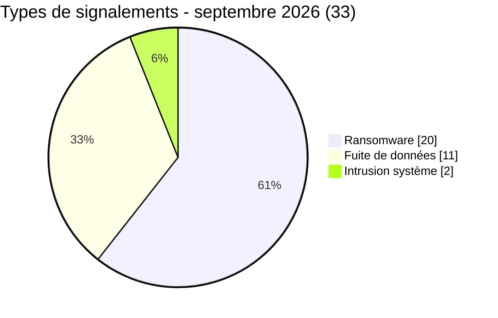

# AFRINTEL - Rapport CTI | Cyberincidents en Afrique - Septembre 2026

**Période étudiée :** 1er–30 septembre 2026 · **Revue éditoriale :** 5 novembre 2026
**Périmètre :** 54 pays africains suivis ; 12 pays représentés dans le corpus
**Sources :** sites de divulgation ransomware, forums underground et places de marché clandestines, communications officielles, presse spécialisée et échantillons disponibles
**Données :** [fiches victimes FR](./victims_FR.md) · [Victim records EN](./victims.md) · [English report](./README.md)

> **Sources et démarche -** Le rapport s'appuie sur les publications observées par AFRINTEL, les éléments visuels disponibles, les communications d'organisations ou d'autorités et, lorsque cela est possible, l'examen local en lecture seule d'échantillons. Les faits observés, hypothèses et inconnues restent séparés dans les fiches victimes. Les chiffres décrivent la visibilité documentée par AFRINTEL et ne mesurent pas le nombre réel de compromissions.

## 1. Synthèse exécutive

Le corpus de septembre comprend **33 dossiers dans 12 pays** : **20 ransomware (60,6 %)**, **11 fuites de données (33,3 %)** et **2 intrusions système (6,1 %)**. Chaque événement reçoit un type principal ; les revendications ransomware sans chiffrement établi conservent cette limite dans l'analyse.

L'Afrique du Sud compte **9 dossiers**, l'Égypte **8** et le Maroc **4**. Ces trois pays représentent **21 des 33 dossiers (63,6 %)**. Cette concentration dépend aussi des sources accessibles, de la couverture linguistique et des capacités de collecte ; elle ne constitue pas un classement du risque national.

La maturité des preuves est hétérogène : plusieurs dossiers comportent des échantillons structurés ou visuels examinés en lecture seule, d'autres restent des listings. Deux cas concernent une exposition chez un tiers sans compromission directe établie ; la Namibie comporte une confirmation gouvernementale d'activité non autorisée dans un réseau ministériel. Ces statuts ne valident pas automatiquement les volumes ou les récits des acteurs.

### 1.1 Comparaison avec octobre 2026

| Indicateur | Septembre | Octobre | Évolution |
|---|---:|---:|---:|
| **Total** | **33** | **48** | **+15 (+45,5 %)** |
| Ransomware | 20 | 17 | −3 (−15,0 %) |
| Data Leak | 11 | 23 | +12 (+109,1 %) |
| Access Sale | 0 | 3 | +3 (nouveau) |
| System Intrusion | 2 | 5 | +3 (+150,0 %) |
| DDoS / Defacement / Account Takeover / Malware / Operational Fraud | 0 | 0 | stable |

La hausse d'octobre vient principalement des fuites de données documentées. Elle ne doit pas être assimilée à une hausse équivalente des compromissions réelles sans contrôle de la collecte et des republications.

## 2. Périmètre, méthode et limites

Le rattachement mensuel suit la date de publication observée ou la première observation documentée par AFRINTEL. Cette date n'est pas nécessairement la date d'accès initial, d'extraction, de chiffrement ou de divulgation.

Les **33 fiches FR et 33 fiches EN** ont été contrôlées pour le nombre, l'ordre et les valeurs structurées. Les statistiques sont déterminées depuis la version française puis vérifiées dans la version anglaise. Un événement compte une seule fois ; les effets secondaires et publications multiples ne créent pas de doublon.

Les échantillons locaux sont traités en lecture seule. Les nombres de fichiers, lignes, pages ou motifs ne sont pas convertis en nombres de personnes uniques. Aucun nom, email, numéro, mot de passe, token, document individuel ou lien criminel n'est reproduit.

## 3. Panorama du mois

### 3.1 Types de signalements

| Type d'incident | Dossiers | Part |
|---|---:|---:|
| **Ransomware** | **20** | **60,6 %** |
| **Data Leak - Fuite de données** | **11** | **33,3 %** |
| **System Intrusion - Intrusion système** | **2** | **6,1 %** |
| **Total** | **33** | **100,0 %** |

### 3.2 Pays et régions

| Pays | Dossiers | Pays | Dossiers |
|---|---:|---|---:|
| Afrique du Sud | 9 | Angola | 2 |
| Égypte | 8 | Kenya | 2 |
| Maroc | 4 | Mali | 1 |
| Nigéria | 2 | Namibie | 1 |
| Tunisie | 1 | Éthiopie | 1 |
| Tanzanie | 1 | Ouganda | 1 |
| **Total (12 pays)** | **33** |  |  |

| Région AFRINTEL | Dossiers | Part |
|---|---:|---:|
| Afrique du Nord | 13 | 39,4 % |
| Afrique australe | 12 | 36,4 % |
| Afrique de l'Est | 5 | 15,2 % |
| Afrique de l'Ouest | 3 | 9,1 % |
| **Total** | **33** | **100,0 %** |

Les régions sans dossier ne sont pas exemptes d'incidents ; elles sont sous-représentées dans la visibilité collectée.

### 3.3 Qualité des éléments accessibles

| État documentaire AFRINTEL | Dossiers | Part |
|---|---:|---:|
| Claim - Data Sample Published | 16 | 48,5 % |
| Claim - Unverified | 12 | 36,4 % |
| Data Fully Published | 1 | 3,0 % |
| Third-Party Exposure Confirmed - Direct Breach Not Established | 2 | 6,1 % |
| Victim Confirmed - Unauthorized Access | 1 | 3,0 % |
| Government Confirmed - Unauthorized Access | 1 | 3,0 % |
| **Total** | **33** | **100,0 %** |

Les libellés historiques sont conservés dans les fiches. Une exposition chez un tiers ou une confirmation d'accès ne valide pas tous les volumes et catégories revendiqués.

### 3.4 Acteurs et comptes de publication

| Identifiant observé | Dossiers |
|---|---:|
| krybit | 6 |
| TheGentlemen | 4 |
| BLACKLOCKS | 2 |
| N0n | 2 |
| lockbit5 | 2 |
| Autres libellés | 17 |

Ce classement mesure la visibilité des sources, non l'identité technique ou la responsabilité démontrée. Les comptes de forum restent des attributions déclarées.

### 3.5 Secteurs normalisés

| Secteur primaire | Dossiers | Part |
|---|---:|---:|
| Finance / Assurance | 7 | 21,2 % |
| Gouvernement / Administration publique | 6 | 18,2 % |
| Services professionnels | 4 | 12,1 % |
| Santé | 3 | 9,1 % |
| Technologie / Services numériques | 3 | 9,1 % |
| Éducation | 2 | 6,1 % |
| Immobilier | 2 | 6,1 % |
| Commerce / Logistique | 2 | 6,1 % |
| Transport | 1 | 3,0 % |
| Construction | 1 | 3,0 % |
| Agriculture | 1 | 3,0 % |
| Hôtellerie | 1 | 3,0 % |
| **Total** | **33** | **100,0 %** |

Chaque dossier reçoit un secteur primaire afin d'éviter le double comptage des secteurs composites.

## 4. Dossiers marquants

### 4.1 Données administratives et d'identité

**Centre Atlantique Formation** est l'un des dossiers les plus documentés : **4 644 fichiers**, environ **3,94 Go**, dont **3 476 JSON**, **1 165 PDF** et **3 JPG**. L'analyse décrit **1 155 dossiers d'inscription** et des catégories d'identité, formation et certificats. La cohérence interne renforce l'association documentaire, sans établir le vecteur d'accès ni le volume complet.

Le dossier **SEPE** en Angola comprend **1 189 fichiers** pour **544 921 521 octets**, avec **111 JSON** inspectés structurellement. Les chiffres revendiqués de **179 Go** et **110 021 utilisateurs** ne sont pas validés par l'échantillon.

Le cas **FCT-IRS** repose notamment sur un PDF de **314 pages**. Les détections de formats d'emails ou de téléphones ne constituent ni un décompte de personnes ni une preuve de provenance technique.

### 4.2 Ransomware avec éléments visibles

Les échantillons associés à **Apollo 21**, **ARCA Unlimited Architects** et **First National Bank** montrent des documents commerciaux, financiers ou personnels présentés par les acteurs. Ils soutiennent une association documentaire variable, mais ne prouvent ni chiffrement, ni exfiltration complète, ni volume revendiqué.

Pour **Air Tanzania**, 114 fichiers locaux ont été examinés, dont 112 images valides. Cette cohérence structurelle confirme un corpus associé à la publication, pas son origine technique.

### 4.3 Confirmations et expositions tierces

La **Namibian Defence Force** bénéficie d'une confirmation gouvernementale d'activité non autorisée dans le réseau du ministère de la Défense et des Anciens combattants. Le chiffrement, l'exfiltration et la divulgation de secrets militaires ne sont pas établis.

Pour **Hollard Insurance Group** et **Guardrisk**, les fiches séparent l'exposition ou le contexte d'un tiers d'une compromission directe de l'assureur. Cette distinction évite d'attribuer automatiquement à la victime principale des données détenues par un prestataire.

### 4.4 Santé, finance et services critiques

Les cas **MDCN**, **Pharma 5**, **Seashell Hospital**, **FNB**, **Siinqee Bank**, **Armada Credit Bureau**, **Majani Insurance Brokers** et **RelyComply** présentent des risques potentiels d'usurpation, fraude et phishing ciblé. La sensibilité sectorielle ne remplace pas une preuve d'accès ou une confirmation institutionnelle.

## 5. Lecture stratégique

Les acteurs recherchent des jeux de données transversaux reliant identité, activité professionnelle, transactions et documents justificatifs. Les échantillons visuels peuvent soutenir une association documentaire sans prouver la source technique. Les prestataires et intermédiaires élargissent le périmètre de risque : une exposition tierce doit rester séparée d'une intrusion confirmée chez la victime nommée.

La domination du ransomware reflète aussi la visibilité des leak sites et ne signifie pas que les autres formes d'intrusion ou de fuite sont marginales dans la réalité.

## 6. Risques prioritaires

| Environnement | Risque à anticiper | Priorité défensive |
|---|---|---|
| Administrations et portails | Usurpation et fraude documentaire | Contrôler exports, IAM et prestataires |
| Finance et assurance | Fraude au paiement et phishing ciblé | MFA, journalisation et validation hors bande |
| Santé et régulation | Atteinte à la vie privée et extorsion | Segmenter et limiter les accès massifs |
| Formation et éducation | Fraude aux certificats et ciblage d'étudiants | Protéger portails et mécanismes de vérification |
| Services numériques et tiers | Mouvement latéral et réutilisation d'identifiants | Revoir comptes de service et accès délégués |

## 7. Lacunes de renseignement

| Sujet | Établi | À établir |
|---|---|---|
| Revendications ransomware | Listings et parfois échantillons visibles | Chiffrement, accès initial, exfiltration et impact |
| Expositions tierces | Prestataire ou intermédiaire mentionné dans certains cas | Périmètre, flux et responsabilité exacte |
| Échantillons | Catégories et cohérence interne | Provenance, exhaustivité et personnes uniques |
| Volumes annoncés | Chiffres publiés par les acteurs | Correspondance avec les lots accessibles |
| Pays peu représentés | Visibilité faible dans le corpus | Sources locales, CERT/CSIRT et langues régionales |

## 8. MITRE ATT&CK : pistes défensives

Les techniques suivantes sont des hypothèses à tester dans les journaux ; elles ne constituent pas une attribution.

| Technique | Hypothèse | Données à corréler |
|---|---|---|
| [T1078 - Valid Accounts](https://attack.mitre.org/techniques/T1078/) | Compte légitime détourné | IAM, VPN, SSO, terminal |
| [T1190 - Exploit Public-Facing Application](https://attack.mitre.org/techniques/T1190/) | Portail exposé exploité | WAF, proxy, erreurs applicatives |
| [T1213 - Data from Information Repositories](https://attack.mitre.org/techniques/T1213/) | Extraction depuis un dépôt métier | Audit fichiers, DB, stockage |
| [T1530 - Data from Cloud Storage](https://attack.mitre.org/techniques/T1530/) | Téléchargement depuis le cloud | API cloud, logs objets, DLP |
| [T1486 - Data Encrypted for Impact](https://attack.mitre.org/techniques/T1486/) | Chiffrement massif si établi | EDR, fichiers, sauvegardes |

Une présence sur un forum ne prouve aucune de ces techniques ; un listing ransomware ne prouve pas automatiquement T1486.

## 9. Recommandations SOC et plan d'action

1. Alerter sur les exports massifs depuis ERP, portails de candidature, bases de santé et plateformes financières.
2. Corréler connexions privilégiées avec pays, ASN, terminal, horaire et action.
3. Journaliser téléchargements, archives, changements de droits et accès de prestataires.
4. Imposer une validation hors bande pour les changements de coordonnées bancaires et transferts sensibles.
5. Préparer la révocation des sessions et la rotation contrôlée des secrets lorsque l'enquête le justifie.
6. Conserver les preuves en stockage restreint et ne jamais tester des identifiants publiés.

**0–7 jours :** préserver les journaux, identifier les systèmes détenant les catégories signalées, bloquer les opérations financières sensibles et séparer faits/hypothèses.
**8–30 jours :** tester les alertes d'export, revoir comptes de service et accès tiers, préparer la protection des personnes.
**30–90 jours :** exercer les scénarios de fuite, compromission tierce et ransomware ; mesurer couverture des logs et délais de révocation.

## 10. Qualité du renseignement et réserves

Le niveau de confiance mesure la solidité de l'association ou des éléments examinés ; le niveau d'impact décrit la gravité potentielle ou établie. Une confiance élevée dans un échantillon ne constitue pas automatiquement une confirmation officielle.

Les rapports FR et EN utilisent les mêmes 33 fiches et les mêmes valeurs structurées. Les tableaux totalisent tous 33 dossiers et ne doivent pas être recalculés indépendamment depuis les deux langues.

## Conclusion

Septembre 2026 est dominé par les revendications ransomware, mais les dossiers les plus instructifs exposent des données administratives, financières, médicales ou professionnelles. Les priorités défensives sont la limitation des exports, le contrôle des accès tiers, la protection des identités et la surveillance de la fraude secondaire.

AFRINTEL distingue strictement publication, observation, hypothèse et confirmation afin de produire un renseignement CTI exploitable.

---

*AFRINTEL - Cyber Threat Intelligence for Africa*
*Fiches détaillées : [victims_FR.md](./victims_FR.md) · [GitHub AFRINTEL](https://github.com/Hatchepsoute/AFRINTEL)*
