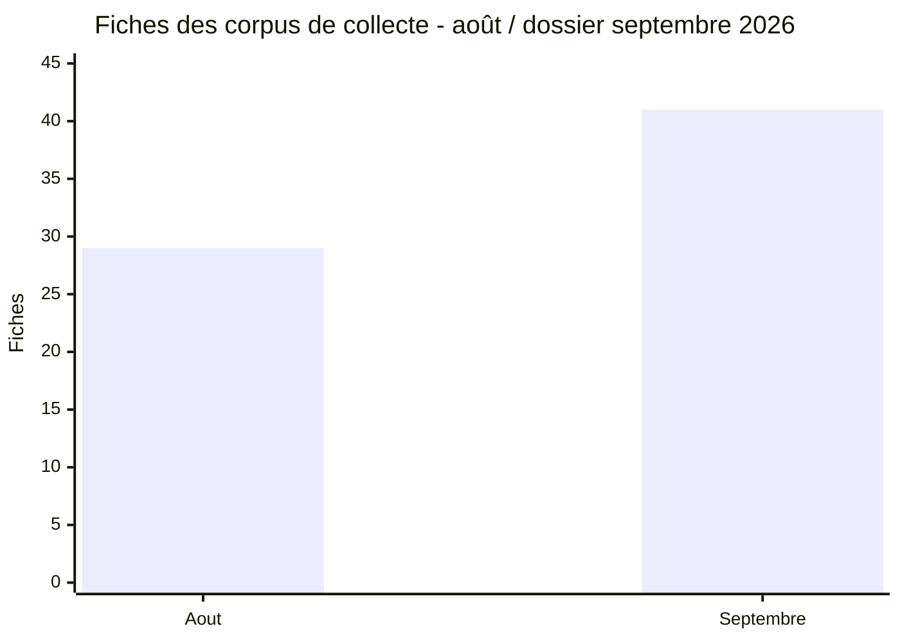
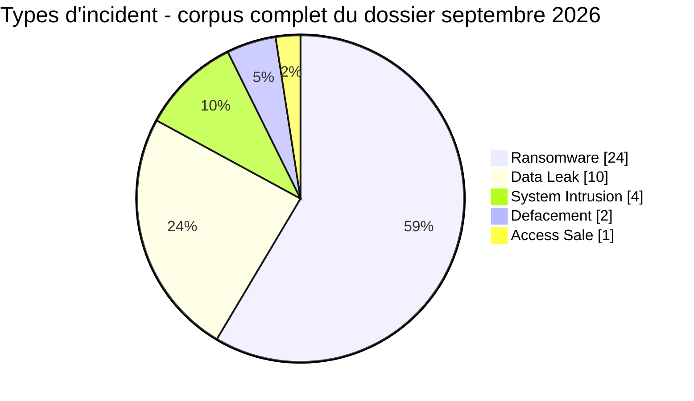
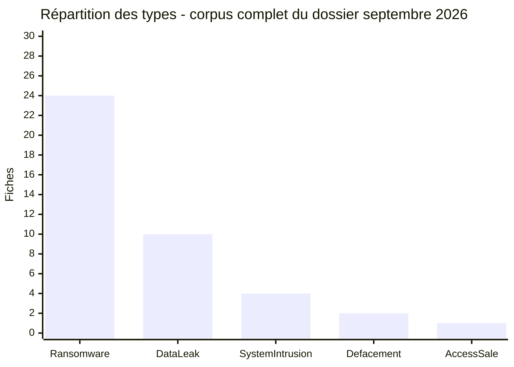
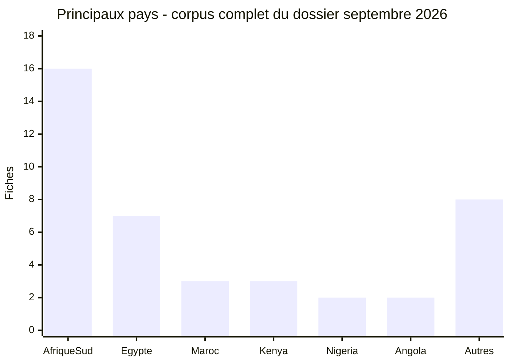
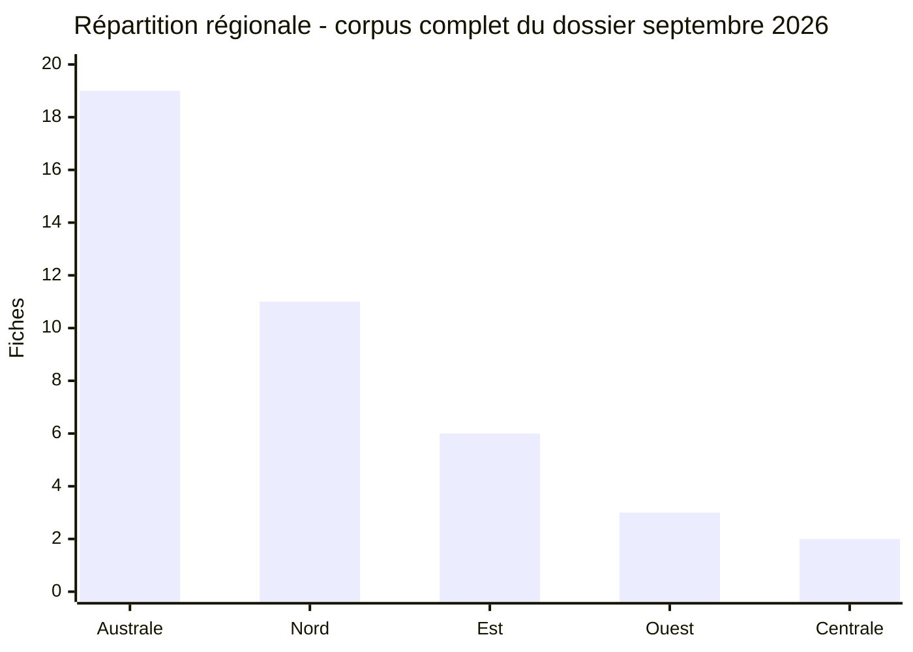
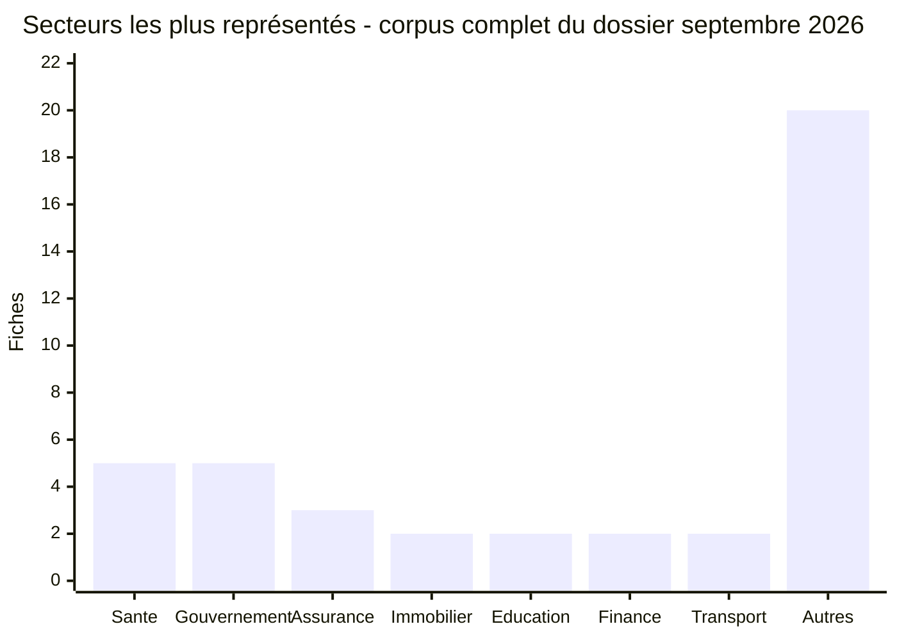
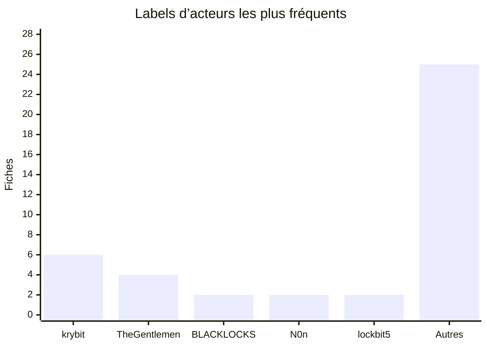
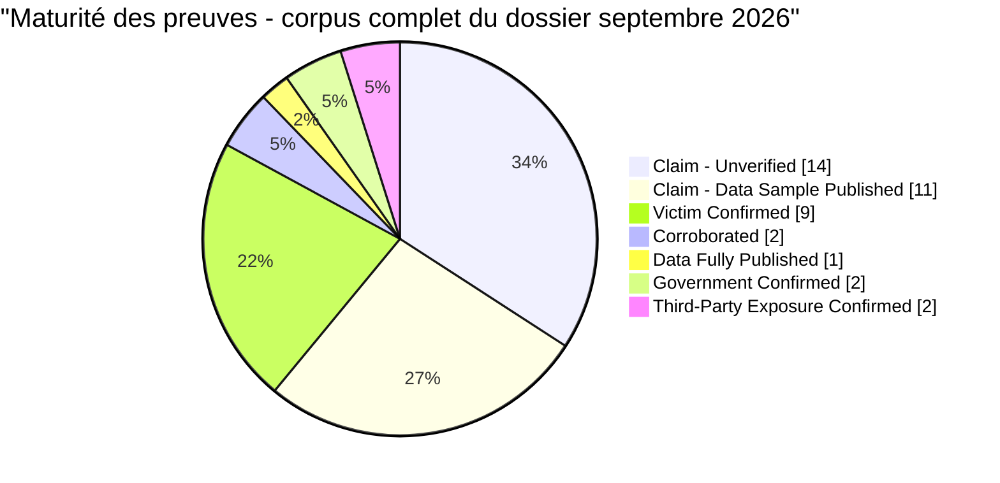
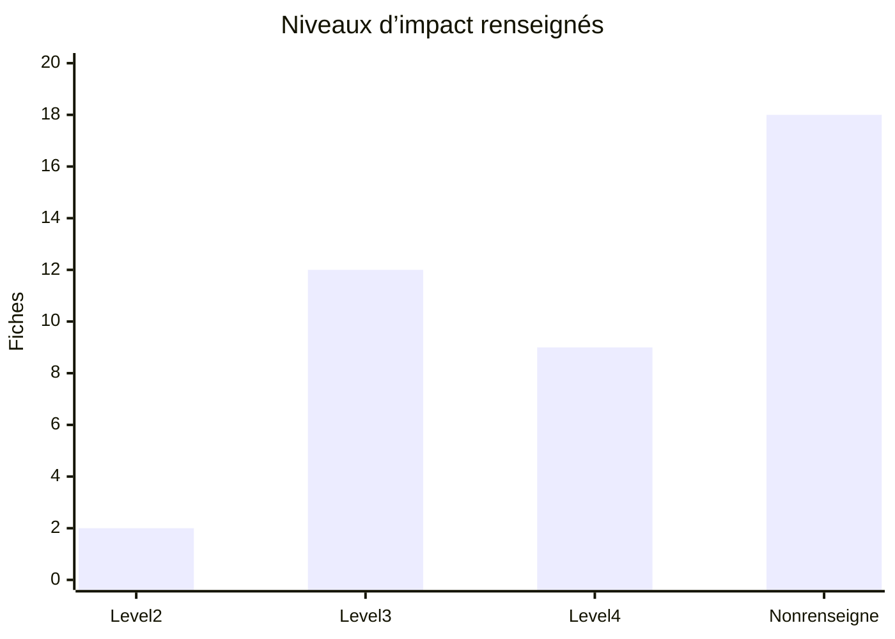
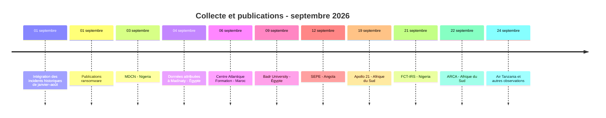

# AFRINTEL  -  Rapport CTI mensuel

## Rapport CTI  -  septembre 2026

**29 publications datées de septembre au sein d’un corpus de 41 fiches documentées**

👉🏾 [Version anglaise](./README.md) · [Victimes et incidents documentés](./victims_FR.md)

## 1. Synthèse exécutive

Le corpus AFRINTEL du dossier de septembre 2026 contient **41 fiches documentées**, réparties dans **14 pays africains**. Il comprend **29 publications datées de septembre**, réparties dans **12 pays**, et **12 incidents antérieurs** intégrés rétrospectivement. Selon le type principal renseigné dans les fiches, le Ransomware représente **24 fiches (58,5 %)**, devant les Data Leak avec **10 (24,4 %)**. Quatre System Intrusion, deux Defacement et une Access Sale complètent le corpus.

Dans le seul sous-ensemble des 29 publications de septembre, **20 fiches sont classées Ransomware (69,0 %)**, **7 Data Leak (24,1 %)** et **2 System Intrusion (6,9 %)**. Ces ratios ne doivent pas être mélangés avec les statistiques du corpus complet, qui incluent les 12 fiches antérieures.

Le corpus de collecte passe de **29 fiches en août à 41 fiches dans le dossier de septembre (+12 ; +41,4 %)**. Cet écart décrit la collecte AFRINTEL et ne constitue pas une estimation de l’évolution réelle des compromissions. Le corpus combine des publications de septembre et des incidents antérieurs intégrés pour rétrospective ; ces dimensions de collecte ne doivent pas être additionnées comme des catégories exclusives.

L’Afrique du Sud concentre **16 fiches (39,0 %)**, suivie de l’Égypte avec 7, du Maroc et du Kenya avec 3 chacun. Les secteurs de la santé et du gouvernement/administration apparaissent chacun dans cinq fiches après normalisation prudente des libellés.

La maturité des preuves reste hétérogène : **14 fiches** sont `Claim - Unverified`, **11** `Claim - Data Sample Published`, **9** `Victim Confirmed`, **2** `Corroborated`, **1** `Data Fully Published`, **2** `Government Confirmed` et **2** `Third-Party Exposure Confirmed`. Ces statuts sont normalisés à partir des libellés détaillés des fiches et ne prouvent pas automatiquement l’exfiltration complète.

### Lecture CTI à retenir

- La hausse de **29 à 41 fiches** reflète principalement l’élargissement et la consolidation de la collecte, pas une hausse démontrée des compromissions réelles.
- Les **29 publications de septembre** sont dominées par les labels ransomware, mais la majorité reste au stade de revendication ou d’échantillon publié.
- Les éléments les plus exploitables sont les échantillons structurés ou les lots effectivement examinés ; ils renforcent l’évaluation du lien documentaire sans prouver automatiquement le vecteur d’accès, l’exhaustivité de l’exfiltration ou le chiffrement.
- Les priorités défensives sont la protection des identités et documents sensibles, la surveillance des exports et comptes privilégiés, ainsi que la prévention de la fraude au paiement et de l’usurpation.

Les statuts doivent être lus avec trois distinctions constantes : **publication observée**, **échantillon ou données examinés** et **compromission confirmée**. Ces trois niveaux ne sont pas interchangeables.

## 2. Écart entre les corpus de collecte : août/septembre 2026

| Indicateur | Août 2026 | Septembre 2026 | Variation |
|---|---:|---:|---:|
| Fiches du corpus de collecte | 29 | 41 | **+12 (+41,4 %)** |
| Ransomware | 17 | 24 | **+7 (+41,2 %)** |
| Data Leak | 11 | 10 | **-1 (-9,1 %)** |
| Access Sale | 1 | 1 | **Stable** |
| System Intrusion | 0 | 4 | **Nouveau** |
| Defacement | 0 | 2 | **Nouveau** |

Cette comparaison porte sur les corpus de collecte clôturés : elle ne constitue pas une comparaison homogène du nombre d’attaques survenues pendant chaque mois, car le corpus de septembre inclut 12 incidents antérieurs. Elle ne transforme pas les dates de découverte, de publication ou d’intégration en dates d’intrusion. Une évolution réelle des compromissions ne peut pas être déduite de ces seuls totaux.

## 3. Méthodologie et périmètre

- Source éditoriale : couple validé `victims_FR.md` / `victims.md`.
- Une fiche correspond à un incident canonique documenté dans le dossier de septembre ; le corpus comprend aussi 12 incidents antérieurs intégrés pour rétrospective.
- Pour les incidents antérieurs au mois de collecte, la date de découverte/intégration AFRINTEL est conservée séparément de la date historique de l’incident et de la publication. Aucun champ de découverte/intégration n’est ajouté aux incidents du mois de collecte en cours.
- Une revendication publiée sur un site ou forum criminel n’est pas assimilée à une confirmation technique sans éléments supplémentaires.
- Les extraits et captures ont été traités de manière minimisée ; aucune donnée personnelle brute, authentifiant, secret ou jeton n’est reproduit.
- Les catégories secondaires et les effets potentiels ne créent pas automatiquement une seconde fiche.

Les sites de groupes ransomware, leak sites et forums underground sont traités comme des **sources primaires d’observation** : ils documentent une publication, un compte, une date, une échéance ou un échantillon visible. Leur contenu n’est pas assimilé à une confirmation officielle. La confiance peut toutefois être relevée lorsqu’un échantillon a été examiné et présente une cohérence documentaire ou structurelle ; l’attribution, le vecteur, l’exhaustivité et le chiffrement restent des dimensions séparées.

## 4. Cohortes et types d’incident

### 4.1 Publications datées de septembre : 29 fiches

| Type d’incident | Fiches | Part |
|---|---:|---:|
| Ransomware | 20 | 69,0 % |
| Data Leak | 7 | 24,1 % |
| System Intrusion | 2 | 6,9 % |
| **Total** | **29** | **100 %** |

Cette cohorte est la base des lectures typologiques et narratives portant strictement sur les publications de septembre. Elle ne comprend pas les 12 incidents antérieurs intégrés pour rétrospective.

### 4.2 Corpus complet du dossier de septembre : 41 fiches

| Type d’incident | Fiches | Part |
|---|---:|---:|
| Ransomware | 24 | 58,5 % |
| Data Leak | 10 | 24,4 % |
| System Intrusion | 4 | 9,8 % |
| Defacement | 2 | 4,9 % |
| Access Sale | 1 | 2,4 % |
| **Total** | **41** | **100 %** |

### Ransomware

Les 24 fiches Ransomware correspondent à des publications ou observations de groupes dans un contexte ransomware. La présence d’une fiche ne permet pas, à elle seule, de conclure au chiffrement, à l’exfiltration complète ou au paiement d’une rançon. Les groupes les plus visibles sont `krybit` avec 6 fiches et `TheGentlemen` avec 4. Pour les cas prioritaires, le cycle doit rester séparé en inscription, échantillon, échéance, divulgation et dernière vérification.

### Data Leak, System Intrusion et Defacement

Les dix Data Leak comprennent les publications accompagnées d’extraits, les cas confirmés par la victime et les deux expositions indirectes chez un tiers. Les quatre System Intrusion restent classés selon la nature principale observée, même lorsqu’une revendication ransomware leur est associée. Les deux Defacement ne sont pas reclassés en Data Leak sans preuve distincte d’exposition de données.

## 5. Répartition géographique

### 5.1 Publications datées de septembre : 29 fiches

| Pays | Fiches | Part |
|---|---:|---:|
| Afrique du Sud | 8 | 27,6 % |
| Égypte | 7 | 24,1 % |
| Maroc | 3 | 10,3 % |
| Nigéria | 2 | 6,9 % |
| Angola | 2 | 6,9 % |
| Namibie | 1 | 3,4 % |
| Tunisie | 1 | 3,4 % |
| Éthiopie | 1 | 3,4 % |
| Mali | 1 | 3,4 % |
| Tanzanie | 1 | 3,4 % |
| Ouganda | 1 | 3,4 % |
| Kenya | 1 | 3,4 % |
| **Total** | **29** | **100 %** |

Cette ventilation concerne uniquement les publications datées de septembre. Elle ne doit pas être comparée directement à la table suivante, qui porte sur les 41 fiches du corpus complet.

### 5.2 Corpus complet du dossier de septembre : 41 fiches

| Pays | Fiches | Part |
|---|---:|---:|
| Afrique du Sud | 16 | 39,0 % |
| Égypte | 7 | 17,1 % |
| Maroc | 3 | 7,3 % |
| Kenya | 3 | 7,3 % |
| Nigéria | 2 | 4,9 % |
| Angola | 2 | 4,9 % |
| Mali | 1 | 2,4 % |
| Gabon | 1 | 2,4 % |
| Cameroun | 1 | 2,4 % |
| Namibie | 1 | 2,4 % |
| Tunisie | 1 | 2,4 % |
| Éthiopie | 1 | 2,4 % |
| Tanzanie | 1 | 2,4 % |
| Ouganda | 1 | 2,4 % |
| **Total** | **41** | **100 %** |

| Région | Fiches | Part |
|---|---:|---:|
| Afrique australe | 19 | 46,3 % |
| Afrique du Nord | 11 | 26,8 % |
| Afrique de l’Est | 6 | 14,6 % |
| Afrique de l’Ouest | 3 | 7,3 % |
| Afrique centrale | 2 | 4,9 % |
| **Total** | **41** | **100 %** |

Chaque fiche du corpus complet reçoit ici une seule affectation pays. Aucun incident multi-pays supplémentaire n’a été compté dans cette ventilation.

## 6. Secteurs et acteurs  -  corpus complet de 41 fiches

Après normalisation prudente des libellés  -  regroupement documenté par famille analytique, sans modifier le secteur brut des fiches  -  les secteurs les plus représentés sont la **Santé (5)**, le **Gouvernement / Administration (5)**, l’**Assurance (3)**, puis l’**Immobilier (2)**, l’**Éducation (2)**, les **Services financiers (2)** et le **Transport aérien (2)**. Les 20 autres occurrences relèvent de secteurs distincts ou spécialisés.

Les **labels de publication ou d’acteur affiché** les plus fréquents sont `krybit` (6), `TheGentlemen` (4), `BLACKLOCKS` (2), `N0n` (2) et `lockbit5` (2). Les 25 autres fiches incluent les labels moins fréquents et les fiches sans attribution publique ; sept fiches indiquent explicitement qu’aucun acteur n’est attribué publiquement. Ces labels ne constituent pas nécessairement une attribution technique ni un décompte de groupes distincts.

## 7. Maturité des preuves et impact

Les statuts ci-dessous concernent le **corpus complet de 41 fiches**. Pour la seule cohorte des 29 publications de septembre, la répartition normalisée est de **13 `Claim - Unverified`**, **11 `Claim - Data Sample Published`**, **1 `Victim Confirmed`**, **1 `Government Confirmed`**, **1 `Data Fully Published`** et **2 `Third-Party Exposure Confirmed`**. Le suivi mensuel reste marqué `In Progress / En cours` ; les totaux sont donc valables à la date de rédaction et peuvent évoluer si de nouvelles fiches sont validées.

| Statut | Fiches |
|---|---:|
| Claim - Unverified | 14 |
| Claim - Data Sample Published | 11 |
| Victim Confirmed | 9 |
| Corroborated | 2 |
| Data Fully Published | 1 |
| Government Confirmed | 2 |
| Third-Party Exposure Confirmed | 2 |
| **Total** | **41** |

Les cartes renseignent explicitement un niveau d’impact pour 23 fiches : 12 en Level 3, 9 en Level 4 et 2 en Level 2. Pour 18 fiches, ce champ n’est pas renseigné dans le corpus actuel. Le niveau de confiance est explicitement indiqué pour 24 fiches ; les autres doivent rester interprétées avec prudence.

## 8. Chronologie de collecte

Les principales publications ou observations de septembre sont datées des 1er, 3, 4, 6, 7, 9, 12, 16, 18, 19, 21, 22, 24, 25, 26 et 29 septembre. Le corpus contient aussi **12 incidents antérieurs à septembre**, intégrés au suivi le **1er septembre 2026** pour rétrospective. Cette date correspond à la date de classement/intégration du corpus ; elle ne remplace jamais la date historique de l’incident ou de la publication et ne doit pas être interprétée comme la date technique de découverte lorsque celle-ci est inconnue. La fiche RelyComply conserve une réserve de datation lorsque son titre et son champ de publication initiale divergent.

## 9. Analyse CTI approfondie

Le sous-ensemble de septembre doit être lu comme un corpus de publications et d'observations, non comme une série de compromissions confirmées. Les dossiers les plus exploitables sont ceux où un échantillon ou un artefact a été décrit et examiné. Même un échantillon cohérent renforce surtout le lien documentaire ou structurel ; il ne prouve pas nécessairement le système source, le vecteur d'accès, l'exhaustivité de l'exfiltration ou le chiffrement.

| Dossier prioritaire | Éléments observés ou rapportés | Ce qui reste inconnu |
|---|---|---|
| MDCN  -  Nigéria | Extrait structuré présenté comme lié à l'organisation | Provenance technique, personnes uniques, intrusion et volume complet |
| Centre Atlantique Formation  -  Maroc | Dossiers et documents de formation décrits dans l'échantillon | Exhaustivité, nombre de personnes et origine système |
| SEPE  -  Angola | Fichiers et structures JSON analysés dans la fiche | Volume réellement exfiltré, chiffrement et vecteur d'accès |
| AFRICA-TECH  -  Mali | Lot de fichiers publié et examiné | Exhaustivité, destruction de sauvegardes et confirmation de la victime |
| FNB  -  Afrique du Sud | Images de relevés apparents analysées | Provenance bancaire, accès aux comptes et authenticité métier complète |
| Air Tanzania  -  Tanzanie | Fichiers et images décrits dans l'échantillon disponible | Source d'acquisition, personnes uniques et portée complète |

Dans chaque cas, la publication, l'échantillon et la compromission sont trois niveaux distincts. Les montants, tailles et volumes attribués à l'acteur restent des valeurs revendiquées lorsqu'ils ne sont pas corroborés indépendamment. Les références à des tiers visibles dans un document ne créent pas automatiquement un incident séparé.

Les détails complets, les sources et les limites de chaque dossier sont conservés dans les [fiches victimes FR](./victims_FR.md) et les [fiches victimes EN](./victims.md).

### 9.1. Cycle de publication ransomware

Une fiche de leak site, un échantillon, l’expiration d’un compte à rebours et la divulgation de données sont des événements distincts. Pour chaque cas où l’information est disponible, la fiche victime conserve séparément : première et dernière observation, état de l’échantillon, échéance et fuseau, état de l’échéance, état de divulgation et dernière vérification. Les négociations, paiements et reventes restent `unknown` en l’absence de preuve publique spécifique.

### 9.2. Hypothèses de détection défensive non attribuées

- rechercher les exports inhabituels, créations d'archives et transferts sortants volumineux ;
- surveiller les connexions privilégiées, VPN/RDP, changements de rôles et réinitialisations de comptes ;
- vérifier MFA, segmentation, journaux d'administration et sauvegardes isolées ;
- traiter séparément les signaux de fuite, d'accès vendu, de ransomware et de défacement ;
- préserver les captures et manifestes hors dépôt, sans tester d'identifiants ni suivre de liens criminels.

Ces catégories sont des hypothèses de chasse défensive et ne constituent pas une attribution de techniques aux acteurs observés :

| Hypothèse à vérifier | MITRE ATT&CK | Signal défensif indicatif |
|---|---|---|
| Utilisation d’identifiants valides | `T1078` | Connexions anormales, MFA contournée, changements de rôles |
| Archivage préalable à une exfiltration | `T1560` | Création d’archives inhabituelles et compression massive |
| Collecte depuis des dépôts | `T1213` | Exports volumineux depuis GED, CRM, bases ou partages |
| Exfiltration vers une infrastructure externe | `T1041` | Transferts sortants inhabituels et destinations nouvelles |
| Chiffrement pour impact, à confirmer uniquement | `T1486` | Extension massive de fichiers et événements EDR concordants |

## 10. Priorités SOC défensives

1. **Priorité élevée  -  accès privilégiés :** surveiller les comptes administrateurs, VPN/RDP, MFA, changements de rôles et réinitialisations.
2. **Priorité élevée  -  exfiltration :** détecter les exports inhabituels, créations d’archives et transferts sortants volumineux depuis CRM, GED, bases et partages.
3. **Priorité élevée  -  résilience :** vérifier segmentation, sauvegardes isolées et restauration testée pour les organisations publiques, financières, de santé et de transport.
4. **Priorité moyenne  -  exposition :** préparer la rotation des secrets, la réduction d’exposition et les notifications lorsque des données d’identité, de santé ou de paiement sont publiées.
5. **Priorité permanente  -  preuve :** conserver captures, horodatages, empreintes et manifestes hors dépôt, avec accès restreint, sans tester d’identifiants ni suivre de liens criminels.

## 11. Conclusion et contrôles

Le dossier de septembre 2026 compte **41 fiches documentées**, dont **24 Ransomware**, **10 Data Leak**, **4 System Intrusion**, **2 Defacement** et **1 Access Sale**. L’Afrique du Sud concentre la plus grande part du corpus, tandis que les confirmations de victimes renforcent la visibilité de plusieurs dossiers sans valider automatiquement les volumes ou les chaînes d’intrusion revendiqués.

Contrôles effectués :

- 41 fiches FR et 41 fiches EN ;
- 1 correspondance FR/EN par fiche, dans le même ordre analytique ;
- total par type = 41 ;
- total par pays = 41 ;
- total par région = 41 ;
- statuts de preuve = 41 ;
- rapports et fiches maintiennent la séparation entre date de l’incident, publication et découverte tardive ;
- types et statuts normalisés contrôlés contre les valeurs structurées des fiches.

**AFRINTEL  -  TLP:CLEAR**
