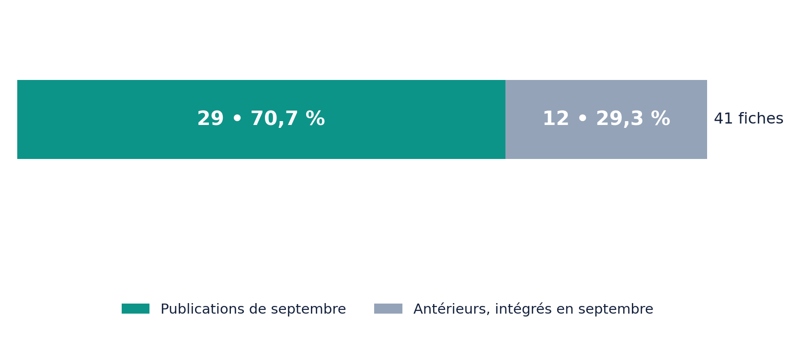
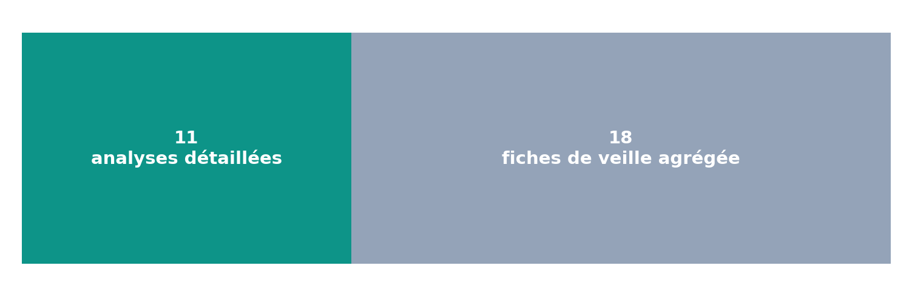
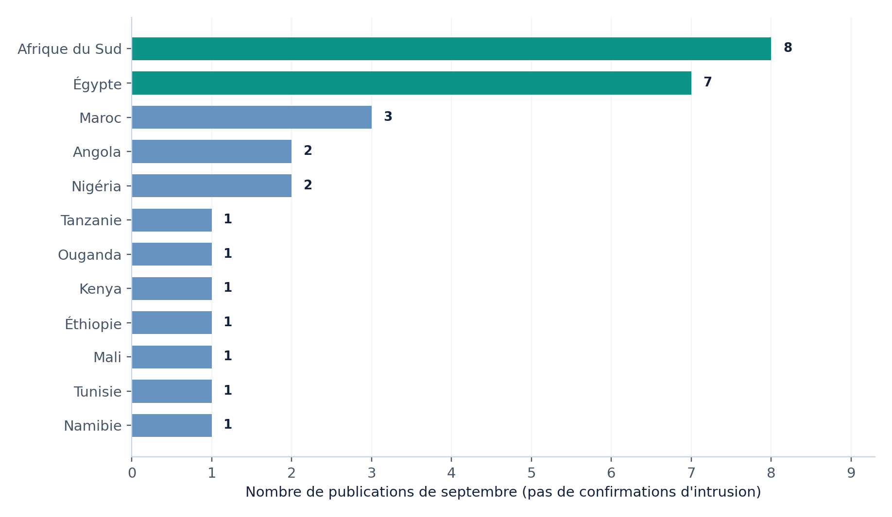
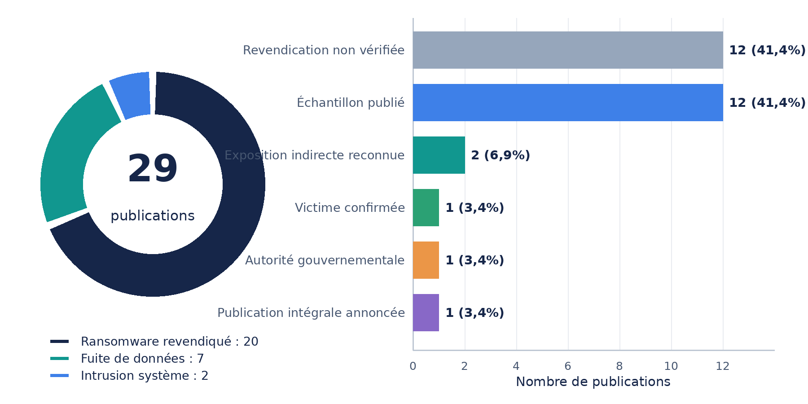
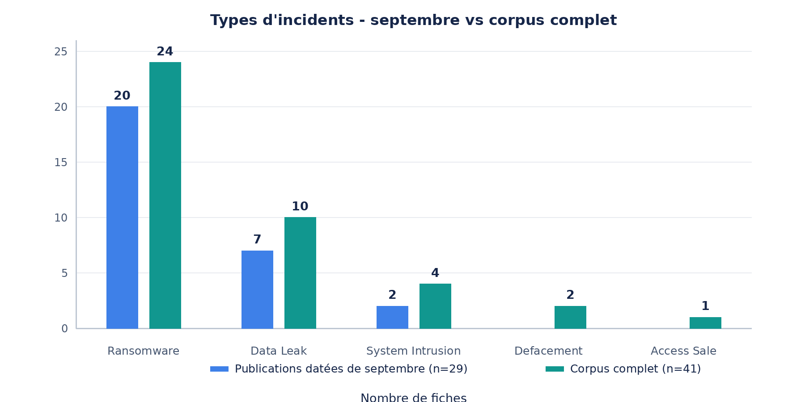
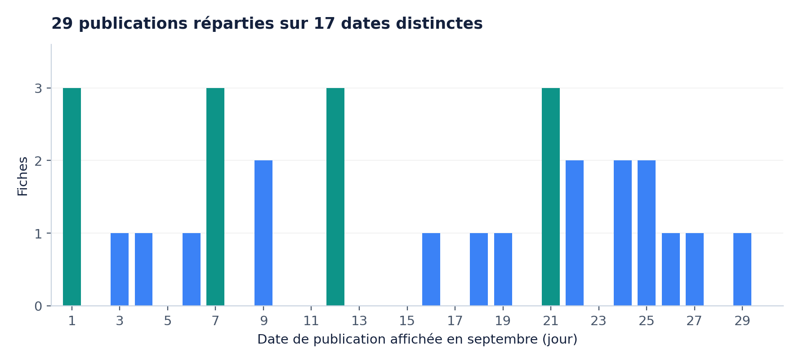
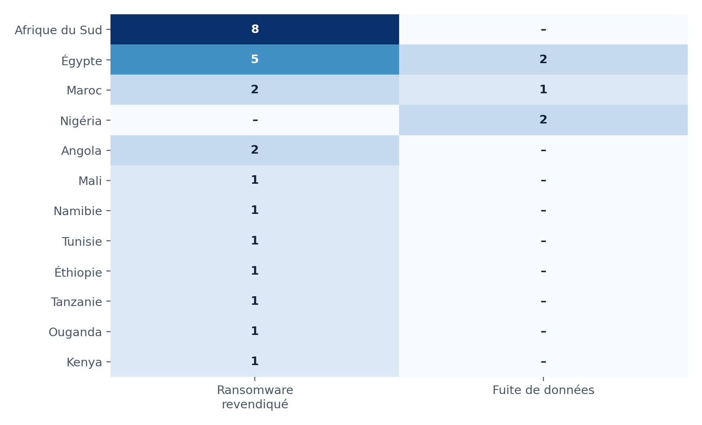
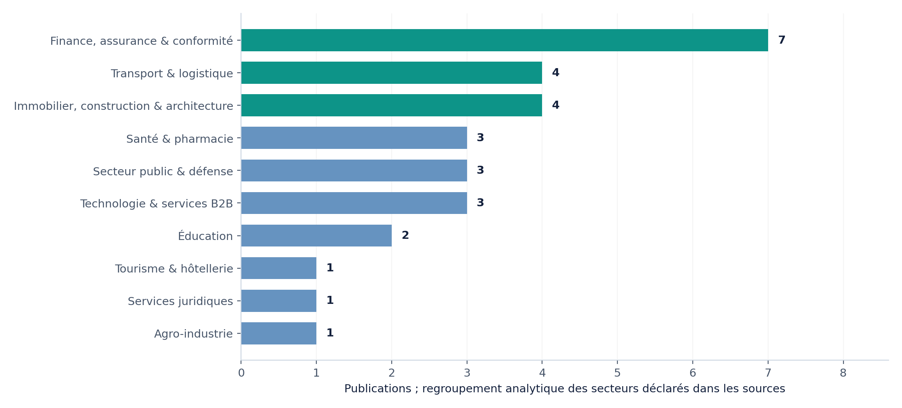
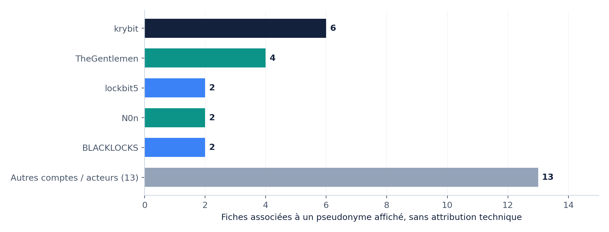

# AFRINTEL - Rapport mensuel de Cyber Threat Intelligence

👉🏾[** English version available here**](./README.md)

**Afrique · Septembre 2026**
**Ransomware, fuite de données et extorsion**

Panorama de veille des publications affectant des organisations africaines, fondé sur le suivi des sites de groupes ransomware, leak sites et forums underground.

| **29** | **12** | **41** |
|:---:|:---:|:---:|
| Publications en septembre | Incidents antérieurs intégrés | Corpus total unique |

**ÉDITION** 17 octobre 2026 • suivi des publications de septembre, intégrations jusqu’au 16 octobre 2026

**PÉRIMÈTRE** Afrique • OSINT / dossiers AFRINTEL • 12 pays dans le sous-ensemble de septembre

**LECTORAT** RSSI, SOC, CERT/CSIRT, responsables du risque, décideurs et analystes CTI

**DIFFUSION** Analyse de veille • aucune donnée personnelle ni aucun lien criminel reproduit

## Sommaire

1. [Note de lecture et avertissement analytique](#note-de-lecture-et-avertissement-analytique)
2. [Synthèse exécutive](#synthèse-exécutive)
3. [01. Périmètre, sources et méthode](#01-périmètre-sources-et-méthode)
4. [02. Tableau de bord - septembre 2026](#02-tableau-de-bord--septembre-2026)
5. [03. Dossiers de renseignement prioritaires](#03-dossiers-de-renseignement-prioritaires)
6. [04. Enseignements opérationnels et hypothèses d’attaque](#04-enseignements-opérationnels-et-hypothèses-dattaque)
7. [05. Plan de chasse - SOC / CERT / CSIRT](#05-plan-de-chasse--soc--cert--csirt)
8. [06. Feuille de route de réduction du risque](#06-feuille-de-route-de-réduction-du-risque)
9. [07. Incidents antérieurs : contexte à ne pas confondre avec septembre](#07-incidents-antérieurs--contexte-à-ne-pas-confondre-avec-septembre)
10. [08. Priorisation du renseignement](#08-priorisation-du-renseignement)
11. [Annexes A à D](#annexe-a--registre-des-29-publications-de-septembre)

---

# Note de lecture et avertissement analytique

Ce rapport décrit un corpus de veille issu de publications observées dans l’écosystème underground. Il ne constitue pas une liste de 29 intrusions confirmées ni une mesure exhaustive de la cybercriminalité en Afrique.

> **PRINCIPE DE NON-SURESTIMATION**
>
> Les fichiers « victims » (anglais) et « victims_FR » (français) contiennent les mêmes 41 fiches : ils ont été consolidés comme une seule source bilingue. Seules 29 fiches portent sur des publications datées de septembre 2026 ; les 12 autres décrivent des événements antérieurs ajoutés rétrospectivement. Les dates de publication ne sont pas des dates d’attaque. Une publication de victime, un échantillon visible et une divulgation ultérieure sont trois événements distincts. Le paiement d’une rançon, une négociation, une revente ou un retrait ne sont pas déduits de l’absence ou de la présence d’un fichier.

# Synthèse exécutive

L’activité observée en septembre est dominée par les annonces attribuées à des opérateurs ransomware, mais la plupart ne sont pas corroborées par des éléments techniques indépendants.

| **INDICATEUR**                        | **VALEUR**       | **LECTURE CTI**                                    |
|---------------------------------------|------------------|----------------------------------------------------|
| Fiches du corpus                      | 41               | 29 septembre + 12 événements antérieurs            |
| Publications de septembre             | 29               | Réparties entre 12 pays                            |
| Type « ransomware »                   | 20 / 29 (69,0 %) | Étiquette / revendication, pas chiffrement prouvé  |
| Type « data leak »                    | 7 / 29 (24,1 %)  | Publications relatives à des données présumées     |
| Type « system intrusion »             | 2 / 29 (6,9 %)   | Accès ou tentative documentée ; résultat limité    |
| Claim - Unverified                    | 12 / 29 (41,4 %) | Publication sans confirmation publique associée    |
| Échantillon déclaré/publié            | 12 / 29 (41,4 %) | Présence d'un extrait ou d'un corpus local, sans conclusion automatique sur l'accès |
| Lot intégral publié selon la collecte | 1 / 29 (3,4 %)   | AFRICA-TECH : 10 fichiers publiés examinés         |
| Afrique du Sud + Égypte               | 15 / 29 (51,7 %) | Concentration de veille, non taux d'attaque        |

## Cinq conclusions stratégiques

1.  L’extorsion par divulgation domine les signaux visibles : 20 des 29 publications sont classées « ransomware », sans que le chiffrement puisse généralement être confirmé.

2.  Le corpus est géographiquement polarisé : l’Afrique du Sud (8) et l’Égypte (7) représentent 51,7 % des publications de septembre ; cette distribution reflète aussi les sources surveillées et la sélection éditoriale.

3.  La valeur du renseignement réside surtout dans les pièces observées : Centre Atlantique Formation, SEPE, AFRICA-TECH, BLACKLOCKS et FCT-IRS fournissent des éléments plus riches qu’une simple inscription sur un site de fuite.

4.  Les risques prioritaires sont la fraude à l’identité et au paiement, la réutilisation de documents administratifs, le spear-phishing et la divulgation de plans, documents bancaires ou certificats - sans présumer des dommages opérationnels.

5.  Deux des 29 cas datés de septembre disposent d’un statut de confirmation dans les fichiers fournis : RelyComply est classé « Victim Confirmed - Unauthorized Access » et le ministère namibien de la Défense « Government Confirmed - Unauthorized Access ». Ces confirmations portent sur un accès ou un incident, pas automatiquement sur le chiffrement, l’exfiltration ou les volumes revendiqués.

# 01. Périmètre, sources et méthode

## 1.1. Trois temporalités à distinguer

**Date de l’incident :** moment réel d’un accès ou d’une perturbation ; souvent inconnu pour les publications de septembre.

**Date de publication initiale :** date affichée sur un forum, une liste d’extorsion ou un message, utilisée pour tracer les 29 entrées mensuelles.

**Date de découverte/intégration :** moment où AFRINTEL a obtenu la capture, l’échantillon ou intégré le cas, pouvant être postérieur au mois.

Un dossier publié le 27 septembre et revu le 8 octobre reste une publication de septembre. Inversement, une intrusion de janvier 2026 ajoutée à l’inventaire en septembre n’est pas traitée comme une attaque survenue en septembre.

## 1.2. Classification des observations

| **STATUT D’OBSERVATION**     | **SIGNIFICATION OPÉRATIONNELLE**                       | **LIMITE**                                        |
|-------------------------------|--------------------------------------------------------|---------------------------------------------------|
| Claim - Unverified            | Publication observée sans confirmation publique associée | La publication seule ne décrit pas l’accès réel |
| Claim - Data Sample Published | Publication accompagnée d'un extrait ou d’images       | L’origine des données peut rester inconnue        |
| Data Fully Published          | Lot libéré/revu selon la collecte : AFRICA-TECH        | N’équivaut pas à la totalité des données obtenues |
| Victim / Government Confirmed | Confirmation publique d’une organisation ou d’une autorité | Vecteur et étendue peuvent rester inconnus      |
| Corroborated                  | Plusieurs éléments publics concordants                 | N'établit pas tous les effets revendiqués         |

### 1.2.1. Profondeur documentaire complémentaire

Pour éviter de confondre statut et profondeur d'analyse, le rapport utilise aussi une échelle descriptive :

| Niveau | Description | Ce qui ne peut pas être déduit |
|---|---|---|
| P0 - Publication observée | Victime, domaine, compte ou menace affiché à un instant donné | Intrusion, authenticité des données ou responsabilité technique |
| P1 - Échantillon visible ou examiné | Extrait, image ou structure de fichiers cohérente avec l'organisation | Source technique certaine, volume total, personnes uniques ou chiffrement |
| P2 - Lot publié examiné | Lot rendu accessible lors de la collecte et caractérisé localement | Exhaustivité de l'exfiltration, accès initial, restauration ou paiement |

Cette échelle complète les statuts AFRINTEL et ne les remplace pas. Une exposition tierce peut être confirmée au niveau de l'exposition sans établir une intrusion directe chez l'organisation nommée.

## 1.3. Règles de traitement

- Déduplication : chaque victime apparaît une seule fois, malgré la double version linguistique des fichiers.

- Numérateurs des graphes : 29 publications de septembre ; les 12 dossiers antérieurs ne sont pas ajoutés à la distribution mensuelle.

- Données temporelles : la date de publication est prioritaire sur l’en-tête de section lorsqu’elles diffèrent.

- Secteurs : regroupement analytique explicite en dix familles ; les libellés d’origine sont conservés dans la matrice de travail.

- Attribution : un pseudonyme affiché n’équivaut ni à une identité civile ni à une affiliation techniques certaine.

- Revendications chiffrées : ne jamais additionner les volumes, échantillons, lignes, fichiers ou « utilisateurs » comme s’ils mesuraient des victimes uniques.

- Données sensibles : seuls les métriques agrégées et les types de documents sont repris ; aucun identifiant personnel ou credential n’est transcrit.

## 1.4. Qualité, biais et limites

La collecte repose principalement sur le monitoring des sites de groupes ransomware, leak sites et forums underground, complété lorsque disponible par des communications publiques et des éléments visibles associés aux publications. Ces espaces sont des sources primaires d’observation de l’activité de publication : ils permettent de suivre une victime affichée, un acteur revendiqué, un échantillon, une échéance ou une mise à disposition. Ils ne permettent pas toujours de déterminer l’accès initial, l’exhaustivité des données ou le devenir d’une négociation.

Les fichiers victimes FR et EN sont la consolidation éditoriale de cette veille. Les artefacts bruts, captures et manifestes éventuellement conservés hors dépôt ne sont pas assimilés à une confirmation officielle. Les liens institutionnels cités dans les fiches servent de contexte documentaire et n’ont pas systématiquement fait l’objet d’une vérification web indépendante pour ce rapport.

Couverture non exhaustive : la visibilité des sites de fuite, des forums et des registres intégrés peut varier selon les pays, langues et secteurs. Les décomptes mesurent l’activité de veille accessible à AFRINTEL, pas le nombre réel d’intrusions.

## 1.5. Cycle de publication et divulgation

Pour chaque publication ransomware, AFRINTEL distingue autant que possible : l’apparition de la victime, l’échantillon visible, l’échéance affichée, la mise à disposition éventuelle de données et la dernière vérification. Une échéance dépassée sans fichier accessible signifie uniquement qu’aucune divulgation n’a été observée à cette date.

Les causes possibles d’une absence de publication restent inconnues : négociation, paiement, report, retrait technique, revente, partage avec un tiers ou revendication inexacte. Ces scénarios ne sont jamais présentés comme établis sans information publique spécifique. Les champs liés au paiement, à la négociation et à la revente restent `unknown` lorsqu’aucun élément public ne permet de les qualifier.

> **RÈGLE DE CONFIANCE**
>
> Échelle « High / Medium » : lorsqu’elle figure dans une fiche, elle qualifie la fiabilité de certains liens documentaires ou observations, et non nécessairement la certitude de l’intrusion. Les fiches complémentaires ne portent généralement pas de score de confiance ou d’impact : aucune valeur n’a été imputée.

# 02. Tableau de bord - septembre 2026

Les visualisations ci-dessous mesurent les publications connues du corpus AFRINTEL, non les attaques confirmées.

*FIG. 01 - Construction du corpus unique : 29 publications de septembre et 12 dossiers d'incidents antérieurs.*

Le classement en deux cohortes corrige un biais majeur : les informations historiques intégrées en septembre ne sont pas un surcroît d’attaques pour ce mois.

*FIG. 02 - Profondeur documentaire : 11 analyses détaillées et 18 fiches complémentaires.*

Les 18 fiches de registre ont principalement une valeur d’alerte et de qualification initiale. Elles ne doivent pas être mises au même niveau d’étayage que les dossiers accompagnés d’un examen d’échantillons.

## 2.1. Distribution géographique

*FIG. 03 - Pays associés aux 29 publications de septembre ; 12 pays distincts.*

L’Afrique du Sud totalise huit publications, l’Égypte sept, puis le Maroc trois. Le Nigéria et l’Angola en comptent deux chacun. Les sept autres pays n’ont qu’une publication chacun. Cette concentration est descriptive du corpus ; elle ne justifie pas d’affirmer que les organisations de ces pays ont subi davantage d’intrusions réelles.

> **INTERPRÉTATION**
>
> Le ratio de 15 / 29 (51,7 %) pour l’Afrique du Sud et l’Égypte peut aussi résulter des sources, des campagnes suivies, de la disponibilité des publications et de la sélection des cibles. Il ne représente pas une probabilité de compromission nationale.

## 2.2. Typologie et état des observations

*FIG. 04 - Répartition par type déclaré (gauche) et statut de publication (droite).*

Ransomware représente 20 / 29 fiches (69,0 %). La catégorie « ransomware » des publications est utilisée comme classification de veille ; elle ne prouve ni chiffrement, ni sabotage, ni double extorsion effectivement exécutée. Les sept Data Leak et les deux System Intrusion sont conservés selon leur type principal renseigné dans les fiches, même lorsqu’une revendication ransomware leur est associée.

La cohorte comprend 12 fiches `Claim - Unverified`, 12 fiches avec échantillon publié, 2 expositions de données indirectes reconnues, 1 dossier `Victim Confirmed`, 1 dossier `Government Confirmed` et 1 dossier `Data Fully Published`. Ces catégories décrivent des niveaux d’observation différents et ne permettent pas de déduire automatiquement l’exfiltration complète, le vecteur ou les volumes revendiqués.

*FIG. 05 - Comparaison des types d'incidents entre les 29 publications datées de septembre et le corpus complet de 41 fiches.*

## 2.3. Chronologie des publications

*FIG. 06 - Dates de première publication affichées en septembre ; 29 fiches sur 17 jours distincts.*

Les pointes des 1er, 7, 12 et 21 septembre comptent chacune trois publications dans le corpus. Ces pics peuvent correspondre à des dépôts groupés sur des sites de fuite ou à la sélection des sources ; ils ne renseignent pas sur des dates communes d’intrusion. Certains horodatages originaux ne précisent pas le fuseau horaire.

## 2.4. Localisation et type revendiqué

*FIG. 07 - Croisement du pays et de la typologie déclarée ; toutes les cellules sont des comptes de publications.*

Les huit entrées sud-africaines de septembre comprennent cinq Ransomware, deux Data Leak et un System Intrusion. Les deux fiches nigérianes concernent des fuites revendiquées. L’Égypte combine cinq mentions ransomware et deux fuites de données. Ces différences reflètent le périmètre observé, non les pratiques d’attaque nationales.

## 2.5. Secteurs exposés dans le registre

*FIG. 08 - Regroupement éditorial en dix familles sectorielles ; chaque cible compte une fois.*

La finance, l’assurance et la conformité rassemblent sept publications (24,1 %). L’immobilier / construction / architecture et le transport / logistique en totalisent quatre chacun. La santé, le secteur public et les services technologiques en comptent trois chacun ; l’éducation deux. Les autres familles comptent une entrée.

La sensibilité d’un domaine ne suffit pas à établir un impact. Néanmoins, les contenus décrits dans certaines fiches - documents d’identité, pièces financières, plans de bâtiments, inscriptions d’apprenants - justifient une priorité de validation des risques.

## 2.6. Pseudonymes et concentrations

*FIG. 09 - Principaux pseudonymes associés aux fiches de septembre. « Autres » inclut 13 entrées.*

Le pseudonyme krybit est mentionné dans six fiches, TheGentlemen dans quatre. BLACKLOCKS, N0n et lockbit5 sont mentionnés deux fois chacun. Les treize autres fiches correspondent à des acteurs ou comptes différents, dont un cas non attribué.

Derrière ces agrégats se trouvent des niveaux d’observation hétérogènes : quatre des six fiches krybit sont « Claim - Unverified », tandis que La Sultana et Air Tanzania disposent d’un corpus d’images associé à la collecte ; les quatre fiches TheGentlemen sont non confirmées publiquement ; BLACKLOCKS possède deux dossiers avec images et documents examinés ; N0n combine un lot mis à disposition pour AFRICA-TECH et une revendication isolée en Tunisie.

> **PRUDENCE D’ATTRIBUTION**
>
> Un nom de groupe dans une publication ne constitue ni une attribution forensique, ni une confirmation d’appartenance à un opérateur ransomware précis. Les regroupements reflètent uniquement les chaînes de noms présentes dans les sources.

# 03. Dossiers de renseignement prioritaires

Sélection fondée sur la sensibilité des données, la richesse des éléments décrits et l’intérêt défensif. Chaque dossier distingue observation, revendication et inconnues.

## 3.1. Angola - SEPE / services publics numériques

**Date / acteur :** publication du 12 septembre • pseudonyme affiché « Kazu » • type source : ransomware • impact éditorial : niveau 4.

OBSERVÉ - Selon la fiche AFRINTEL, 1 189 fichiers locaux totalisant 544 921 521 octets ont été analysés ; 111 JSON comportent une structure formData orientée identité, résidence, coordonnées, documents et parcours administratifs. La structure de l’échantillon renforce un lien plausible avec des dossiers de services publics angolais.

REVENDIQUÉ - Le post affiche 364 841 fichiers, 110 021 utilisateurs, 179 Go, une demande de 100 000 USD et une échéance au 27 septembre. Aucun de ces agrégats n’est confirmé par le petit échantillon.

INCONNU - Source exacte, vecteur d’accès, personne distincte, étendue réelle, activité de chiffrement, paiement, confirmation de SEPE et évolution après la dernière vérification du 22 septembre.

**Intérêt défensif :** vérifier les exports de formulaires, comptes applicatifs et API, accès aux dépôts documentaires, accès IAM privilégiés et éventuels usages frauduleux de pièces administratives.

## 3.2. Maroc - Centre Atlantique Formation / pièces d’identité et certificats

**Date / acteur :** 6 septembre • xNov • fuite de données • confiance éditoriale : élevée sur le lien documentaire.

OBSERVÉ - L’archive annoncée à 2,49 Go occupe environ 4 Go après extraction selon la fiche : 1 155 dossiers et 3 465 objets, avec details.json, certificates.json et certificat PDF dans chaque dossier. La cohérence entre JSON et attestations fournit une corroboration interne importante des données de formation.

REVENDIQUÉ - La diffusion ne représenterait que 27 % de la base ; le reste aurait été proposé pour 300 USD. Le prix proposé est documenté, non la taille ni l’existence de la portion restante. Des dossiers semblent concerner des mineurs.

INCONNU - Nombre de personnes uniques, source exacte, extraction totale, mode d’accès et chiffrement. Un dossier d’inscription ne correspond pas automatiquement à un individu distinct.

**Intérêt défensif :** dédoublonner de façon autorisée, contrôler la chaîne de vérification des certificats et QR codes, surveiller les usages frauduleux de CIN et les campagnes de phishing visant les apprenants.

## 3.3. Mali - AFRICA-TECH / extorsion suivie d’une publication

**Date / acteur :** 22 septembre (annonce), 25 septembre à 16 h UTC (publication documentée) • N0n.

OBSERVÉ - La collecte fournit dix fichiers distincts, pour 2 413 673 octets : six PDF sur 39 pages, deux documents Word, un texte et un fichier temporaire non exploitable. Le corpus inclut documents financiers, éléments de voyage, assurance, plainte et correspondances. La fiche indique que l’ensemble du lot mis en ligne a été fourni et analysé.

REVENDIQUÉ - Des propos évoquent le chiffrement de documents clients et la destruction de sauvegardes ; aucun élément technique du lot ne l’établit. Les dix fichiers publiés ne démontrent pas qu’il s’agit de tous les fichiers copiés.

INCONNU - Accès initial, périmètre réel, identité de l’exploitant, chiffrement, paiement, interruption de service et authentification indépendante de chaque pièce.

## 3.4. Afrique du Sud - BLACKLOCKS : Apollo 21 et ARCA Unlimited

OBSERVÉ - Deux publications distinctes des 19 et 22 septembre attribuées au pseudonyme BLACKLOCKS. Pour Apollo 21, la fiche décrit 14 images examinées, dont 12 images d’extraits : documents commerciaux, tableaux de vente et trois images de pièces d’identité. Pour ARCA Unlimited, 18 images au total, dont 17 d’échantillons : plans, élévations, dossiers de projet, coûts et un document d’identité.

REVENDIQUÉ - Apollo 21 : 400 GB. ARCA : « 400G », unité non définie. Les deux chiffres ne sont pas des volumes mesurés et ne doivent pas être interprétés comme deux jeux de 400 Go intégralement possédés par le groupe.

INCONNU - Accès initial, environnement compromis, provenance technique des documents, autorisations de diffusion antérieures, chiffrement, impact opérationnel et confirmation par les entreprises. La présence de documents relatifs à des clients ne constitue pas un incident supplémentaire chez ces clients.

**Intérêt défensif :** côté Apollo 21, renforcer la détection de fraude fournisseurs et de changements de coordonnées bancaires ; côté ARCA, revoir les droits de partage des plans et les risques associés aux détails de sites clients.

## 3.5. Nigéria - MDCN et FCT-IRS : exposition d’identités

MDCN (3 septembre) - Un message attribué au compte cattier affirme disposer de 65 580 utilisateurs ; 50 lignes textuelles et 24 intitulés de champs sont décrits dans la fiche, couvrant l’identité et l’enregistrement professionnel. Aucun nombre de personnes uniques ni aucune intrusion au MDCN n’est confirmé. Les risques concernent surtout l’usurpation de praticiens et les sollicitations ciblées.

FCT-IRS (21 septembre) - Une publication attribuée au compte individual est associée à un export PDF de 314 pages. L’analyse source relève 2 541 occurrences de motifs d’e-mail, dont 2 540 valeurs distinctes, et 61 occurrences de motifs téléphoniques nigérians. Ces occurrences ne sont pas un comptage d’individus et ne suffisent pas à établir une extraction depuis les systèmes de l’administration fiscale.

**Intérêt défensif :** procéder à l’attribution du détenteur initial des données avant communication publique ; rechercher les exports massifs de dépôts et le phishing usurpant les institutions.

## 3.6. Égypte - Madinaty et Badr University

Madinaty (4 septembre) - Un message de forum attribué à sainttrojan propose des données de propriétaires/résidents et évoque 0,5 % du total. L’extrait visible comprend des identités, rôles et identifiants résidentiels, sans permettre d’identifier l’organisme source ; l’association au promoteur du site ne constitue pas une attribution de compromission.

Badr University in Cairo (9 septembre) - Une capture attribuée au compte elmo7areb affirme une extraction complète ; les identifiants de type e-mail et chaînes présentées comme mots de passe sont partiellement masqués. Aucun credential valide, compte compromis ou total d’enregistrements n’est démontré.

**Intérêt défensif :** Madinaty : fraude et sécurité physique des résidents ; BUC : protection des comptes du portail d’admission et des familles, sans tester les identifiants divulgués.

## 3.7. Maroc - Pharma 5 / documentation pharmaceutique

**Date / acteur :** 25 septembre • INC Ransom • revendication de 50 GB • échantillon partiel.

La fiche documente quatre images locales, mais deux reproduisent la même publication et deux la même page d’un cahier des charges qualité. Une seule page distincte, relative au salicylamide et identifiée comme page 1/5, est lisible. Elle soutient le lien documentaire avec Pharma 5, sans démontrer la possession des autres pages ou des catégories de données annoncées : finances, contrôle qualité, supply chain et personnel.

**Intérêt défensif :** surveillance de l’usurpation de fournisseurs, des fausses demandes de modification de paiement et des accès aux espaces qualité, achats et gestion documentaire.

## 3.8. Afrique du Sud - First National Bank / origine des relevés inconnue

**Date / acteur :** 27 septembre • Blacknet00 • cinq JPEG d’extraits bancaires • confiance : moyenne.

Les cinq images décrites représentent plusieurs séries de relevés de comptes professionnels portant sur des périodes de 2023 et 2025. Leur apparence est cohérente avec des documents FNB, mais rien n’établit qu’ils ont été obtenus depuis l’infrastructure de la banque. Ils peuvent provenir d’un client, d’un tiers ou d’un autre dépôt. Le post ne confirme ni accès à des comptes ni perte financière.

**Intérêt défensif :** détecter fraude au virement, compromission de boîtes e-mail d’entreprise et accès anormaux aux exports de relevés. Ne pas caractériser ce cas comme une « compromission bancaire confirmée ».

## 3.9. Tanzanie - Air Tanzania / lot d’images sans provenance prouvée

**Date / acteur :** 24 septembre • krybit • confiance source : moyenne.

La fiche issue du registre AFRINTEL indique 114 fichiers pour 676 972 266 octets : 112 images valides (101 MPO à trois vues et 11 JPEG à une vue), soit 314 vues intégrées, et deux fichiers à extension .jpg de nature différente. Aucun doublon SHA-256 n’a été repéré dans ce lot. Sa cohérence structurelle n’établit ni une provenance depuis l’infrastructure d’Air Tanzania, ni le nombre de personnes concernées.

**Intérêt défensif :** valider la provenance des éléments uniquement par les voies autorisées et surveiller l’exploitation frauduleuse de documents d’identité et de voyage, sans reconnaissance faciale ni reproduction de données personnelles.

## 3.10. Lecture agrégée des 18 fiches complémentaires

Les dix-huit fiches complémentaires comprennent douze revendications `Claim - Unverified`, deux publications avec échantillon ou corpus local, deux expositions de données indirectes reconnues et deux dossiers avec confirmation d’accès ou d’incident. Parmi les cibles citées figurent des organisations de finance et d’assurance (Hollard, RelyComply, Siinqee Bank, Armada, Majani, Guardrisk), des services stratégiques ou de transport (Egyptian Airports Company, Namibian Defence Force, Air Tanzania), des services professionnels ou industriels (BCX, VSB Attorneys, HCCD) et d’autres acteurs du tourisme et de la distribution.

Leurs fiches ne fournissent généralement ni élément de réponse à incident, ni diagnostic du point d’accès, ni quantité réellement dérobée. À ce stade, la bonne action CTI est la qualification et la surveillance des confirmations, pas l’ajout de nouvelles compromissions prouvées.

# 04. Enseignements opérationnels et hypothèses d’attaque

La présence de documents sensibles suggère des surfaces à vérifier ; les deux fichiers ne permettent pas de reconstruire une kill chain technique propre aux 29 publications de septembre.

## 4.1. Quatre mécanismes de risque plausibles

**R1 - Appropriation de données identifiantes :** CIN, naissance, téléphones, dossiers de praticiens, données résidentielles et pièces administratives peuvent être réutilisés pour usurpation, phishing et fraude documentaire.

**R2 - Fraude financière et BEC :** relevés, dossiers commerciaux, coordonnées de fournisseurs et documents bancaires peuvent crédibiliser des demandes de règlement ou de modification d’IBAN.

**R3 - Chaîne d’approvisionnement documentaire :** fichiers qualité, planification, contrats et rapports de projet peuvent être exploités pour cibler clients et partenaires ; leur présence ne prouve pas que les tiers ont été compromis.

**R4 - Rebond par le prestataire :** les incidents historiques concernant MIP Holdings et Rectron illustrent l’importance des environnements tiers ; extrapoler ce mécanisme aux publications de septembre serait spéculatif.

## 4.2. Hypothèses MITRE ATT&CK pour la chasse

Les techniques suivantes sont des catégories d’investigation défensive, et non des TTP attribuées à des acteurs précis dans le corpus.

| **HYPOTHÈSE**                          | **MITRE ATT&CK**                           | **SIGNAUX À RECHERCHER**                                                |
|----------------------------------------|--------------------------------------------|-------------------------------------------------------------------------|
| Usage d'identités légitimes détournées | T1078 - Valid Accounts                     | Connexions atypiques, privilèges, pays/ASN inhabituels                  |
| Collecte depuis des dépôts             | T1213 - Data from Information Repositories | Consultations massives, exportations et changements d'ACL               |
| Accès aux espaces cloud documentaires  | T1530 - Data from Cloud Storage            | Téléchargements volumineux, liens publics, nouvelles applications OAuth |
| Exfiltration via stockage en ligne     | T1567.002 - Exfiltration to Cloud Storage  | Rafales d'uploads hors profil, stockage non homologué                   |
| Mise en scène de données à transférer  | T1074 - Data Staged                        | Archives inhabituelles, gros volumes dans dossiers temporaires          |
| Chiffrement pour impact (hypothèse)    | T1486 - Data Encrypted for Impact          | Renommages massifs, fichiers canaris, processus et notes de rançon      |

La qualification de T1486 ne doit jamais être faite à partir du seul mot « ransomware » dans une fiche de veille. Les cas historiques Land Bank et Ahmed Al-Kadi décrivent bien un chiffrement confirmé, à des dates antérieures au mois étudié.

## 4.3. Trois scénarios de fraude post-divulgation

1.  Fausse prise de contact d’une autorité : réemploi de champs de praticiens ou de formulaires administratifs pour obtenir des documents additionnels, tokens ou paiements.

2.  Détournement de relation commerciale : courrier reprenant un ancien devis, un relevé ou un document fournisseur pour faire accepter de nouvelles coordonnées de règlement.

3.  Falsification documentaire : modification ou reproduction de certificats, pièces d’identité ou plans, notamment lorsque les mécanismes publics de validation permettent l’énumération d’identifiants.

# 05. Plan de chasse - SOC / CERT / CSIRT

Hunting guidé par les risques documentés ; déploiement uniquement sur les environnements et journaux dont l’organisation a la charge ou l’autorisation.

| HUNT / PRIORITÉ | DONNÉES À CORRÉLER | CONDITION DE DÉCLENCHEMENT | VALIDATION / FAUX POSITIFS |
| --- | --- | --- | --- |
| H01 • P1   Export documentaire inhabituel | Logs SaaS, DLP, audit CRM/ERP, API, proxy | Volume d'exports > historique utilisateur + accélération sur 24 h | Écarter migrations, clôtures comptables et sauvegardes approuvées |
| H02 • P1   Compte privilégié et dépôt | IAM, Entra/IdP, VPN, PAM, journaux DB | Nouveau lieu ou nouveau client + lecture massive peu après | Vérifier changement d'équipe, VPN ou test d'intégration |
| H03 • P1   Documents sensibles rendus publics | Audit SharePoint/Drive/S3, CASB, revues ACL | Partage anonyme nouveau ou permission publique sur dépôt sensible | Vérifier autorisation métier et purge des anciens liens |
| H04 • P1   Chiffrement anormal | EDR, Windows events, canaris, sauvegardes | Pic de renommages/écritures + artefacts de destruction de copies | Écarter maintenance, indexation et outils d'archivage |
| H05 • P2   Fraude après exposition | Mail security, DMARC, SIEM, tickets trésorerie | Usurpation domaine + pièce ou demande de changement d'IBAN | Double contrôle hors bande auprès du partenaire |
| H06 • P2   Abus de certificat / QR | Audit validation, WAF, logs API, anti-bot | Énumération de numéros ou hausse de réponses homogènes | Écarter campagnes de délivrance officielles |

## 5.1. Deux détecteurs génériques à calibrer

**Détection A - Export massif :** construire une baseline à 30 jours par utilisateur, application et type d’opération. Alerter lorsqu’un compte dépasse simultanément son percentile haut d’exports et son taux normal de lecture, surtout après une connexion inhabituelle. Les seuils seront propres au contexte ; aucun seuil numérique universel n’est imposé.

**Détection B - Bascule vers partage externe :** alerter lorsqu’un stockage précédemment privé reçoit un lien anonyme ou une autorisation globale, puis connaît un pic de téléchargements. Associer le changement ACL à l’identité, la machine et le ticket de changement.

Les deux détecteurs visent la recherche de comportements ; ils ne sont pas des signatures d’attaque extraites de ces fichiers. Les validateurs doivent conserver la chaîne de preuve, les fuseaux horaires et l’horodatage de collecte.

## 5.2. Tableau de décision en réponse à une revendication

| **ÉTAPE**     | **QUESTION À TRANCHER**                              | **CRITÈRE DE SORTIE**                                              |
|---------------|------------------------------------------------------|--------------------------------------------------------------------|
| 1 • Triage    | Publication et cible identifiables ?                 | Capture, URL interne de veille, heure, hash de l'artefact autorisé |
| 2 • Liaison   | Document associé de manière crédible ?               | Schema, nom de système, métadonnées, comparaison interne autorisée |
| 3 • Origine   | Quel dépôt/source a produit ces éléments ?           | Revue des journaux, propriétaire de données, contrôles d'accès     |
| 4 • Extension | Qui et quoi est effectivement touché ?               | Dédoublonnage légal, données minimisées, durée et périmètre        |
| 5 • Décision  | Action de confinement ou de notification justifiée ? | Critères juridiques, preuve et validation par incident commander   |

# 06. Feuille de route de réduction du risque

## Actions immédiates - 0 à 72 heures

- Classer les actifs contenant des pièces d’identité, dossiers administratifs, relevés, certificats, données de paiement ou documents techniques sensibles.

- Vérifier les journaux d’accès et d’export des dépôts à forte valeur ; conserver les traces pertinentes avant expiration des rétentions.

- Auditer les comptes privilégiés, les applications OAuth, les tokens d’API et les accès de prestataires exposés à ces dépôts.

- Renforcer les validations hors bande de changement de coordonnées bancaires et l’authentification du support utilisateur.

- Contrôler les sauvegardes hors ligne / immuables, et tester la restauration ; ne pas conclure que les sauvegardes ont été détruites sur la base d’un README criminel.

## À sept jours

- Mettre en place une revue ciblée des partages anonymes, des droits de dépôt et des exports massifs par métier.

- Conduire une campagne d’awareness ciblée : fraude au virement, fausses autorités, certificats et demandes d’identité.

- Vérifier les traitements applicables aux mineurs, aux résidents et aux détenteurs de documents d’identité sensibles.

- Tester, sur le périmètre autorisé, la résistance des API de vérification documentaire à l’énumération et à l’extraction.

- Documenter la communication de crise et les seuils d’avis aux autorités selon les régimes nationaux applicables.

## À trente jours

- Mettre sous surveillance les patterns de republication / recyclage de jeux déjà observés, sans téléchargement de données personnelles.

- Déployer des cas de détection multi-source IAM + stockage + DLP, avec fenêtres de corrélation et faux positifs documentés.

- Actualiser l’inventaire des tiers manipulant données d’identité, documents clients, attestations et plans.

- Exercer un scénario de crise reposant sur une revendication non vérifiée pour éviter l’attribution erronée et les notifications prématurées.

## 6.1. Critères de surveillance en octobre-novembre 2026

| **INDICATEUR DE CHANGEMENT**                               | **ACTION CTI SI OBSERVÉ**                                                                |
|------------------------------------------------------------|------------------------------------------------------------------------------------------|
| Une organisation confirme publiquement l’incident          | Réévaluer statut, chronologie, périmètre et le niveau d’incertitude                      |
| Un lot documenté devient accessible à une équipe autorisée | Vérification en lecture seule et métriques minimisées, sans redistribution               |
| Publication du « reste » revendiqué par xNov               | Comparer les hachages/structures de manière sûre ; ne pas payer pour accéder aux données |
| Échéance ou nouvelle publication N0n / Kazu                | Mettre à jour cycle de vie de l’extorsion et date de dernier contrôle                    |
| Campagne de phishing ciblant les organismes cités          | Corréler artefacts de fraude et exposer seulement des IOCs vérifiés                      |
| Nouvelles notifications réglementaires de tiers            | Distinguer incident chez le fournisseur, le client et les entités liées                  |

> **POSITION SUR LES INDICATEURS TECHNIQUES**
>
> Aucun IOC technique vérifié (IP, C2 ou hash de malware) n’est fourni. Il serait erroné d’en inventer ; les domaines des organisations citées ne sont pas des infrastructures adverses.

# 07. Incidents antérieurs : contexte à ne pas confondre avec septembre

Douze fiches décrivent des faits survenus entre janvier et août 2026 et intégrés tardivement. Elles constituent un contexte utile, mais sont exclues de tous les graphiques mensuels.

Dans cette cohorte rétrospective, huit entrées portent le statut « Victim Confirmed », une le statut « Government Confirmed », deux « Corroborated » et une « Claim - Unverified ». Les éléments de confirmation concernent donc cette cohorte, pas les 29 publications de septembre.

## 7.1. Illustrations d’impact opérationnel

**Land Bank (Afrique du Sud, janvier) :** l’attaque par ransomware a fait l’objet d’une confirmation institutionnelle ; des serveurs et postes ont été chiffrés et des fichiers exfiltrés, selon la fiche.

**Ahmed Al-Kadi Private Hospital (Afrique du Sud, avril) :** l’établissement a confirmé un ransomware et le chiffrement d’une partie de son environnement.

**SEEG (Gabon, juin) :** la perturbation d’un opérateur d’énergie et d’eau est documentée ; un taux de perte d’infrastructure d’environ 95 % est rapporté dans la source, mais le mécanisme technique reste inconnu.

**CHPC / Lengau (Afrique du Sud, fin mai) :** un incident sur l’environnement de calcul haute performance est confirmé, avec des problèmes associés à un système vieillissant.

**Standard Bank / MIP / Rectron :** ces dossiers illustrent l’exposition documentaire et le risque fournisseur ; ne pas confondre une exposition de dépôt administratif avec une compromission du cœur bancaire.

## 7.2. Cas exclus du mois mais importants pour la posture CTI

Les cas de défiguration MINEFOP (Cameroun, juillet) et du site présidentiel kényan (juillet) illustrent le risque d’intégrité et de réputation, sans que l’exfiltration soit établie. Constantia Pharmacy (janvier) montre l’utilité d’une découverte externe suivie d’une coordination défensive. TikoHUB (avril) est une annonce de vente d’accès non corroborée : sa présence dans le corpus ne confirme pas de vol d’identifiants.

> **EXCLUSION DES DÉNOMINATEURS**
>
> Un lecteur pressé pourrait confondre les 41 fiches avec 41 événements survenus en septembre. Cette lecture est incorrecte. Les événements historiques n’entrent ni dans le calcul du ratio ransomware, ni dans les graphiques par pays, acteur ou secteur de septembre.

## 7.3. Suivi intermensuel : ministère de l’Éducation libyen

Une note finale des fichiers suit une publication du 10 septembre attribuée à EveN47, en relation avec un dossier initial de juin attribué à EvaN47. Les volumes annoncés de 287 Go (juin), 800 Go et 300 Go (septembre) sont trois affirmations distinctes qu’il serait incorrect d’additionner.

Selon cette note, un échantillon de septembre de 3 900 fichiers, soit 900 976 395 octets, a été examiné en lecture seule. Il comporte notamment passeports, identifiants nationaux, photographies et certificats d’élèves ; des contrôles SHA-256 ont identifié 169 groupes de doublons et 213 fichiers excédentaires. Cette comparaison de matériaux ne prouve ni l’accès initial ni la totalité des volumes annoncés.

**Règle de comptage :** ce suivi libyen est une note intermensuelle et non une 42e fiche ; il n’est inclus dans aucun total mensuel.

# 08. Priorisation du renseignement

Les priorités suivantes concernent la vérification et la prévention du risque, pas un classement de compromissions constatées.

| **PRIORITÉ CTI**                     | **DOSSIERS / PROBLÉMATIQUES**          | **JUSTIFICATION**                                            | **LIVRABLE ATTENDU**                                               |
|--------------------------------------|----------------------------------------|--------------------------------------------------------------|--------------------------------------------------------------------|
| P1 • Validation de données sensibles | SEPE, Centre Atlantique, FCT-IRS, MDCN | Documents administratifs et identifiants ; risques de fraude | Provenance + périmètre juridique / population réellement concernée |
| P1 • Suivi de publication libérée    | AFRICA-TECH                            | Lot de documents effectivement publié selon collecte         | Cycle de vie extorsion + attestation de contenu minimisé           |
| P1 • Chaîne commerciale / projet     | Apollo 21, ARCA Unlimited, Pharma 5    | Commerciaux, plans, qualité et relations partenaires         | Analyse de risques BEC, partage documentaire et tiers              |
| P2 • Vérification de la source       | FNB, ATCL, BUC, Madinaty               | Lien documentaire ou visuel sans preuve d’intrusion cible    | Origine du dépôt, validation autorisée et statut de confirmation   |
| P2 • Surveillance des listes         | 12 revendications non confirmées et 2 expositions indirectes | Publications à suivre, sans conclusion sur le devenir des données | Suivi des mises à jour, sans diffusion alarmiste |

## 8.1. Exigences minimales pour faire évoluer la qualification

9.  Conserver la capture originale, son horodatage affiché, la date de collecte et une empreinte cryptographique lorsque l’artefact est détenu légalement.

10. Isoler ce qui relie une pièce à l’organisation (marques, schémas, numéros de document) et ce qui prouverait réellement une extraction ou un accès à un système.

11. Obtenir une validation interne du propriétaire des données ou une notification officielle, sans tester des identifiants exposés et sans solliciter un groupe criminel.

12. Produire un bilan chiffré dédoublonné des objets et personnes ; séparer taille annoncée, taille fournie, nombre de documents et population concernée.

13. Réviser les statuts au fil des nouvelles observations. Une forte ressemblance documentaire ne devient pas automatiquement un incident confirmé.

## 8.2. Conclusion analytique

Le corpus de septembre 2026 rassemble 29 publications datées du mois et 12 incidents antérieurs intégrés au suivi, soit 41 fiches au total. Il reflète l’activité de monitoring AFRINTEL sur les sites de groupes ransomware, les leak sites et les forums underground. Il ne constitue ni un décompte des intrusions réellement survenues en septembre, ni une mesure exhaustive de la cybercriminalité africaine.

Les publications observées sont majoritairement associées à des revendications ransomware. Certaines comportent des échantillons visibles ou des données mises à disposition, tandis que quelques dossiers disposent d’une confirmation publique d’accès ou d’incident. Ces niveaux d’observation restent distincts de l’exhaustivité de l’exfiltration, du vecteur initial, du chiffrement, du paiement d’une rançon et de l’impact opérationnel.

La collecte ne permet pas d’identifier une campagne technique commune, un vecteur dominant ou une progression réelle du nombre d’attaques par rapport à août. Elle met toutefois en évidence des risques récurrents pour les identités, les documents administratifs, les données financières, les espaces documentaires et les relations fournisseurs. Ces risques justifient une validation ciblée des actifs, des accès privilégiés, des exports, des partages externes et des contrôles contre la fraude au paiement.

Pour les organisations concernées, la priorité est de traiter une publication underground comme un signal de vérification et de préparation, sans attendre une divulgation complète et sans conclure automatiquement à une compromission. Pour la CTI, le suivi doit rester centré sur l’évolution de la fiche victime, les échantillons, les échéances, les divulgations éventuelles, les confirmations publiques et les republications. Les paiements, négociations, retraits, reventes et transferts restent inconnus lorsqu’aucune information publique spécifique ne permet de les qualifier.

Ce rapport fournit ainsi une base de veille documentée et exploitable pour la priorisation défensive. Il doit être mis à jour lorsque le statut public d’une victime évolue, sans transformer une observation underground en confirmation technique ou institutionnelle.

# Annexe A - Registre des 29 publications de septembre

Statuts : S0 = « Claim - Unverified » ; S1 = « Claim - Data Sample Published » ; S2 = « Data Fully Published ». Les noms d’acteurs sont des pseudonymes présents dans la source. « Ran. » désigne la rubrique ransomware, non un chiffrement confirmé.

| **DATE** | **PAYS / CIBLE**                                                                         | **COMPTE OU GROUPE**            | **TYPE** | **STATUT** |
|----------|------------------------------------------------------------------------------------------|---------------------------------|----------|------------|
| 01/09    | Égypte - Holding Company for Construction and Development (HCCD)                         | krybit                          | Ran.     | S0         |
| 01/09    | Égypte - Mecca High Feed Factory                                                         | krybit                          | Ran.     | S0         |
| 01/09    | Égypte - Seashell Hospital                                                               | krybit                          | Ran.     | S0         |
| 03/09    | Nigéria - Medical and Dental Council of Nigeria (MDCN)                                   | cattier                         | Fuite    | S1         |
| 04/09    | Égypte - Data attributed to Madinaty owners/residents (source organisation unidentified) | sainttrojan                     | Fuite    | S1         |
| 06/09    | Maroc - Centre Atlantique Formation                                                      | xNov                            | Fuite    | S1         |
| 07/09    | Afrique du Sud - Hollard Insurance Group                                                 | TheGentlemen                    | Ran.     | S0         |
| 07/09    | Égypte - Nile Projects Trading                                                           | TheGentlemen                    | Ran.     | S0         |
| 07/09    | Afrique du Sud - VSB Attorneys Inc                                                       | lockbit5                        | Ran.     | S0         |
| 09/09    | Égypte - Badr University in Cairo (BUC)                                                  | Non attribué (post : elmo7areb) | Fuite    | S1         |
| 09/09    | Afrique du Sud - RelyComply AML Platform                                                 | direwolf                        | Intrusion | Victime conf. |
| 12/09    | Égypte - Egyptian Airports Company (EAC)                                                 | krybit                          | Ran.     | S0         |
| 12/09    | Maroc - La Sultana Hotel Group                                                           | krybit                          | Ran.     | S0         |
| 12/09    | Angola - SEPE: Angola's E-Government Platform                                            | Kazu                            | Ran.     | S1         |
| 16/09    | Namibie - Namibian Defence Force                                                         | ransomhouse                     | Intrusion | État conf.   |
| 18/09    | Tunisie - PayPal Support Operations (Transcom WorldWide)                                 | N0n                             | Ran.     | S0         |
| 19/09    | Afrique du Sud - Apollo 21                                                               | BLACKLOCKS                      | Ran.     | S1         |
| 21/09    | Nigéria - Federal Capital Territory Internal Revenue Service (FCT-IRS)                   | individual                      | Fuite    | S1         |
| 21/09    | Angola - Grupolider                                                                      | TheGentlemen                    | Ran.     | S0         |
| 21/09    | Éthiopie - Siinqee Bank                                                                  | lockbit5                        | Ran.     | S0         |
| 22/09    | Mali - AFRICA-TECH                                                                       | N0n                             | Ran.     | S2         |
| 22/09    | Afrique du Sud - ARCA Unlimited Architects                                               | BLACKLOCKS                      | Ran.     | S1         |
| 24/09    | Tanzanie - Air Tanzania Company Limited (ATCL)                                           | krybit                          | Ran.     | S1         |
| 24/09    | Ouganda - Armada Credit Bureau                                                           | Spirals                         | Ran.     | S0         |
| 25/09    | Kenya - Majani Insurance Brokers                                                         | Vexy Ransomware                 | Ran.     | S0         |
| 25/09    | Maroc - Pharma 5                                                                         | INC Ransom                      | Ran.     | S1         |
| 26/09    | Afrique du Sud - Guardrisk                                                               | TheGentlemen                    | Ran.     | S0         |
| 27/09    | Afrique du Sud - First National Bank (FNB)                                               | Blacknet00                      | Ran.     | S1         |
| 29/09    | Afrique du Sud - BCX / Business Connexion                                                | incransom                       | Ran.     | S0         |

Lecture : la date provient du champ « publication initiale », et non d'une date de découverte. Les fiches S0 reposent essentiellement sur des annonces de publication ; S1 qualifie l'existence d’un extrait, sans démontrer la source de l’accès.

# Annexe B - Les 12 incidents antérieurs intégrés

| **DATE SOURCE** | **CIBLE / PAYS**                                                                     | **TYPE**     | **STATUT**    |
|-----------------|--------------------------------------------------------------------------------------|--------------|---------------|
| 03/01           | Afrique du Sud - Constantia Pharmacy                                                 | Ransomware   | Corroboré     |
| 12/01           | Afrique du Sud - Land and Agricultural Development Bank of South Africa (Land Bank)  | Ransomware   | Victime conf. |
| 23/03           | Afrique du Sud - Standard Bank South Africa                                          | Fuite        | Victime conf. |
| 18/04           | Afrique du Sud - Ahmed Al-Kadi Private Hospital                                      | Ransomware   | Victime conf. |
| 28/04           | Kenya - TikoHUB                                                                      | Vente accès  | Non vérifié   |
| Fin 05          | Afrique du Sud - Centre for High Performance Computing (CHPC) / Lengau Supercomputer | Intrusion    | Victime conf. |
| 06/2026         | Afrique du Sud - MIP Holdings                                                        | Fuite        | Victime conf. |
| 14-15/06        | Gabon - Société d'Énergie et d'Eau du Gabon (SEEG)                                   | Intrusion    | Victime conf. |
| 12/07           | Cameroon - Ministry of Employment and Vocational Training (MINEFOP)                  | Défiguration | Corroboré     |
| 15/07           | Afrique du Sud - Rectron (Pty) Ltd                                                   | Fuite        | Victime conf. |
| 18/07           | Kenya - Official website of the President of the Republic (\`president.go.ke\`)      | Défiguration | État conf.    |
| 26/08           | Afrique du Sud - Cartrack South Africa                                               | Ransomware   | Victime conf. |

Les dates et statuts ci-dessus se réfèrent aux faits survenus de janvier à août. Ils ne sont ni repris dans l’inventaire de septembre, ni compris dans les 29 décomptes.

# Annexe C - Échantillons documentés et limites

| **DOSSIER**       | **ÉLÉMENTS DÉCRITS DANS LA SOURCE**                   | **CE QU’ILS NE PROUVENT PAS**                            |
|-------------------|-------------------------------------------------------|----------------------------------------------------------|
| MDCN              | CSV local de 50 lignes ; 24 champs ; structure contrôlée | Personnes uniques, intrusion ni provenance de la base    |
| Madinaty          | Extrait arabe visible ; 0,5 % annoncé                 | Organisme détenteur, authenticité totale, adresses       |
| Centre Atlantique | 1 155 dossiers ; 3 465 objets ; ~4 Go extraits        | Personnes uniques, totalité de la base, 27 % exact       |
| BUC               | Capture avec logins et chaînes partiellement masqués  | Validité d'un mot de passe ou compromission de compte    |
| SEPE              | 1 189 fichiers ; 111 JSON ; 544 921 521 octets        | 179 Go, 110 021 individus ou chiffrement                 |
| Apollo 21         | 14 images, dont 12 échantillons                       | 400 GB, origine système, chiffrement                     |
| FCT-IRS           | PDF exporté de 314 pages ; e-mails au format détectés | Personnes uniques, « full breach » ni extraction système |
| ARCA Unlimited    | 18 images, dont 17 échantillons                       | « 400G », intrusion chez les clients, chiffrement        |
| VSB Attorneys      | Fragment RAR5 multipartie de 1 082 440 568 octets, test en échec | Contenu, exhaustivité et divulgation réelle             |
| AFRICA-TECH       | 10 fichiers publiés ; 39 pages PDF                    | Destruction sauvegardes ou volume de l'exfiltration      |
| Pharma 5          | 4 images, une seule page distincte lisible            | 50 GB, totalité d'un document de 5 pages                 |
| FNB               | 5 JPEG de relevés apparents                           | Provenance bancaire, accès à des comptes                 |
| Air Tanzania      | 114 fichiers ; 112 images valides ; 314 vues          | Source d'acquisition ni personnes uniques                |

## C.1. Catégories sensibles régulièrement citées

Identité, contacts et documents officiels ; documents d’inscription ou de certification ; pièces bancaires, financières ou transactionnelles ; documents de projet et plans ; données de fournisseurs et de qualité. La présence d’une catégorie dans une capture ou un échantillon ne permet pas de généraliser au jeu entier.

## C.2. Non-additivité des volumes

Un chiffre de taille revendiquée ne mesure pas le volume réellement volé. Un ensemble PDF de 314 pages ne fournit pas un nombre de personnes ; 1 155 dossiers ne signifient pas 1 155 personnes distinctes ; 3 900 fichiers de suivi intermensuel n’ajoutent pas une victime au décompte ; des séries d’images peuvent représenter plusieurs vues d’une même pièce.

# Annexe D - Définitions, calculs et sources

## D.1. Glossaire

| **TERME**                  | **DÉFINITION UTILISÉE**                                                                                                  |
|----------------------------|--------------------------------------------------------------------------------------------------------------------------|
| Publication                | Message, annonce ou fiche observée, avec une date de publication ; n’atteste pas la date d’intrusion.                    |
| Victime / cible citée      | Organisation ou entité présentée comme concernée ; le terme « victime » reflète le titre du corpus, pas la confirmation. |
| Échantillon examiné        | Sous-ensemble visible ou local documenté ; sa cohérence peut être forte sans prouver l’accès initial.                    |
| Double extorsion           | Chiffrement et menace de divulgation ; la revendication n’en prouve pas les deux composantes.                            |
| Corroboration documentaire | Convergence de champs, marques et structures avec la cible ; distincte d’une attribution technique.                      |
| Confiance                  | Évaluation qualitative figurant dans la fiche, à l’objet parfois restreint ; pas de recalcul inventé.                    |
| Impact                     | Catégorie éditoriale source ; les 18 fiches brèves n’ont pas de score comparable.                                        |
| OSINT                      | Renseignement tiré de sources accessibles ou collectées légalement selon la documentation fournie.                       |

## D.2. Calculs auditables

Corpus = 41 fiches uniques. Cohorte de septembre = 29 (70,7 % de 41) ; antérieurs intégrés = 12 (29,3 %). Type ransomware = 20 / 29 = 69,0 % ; data leak = 7 / 29 = 24,1 % ; system intrusion = 2 / 29 = 6,9 %. Statuts de la cohorte : 12 `Claim - Unverified`, 12 `Claim - Data Sample Published`, 2 expositions de données indirectes reconnues, 1 `Victim Confirmed`, 1 `Government Confirmed` et 1 `Data Fully Published`. Afrique du Sud + Égypte = (8 + 7) / 29 = 51,7 %. Finance / assurance / conformité = 7 / 29 = 24,1 %.

## D.3. Sources documentaires

**\[F1\] Corpus de veille EN :** `victims.md`, titre : List of African cyberattack victims in September 2026 (41 records), version anglaise du corpus AFRINTEL.

**\[F2\] Corpus de veille FR :** `victims_FR.md`, titre : Liste des victimes africaines de cyberattaques en septembre 2026 (41 fiches), version française du corpus AFRINTEL.

Les fichiers F1 et F2 sont deux versions linguistiques du même corpus AFRINTEL. Ils ne constituent pas deux sources indépendantes et ne sont pas comptés comme deux éléments de corroboration.

Le corpus est produit à partir du monitoring des sites de groupes ransomware, leak sites et forums underground. Ces plateformes constituent les sources primaires d’observation des publications, victimes affichées, échantillons, échéances et divulgations éventuelles.

Les captures, échantillons et manifestes externes mentionnés dans les fiches ne sont pas intégrés aux fichiers F1/F2. Le présent rapport reprend les informations documentées dans les fiches et ne prétend pas avoir réexaminé chaque artefact brut.

Les sites institutionnels, communiqués, liens médias et autres références signalés dans \[F1\]/\[F2\] sont conservés comme contexte associé aux fiches. Aucune validation complémentaire n’a été réalisée pour ce rapport après la date de collecte indiquée.

## D.4. Checklist de révision éditoriale

Contrôler systématiquement les dates d’incident, de publication et de découverte lorsqu’elles sont disponibles ; distinguer les publications de victimes, les échantillons, les divulgations et les absences de publication ; fusionner uniquement les republications d’un même événement ; documenter tout statut de confirmation publique avec sa source et sa date ; conserver les champs de paiement, négociation et revente à `unknown` lorsqu’aucun élément public ne permet de les qualifier ; limiter les informations publiées à des données agrégées et minimisées.

**FIN DU RAPPORT • AFRINTEL / SEPTEMBRE 2026**
