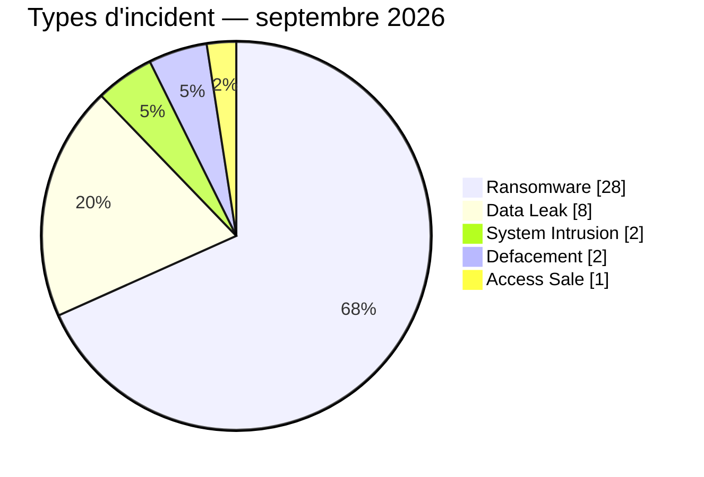
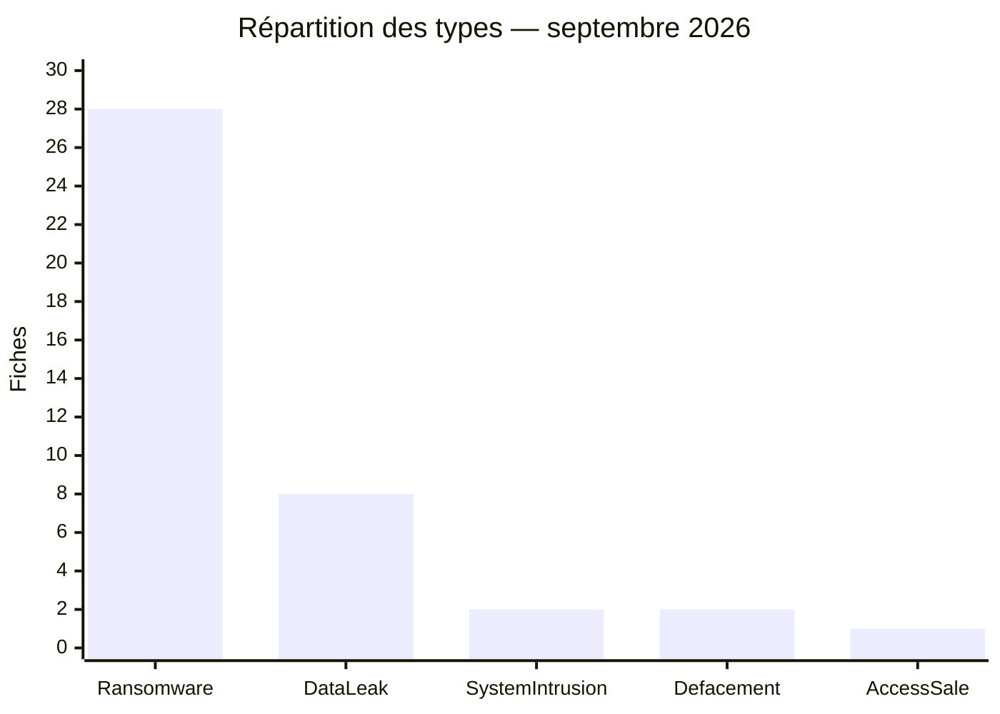
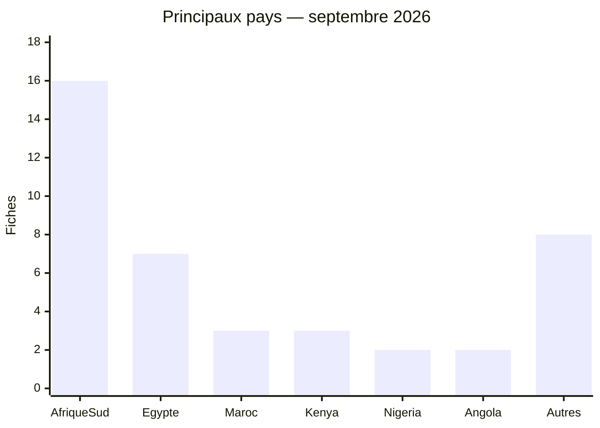
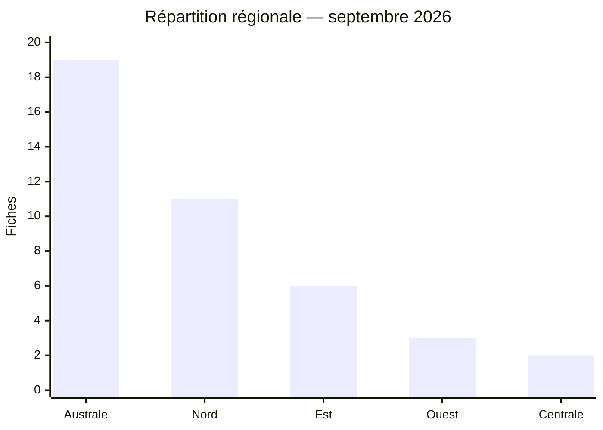
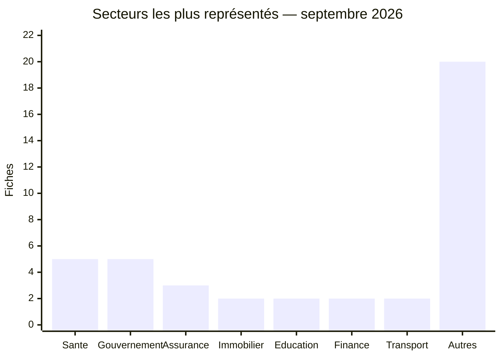
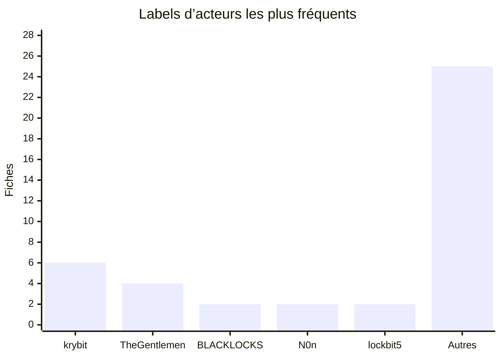
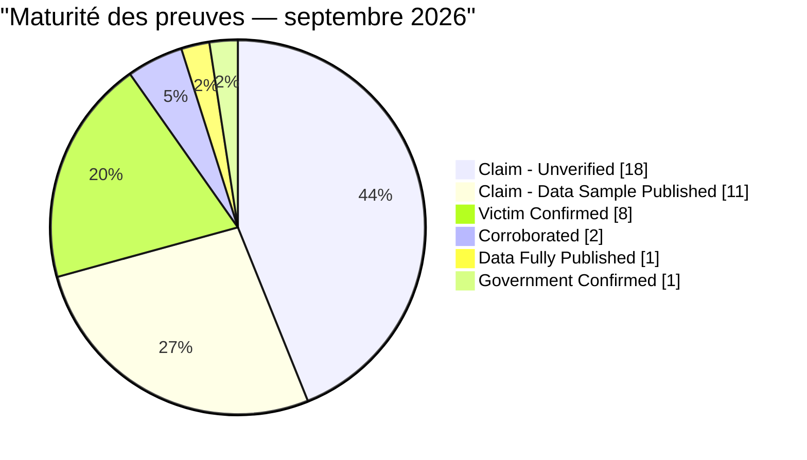
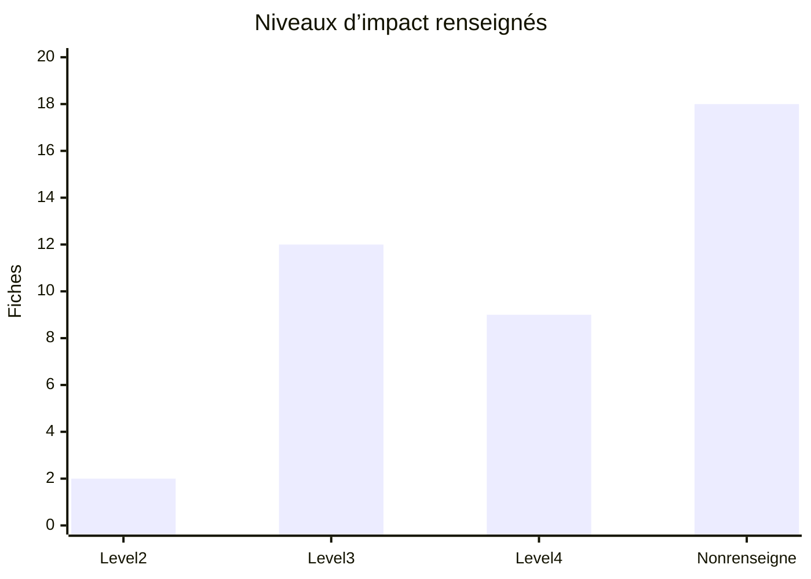
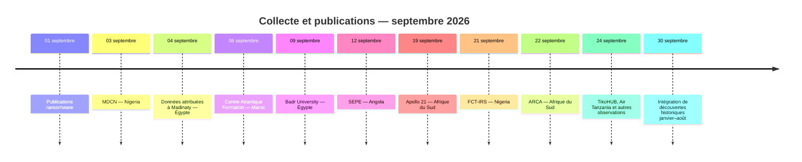

# AFRINTEL — Rapport CTI mensuel

## Cyberattaques en Afrique — septembre 2026

👉🏾 [Version anglaise](./README.md) · [Victimes et incidents documentés](./victims_FR.md)

## 1. Synthèse exécutive

Le corpus AFRINTEL de septembre 2026 contient **41 incidents documentés**, répartis dans **14 pays africains**. Le Ransomware domine avec **28 fiches (68,3 %)**, devant les Data Leak avec **8 (19,5 %)**. Deux System Intrusion, deux Defacement et une Access Sale complètent le corpus.

Le volume progresse de **29 fiches en août à 41 en septembre (+12 ; +41,4 %)**. Cette variation décrit la collecte AFRINTEL et ne constitue pas une estimation de l’évolution réelle des compromissions. Le corpus inclut des publications de septembre ainsi que des incidents publiés ou découverts antérieurement et intégrés tardivement dans le suivi de septembre.

L’Afrique du Sud concentre **16 fiches (39,0 %)**, suivie de l’Égypte avec 7, du Maroc et du Kenya avec 3 chacun. Les secteurs de la santé et du gouvernement/administration apparaissent chacun dans cinq fiches après normalisation prudente des libellés.

La maturité des preuves reste hétérogène : **18 fiches** sont `Claim - Unverified`, **11** `Claim - Data Sample Published`, **8** `Victim Confirmed`, **2** `Corroborated`, **1** `Data Fully Published` et **1** `Government Confirmed`. Ces statuts ne changent pas le type technique principal et ne prouvent pas automatiquement l’exfiltration complète.

## 2. Comparaison avec août 2026

| Indicateur | Août 2026 | Septembre 2026 | Variation |
|---|---:|---:|---:|
| Incidents documentés | 29 | 41 | **+12 (+41,4 %)** |
| Ransomware | 17 | 28 | **+11 (+64,7 %)** |
| Data Leak | 11 | 8 | **-3 (-27,3 %)** |
| Access Sale | 1 | 1 | **Stable** |
| System Intrusion | 0 | 2 | **Nouveau** |
| Defacement | 0 | 2 | **Nouveau** |

La comparaison porte sur les corpus mensuels clôturés. Elle ne transforme pas les dates de découverte, de publication ou d’intégration en dates d’intrusion.

```mermaid
xychart-beta
    title "Incidents documentés — août / septembre 2026"
    x-axis [Août, Septembre]
    y-axis "Fiches" 0 --> 45
    bar [29, 41]
```

## 3. Méthodologie et périmètre

- Source éditoriale : couple validé `victims_FR.md` / `victims.md`.
- Une fiche correspond à un incident canonique documenté dans le dossier de septembre.
- Les fiches découvertes tardivement conservent leur date d’incident ou de publication lorsqu’elle est connue ; leur date d’intégration AFRINTEL est indiquée séparément.
- Une revendication publiée sur un site ou forum criminel n’est pas assimilée à une confirmation technique sans éléments supplémentaires.
- Les extraits et captures ont été traités de manière minimisée ; aucune donnée personnelle brute, authentifiant, secret ou jeton n’est reproduit.
- Les catégories secondaires et les effets potentiels ne créent pas automatiquement une seconde fiche.

## 4. Vue globale et types d’incident

| Type d’incident | Fiches | Part |
|---|---:|---:|
| Ransomware | 28 | 68,3 % |
| Data Leak | 8 | 19,5 % |
| System Intrusion | 2 | 4,9 % |
| Defacement | 2 | 4,9 % |
| Access Sale | 1 | 2,4 % |
| **Total** | **41** | **100 %** |





### Ransomware

Les 28 fiches Ransomware correspondent à des publications de victimes ou à des observations de groupes. La présence d’une fiche ne permet pas, à elle seule, de conclure au chiffrement, à l’exfiltration complète ou au paiement d’une rançon. Les groupes les plus visibles sont `krybit` avec 6 fiches et `TheGentlemen` avec 4.

### Data Leak, System Intrusion et Defacement

Les huit Data Leak comprennent des publications accompagnées d’extraits, des cas confirmés par la victime et des revendications dont la provenance technique reste inconnue. Les deux System Intrusion et les deux Defacement sont conservés dans leurs catégories respectives ; un Defacement n’est pas reclassé en Data Leak sans preuve distincte d’exposition de données.

## 5. Répartition géographique

| Pays | Fiches | Part |
|---|---:|---:|
| Afrique du Sud | 16 | 39,0 % |
| Égypte | 7 | 17,1 % |
| Maroc | 3 | 7,3 % |
| Kenya | 3 | 7,3 % |
| Nigéria | 2 | 4,9 % |
| Angola | 2 | 4,9 % |
| Mali | 1 | 2,4 % |
| Gabon | 1 | 2,4 % |
| Cameroun | 1 | 2,4 % |
| Namibie | 1 | 2,4 % |
| Tunisie | 1 | 2,4 % |
| Éthiopie | 1 | 2,4 % |
| Tanzanie | 1 | 2,4 % |
| Ouganda | 1 | 2,4 % |
| **Total** | **41** | **100 %** |

| Région | Fiches | Part |
|---|---:|---:|
| Afrique australe | 19 | 46,3 % |
| Afrique du Nord | 11 | 26,8 % |
| Afrique de l’Est | 6 | 14,6 % |
| Afrique de l’Ouest | 3 | 7,3 % |
| Afrique centrale | 2 | 4,9 % |
| **Total** | **41** | **100 %** |

Chaque fiche de septembre reçoit ici une seule affectation pays. Aucun incident multi-pays supplémentaire n’a été compté dans cette ventilation.





## 6. Secteurs et acteurs

Après normalisation prudente des libellés, les secteurs les plus représentés sont la **Santé (5)**, le **Gouvernement / Administration (5)**, l’**Assurance (3)**, puis l’**Immobilier (2)**, l’**Éducation (2)**, les **Services financiers (2)** et le **Transport aérien (2)**. Les 20 autres occurrences relèvent de secteurs distincts ou spécialisés.



Les labels d’acteurs les plus fréquents sont `krybit` (6), `TheGentlemen` (4), `BLACKLOCKS` (2), `N0n` (2) et `lockbit5` (2). Sept fiches indiquent explicitement qu’aucun acteur n’est attribué publiquement. Les labels de comptes ou de publications ne constituent pas nécessairement une attribution technique.



## 7. Maturité des preuves et impact

| Statut | Fiches |
|---|---:|
| Claim - Unverified | 18 |
| Claim - Data Sample Published | 11 |
| Victim Confirmed | 8 |
| Corroborated | 2 |
| Data Fully Published | 1 |
| Government Confirmed | 1 |
| **Total** | **41** |

Les cartes renseignent explicitement un niveau d’impact pour 23 fiches : 12 en Level 3, 9 en Level 4 et 2 en Level 2. Pour 18 fiches, ce champ n’est pas renseigné dans le corpus actuel. Le niveau de confiance est explicitement indiqué pour 24 fiches ; les autres doivent rester interprétées avec prudence.





## 8. Chronologie de collecte

Les principales publications ou observations de septembre sont datées des 1er, 3, 4, 6, 7, 9, 12, 16, 18, 19, 21, 22, 24, 25, 26 et 29 septembre. Le dossier contient également des fiches intégrées tardivement le 30 septembre pour des événements publiés ou situés entre janvier et août 2026. Ces fiches restent dans le corpus de septembre pour la traçabilité de la collecte, sans modifier leur chronologie historique.



## 9. Priorités SOC défensives

- surveiller les comptes privilégiés, les accès VPN/RDP et les changements de rôles ;
- rechercher les créations d’archives, exports inhabituels et transferts sortants volumineux ;
- renforcer MFA, segmentation et sauvegardes isolées pour les organisations publiques, financières, de santé et de transport ;
- traiter séparément les signaux de défacement et de fuite de données afin d’éviter les conclusions non étayées ;
- préparer des procédures de notification et de réduction d’exposition lorsque des données d’identité, de santé ou de paiement sont publiées ;
- conserver les captures et manifestes de preuve hors dépôt, avec accès restreint.

## 10. Conclusion et contrôles

Septembre 2026 compte **41 incidents documentés**, dont **28 Ransomware**, **8 Data Leak**, **2 System Intrusion**, **2 Defacement** et **1 Access Sale**. L’Afrique du Sud concentre la plus grande part du corpus, tandis que les confirmations de victimes renforcent la visibilité de plusieurs dossiers sans valider automatiquement les volumes ou les chaînes d’intrusion revendiqués.

Contrôles effectués :

- 41 fiches FR et 41 fiches EN ;
- total par type = 41 ;
- total par pays = 41 ;
- total par région = 41 ;
- statuts de preuve = 41 ;
- rapports et fiches maintiennent la séparation entre date de l’incident, publication et découverte tardive.

**AFRINTEL — TLP:CLEAR**
