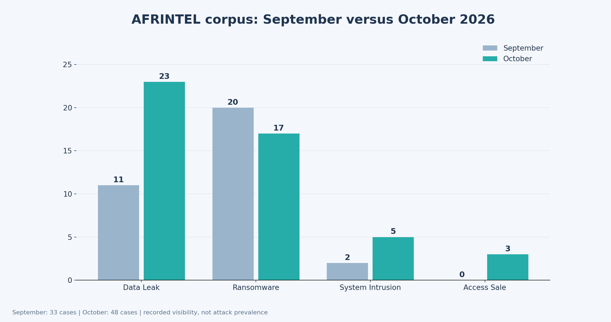
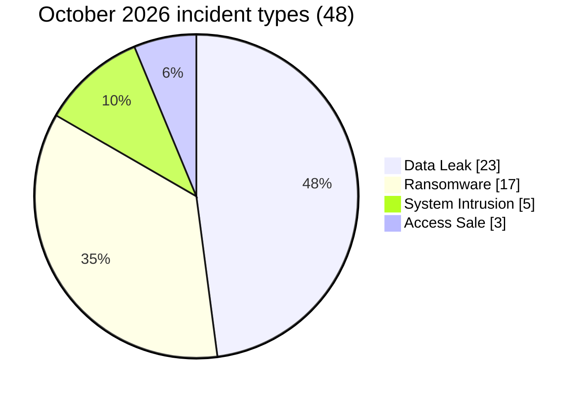
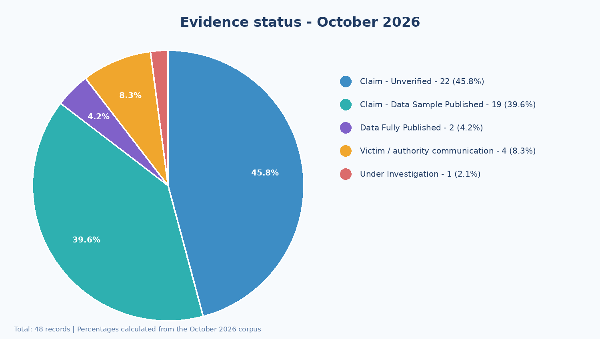

# AFRINTEL - CTI Report | Cyber incidents across Africa - October 2026

  

**Period:** 1–31 October 2026 · **Editorial review:** 5 November 2026  
**Coverage:** 54 African countries monitored; 15 appear in the October corpus  
**Sources:** ransomware leak sites, underground forums and illicit dark-web/deep-web marketplaces, official statements, specialist media and available samples  
**Explore:** [EN victim records](./victims.md) · [French victim records](./victims_FR.md) · [Version française](./README_FR.md)

> **Sources and analytical approach -** This report draws on AFRINTEL monitoring of ransomware groups' leak sites, underground forums and illicit marketplaces on the dark web and deep web. Each case is documented using observed posts, available visual evidence and, where possible, read-only examination of data samples. Findings are cross-checked against public information and official statements when available. Each victim record describes the evidence reviewed, its confidence level and the issues that remain unresolved.

## 1. Executive summary

**The main takeaway from October is the prominence of personal and business data in publicly observed cybercrime claims.** Across **48 documented cases in 15 countries**, the corpus contains **23 data leaks (47.9%)**, **17 ransomware-related listings (35.4%)**, **5 system intrusions or alerts (10.4%)**, and **3 access-sale offers (6.3%)**. The cases differ substantially in their level of evidence. They must not be read as 48 independently confirmed compromises.

**Morocco and Egypt each account for 12 cases; South Africa for 9.** Together they represent **33 of 48 records (68.8%)**. This concentration also reflects visibility and collection coverage, not an independently measured national threat rate.

Three patterns deserve attention. Business systems - ERP, e-commerce, recruitment and payroll - may combine customer, employee, supplier and transaction information in a single export. Health, identity, administrative and judicial information can create serious exposure even in smaller samples. Finally, service providers, identity systems and content-distribution chains make third-party access a meaningful security concern.

**Evidence classification:** AFRINTEL distinguishes **21 cases with a published or visible sample** (review depth varies), **2 disclosed batches reviewed**, **4 cases publicly acknowledged by the affected organisation**, **1 case under investigation**, and **20 unverified claims**. This classification makes the corpus more precise by showing what is documented in each case, without equating a criminal claim with independent technical confirmation.

### 1.1 Month-over-month comparison

> This comparison measures validated **AFRINTEL records**, not the actual number of successful attacks. Improved collection and retrospective discoveries can affect the figures.

| Indicator | September | October | Observed change |
|---|---:|---:|---:|
| **Total cases** | **33** | **48** | **+15 (+45.5%)** |
| Ransomware | 20 | 17 | −3 (−15.0%) |
| Data Leak | 11 | 23 | +12 (+109.1%) |
| Access Sale | 0 | 3 | +3 (new) |
| DDoS | 0 | 0 | 0 (stable) |
| Defacement | 0 | 0 | 0 (stable) |
| Account Takeover | 0 | 0 | 0 (stable) |
| System Intrusion | 2 | 5 | +3 (+150.0%) |
| Malware | 0 | 0 | 0 (stable) |
| Operational Fraud | 0 | 0 | 0 (stable) |

Data leaks, rather than ransomware listings, account for most of the observed increase. Ransomware fell from 20 to 17 cases. These shifts should not be described as real-world attack trends without comparable collection coverage.

## 2. Scope, methodology and limitations

AFRINTEL monitors claims and incidents involving African organisations or African data. Collection includes postings directly observed on ransomware leak sites, underground forums and illicit marketplaces. Screenshots, official notices and accessible samples are compared to document each case. October records are allocated by **observed publication date or first documented AFRINTEL observation** when the technical incident date cannot be established. A posting date is not an initial-compromise date.

The **48 French and 48 English victim records** were cross-checked for incident type, status and order. Composite labels are counted under a single primary type: **Decathlon Morocco** is counted as `Data Leak`, with the alleged personal-data exposure described in its record. Secondary effects never create a second attack count.

Sectors follow AFRINTEL's [2026 normalization mapping](../../../normalization/sector_mapping_2026.csv). The corrected sector charts differ from the previously circulated illustration. This grouping supports comparability but is not a legal critical-infrastructure classification.

**Chronology caveat:** the October post concerning **e-Solde (Republic of the Congo)** matches an earlier post dated **28 June 2026**. The published monthly corpus retains it in October because that was the first AFRINTEL observation counted. It must **not** be described as a new October compromise. Future retrospective corrections should be tracked without double counting.

An examined file does not validate the total amount claimed or prove technical provenance. Rows, files, accounts and transactions are not interchangeable with unique people. No raw personal data, credentials, secrets or criminal download links are distributed in the repository.

## 3. October at a glance

### 3.1 Incident types

| Type | Cases | Share |
|---|---:|---:|
| **Data Leak** | **23** | **47.9%** |
| Ransomware | 17 | 35.4% |
| System Intrusion | 5 | 10.4% |
| Access Sale | 3 | 6.3% |
| **Total** | **48** | **100.0%** |

### 3.2 Countries and regions

| Country | Cases | Country | Cases |
|---|---:|---|---:|
| Egypt | 12 | Republic of the Congo | 1 |
| Morocco | 12 | Rwanda | 1 |
| South Africa | 9 | Mozambique | 1 |
| Democratic Republic of the Congo | 2 | Gabon | 1 |
| Ethiopia | 2 | Tunisia | 1 |
| Madagascar | 2 | Benin | 1 |
| Nigeria | 1 | Sierra Leone | 1 |
| Côte d'Ivoire | 1 | **Total (15 countries)** | **48** |

| Region | Cases | Share |
|---|---:|---:|
| North Africa | 25 | 52.1% |
| Southern Africa | 10 | 20.8% |
| East Africa | 5 | 10.4% |
| Central Africa | 4 | 8.3% |
| West Africa | 4 | 8.3% |
| **Total** | **48** | **100.0%** |

**39 of the 54 monitored African countries** are absent from this month's corpus. That does not mean there were no incidents in those countries. It is a reminder to strengthen regional and local-language collection.

### 3.3 Evidence quality

| AFRINTEL status | Cases | Share |
|---|---:|---:|
| Claim - Unverified | 20 | 41.7% |
| Claim - Data Sample Published | 21 | 43.8% |
| Data Fully Published | 2 | 4.2% |
| Incident Confirmed by Victim | 4 | 8.3% |
| Under Investigation | 1 | 2.1% |
| **Total** | **48** | **100.0%** |

A `Claim - Data Sample Published` status may mean a sample was advertised, seen or examined; review depth varies by case. It does not independently establish a breach of the victim's systems. For **CNESTEN**, the examined artifact is a **directory listing**, not the content of the files it names. Likewise, victim acknowledgements should not be treated as confirmation of every volume or claim circulating online.

### 3.4 Actors, groups and publishing accounts

| Observed label | Cases |
|---|---:|
| Nameless511 | 9 |
| UmBra | 4 |
| N0n | 4 |
| The Gentlemen | 3 |
| SensitiveDarkForum | 2 |
| Krybit | 2 |
| Qilin | 2 |
| Lenken | 2 |
| Kazu | 2 |
| List1 | 2 |

These **ten labels cover 32 cases**. Other cases involve less common labels or lack an established actor. The ranking measures source visibility and claimed attribution - **not technical identification**. Some labels refer to ransomware groups; others are forum or marketplace accounts.

### 3.5 Corrected normalized sectors

| Normalized sector | Cases | Share |
|---|---:|---:|
| Government / Public administration | 12 | 25.0% |
| Other sectors | 7 | 14.6% |
| Technology / Digital services | 6 | 12.5% |
| Commerce / Retail | 5 | 10.4% |
| Healthcare | 5 | 10.4% |
| Education | 5 | 10.4% |
| Industry / Engineering | 3 | 6.3% |
| Finance / Insurance | 3 | 6.3% |
| Transport | 2 | 4.2% |
| **Total** | **48** | **100.0%** |

**Public administration (12 cases)** remains the largest category. The seven cases grouped as “Other sectors” cover distinct activities including nuclear research, water, broadcasting, NGOs and environmental research. The category should be refined in a future controlled mapping, without disrupting historical comparability. Some IT equipment retailers are grouped with technology in this mapping, so the commerce figure does not capture every e-commerce business in an economic sense.

## 4. Incidents that matter most

### 4.1 Morocco: business-management exports

**Tera.ma** is among the most extensively documented cases. AFRINTEL inventoried **8,140 files totaling 2,389,358,436 bytes**, including **282 CSV files and 3,693 PDFs**. Structural checks find **19,595 partner entries**, **69,197 orders** and **124,088 accounting entries**. This strongly supports the connection with an Odoo-type business dataset. It **does not establish when or how access occurred**, nor an official acknowledgement by Tera.ma.

For **NextLevel PC**, the **eight supplied CSV files** support the published figures: **52,545 customer accounts**, **60,262 delivery addresses**, **47,653 orders**, **11 internal accounts** and **14,160 commercial rules**. These structures could enable delivery fraud, fake refunds and account targeting. The number of customers, addresses and orders must not be added up as a people count.

**Midipcom**, **Karamtech** and **Decathlon Morocco** illustrate related exposure affecting sales, billing and logistics. The supplied Midipcom and Karamtech samples do not validate the larger advertised datasets. The precise source of Decathlon-related records - retailer, third party or historical export - remains unresolved.

### 4.2 Public bodies: hard-to-replace identifiers and records

For Morocco's **Ministry of Endowments and Islamic Affairs**, the available **33 XLSX workbooks and one CSV** amount to approximately **109,640 data rows** under a presumed header-removal method. They resemble recruitment records, with identity, education and administrative-reference fields. Direct technical provenance from ministry systems is not established.

A corpus associated with **Rwanda's Ministry of Health** contains **375 CSV files**, totaling **6,050,914,271 bytes** and **42,509,228 physical lines**. The files include different kinds of records, such as accounts, audit logs and health-related information. **These lines cannot be converted into 42.5 million affected patients or citizens.** Technical provenance and actual scope remain unresolved.

In the **DR Congo**, the **MINESURSI** announcement claims **136 GB and 125,823 files**; the examined batch includes only **1,531 files** - **581 PDFs and 950 images**. In the **Republic of the Congo**, the e-Solde sample contains account and public-payroll fields, but a functioning administrator access offered for sale has not been independently established.

### 4.3 Healthcare: sensitivity matters more than file size

The **Ampath Laboratories** samples from South Africa include structured employee, patient, admission, insurance and payment records. They support the presence of sensitive categories in the material reviewed, but **not the claim of 80 million records** or hundreds of databases.

Other cases concern medical organisations and schools in **Egypt** and material associated with **Ethiopia's Ministry of Health**. Identity data, health information and professional details could facilitate targeted fraud and privacy harms. For cases based mainly on postings or images, originating systems remain unknown.

### 4.4 Ransomware: a listing is not proof of encryption

**Eurogate Tanger** has an examined first publication batch: **355 files**, totaling **373,065,003 uncompressed bytes**, with office documents, correspondence and technical material associated with port operations. This does **not** establish terminal downtime, encryption or complete exfiltration.

For **CNESTEN**, a publication associated with **Qilin** was compared with a **directory inventory describing 110,803 files** and **205,805,114,681 stated bytes**. The underlying documents were not examined, and no consequence for nuclear safety or plant availability has been established. **YOD Ingénierie** remains attributed **only to Benin**.

Listings linked to **Gabon Meca (HYFLOCK)**, **Société Ivoirienne de Télédiffusion (Qilin)** and other victims are visible through actor postings or public trackers. A displayed deadline does not establish payment, complete release or the outcome of negotiations.

### 4.5 Public acknowledgements: not all incidents are leaks

**Lawyers for Human Rights** in South Africa reported unauthorised access to and downloading from a database hosted by a service provider. **GCIS** reported compromise of a recruitment portal, with the final extent of data exposure unresolved.

In **Nigeria**, **InvestNaija / Chapel Hill Denham** disclosed unusual activity that might concern a limited proportion of client information. In **Egypt**, **Al Arabia United** acknowledged unauthorised content displayed on an advertising screen; this relates to a content distribution chain **without established data leakage**. These cases show that confidentiality, integrity and availability can be affected differently.

## 5. Strategic interpretation

**First, business exports are valuable fraud material.** ERP and order databases connect people, payments, suppliers and documents. Tera.ma and NextLevel PC provide concrete examples; other postings describe similar datasets with less supporting evidence.

**Second, identity information crosses sector boundaries.** Recruitment, universities, public payroll and healthcare may contain difficult-to-replace records. After a release, defenders must anticipate fraudulent reuse as well as contain the original exposure.

**Third, third-party dependencies deserve dedicated monitoring.** Lawyers for Human Rights involved a service provider; two Madagascar access offers concern separate identity environments; Al Arabia United involved content distribution. The cases do not demonstrate one shared attack path, but they support stricter delegated-access controls and system separation.

Finally, **a larger documented corpus is not automatically evidence of faster-growing attacks**. Source availability, reposts and collection depth affect the monthly count.

## 6. Priority risks by environment

| Environment | Exposure documented in the corpus | Risk to anticipate | Defensive priority |
|---|---|---|---|
| Government and recruitment | Applications, payroll, accounts, supporting documents | Identity misuse, administrative fraud, staff targeting | Monitor exports, IAM and third parties |
| Commerce, ERP, logistics | Customers, orders, invoices, addresses, financial history | Invoice and delivery fraud, fraudulent bank-detail changes | Audit bulk exports and critical changes |
| Healthcare | Patient, staff, insurance and facility data | Privacy harm, targeted phishing, extortion | Segment and detect mass access |
| Digital and identity services | App backups, accounts, access offers | Token reuse, privilege abuse | MFA, controlled rotation and access review |
| Transport and service infrastructure | Operational files, publishing systems | Document misuse, content hijacking | Audit sensitive actions and suppliers |

The table prioritises defensive scenarios. It does not assert that every impact listed occurred at every victim.

## 7. Intelligence gaps and verification priorities

| Topic | Current evidence | Open question |
|---|---|---|
| e-Solde | Concordant June and October posts, treated as one case | Canonical chronology and historical allocation |
| Mozambique PGR / Rand Mutual | Both records describe **262 files and 75,941,802 bytes** with identical composition | Compare archive hashes, provenance and possible misassociation; **do not treat them as independent corroboration** |
| Rand Mutual Assurance | Public alert and investigation; contextually associated sample | Was there unauthorised access, and what is the actual exposure? |
| CNESTEN | Directory inventory examined, not underlying documents | Authenticity, completeness, sensitivity and any operational effect |
| Ransomware listings without samples | Actor posts and some deadlines | Last review date, release status, victim acknowledgements and technical evidence |
| Under-represented countries | Few or no observed cases in October sources | Local languages, CERT/CSIRT notices and regional OSINT coverage |

Public notices, safe provenance checks, samples that can be examined without sharing personal data, and changes in disclosure status should take priority. No victim statement found in consulted sources does not prove intentional concealment or absence of an incident.

## 8. MITRE ATT&CK: detection hypotheses, not observed technique attribution

The monthly classification alone does not establish a complete intrusion chain. These are **defensive hypotheses** to confirm or reject using the affected organisations' telemetry.

| ATT&CK technique | Hypothesis to test | Telemetry to correlate |
|---|---|---|
| [T1078 - Valid Accounts](https://attack.mitre.org/techniques/T1078/) | Use of a compromised legitimate account | IAM, SSO, VPN, sessions, device posture |
| [T1190 - Exploit Public-Facing Application](https://attack.mitre.org/techniques/T1190/) | Exploitation of an Internet-facing application | WAF, reverse proxy, HTTP logs, application errors, EDR |
| [T1213 - Data from Information Repositories](https://attack.mitre.org/techniques/T1213/) | Abusive access to document repositories | SharePoint/document audit, file access, permissions |
| [T1530 - Data from Cloud Storage](https://attack.mitre.org/techniques/T1530/) | Access or downloads from cloud object storage | Bucket/object logs, cloud API, download logs |
| [T1567 - Exfiltration Over Web Service](https://attack.mitre.org/techniques/T1567/) | Outbound transfer to a web service if supported by telemetry | Proxy, DNS, DLP/CASB, network flows |
| [T1486 - Data Encrypted for Impact](https://attack.mitre.org/techniques/T1486/) | Mass encryption in an established ransomware case | EDR, file modifications, backup events |

**Publication on a forum does not establish T1567** or another specific exfiltration technique. A ransomware-group listing does not prove T1486.

## 9. SOC guidance: what to detect

| Defensive scenario | Telemetry | Detection / correlation idea |
|---|---|---|
| Unusual ERP or e-commerce export | ERP, database audit, IAM, proxy, DLP | Bulk export + elevated privileges + anomalous outbound transfer |
| Misuse of a privileged account | SSO/Keycloak, VPN, EDR, bastion | Unusual location/ASN or device + sensitive action + atypical time |
| Mass download of records | Recruitment, healthcare, repositories, access logs | Access or download volume outside the account's normal role |
| Third-party account compromise | Identity provider, vendor accounts, API audit | Novel vendor session + access across multiple environments |
| Display-content hijacking | CMS, publishing API, SSO, deployment history | Unapproved change + multi-screen publishing + schedule mismatch |
| Possible ransomware impact preparation | EDR, files, backups, IAM | Mass file changes + account anomaly + unusual backup activity |

**Observed in October:** data postings, inventories and samples, access offers, public security notices and unauthorised display content in the Al Arabia United case.

**Hypotheses requiring investigation:** automated collection, account misuse, provider access, outbound transfer or attempted encryption. These are **not** asserted for every victim.

**Preventive measures:** phishing-resistant MFA for privileged accounts, fewer standing privileges, logged exports, protected backups and prompt session and secret revocation. Log retention should reflect legal requirements and investigation needs.

## 10. Prioritised action plan

### Immediate - 0 to 7 days

1. **Scope the exposed data:** identify internal and vendor systems holding comparable records, preserve evidence and restrict unnecessary access.
2. **Reduce reuse risk:** revoke affected sessions and rotate genuinely exposed secrets through controlled processes. Do not test values advertised by criminals.
3. **Prevent secondary fraud:** use out-of-band checks for bank-detail changes, unusual refunds and sensitive payment requests.

### Near term - 8 to 30 days

1. Test SIEM alerts for bulk exports, privilege use, vendor access and repeated downloads.
2. Review supplier permissions, service accounts and staging environments; remove unnecessary access.
3. Prepare legally appropriate notifications and protections proportionate to the validated evidence.

### Consolidation - 30 to 90 days

1. Run exercises covering an ERP leak, recruitment records, provider compromise and display-system hijacking.
2. Measure log coverage and retention, secret-revocation time and recovery-test frequency.
3. Improve sector mapping, deduplication and ransomware disclosure lifecycle tracking for reliable monthly comparisons.

## 11. November 2026 monitoring outlook

Priorities are further data releases, official updates, comparisons of samples attributed to different victims, evolving ransomware disclosure status, and possible fraud using authentic commercial references. Future observations should be dated and kept separate from hypotheses.

## Conclusion

**The main October signal is not simply how many victims were named: it is how much operational detail some available datasets expose.** Order history, recruitment records, payroll exports and directory inventories may continue to enable targeting well after the original post. Defenders need to protect accounts, verify third-party access, detect anomalous exports and prepare for follow-on fraud.

AFRINTEL deliberately distinguishes **what was posted, what was actually observed in files and what remains unknown**. That is what makes the intelligence useful to leadership, CERT/CSIRT teams and SOC analysts.

---

*AFRINTEL - Cyber Threat Intelligence for Africa*  
*Sources and detailed records: [AFRINTEL GitHub](https://github.com/Hatchepsoute/AFRINTEL) · [October 2026 victim records](./victims.md)*
