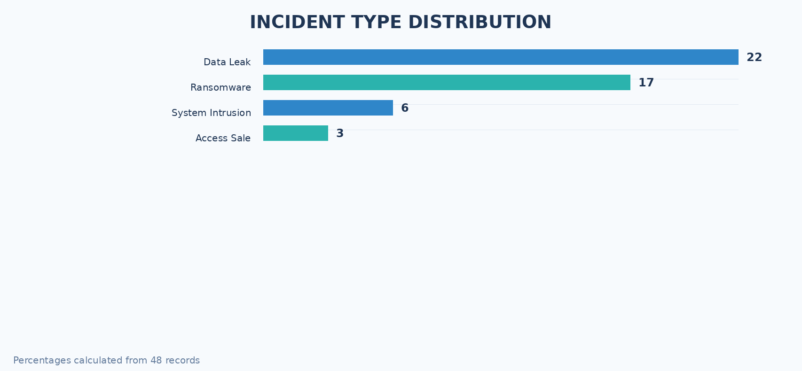
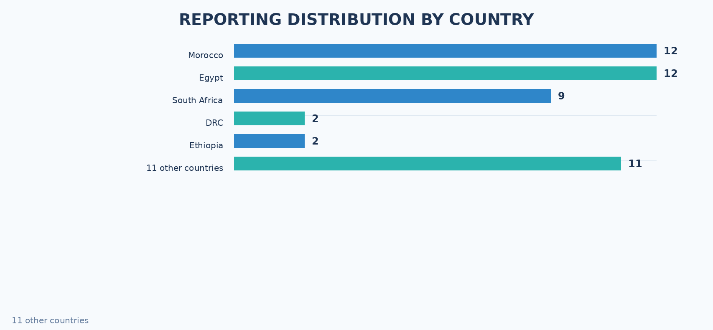
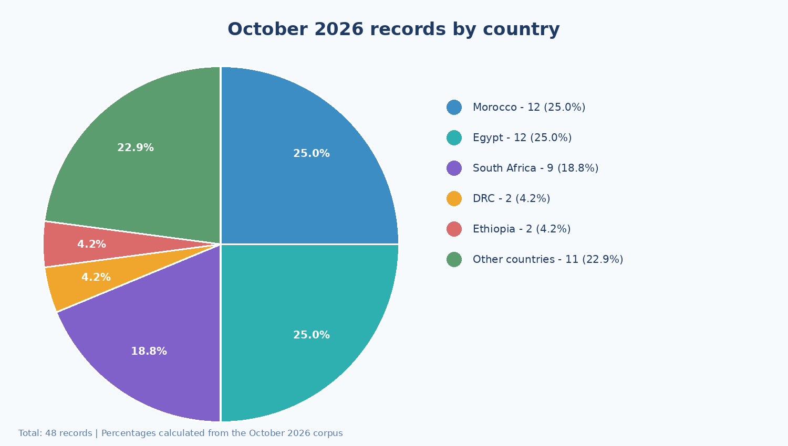
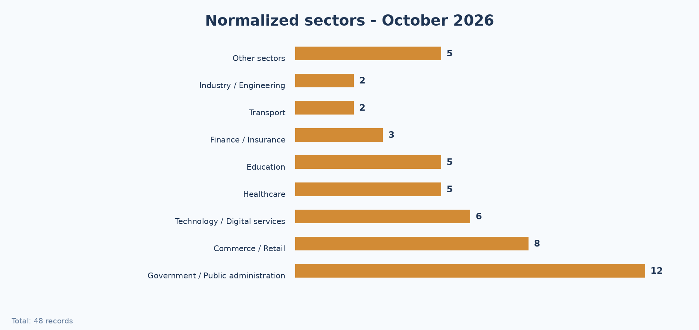
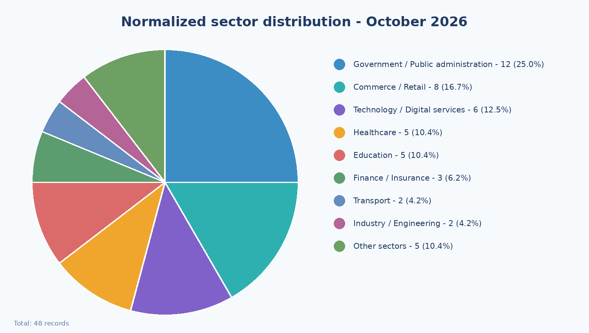
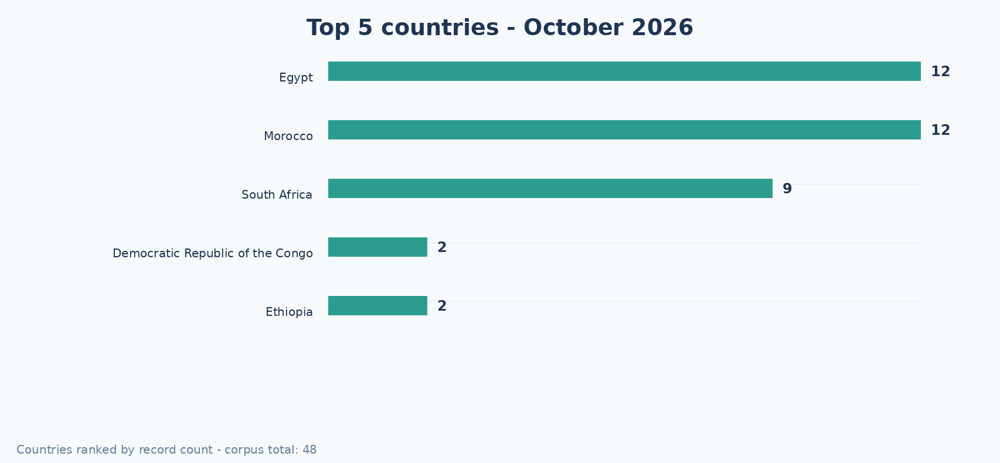
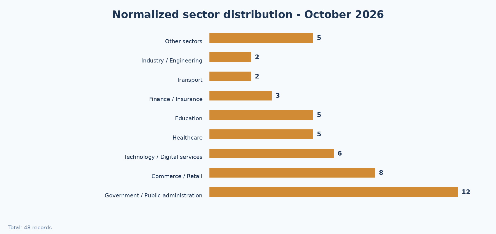
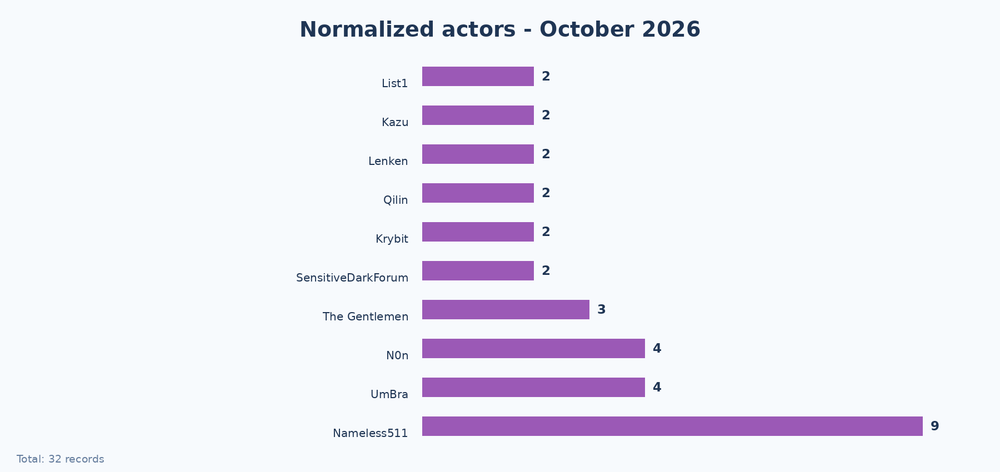
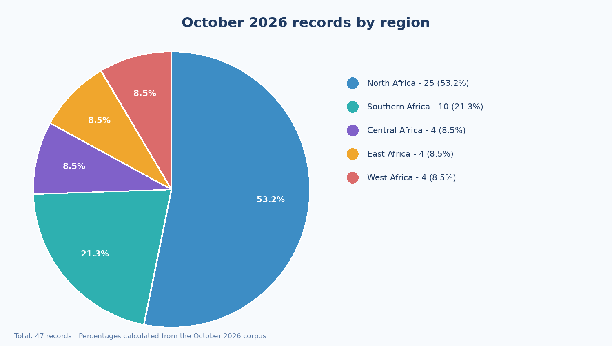
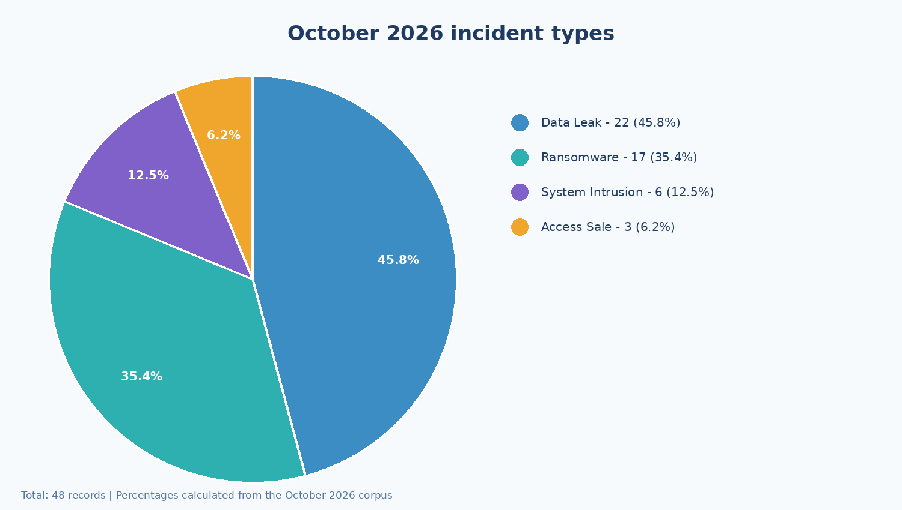

# AFRINTEL CTI report - cyber incidents in Africa (October 2026)

This validated corpus contains **48 incidents or documented cases** first published or first observed by AFRINTEL in October 2026. The month assignment follows the publication or first documented observation date; a compromise date is not inferred when it is unavailable.

## Validated monthly breakdown

| Incident type | Count | Share |
|---|---:|---:|
| Data Leak | 22 | 45.8% |
| Ransomware | 17 | 35.4% |
| System Intrusion | 6 | 12.5% |
| Access Sale | 3 | 6.2% |
| **Total** | **48** | **100.0%** |

## Countries most represented

| Country | Count |
|---|---:|
| Egypt | 12 |
| Morocco | 12 |
| South Africa | 9 |
| Democratic Republic of the Congo | 2 |
| Ethiopia | 2 |
| Madagascar | 2 |
| Republic of the Congo | 1 |
| Rwanda | 1 |
| Mozambique | 1 |
| Gabon | 1 |
| Tunisia | 1 |
| Benin | 1 |
| Nigeria | 1 |
| Sierra Leone | 1 |
| Côte d'Ivoire | 1 |

## Actor labels most represented

Account names and actor labels were grouped when they referred to the same source label. Source-displayed accounts remain distinct from incidents for which no actor is identified.

| Actor label | Count |
|---|---:|
| Nameless511 | 9 |
| UmBra | 4 |
| N0n | 4 |
| The Gentlemen | 3 |
| SensitiveDarkForum | 2 |
| Krybit | 2 |
| Qilin | 2 |
| Lenken | 2 |
| Kazu | 2 |
| List1 | 2 |

**Unidentified or unestablished attribution: 5 incidents.** These cases are not counted as actors in the ranking.

## Normalized sector distribution

Sectors were grouped into analytical families to avoid fragmenting the same activity across overly specific labels.

| Sector | Count |
|---|---:|
| Government / Public administration | 12 |
| Commerce / Retail | 8 |
| Technology / Digital services | 6 |
| Healthcare | 5 |
| Education | 5 |
| Finance / Insurance | 3 |
| Transport | 2 |
| Industry / Engineering | 2 |
| Other sectors | 5 |

## CTI reading

Data leaks were the leading incident category in October with 22 records, followed by ransomware with 17. System intrusions accounted for 6 records and access sales for 3. Egypt and Morocco ranked first with 12 incidents each, which also reflects the visibility of the sources monitored by AFRINTEL. Public administration was the largest normalized sector family with 12 records, followed by commerce and retail with 8, and technology and digital services with 6. Access sales were less frequent, but potentially more critical when they involved administrative environments or privileged accounts. Source-displayed accounts such as Nameless511, UmBra and N0n are retained as publication identifiers; five records remain without established attribution. These findings describe documented monthly visibility and are not an exhaustive measure of the real threat landscape.

## Methodology

The figures are derived once from `victims_FR.md`, checked against `victims.md`, and reused in the reports, comparisons and STIX bundle. The mapping between detailed source sectors and normalized families is documented in the [sector normalization file](../../../normalization/sector_mapping_2026.csv). A multi-country incident counts once globally; country occurrences may therefore exceed the global total. The corpus measures documented AFRINTEL visibility, not the actual prevalence of cyberattacks.

[Victim records](./victims.md)
