# AFRINTEL - CTI Report | Cyber incidents across Africa - October 2026

  

**Period:** 1-31 October 2026 · **Editorial review and OSINT verification:** 17 November 2026 
**Coverage:** 54 African countries monitored; 15 appear in the October corpus 
**Audience:** CISOs, CIOs, SOC, CERT/CSIRT and IT leadership 
**Sources:** AFRINTEL monitoring of ransomware leak sites, underground forums, dark-web/deep-web marketplaces and criminal posting accounts; read-only sample assessment; cross-checks with official statements and specialist media 
**Explore:** [EN victim records](./victims.md) · [French victim records](./victims_FR.md) · [Version française](./README_FR.md)

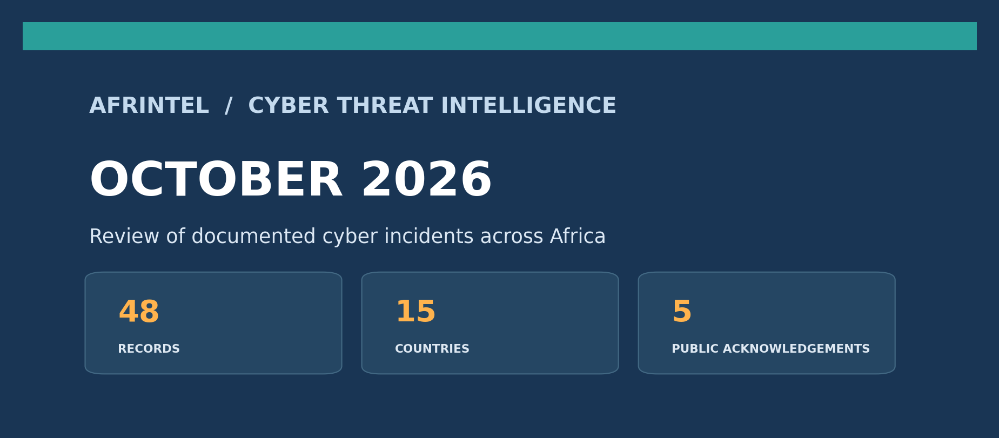

> **Intelligence provenance.** This monitoring is based primarily on material documented on **ransomware leak sites**, **underground cybercrime forums**, **criminal marketplaces** and other accessible **dark-web/deep-web** spaces. AFRINTEL records posts, screenshots, metadata and released samples; supplied files are inspected read-only where available. Victim statements, public authorities and independent media are used for corroboration. The observation of a criminal post documents **that the post exists**, not automatically every technical claim it makes.

## 1. Executive summary

**October underlines the value of business, administrative and personal data in cybercrime marketplaces.** AFRINTEL documented **48 signals across 15 African countries**, chiefly through criminal postings and accessible evidence. The corpus includes **23 data-leak cases (47.9%)**, **17 ransomware-related listings (35.4%)**, **5 system-intrusion reports (10.4%)** and **3 access-sale offers (6.3%)**. Each record is a canonical CTI observation rather than a claim that a technical compromise has been forensically proven.

**Morocco and Egypt each account for 12 cases; South Africa for 9.** Together they represent **33 of 48 records (68.8%)**. This concentration also reflects visibility and collection coverage, not an independently measured national threat rate.

Three patterns deserve attention. Business systems - ERP, e-commerce, recruitment and payroll - may combine customer, employee, supplier and transaction information in a single export. Health, identity, administrative and judicial information can create serious exposure even in smaller samples. Finally, service providers, identity systems and content-distribution chains make third-party access a meaningful security concern.

**Cross-checks strengthen the corpus:** **5 publicly acknowledged security events**, **2 fully published datasets reviewed**, **19 records with a sample advertised, displayed or examined**, **1 publicly acknowledged investigation**, and **21 other documented criminal claims**. This classification captures available evidence without hiding its underground origin. **Ampath Laboratories** has been added to publicly acknowledged incidents following its 14 October statement; the **Mozambique PGR** listing remains counted, but a documentary batch previously associated with it has been excluded from evidence supporting that attribution due to a provenance issue.

### 1.1 Month-over-month comparison

> This comparison measures validated **AFRINTEL records**, not the actual number of successful attacks. Improved collection and retrospective discoveries can affect the figures.

| Indicator | September | October | Observed change |
|---|---:|---:|---:|
| **Total cases** | **33** | **48** | **+15 (+45.5%)** |
| Ransomware | 20 | 17 | −3 (−15.0%) |
| Data Leak | 11 | 23 | +12 (+109.1%) |
| Access Sale | 0 | 3 | +3 (new) |
| DDoS | 0 | 0 | 0 (stable) |
| Defacement | 0 | 0 | 0 (stable) |
| Account Takeover | 0 | 0 | 0 (stable) |
| System Intrusion | 2 | 5 | +3 (+150.0%) |
| Malware | 0 | 0 | 0 (stable) |
| Operational Fraud | 0 | 0 | 0 (stable) |

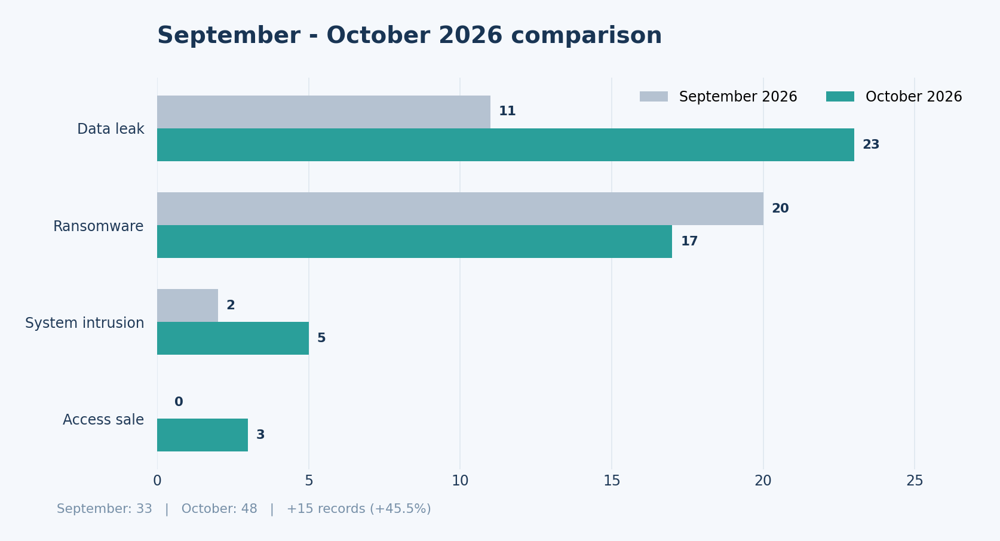

Data leaks account for most of the change in documented records (**11 to 23**). Ransomware listings fell from **20 to 17**. This measures **AFRINTEL collection and documentation**, which can be affected by source visibility, reposts and retrospective research.

### 1.2 Key decisions for leadership

- **Data and fraud:** sales orders, accounts, payroll, recruitment and healthcare data can enable targeted abuse long after initial disclosure.
- **Third-party environments:** business software, providers and central publishing systems expand organisational exposure.
- **Public corroboration:** Ampath, Lawyers for Human Rights, GCIS, InvestNaija and Al Arabia United issued or were the subject of public incident communications, with different confirmed scopes.
- **Operational priority:** secure identities and exports, scrutinise vendor access and prepare for follow-on fraud.

## 2. Scope, methodology and limitations

AFRINTEL monitors claims and incidents involving African organisations or African data. Collection includes postings directly observed on ransomware leak sites, underground forums and illicit marketplaces. Screenshots, official notices and accessible samples are compared to document each case. October records describe **postings and security signals first included in AFRINTEL's monthly tracking**. The date of a technical event, actor post, victim announcement and collection are different fields documented separately in the victim records. Thus the report measures the **visibility of cybercrime intelligence in October**, not solely intrusions that occurred in October.

The **48 French and 48 English victim records** were cross-checked for incident type, status and order. Composite labels are counted under a single primary type: **Decathlon Morocco** is counted as `Data Leak`, with the alleged personal-data exposure described in its record. Secondary effects never create a second attack count.

Sectors follow AFRINTEL's [2026 normalization mapping](../../../normalization/sector_mapping_2026.csv). The corrected sector charts differ from the previously circulated illustration. This grouping supports comparability but is not a legal critical-infrastructure classification.

**Retrospective case: e-Solde (Republic of the Congo).** The earliest identified post is dated **28 June 2026**; the **2 October** record is a repost first incorporated into AFRINTEL monitoring that month. Both dates appear in the victim record. The case is retained in the **48 October tracking records**, without being described as a new October attack. Any move to an event-based historical series should recalculate both months together and avoid double counting.

An examined file does not validate the total amount claimed or prove technical provenance. Rows, files, accounts and transactions are not interchangeable with unique people. No raw personal data, credentials, secrets or criminal download links are distributed in the repository.

## 3. October at a glance

### 3.1 Incident types

| Type | Cases | Share |
|---|---:|---:|
| **Data Leak** | **23** | **47.9%** |
| Ransomware | 17 | 35.4% |
| System Intrusion | 5 | 10.4% |
| Access Sale | 3 | 6.3% |
| **Total** | **48** | **100.0%** |

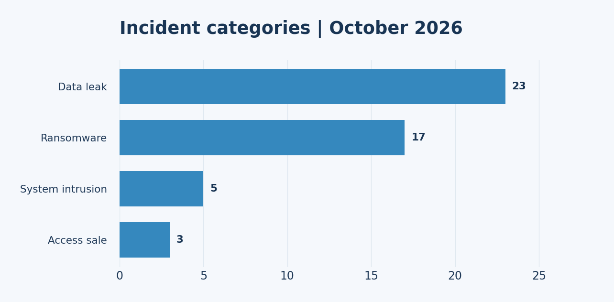
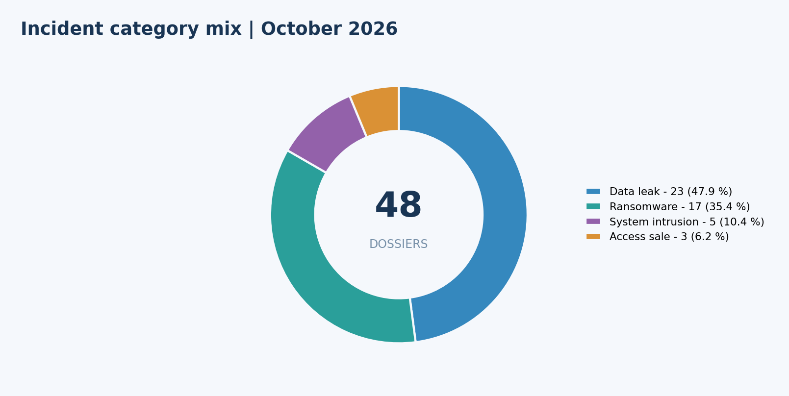

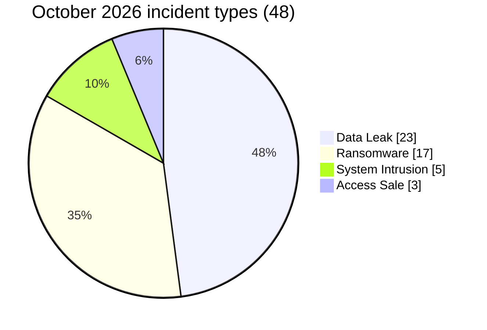

### 3.2 Countries and regions

| Country | Cases | Country | Cases |
|---|---:|---|---:|
| Egypt | 12 | Republic of the Congo | 1 |
| Morocco | 12 | Rwanda | 1 |
| South Africa | 9 | Mozambique | 1 |
| Democratic Republic of the Congo | 2 | Gabon | 1 |
| Ethiopia | 2 | Tunisia | 1 |
| Madagascar | 2 | Benin | 1 |
| Nigeria | 1 | Sierra Leone | 1 |
| Côte d'Ivoire | 1 | **Total (15 countries)** | **48** |

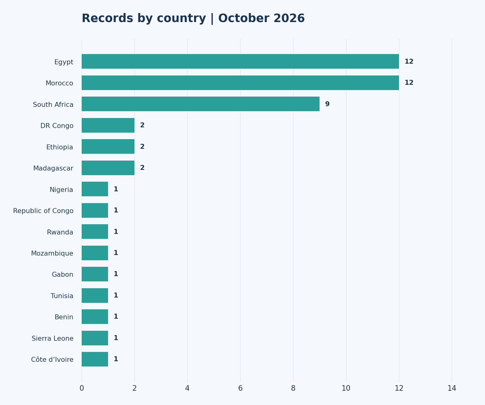
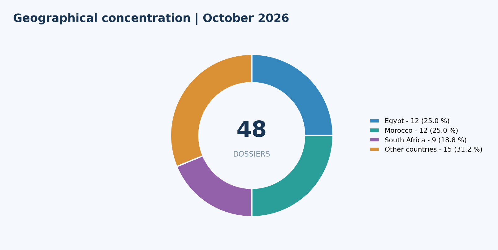

| Region | Cases | Share |
|---|---:|---:|
| North Africa | 25 | 52.1% |
| Southern Africa | 10 | 20.8% |
| East Africa | 5 | 10.4% |
| Central Africa | 4 | 8.3% |
| West Africa | 4 | 8.3% |
| **Total** | **48** | **100.0%** |

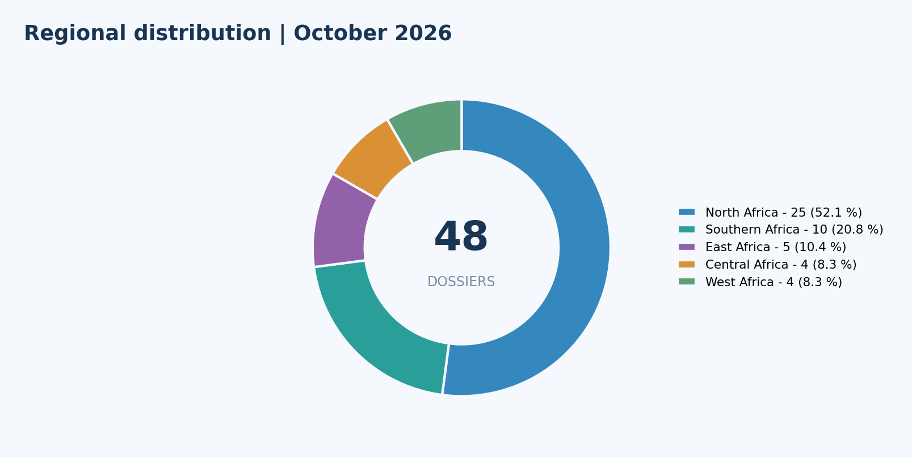

**39 of the 54 monitored African countries** are absent from this month's corpus. That does not mean there were no incidents in those countries. It is a reminder to strengthen regional and local-language collection.

### 3.3 Evidence qualification and public acknowledgements

| AFRINTEL status | Cases | Share |
|---|---:|---:|
| Claim - Unverified | 21 | 43.8% |
| Claim - Data Sample Published | 19 | 39.6% |
| Data Fully Published | 2 | 4.2% |
| Incident Confirmed by Victim | 5 | 10.4% |
| Under Investigation | 1 | 2.1% |
| **Total** | **48** | **100.0%** |

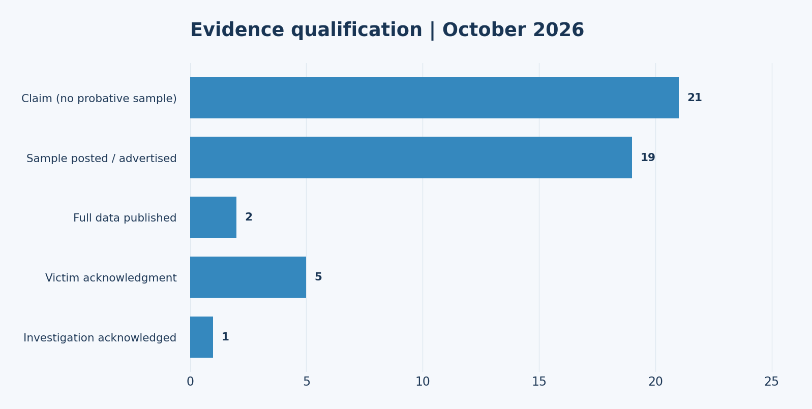

**Five security events have been acknowledged publicly by the organisation or an authority:**

| Organisation | Country | Established public information | Accessible reference |
|---|---|---|---|
| **Ampath Laboratories** | South Africa | Incident detected on 2 October, contained and reported to regulator; assessment of administrative information | [Company statement, 14 October](https://novuspressbulletin.co.za/blog/ampath-cautions-about-overstated-numbers-as-cybersecurity-incident-probe-continues) |
| **Lawyers for Human Rights** | South Africa | Unauthorised access to and download from a provider-hosted database, detected on 5 October | [Official notice, 15 October](https://www.lhr.org.za/lhr-news/important-notice-regarding-a-security-incident/) |
| **GCIS** | South Africa | Recruitment portal compromise, suspicious activity detected 24 October; applicants notified | [ITWeb, 30 October](https://www.itweb.co.za/article/gcis-warns-of-information-breach/wbrpO7g2ea3vDLZn) |
| **InvestNaija / Chapel Hill Denham** | Nigeria | Notice of unusual activity and possible limited access to customer contact details | [The Sun Nigeria, 30 October](https://thesun.ng/chapel-hill-denham-alerts-customers-to-potential-data-breach-says-investments-safe/) |
| **Al Arabia United** | Egypt | Unauthorised content on a digital billboard; third-party publishing platform breach identified by authorities | [Egyptian Interior Ministry, 29 October](https://www.moi.gov.eg/news/GetDetails?newsId=bbfb00a8-b8e2-4c10-81bd-161ba437d035) |

A public notice **does not validate every figure appearing in criminal posts**. Other records remain valuable when they contain traceable listings, screenshots, metadata or coherent samples. Individual limitations are documented in the victim records without distracting from the core threat assessment.

### 3.4 Publishing accounts and claiming groups

| Observed label | Cases |
|---|---:|
| Nameless511 | 9 |
| UmBra | 4 |
| N0n | 4 |
| The Gentlemen | 3 |
| SensitiveDarkForum | 2 |
| Krybit | 2 |
| Qilin | 2 |
| Lenken | 2 |
| Kazu | 2 |
| List1 | 2 |

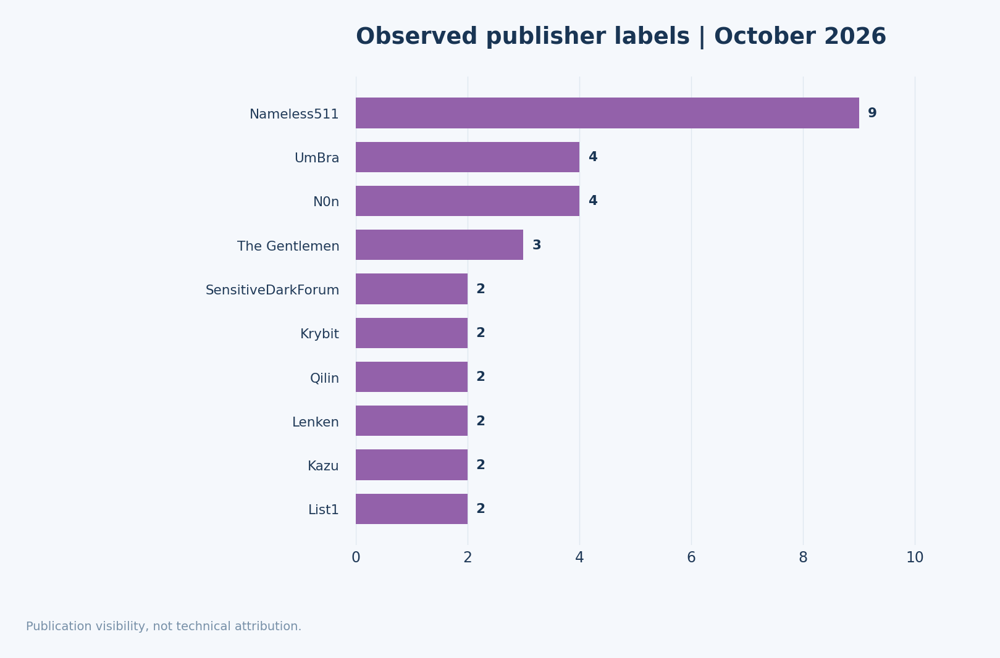

These **ten labels cover 32 cases**. Other cases involve less common labels or lack an established actor. The ranking measures source visibility and claimed attribution - **not technical identification**. Some labels refer to ransomware groups; others are forum or marketplace accounts.

### 3.5 Corrected normalized sectors

| Normalized sector | Cases | Share |
|---|---:|---:|
| Government / Public administration | 12 | 25.0% |
| Other sectors | 7 | 14.6% |
| Technology / Digital services | 6 | 12.5% |
| Commerce / Retail | 5 | 10.4% |
| Healthcare | 5 | 10.4% |
| Education | 5 | 10.4% |
| Industry / Engineering | 3 | 6.3% |
| Finance / Insurance | 3 | 6.3% |
| Transport | 2 | 4.2% |
| **Total** | **48** | **100.0%** |

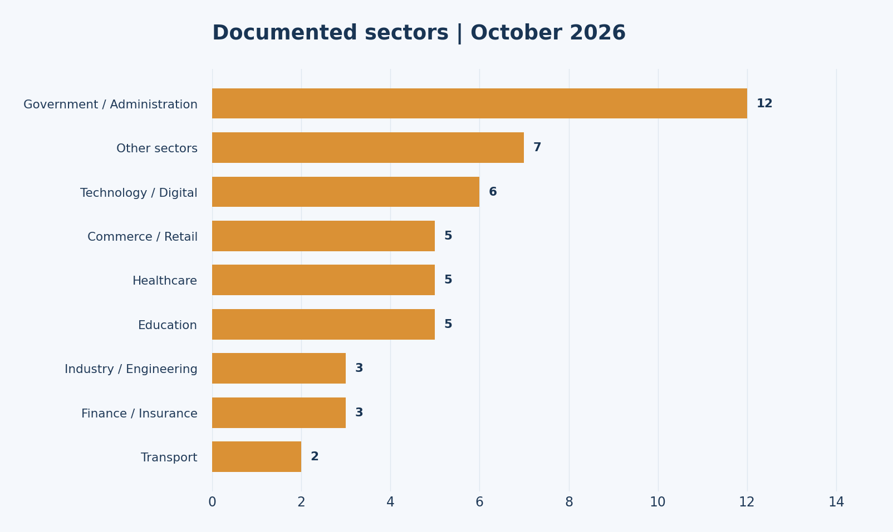
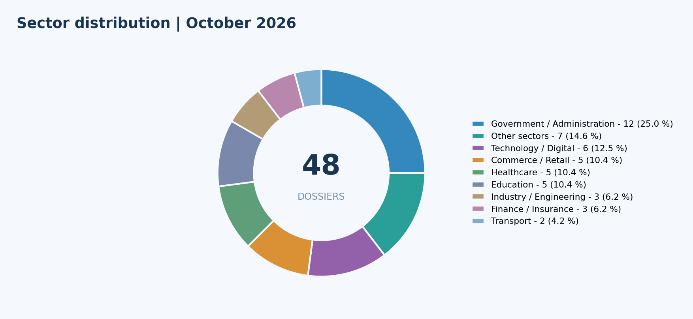

**Public administration (12 cases)** remains the largest category. The seven cases grouped as “Other sectors” cover distinct activities including nuclear research, water, broadcasting, NGOs and environmental research. The category should be refined in a future controlled mapping, without disrupting historical comparability. Some IT equipment retailers are grouped with technology in this mapping, so the commerce figure does not capture every e-commerce business in an economic sense.

## 4. Incidents that matter most

### 4.1 Morocco: business-management exports

**Tera.ma** is among the most extensively documented cases. AFRINTEL inventoried **8,140 files totaling 2,389,358,436 bytes**, including **282 CSV files and 3,693 PDFs**. Structural checks find **19,595 partner entries**, **69,197 orders** and **124,088 accounting entries**. This strongly supports the connection with an Odoo-type business dataset. It **does not establish when or how access occurred**, nor an official acknowledgement by Tera.ma.

For **NextLevel PC**, the **eight supplied CSV files** support the published figures: **52,545 customer accounts**, **60,262 delivery addresses**, **47,653 orders**, **11 internal accounts** and **14,160 commercial rules**. These structures could enable delivery fraud, fake refunds and account targeting. The number of customers, addresses and orders must not be added up as a people count.

**Midipcom**, **Karamtech** and **Decathlon Morocco** illustrate related exposure affecting sales, billing and logistics. The supplied Midipcom and Karamtech samples do not validate the larger advertised datasets. The precise source of Decathlon-related records - retailer, third party or historical export - remains unresolved.

### 4.2 Public bodies: hard-to-replace identifiers and records

For Morocco's **Ministry of Endowments and Islamic Affairs**, the **33 XLSX workbooks** contain **109,607 application rows**, prior to deduplication, plus a separate 10-row CSV. The review found **78,467 distinct ID-number values matching the expected format**, which must not be construed as a verified number of individuals. They resemble recruitment records, with identity, education and administrative-reference fields. Direct technical provenance from ministry systems is not established.

A corpus associated with **Rwanda's Ministry of Health** contains **375 CSV files**, totaling **6,050,914,271 bytes** and **42,509,228 physical lines**. The files include different kinds of records, such as accounts, audit logs and health-related information. **These lines cannot be converted into 42.5 million affected patients or citizens.** Technical provenance and actual scope remain unresolved.

In the **DR Congo**, the **MINESURSI** announcement claims **136 GB and 125,823 files**; the examined batch includes only **1,531 files** - **581 PDFs and 950 images**. In the **Republic of the Congo**, the e-Solde sample contains account and public-payroll fields, but a functioning administrator access offered for sale has not been independently established.

### 4.3 Healthcare: a publicly acknowledged incident and sensitive data

**Ampath Laboratories (South Africa)** demonstrates the value of combining underground monitoring with official statements. The ByteToBreach posting was assessed alongside supplied samples. Ampath **acknowledged a cybersecurity incident detected on 2 October** and issued a public statement on **14 October** describing containment and its regulatory notification.

The examined files contain fields relating to **employees, patients, enrolments, insurance and payments**. Ampath stated, however, that potentially involved information appeared mainly **demographic or administrative**, and that it had no evidence, at the time of its statement, of compromised **medical records, diagnoses, pathology results or banking information**. The **80 million records** appearing in the criminal posting must not be equated with unique patients.

The corpus associated with **Rwanda's Ministry of Health** (375 CSVs, approximately 6.05 GB and 42.5 million physical lines) and material linked to **Ethiopia's Ministry of Health** illustrate different degrees of visibility into health-sector data. **An audit log line, user account and patient record are different statistical units.** The immediate defensive concern is the combination of identity, contact and business-system access data.

### 4.4 Ransomware: a listing is not proof of encryption

**Eurogate Tanger** has an examined first publication batch: **355 files**, totaling **373,065,003 uncompressed bytes**, with office documents, correspondence and technical material associated with port operations. This does **not** establish terminal downtime, encryption or complete exfiltration.

For **CNESTEN**, a publication associated with **Qilin** was compared with a **directory inventory describing 110,803 files** and **205,805,114,681 stated bytes**. The underlying documents were not examined, and no consequence for nuclear safety or plant availability has been established. **YOD Ingénierie** remains attributed **only to Benin**.

Listings involving **Gabon Meca (HYFLOCK)** and **Société Ivoirienne de Télédiffusion (Qilin)** also appear in [public ransomware-tracking feeds](https://www.legal-isac.org/ransomware/). Such open-source corroboration confirms the listing's visibility, not a specific entry method or a negotiation outcome.

**Maritime provider exposure deserves attention:** according to [SOCRadar](https://socradar.io/blog/n0n-group-global-ports-shipping-leak/), **N0n** listed **38 transport and port-related organisations** on 12 October, including Eurogate Tanger. This clustering warrants investigation of shared applications and vendors, **without assuming 38 independent intrusions or a proven common vulnerability**.

### 4.5 Public acknowledgements: not all incidents are leaks

**Lawyers for Human Rights** announced on **15 October** that an unauthorised third party had accessed and downloaded data from a provider-hosted database on **5 October**. **GCIS** notified recruitment applicants following suspicious activity detected on **24 October** and compromise of its recruitment portal. Both cases require protective measures proportionate to the data scope established.

In **Nigeria**, **InvestNaija / Chapel Hill Denham** disclosed unusual activity that might concern a limited proportion of client information. In **Egypt**, **Al Arabia United** acknowledged unauthorised content displayed on an advertising screen; this relates to a content distribution chain **without established data leakage**. These cases show that confidentiality, integrity and availability can be affected differently.

## 5. Strategic interpretation

**First, business exports are valuable fraud material.** ERP and order databases connect people, payments, suppliers and documents. Tera.ma and NextLevel PC provide concrete examples; other postings describe similar datasets with less supporting evidence.

**Second, identity information crosses sector boundaries.** Recruitment, universities, public payroll and healthcare may contain difficult-to-replace records. After a release, defenders must anticipate fraudulent reuse as well as contain the original exposure.

**Third, third-party dependencies deserve dedicated monitoring.** Lawyers for Human Rights involved a service provider; two Madagascar access offers concern separate identity environments; Al Arabia United involved content distribution. The cases do not demonstrate one shared attack path, but they support stricter delegated-access controls and system separation.

Finally, **a larger documented corpus is not automatically evidence of faster-growing attacks**. Source availability, reposts and collection depth affect the monthly count.

## 6. Priority risks by environment

| Environment | Exposure documented in the corpus | Risk to anticipate | Defensive priority |
|---|---|---|---|
| Government and recruitment | Applications, payroll, accounts, supporting documents | Identity misuse, administrative fraud, staff targeting | Monitor exports, IAM and third parties |
| Commerce, ERP, logistics | Customers, orders, invoices, addresses, financial history | Invoice and delivery fraud, fraudulent bank-detail changes | Audit bulk exports and critical changes |
| Healthcare | Patient, staff, insurance and facility data | Privacy harm, targeted phishing, extortion | Segment and detect mass access |
| Digital and identity services | App backups, accounts, access offers | Token reuse, privilege abuse | MFA, controlled rotation and access review |
| Transport and service infrastructure | Operational files, publishing systems | Document misuse, content hijacking | Audit sensitive actions and suppliers |

The table prioritises defensive scenarios. It does not assert that every impact listed occurred at every victim.

## 7. Intelligence gaps and verification priorities

| Topic | Current evidence | Open question |
|---|---|---|
| e-Solde (Republic of Congo) | Earliest post on **28 June**, repost monitored on **2 October** | Maintain both dates and avoid double counting in event-based histories |
| **Mozambique PGR / Rand Mutual** | The inventory of **262 files / 75,941,802 bytes** is identical, while repeated document markers refer to RMA | **Sample excluded from evidence supporting PGR**; obtain full-file hashes and custody records before attribution |
| Rand Mutual Assurance | Company reported alert and investigation on **23 October**; supplied batch contains RMA-related documentary markers | Establish source of batch, link to criminal offer and investigation outcome |
| CNESTEN | Directory inventory examined, not underlying documents | Authenticity, completeness, sensitivity and any operational effect |
| Ransomware listings without samples | Actor posts and some deadlines | Last review date, release status, victim acknowledgements and technical evidence |
| Under-represented countries | Few or no observed cases in October sources | Local languages, CERT/CSIRT notices and regional OSINT coverage |

Public notices, safe provenance checks, samples that can be examined without sharing personal data, and changes in disclosure status should take priority. No victim statement found in consulted sources does not prove intentional concealment or absence of an incident.

## 8. MITRE ATT&CK: detection hypotheses, not observed technique attribution

The monthly classification alone does not establish a complete intrusion chain. These are **defensive hypotheses** to confirm or reject using the affected organisations' telemetry.

| ATT&CK technique | Hypothesis to test | Telemetry to correlate |
|---|---|---|
| [T1078 - Valid Accounts](https://attack.mitre.org/techniques/T1078/) | Use of a compromised legitimate account | IAM, SSO, VPN, sessions, device posture |
| [T1190 - Exploit Public-Facing Application](https://attack.mitre.org/techniques/T1190/) | Exploitation of an Internet-facing application | WAF, reverse proxy, HTTP logs, application errors, EDR |
| [T1213 - Data from Information Repositories](https://attack.mitre.org/techniques/T1213/) | Abusive access to document repositories | SharePoint/document audit, file access, permissions |
| [T1530 - Data from Cloud Storage](https://attack.mitre.org/techniques/T1530/) | Access or downloads from cloud object storage | Bucket/object logs, cloud API, download logs |
| [T1567 - Exfiltration Over Web Service](https://attack.mitre.org/techniques/T1567/) | Outbound transfer to a web service if supported by telemetry | Proxy, DNS, DLP/CASB, network flows |
| [T1486 - Data Encrypted for Impact](https://attack.mitre.org/techniques/T1486/) | Mass encryption in an established ransomware case | EDR, file modifications, backup events |

**Publication on a forum does not establish T1567** or another specific exfiltration technique. A ransomware-group listing does not prove T1486.

## 9. SOC guidance: detection and correlation

| Defensive scenario | Telemetry | Detection / correlation idea |
|---|---|---|
| Unusual ERP or e-commerce export | ERP, database audit, IAM, proxy, DLP | Bulk export + elevated privileges + anomalous outbound transfer |
| Misuse of a privileged account | SSO/Keycloak, VPN, EDR, bastion | Unusual location/ASN or device + sensitive action + atypical time |
| Mass download of records | Recruitment, healthcare, repositories, access logs | Access or download volume outside the account's normal role |
| Third-party account compromise | Identity provider, vendor accounts, API audit | Novel vendor session + access across multiple environments |
| Display-content hijacking | CMS, publishing API, SSO, deployment history | Unapproved change + multi-screen publishing + schedule mismatch |
| Possible ransomware impact preparation | EDR, files, backups, IAM | Mass file changes + account anomaly + unusual backup activity |

**Observed in October:** data postings, inventories and samples, access offers, public security notices and unauthorised display content in the Al Arabia United case.

**Hypotheses requiring investigation:** automated collection, account misuse, provider access, outbound transfer or attempted encryption. These are **not** asserted for every victim.

**Example behavioural rule to tune locally:** for an ERP or recruitment platform, prioritise an alert when **(i)** an account exports in one hour more than five times its normal 30-day baseline, **(ii)** the same account accesses an unusual business scope or gains privilege, and **(iii)** proxy, DLP or object-storage logs show atypical outbound transfer or downloads. These thresholds are **test values**, not techniques observed at the named victims.

**Preventive measures:** phishing-resistant MFA for privileged accounts, least privilege, export auditing, integrity-protected logs, protected backups and prompt session and secret revocation. Log retention should reflect legal and investigative requirements.

## 10. Prioritised action plan

### Immediate - 0 to 7 days

1. **Scope the exposed data:** identify internal and vendor systems holding comparable records, preserve evidence and restrict unnecessary access.
2. **Reduce reuse risk:** revoke affected sessions and rotate genuinely exposed secrets through controlled processes. Do not test values advertised by criminals.
3. **Prevent secondary fraud:** use out-of-band checks for bank-detail changes, unusual refunds and sensitive payment requests.

### Near term - 8 to 30 days

1. Test SIEM alerts for bulk exports, privilege use, vendor access and repeated downloads.
2. Review supplier permissions, service accounts and staging environments; remove unnecessary access.
3. Prepare legally appropriate notifications and protections proportionate to the validated evidence.

### Consolidation - 30 to 90 days

1. Run exercises covering an ERP leak, recruitment records, provider compromise and display-system hijacking.
2. Measure log coverage and retention, secret-revocation time and recovery-test frequency.
3. Improve sector mapping, deduplication and ransomware disclosure lifecycle tracking for reliable monthly comparisons.

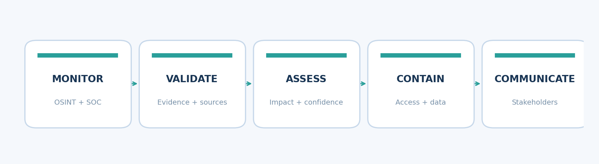

## 11. November 2026 monitoring outlook

Priorities are further data releases, official updates, comparisons of samples attributed to different victims, evolving ransomware disclosure status, and possible fraud using authentic commercial references. Future observations should be dated and kept separate from hypotheses.

## 12. Public references and collection transparency

**AFRINTEL primary material:** captured posts and metadata from ransomware leak sites, underground forums, dark-web/deep-web criminal marketplaces and local read-only examination of supplied samples. Active criminal-service links and personal records are excluded. Each victim record identifies the publishing actor/account, source category and evidence reviewed.

**Selected public cross-checks:** [Ampath company statement](https://novuspressbulletin.co.za/blog/ampath-cautions-about-overstated-numbers-as-cybersecurity-incident-probe-continues); [Lawyers for Human Rights official notice](https://www.lhr.org.za/lhr-news/important-notice-regarding-a-security-incident/); [GCIS via ITWeb](https://www.itweb.co.za/article/gcis-warns-of-information-breach/wbrpO7g2ea3vDLZn); [InvestNaija via The Sun](https://thesun.ng/chapel-hill-denham-alerts-customers-to-potential-data-breach-says-investments-safe/); [Egyptian Ministry of the Interior](https://www.moi.gov.eg/news/GetDetails?newsId=bbfb00a8-b8e2-4c10-81bd-161ba437d035); [Rand Mutual via ITWeb](https://www.itweb.co.za/article/rand-mutual-probes-alleged-breach-of-168m-claims/G98YdqLGAgXMX2PD); [N0n maritime listings via SOCRadar](https://socradar.io/blog/n0n-group-global-ports-shipping-leak/); [Qilin / SIDT via Legal-ISAC](https://www.legal-isac.org/ransomware/).

*Review performed on 17 November 2026. Each public source is used only for what it explicitly establishes, not as a substitute for victim-side forensic analysis.*

## Conclusion

**The defining October signal is the depth of operational, personal and administrative information visible on cybercrime publishing channels.** Order history, recruitment records, payroll exports and directory inventories may continue to enable targeting well after the original post. Defenders need to protect accounts, verify third-party access, detect anomalous exports and prepare for follow-on fraud.

AFRINTEL deliberately distinguishes **what was posted, what was actually observed in files and what remains unknown**. That is what makes the intelligence useful to leadership, CERT/CSIRT teams and SOC analysts.

---

*AFRINTEL - Cyber Threat Intelligence for Africa* 
*Sources and detailed records: [AFRINTEL GitHub](https://github.com/Hatchepsoute/AFRINTEL) · [October 2026 victim records](./victims.md)*
