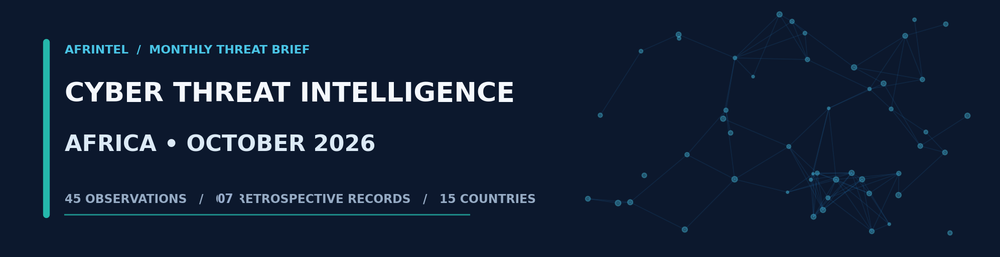
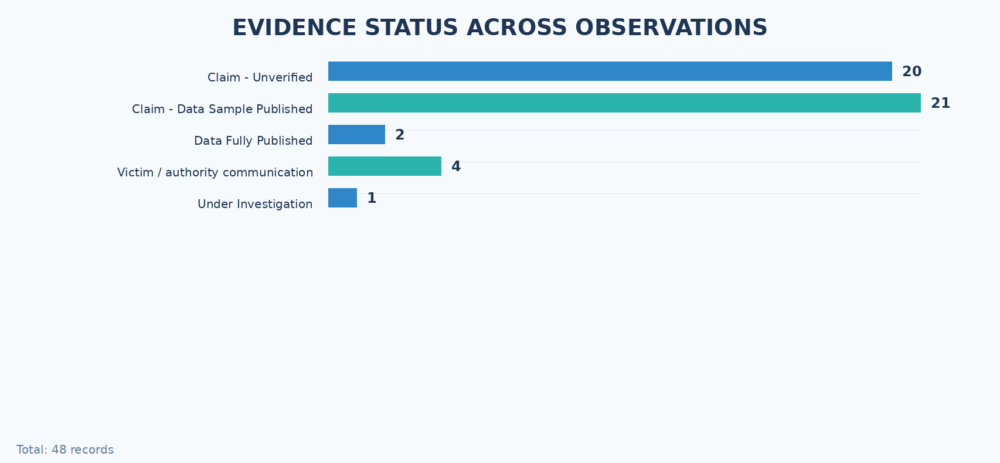
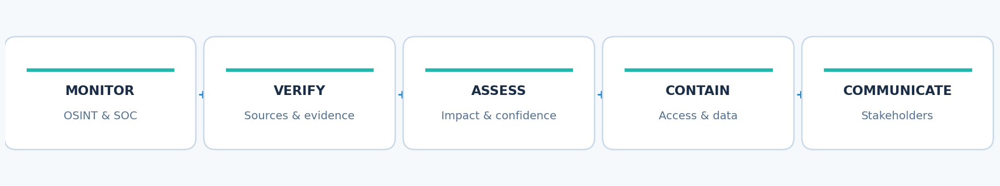

# AFRINTEL

# MONTHLY CYBER THREAT INTELLIGENCE REPORT
## Africa - October 2026

**[French version](README_FR.md)** · **[AFRINTEL English source corpus](victims.md)**

**Reporting period:** 1–31 October 2026  
**Information cut-off:** 2 November 2026  
**Scope:** Africa, with a separate assessment of globally exploited vulnerabilities relevant to African defenders  
**Handling:** Professional circulation - open-source reporting and aggregated findings; no raw personal data reproduced  
**Report ID:** CTI-AFR-2026-10

## BRIEF HIGHLIGHTS

- **52 distinct records: 45 reports published or documented in October 2026 and seven older cases identified retrospectively.** The seven historical cases are kept separate from the October monthly count and retained in a dedicated retrospective section.
- **Morocco and Egypt each account for 12 October records**, followed by South Africa (seven). This reflects collection coverage and visibility, not the actual prevalence of attacks.
- **Data exposure and alleged data sales pose significant risks to public-sector and health organisations.** Some supplied corpora are extensive, but proving where an attacker obtained the data is often more difficult than matching it to an organisation.
- **Seventeen records are labelled as ransomware.** The report records the publication context and the available evidence for each listing; encryption, business disruption and data publication are assessed separately.
- **Four cases include a public statement or notification from the affected organisation:** Lawyers for Human Rights, GCIS, InvestNaija / Chapel Hill Denham, and Al Arabia United. Their technical circumstances differ.
- **Third parties, privileged access and identity services remain critical dependencies**, as illustrated by the LHR supplier incident and the purported e-Solde and Madagascar SSO access offerings.
- **Patching high-risk internet-facing products is urgent.** October advisories document exploitation involving Windows, Cisco Secure Email Gateway and Ivanti Connect Secure.

## 1. EXECUTIVE ASSESSMENT

October's African cyber-threat picture is more varied than the stream of criminal publications might suggest. The AFRINTEL dataset documents 45 incidents or reported cases during the month across 15 African countries. It keeps seven earlier records discovered retrospectively in a separate historical section. Most entries concern reported data leaks, ransomware listings or offers to sell system access. Their evidence levels vary considerably: some are backed by organisational notices, some by consistent data samples, and others by advertisements or entries on leak sites. [AFR]

The immediate concern is not confined to systems going offline. The information reportedly exposed includes recruitment applications, student records, healthcare-related documents, insurance claims and financial-service customer details. Once plausible material circulates, it can support highly tailored phishing, identity impersonation and document fraud. SOC and incident-response teams need to verify where the data came from, scope the exposure and prevent abuse of accounts, tokens and access credentials.

Public notices in South Africa and Nigeria, together with the digital-billboard incident in Egypt, also demonstrate how much exposure may originate in a supplier, a web interface or a central publishing platform. Separately, attackers' interest in remote-access appliances and email gateways creates risks for organisations across the region regardless of whether they appear in the October victim dataset. [S01] [S02] [S03] [S04] [S08] [S10] [S12]

**Overall assessment: elevated potential impact for government, healthcare, education and financial services; mixed confidence in individual allegations.** Defenders should differentiate established facts from criminally advertised volumes and prioritise public-facing systems, privileged access, sensitive-data exports and the reuse of exposed secrets.

## COMPARISON WITH SEPTEMBER 2026

The comparison uses only publications dated within each month. Retrospectively identified historical cases are excluded from both monthly denominators.

| Incident type | September 2026 | October 2026 | Change |
| --- | ---: | ---: | ---: |
| Monthly total | 29 | 45 | +16 (+55.2%) |
| Ransomware | 20 | 17 | -3 (-15.0%) |
| Data Leak | 7 | 20 | +13 (+185.7%) |
| Access Sale | 0 | 2 | +2 (newly observed category) |
| System Intrusion | 2 | 6 | +4 (+200.0%) |

DDoS, Defacement, Account Takeover, Malware and Operational Fraud are not shown because both months recorded zero cases in these categories. This change describes the composition of the AFRINTEL collections and should be read together with the evidence status assigned to each record.

## 2. DATASET, METRICS AND EVIDENCE QUALITY

| Measure | October records |
| --- | ---: |
| African countries represented | 15 |
| Data-leak reports | 20 |
| Ransomware reports | 17 |
| System-intrusion reports / intrusion alerts | 6 |
| Access-for-sale offerings | 2 |
| Claims without sufficient corroboration | 21 |
| Claims accompanied by a published sample | 17 |
| Allegedly complete data publications | 2 |
| Incidents acknowledged or notified by an organisation | 4 |
| Record classified as under investigation | 1 |

**Geographic distribution.** Morocco: 12; Egypt: 12; South Africa: seven; Democratic Republic of the Congo: two; Ethiopia: two; ten additional countries: one record each. These figures describe the composition of this particular collection. They do not support a claim about the true incidence of cyberattacks across Africa. [AFR]

### Normalised sector distribution

Each October record is assigned one primary sector to avoid double-counting composite sector labels.

Public administration: 11; technology and digital services: 9; higher education and training: 5; healthcare: 4; finance and insurance: 3; industry and manufacturing: 3; media and utilities: 3; transport and mobility: 2; research and environment: 2; commerce and real estate: 2; NGO and legal services: 1.

### Most visible actors and accounts

These labels are the accounts or groups displayed in the publications. They do not represent confirmed technical attribution.

| Displayed actor or account | Records |
| --- | ---: |
| Nameless511 | 9 |
| Unestablished / unidentified | 5 |
| UmBra | 4 |
| N0n | 4 |
| The Gentlemen | 3 |
| SensitiveDarkForum | 2 |
| Krybit | 2 |
| Qilin | 2 |
| Lenken | 2 |
| Kazu | 2 |
| Other displayed labels | 10 |

### Regional distribution

Using the AFRINTEL regional convention, the 45 October records are distributed as follows:

| Region | Records |
| --- | ---: |
| North Africa | 25 |
| Southern Africa | 8 |
| Central Africa | 4 |
| East Africa | 4 |
| West Africa | 4 |

**How to read the visuals.** These are original charts based on the categorisation in the supplied AFRINTEL register. They are not photographs of incidents, screenshots of criminal infrastructure or proof of a compromise. No victim data or criminal-forum contents are shown.

**How to read the visuals.** These are original charts based on the categorisation in the supplied AFRINTEL register. They are not photographs of incidents, screenshots of criminal infrastructure or proof of a compromise. No victim data or criminal-forum contents are shown.

**Temporal attribution.** An 'October record' denotes an incident published or first documented within the dataset during October, not necessarily an intrusion that occurred that month. The seven older cases remain separate from the 45 records published or reported in October and are not added to the monthly denominator. Their late discovery explains their presence in the register, but does not turn them into October events. The expression 'data fully published' describes the material seen, not confirmation from an affected institution. [AFR]

**Evidence-chain anomaly requiring review.** The Mozambique Prosecutor General's Office (PGR) and Rand Mutual Assurance entries both describe samples consisting of **262 files**, identically split into **180 JSON, 71 PDF, nine EML, one DOC and one JPG**, and both cite **75,941,802 bytes**. This striking match warrants comparing hashes and file manifests. It is not, by itself, proof of sample reuse; equally, neither description should be treated as an independent technical corroboration before that comparison. [AFR]

## 3. PRIORITY INCIDENTS AND CAMPAIGNS

### 3.1 - South Africa: Lawyers for Human Rights confirms data access at a service provider
**Sourced: 2 November 2026 | Suspected access identified: 5 October | Official notice: 15 October 2026.**

**What we know.** Lawyers for Human Rights (LHR) said it detected suspected unauthorised access on 5 October to a database hosted by a third-party provider. Subsequent investigation indicated that an unauthorised party accessed and downloaded information from it. The organisation secured the environment, engaged specialist investigators, began notifying potentially affected individuals and informed the relevant authorities. The specific data categories vary by person's relationship with LHR, and the available notice does not provide a final verified headcount. [S01]

**Context.** Legal-service and rights organisations may hold particularly confidential records on clients, beneficiaries, staff, contractors and partners. Moving a database to a service provider does not remove the organisation's exposure to harm if that provider is compromised.

**Analyst recommendation.** Review supplier-held databases and support privileges, require sufficient logging and timely incident notification, and establish whether unusual exports occurred. The threat-monitoring priority is impersonation directed at individuals whose legal, identity or contact details may have been exposed.

### 3.2 - South Africa: GCIS warns applicants after an e-recruitment incident
**Sourced: 2 November 2026 | Suspicious activity: 24 October | Public reporting: 30 October 2026.**

**What we know.** South Africa's Government Communication and Information System (GCIS) notified users of a potential personal-information incident involving its e-recruitment service after suspicious activity against web systems on 24 October. Candidate records, possibly including identity numbers, telephone numbers and email addresses, may have been accessed. Containment and notifications were reported, but the publicly available information does not establish that every category was taken or how many applicants were affected. [S02] [AFR]

**Context.** Government recruitment systems aggregate identifying information and supporting documents. They are attractive to adversaries seeking to impersonate authorities, run fraudulent interview campaigns or request fabricated processing fees.

**Analyst recommendation.** Preserve application, WAF, identity-management and database logs; reconstruct unusual queries and exports; and review service and administrator accounts. Candidate communications should explicitly warn against unsolicited demands for ID copies, payments and one-time codes.

### 3.3 - Nigeria: InvestNaija alerts customers to possible information exposure
**Sourced: 2 November 2026 | Customer notice: 28 October | Press report: 30 October 2026.**

**What we know.** Chapel Hill Denham said unusual activity on its InvestNaija platform suggested possible unauthorised access to part of its customer information. Its notice estimated that less than one percent of customer data might have been accessible and mentioned emails and contact details as potentially involved. The company announced containment steps and notifications, and stated that investments were unaffected. The percentage is a preliminary corporate estimate, not a confirmed count of exposed individuals. [S03]

**Context.** Financial-services contact information can enable convincing account-recovery scams and fraudulent calls without a password or a direct theft of funds. Fraudsters can use the firm's name and product context to solicit verification codes.

**Analyst recommendation.** Hunt for abnormal customer-profile API access, monitor brand-lookalike domains and reinforce customer-facing authentication controls. Public messaging should keep potential data access distinct from confirmed account or asset compromise.

### 3.4 - Egypt: Giza billboard compromise highlights a shared platform dependency
**Sourced: 2 November 2026 | Event: 29 October | Public findings: 30 October 2026.**

**What we know.** A digital billboard run by Al Arabia United in Giza displayed unauthorised content. The operator said it detected an intrusion affecting one of its screens and stopped the display. Egypt's Interior Ministry attributed the incident to a breach of an international digital-content distribution platform used by the operator, which reportedly led to similar content appearing on screens in multiple countries. The provider was not named and the intrusion technique was not disclosed. [S04]

**Context.** This was primarily an integrity and digital-supply-chain incident rather than an identified personal-data breach. A single remotely managed publishing console can affect many screens at once.

**Analyst recommendation.** Segment content-publishing systems, require strong authentication for operator consoles and separate content approval from live distribution. Ensure that each location has a tested local shutdown procedure. Similar controls matter for hospitals, transport systems and other public information displays.

### 3.5 - South Africa: Rand Mutual Assurance investigates an extortion claim
**Sourced: 2 November 2026 | Alert: 23 October | Press report: 27 October 2026.**

**What we know.** Rand Mutual Assurance (RMA) said it was investigating an alert about possible unauthorised activity. An actor claimed to possess **366 GB** of information, including roughly **1.68 million** insurance-claim records, and demanded **US$95,000** before a stated 5 November deadline. RMA had not confirmed an intrusion or an unauthorised data transfer at the report's cut-off. All quantities and the deadline should be attributed to the actor, not asserted as independently verified. [S05] [AFR]

**Context.** Occupational-injury insurance files can contain sensitive identifiers, medical and financial information. A pressure deadline is part of an extortion narrative and does not itself validate a breach.

**Analyst recommendation.** Retain the original allegation, communications and file hashes with full provenance. Compare RMA's sample inventory against the apparently identical metadata in the Mozambique PGR entry before interpreting either as separate forensic evidence. Prepare conditional notification plans, but do not imply an exposure has been verified ahead of investigation.

### 3.6 - Rwanda: a healthcare-related dataset attributed to the Ministry of Health
**Sourced: 2 November 2026 | Claim first published: 18 October 2026.**

**What we know.** A post under the name 'Lenken' advertised a dataset linked to Rwanda's Ministry of Health. AFRINTEL reports examining **375 CSV files** totalling approximately **6.05 billion bytes**. Their structure is consistent with a healthcare information environment and includes application and administration-related information. The recorded **42.5 million physical lines** are line-break counts, not a verified number of individual records or people; some fields contain embedded newlines. Initial access, direct ministry compromise and the identity of the exfiltrating party remain unknown. [AFR]

**Context.** Structured health and administrative data may support identity abuse and long-term social engineering. Account-related tables and potentially reusable secrets heighten the possibility of secondary compromise if any such material is still valid.

**Analyst recommendation.** Identify the specific applications represented by the exports, examine privileged logins and bulk-data operations, and rotate validated exposed secrets through authorised procedures. Do not publish 'patient counts' without business-level deduplication.

### 3.7 - Ethiopia: identity and health documents appear in a claimed sample
**Sourced: 2 November 2026 | Claimed publication: 7 October 2026.**

**What we know.** A post linked to `moh.gov.et` advertises **four million records** and **13 GB** of material. AFRINTEL's review of the available sample found sensitive-looking identity and healthcare documentation consistent with Ethiopian health-service contexts. The sample's technical origin and the advertised totals remain to be established. [AFR]

**Context.** Genuine-looking documents may have originated in a ministry system, a partner application, an archival backup or an entirely different repository. Attribution of the material and attribution of a compromise are separate analytical questions.

**Analyst recommendation.** Conduct legally authorised document and source-system validation, review access to implicated registries and limit high-volume exports. Include partners and contractors with access to the relevant identity or health systems in the investigation.

### 3.8 - Mozambique and DR Congo: alleged sale of public administration archives
**Sourced: 2 November 2026 | Two posts dated: 20 October 2026.**

**What we know.** One post attributed to 'Kazu' advertises files linked to Mozambique's Procuradoria-Geral da República, claiming **22 GB** and **158,511 files**; the AFRINTEL sample summary describes **262 examined files**. A separate post under the same handle advertises **136 GB** and **125,823 files** connected to a DR Congo teacher-registration platform associated with MINESURSI, with approximately **1.56 GB** of sample archives reviewed. The available materials can be consistent with administrative records, but do not confirm the initial intrusions or the full advertised datasets. [AFR]

**Context.** The prospect of administrative and judicial records entering underground markets creates risks of document fraud and targeted impersonation. The same seller alias across two postings does not establish a single technical campaign or common intrusion path.

**Analyst recommendation.** Determine which systems actually stored the documents, inspect data-export activity and verify sample checksums against authorised internal records. For Mozambique, reconcile the PGR sample metadata with the identical RMA inventory before concluding that the two have independent provenance.

### 3.9 - Morocco: nine postings share the 'Nameless511' account
**Sourced: 2 November 2026 | Observed publications: 1–11 October 2026.**

**What we know.** Nine Moroccan records in the supplied dataset refer to the 'Nameless511' alias. Named targets include Midipcom, Karamtech, Tera.ma, NextLevel PC, Cadi Ayyad University, Decathlon Morocco, the National Press Council and two government portfolios. Some entries provide samples; others use a 'fully published' status. The forum alias is not a verified real-world identity, and attribution of each underlying technical intrusion remains unproven. Morocco accounts for **12** October records in total. [AFR]

**Context.** Multiple posts from one alias may reflect repeated attacks, the resale of older material or an effort to build a forum reputation. It is unsafe to assume nine separate initial compromises solely from nine advertisements.

**Analyst recommendation.** Cluster records by schema, timestamp, document format and artefact hashes, without merging named victims automatically. In potentially affected organisations, review web application logs, database exports and administrative accounts and watch for brand impersonation.

### 3.10 - Republic of the Congo and Madagascar: privileged-access listings
**Sourced: 2 November 2026 | e-Solde listing: 2 October | Madagascar SSO listing: 20 October 2026.**

**What we know.** A claimed offer involving `e-solde.cg` displays material consistent with public-sector salary and staff management. AFRINTEL also identified an older June listing with the same domain and price, and linked the records to avoid duplicate incident counting. In Madagascar, List1 first advertised administrator access to `staging.sso.gov.mg`. During a direct exchange, the seller then offered `e-koragna.gov.mg` as an additional access. The exchange associated the offer with an advertised price of USD 450. A Keycloak-style interface appears in the material, but functioning access was neither tested nor established. The two domains are treated as one record and one `Access Sale`. [AFR]

**Context.** A payroll platform or single sign-on system can provide disproportionate leverage to an attacker. 'Staging' is not evidence of isolation: credentials, secrets and trust relationships may be shared with production.

**Analyst recommendation.** Immediately review exposed administrator endpoints, privileged identities and federation relationships. Separate test and production environments, enforce phishing-resistant MFA and revoke secrets if their exposure is confirmed.

### 3.11 - Ransomware: Egyptian listings and pressure on public-service sectors
**Sourced: 2 November 2026 | Claims recorded between 2 and 30 October 2026.**

**What we know.** AFRINTEL labels **17** October records as ransomware. Egyptian postings name Beni Suef Technological University, Cairo University, Helwan University, Luxor Company for Drinking Water and Sanitation, Millensys and MODON Developments, among others. 'UmBra' appears in four Egyptian records. In Morocco, Qilin listed CNESTEN on 11 October, while a Qilin-associated posting listed Côte d'Ivoire's Société Ivoirienne de Télédiffusion on 30 October. The available material documents the listings; encryption, operational disruption and data exfiltration are assessed separately in the victim records. [AFR] [S06] [S07]

**Context.** Extortion groups may combine encryption and data theft, but tactics differ between campaigns. Water operators, universities, health organisations and broadcasters have major continuity requirements. A leak-site entry can also rely on old, misattributed or otherwise misleading information.

**Analyst recommendation.** Investigate observable behaviour rather than the group label: remote-access logins, new privileged accounts, lateral movement, unusual outbound volumes, backup deletion and encryption activity. Regularly test offline recovery and the ability to isolate critical operational segments.

### 3.12 - Côte d'Ivoire: the UVCI case demonstrates retrospective discovery risks
**Sourced: 2 November 2026 | Original publication: 1 July | AFRINTEL discovery: 25 October 2026.**

**What we know.** AFRINTEL describes a read-only examination of a roughly **8.72-billion-byte SQL export** attributed to the Virtual University of Côte d'Ivoire, accompanied by ten CSV files. The material contains Moodle and academic tables, user accounts, enrolments, grades, logs, sessions and authentication-related artefacts. Its internal consistency strongly supports an association with the UVCI environment, but the original intrusion and present-day validity of secrets are unknown. The publication is historically attributable to July, and the case is not included among the 45 October-published or reported entries. [AFR]

**Context.** An older publication can merit urgent action after it is discovered without being counted as a new October attack. Database logs and repeated historical exports may duplicate user information, so line counts cannot be interpreted as distinct individuals.

**Analyst recommendation.** Record at least two dates for each case: first publication or observation and intelligence-team discovery. Review session and token validity through authorised channels, rotate demonstrably exposed credentials and investigate connected university services.

## 4. PRIORITY EXPLOITED VULNERABILITIES

### 4.1 - Microsoft Windows: CVE-2026-96951 amid a record patch release
**Sourced: 2 November 2026 | Vendor updates and advisories: 13 October 2026.**

**What we know.** Microsoft's 13 October Patch Tuesday addressed approximately **1,407 CVEs**, according to Tenable's release analysis. A priority item was **CVE-2026-96951**, a Windows Shell security-feature bypass associated with Mark of the Web handling, reported as exploited in the wild. CISA added it to the Known Exploited Vulnerabilities (KEV) catalogue on 13 October. Counts by severity differ among vendors because classification methodologies differ; that does not change the priority of confirmed exploitation. [S08] [S09]

**Context.** A large patch count can obscure the smaller set of vulnerabilities for which exploitation evidence exists. A bypass of protections applied to externally sourced content can facilitate execution when combined with social engineering or another attack technique.

**Analyst recommendation.** Put internet-facing administrative workstations and employees handling untrusted files at the front of the remediation queue. Measure installed patch coverage, not only the number of updates approved for deployment.

**Remediation steps.** Apply the relevant Windows security updates; validate the installed build on a representative endpoint sample; harden handling of downloads and attachments; and look for suspicious file execution or security-control bypasses on privileged workstations. [S08] [S09]

### 4.2 - Cisco Secure Email Gateway: CVE-2026-76519 and root-level compromise risk
**Sourced: 2 November 2026 | Cisco advisory and CISA KEV listing: 14 October 2026.**

**What we know.** Cisco disclosed **CVE-2026-76519 (CVSS 9.8)** affecting an Advanced Malware Protection feature of Secure Email Gateway. An unauthenticated remote attacker may be able to write arbitrary files via a crafted attachment and, on successful exploitation, execute commands as root on the underlying operating system. Cisco reported active exploitation and no full workaround. CISA added the vulnerability to its KEV catalogue on 14 October. [S10] [S11]

**Context.** An email security appliance is a trusted intermediary for an organisation's communications. Compromise may undermine both confidentiality and the security controls applied to inbound mail.

**Analyst recommendation.** Prioritise affected appliances receiving external email, including installations managed by service providers. Do not assume that an upstream spam filter eliminates the risk.

**Remediation steps.** Identify affected AsyncOS builds and relevant AMP / File Reputation configuration; apply Cisco's fixed software versions; inspect appliance logs and unexpected files; preserve forensic evidence when anomalies are present; restrict management-plane access and rotate exposed secrets after evidence-based scoping. [S10]

### 4.3 - Ivanti Connect Secure: exploited vulnerabilities in remote-access gateways
**Sourced: 2 November 2026 | CISA / vendor notices: 13 and 30 October 2026.**

**What we know.** CISA added **CVE-2026-104935**, an authentication-bypass issue in Ivanti Connect Secure, to KEV on 13 October. Ivanti stated that it was aware of limited exploitation and released fixes for relevant 25.x and 22.x branches. On 30 October CISA added two further Connect Secure issues, **CVE-2026-111357** and **CVE-2026-118527**, to the exploited-vulnerability catalogue. [S09] [S12] [S13]

**Context.** Remote-access appliances are highly sensitive entry points into corporate networks, often providing access to internal applications and administrative workflows. Remediating a known weakness does not guarantee the appliance was not compromised earlier.

**Analyst recommendation.** Identify every internet-facing VPN and access gateway, including those operated by suppliers. Treat the appliances as high-priority detection and patching targets, while looking for evidence of pre-patch compromise.

**Remediation steps.** Install the vendor's supported fixed release for each appliance branch; run published integrity and compromise checks; retain authentication and administrative logs; revoke sessions, certificates and secrets when compromise indicators warrant it; and audit privileged accounts and lateral-access paths. [S12] [S13]

## 5. CROSS-CUTTING RISKS AND NOVEMBER PRIORITIES

**Priority 1 - Shorten the exploit window.** Identify Windows systems, Cisco Secure Email Gateway and Ivanti Connect Secure appliances, and other internet-exposed assets covered by KEV. Patch supported versions promptly and carry out compromise hunting on the most critical systems. A system patched today may have been exploited yesterday.

**Priority 2 - Control high-value data access.** Review export features in health, education, payroll, recruitment and finance applications. Monitor administrators, service accounts, auto-forwarding rules, large downloads and unusual cloud-storage activity.

**Priority 3 - Strengthen supplier and identity governance.** Identify third parties that can access databases, publishing consoles or federated identity systems. Isolate staging environments, eliminate unnecessary trust relationships and require phishing-resistant MFA for sensitive consoles.

**Priority 4 - Prepare for extortion without surrendering evidence standards.** A threat actor's message is a reportable lead, not automatic proof of a breach. Preserve timestamps and artefacts, validate hashes inside an authorised investigative environment and agree escalation thresholds among SOC, legal, communications and management.

**Priority 5 - Improve intelligence provenance.** Assign each observation a unique identifier, original disclosure date, discovery date, evidence status, confidence level and reference to hashed artefacts. Deduplicate samples across cases before drawing conclusions about independent incidents or issuing notifications.

**Thirty-day outlook.** The combination of leak claims, privileged-access advertising and confirmed exploitation of edge-product vulnerabilities supports heightened vigilance. Public-service operators and organisations holding large identity datasets should test remote access controls, supplier access and recovery plans. This dataset alone cannot establish a continent-wide increase in actual intrusions.

## 6. ANALYST CONCLUSION

The central lesson from October is the need to distinguish an organisation-confirmed incident, an exposure supported by a coherent data corpus, and a claim that still cannot be verified. These situations deserve different wording and different response thresholds. The disclosures in South Africa and Nigeria and the display-platform incident in Egypt underline the importance of third-party exposure and web-facing services. Claims involving government and healthcare datasets show why identity-rich records remain attractive long after the original collection date.

For November, the practical priorities are to remediate exploited vulnerabilities, constrain privileged accounts, detect unusual data movement and maintain an evidence-preserving response to extortion. Good intelligence quality is a security control in its own right: repeated claims or misattributed samples can waste investigative effort, while a verified indicator can focus it where it matters.

## 7. SOURCES AND PROVENANCE

**Primary dataset**

[AFR] AFRINTEL, *African victims of cyberattacks - October 2026*, supplied English version, information cut-off 2 November 2026; cross-checked against the supplied French version. The original dataset remains marked as in progress, with final monthly statistics pending.

**Public-source verification - accessed 2 November 2026**

[S01] Lawyers for Human Rights, “Important Notice Regarding a Security Incident,” **15 October 2026**.  
[S02] ITWeb, “GCIS warns of information breach,” **30 October 2026**.  
[S03] The Sun Nigeria, “Chapel Hill Denham alerts customers to potential data breach,” **30 October 2026**.  
[S04] Ahram Online, report on the Giza digital-billboard intrusion, **30 October 2026**.  
[S05] ITWeb, “Rand Mutual probes alleged breach of 1.68m claims,” **27 October 2026**.  
[S06] SOCRadar, “CNESTEN Data Breach,” alleged group claim, **11 October 2026**.  
[S07] CTIWatch, Société Ivoirienne de Télédiffusion Qilin listing, **30 October 2026**.  
[S08] Tenable Research, Microsoft's October 2026 Patch Tuesday analysis, **13 October 2026**.  
[S09] CISA, two KEV additions, **13 October 2026**.  
[S10] Cisco PSIRT, Secure Email Gateway Arbitrary File Write advisory, **14 October 2026**.  
[S11] CISA, four KEV additions, **14 October 2026**.  
[S12] Ivanti, October 2026 Patch Tuesday commentary, **13 October 2026**.  
[S13] CISA, two KEV additions, **30 October 2026**.

<!-- Shortcut reference links make every [Sxx] citation clickable in GitHub-compatible Markdown. -->
[AFR]: victims.md
[S01]: https://www.lhr.org.za/lhr-news/important-notice-regarding-a-security-incident/
[S02]: https://www.itweb.co.za/article/gcis-warns-of-information-breach/wbrpO7g2ea3vDLZn
[S03]: https://thesun.ng/chapel-hill-denham-alerts-customers-to-potential-data-breach-says-investments-safe/
[S04]: https://english.ahram.org.eg/NewsContent/1/1233/581254/Egypt/Courts-amp%3B-Law/Egypt-traces-Giza-billboard-hack-to-breach-affecti.aspx
[S05]: https://www.itweb.co.za/article/rand-mutual-probes-alleged-breach-of-168m-claims/G98YdqLGAgXMX2PD
[S06]: https://socradar.io/data-breach/cnesten-data-breach/
[S07]: https://ctiwatch.com/victims/societe-ivoirienne-de-telediffusion-f74917f5
[S08]: https://www.tenable.com/blog/microsofts-october-2026-patch-tuesday-addresses-1407-cves-cve-2026-96951
[S09]: https://content.govdelivery.com/accounts/USDHSCISA/bulletins/42f0923
[S10]: https://sec.cloudapps.cisco.com/security/center/content/CiscoSecurityAdvisory/cisco-sa-esa-afw-zqYJkjxp
[S11]: https://content.govdelivery.com/accounts/USDHSCISA/bulletins/42f2e7f
[S12]: https://www.ivanti.com/fr/blog/october-2026-patch-tuesday
[S13]: https://content.govdelivery.com/accounts/USDHSCISA/bulletins/4311c77

---

*AFRINTEL - CTI-AFR-2026-10. All figures in `assets/` are original report graphics. Analytical cut-off: 2 November 2026.*

