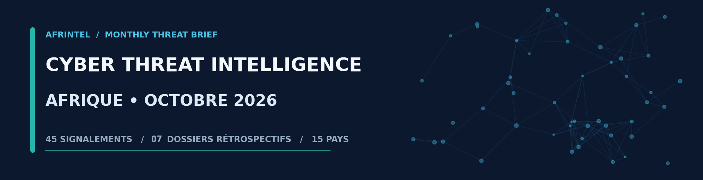
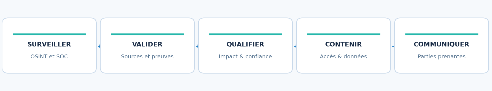

# AFRINTEL

# RAPPORT MENSUEL DE CYBER THREAT INTELLIGENCE
## Afrique - Octobre 2026

**[English version](README.md)** · **[Corpus AFRINTEL français](victims_FR.md)**

**Période analysée :** 1er au 31 octobre 2026  
**Date de consolidation :** 2 novembre 2026  
**Périmètre :** Afrique ; éclairage complémentaire sur les vulnérabilités exploitées à l'échelle mondiale  
**Classification :** Diffusion professionnelle - sources ouvertes et éléments agrégés ; aucune donnée personnelle brute reproduite  
**Référence :** CTI-AFR-2026-10

## BRIEF HIGHLIGHTS - LES FAITS MARQUANTS

- **52 fiches distinctes : 45 signalements publiés ou rapportés en octobre 2026 et 7 dossiers antérieurs découverts rétrospectivement.** Les 7 dossiers historiques sont séparés du total mensuel d'octobre et conservés dans une section rétrospective dédiée.
- **Maroc et Égypte concentrent chacun 12 fiches**, devant l'Afrique du Sud (7). Cette répartition décrit les observations disponibles, pas la prévalence réelle des attaques dans ces pays.
- **Les fuites ou ventes de données dominent l'exposition potentielle des administrations et de la santé**, avec des corpus parfois volumineux, mais des liens techniques à la victime encore incomplets.
- **Le rançongiciel représente 17 signalements** ; le contexte de publication et les éléments disponibles sont précisés pour chaque fiche. Le chiffrement, l'interruption de service et la publication de données sont évalués séparément.
- **Quatre cas comportent une communication ou une reconnaissance de l'incident par une organisation concernée** : Lawyers for Human Rights, GCIS, InvestNaija/Chapel Hill Denham et Al Arabia United. La nature exacte de l'accès aux données diffère toutefois d'un dossier à l'autre.
- **Les accès d'administration, les prestataires et les environnements d'identité sont des points de fragilité transversaux** : e-Solde, l'environnement SSO revendiqué à Madagascar et le prestataire de Lawyers for Human Rights illustrent des risques distincts.
- **La gestion des correctifs reste une priorité immédiate** : les alertes CISA d'octobre confirment l'exploitation de failles touchant Windows, Ivanti et Cisco Secure Email Gateway, entre autres.

## 1. SYNTHÈSE EXÉCUTIVE

Octobre 2026 met en évidence une menace moins uniforme qu'il n'y paraît à la lecture des seules publications de cybercriminels. Le jeu de données AFRINTEL recense 45 incidents ou cas rapportés pendant le mois dans 15 pays africains. Il conserve séparément 7 dossiers plus anciens découverts rétrospectivement. Les publications observées relèvent principalement de fuites de données rapportées, du rançongiciel et de la vente d'accès. Le niveau de preuve varie considérablement : certaines enquêtes ont fait l'objet de communications officielles ; d'autres reposent sur un message de forum, un échantillon incomplet ou une inscription sur un site de divulgation. [AFR]

Le risque le plus immédiat ne se limite pas à l'indisponibilité des systèmes. Les informations rapportées concernent des personnels publics, des candidats à l'emploi, des étudiants, des professionnels de santé, des clients d'assurances et des utilisateurs de services financiers. La mise en circulation d'un échantillon crédible peut déclencher des campagnes d'hameçonnage personnalisées, des usurpations d'identité ou des fraudes documentaires. Pour les équipes SOC et de réponse aux incidents, l'enjeu consiste à valider rapidement l'origine des données, mesurer l'étendue de l'exposition et empêcher la réutilisation des comptes et des secrets.

Les faits publiquement reconnus en Afrique du Sud, au Nigeria et en Égypte rappellent par ailleurs qu'un incident peut provenir d'un prestataire, d'une interface web exposée ou d'une plateforme centralisée de diffusion, sans que l'organisation citée soit nécessairement le point d'entrée technique. Dans le même temps, les vulnérabilités activement exploitées d'octobre concernent des produits communs à de nombreuses entreprises africaines : systèmes Windows, accès distants et passerelles de messagerie. [S01] [S02] [S03] [S04] [S08] [S10] [S12]

**Appréciation générale : risque élevé pour les organisations publiques, la santé, l'éducation et les services financiers ; niveau de confiance hétérogène selon les cas.** La priorité est de séparer les faits établis des volumes annoncés par les acteurs malveillants, puis de concentrer les efforts sur les actifs exposés, les accès privilégiés, les secrets et la détection des exports massifs.

## COMPARAISON AVEC SEPTEMBRE 2026

La comparaison porte uniquement sur les publications datées de chaque mois. Les dossiers historiques intégrés rétrospectivement sont exclus des deux dénominateurs.

| Type d'incident | Septembre 2026 | Octobre 2026 | Évolution |
| --- | ---: | ---: | ---: |
| Total mensuel | 29 | 45 | +16 (+55,2 %) |
| Ransomware | 20 | 17 | -3 (-15,0 %) |
| Data Leak | 7 | 20 | +13 (+185,7 %) |
| Access Sale | 0 | 2 | +2 (nouvelle catégorie observée) |
| System Intrusion | 2 | 6 | +4 (+200,0 %) |

Les catégories DDoS, Defacement, Account Takeover, Malware et Operational Fraud ne figurent pas dans le tableau car elles sont à zéro pour septembre et octobre. Cette évolution décrit la composition des corpus AFRINTEL et doit être lue avec le statut de preuve attribué à chaque fiche.

## 2. PÉRIMÈTRE, STATISTIQUES ET QUALITÉ DES PREUVES

| Indicateur | Valeur observée dans les 45 fiches d'octobre |
| --- | --- |
| Pays couverts | 15 |
| Signalements de fuite de données | 20 |
| Signalements de rançongiciel | 17 |
| Intrusions système / alertes d'intrusion | 6 |
| Offres de vente d'accès | 2 |
| Revendications sans corroboration suffisante | 21 |
| Revendications accompagnées d'un échantillon publié | 17 |
| Publications de données décrites comme complètes | 2 |
| Incidents reconnus ou notifiés par une organisation | 4 |
| Dossier classé « en investigation » | 1 |

**Répartition géographique.** Maroc : 12 ; Égypte : 12 ; Afrique du Sud : 7 ; République démocratique du Congo : 2 ; Éthiopie : 2 ; dix autres pays : une fiche chacun. Les chiffres mesurent la composition du corpus et ne doivent pas être extrapolés à l'ensemble du continent. [AFR]

### Répartition normalisée par secteur

Chaque fiche d'octobre reçoit un secteur principal afin d'éviter le double comptage des libellés composites.

Administration publique : 11 ; technologie et services numériques : 9 ; enseignement supérieur et formation : 5 ; santé : 4 ; finance et assurance : 3 ; industrie et fabrication : 3 ; médias et utilités : 3 ; transport et mobilité : 2 ; recherche et environnement : 2 ; commerce et immobilier : 2 ; ONG et services juridiques : 1.

### Acteurs et comptes les plus visibles

Ces libellés correspondent aux comptes ou groupes affichés dans les publications. Ils ne constituent pas une attribution technique confirmée.

| Acteur ou compte affiché | Fiches |
| --- | ---: |
| Nameless511 | 9 |
| Non établi / non identifié | 5 |
| UmBra | 4 |
| N0n | 4 |
| The Gentlemen | 3 |
| SensitiveDarkForum | 2 |
| Krybit | 2 |
| Qilin | 2 |
| Lenken | 2 |
| Kazu | 2 |
| Autres libellés affichés | 10 |

### Répartition régionale

Selon la convention régionale AFRINTEL, la ventilation des 45 fiches d'octobre est la suivante :

| Région | Fiches |
| --- | ---: |
| Afrique du Nord | 25 |
| Afrique australe | 8 |
| Afrique centrale | 4 |
| Afrique de l'Est | 4 |
| Afrique de l'Ouest | 4 |

**À propos des illustrations.** Les schémas et graphiques ont été créés pour ce rapport à partir des chiffres du référentiel AFRINTEL. Il ne s’agit pas de captures d’attaques, ni de preuves de compromission. Aucune donnée personnelle ou contenu issu d’un forum criminel n’est reproduit.

**À propos des illustrations.** Les schémas et graphiques ont été créés pour ce rapport à partir des chiffres du référentiel AFRINTEL. Il ne s’agit pas de captures d’attaques, ni de preuves de compromission. Aucune donnée personnelle ou contenu issu d’un forum criminel n’est reproduit.

**Précaution méthodologique.** Le millésime « octobre » renvoie ici à la publication ou à l'observation documentée, non nécessairement à la date de l'intrusion. Les sept dossiers rétrospectifs restent séparés des 45 fiches publiées ou rapportées en octobre et ne sont pas ajoutés au dénominateur mensuel. La date de découverte tardive explique leur présence dans le référentiel, mais ne les transforme pas en événements d'octobre. La mention « données entièrement publiées » qualifie la publication observée, pas une confirmation officielle de compromission. [AFR]

**Point de vigilance sur la traçabilité des échantillons.** Les fiches de la Procuradoria-Geral da República du Mozambique et de Rand Mutual Assurance décrivent toutes deux un ensemble de 262 fichiers, avec la même ventilation (180 JSON, 71 PDF, 9 EML, 1 DOC et 1 JPG) et un total identique de 75 941 802 octets. Cette identité de métadonnées exige une vérification croisée des empreintes et des inventaires de fichiers. Elle ne permet pas, à elle seule, d'affirmer qu'il s'agit du même corpus ; elle interdit toutefois de traiter ces deux descriptions comme deux preuves techniques indépendantes sans contrôle supplémentaire. [AFR]

## 3. ÉVÉNEMENTS ET CAMPAGNES PRIORITAIRES

### 3.1 - Afrique du Sud : Lawyers for Human Rights, un incident confirmé chez un prestataire
**Date de collecte : 2 novembre 2026 | Incident détecté le 5 octobre ; avis public du 15 octobre 2026.**

**Ce que nous savons.** Lawyers for Human Rights (LHR) a déclaré avoir constaté le 5 octobre un accès non autorisé présumé à une base hébergée pour son compte par un tiers. L'enquête indique qu'une partie non autorisée a accédé à la base et en a téléchargé des informations. L'organisation a sécurisé l'environnement, engagé une expertise spécialisée, commencé les notifications nécessaires et saisi les autorités compétentes. Les catégories précises de données varient selon les personnes concernées ; l'organisation n'a pas présenté de décompte final public dans la source consultée. [S01]

**Contexte.** Les associations et organisations de défense des droits détiennent souvent des informations confidentielles sur des bénéficiaires, partenaires et collaborateurs. Le recours à un prestataire ne transfère pas le risque réputationnel et juridique : une compromission du fournisseur peut avoir le même effet qu'un incident sur un système interne.

**Recommandation de l'analyste.** Les organisations comparables devraient inventorier les bases confiées à des tiers, les accès de support et les échanges de fichiers, puis vérifier contractuellement la journalisation, l'alerte et les délais de notification. La priorité opérationnelle est de confirmer l'étendue des extractions et de renforcer la surveillance des campagnes d'usurpation visant les personnes affectées.

### 3.2 - Afrique du Sud : le portail de recrutement du GCIS compromis
**Date de collecte : 2 novembre 2026 | Activité suspecte le 24 octobre ; notification publique le 30 octobre 2026.**

**Ce que nous savons.** Le Government Communication and Information System (GCIS) a signalé une compromission de son dispositif de recrutement électronique après la détection d'activités suspectes sur ses systèmes web. Des informations de candidats - notamment identifiants nationaux, numéros de téléphone et adresses électroniques - pourraient avoir été exposées. Le système concerné a été isolé et les autorités sud-africaines informées. L'accès effectif à chaque catégorie de données et le nombre de personnes concernées restent à déterminer. [S02] [AFR]

**Contexte.** Les portails de recrutement publics centralisent des informations d'identité et des pièces justificatives particulièrement utiles à la fraude. Ce type de données est aussi réutilisable pour de faux entretiens, des demandes de frais administratifs ou des campagnes de phishing se faisant passer pour une administration.

**Recommandation de l'analyste.** Prioriser la conservation des journaux d'application, WAF, IAM et base de données ; établir une chronologie des requêtes et des exports ; examiner les comptes de service et les interfaces d'administration. Les candidats doivent recevoir des consignes simples : ne pas transmettre de pièce d'identité ni de code OTP à la suite d'une sollicitation inattendue.

### 3.3 - Nigeria : InvestNaija alerte ses clients après une activité inhabituelle
**Date de collecte : 2 novembre 2026 | Notification du 28 octobre ; reprise publique le 30 octobre 2026.**

**Ce que nous savons.** Chapel Hill Denham a informé les utilisateurs d'InvestNaija d'un possible accès non autorisé à une fraction des informations clients. Selon la notification, moins de 1 % des données clients pourraient être concernées ; les adresses électroniques et coordonnées sont mentionnées comme potentiellement accessibles. L'entreprise a annoncé des mesures de confinement et des signalements aux autorités. Les investissements n'auraient pas été affectés, selon sa propre communication. Le chiffre de moins de 1 % ne constitue pas un décompte de personnes dont l'exposition serait techniquement confirmée. [S03]

**Contexte.** Les données de contact financières constituent un levier de fraude même en l'absence de mot de passe ou de fonds détournés. Un fraudeur peut appeler un client en se présentant comme l'établissement, faire référence à un produit d'investissement et tenter d'obtenir un code de vérification.

**Recommandation de l'analyste.** Renforcer la détection des connexions inhabituelles aux canaux web et mobile, rechercher les accès aux API de profil client et surveiller les domaines imitant la marque. La communication aux clients doit distinguer clairement « information potentiellement consultée » et « compte ou fonds compromis ».

### 3.4 - Égypte : un panneau publicitaire piraté révèle une dépendance à une plateforme centrale
**Date de collecte : 2 novembre 2026 | Incident du 29 octobre ; conclusions publiques le 30 octobre 2026.**

**Ce que nous savons.** Un panneau numérique exploité par Al Arabia United à Gizeh a diffusé des images non autorisées. L'entreprise a reconnu une intrusion liée à l'un de ses écrans et l'a arrêté. Le ministère égyptien de l'Intérieur a indiqué qu'une plateforme internationale de distribution de contenus, utilisée par l'exploitant, avait été compromise et que des écrans situés dans plusieurs pays avaient affiché simultanément le contenu. L'identité du fournisseur et la technique d'intrusion n'ont pas été précisées. [S04]

**Contexte.** Cet événement relève davantage de l'intégrité des contenus et de la chaîne d'approvisionnement numérique que d'une fuite de données traditionnelle. Une console de diffusion centralisée peut transformer un accès unique en altération visible sur de nombreux équipements.

**Recommandation de l'analyste.** Les opérateurs de signalétique et d'équipements connectés devraient isoler les consoles de publication, séparer la validation éditoriale de la mise en production, exiger une authentification forte et prévoir une procédure de coupure locale. Les mêmes principes valent pour l'affichage hospitalier, les transports et les dispositifs d'information au public.

### 3.5 - Afrique du Sud : Rand Mutual Assurance enquête sur une revendication d'extorsion
**Date de collecte : 2 novembre 2026 | Alerte du 23 octobre ; article de presse du 27 octobre 2026.**

**Ce que nous savons.** Rand Mutual Assurance a confirmé enquêter sur une alerte de cybersécurité. Un acteur revendique le vol de 366 Go de données, dont environ 1,68 million de dossiers de demandes d'indemnisation, et demande 95 000 dollars avec une échéance annoncée au 5 novembre. À la date de consolidation, RMA n'avait pas confirmé d'accès ou d'exfiltration non autorisés. Ces volumes et la menace de divulgation restent des affirmations de l'auteur. [S05] [AFR]

**Contexte.** Les dossiers d'assurance liés aux accidents du travail peuvent réunir des informations personnelles, financières et relatives à la santé. Le risque potentiel est donc significatif, même si l'authenticité de la revendication n'est pas encore démontrée. La pression calendaire fait partie du mécanisme d'extorsion et ne doit pas être confondue avec la preuve d'un incident.

**Recommandation de l'analyste.** Conserver une chaîne de preuve rigoureuse, vérifier l'origine des échantillons sans les redistribuer et préparer un dispositif de notification conditionnel à la confirmation des données. Compte tenu de l'anomalie d'inventaire relevée dans le corpus AFRINTEL, rapprocher d'abord les empreintes du dossier RMA de celles attribuées à la PGR du Mozambique.

### 3.6 - Rwanda : un corpus sanitaire attribué au ministère de la Santé
**Date de collecte : 2 novembre 2026 | Revendication publiée le 18 octobre 2026.**

**Ce que nous savons.** Une publication attribuée au compte « Lenken » présente une base liée au ministère rwandais de la Santé. AFRINTEL indique avoir examiné 375 fichiers CSV totalisant environ 6,05 milliards d'octets. Le corpus comprend des structures applicatives cohérentes avec un système d'information sanitaire ; certains exports comprennent des informations de comptes et d'administration. Le total de 42,5 millions de lignes physiques mentionné dans le référentiel ne correspond pas à autant de personnes ou d'enregistrements logiques : des cellules CSV comportent des retours à la ligne. Aucun accès initial, auteur de l'exfiltration ni compromission directe du ministère n'est confirmé. [AFR]

**Contexte.** Les données de santé, de gestion d'établissements et d'identité peuvent être réutilisées pour des fraudes difficiles à détecter. Une base structurée riche en comptes, journaux ou éléments d'accès présente par ailleurs un risque de compromission secondaire si certains secrets sont toujours actifs.

**Recommandation de l'analyste.** Délimiter les systèmes couverts par les tables, rechercher les exports inhabituels et les connexions privilégiées, révoquer les secrets réellement présents après validation autorisée et coordonner la réponse avec les responsables des applications et de la protection des données. Ne pas communiquer de chiffres sur le nombre de patients tant qu'une déduplication métier n'a pas été effectuée.

### 3.7 - Éthiopie : des documents d'identité et de santé dans un échantillon revendiqué
**Date de collecte : 2 novembre 2026 | Publication du 7 octobre 2026.**

**Ce que nous savons.** Une publication associée au domaine `moh.gov.et` revendique quatre millions d'enregistrements et 13 Go de données. Le matériel observé par AFRINTEL présente des documents d'identité et des références sanitaires sensibles. La cohérence de l'échantillon avec des services de santé éthiopiens est jugée forte ; l'origine technique du corpus et les volumes annoncés restent à établir. [AFR]

**Contexte.** La présence de documents apparemment authentiques peut accroître la crédibilité d'une revendication tout en laissant ouverte la question de leur provenance : plateforme partenaire, base mutualisée, sauvegarde ancienne ou système ministériel. La nuance est essentielle pour identifier le bon périmètre d'enquête.

**Recommandation de l'analyste.** Procéder à une validation documentaire et technique limitée, sous contrôle légal, puis effectuer une recherche ciblée des comptes ayant consulté ou exporté les référentiels concernés. Réduire les droits de téléchargement massif et déclencher un contrôle des prestataires ayant accès aux dossiers sensibles.

### 3.8 - Mozambique et RDC : la vente présumée d'archives publiques
**Date de collecte : 2 novembre 2026 | Deux publications attribuées au compte « Kazu », le 20 octobre 2026.**

**Ce que nous savons.** Une annonce vise la Procuradoria-Geral da República (PGR) du Mozambique et revendique 22 Go ainsi que 158 511 fichiers ; l'échantillon décrit par AFRINTEL compte 262 fichiers. Une autre annonce vise une plateforme d'enregistrement d'enseignants associée au ministère congolais MINESURSI et revendique 136 Go ainsi que 125 823 fichiers ; une archive d'échantillons d'environ 1,56 Go a été étudiée. Les fichiers observés sont compatibles avec des dossiers administratifs, mais les volumes complets et les compromissions initiales ne sont pas établis. [AFR]

**Contexte.** La mise en vente d'archives administratives accroît l'exposition potentielle à la fraude documentaire, à l'usurpation d'identité et aux campagnes visant des agents publics. Le même pseudonyme de vendeur ne suffit pas à démontrer une campagne technique unique ni un mode opératoire commun.

**Recommandation de l'analyste.** Pour chaque administration, confirmer le propriétaire des systèmes et le chemin de collecte des documents, rapprocher les empreintes des pièces disponibles et rechercher les exports en masse. Pour la PGR, suspendre toute conclusion de provenance fondée uniquement sur le résumé de l'échantillon tant que sa traçabilité n'a pas été réconciliée avec celle du dossier RMA.

### 3.9 - Maroc : neuf publications associées au pseudonyme « Nameless511 »
**Date de collecte : 2 novembre 2026 | Publications du 1er au 11 octobre 2026.**

**Ce que nous savons.** Neuf fiches marocaines du référentiel attribuent des publications au compte « Nameless511 ». Elles concernent notamment Midipcom, Karamtech, Tera.ma, NextLevel PC, l'Université Cadi Ayyad, Decathlon Maroc, le Conseil national de la presse et deux portefeuilles ministériels. Certaines publications montrent des échantillons, tandis que d'autres sont décrites comme des données entièrement publiées. Les associations entre compte de forum, personne réelle et compromission technique demeurent non établies. Au total, 12 fiches marocaines figurent dans la section d'octobre. [AFR]

**Contexte.** Une concentration de messages sous un même pseudonyme peut signaler une activité suivie, une revente de jeux de données collectés ailleurs ou une stratégie de visibilité sur les forums. Elle ne signifie pas nécessairement neuf accès initiaux distincts. Les domaines de l'administration et du commerce combinent des données de contact, de transaction ou de candidature qui se prêtent à l'ingénierie sociale.

**Recommandation de l'analyste.** Regrouper les publications pour rechercher des schémas de fichiers, dates, métadonnées et champs communs, sans fusionner les victimes par défaut. Dans les organismes cités, auditer les applications web, les exports de bases et les comptes de service, puis surveiller l'usurpation de domaines et les messages frauduleux ciblant leurs usagers.

### 3.10 - Congo et Madagascar : les accès d'administration revendiqués deviennent une marchandise
**Date de collecte : 2 novembre 2026 | Publication e-Solde du 2 octobre ; publication e-Koragna/SSO du 20 octobre 2026.**

**Ce que nous savons.** Une offre concernant le service congolais `e-solde.cg` présente des échantillons cohérents avec des informations de paie et de gestion d'agents publics. AFRINTEL signale toutefois une publication antérieure de juin décrivant le même domaine et le même prix ; les deux annonces ont été rapprochées pour éviter un double comptage. À Madagascar, List1 a d'abord annoncé la vente d'un accès administrateur à `staging.sso.gov.mg`. Lors d'un échange direct, le vendeur a ensuite proposé `e-koragna.gov.mg` comme accès supplémentaire. Les échanges associent cette offre à un prix annoncé de 450 USD. Une interface de type Keycloak apparaît dans le matériel, mais aucun accès fonctionnel n'a été testé ni confirmé. Les deux domaines sont traités comme une seule fiche et un seul `Access Sale`. [AFR]

**Contexte.** L'accès aux systèmes de paie ou à une brique SSO peut donner un pouvoir disproportionné par rapport à la taille apparente de la cible. La mention « staging » ne garantit pas qu'un environnement est isolé : comptes, secrets ou relations de confiance peuvent être partagés avec la production.

**Recommandation de l'analyste.** Vérifier d'urgence les domaines d'administration exposés, les comptes privilégiés, les comptes de service, les relations de confiance et les journaux de fédération. Séparer strictement test et production ; imposer MFA résistante au phishing pour les accès sensibles ; révoquer les secrets dont l'exposition est effectivement constatée.

### 3.11 - Rançongiciels : signalements en Égypte et pression sur les infrastructures
**Date de collecte : 2 novembre 2026 | Revendications réparties du 2 au 30 octobre 2026.**

**Ce que nous savons.** Dix-sept fiches d'octobre sont classées « ransomware ». En Égypte, des publications mentionnent notamment Beni Suef Technological University, Cairo University, Helwan University, Luxor Company for Drinking Water and Sanitation, Millensys et MODON Developments. Le pseudonyme « UmBra » apparaît sur quatre fiches égyptiennes. Au Maroc, Qilin a inscrit CNESTEN parmi ses victimes revendiquées le 11 octobre ; une publication associée à Qilin a également visé la Société Ivoirienne de Télédiffusion le 30 octobre. Aucune de ces seules mentions ne confirme une indisponibilité, un chiffrement ou un vol de données. [AFR] [S06] [S07]

**Contexte.** Les rançongiciels combinent fréquemment chantage à la publication et perturbation opérationnelle, mais le modèle varie selon les groupes et les cas. Les établissements d'enseignement, structures de santé, opérateurs de distribution d'eau et acteurs de diffusion audiovisuelle présentent des besoins de continuité importants. Des victimes affichées sur un site d'extorsion peuvent aussi correspondre à des données historiques ou à des annonces trompeuses.

**Recommandation de l'analyste.** Privilégier une réponse fondée sur les symptômes techniques : accès RDP/VPN, création de comptes privilégiés, mouvements latéraux, volumes de sortie, suppression de sauvegardes, déploiement d'outils d'administration et chiffrement réel. Tester la restauration hors ligne et l'isolement des segments critiques plutôt que de réagir au seul nom du groupe.

### 3.12 - Côte d'Ivoire : le dossier UVCI illustre le piège des découvertes rétrospectives
**Date de collecte : 2 novembre 2026 | Publication initiale du 1er juillet ; découverte AFRINTEL du 25 octobre 2026.**

**Ce que nous savons.** AFRINTEL décrit l'analyse d'un export SQL d'environ 8,72 milliards d'octets attribué à l'écosystème de l'Université Virtuelle de Côte d'Ivoire, complété par dix CSV. L'ensemble contient des tables Moodle et universitaires, des comptes, des données pédagogiques, des journaux, des sessions et des artefacts d'authentification. La cohérence technique du corpus est élevée, mais l'accès initial et la validité actuelle des secrets ne sont pas établis. Le dossier relève de juillet par sa publication d'origine et est exclu des 45 fiches publiées ou rapportées en octobre. [AFR]

**Contexte.** Une découverte tardive peut justifier des mesures d'urgence aujourd'hui sans devenir statistiquement un « nouvel incident d'octobre ». Les fichiers d'historique et tables applicatives comportent des duplications ; la somme brute des lignes ne correspond pas au nombre d'étudiants ou de personnes exposés.

**Recommandation de l'analyste.** Maintenir deux dates dans chaque fiche CTI : date initiale de publication ou d'observation de l'incident, et date de découverte par l'équipe. Rechercher les sessions et jetons encore valides, procéder à des rotations ciblées et contrôler les accès aux plateformes universitaires reliées.

## 4. VULNÉRABILITÉS PRIORITAIRES - EXPLOITATION CONFIRMÉE EN OCTOBRE

### 4.1 - Microsoft Windows : CVE-2026-96951 et une volumétrie exceptionnelle de correctifs
**Date de collecte : 2 novembre 2026 | Correctifs et avis publiés le 13 octobre 2026.**

**Ce que nous savons.** Le Patch Tuesday de Microsoft du 13 octobre a corrigé plus de 1 400 vulnérabilités selon les décomptes des équipes de recherche ; les totaux exacts diffèrent légèrement selon les périmètres retenus. Parmi les failles prioritaires figure CVE-2026-96951, un contournement de protection de Windows Shell lié au mécanisme Mark of the Web, considéré comme exploité dans la nature. CISA l'a ajouté à son catalogue Known Exploited Vulnerabilities le 13 octobre. [S08] [S09]

**Contexte.** Le volume de correctifs ne doit pas masquer les vulnérabilités à fort risque réel. Une faille qui réduit la protection appliquée à des contenus externes peut faciliter une chaîne d'infection si elle est combinée à la tromperie de l'utilisateur ou à d'autres techniques.

**Recommandation de l'analyste.** Prioriser les postes exposés aux fichiers provenant d'Internet et les environnements où des comptes à privilèges sont utilisés. Suivre le taux de déploiement réel des correctifs, pas seulement l'approbation des mises à jour dans l'outil de gestion.

**Mesures correctives.** Déployer les mises à jour Windows applicables ; vérifier les versions effectivement corrigées sur un échantillon de machines ; renforcer la protection contre les pièces jointes et contenus téléchargés ; rechercher les signes d'exécution de fichiers inhabituels et de contournement des contrôles de sécurité, en particulier sur les postes sensibles. [S08] [S09]

### 4.2 - Cisco Secure Email Gateway : CVE-2026-76519, risque d'exécution avec privilèges élevés
**Date de collecte : 2 novembre 2026 | Avis Cisco et ajout au catalogue CISA du 14 octobre 2026.**

**Ce que nous savons.** Cisco a publié l'avis relatif à CVE-2026-76519 (CVSS 9,8) le 14 octobre. Une gestion incorrecte de pièces jointes dans la fonctionnalité Advanced Malware Protection peut permettre à un attaquant distant non authentifié d'écrire des fichiers sur le système sous-jacent et, en cas d'exploitation réussie, d'exécuter des commandes avec les privilèges root. Cisco indique avoir eu connaissance d'exploitations actives et ne fournit pas de solution de contournement complète. CISA a ajouté la CVE à son catalogue KEV le même jour. [S10] [S11]

**Contexte.** Une passerelle de messagerie est un équipement de confiance situé sur le chemin des communications de l'organisation. Sa compromission peut affecter directement la confidentialité, la sécurité des messages et la capacité à détecter des contenus malveillants.

**Recommandation de l'analyste.** Traiter cette vulnérabilité en priorité sur les équipements exposés et les architectures recevant directement du courrier externe, sans supposer qu'un filtrage amont constitue une protection suffisante.

**Mesures correctives.** Vérifier les versions AsyncOS et la configuration AMP/File Reputation ainsi que la version des Content Scanner Tools ; appliquer les versions corrigées recommandées par Cisco ; examiner les journaux et fichiers inattendus sur les passerelles ; préserver les éléments forensiques si une activité suspecte est relevée ; limiter l'accès d'administration et renouveler les secrets exposés selon les résultats de l'enquête. [S10]

### 4.3 - Ivanti Connect Secure : plusieurs vulnérabilités exploitées sur les accès distants
**Date de collecte : 2 novembre 2026 | Alertes du 13 et du 30 octobre 2026.**

**Ce que nous savons.** CISA a inscrit CVE-2026-104935, une vulnérabilité de contournement d'authentification affectant Ivanti Connect Secure, au catalogue KEV le 13 octobre. Ivanti a indiqué avoir connaissance d'une exploitation limitée et a publié des versions corrigées selon les branches de produits. Le 30 octobre, CISA a ajouté deux autres vulnérabilités concernant Connect Secure, CVE-2026-111357 et CVE-2026-118527, à son catalogue des failles exploitées. [S09] [S12] [S13]

**Contexte.** Les passerelles d'accès distants constituent un chemin privilégié vers les systèmes internes, parfois avec des flux persistants vers des applications sensibles. Un incident sur cette couche peut contourner de nombreuses protections mises en place sur les postes.

**Recommandation de l'analyste.** Cartographier toutes les appliances de VPN et d'accès distant, y compris celles gérées par des prestataires ; appliquer une priorité maximale aux équipements exposés sur Internet. Un simple correctif ne remplace pas la recherche d'une compromission antérieure.

**Mesures correctives.** Appliquer les versions de maintenance publiées par Ivanti pour la branche concernée ; exécuter les contrôles d'intégrité et de compromission recommandés par l'éditeur ; préserver les journaux VPN et d'administration ; réinitialiser ou révoquer les sessions, certificats et secrets si des indices de compromission sont identifiés ; auditer les comptes privilégiés et les accès latéraux. [S12] [S13]

## 5. ÉVALUATION TRANSVERSALE ET PRIORITÉS POUR NOVEMBRE

**Priorité 1 - Réduire la fenêtre d'exploitation.** Identifier les actifs Windows, Cisco Secure Email Gateway, Ivanti Connect Secure et autres équipements exposés figurant au catalogue KEV. Déployer les correctifs applicables et conduire une recherche de compromission sur les systèmes les plus critiques. Un système corrigé aujourd'hui peut avoir été exploité avant l'intervention.

**Priorité 2 - Maîtriser l'accès aux données sensibles.** Examiner les exports d'applications de santé, d'éducation, de paie, de recrutement et de finance. Mettre sous surveillance les accès administrateurs, les comptes de service, les règles de transfert, les téléchargements massifs et les événements anormaux sur les stockages cloud.

**Priorité 3 - Encadrer les tiers et l'identité.** Vérifier les prestataires disposant d'un accès aux bases de données, aux interfaces de diffusion ou aux identités fédérées. Isoler les environnements de recette, supprimer les relations de confiance injustifiées et appliquer une MFA résistante au phishing sur les consoles sensibles.

**Priorité 4 - Préparer la réponse aux extorsions.** Disposer d'une procédure pour recevoir une revendication sans la transformer automatiquement en « violation confirmée ». Conserver les captures et horodatages, contrôler les empreintes d'échantillons dans un environnement autorisé et coordonner les décisions entre SOC, juridique, communication et direction.

**Priorité 5 - Fiabiliser la chaîne de renseignement.** Affecter à chaque fiche un identifiant unique, une date de première divulgation, une date de détection, un statut de preuve, un degré de confiance et un lien vers les artefacts hachés. Dédupliquer les documents et vérifier les échantillons réutilisés entre dossiers avant de produire des statistiques ou des alertes aux victimes.

**Projection à 30 jours.** La combinaison d'annonces de fuite, de ventes d'accès et de failles activement exploitées justifie une vigilance renforcée. Les secteurs qui exposent des identités nombreuses ou des infrastructures de service public devraient passer en revue leurs accès distants, leurs intégrations de prestataires et leurs capacités de restauration. Il ne serait pas rigoureux d'inférer, sur la seule base de ces 45 signalements, une hausse continentale du nombre réel d'intrusions.

## 6. CONCLUSION DE L'ANALYSTE

Le principal enseignement d'octobre est la nécessité de distinguer trois choses : une compromission officiellement reconnue, une exposition de données étayée par un corpus cohérent et une revendication encore impossible à vérifier. Ces trois situations n'appellent ni le même langage ni exactement les mêmes mesures. Les cas documentés en Afrique du Sud, au Nigeria et en Égypte montrent l'importance des prestataires, des systèmes web et des plateformes centralisées ; les publications liées aux administrations et à la santé révèlent, elles, l'attrait des données susceptibles de soutenir des fraudes sur la durée.

Pour novembre, les décisions les plus utiles sont concrètes : corriger les failles connues comme exploitées, contrôler les accès privilégiés, surveiller les sorties de données et préparer une réponse à l'extorsion qui préserve les preuves. La qualité du renseignement constitue elle-même une mesure de sécurité : une revendication répétée ou un échantillon mal attribué peut détourner des ressources, tandis qu'un indice fiable, vérifié à temps, permet de cibler les investigations.

## 7. SOURCES ET TRAÇABILITÉ

**Source de référence**

[AFR] AFRINTEL, « Liste des victimes africaines de cyberattaques en octobre 2026 », version française fournie par l'utilisateur, état au 2 novembre 2026 ; contrôle croisé avec la version anglaise fournie. Le corpus de base est en cours de consolidation et ses statistiques mensuelles ne sont pas publiées comme définitives.

**Sources externes consultées le 2 novembre 2026**

[S01] Lawyers for Human Rights, « Important Notice Regarding a Security Incident », 15 octobre 2026 - https://www.lhr.org.za/lhr-news/important-notice-regarding-a-security-incident/

[S02] ITWeb, « GCIS warns of information breach », 30 octobre 2026 - https://www.itweb.co.za/article/gcis-warns-of-information-breach/wbrpO7g2ea3vDLZn

[S03] The Sun Nigeria, « Chapel Hill Denham alerts customers to potential data breach », 30 octobre 2026 - https://thesun.ng/chapel-hill-denham-alerts-customers-to-potential-data-breach-says-investments-safe/

[S04] Ahram Online, « Egypt traces Giza billboard hack to breach affecting screens across countries », 30 octobre 2026 - https://english.ahram.org.eg/NewsContent/1/1233/581254/Egypt/Courts-amp%3B-Law/Egypt-traces-Giza-billboard-hack-to-breach-affecti.aspx

[S05] ITWeb, « Rand Mutual probes alleged breach of 1.68m claims », 27 octobre 2026 - https://www.itweb.co.za/article/rand-mutual-probes-alleged-breach-of-168m-claims/G98YdqLGAgXMX2PD

[S06] SOCRadar, « CNESTEN Data Breach » (revendication alléguée), 11 octobre 2026 - https://socradar.io/data-breach/cnesten-data-breach/

[S07] CTIWatch, « Société Ivoirienne de Télédiffusion », référencement d'une revendication Qilin, 30 octobre 2026 - https://ctiwatch.com/victims/societe-ivoirienne-de-telediffusion-f74917f5

[S08] Tenable Research, « Microsoft's October 2026 Patch Tuesday addresses 1407 CVEs », 13 octobre 2026 - https://www.tenable.com/blog/microsofts-october-2026-patch-tuesday-addresses-1407-cves-cve-2026-96951

[S09] CISA, « Adds Two Known Exploited Vulnerabilities to Catalog », 13 octobre 2026 - https://content.govdelivery.com/accounts/USDHSCISA/bulletins/42f0923

[S10] Cisco PSIRT, « Cisco Secure Email Gateway Arbitrary File Write Vulnerability », 14 octobre 2026 - https://sec.cloudapps.cisco.com/security/center/content/CiscoSecurityAdvisory/cisco-sa-esa-afw-zqYJkjxp

[S11] CISA, « Adds Four Known Exploited Vulnerabilities to Catalog », 14 octobre 2026 - https://content.govdelivery.com/accounts/USDHSCISA/bulletins/42f2e7f

[S12] Ivanti, « Patch Tuesday d'octobre 2026 », 13 octobre 2026 - https://www.ivanti.com/fr/blog/october-2026-patch-tuesday

[S13] CISA, « Adds Two Known Exploited Vulnerabilities to Catalog », 30 octobre 2026 - https://content.govdelivery.com/accounts/USDHSCISA/bulletins/4311c77

**Note de publication.** Les références à des forums clandestins proviennent des fiches AFRINTEL fournies ; aucun lien vers les espaces de vente, aucun identifiant individuel, secret, jeton, pièce d'identité, dossier médical ou échantillon brut n'est reproduit. La classification et les conclusions restent révisables si des confirmations officielles ou de nouvelles preuves sont publiées.

<!-- Références de citation rendues cliquables dans les lecteurs Markdown -->
[AFR]: victims_FR.md
[S01]: https://www.lhr.org.za/lhr-news/important-notice-regarding-a-security-incident/
[S02]: https://www.itweb.co.za/article/gcis-warns-of-information-breach/wbrpO7g2ea3vDLZn
[S03]: https://thesun.ng/chapel-hill-denham-alerts-customers-to-potential-data-breach-says-investments-safe/
[S04]: https://english.ahram.org.eg/NewsContent/1/1233/581254/Egypt/Courts-amp%3B-Law/Egypt-traces-Giza-billboard-hack-to-breach-affecti.aspx
[S05]: https://www.itweb.co.za/article/rand-mutual-probes-alleged-breach-of-168m-claims/G98YdqLGAgXMX2PD
[S06]: https://socradar.io/data-breach/cnesten-data-breach/
[S07]: https://ctiwatch.com/victims/societe-ivoirienne-de-telediffusion-f74917f5
[S08]: https://www.tenable.com/blog/microsofts-october-2026-patch-tuesday-addresses-1407-cves-cve-2026-96951
[S09]: https://content.govdelivery.com/accounts/USDHSCISA/bulletins/42f0923
[S10]: https://sec.cloudapps.cisco.com/security/center/content/CiscoSecurityAdvisory/cisco-sa-esa-afw-zqYJkjxp
[S11]: https://content.govdelivery.com/accounts/USDHSCISA/bulletins/42f2e7f
[S12]: https://www.ivanti.com/fr/blog/october-2026-patch-tuesday
[S13]: https://content.govdelivery.com/accounts/USDHSCISA/bulletins/4311c77

---

*AFRINTEL - CTI-AFR-2026-10. Visuels originaux intégrés au dossier `assets/`. Clôture analytique provisoire au 2 novembre 2026.*

