# Rapport CTI AFRINTEL - cyberincidents en Afrique (octobre 2026)

Version française - [English version](./README.md) - [Fiches victimes](./victims_FR.md)

## 1. Synthèse exécutive

Le corpus d'octobre 2026 comprend **48 incidents documentés**. Il s'agit de la visibilité AFRINTEL pour le mois, et non d'une mesure exhaustive de toutes les cyberattaques ayant touché l'Afrique.

La catégorie dominante est la fuite de données avec 23 incidents, suivie du ransomware avec 17, de l'intrusion système avec 5 et de la vente d'accès avec 3. L'Égypte et le Maroc comptent chacun 12 incidents, devant l'Afrique du Sud avec 9. Les secteurs les plus représentés sont l'administration publique, le commerce et la distribution, puis les services numériques.

Les comptes ou noms d'acteurs sont conservés comme identifiants observés dans les publications. Ils ne constituent pas, à eux seuls, une attribution technique indépendante. Quatre incidents restent sans acteur établi.

### 1.1 Comparaison avec septembre 2026

| Type d'incident | Septembre | Octobre | Évolution |
|---|---:|---:|---:|
| Ransomware | 20 | 17 | -3 (-15.0%) |
| Fuite de données | 11 | 23 | +12 (+109.1%) |
| Vente d'accès | 0 | 3 | +3 |
| Intrusion système | 2 | 5 | +3 (+150.0%) |
| **Total** | **33** | **48** | **+15 (+45.5%)** |

## 2. Méthodologie

Le classement mensuel suit la date de publication ou la première observation documentée par AFRINTEL, et non une date de compromission supposée. Les incidents ont été dédupliqués au niveau de la victime et de l'événement. Les deux offres malgaches, `staging.sso.gov.mg` et `e-koragna.gov.mg`, sont comptées comme deux incidents distincts liés au même compte vendeur.

Les statistiques sont dérivées des [fiches victimes françaises](./victims_FR.md), puis contrôlées contre les [fiches victimes anglaises](./victims.md). Les deux fichiers contiennent 48 fiches dans le même ordre. Les secteurs sont normalisés selon le [référentiel sectoriel 2026](../../../normalization/sector_mapping_2026.csv). Un incident multi-pays est compté une seule fois au total global.

Les éléments visuels fournis, les publications observées et les échantillons locaux accessibles ont été utilisés selon leur niveau d'information. Les limites propres à chaque incident sont précisées dans les fiches victimes correspondantes.

## 3. Vue d'ensemble globale

### 3.1 Répartition par type d'incident

| Type | Nombre | Part |
|---|---:|---:|
| Fuite de données | 23 | 47.9% |
| Ransomware | 17 | 35.4% |
| Intrusion système | 5 | 10.4% |
| Vente d'accès | 3 | 6.3% |
| **Total** | **48** | **100.0%** |

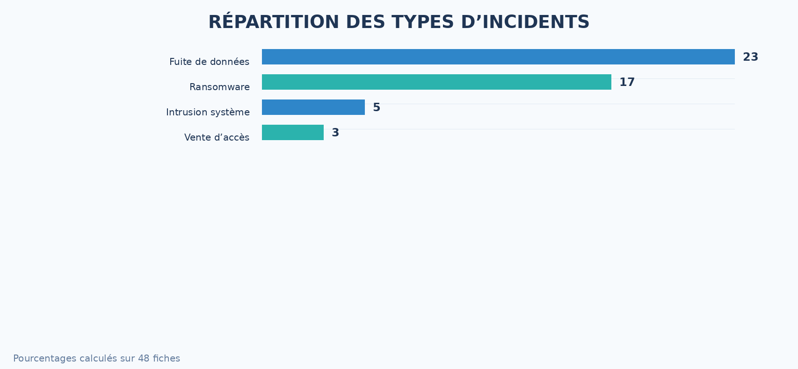
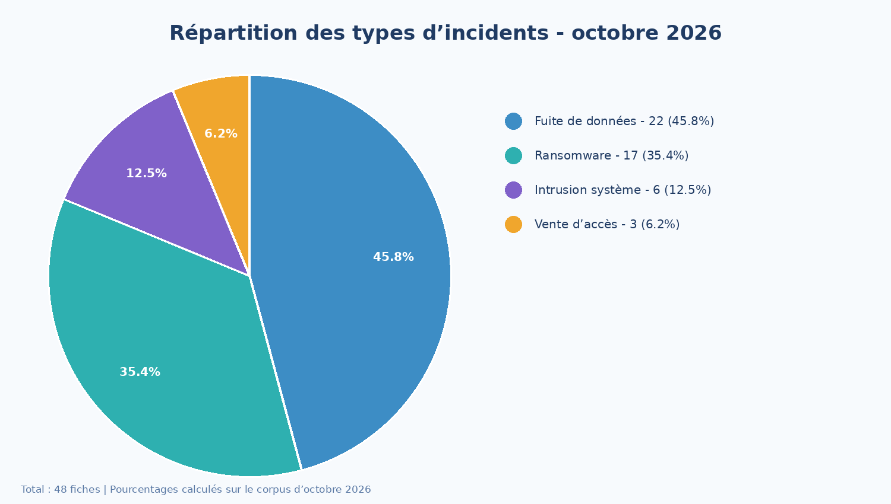

### 3.2 Pays et régions

| Pays | Incidents |
|---|---:|
| Égypte | 12 |
| Maroc | 12 |
| Afrique du Sud | 9 |
| République démocratique du Congo | 2 |
| Éthiopie | 2 |
| Madagascar | 2 |
| République du Congo | 1 |
| Rwanda | 1 |
| Mozambique | 1 |
| Gabon | 1 |
| Tunisie | 1 |
| Bénin | 1 |
| Nigeria | 1 |
| Sierra Leone | 1 |
| Côte d'Ivoire | 1 |

L'Afrique du Nord domine la ventilation régionale, suivie par l'Afrique australe. Les graphiques régionaux doivent être lus comme une ventilation géographique des occurrences documentées, et non comme une estimation de la prévalence réelle.

| Région | Incidents | Pays inclus |
|---|---:|---|
| Afrique du Nord | 25 | Égypte (12), Maroc (12), Tunisie (1) |
| Afrique australe | 10 | Afrique du Sud (9), Mozambique (1) |
| Afrique de l'Est | 5 | Éthiopie (2), Madagascar (2), Rwanda (1) |
| Afrique centrale | 4 | RDC (2), Gabon (1), République du Congo (1) |
| Afrique de l'Ouest | 4 | Bénin (1), Côte d'Ivoire (1), Nigeria (1), Sierra Leone (1) |
| **Total** | **48** | **15 pays** |

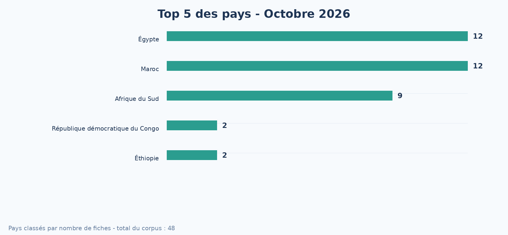
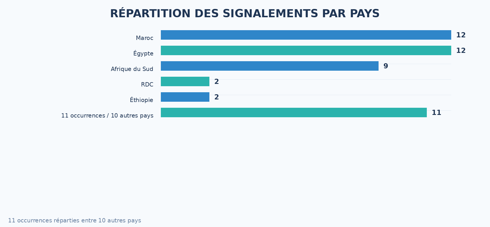
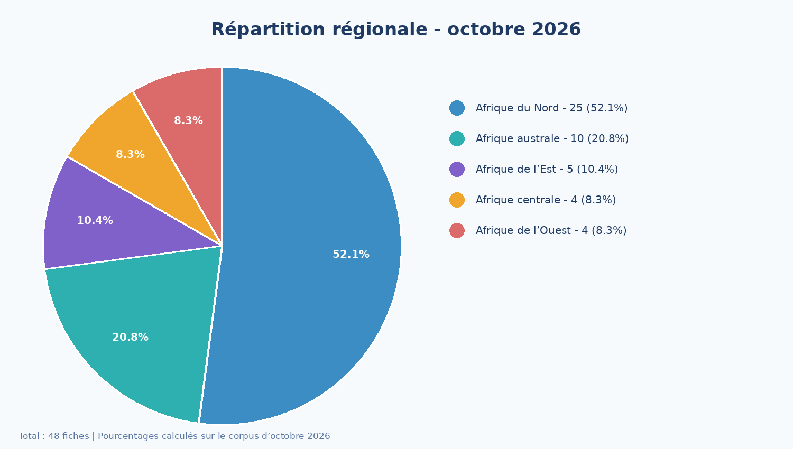

### 3.3 Statut des éléments de preuve

| Statut suivi | Incidents | Part |
|---|---:|---:|
| Revendication non vérifiée | 20 | 41.7% |
| Échantillon publié | 21 | 43.8% |
| Données entièrement publiées | 2 | 4.2% |
| Communication victime / autorité | 4 | 8.3% |
| En cours d'examen | 1 | 2.1% |
| **Total** | **48** | **100.0%** |

Ces statuts décrivent le niveau d'information disponible dans le corpus. Ils ne constituent pas tous des confirmations techniques indépendantes.

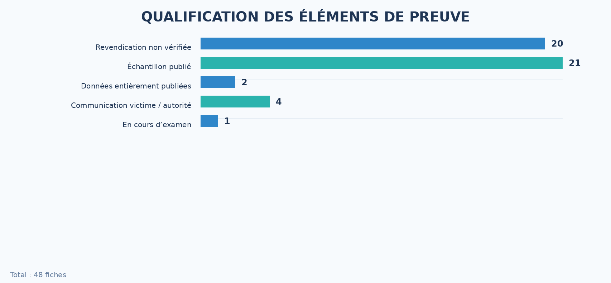
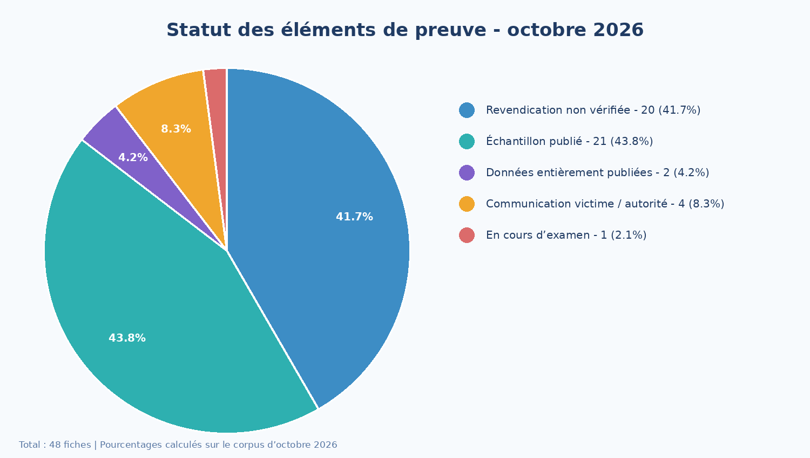

### 3.4 Acteurs ou comptes les plus visibles

| Compte ou libellé observé | Incidents |
|---|---:|
| Nameless511 | 9 |
| UmBra | 4 |
| N0n | 4 |
| The Gentlemen | 3 |
| SensitiveDarkForum | 2 |
| Krybit | 2 |
| Qilin | 2 |
| Lenken | 2 |
| Kazu | 2 |
| List1 | 2 |

Le compte `bytetobreach` est conservé comme identifiant de publication pour Ampath. Quatre fiches ne comportent pas d'attribution établie. Les classements reflètent la fréquence des libellés dans les sources, pas la capacité opérationnelle réelle des acteurs.

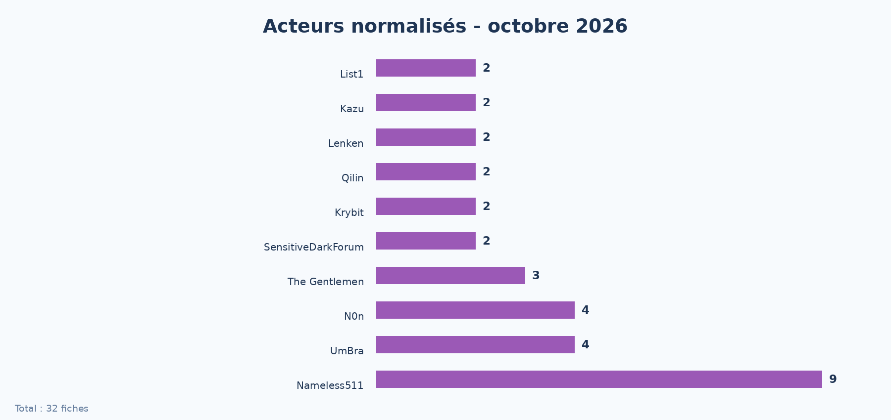

### 3.5 Lecture rapide par secteur

| Secteur normalisé | Incidents |
|---|---:|
| Gouvernement / Administration publique | 12 |
| Commerce / Distribution | 8 |
| Technologie / Services numériques | 6 |
| Santé | 5 |
| Éducation | 5 |
| Finance / Assurance | 3 |
| Transport | 2 |
| Industrie / Ingénierie | 2 |
| Autres secteurs | 5 |

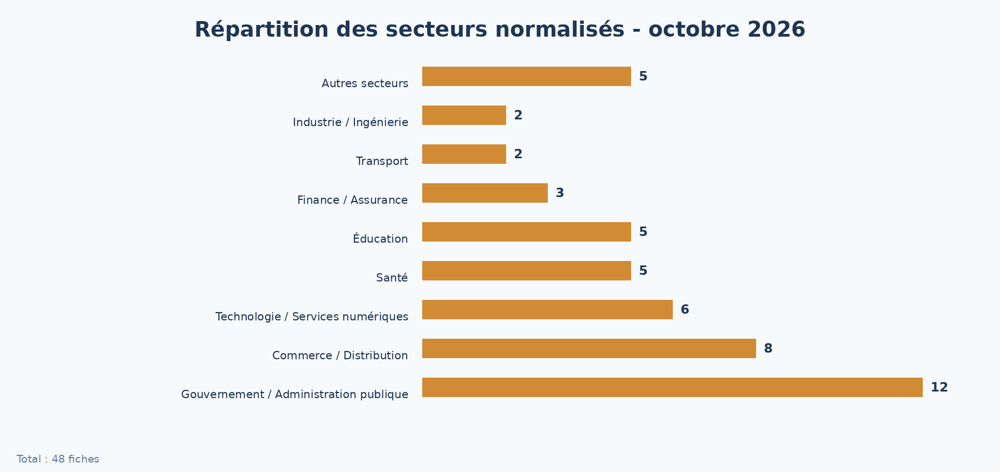
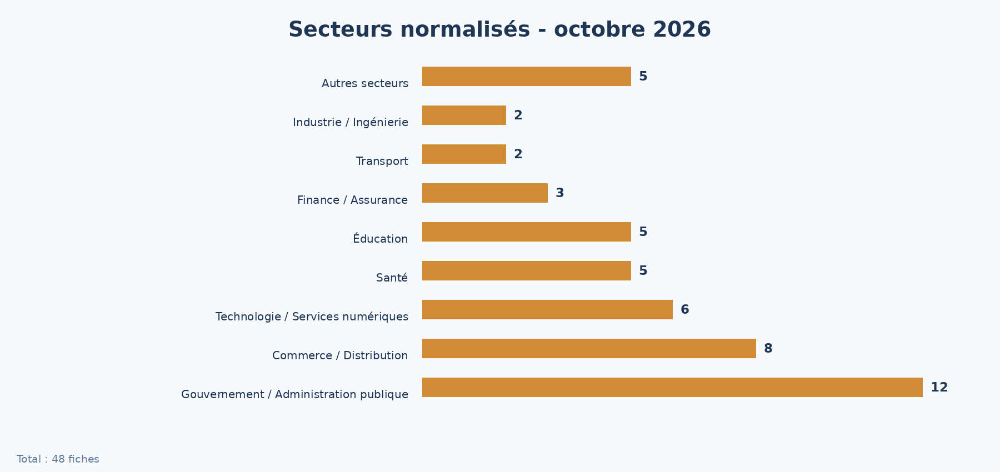
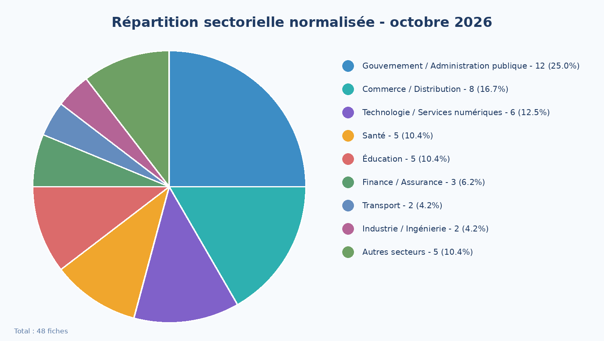

## 4. Analyse détaillée par type

### 4.1 Fuites de données - 23 incidents

Les fuites de données forment le principal signal du mois. Les cas couvrent notamment des bases clients, des données d'identité, des données de santé, des données éducatives, des documents administratifs et des informations professionnelles. La sensibilité est particulièrement élevée pour les administrations, la santé et les ressources humaines.

Le cas Ampath Laboratories of the Zululand comprend un échantillon local structuré avec des fichiers liés aux employés, patients, admissions, paiements et données de santé. Les fichiers examinés montrent une exposition de catégories de données personnelles et médicales. Les éléments accessibles ne permettent pas de confirmer l'étendue annoncée de la divulgation ni les centaines de bases mentionnées dans la publication.

### 4.2 Ransomware - 17 incidents

Les victimes apparaissent dans des publications de groupes ransomware. Les fiches distinguent la présence sur un site de fuite, l'existence d'un échantillon, l'état d'une échéance et la divulgation effectivement observée. Une fiche publiée n'est pas automatiquement assimilée à une divulgation complète. Parmi les 17 cas, Eurogate Tanger dispose d'une archive publiée et analysée en lecture seule ; YOD Ingénierie et CNESTEN ont fait l'objet d'une analyse structurelle de la publication et d'un artefact local, sans examen du contenu des documents annoncés. Pour les 14 autres cas, aucun contenu exploitable n'a été analysé dans le corpus disponible. Certaines publications n'indiquent aucune échéance, tandis que d'autres affichaient encore un compte à rebours à la clôture du rapport. Ces éléments ne permettent pas de conclure sur l'issue des négociations, un éventuel paiement ou l'exfiltration complète.

### 4.3 Intrusions système - 5 incidents

Les cinq cas correspondent à des accès ou intrusions système documentés dans les sources du mois. Leur traitement reste distinct des ventes d'accès : une publication décrivant un accès potentiel n'est pas fusionnée avec une autre victime ou une autre plateforme.

### 4.4 Ventes d'accès - 3 incidents

Les ventes d'accès concernent des environnements ou comptes présentés comme accessibles par les vendeurs. Le cas malgache compte deux fiches séparées pour les deux plateformes proposées par le même acteur. Le vendeur et son compte sont documentés comme éléments observés ; l'attribution technique et la validité actuelle des accès restent des questions distinctes.

### 4.5 Dossiers prioritaires et éléments de preuve

Les dossiers suivants ont été retenus pour leur valeur de renseignement, leur sensibilité ou la qualité des éléments accessibles. Ils ne remplacent pas le registre complet des 48 fiches.

1. **Tera.ma.** Un export Odoo documenté comprend 8 140 fichiers, 2 389 358 436 octets, 282 CSV, 3 693 PDF et plusieurs milliers d'images. Les décomptes observés comprennent notamment 19 595 partenaires, 69 197 commandes et 124 088 écritures comptables. Le vecteur initial et la date réelle d'extraction restent inconnus.
2. **NextLevel PC.** Les huit CSV examinés concordent avec les volumes publiés : 52 545 clients, 60 262 adresses, environ 47 653 commandes, 11 comptes internes et 14 160 règles commerciales. Le corpus décrit l'échantillon analysé, pas nécessairement l'ensemble de la base.
3. **Ministère marocain des Habous.** Les fichiers disponibles comprennent 33 classeurs XLSX et un CSV. L'inventaire compte environ 109 640 lignes de données après retrait des en-têtes présumés. La provenance technique depuis l'infrastructure ministérielle n'est pas établie.
4. **Ministère rwandais de la Santé.** La publication annonce 375 tables et 5,7 Go compressés. Le corpus accessible comprend 375 CSV et 6 050 914 271 octets, avec 42 509 228 lignes physiques. Les retours à la ligne rendent impossible une conversion directe en nombre de patients.
5. **Ampath Laboratories of the Zululand.** Les échantillons locaux comprennent des données d'employés, de patients, d'admissions, Medicaid et de paiements. Ils établissent la présence de catégories médicales, personnelles et financières, sans valider les 80 millions d'enregistrements revendiqués.
6. **Lawyers for Human Rights.** L'organisation a déclaré qu'une base hébergée chez un prestataire avait été consultée et téléchargée sans autorisation. Le système a été sécurisé et une enquête engagée. Aucun chiffrement ransomware n'est documenté.
7. **e-Solde, République du Congo.** L'offre mentionne une plateforme publique et des données administratives, de paie et de comptes. La republication antérieure de juin est rattachée au même dossier et n'est pas comptée séparément.
8. **Madagascar.** Les accès proposés à `staging.sso.gov.mg` et `e-koragna.gov.mg` sont comptés comme deux incidents distincts, malgré le même vendeur. Les éléments visuels évoquent une interface d'identité ; aucun accès interactif n'a été testé.
9. **Eurogate Tanger.** Une archive de 355 fichiers et 373 065 003 octets non compressés comprend des documents bureautiques, messages, fichiers EDI/XML et éléments techniques. La diffusion de documents ne prouve pas un chiffrement ni une interruption portuaire.
10. **MINESURSI, RDC.** L'annonce revendique 136 Go et 125 823 fichiers. L'archive examinée est plus limitée : 1 531 fichiers, dont 581 PDF et 950 images, compatibles avec des dossiers d'enseignants. Le nombre de personnes concernées reste inconnu.
11. **PGR du Mozambique.** L'échantillon décrit 262 fichiers pour 75 941 802 octets. La même composition et la même taille apparaissent dans la fiche Rand Mutual Assurance. Cette similitude doit être résolue avant de considérer les deux corpus comme des corroborations indépendantes.
12. **Rand Mutual Assurance.** L'organisation a reconnu une alerte de sécurité et ouvert une enquête. Les volumes revendiqués de 366 Go, 1 683 810 dossiers et 593 786 fichiers ne sont pas validés par l'échantillon local.
13. **GCIS, Afrique du Sud.** Le portail de recrutement a été déclaré compromis après une activité suspecte détectée le 24 octobre. L'étendue de l'accès aux identités, téléphones et courriels de candidats reste à déterminer.
14. **InvestNaija / Chapel Hill Denham.** Une activité inhabituelle aurait pu exposer une partie des informations clients. L'organisation indique que moins de 1 % des informations pourraient être concernés, sans préciser le nombre exact d'enregistrements.
15. **BlueBus, Égypte.** L'échantillon comprend 2 999 lignes de commandes, 1 178 identifiants clients distincts, 350 courriels distincts et 358 lignes avec un identifiant national. Ces chiffres ne décrivent pas la base complète revendiquée.
16. **Al Arabia United, Égypte.** L'entreprise a reconnu un affichage non autorisé sur un écran publicitaire et l'a désactivé. L'incident est lié à une chaîne de diffusion, sans preuve d'une fuite de données.
17. **ServerUnlockApp, RDC.** Une sauvegarde applicative de 7 329 fichiers et 158 750 705 octets expose une arborescence de gestion, des commandes, des paiements et des configurations. La validité actuelle des secrets n'a pas été testée.

**Mise à jour CNESTEN.** Le dossier CNESTEN, initialement traité comme une revendication sans échantillon, dispose désormais d'un inventaire de répertoire récupéré avant l'indisponibilité du lien. L'inventaire contient 158 539 lignes et annonce 110 803 fichiers pour 205 805 114 681 octets. Il a été analysé structurellement, sans récupération ni examen du contenu des fichiers. Le statut de la fiche a été relevé à `Claim - Data Sample Published` avec un niveau de confiance `Medium`.

## 5. Tendances stratégiques

### 5.1 Industrialisation de la fuite commerciale

Les dossiers Tera.ma, NextLevel PC, Midipcom et Karamtech montrent la valeur des exports ERP et e-commerce pour la fraude au fournisseur, le phishing personnalisé et la falsification de demandes de paiement. Les volumes observés dans Tera.ma et NextLevel PC sont plus étayés que les volumes revendiqués dans les autres cas.

### 5.2 Convergence entre identité, recrutement et santé

Les portails de recrutement, les organismes publics, les universités et les établissements de santé concentrent identités civiles, diplômes, adresses, documents justificatifs et informations professionnelles. Ces données peuvent alimenter de fausses convocations, l'usurpation d'identité et des campagnes visant des personnes vulnérables.

### 5.3 Exposition ransomware supérieure à la preuve technique

Les 17 fiches ransomware ne démontrent pas toutes un chiffrement, une interruption de service ou un périmètre d'exfiltration vérifié. La publication d'une victime, la présence d'un échantillon et la divulgation complète restent des événements distincts.

### 5.4 Dépendances et chaînes de confiance

Les cas Lawyers for Human Rights, Al Arabia United et Madagascar montrent le rôle des prestataires, des chaînes de diffusion et des plateformes d'identité. La sécurité des tiers, la séparation des environnements et la révocation rapide des accès doivent être traitées comme des contrôles centraux.

## 6. Impact sectoriel

L'administration publique est la famille sectorielle la plus représentée. Elle concentre des risques liés aux identités, aux services publics, aux comptes privilégiés et aux données de citoyens. Le commerce et la distribution exposent surtout des données clients et transactionnelles. La technologie et les services numériques peuvent servir de points de relais vers d'autres organisations.

La santé et l'éducation occupent chacune cinq occurrences. Ces secteurs réunissent des données personnelles sensibles, des informations de patients ou d'étudiants et des processus opérationnels difficiles à interrompre. Les chiffres sont des occurrences d'incidents, pas un volume de personnes affectées.

## 7. Profil des acteurs et évaluation du risque

Les sources du mois montrent un mélange de groupes ransomware, de comptes de forums et de vendeurs d'accès. Les acteurs les plus visibles sont Nameless511, UmBra, N0n et The Gentlemen. Cette visibilité est une mesure de publication, pas un classement de menace établi par attribution technique.

### 7.1 Évaluation du risque par pays

L'Égypte et le Maroc présentent le plus grand nombre d'occurrences documentées, suivis par l'Afrique du Sud. Cette concentration justifie une surveillance renforcée des administrations, des services numériques et des plateformes exposées. Le niveau de risque présenté ici est relatif à la visibilité du corpus AFRINTEL et ne constitue pas une mesure nationale exhaustive.

## 8. Tendances et lacunes de renseignement

Les tendances principales sont la hausse mensuelle du volume total, le poids des fuites de données et la progression des intrusions système et ventes d'accès. Les principales lacunes concernent la confirmation officielle des incidents, l'identification technique des acteurs, l'exhaustivité des échantillons, la date réelle d'accès initial et le résultat des négociations ransomware.

Les quatre incidents sans attribution établie sont conservés dans le total global. Les noms affichés dans les sources ne sont pas transformés en attribution indépendante.

## 9. Mapping MITRE ATT&CK contextuel

Les correspondances ci-dessous sont contextuelles et ne constituent pas une preuve que chaque technique a été utilisée :

| Technique | Interprétation CTI |
|---|---|
| T1190 - Exploit Public-Facing Application | Hypothèse adaptée aux accès ou intrusions sur services exposés |
| T1078 - Valid Accounts | Hypothèse adaptée aux ventes d'accès ou comptes compromis |
| T1005 - Data from Local System | Hypothèse adaptée à l'extraction de données |
| T1567 - Exfiltration Over Web Service | Hypothèse lorsque la publication ou l'hébergement distant est mentionné |
| T1486 - Data Encrypted for Impact | Contexte ransomware uniquement ; le chiffrement n'est pas présumé sans élément source |

## 10. Recommandations par type d'organisation

- Administrations : inventorier les domaines exposés, renforcer MFA et comptes privilégiés, segmenter les services sensibles et préparer la notification des autorités compétentes.
- Santé et éducation : protéger les bases contenant des données sensibles, limiter les exports, surveiller les comptes à privilèges et tester les plans de continuité.
- Commerce et finance : renforcer la protection des comptes clients, des interfaces d'administration et des flux de paiement ; détecter les extractions inhabituelles.
- Fournisseurs numériques : appliquer une segmentation entre clients, contrôler les accès d'administration et journaliser les opérations d'export.

## 11. Recommandations SOC et tactiques

**Observé :** présence de publications de fuites, de victimes ransomware, d'offres d'accès et, pour Ampath, un échantillon structuré contenant plusieurs catégories sensibles.

**Hypothèses à tester :** exploitation d'un service exposé, réutilisation d'identifiants, extraction automatisée, transfert vers un service distant ou réutilisation d'un accès vendu.

**Mesures préventives :** rechercher les connexions anormales, réinitialiser les secrets concernés après qualification, révoquer les sessions, vérifier les règles d'accès externes, préserver les journaux et contrôler les exports de bases. Ne jamais tester un accès vendu contre une infrastructure réelle.

## 12. Recommandations stratégiques

Les organisations doivent relier la veille des publications criminelles à leur inventaire d'actifs, à la gestion des identités et à la réponse aux incidents. Les priorités sont la visibilité des actifs exposés, la MFA résistante au phishing, la segmentation des données sensibles, la conservation des journaux et des exercices réguliers de crise. Les indicateurs doivent distinguer volume de publications, incidents corroborés et impact effectivement établi.

## 13. Plan d'action opérationnel

### Priorité immédiate - 0 à 7 jours

Identifier les environnements cités dans les fiches, préserver les journaux IAM, WAF, applicatifs, bases, sauvegardes et sorties réseau, puis invalider les sessions et secrets exposés après qualification. Renforcer le contrôle des changements de coordonnées bancaires et des exports volumineux.

### Court terme - 8 à 30 jours

Cartographier les données sensibles des portails de recrutement, ERP, services de santé et prestataires externes. Auditer les comptes de service, administrateurs, sous-traitants et environnements de préproduction. Déployer des détections sur les téléchargements en masse et la réutilisation de jetons.

### Consolidation - 30 à 90 jours

Tester des scénarios de crise couvrant la fuite d'un ERP, l'exposition de pièces d'identité, la compromission d'un prestataire et le détournement d'un système d'affichage. Mesurer la couverture des journaux, le délai de révocation des secrets et la protection MFA des comptes privilégiés.

## 14. Qualité du renseignement et réserves

- **Déduplication :** la republication e-Solde repérée en juin et en octobre est comptée une seule fois.
- **Attribution :** un pseudonyme de forum ne prouve ni l'identité réelle ni l'appartenance à un groupe.
- **Quantification :** une ligne, un fichier, une commande ou un dossier ne correspond pas nécessairement à une personne unique.
- **Traçabilité :** la similitude entre les échantillons PGR Mozambique et Rand Mutual doit être résolue par comparaison des empreintes et de la provenance avant toute conclusion de corroboration indépendante.

### 14.1 Perspectives de surveillance pour novembre

Les scénarios suivants sont des hypothèses de surveillance, et non des événements observés :

- **Réemploi de documents commerciaux :** surveiller les faux paiements, les changements de coordonnées bancaires et les messages citant des références exactes de commandes.
- **Fraude autour du recrutement public :** surveiller les fausses convocations, les demandes de frais et les domaines proches des sites institutionnels.
- **Réutilisation d'accès et de secrets :** rechercher les nouvelles connexions privilégiées, les comptes de service utilisés depuis un nouvel ASN et les exports après changement de rôle.
- **Amplification des revendications ransomware :** surveiller les nouveaux échantillons, les confirmations de victimes et la réutilisation d'archives sous plusieurs noms.

### 14.2 Traçabilité des sources

Les sources primaires du rapport sont les couples validés [victims_FR.md](./victims_FR.md) et [victims.md](./victims.md), les publications observées, les communications d'organisations et les éléments visuels ou échantillons accessibles. Les liens criminels, données personnelles brutes, secrets et jetons ne sont pas reproduits. Les conclusions restent révisables si une confirmation officielle ou un nouvel élément indépendant est publié.

## 15. Conclusion

Octobre 2026 se caractérise par une forte visibilité des fuites de données et une augmentation du nombre total d'incidents documentés. Le corpus met en évidence une exposition importante des administrations, du commerce, des services numériques, de la santé et de l'éducation. L'analyse détaillée montre que la profondeur de certains corpus et leur réutilisation possible pour la fraude sont plus significatives que le seul nombre de victimes alléguées. Les résultats doivent être utilisés comme base de priorisation défensive et de recherche complémentaire.

AFRINTEL - Cyber Threat Intelligence for Africa
[Dépôt GitHub](https://github.com/Hatchepsoute/AFRINTEL)
